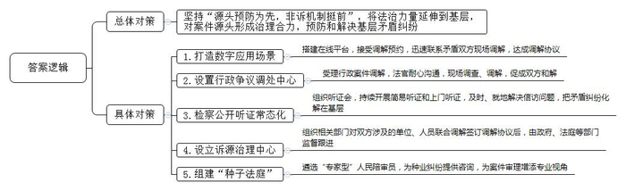
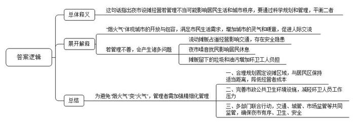
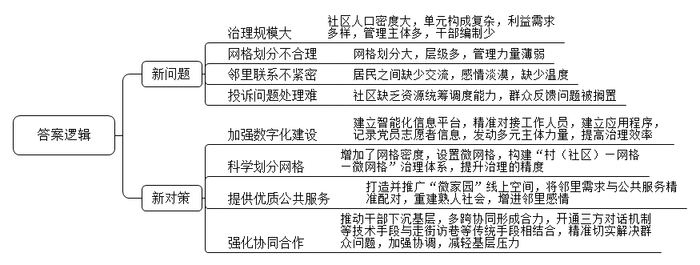
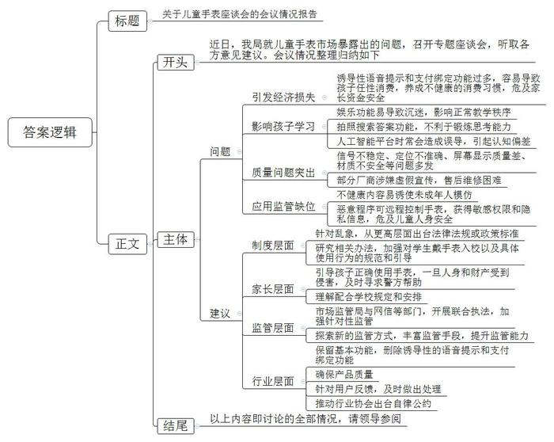

# 2023年公务员多省联考《申论》题（海南C卷）

<!-- gwy:overview:start -->
> **海南 · 2023 · 申论 · C类** ｜ 4 题 · 图片 4 处 · 答案随题折叠

导航：[题目](#题目) · [材料 1](#材料-1)
<!-- gwy:overview:end -->

> 候选采集稿。参考答案及解析来自粉笔页面，不代表官方答案或真实高分答卷；来源使用许可与原卷对应关系仍需人工核实。

## 给定材料

### 材料 1

外来务工人员小勇居住在J市东江街道鸣山社区，因工作原因经常昼伏夜出，而邻居陈阿姨每天早睡早起，双方生活习惯截然不同，多次发生纠纷。于是，小勇尝试向“娘家人”平台求助。接到调解预约后，平台工作人员马上联系到小勇和陈阿姨，并派人现场调解，最终双方达成调解协议。事件的圆满处置，得益于J市“外来务工人员服务管理”应用场景之一的“娘家人”。“‘外来务工人员服务管理’数字应用场景只是J市扎实推进诉源治理的一个缩影。”市委政法委林副书记说，诉源治理坚持“源头预防为先，非诉机制挺前”，将更多法治力量延伸到基层，对案件源头形成治理合力，有效预防和解决基层矛盾纠纷。

近日，J市N区人民法院行政争议调处中心成功调解一起行政强制案件，当事人梁某送来锦旗表达感谢。今年年初，N区茶恩镇政府责令梁某限期拆除未经许可搭建的冷库，然而梁某认为冷库是经村委会同意后才建的，主要用于储存果蔬等农产品，方便村民发展经济，遂向区法院提起行政诉讼，要求撤销镇政府责令限期拆除决定。调处中心受理此案后，经法官的耐心沟通、多次现场调查和调解，最终促成双方和解。参与调解的张法官说：“调处中心为群众和行政机关搭建了更为高效的沟通平台，行政案件协调和解率达30%以上，对于化解群众与行政机关之间的争议、完善诉源治理新格局发挥了重要作用。”

本着“事都捋一捋、理都摆一摆、法都讲一讲，讲着讲着心结就打开”的工作思路，J市检察机关近年来常态化推进检察公开听证，2022年，全市检察机关组织听证会600场，听证后矛盾化解率达90%。同时，J市检察机关还持续开展简易听证和上门听证，努力把信访问题在第一时间、第一地点解决到位，切实把矛盾纠纷化解在基层、解决在当地。

拉几条长凳、摆几张桌子，笔记本电脑、打印机往上一放，一场简易听证会在杨大爷家的院坝拉开了帷幕。2022年初，湛某潜入杨大爷家盗窃现金1万元，公安机关抓获湛某时，他已将所盗钱财挥霍一空，由于湛某没有固定收入来源，无力赔偿杨大爷的损失。法院依法判处湛某有期徒刑，但杨大爷却一直不认可，多次上访。为解开杨大爷的心结，J市人民检察院何检察官和听证员来到杨大爷家，面对面释法说理。其实案情并不复杂，关键是如何让杨大爷理解判决。听证员在全面了解案情的基础上，进行了充分评议，形成了听证评议意见。听证会罢，杨大爷表示愿意息诉。“考虑到杨大爷家庭困难，湛某也没有赔偿能力，我们准备帮助杨大爷申请司法救助金。”何检察官说。

2022年11月17日，建筑工人老程一行来到J市M县诉源治理中心，投诉电力公司拖欠他们13万元工资。青山镇政法委员老黄得知后，立即组织公安、司法、供电等部门对双方涉及的单位、人员进行联合调解。经调查了解，该项目存在转包现象，当时项目款确实还未到账，承包人吴某又因故无法及时返回青山镇。经调解，由电力公司先行垫付老程等人的工资13万元。双方签订调解协议，政府、法庭、司法、公安监督跟进。

“种子法庭”是J市H区人民法院2022年探索推行的服务种业的工作模式。在涉种纠纷化解中，H区人民法院组建了专门的合议庭审理涉种案件，在当地大专院校、种子管理部门、制种龙头企业中，遴选了十余名“专家型”人民陪审员，为种业纠纷提供咨询，给案件审理增添专业视角。自该模式推行以来，H区人民法院办理的涉种纠纷非诉解决比例和调解成功率均超过70%，涉种案件平均办理周期比过去缩短了一半以上。H区人民法院荣院长说，“种子法庭”让涉种纠纷化解驶入“快车道”，让种企、种农诉累减轻，今后全区涉种案件也将逐步向该法庭归并，推动实现涉种案件办理专业化、专门化。

### 材料 2

日前，S市十五届人大常委会第43次会议表决通过了新修订的《S市市容环境卫生管理条例》。其中对于设摊经营、占道经营等行为由以往的全面禁止改变为“重点区域禁止”，不再“一禁了之”，引发了网友热议。有网友认为，此举体现民意；但也有人担忧放开之后，是否会增加管理成本？为此，记者进行了调研。

记者调研发现，S市的夜市主要有两种模式。一种是租金模式，主办方收取日租或月租，如果是月租，随时可退押金；一种是抽成模式，根据摊位的位置和面积进行一定比例抽成。一般来说，越靠近市中心，摊位费越高。

“与商场或街头的店面租金相比，摊位的成本低很多。”老王表示，生意好的话，他的“地摊照相馆”一晚上能赚上千块，少的基本也可以覆盖成本。摆摊又比较自由，时间上更为灵活。

记者注意到，相比夜市的固定摊位，流动摊贩的自由度更大，成本更少，但风险也更大。这类摆摊并不被即将实施的法规所允许，但在人流量大的地铁口、交通路口，依然会有流动摊贩出没。

晚上11点，在地铁口卖炸串的邹阿姨手机响了，接完电话后，她立刻招呼其他摊主收摊，大家心领神会——城管来了。邹阿姨他们骑上车，藏进一家商铺的通道里。“我们也想过到政府划定的区域去摆摊，但是这些区域都不沿道，摊位费也高，对于我们这样的小摊贩并不合算。”邹阿姨对记者说。

都说“人间烟火气，当数夜市最浓”，针对这部法规的评论，网友们说的最多的一个词即“烟火气”。法规中对设摊经营不再“一禁了之”，让市民读到了一种开放与包容的城市治理气度。

“童年的回忆和烟火气一起回来了！”老马走进“九街夜市”后感慨道。天刚擦黑，夜市已是人声鼎沸。步行街两面是古色古香的殿宇楼阁，中间的小摊次第排开，水果生鲜、烧烤肉串、衣服饰品、美甲、套圈、气球、鲜花……应有尽有。老马家在长龙，这次专程带女儿小美来“赶集”。

像老马这样专程逛夜市的市民不在少数。“我就喜欢夜市驳杂的热闹感。”老马说，“在这里看到了接地气的S市。”还有摄影师专程来拍这种人间“烟火气”，来逛夜市的人的脸上都有一种“幸福”的表情。

不少市民说，缺少了摊贩，这座城市总觉得少了几分灵气和暖意，夜市就是一种载体，实现人与人之间更亲密的交流，使城市不再是钢筋水泥的森林。

夜市不仅是中老年人的乡愁，也是年轻人的乐园。在多个网络社交平台，夜市话题均为流量热帖。每个从夜市归来的“90后”“00后”，回家第一件事就是发朋友圈，有的甚至开启直播，而这些网上的流量又引来线下流量，为夜市积攒人气。但是，也有人坦言，“烟火气”管不好，很可能就变成了“火气”。

“没有人不爱路边摊，除了周边的居民。”住在新牌坊的小孙此前是夜市的投诉者。“炒河粉的摊位就在我家楼下，一直闹到凌晨4点。夜市取缔后，一下子清静了。”不过，几年之后当小孙搬到菁口后，她又异常怀念当年的喧嚣，成了夜市的支持者。

市民需求关乎“里子”，市容管理关乎“面子”。在“岐山夜市”，清洁工潘叔指着地上散乱的竹签、纸盒，向记者吐槽：“这怎么扫？扫了前面后面还有，永远也扫不干净，至于烧烤摊留下的油污，只能等夜市收摊后才能刷洗了。”

夜市星光灿烂，运营和管理成本却不低。一场夜市的背后，除了组织方的精心策划，还涉及多部门的联合行动。江北区商务委蔡主任说：“如果在划定区域内开夜市，需要交通部门的支持；食品摊贩的证照是否齐全，需要市场监管局的监督。摊贩的市容‘善后’，需要街道、城管部门来管，一旦有流动摊贩进入夜市，还要相关部门来执法。”

摆摊不能“一禁了之”，但也绝非“一放了之”。此番对设摊经营的立法疏导，对管理者也提出了更高的要求。比如哪里可以设摊？与居民区的距离多少为好？公共市政设施是否完备？消费纠纷如何调处？……这都需更精细的管理体系作为支撑。

### 材料 3

“了解情况靠走、登记信息靠手、交流沟通靠口”，这是Z省P市欣阳社区党委郭书记20多年来的工作常态，但现在，面对新问题，这三招已经不够用了，需要新解法。

欣阳社区是典型的融合型大社区，有近2万常住人口，其中八成是外来人口，另外还有1000多家商铺，近400家企业。“现在的社区，规模更像是一座小型城市。”郭书记说，人口密度大、单元构成复杂、利益需求多样、管理主体多元，而社区干部满编也就18人，仅靠传统的管理服务方式，已经无法应对。

一天上午，社区网格员小吕在巡查中发现社区河道有漂浮物，他通过“掌上社区”App拍摄上报，基层治理综合信息平台根据定位，自动将事件派发，保洁人员当天下午就完成了清理。“这要在以往，至少得两三天，幸好有数字化赋能。”小吕说。

B市清风社区所辖的青林湾小区有100多幢高层住宅。去年疫情期间，清风社区在短时间内就精准高效完成了1.6万常住人口的人员排查、上门服务等工作，靠的是“两张网”：一方面，通过一体化智能化公共数据平台，区、乡镇（街道）的排查数据及时流转下发到社区、网格，社区网格员可及时精准对接相关人员；另一方面，清风社区这两年加强数字化建设，通过调查收集数据建立了小应用——“活地图”，标记了辖区内345名党员、志愿者的居住位置和联系方式，可随时发动他们参与社区的相关工作。

针对此前网格划分过大、层级过多、力量不足等问题，去年省里对网格进行了科学划分、合理优化。“现在不仅增加了网格的密度，还在网格中按楼道、楼栋设置了微网格，构建了‘村（社区）——网格——微网格’治理体系。”省政法委张副书记说，“遍布全省的‘两张网’，正在提升社区治理的精度。”

在融合型大社区，通过数字化改革让居民享受更有温度的服务，是大家进一步的期待。在Y市，一个集纳了线下6000多个网格的线上空间——“微家园”，成为广大居民享受优质公共服务的新平台。Y市居民只要扫二维码注册、填写所属的社区网格，就能加入这个线上空间，大家可以在这里发布需求，与社区干部、邻居们交流。目前，“微家园”的用户数已达253万，日均活跃用户达40万，已成为一片火热的线上空间。

东湖社区的王女士前几天看到“微家园”贴出了社区举办书法培训班的通知，很快就在线上报了名。培训班由社区里有书法特长的老师义务教学，居民不用交费。“期间，我们认识了很多邻居，也收获了温暖的友情。”王女士说，“我们这儿是新建小区，住户来自全国各地，以前相互间基本都是‘陌生人’。”

“这也是众多融合型大社区的共性问题。”Y市政法委陈副书记说，“‘微家园’创造了线上交流的社区新空间，通过数字化重建了熟人社会，邻里关系越来越紧密。”如今，“微家园”上有了邻里互助、爱心义卖、定向捐赠等项目，实现邻里需求与公共服务精准配对。“微家园”正在被复制、推广，更多实用管用的服务功能被送到“掌上社区”，满足更多个性化的需求，让大家享受到公共服务的温度。

“微家园”设有投诉功能，问题投诉可以线上发布，但必须线下解决。在融合型大社区，群众投诉的问题更为复杂和棘手，仅靠社区或者街道的力量远远不够。Y市风华社区的水产市场一直被内涝问题困扰，不仅影响商户的生意，也对居民的生活造成不便。许多人在“微家园”上投诉，社区由于缺乏资源统筹调度能力，问题不得不搁置。

2022年7月，风华社区严书记带着水务集团、镇政府相关人员，到水产市场现场协调，决定由水务集团负责新装抽水系统，镇、社区在资金、施工等环节协同配合，内涝问题很快得到解决。一个社区书记，为什么能“叫得动”水务集团和镇里的干部？原来，为了推动基层治理，特别是解决一些陈年顽疾，从2022年7月开始，全市乡镇以及基层站所干部全部下沉到村（社区)，多跨协同形成合力，帮助解难题、谋发展，多元化共治力度前所未有。

“微家园”还开通了政府部门、村（社区）与群众的三方对话机制。“用大数据分析和手机应用为协商议事插上了科技的翅膀，让民有所呼更便捷、基层议事更智慧、为民解难更精准。”郭书记认为，但技术手段再先进，走街访巷“铁脚板”的老传统也不能丢，问题的“最后一米”还是要脚踏实地去解决。与此同时，也绝不能让技术浮在现实之上，要防止因多头报送、重复收集数据而增加基层压力。

### 材料 4

“碰碰手表，加个好友！”这句话成了当下不少儿童社交时打招呼的见面语。儿童智能手表市场蓬勃发展背后，也暴露出不少问题。为守护儿童“腕上安全”，L市市场监管局近日召开了一次专题座谈会，听取各方意见建议。以下是部分参会人员的发言摘录：

学生家长龚某：前几天，小孩突然要我在她手表上绑定我的手机钱包。我问她为什么？她说：“我们班上很多小朋友的手表都绑定了爸爸妈妈的手机钱包，这样我们可以想买什么就买什么。”有些智能手表一旦关联了家长的手机，就开通了免密支付，在家长不知情的情况下，孩子就可能会任性消费，比如购物、打赏、购买游戏皮肤等，我觉得这既容易导致小孩养成不健康的消费习惯，又可能危及家长的资金安全。

某学校教师盛某：客观而言，智能手表有助于学生、家长和学校之间的沟通联系，但学生之间语音聊天、打电话越来越频繁，有的还在手表里下载了游戏和短视频App，课上偷着玩，课下抢着玩，影响了正常教学秩序，特别不利于学生学习。

学生家长李某：给孩子买智能手表，主要是为了方便跟孩子联系，确保孩子安全。前阵子，孩子突然吵着要拿我的手机扫码听音乐，我才知道他的手表电话中居然自带了语音提示：“小朋友，请用爸爸妈妈的手机扫码，开通手表音乐VIP。”其实，我觉得儿童手表只要有基本功能就行，没必要设置那么多诱导性的语音提示和支付绑定功能。

市教委周副主任：现在儿童智能手表都具有上网、拍照以及智能语音功能，有的学生自律意识差，一遇到不会做的题，自己不动脑筋思考，而是用手表拍照在网上搜索答案，关键有时候答案还是错的。更严重的是，不少手表都与人工智能平台相连，学生喜欢向手表提出各种稀奇古怪的问题，而得到的回答时常会给学生造成误导，甚至引起认知偏差，非常不利于他们的身心健康。我们正在研究相关办法，加强对学生戴手表入校以及具体使用行为的规范和引导，当然这也需要家长们的理解和配合。

市消保委监督部黄主任：我们今年对儿童智能手表消费情况进行了调查，结果显示，近一半的消费者对儿童智能手表质量表示不满，主要是信号不稳定、定位不准确、屏幕显示质量差、材质不安全等问题，有的厂商涉嫌虚假宣传，产品售后维修困难。

市公安局周警官：我们遇到过不少因儿童手表免密支付引发的经济损失案件。我们发现，有恶意程序伪装成游戏App，当小孩在手表上下载安装后，恶意程序就轻松进驻到了手表中，手表就被远程控制，容易被不法分子采集到小孩位置信息、监听通话记录，甚至偷拍偷录视频，有时可能危及儿童人身安全。希望家长引导孩子正确使用手表，一旦人身和财产受到侵害，应及时寻求警方帮助。

市关工委刘副主任：由于各种应用平台缺乏筛选和监管，导致儿童智能手表下载到血腥暴力的游戏App和内容不健康的漫画App，极易诱使未成年人模仿。一些App在安装的时候，不用授权就可以直接获得定位、通讯录、麦克风、摄像头等多种敏感权限，轻易就能获取孩子的位置、人脸图像、录音等个人隐私信息，存在极大的信息安全漏洞。

市场监管局王副局长：前期，我们组织力量对儿童智能手表进行了专项执法检查，大家所反映的问题都不同程度存在，且问题所涉及面较广，给执法带来一定难度。我们后续将会同网信、公安、工信等部门，开展联合执法行动，加强针对性监管，切实提高产品质量和安全水平。我们将不断探索新的监管方式，丰富监管手段，提升监管专业能力。

某儿童手表公司曹经理：我们会千方百计确保产品质量，针对用户反馈的第三方软件问题，我们已在第一时间下架处理了问题应用程序。但守护儿童“腕上安全”仅靠我们一家公司是不够的，我们已向行业协会提出建议，出台相应的行业自律公约，共同为孩子们提供干净安全的手表。

某大学姚教授：儿童智能手表集多种功能于一体，但功能的多样性也带来了系列“负产品”。治理儿童智能手表乱象，根本在于要从更高层面出台相应的法律法规或政策标准，同时，社会各界也要共同担当作为，合力确保孩子“腕上安全”。

## 题目

### 第 1 题

**请根据****“给定资料**1**”，谈谈J市是如何推进诉源治理工作的。（20分）**

关联材料：材料 1、材料 2、材料 3、材料 4

作答要求：

要求：全面、准确、有条理。不超过300字。

第 1 题 · 答案与解析

**参考答案（粉笔题库参考内容）**

坚持“源头预防为先，非诉机制挺前”，将法治力量延伸到基层，对案件源头形成治理合力，预防和解决基层矛盾纠纷。

1.打造数字应用场景。搭建在线平台，接受调解预约，迅速联系矛盾双方，现场调解，达成调解协议。

2.设置行政争议调处中心。受理行政案件调解，法官耐心沟通，现场调查、调解，促成双方和解。

3.检察公开听证常态化。组织听证会，持续开展简易听证和上门听证，及时、就地解决信访问题，把矛盾纠纷化解在基层。

4.设立诉源治理中心。组织相关部门对双方涉及的单位、人员联合调解，签订调解协议后，由政府、法庭等部门监督跟进。

5.组建“种子法庭”。遴选“专家型”人民陪审员，为种业纠纷提供咨询，为案件审理增添专业视角。

**解析**

**参考答案说明**：本参考答案宏观上分为“总体对策”和“具体对策”两个方面。在“具体对策”方面，又从“数字应用场景”“行政争议调处中心”“检察公开听证”“诉源治理中心”“种子法庭”五个角度展开，各条答案要点之间在内容上相互并列，没有交叉。

**考点**：概括措施类

**来源**：2023年公务员多省联考《申论》题（海南C卷）

粉笔申论页面对本题只提供「解析视频」入口，该入口是会员推广位，页面无视频地址与文字解析。

### 第 2 题

**请根据****“给定资料**2**”，谈谈对画线句子“****‘****烟火气****’****管不好，很可能就变成了****‘火气’”的理解。（20分）**

关联材料：材料 1、材料 2、材料 3、材料 4

作答要求：

要求：全面、准确、逻辑清晰。不超过300字。

第 2 题 · 答案与解析

**参考答案（粉笔题库参考内容）**

这句话指出夜市设摊经营若管理不当可能影响居民生活和城市秩序，要通过科学规划和管理，平衡二者。具体而言：

“烟火气”体现城市的开放与包容，满足市民生活需求，增加城市的灵气和暖意，促进人际交流。但同时，若管理不善，会产生诸多问题：流动摊贩占道经营影响交通，存在安全隐患；夜市噪音扰民影响居民休息；摊贩留下的垃圾和油污增加环卫工人负担。

为避免“烟火气”变“火气”，管理者需加强精细化管理。一、合理规划固定设摊区域，与居民区保持适当距离，降低经营者成本。二、完善市政公共卫生环境设施，减轻环卫人员工作压力。三、多部门联合行动，交通、城管、市场监管等共同监管，确保夜市有序、卫生、安全。

**解析**

**参考答案说明：**（1）思路方面，本参考答案按照词句解释题“总体释义+展开解释+总结”思路展开。（2）内容方面，本参考答案首先对句子的含义作出了解释并做出表态；接着展开解释方面，分别从“‘烟火气’的体现”“存在问题”与“管理措施”三个层面进行了具体分析。（3）词句表达方面，本参考答案加上了“具体而言”“为避免”等连接语来承接上下文，使答案的衔接和表达更顺畅。

**考点**：词句解释类

**来源**：2023年公务员多省联考《申论》题（海南C卷）

粉笔申论页面对本题只提供「解析视频」入口，该入口是会员推广位，页面无视频地址与文字解析。

### 第 3 题

**请根据****“给定资料**3**”，概括Z省在融合型大社区治理过程中遇到的新问题以及运用的新解法。（25分）**

关联材料：材料 1、材料 2、材料 3、材料 4

作答要求：

要求：全面、准确、有条理。不超过400字。

第 3 题 · 答案与解析

**参考答案（粉笔题库参考内容）**

新问题：1.治理规模大。社区人口密度大，单元构成复杂，利益需求多样，管理主体多，干部编制少。2.网格划分不合理。网格划分大，层级多，管理力量薄弱。3.邻里联系不紧密。居民之间缺少交流，感情淡漠，缺少温度。4.投诉问题处理难。社区缺乏资源统筹调度能力，群众反馈问题被搁置。

新解法：1.加强数字化建设。建立智能化信息平台，精准对接工作人员，建立应用程序，记录党员志愿者信息，发动多元主体力量，提高治理效率。2.科学划分网格。增加了网格密度，设置微网格，构建“村（社区）—网格—微网格”治理体系，提升治理的精度。3.提供优质公共服务。打造并推广“微家园”线上空间，将邻里需求与公共服务精准配对，重建熟人社会，增进邻里感情。4.强化协同合作。推动干部下沉基层，多跨协同形成合力，开通三方对话机制等技术手段与走街访巷等传统手段相结合，精准切实解决群众问题，加强协调，减轻基层压力。

**解析**

**参考答案说明**：本参考答案包括问题与对策两个方面。问题从“治理规模大”“网格划分不合理”“邻里联系不紧密”“投诉问题处理难”四个层次展开；对策从“加强数字化建设”“科学划分网格”“提供优质公共服务”“强化协同合作”四个层次展开。以上两个方面，各条答案要点之间在内容上相互并列，没有交叉。

**考点**：多要素组合类

**来源**：2023年公务员多省联考《申论》题（海南C卷）

粉笔申论页面对本题只提供「解析视频」入口，该入口是会员推广位，页面无视频地址与文字解析。

### 第 4 题

**假如你是****L市市场监管局工作人员小符，请根据“给定资料**4**”，对座谈会上提出的问题和建议进行整理和归纳，拟写一份会议情况报告供领导参阅。（35分)**

关联材料：材料 1、材料 2、材料 3、材料 4

作答要求：

要求：

（1）紧扣资料，内容全面；

（2）准确简明，条理清晰；

（3）不超过600字。

第 4 题 · 答案与解析

**参考答案（粉笔题库参考内容）**

关于儿童手表座谈会的会议情况报告

近日，我局就儿童手表市场暴露出的问题，召开专题座谈会，听取各方意见建议。会议情况整理归纳如下：

一、存在的问题：1.引发经济损失。诱导性语音提示和支付绑定功能过多，容易导致孩子任性消费，养成不健康的消费习惯，危及家长资金安全。2.影响孩子学习。娱乐功能易导致沉迷，影响正常教学秩序；拍照搜索答案功能，不利于锻炼思考能力；人工智能平台时常会造成误导，引起认知偏差。3.质量问题突出。信号不稳定、定位不准确、屏幕显示质量差、材质不安全等问题多发；部分厂商涉嫌虚假宣传，售后维修困难。4.应用监管缺位。不健康内容易诱使未成年人模仿；恶意程序可远程控制手表，获得敏感权限和隐私信息，危及儿童人身安全。

二、提出的建议：1.制度层面。针对乱象，从更高层面出台法律法规或政策标准；研究相关办法，加强对学生戴手表入校以及具体使用行为的规范和引导。2.家长层面。引导孩子正确使用手表，一旦人身和财产受到侵害，及时寻求警方帮助；理解配合学校规定和安排。3.监管层面。市场监管局与网信等部门，开展联合执法，加强针对性监管；探索新的监管方式，丰富监管手段，提升监管能力。4.行业层面。保留基本功能，删除诱导性的语音提示和支付绑定功能**；**确保产品质量；针对用户反馈，及时做出处理；推动行业协会出台自律公约。

以上内容即讨论的全部情况，请领导参阅。

**解析**

**参考答案说明：**（1）格式方面，本参考答案写到了“标题”“正文”两个部分。（2）正文部分，一方面从内容上来看，本参考答案的开头先介绍了本次专题座谈会的主题及背景信息。其次，主体部分从“引发经济损失”“影响孩子学习”“质量问题突出”“应用监管缺位”四个方面介绍了儿童手表市场存在的“问题”；又从“制度”“家长”“监管”“行业”四个层面提出了“建议”。另一方面，形式上，本参考答案做到了分段、分条撰写，整体上条理较为清晰。

**考点**：总结类

**来源**：2023年公务员多省联考《申论》题（海南C卷）

粉笔申论页面对本题只提供「解析视频」入口，该入口是会员推广位，页面无视频地址与文字解析。

