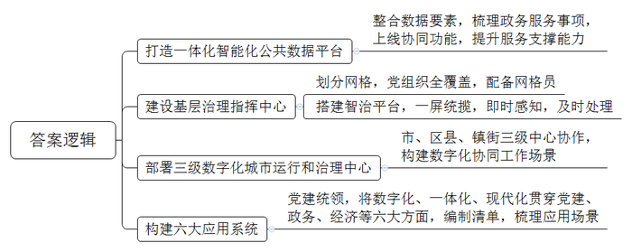
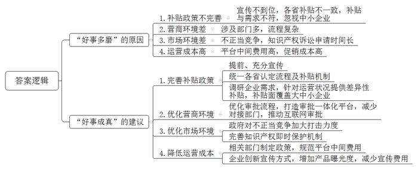
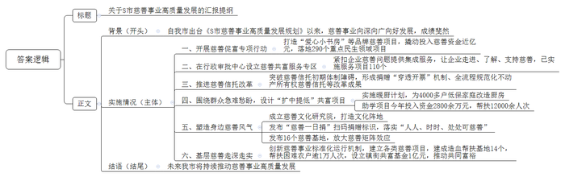
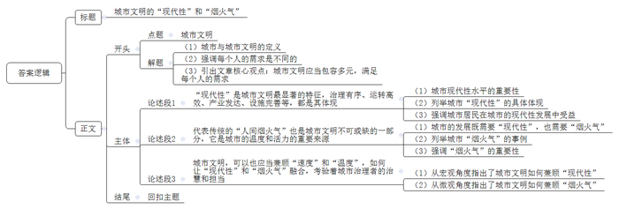

# 2024年公务员多省联考《申论》题（海南A卷）

<!-- gwy:overview:start -->
> **海南 · 2024 · 申论 · A类** ｜ 4 题 · 图片 4 处 · 答案随题折叠

导航：[题目](#题目) · [材料 1](#材料-1)
<!-- gwy:overview:end -->

> 候选采集稿。参考答案及解析来自粉笔页面，不代表官方答案或真实高分答卷；来源使用许可与原卷对应关系仍需人工核实。

## 给定材料

### 材料 1

“我们早上9点提交申请，不到半小时就收到资料检查通过的短信，10点签了个字，下午3点企业就注册成功了。”12月1日，创业者小苏在网上提交“企业开办一件事”申请，轻松完成了企业开办手续。

2023年以来，H市持续打造一体化智能化公共数据平台，不断提升平台服务支撑能力。目前，已建成一体化平台数据要素“一组库”，为76个市级部门、41个区县开通数据仓环境；“快办”平台精细化梳理了2866个政务服务事项，支撑53项“一件事一次办”上线运行；“快政”平台上线了16项协同功能，日均活跃用户40万。

H市N区双桂镇将原有办公场地建成为基层治理指挥中心，形成党建统领、经济生态、平安法治和公共服务4个板块。全镇共划为176个网格，全覆盖建立网格党支部或党小组，采取整合、招聘、下沉等方式，配备专职网格员176人。通过搭建智治平台，以网格为单元核准“人、房、地、事、物”等信息，实现全镇网格一屏统揽。一旦发生紧急事件，网格地图将立即变色并闪烁预警，实现即时感知、及时处理。

H市现有3000万常住人口，兼具“大城市”与“大农村”特点，治理难度大。2023年初，H市启动部署的市、区县、镇街三级数字化城市运行和治理中心正式运行，初步构建起全局“一屏掌控”、政令“一键智达”、执行“一贯到底”、监督“一览无余”的数字化协同工作场景。“如果说传统的城市管理是‘农家土布’，那么数字时代的城市治理就是‘江南刺绣’。”H市大数据发展局黎局长说。

目前，全市842家医疗机构已实现影像检查结果互认，共汇聚检查报告1925万份，存储数据1852TB；医疗机构可以跨院调阅患者的影像检查结果，避免患者重复检查，让医生的诊断更加高效；B区智慧养老服务中心对居家养老群体的居住环境进行适老化改造，装上一键呼叫等设备，一旦出现异常，工作人员会第一时间联系处理；在革命纪念馆，游客借助数字技术手段，穿越时空，沉浸式感受红色文化……

一年多来，H市始终坚持党建统领，把数字化、一体化、现代化贯穿到党建、政务、经济、社会、文化、法治建设全过程各方面，着力构建“六大应用系统”，编制应用重大需求清单、多跨场景应用清单和重大改革清单，梳理“一件事”思维应用场景930个。

数字化场景应用正逐渐改变着人们生活的方方面面，赋予城市发展生生不息的力量。H市加“数”前行，数字化运行与治理的想象和场景还在不断拓展……

### 材料 2

2023年1月，Q省入选国家首批内外贸一体化试点地区名单。按照计划，Q省准备用三年左右的时间培育具有国际竞争力、内外贸融合发展的产业基地100家，内外贸一体化“领跑者”企业1000家。日前，为了解全省内外贸一体化试点工作中存在的问题和不足，省商务厅组织部分企业代表、专家学者以及有关部门负责人进行了座谈。以下是座谈会发言摘录。

省商务厅符厅长：在国家构建以国内大循环为主体、国内国际双循环相互促进的新发展格局背景下，我省积极探索推动内外贸一体化试点工作，并取得了一定的成效。一年多来，我们已认定省级“领跑者”企业744家、基地76个。通过内外贸产品“同线同标同质”的“三同”行动推动实现内外贸标准对接、内外贸产品质量一致。目前，全省已有400多家企业获得“三同”产品认证，并获得了相应补贴。

某新兴企业负责人张总：企业刚起步时，我们确实从政府那里获得了一些发展补贴，但“三同”这个事儿我们是在开会前才知道的。如果早一点儿知道政府的相关政策举措，我们就能少走一些弯路。

某儿童用品公司负责人林总：我们是一家外向型企业，近年来，开始布局国内市场，在多个省市建立了分公司。但在外省，“三同”需要重新认定，认定标准及认定后所使用的相关产品标识等不尽相同，导致各分公司都需要“另起炉灶”申报。此外，各分公司享受所在省的补贴政策又不一样，若放弃补贴，产品又缺少了价格优势。

某机电集团负责人陈总：过去，我们为满足海外客户的质量要求，在设施设备、人才储备、经营管理上标准高、投入多，生产成本较高。现在，以同样标准转向国内市场，却经常遭遇产品被仿制、低质低价不正当竞争等问题，高投入换不来高回报，政策补贴有点杯水车薪。

某市商务局胡局长：在我市开展“大走访大调研”活动期间，不少企业反映，目前的政策多是对具有一定实力的企业“扶优扶强”来支持其提升内外贸竞争力，这给本就在竞争中处于劣势的中小企业带来了很多压力，存在“保大”“汰小”的倾向。

某代工企业负责人钱总：我们做外贸代工20多年了，一直感觉订单量大、销售省事、货款到位及时。近几年兼顾国内市场，发现不仅竞争对手多、营商环境存隐忧，订单还不稳、货款常被拖欠。我听说，全省做外贸代工的企业有一半还未涉足内销业务。我理解他们宁愿去海外扩展低起点的新兴市场，也不想在国内市场建品牌、“卷”渠道。

某交通设备企业负责人杨总：我们生产的交通设备主要用于出口，一般只要与商务、海关、税务等部门打交道。现在一部分产品转内销，却要与商务、发改、税务、公安、市场监管等10多个部门打交道，有点儿“分身乏术”。

省市场监管局姜处长：最近，我们在处理一起投诉。某内外贸一体化公司在电商“大促”期间遇到竞争对手恶意刷差评，该公司前期为宣传促销活动投入了大量成本，结果却打了个“水漂”。据我们了解，遭遇这种情况的企业不在少数，净化市场环境还需要大家的共同参与。

某大学法学院王教授：去年，我们做课题调研时发现，国内中高端羽绒服品牌越来越受国际市场欢迎，而在国内，新开发的原创款式上市一周左右就可能出现高仿款。而传统的外观设计专利、商标权保护等知识产权诉讼手段一般很难在短时间内生效，容易让不法厂商利用时间差钻空子、牟暴利。如果有原创款式登记备案或其他即时保护机制，他们或许就无机可乘了。

某化妆品公司孙总监：以前，我们想抓住国内电商行业发展机遇进军国内市场，没想到这几年电商平台高额的中间费用反而拖累了企业发展。如今，我们交给电商平台的各类中间费用接近产品成本的40%，要是找一些平台的头部主播带货，中间费用更高。

某大学商学院毕教授：目前，直播带货等各类销售形式兴起，企业不仅需要不断增加产品曝光度以提升销量，持续运营电商平台的线上店铺、参与各类促销获取公域流量，还要培养自己的带货主播以争取定价主动权，这都需要企业投入不少的成本。

省商务厅符厅长：感谢大家今天针对内外贸一体化发展工作开诚布公地摆问题、提建议。下一步，我们将深入分析内外贸一体化“好事多磨”的根源，进一步打好“组合拳”，用实实在在的举措让内外贸一体化“好事成真”。

### 材料 3

二十大报告强调，分配制度是促进共同富裕的基础性制度。坚持按劳分配为主体、多种分配方式并存，构建初次分配、再分配、第三次分配协调配套的制度体系。公益慈善事业作为第三次分配的重要载体，被赋予了时代使命。

“谢谢你们，孩子们再也不用在塑料凳上写作业了。”日前，在T县山坝村小雨家里，小雨的爷爷高兴地对送书桌上门的“爱心小书房”志愿者说。在陈旧、简陋的家具摆设中，崭新的书桌格外醒目。点滴之爱，为困难家庭的孩子带来了更多的阳光和希望。

“爱心小书房”是S市慈善促富专项行动中涌现出的品牌慈善项目。该项目采取民生服务共富结对的机制开展。“过去一年，S市9个区民政部门与T县等3个县民政部门结对共建，组成3个共建团队，聚焦当地老人、小孩和困难群众的民生服务需求，统筹资源支持3个县民政民生协同发展。”S市民政局慈善事业促进和社会工作处邢处长表示，慈善促富专项行动已累计撬动投入慈善资金近亿元，落地290个重点民生领域项目。

“我们出台《S市慈善事业高质量发展规划》，在全省各行政审批服务中心，率先设立慈善共富服务专区。紧扣企业反映的捐赠发票、税收抵扣、捐赠形式、慈善信托等问题提供集成服务，让企业更好走进慈善、了解慈善、支持慈善。”邢处长说，一年多来，已实施慈善募捐、救助等服务项目110个。S市还突破慈善信托起步初期的体制障碍，形成了慈善信托捐赠“穿透开票”机制、全国首单全流程规范化不动产所有权慈善信托等系列改革成果。

围绕群众的“急难愁盼”，S市各级慈善总会精心设计一批“扩中提低”共富项目，将每一份关爱精准送达到最需要的地方。

“油烟机终于装上了，灶具也换上新的了。厨房不仅干净了许多，也更加安全了。感谢你们！”市民李大妈开心地对绿能集团工作人员说。这个叫“暖厨计划”的项目，由S市慈善总会和绿能集团联合发起，计划投入3000万元、持续3年时间为低保家庭改造厨房，帮助更换油烟机、灶具等厨房设备。绿能集团公益慈善基金会负责人表示，“暖厨计划”已累计改造厨房4000多户。如果说，“暖厨计划”慈善项目让善意的微光照进烟火日常，助学行动则是面向未来的希望之光。近日，在“学子自强计划”帮助下，T县等3县的60名大学生收到了社会各界捐赠的每人16000元助学金。该计划已连续开展18年，是助学行动的有效组成部分。今年慈善系统助学项目已投入慈善资金2800余万元，帮扶12000余人次。

2023年1月至8月，S市慈善系统支出2亿元，救助困难群众38万人次。9月，S市慈善文化研究院揭牌成立。“我们将从历史和现实着眼，汲取中国传统慈善等文化精髓，加快慈善文化阵地建设，强化慈善典型事迹宣传，服务慈善事业大格局。”研究院娄院长说。同月，S市发布“慈善一日捐”扫码捐赠统一标识，市民通过政务App、支付宝、微信等方式即可捐赠，将“人人可慈善、时时可慈善、处处可慈善”落到实处。

日前，S市对外发布首批16个慈善基地。东城区孝爱慈善基地打造线上线下智慧慈善超市、西城区幸福乡里共同体慈善基地守护“朝夕美好”、T县太安村帮助低收入农户在家门口就业……随着S市的慈善基地“触角”延伸，“身边慈善”蔚然成风，慈善矩阵效应得以放大。

在红帆路，一个情意暖暖的幸福里慈善街区规模初现，慈善摊位、暖心助岗……“我们以困难群众就业帮扶为重点，打造公益慈善与商圈资源相融合的街区慈善文化。”拱墅区慈善总会相关负责人介绍，目前该街区正全力打造幸福里慈善驿站，已经筹资30余万元成立慈善信托，提供就业岗位300余个。

在“就业、帮扶、慈善捐”等领域，S市建立各类慈善项目，让“善”意流淌在街区的每个角落。港山区善“芹”共富基地依托当地的芹菜特色种植，承包70亩连片土地，免费提供给困难农户种植。截至今年2月，该基地结对帮扶困难农户35户，直接增收300余万元。目前，S市已建成具备造血功能的帮扶基地14个，累计帮扶困难农户逾1万人次，有力推动了困难农户增收。

S市创新慈善事业标准化运行机制，通过打造慈善基地、探索配捐机制、发展共富基金，有效推动基层慈善活动走深走实。日前，在镇街共富基金的推动下，西城区慈善健康共富直通车“开”进砚台镇，为居民提供公益医疗服务，还为行动不便的老年人提供送餐、助浴等多方位慈善养老服务。

目前，S市已设立镇街共富基金1亿元，使得慈善在基层不断释放潜能，让公益慈善事业这只“温柔之手”可感可及，推动共同富裕美好图景转化为美好生活。

### 材料 4

每天清晨，都会有一班特殊的列车，穿过昏暗的黎明与渐亮的晨光，从郊外开进即将忙碌起来的城市中心地带。

这班列车是C市轨道交通4号线石船至民安大道方向的首班车，因为主要乘客是来自C市渝北区石船镇的菜农，他们都背着装满红薯叶、辣椒、韭菜等新鲜蔬菜的背篓，所以这班列车也被称为“背篓专列”。

9月27日，我们凌晨5点便从市区出发前往菜农们集中搭车的起点——石船站。我们到的时候，菜农们已在排队等待过安检了，因为背篓重，东西比较多，工作人员并没有要求他们将背篓放到安检传送带上，而是用手持式金属探测器进行安检。看到年纪大、行动缓慢的老人，他们会时不时搭把手，或引导他们乘坐无障碍电梯。

“菜农一般是赶早摘的新鲜蔬菜，难免沾有露水或雨水，是否会因此带来不便，甚至被拒绝上车？”我们问安检人员。“抛洒滴漏，造成地面湿滑，影响清洁，这是难免的。就算没有他们，有时候也有这些问题。如果带上车的菜有气味、汁水，弄脏车厢，工作人员也会上前处理。”安检人员回答道。

6点30分，列车准时到站，菜农们熟练地进入车厢，将自己的背篓、菜篮放置在中间空道处后，便在就近的位置坐下。

在列车上，菜农老樊感到很放松，因为车厢比公交车车厢更宽敞，不会因为背篓阻挡其他乘客的路而遭到“嫌弃”，也不用总是担心绊倒别人，带来安全隐患！“我从前做梦都想坐地铁去城里卖菜！”老樊对我们说。“我们是搭上时代发展的快车了。以前我们在镇上卖菜，人少，卖得慢，价格也低。同样的空心菜，在镇上1斤才卖1.5元，到了市区能卖3元，两三个小时就能卖完一大筐，回家还能赶上吃午饭。”和老樊住一个小区的老李感叹道，他性格外向，见着谁都要搭上两句话。

对身处市区的人来说，石船站是轨道交通4号线上遥远的倒数第一站，但对这群郊区菜农来说，这是通往市区的第一站。这些菜农大多带着浓厚的口音，有的雨衣早已陈旧，有的说话时嗓门儿大些。他们的背篓大，让本就窄的车厢里显得更加拥挤……但这些都不影响他们愉快地搭着地铁去城里卖菜。如果说轨道交通的发展，让城市的中心和边缘得以更好地连接，那么真正地激活城市的神经末梢，让城市更显张力和灵性的，则是在轨道交通上流溢的无限暖意。

当我们提及这趟“背篓专列”刷屏各大媒体时，坐在对面的一位乘客应道：“我也看到了，有很多人都在点赞。有些外地人还说要来打卡，体验一把背着背篓乘坐地铁去卖菜的生活。我们的地铁这下出名了。”说话间，她很热情地给我们展示网友在某视频平台上的留言。其中一条写道：“这波操作值得点赞。<u>文明之所以文明，就是因为它既容纳了现代的行为方式，也包容了传统的生活习惯</u>。”

## 题目

### 第 1 题

**请根据“给定资料1”，谈谈H市能够加“数”前行的原因。（10分）**

关联材料：材料 1

作答要求：

要求：

（1）全面、准确、有条理；

（2）不超过200字。

第 1 题 · 答案与解析

**参考答案（粉笔题库参考内容）**

1.打造一体化智能化公共数据平台。整合数据要素，梳理政务服务事项，上线协同功能，提升服务支撑能力。

2.建设基层治理指挥中心。划分网格，党组织全覆盖，配备网格员；搭建智治平台，一屏统揽，即时感知，及时处理。

3.部署三级数字化城市运行和治理中心。市、区县、镇街三级中心协作，构建数字化协同工作场景。

4.构建六大应用系统。党建统领，将数字化、一体化、现代化贯穿党建、政务、经济等六大方面，编制清单，梳理应用场景。

**解析**

**参考答案说明：**本参考答案分别从“打造一体化智能化公共数据平台”“建设基层治理指挥中心”“部署三级数字化城市运行和治理中心”“构建六大应用系统”四个方面介绍了H市能够“加‘数’前行”的原因，各条要点之间在内容上相互并列，没有交叉。

**考点**：原因类

**来源**：2024年公务员多省联考《申论》题（海南A卷）

### 第 2 题

**请根据“给定资料2”，谈谈Q省在加快推动内外贸一体化发展过程中为什么会“好事多磨”，并提出推动“好事成真”的建议。（20分）**

关联材料：材料 2

作答要求：

要求：

（1）分析全面准确，建议切实可行；

（2）条理清晰，语言精炼；

（3）不超过400字。

第 2 题 · 答案与解析

**参考答案（粉笔题库参考内容）**

“好事多磨”的原因：1.补贴政策不完善。宣传不到位，各省补贴不一致，补贴与需求不符，忽视中小企业。2.营商环境差。涉及部门多，流程复杂。3.市场环境差。不正当竞争，知识产权诉讼申请时间长。4.运营成本高。平台中间费用高，促销成本高。

“好事成真”的建议：1.完善补贴政策。提前、充分宣传；统一各省认定流程及补贴机制；调研企业需求，针对运营状况提供差异性补贴，补贴面覆盖大中小企业。2.优化营商环境。优化审批流程，打造审批一体化平台，减少对接部门，推动互联网审批。3.优化市场环境。政府对不正当竞争加大打击力度；完善知识产权即时保护机制。4.降低运营成本。相关部门制定政策，规范平台中间费用；企业创新宣传方式，增加产品曝光度，减少宣传费用。

**解析**

**参考答案说明：**本参考答案分为“原因”和“建议”两个部分。其中，“原因”部分，从“补贴政策不完善”“营商环境差”“市场环境差”“运营成本高”四个方面展开；“建议”部分，从“完善补贴政策”“优化营商环境”“优化市场环境”“降低运营成本”四个方面展开。各条答案要点之间在内容上相互并列，没有交叉。

**考点**：提出对策类

**来源**：2024年公务员多省联考《申论》题（海南A卷）

### 第 3 题

**S市相关领导计划近期召开专题会议，听取《S市慈善事业高质量发展规划》落实情况。假如你是S市慈善总会工作人员，请根据“给定资料3”拟写一份汇报提纲。（30分）**

关联材料：材料 3

作答要求：

要求：

（1）紧扣资料，内容全面；

（2）准确简明，条理清晰；

（3）不超过500字。

第 3 题 · 答案与解析

**参考答案（粉笔题库参考内容）**

关于S市慈善事业高质量发展的汇报提纲

背景：自我市出台《S市慈善事业高质量发展规划》以来，慈善事业向深向广向好发展，成绩斐然。

落实情况：一、开展慈善促富专项行动。打造“爱心小书房”等品牌慈善项目，撬动投入慈善资金近亿元，落地290个重点民生领域项目。二、在行政审批中心设立慈善共富服务专区。紧扣企业慈善问题提供集成服务，让企业走进、了解、支持慈善，已实施服务项目110个。三、推进慈善信托改革。突破慈善信托初期体制障碍，形成捐赠“穿透开票”机制、全流程规范化不动产所有权慈善信托等改革成果。四、围绕群众急难愁盼，设计“扩中提低”共富项目。实施暖厨计划，为4000多户低保家庭改造厨房；助学项目今年投入资金2800余万元，帮扶12000余人次。五、塑造身边慈善风气。成立慈善文化研究院，打造文化阵地；发布“慈善一日捐”扫码捐赠标识，落实“人人、时时、处处可慈善”；发布16个慈善基地，放大慈善矩阵效应。六、基层慈善走深走实。创新慈善事业标准化运行机制，建立各类慈善项目，建成造血帮扶基地14个，帮扶困难农户逾1万人次，设立镇街共富基金1亿元，推动共同富裕。

结语：未来我市将持续推动慈善事业高质量发展。

**解析**

**参考答案说明：**（1）格式方面，本参考答案写到了“标题”“正文”两个部分。（2）正文部分，一方面从内容上来看，围绕“《S市慈善事业高质量发展规划》落实情况”这一主题，本参考答案的开头写到了S市慈善事业的成就；主体部分从“开展慈善促富专项行动”“在行政审批中心设立慈善共富服务专区”“推进慈善信托改革”“围绕群众急难愁盼，设计‘扩中提低’共富项目”“塑造身边慈善风气”“基层慈善走深走实”这六个方面给出了具体的落实情况；结尾部分写到了对S市慈善事业的展望。另一方面，形式上，本参考答案做到了分段、分条撰写，整体上条理较为清晰。

**考点**：总结类

**来源**：2024年公务员多省联考《申论》题（海南A卷）

### 第 4 题

**“给定资料4”提到：“文明之所以文明，就是因为它既容纳了现代的行为方式，也包容了传统的生活习惯。”请深入思考这句话，参考给定资料，联系实际，自选角度，自拟题目，写一篇文章。（40分）**

关联材料：材料 1、材料 2、材料 3、材料 4

作答要求：

要求：

（1）观点明确，见解深刻；

（2）参考给定资料，但不拘泥于给定资料；

（3）思路清晰，语言流畅；

（4）字数1000-1200字。

第 4 题 · 答案与解析

**参考答案（粉笔题库参考内容）**

**城市文明的“现代性”和“烟火气”**

城市是人类文明的重要成果和标志。作为人类文明发展的高级阶段，**城市文明应该是以人的幸福为中心的文明**。从整体而言，人类都在追求更优渥的物质条件、更便利的生活；但从个体角度来看，每个人的需求和感受、生活方式和价值观念等又都是不同的。因此，**城市的文明应当是包容的、多元的，让每个人都能够在其中获得满足和尊重**。

在城市文明中，代表着未来发展方向的“现代性”与代表传统的“人间烟火气”，一个追求速度和秩序，一个关注温度和个体，二者看似格格不入，但实际上都是城市文明的重要组成。

**毋庸置疑，“现代性”是城市文明最显著的特征，治理有序、运转高效、产业发达、设施完善等，都是其体现。**城市居民的生活质量，在很大程度上取决于城市的现代性水平。“数字城市”等先进的社会治理方式，让城市决策更高效、治理更精细；城市机能的高效运转，能够让人以最短的时间、最低的成本，完成各种各样的社会活动；城市中发达的产业，能够创造更高的GDP，提供更多的就业机会……可以说，在当下的中国，每一座城市的居民，都能切实感受到城市发展的红利，都在城市的发展中受益。

但是在有些人的眼中，城市发展的速度和秩序，就是城市文明的唯一标准，乃至有些地方，不允许菜农上地铁、不允许摆摊，因为这不够“现代”，影响“秩序”。

**恰恰相反，代表传统的“人间烟火气”也是城市文明不可或缺的一部分，它是城市的温度和活力的重要来源。**城市的发展，不能只有高楼大厦、车水马龙，清早装满蔬菜的背篓、夜市里嘈杂的叫卖，也同样是城市的风景。山城重庆开通的“背篓专列”，一头连接乡村生计，一头连接城市需求，这是政府换位思考、人性化管理的智慧，也是城市烟火气的再现。“人间烟火气，最抚凡人心”，“烟火气”能够激活城市的神经末梢，是观察城市文明的一扇窗口，是城市张力和灵性的所在，一个失去“烟火气”的城市，往往会变得空洞、冷漠，缺乏生机和活力。真正文明的城市，既要装得下“公文包”，也容得下“菜背篓”。

**城市文明，可以也应当兼顾“速度”和“温度”，如何让“现代性”和“烟火气”融合，考验着城市治理者的“治慧”和担当。**在宏观的战略布局上，通过先进的技术、科学的规划，保障城市的经济发展、秩序稳定，为市民提供便捷舒适的生活环境；在微观的民生福祉上，倾听市民的声音，满足他们的真实需求与期望，让他们找到归属感与幸福感，为城市的繁荣贡献力量。同时，也需要加强公众教育，让关爱、尊重、包容成为每一个市民的共识，让每一个人都成为城市文明的传播者与践行者，让身边的人都能感受到融融暖意。

电影《流浪地球2》有句打动人心的话：“没有人的文明，毫无意义。”同理，脱离人性的城市文明亦属空谈。唯有速度与温情并存，秩序与人性相依，数字与情感交融，方可称得上真正的城市文明。

**文章分析**

**城市文明的“现代性”和“烟火气”**

【**标题的优点：**首先，范文的标题突出了“城市文明”这一主题。其次，形式上，文字简洁明快，不拖沓。】

（1）<u>城市是人类文明的重要成果和标志</u>。作为人类文明发展的高级阶段，<u>城市文明应该是以人的幸福为中心的文明</u>。（2）从整体而言，人类都在追求更优渥的物质条件、更便利的生活；<u>但从个体角度来看</u>，<u>每个人的需求和感受</u>、<u>生活方式和价值观念等又都是不同的</u>。（3）因此，<u><b>城市的文明应当是包容的</b></u>**、**<u><b>多元的</b></u>**，**<u><b>让每个人都能够在其中获得满足和尊重</b></u>**。**

【**开头的优点：**★内容方面：范文的开头是紧扣“城市文明”这一主题展开的。首先，开头点出主题，做到了主题明确。其次，对“城市文明”这一主题进行了分析阐述：（1）首先指出了城市与城市文明的定义；（2）其次强调每个人的需求是不同的；（3）最后引出文章核心观点：城市文明应当包容多元，满足每个人的需求。★文字表达方面：长短句配合使用，使语言表达有节奏感。】

<u>在城市文明中</u>，代表着未来发展方向的“<u>现代性</u>”与代表传统的“<u>人间烟火气</u>”，<u>一个追求速度和秩序</u>，<u>一个关注温度和个体</u>，二者看似格格不入，<u>但实际上都是城市文明的重要组成</u>。

【**过渡段的优点：**范文过渡段分析了城市文明的组成，一是“现代性”，二是“烟火气”，这两部分组成起到了引起下文的作用。】

**毋庸置疑，“现代性”是城市文明最显著的特征，治理有序、运转高效、产业发达、设施完善等，都是其体现。**（1）<u>城市居民的生活质量</u>，在很大程度上<u>取决于城市的现代性水平</u>。（2）“<u>数字城市</u>”等先进的社会治理方式，让城市决策更高效、治理更精细；<u>城市机能的高效运转</u>，能够让人以最短的时间、最低的成本，完成各种各样的社会活动；城市中<u>发达的产业</u>，能够创造更高的GDP，提供更多的就业机会……（3）可以说，在当下的中国，每<u>一座城市的居民</u>，<u>都能切实感受到城市发展的红利</u>，<u>都在城市的发展中受益</u>。

【**论述段1的优点：**★观点句：范文的观点句是紧扣“城市文明”这一文章主题提出的。形式上，它在段首处直接写出，位置突出，容易发现。内容上，关键词突出，内容要点明确，可以明显看出它是从“现代性”这个角度入手，指出了城市文明“现代性”的表现。★论述内容：（1）首先指出了城市现代性水平的重要性；（2）其次列举了城市“现代性”的具体体现；（3）最后强调了城市居民在城市的现代性发展中受益。注意：以上三个方面的内容都是紧扣“毋庸置疑，‘现代性’是城市文明最显著的特征，治理有序、运转高效、产业发达、设施完善等，都是其体现”这个观点句进行分析论述的，论述的针对性强，内容层次丰富。最后，在论述方法上主要采用了讲道理的方式，论述深刻有力。】

<u>但是在有些人的眼中</u>，<u>城市发展的速度和秩序</u>，<u>就是城市文明的唯一标准</u>，乃至有些地方，<u>不允许菜农上地铁</u>、<u>不允许摆摊</u>，<u>因为这不够</u>“<u>现代</u>”，<u>影响</u>“<u>秩序</u>”。

【**过渡段的优点：**范文过渡段指出了部分人对城市文明“现代性”的绝对肯定和对城市文明“烟火气”的否定，起到了引起下文的作用。】

**恰恰相反，代表传统的“人间烟火气”也是城市文明不可或缺的一部分，它是城市的温度和活力的重要来源。**（1）<u>城市的发展</u>，<u>不能只有高楼大厦</u>、<u>车水马龙</u>，<u>清早装满蔬菜的背篓</u>、<u>夜市里嘈杂的叫卖</u>，<u>也同样是城市的风景</u>。（2）<u>山城重庆开通的</u>“<u>背篓专列</u>”，一头连接乡村生计，一头连接城市需求，这是政府换位思考、人性化管理的智慧，也<u>是城市烟火气的再现</u>。（3）“人间烟火气，最抚凡人心”，“<u>烟火气</u>”<u>能够激活城市的神经末梢</u>，<u>是观察城市文明的一扇窗口</u>，<u>是城市张力和灵性的所在</u>，一个<u>失去</u>“<u>烟火气</u>”<u>的城市</u>，<u>往往会变得空洞</u>、<u>冷漠</u>，<u>缺乏生机和活力</u>。真正文明的城市，既要装得下“公文包”，也容得下“菜背篓”。

【**论述段2的优点：**★观点句：范文的观点句是紧扣“城市文明”这一文章主题提出的。形式上，它在段首处直接写出，位置突出，容易发现。内容上，关键词突出，内容要点明确，可以明显看出它是从“烟火气”这个角度入手，指出了城市文明“烟火气”的重要性。★论述内容：（1）首先指出了城市的发展既需要“现代性”，也需要“烟火气”；（2）其次列举了城市“烟火气”的事例；（3）最后强调了“烟火气”的重要性。注意：以上三个方面的内容都是紧扣“恰恰相反，代表传统的‘人间烟火气’也是城市文明不可或缺的一部分，它是城市的温度和活力的重要来源”这个观点句进行分析论述的，论述的针对性强，内容层次丰富。最后，在论述方法上主要采用了讲道理与举例子结合，做到了丰富多样。】

**城市文明，可以也应当兼顾“速度”和“温度”，如何让“现代性”和“烟火气”融合，考验着城市治理者的“治慧”和担当。**（1）<u>在宏观的战略布局上</u>，通过先进的技术、科学的规划，保障城市的经济发展、秩序稳定，为市民提供便捷舒适的生活环境；（2）<u>在微观的民生福祉上</u>，倾听市民的声音，满足他们的真实需求与期望，让他们找到归属感与幸福感，为城市的繁荣贡献力量。同时，也需要<u>加强公众教育</u>，让关爱、尊重、包容成为每一个市民的共识，让每一个人都成为城市文明的传播者与践行者，让身边的人都能感受到融融暖意。

【**论述段3的优点：**★观点句：范文的观点句是紧扣“城市文明”这一文章主题提出的。形式上，它在段首处直接写出，位置突出，容易发现。内容上，关键词突出，内容要点明确，可以明显看出它是从“现代性”与“烟火气”这个角度入手，指出了城市文明应当兼顾两者。★论述内容：（1）首先从宏观角度指出了城市文明如何兼顾“现代性”；（2）其次从微观角度指出了城市文明如何兼顾“烟火气”。注意：以上两个方面的内容都是紧扣“城市文明，可以也应当兼顾‘速度’和‘温度’，如何让‘现代性’和‘烟火气’融合，考验着城市治理者的‘治慧’和担当”这个观点句进行分析论述的，论述的针对性强，内容层次丰富。最后，在论述方法上主要采用了讲道理的方式，论述深刻有力。】

【**论述段之间的关系：**论述段1先写了城市文明的“现代性”，论述段2接着写了城市文明的“烟火气”，论述段3最后写了城市文明要兼顾“现代性”与“烟火气”。三个论述段相互并列，逻辑清晰。】

电影《流浪地球2》有句打动人心的话：“没有人的文明，毫无意义。”同理，脱离人性的城市文明亦属空谈。唯有速度与温情并存，秩序与人性相依，数字与情感交融，方可称得上真正的城市文明。

【**结尾的优点：**范文的结尾回扣了“城市文明”这个主题，并且进行了总结提升。】

**解析状态：unknown（来源未提供）**

**考点**：文章写作题

**来源**：2024年公务员多省联考《申论》题（海南A卷）

