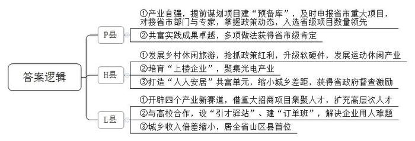
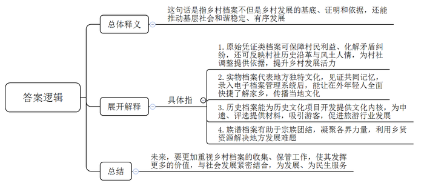
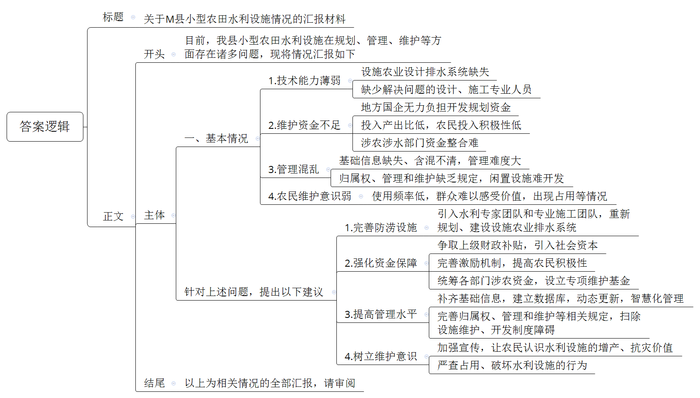

# 2025年公务员多省联考《申论》题（海南B卷）

<!-- gwy:overview:start -->
> **海南 · 2025 · 申论 · B类** ｜ 4 题 · 图片 4 处 · 答案随题折叠

导航：[题目](#题目) · [材料 1](#材料-1)
<!-- gwy:overview:end -->

> 候选采集稿。参考答案及解析来自粉笔页面，不代表官方答案或真实高分答卷；来源使用许可与原卷对应关系仍需人工核实。

## 给定材料

### 材料 1

二十多年来，尤其是自高质量发展建设共同富裕示范区以来，Z省为26个山区县量身定制“一县一策”，出台了一系列超常规政策，山区县驶入发展快车道。根据山区县分类动态调整机制，P县、H县和L县最近被调出“山区26县”，将享受另外的“政策礼包”。区县动态调整，看似简单地做“减法”，背后却蕴藏深意。

长期研究山区县发展的省委党校龚教授认为，“一县一策”效用发挥，关键在于如何让政策从“纸上”落到“地上”。

“山区县突围，产业自强是关键。一方面，县里瞄准了扶持产业项目的优惠政策，早早谋划。”P县发改局李局长透露，为申报2025年省市两级重大产业项目，2024年7月，县里就开始排摸梳理，目前已有280多个项目进入“预备库”。一旦项目申报窗口打开，会第一时间申报。另一方面，P县主动对接省市级部门以及专家资源，及时了解最新政策动态。截至目前，P县累计入选省“千项万亿”项目数在原26个山区县中位居前列；入选省重大产业项目数在全省县（市、区）中名列第四。

同样是承接政策红利，H县借力“一县一策”，点燃了乡村休闲旅游的星星之火。“当时的‘一县一策’文件中，相关扶持政策多达30余项，我们从实际出发，抢抓政策红利，争取上级支持。”县发改局许局长介绍，2022年初，省政府批复同意设立灵山省级旅游度假区，县里乘势升级了软硬件，推动运动休闲产业大发展。如今，灵山古道越野赛成为Z省知名越野跑品牌。2023年，灵山旅游度假区吸引国内外游客超15万人次，旅游总收入1亿元，带动本地农民共增收约233万元。

春节过后，位于H县生态工业园的光启科技有限公司项目现场，8幢高5层的白色厂房陆续交付。H县生态工业服务中心王主任表示：“县里土地资源紧缺，可以腾挪的空间非常少，要打破这一要素瓶颈，关键靠创新。我们园区仅3平方公里不到，由于面积小，横向拓展没有空间，主要培育‘上楼企业’，向纵向空间要发展。”空间小，意味着无法承载大项目。H县在多轮产业选择后，最终瞄准了光电产业。“传统制造业厂房只有一层，而光电企业厂房可建到五六层，单位土地投资强度大、产出高，符合我县实际。”H县经信局孙局长介绍。

近年来，L县开辟了大健康、半导体、新能源、数字经济四个产业新赛道，高层次人才紧缺。为此，L县把人才工作“嵌入”招商工作，借重大产业招商项目集聚人才。比如大健康领域，成功招引了智亿科技股份有限公司这一行业领军企业入驻；在半导体产业领域，通过对接国内外知名半导体企业，吸引到了众多一流专家和工程师集聚，从而实现了链式招商。

“我们在全国10余所高校设立‘引才驿站’。”L县人才中心叶主任介绍，与高校创建“订单班”，针对企业所需专业和技能进行人才培养，极大解决了企业用人的难题。

Z省发改委负责人表示，三个调出县不仅各项经济指标遥遥领先，而且不“偏科”。

在P县，“小萌宠”催生共富“大产业”、“三善工程”开辟山区慈善助老新模式、电商赋能乡村共富路、“红都”文化助力革命老区奔共富等做法，或被列入省市级共富最佳实践，或成为省级首批共富实践观察点。

在H县，城与乡的差距越来越小，打造当地“人人安居”共富单元，通过“一社一策”，探索片区式、差异化的未来乡村和未来社区模式，这项工作获得了省政府督查激励。

在L县，2023年全县城乡收入倍差缩小至1.58，居全省山区县之首。

### 材料 2

如何让农民均等享受档案服务，W市走在了前面。作为全国第一批档案工作服务农村基层治理试点地区，W市在乡村档案管理工作上探索了近十年。目前，W市共有2166个行政村实行了“村档乡管”模式，占比73.4%，在此基础上建成了7家乡村档案馆。徽章档案、矾矿档案、蛮话档案……这些藏在乡村档案馆里的特色档案，成为了当地最具辨识度的文化符号。

<u>乡村档案，不仅是岁月留痕，也蕴藏着发展动能。</u>

在C县马武镇档案馆150多平方米的空间里，竟藏有10447件档案。大至乡镇规划，细至村民的土地、婚姻、社保等各种原始凭证，都细心地分类存放。

马武镇党政办主任兼档案馆馆长小方说，在农村，一份小小的档案可能是保障村民利益、化解矛盾纠纷的关键证据。

数年前，马武镇的王先生退休返乡，因长期在外未能妥善保管宅基地证，导致其宅基地无法确权。王先生向村里查询，村干部对当年档案的去向毫不知情。“这样的情况并不鲜见。”小方说。

“乡村档案规范管理背后有基层治理的深切需要，是乡村发展的基底、证明和依据。”W市委办档案处金处长表示，早在2016年，村社档案收集不齐、保管不当带来的突出矛盾问题就引起了档案部门的关注。自此，一场村级档案的整理工作在W市乡镇间探索启动。

2023年，马武镇档案馆建成投用，王先生抱着试试看的心态又来查询。档案馆工作人员找到了一份1982年的老档案，里面就有王先生父亲的宅基地申请表和乡镇的批复。工作人员当场将相关材料复印给王先生，他家的宅基地终于有了合法身份。

“档案可以反映出村社的历史沿革和风土人情。”金处长说，这为村社调整提供了重要依据。前两年，L县组建社区联合党委，几个社区以党建联建的形式抱团发展。后来，通过查询乡村档案，确定了以人文相亲、地理相近、优势互补为原则进行组合，大大提升了乡村发展活力。

在童溪镇档案馆，还收藏有当地非遗传承人捐赠的戏曲盔头等珍贵的实物档案。“实际上，实物档案具有不可复制性，代表一个地方的独特文化，是共同记忆的最好见证。”C县委办档案科廖科长说。

“档案不一定要存在档案馆里。”廖科长说，只要纳入档案管理，同样能发挥档案的功能。在马武镇向阳村文博馆，每一件展品下面都贴了一个序列号。“这是明代的石磨。”档案管理员说，他们给每一件实物档案贴上标签，然后存入电子档案管理系统，无论实物档案保存的位置多偏远，均可一键知全貌。

矾石镇拥有600年明矾开采史，上世纪八九十年代矾矿衰微后，不少矿工带着采矿技艺走出去成长为企业家。矾石镇上有一家矾都矿石馆，里面收藏了600多件矿石样本，采集地遍布全国各地。这些矿石是由40多位矿老板从自己的矿山采集的，每一块矿石都记载了他们在外打拼的足迹，都在诉说一个创业的故事。这些历史记忆连同实物档案一起，被纳入了电子档案管理系统。

将散落的实体档案纳入管理，是让在外年轻人了解家乡历史最全面、快捷的通道。“天光对应天亮，雾光对应黎明。”奎溪镇土话馆里保存了一本翻译当地土话的《乡谈杂字》。这本方言工具书被录入电子档案管理系统后，人们可以随时查询，当地的方言文化得以更广泛传播。

在R县曹回镇，当地把档案工作融入到省级研学项目建设中。以档案中提取的曹回“八大文化”为内核，打造了进士文化园、花灯公园等系列历史文化项目，串起了“档案故事”，还编辑出版了《曹氏家训》等曹回本土书籍，年均接待研学人员5万多人。

无独有偶，对历史档案的系统性发掘，赋予了C县矾石镇二次生命。矾石镇因明矾而兴，也因明矾而衰，一度陷入沉寂。随后，矾石镇转型工业旅游开发，开启了申遗之路。当地组建团队，参考矾矿博物馆、矾都矿石馆等收藏的各类历史档案，编制了《矾矿申遗·工业文化旅游可行性报告》等申遗材料。2017年矾石镇获评“国家工业遗产”，2020年被评为国家地质公园。随着游客络绎而来，矾矿博物馆、矾都矿石馆也成为了网红打卡点和研学基地。

乡村档案让记忆留存，也凝聚人心。“民间最典型的档案是族谱。”廖科长认为，族谱的存在，有助于宗族团结，而用好族谱档案，可以凝聚各界力量。马武镇教育设施陈旧，优秀教师流失，教育遭遇瓶颈。2023年，为重振教育，镇里从档案室“乡贤档案”里找来全国各地的乡贤名单，发出求助，马武乡贤们积极响应，短短几个月捐赠了540万元。

一份份乡村档案的收集、整理、规范，也象征着基层社会的和谐稳定、有序发展。“档案，钩沉历史，也经纬当下。”金处长表示，“我们常在思考，乡村发展，档案管理应该发挥更多的价值，与社会发展紧密结合，为发展、为民生服务。”

### 材料 3

“大棚根本进不去，里面积水太深。”2024年8月，一场特大暴雨降临M县，老孙至今都清晰地记得当时自家大棚的情形。

几天过去，地表的积水慢慢退去，但只要用脚轻轻一踩，水即刻渗出地面。老孙发现，只要附近的水库一放水，棚里的水井就跟着涨水。大棚不远处还有一座废弃的方塘，如果方塘涨水，棚内积水就更加严重。

邻近的几十个大棚，情况大同小异。“当时下那么大的雨，总不能说不让水库放水吧？”无奈之下老孙拨通了刘镇长的电话。此时，刘镇长正焦头烂额：“下雨当晚，东边几个村就断了电，香菇大棚里的菌棒漂得到处都是，西边冲断了座桥，好多垃圾堵在那儿，水的流向变了，眼瞅着就要冲到大棚，一旦淹过去，一个大棚的损失就得几十万。”

土生土长的刘镇长，人熟，地也熟。他记得小时候，田里种的是玉米和一些杂粮，“旱得厉害，根本收不了多少。”后来，镇里鼓励大家种果树，不少村子开始修建方塘，雨天蓄水，需要的时候拿泵抽水浇果树。“2005年左右，镇里牵头开始引进设施农业，建大棚，种黄瓜和香菇。蔬菜大棚的灌溉，特别是香菇种植，基本不需要方塘蓄水，很多方塘就慢慢废弃了。”当初在引进设施农业时，他全程参与了设计，考虑的是防旱，从没想过排涝的事。田里也没什么排水设计，在后续优化中，排水问题也几乎没有纳入考量。

水库、方塘、大棚……前往老孙家的路上，刘镇长思量其中的关联。“到了他家，看了情况，我也不确定是咋回事。附近河道水位比大棚都高，挖沟排水根本不现实。而且突然挖出一条沟，万一有小孩失足掉进去更危险。”刘镇长坦言，当时灾情紧急，很多想法来不及论证，请示上级后他便做主清理河道。“太专业的知识我也不懂，当时多少有点‘赌一把’的心态。想着水库、方塘和大棚里的水井在地下是不是连通的，如果是，那把河道清出来应该有用。”于是他紧急调来两台挖掘机和翻斗车对垃圾进行清理，同时深挖和拓宽河道。

河道挖开，大棚水退，刘镇长庆幸自己赌赢了。然而，开挖河道只是权宜之计，一旦再遭遇如此暴雨，水漫大棚的情况极有可能再次发生。他觉得：“这不是随便挖条沟、挖个坑就能解决的事，具体该怎么设计、怎么施工都需要很专业的技术人员，我们没有这个水平。”不仅如此，他坦言，更恼火的是资金问题，“这属于公共设施，村民不可能自己出钱，镇里也没这笔钱。”

M县共有水域及水利设施用地超5200公顷，其中，坑塘水面约76公顷，沟渠超46公顷。但却没有各村镇沟渠、坑塘等排水和灌溉设施分布和使用的具体信息。很容易看到废弃的方塘和水井，水井不远处的泵房也早就无人管理，一片杂乱之象。村中的水井已经有五六十年之久，早已无人使用。

2018-2019年，县里对小型农田水利的管理进行了职能调整。“那次调整把‘小农水’的归口管理从水利部门调到了农业部门，但事走了、人没动，各种资料、手续很多还在水利局。以前信息化、数字化不像现在这样普及，存在基础信息缺失和含混不清等问题。”县政府办王副主任表示，加之近些年的人事变动，全县“小农水”管理困难重重。

农业水利专家周教授指出，目前，农田水利公共设施由农业主管部门负责建设，但建成后的归属权、管理和维护问题却缺乏明确的政策规定。

村民老马说：“之前有人承包方塘养鱼、建垂钓园，那会儿由他们自己管。但不挣钱，后来就慢慢荒了，再倒点垃圾，水都臭了。”

刘镇长说，过去种果树、种粮食的年代，村里会对方塘进行集中管理，定期组织清淤、检查维护泵房。“现在利用率太低了，就没人管了。在别的地方，还有人把坑填了另做他用，我们不敢这么干。之前水库管理局将所辖部分闲置鱼池租赁给驾校，其中20亩左右坑塘水面改建成了硬化训练道路，结果因非法占用被通报了。”

“这些都是历史问题，想要重新管起来太难了。”县水利局陈科长说，水库建设之初在下游预留了几个坑塘，想着可以养养鱼，职工也可以搞点副业。后来，经历机构改革、水库管理局的建制早已不复存在，水库和相关资产、人员转由地方国企统一管理，但只是清算了工资，根本没钱对坑塘水面和周边土地做进一步的开发和规划。“而且多年历史遗留的产权归属可能也有一定问题，所以就只能搁着，可惜了一块好地方。”

周教授介绍，当前，各地小型农田水利工程，如果被划入高标准农田建设范畴或是几大灌区的主要水利设施，有中央财政参与支持，管理就比较规范，但对于其他农田或者温室大棚这样的设施农业，灌排工作更多还是以农户或生产经营者自身为主。“农业的投入产出效益比较低，农民对于‘小农水’的投入积极性不高。”他指出，虽然各级涉农涉水部门均有相关建设资金，但各自项目要求不同，整合起来并不容易。

“要想从根本上解决问题，还必须想方设法让村集体和农户意识到其中潜在的价值。”周教授说，在乡村各类基础设施中，道路是管理维护最好的，“老百姓几乎每天要走，能每时每刻感受到价值，所以维护意识很强。小型农田水利设施使用频率低，特别在发生涝害几率小的地区，对排水排涝不够重视，经常会看到排水沟里种植作物，还有的因为种地要用大型农机，直接把沟填平了。”

### 材料 4

三个大小不一、叠在一起的棕色圆盘，拉伸展开，便成为一套颜值“爆表”的可折叠“魔法凳”。在N县腾浩户外用品有限公司，新品刚刚完成试样。张总经理一边拿着“滚烫”的样品频频点头，一边给销售部下达任务：“今年主推这款，争取9月上市！”一旁的设计师，大四学生小谭的心怦怦直跳，“电脑里的毕业设计变成货架上的真实产品，想想就很燃。”

这一切，来自N县谋划的一盘创新“引才大棋”。2022年，N县向全国高校学子发出邀请——将毕业设计“写在”大地上，即以当地经济社会发展的现实需求为题，真题真做，开展“全国高校联合毕业设计”行动，架起县域人才“桥梁”。N县郑县长介绍：“每年9月，活动正式启动，我们‘出题’，全国高校学子‘选题’和‘答题’，第二年5月进行终期答辩。”在N县全国高校联合毕业设计组委会办公室的墙上，挂满了参与院校的校徽。这项行动目前已吸引171所高校的千余名大学生加入，诞生了456个作品。N县打造“中国毕业设计之城”的梦想，正在成为现实。

2024年，第三届全国联合毕业设计行动正式启动后，N县聚焦城镇更新、艺术乡建、产业升级、文旅开发等领域，征集了22个需求作为“毕业设计”开题方向：这其中就有小谭正在做的可折叠“魔法凳”。起初小谭信心满满，然而令他始料未及的是他的设计方案“一波三折”。“最初，我设计了折弯结构的构件，可到了生产一线，才发现要实现它，不仅需要加装转弯轴承，还要让铁件加厚，这大大增加了生产难度和成本，第二稿改用伸缩结构，但因为没有生产经验，数据不准，比例失调……”一遍遍修改，一次次提升。在这一过程中，小谭的“在地导师”柳工程师帮了他大忙。

联合设计的每个作品或项目都配备了由出题方派出的“在地导师”团队，他们与高校导师一起辅导毕业设计，共同参与毕业答辩。项目开始后，柳工并不着急让小谭动手设计，而是带着他扎进生产一线，从了解生产流程、制造工艺、市场销售开始，再理论结合实际，磨合方案，大大小小的修改不计其数。“柳工给的意见总能直击要害，特别实用！”小谭说。

“无论人生的哪个阶段，‘首次’都至关重要，联合毕业设计行动抓住高校毕业生的成长节点，允许试错、宽容失败，给予认同感，最大限度激活了他们的创新创造力。”毕业设计行动迅速扩圈扩容，也令毕业设计组委会委员王教授兴奋不已。

L村口有一面宋代名士浮雕墙，大四学生小李的毕业设计作品《L村公共景观设计》就从这里开始：“我想以宋代活字印刷为蓝本，将抽象山水和活字版融合进行造景……”小李的设计让L村党支部曾书记眼前一亮。“我们就是要将题出得好，并帮助大学生答得妙。”曾书记说。

“我们在镇里支持下，在全镇的村庄开展数月调研，找出迫切的、有资金支持的项目，再结合高校和专家的意见，将现实需求转化为可攻关的课题发布，毕业生则来实地选题、开题。”王教授介绍，“邀请项目方全程参与，将论文答辩直接搬到项目方所在的田野、村庄或车间，村民、产业工人都可以来现场提问。学生论文呈现方式也不拘一格，可以是设计方案、进行中的工程，也可以是已完成的项目。”

“今年，我们将落地作为考评中最大的加分项，希望以实实在在的成果，为打通毕业生和县城的双向接口、满足双向需求‘加码’。”郑县长说，三年来，已有36个毕业设计作品落地，另外28个毕业设计转化为县、镇重大项目配套设计方案。从选题到答题，N县通过一系列的场景重构、流程再造、机制创新，把毕业设计全链条搬进了县城。未来，N县还谋划利用投资、金融等市场手段加固毕业设计“链条”。事实上，已有不少人在关注，乡贤基金、教育基金会、创业联盟，都可能成为“造血”的力量。每年N县还拿出40多万资金奖励优秀毕业设计作品，奖金覆盖面高达70%，以奖代补，吸引更多毕业生加入行动。

“县域，或许没有足够广阔的平台，没有一掷千金的引才实力，但可以给初出茅庐的青年人才提供成长沃土。”郑县长说，“我们不提要求、不讲条件，只做好服务、把‘题’出好，并且在毕业设计作品完结后，继续帮他们搭建平台、创造条件。未来县域的发展势必更加依赖年轻人，招才引智的目标也将前移。<u>我们应当把更多精力投入在‘种树’上，而非静待成熟再‘摘果’。”</u>

## 题目

### 第 1 题

**请根据“给定资料1”，谈谈Z省三个调出县为何能脱颖而出。（15分）**

关联材料：材料 1

作答要求：

（1）全面、准确，有条理；

（2）不超过250字。

第 1 题 · 答案与解析

**参考答案（粉笔题库参考内容）**

1.P县：①产业自强，提前谋划项目建“预备库”，及时申报省市重大项目，对接省市部门与专家，掌握政策动态，入选省级项目数量领先。②共富实践成果卓越，多项做法获得省市级肯定。

2.H县：①发展乡村休闲旅游，抢抓政策红利，升级软硬件，发展运动休闲产业。②培育“上楼企业”，聚集光电产业。③打造“人人安居”共富单元，缩小城乡差距，获得省政府督查激励。

3.L县：①开辟四个产业新赛道，借重大招商项目集聚人才，扩充高层次人才。②与高校合作，设“引才驿站”、建“订单班”，解决企业用人难题。③城乡收入倍差缩小，居全省山区县首位。

**解析**

**参考答案说明：**本参考答案从Z省P县、H县、L县三个调出县脱颖而出的原因展开，各条答案要点之间在内容上相互并列，没有交叉。

**考点**：原因类

**来源**：2025年公务员多省联考《申论》题（海南B卷）

### 第 2 题

**“给定资料2”中提到“乡村档案，不仅是岁月留痕，也蕴藏着发展动能”，谈谈对这句话的理解。（20分）**

关联材料：材料 2

作答要求：

（1）全面、准确、有条理；

（2）不超过300字。

第 2 题 · 答案与解析

**参考答案（粉笔题库参考内容）**

这句话是指乡村档案不但是乡村发展的基底、证明和依据，还能推动基层社会和谐稳定、有序发展。

具体指：1.原始凭证类档案可保障村民利益、化解矛盾纠纷，还可反映村社历史沿革与风土人情，为村社调整提供依据，提升乡村发展活力。2.实物档案代表地方独特文化，见证共同记忆，录入电子档案管理系统后，能让在外年轻人全面快捷了解家乡，传播当地文化。3.历史档案能为历史文化项目开发提供文化内核，为申遗、评选提供材料，吸引游客，促进旅游行业发展。4.族谱档案有助于宗族团结，凝聚各界力量，利用乡贤资源解决地方发展难题。

未来，要更加重视乡村档案的收集、保管工作，使其发挥更多的价值，与社会发展紧密结合，为发展、为民生服务。

**解析**

**参考答案说明：**（1）思路方面，本参考答案按照词句解释题“总体释义+展开解释+总结”的答题思路展开。（2）内容方面，本参考答案先对指定句子的含义进行了总体解释；接着“展开解释”部分，从“原始凭证类档案”“实物档案”“历史档案”“族谱、乡贤档案”四个方面分析了“乡村档案蕴藏发展动能”的具体体现；最后“总结”部分介绍了乡村档案未来的发展方向。（3）词句表达方面，参考答案加上了“具体指”“不但……还能”“可……还可”等连接词来承接上下文。

**考点**：词句解释类

**来源**：2025年公务员多省联考《申论》题（海南B卷）

### 第 3 题

**省相关部门近期将派工作组到M县开展小型农田水利设施相关情况调研，假设你是县里工作人员，请根据“给定资料3”，拟写一份书面汇报材料，反映情况，提出建议。（25分）**

关联材料：材料 3

作答要求：

（1）情况梳理全面、准确；

（2）建议有针对性、切实可行；

（3）条理清晰、语言简洁；

（4）不超过500字。

第 3 题 · 答案与解析

**参考答案（粉笔题库参考内容）**

关于M县小型农田水利设施情况的汇报材料

目前，我县小型农田水利设施在规划、管理、维护等方面存在诸多问题，现将情况汇报如下：

一、基本情况：1.技术能力薄弱。设施农业设计排水系统缺失；缺少解决问题的设计、施工专业人员。2.维护资金不足。地方国企无力负担开发规划资金；投入产出比低，农民投入积极性低；涉农涉水部门资金整合难。3.管理混乱。基础信息缺失、含混不清，管理难度大；归属权、管理和维护缺乏规定，闲置设施难开发。4.农民维护意识弱。使用频率低，群众难以感受价值，出现占用等情况。

二、工作建议：1.完善防涝设施。引入水利专家团队和专业施工团队，重新规划、建设设施农业排水系统。2.强化资金保障。争取上级财政补贴，引入社会资本；完善激励机制，提高农民积极性；统筹各部门涉农资金，设立专项维护基金。3.提高管理水平。补齐基础信息，建立数据库，动态更新，智慧化管理；完善归属权、管理和维护等相关规定，扫除设施维护、开发制度障碍。4.树立维护意识。加强宣传，让农民认识水利设施的增产、抗灾价值；严查占用、破坏水利设施的行为。

以上为相关情况的全部汇报，请审阅。

**解析**

**参考答案说明：**（1）格式方面，本参考答案写到了“标题”“正文”两个部分。（2）正文部分，一方面从内容上来看，围绕“小型农田水利设施”这一主题，本参考答案的开头先简单叙述了整体情况；主体部分主要介绍了“基本情况”和“工作建议”，其中，“基本情况”从“技术能力薄弱”“维护资金不足”“管理混乱”“农民维护意识弱”四个方面展开；“工作建议”从“完善防涝设施”“强化资金保障”“提高管理水平”“树立维护意识”四个方面展开。最后，结尾进行了简单总结。另一方面，形式上，本参考答案做到了分段、分条撰写，整体上条理较为清晰。

**考点**：总结类

**来源**：2025年公务员多省联考《申论》题（海南B卷）

### 第 4 题

**“给定资料4”中提到“我们应当把更多精力投入在‘种树’上，而非静待成熟再‘摘果’”，请对这句话进行深入系统思考，联系实际，自拟题目，写一篇文章。（40分）**

关联材料：材料 1、材料 2、材料 3、材料 4

作答要求：

（1）观点明确，见解深刻，内容充实；

（2）思路清晰，语言流畅；

（3）参考给定资料，但不拘泥于给定资料；

（4）800-1000字。

第 4 题 · 答案与解析

**参考答案（粉笔题库参考内容）**

**深耕人才“沃土”，育好县域发展“青苗”**

当前，县域发展普遍面临人才匮乏的困境，且与经济发达的大城市相比，也不具备高薪引进成熟人才的优势。县域人才工作需要转变思路，要把更多精力投入到“种树”上，将招才引智的目标前移，为初出茅庐的青年人才提供成长的沃土，通过构建良好的人才生态系统，打通毕业生和县城的双向接口、满足双向需求。

**构建实践成长平台，给予大学生动手机会，让其在“真题真做”中厚植根基，是县域人才培育的关键之举。**县域应主动搭建产学研深度融合的实践平台，将地方发展需求转化为可供探索的实际课题，让大学生在真实场景中施展才华、积累经验。从可折叠“魔法凳”的设计研发，到农村公共景观设计，千余名大学生在实践中摸爬滚打，将毕业设计从图纸变为现实。同时，配备“在地导师”团队，带领学生扎根生产一线，了解流程工艺，打磨设计方案。通过搭建实践平台、构建全链条培育生态，让大学生在实践中积累经验、增长才干，成为县域发展的坚实力量。

**营造允许试错、宽容失败、给予认同的促成长环境，激发年轻人的创新创造力，是县域人才培育的重要路径。**在人才成长过程中，创新探索难免遭遇挫折与失败。县域要打造包容开放的人才发展环境，允许人才在试错中积累经验、在挫折中总结教训。创新活动具有不确定性和风险性，若过分强调成功、苛责失败，必然抑制人才的创新勇气。在具体操作上，可设立创新风险补偿基金、建立创新失败案例分享制度等等。这种宽容文化能够解除人才的后顾之忧，激发其持续创新的内生动力，形成“失败-学习-再创新”的良性循环。

**建立成果导向的激励机制，对人才的创新尝试和阶段性成果给予充分认可，是县域人才培育的有效保障。**设立专项人才奖励基金，对在县域各领域作出突出贡献的人才给予物质奖励，以奖代补，提高人才待遇。通过高额奖金、项目补贴等方式，向社会传递重视人才的强烈信号，吸引更多外部人才关注县域发展。物质奖励不仅是对人才付出的肯定，更能营造良好的人才竞争氛围，形成人才汇聚、竞相发展的生动局面，为县域发展提供坚实的人才支撑。

“不谋万世者，不足谋一时；不谋全局者，不足谋一域。”县域人才培育是一项长期而系统的工程，需要我们摒弃急功近利的“摘果”思维，以“种树”的耐心和毅力，为人才提供成长的沃土，让更多人才在县域这片广阔天地中茁壮成长，书写县域发展的崭新篇章。

**解析**

**文章分析**

**深耕人才“沃土”，育好县域发展“青苗”**

【**标题的优点：**首先，标题中含有主题词，使文章主题更突出、清晰。其次，形式上采用对称式结构，使标题更加完整、饱满。】

（1）当前，县域发展普遍面临<u>人才匮乏的困境</u>，且与经济发达的大城市相比，也<u>不具备高薪引进成熟人才的优势</u>。（2）县域人才工作需要<u>转变思路</u>，要把更多精力投入到“种树”上，<u>将招才引智的目标前移</u>，为初出茅庐的<u>青年人才提供成长的沃土</u>，通过<u>构建良好的人才生态系统</u>，<u>打通毕业生和县城的双向接口、满足双向需求</u>。

【**开头的优点：**★内容方面。范文的开头是紧扣“县域人才培育”这一主题展开的。首先，开头点出主题，做到了主题明确。其次，对“县域人才培育”这一主题进行了分析阐述，指出了：（1）县域发展面临的人才困境；（2）解决县域人才问题的宏观对策。★文字表达方面。长短句配合使用，使语言表达有节奏感。】

**构建实践成长平台，给予大学生动手机会，让其在“真题真做”中厚植根基，是县域人才培育的关键之举。**（1）县域应主动<u>搭建产学研深度融合的实践平台</u>，将地方发展需求转化为<u>可供探索的实际课题</u>，让大学生<u>在真实场景中施展才华、积累经验</u>。（2）从<u>可折叠“魔法凳”</u>的设计研发，到<u>农村公共景观设计</u>，千余名大学生在实践中摸爬滚打，将毕业设计从图纸变为现实。（3）同时，<u>配备“在地导师”团队</u>，带领学生<u>扎根生产一线</u>，<u>了解流程工艺</u>，<u>打磨设计方案</u>。（4）通过搭建实践平台、构建<u>全链条培育</u>生态，让大学生在实践中<u>积累经验</u>、<u>增长才干</u>，成为县域发展的坚实力量。

【**论述段1的优点：**★观点句：范文的观点句是紧扣“县域人才培育”这一文章主题提出的。形式上，它在段首处直接写出，位置突出，容易发现。内容上，关键词突出，内容要点明确，可以明显看出主要从“构建实践平台”的角度展开论述。★论述内容：（1）县域搭建产学研融合实践平台；（2）大学生实践的具体事例；（3）导师团队提供实践指导；（4）搭建实践平台的意义。注意：以上几个方面的内容都是紧扣“构建实践成长平台，给予大学生动手机会，让其在‘真题真做’中厚植根基，是县域人才培育的关键之举”这个观点句进行分析论述的，论述的针对性强，内容层次丰富。在论述方法上采用了讲道理与举例子相结合的方式，论述充实清晰。】

**营造允许试错、宽容失败、给予认同的促成长环境，激发年轻人的创新创造力，是县域人才培育的重要路径。**（1）在人才成长过程中，<u>创新探索难免遭遇挫折与失败</u>。县域要<u>打造包容开放的人才发展环境</u>，允许人才<u>在试错中积累经验</u>、<u>在挫折中总结教训</u>。<u>创新</u>活动具有<u>不确定性和风险性</u>，若过分强调成功、苛责失败，必然抑制人才的<u>创新勇气</u>。（2）在具体操作上，可<u>设立创新风险补偿基金</u>、建立<u>创新失败案例分享</u>制度等等。（3）这种宽容文化能够<u>解除人才的后顾之忧</u>，激发其持续<u>创新的内生动力</u>，形成“失败-学习-再创新”的良性循环。

【**论述段2的优点：**★观点句：范文的观点句是紧扣“县域人才培育”这一文章主题提出的。形式上，它在段首处直接写出，位置突出，容易发现。内容上，关键词突出，内容要点明确，可以明显看出主要从“营造宽松环境”的角度展开论述。★论述内容：（1）打造宽松成长环境的必要性；（2）打造宽松成长环境的对策；（3）打造宽松成长环境的意义。注意：以上几个方面的内容都是紧扣“营造允许试错、宽容失败、给予认同的促成长环境，激发年轻人的创新创造力，是县域人才培育的重要路径”这个观点句进行分析论述的，论述的针对性强，内容层次丰富。在论述方法上主要采用了讲道理的方式，论述深刻清晰。】

**建立成果导向的激励机制，对人才的创新尝试和阶段性成果给予充分认可，是县域人才培育的有效保障。**（1）<u>设立专项人才奖励基金</u>，对在县域<u>各</u>领域作出突出贡献的人才<u>给予物质奖励</u>，以奖代补，<u>提高人才待遇</u>。（2）通过<u>高额奖金</u>、<u>项目补贴</u>等方式，向社会<u>传递重视人才的强烈信号</u>，吸引更多外部<u>人才关注县域发展</u>。物质奖励不仅是<u>对人才付出的肯定</u>，更能<u>营造良好的人才竞争氛围</u>，形成人才汇聚、竞相发展的生动局面，为县域发展提供坚实的人才支撑。

【**论述段3的优点：**★观点句：范文的观点句是紧扣“县域人才培育”这一文章主题提出的。形式上，它在段首处直接写出，位置突出，容易发现。内容上，关键词突出，内容要点明确，可以明显看出主要从“建立激励机制”的角度展开论述。★论述内容：（1）建立激励机制的对策；（2）建立激励机制的意义。注意：以上几个方面的内容都是紧扣“建立成果导向的激励机制，对人才的创新尝试和阶段性成果给予充分认可，是县域人才培育的有效保障”这个观点句进行分析论述的，论述的针对性强，内容层次丰富。在论述方法上主要采用了讲道理的方式，论述清晰透彻。】

【**论述段之间的关系：**★内容的内在逻辑：范文的论述段之间是依照“并列”的逻辑展开的。论述段1先写了“构建人才实践成长平台”，论述段2再写了“打造包容开放的成长环境”，论述段3接着写了“建立成果导向的激励机制”，文章整体论述逻辑清晰。】

“不谋万世者，不足谋一时；不谋全局者，不足谋一域。”县域人才培育是一项长期而系统的工程，需要我们摒弃急功近利的“摘果”思维，以“种树”的耐心和毅力，为人才提供成长的沃土，让更多人才在县域这片广阔天地中茁壮成长，书写县域发展的崭新篇章。

【**结尾的优点：**范文的结尾回扣了“县域人才培育”这个主题，并且进行了总结提升。】

**考点**：文章写作题

**来源**：2025年公务员多省联考《申论》题（海南B卷）

