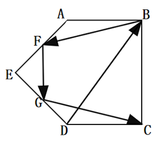
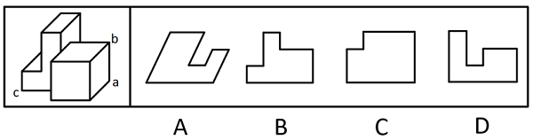
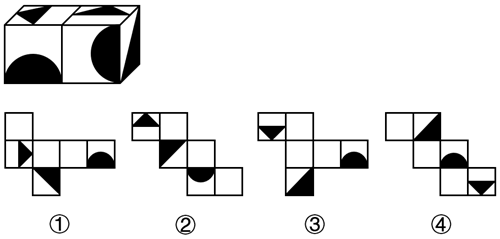
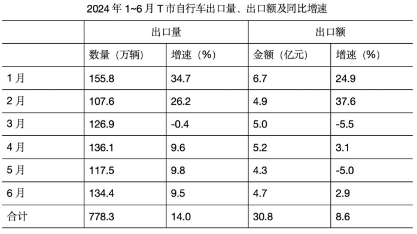
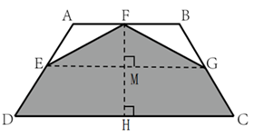
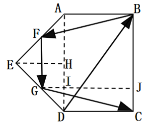
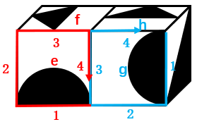

# 2025 海南省公务员录用考试 行测（统考）

> 行测 · 109 题 · 海南 2025

## 第 1 题　qid 13504351 · 马克思主义

习近平总书记指出，“两个结合”是我们取得成功的最大法宝。关于“两个结合”，下列表述正确的有几项？
①“两个结合”筑牢了道路根基，中国特色的关键就在于“两个结合”
②“两个结合”本身就是创新，同时又开启了广阔的理论和实践创新空间
③“两个结合”产生了深刻的“化学反应”，造就了一个有机统一的新的文化生命体
④“两个结合”是坚持把马克思主义基本原理同中国具体实际相结合、同中华优秀传统文化相结合

- **A**. 1
- **B**. 2
- **C**. 3
- **D**. 4

## 第 2 题　qid 13504328 · 时事政治

党的二十届三中全会指出，法治是中国式现代化的重要保障。下列不属于完善中国特色社会主义法治体系举措的是：

- **A**. 健全基层民主制度
- **B**. 深入推进依法行政
- **C**. 深化立法领域改革
- **D**. 加强涉外法治建设

## 第 3 题　qid 13504294 · 新思想

实现中华民族伟大复兴的中国梦不可能一马平川，我们要居安思危、未雨绸缪，坚决战胜一切不确定难预料的风险挑战。任何困难都无法阻挡中国人民前进的步伐，我们要居安思危、未雨绸缪，是因为：

- **A**. 人类社会历史发展是前进性与曲折性的辩证统一
- **B**. 社会规律是在各种因素的相互作用过程中自发实现的
- **C**. 通过充分发挥主观能动性，就能消除事物发展中的偶然方面
- **D**. 本质与现象是相互依存的，所有现象都在一定程度上表现本质

## 第 4 题　qid 13504287 · 时事政治

2024年12月，中央农村工作会议在北京召开，会议对如何做好“三农”工作进行了具体部署，下列与之相关说法错误的是：

- **A**. 加强新时代农村精神文明建设，积极开展移风易俗
- **B**. 提高农村基本公共服务水平，持续改善农村人居环境
- **C**. 推进农业科技力量协同攻关，因地制宜发展农业新质生产力
- **D**. 完善农产品贸易与生产协调机制，推动粮食等农产品价格稳步提升

## 第 5 题　qid 13504353 · 新思想

2024年习近平总书记在福建省东山县考察期间参观谷文昌纪念馆时指出，“先祭谷公、后拜祖宗”，这是老百姓发自内心的敬仰。人民心里有一本账，金杯银杯不如老百姓的口碑。这体现了：
①让群众满意是我们党做好一切工作的价值取向和根本标准
②人民是党的工作的最高裁决者和最终评判者
③中国共产党把为民办事、为民造福作为最重要的政绩
④全心全意为人民服务是党的根本宗旨

- **A**. ①②
- **B**. ①②③
- **C**. ②③④
- **D**. ①②③④

## 第 6 题　qid 13504371 · 时事政治

加强普惠性、基础性、兜底性民生建设，解决好人民群众最关心最直接最现实的利益问题，才能不断满足人民对美好生活的向往。关于加强普惠性、基础性、兜底性民生建设，下列表述正确的有几项？
①出台完善青年创新人才发现、选拔、培养机制
②加强低收入人口动态监测，做好分层分类社会救助工作
③出台政策鼓励收养病残孤儿，政府为收养家庭提供适度补贴
④发展集中管理运营的社区养老服务网络，提升农村互助养老设施建设水平

- **A**. 4项
- **B**. 3项
- **C**. 2项
- **D**. 1项

## 第 7 题　qid 13504290 · 马克思主义

发展新质生产力，必须进一步全面深化改革，形成与之相适应的新型生产关系。要深化经济体制、科技体制等改革，着力打通束缚新质生产力发展的堵点卡点，建立高标准市场体系，创新生产要素配置方式，让各类先进优质生产要素向发展新质生产力顺畅流动，这最直接体现了马克思主义的哪些基本观点？
①生产关系必须与生产力发展要求相适应，才能促进生产力发展
②经济基础的变更必然引起上层建筑的变革，并决定其变革方向
③生产关系对生产力发展具有决定作用
④改革是社会主义社会发展的直接动力

- **A**. ①②
- **B**. ①④
- **C**. ②③
- **D**. ②④

## 第 8 题　qid 13504309 · 新思想

习近平总书记强调，中国将坚持推进高水平对外开放，以高质量发展全面推进中国式现代化，为各国开放合作提供新机遇。关于推进高水平对外开放，下列举措恰当的有几项？
①维护多元稳定的国际经济格局和经贸关系
②加强知识产权保护，营造良好的营商环境
③稳步扩大规则、规制、管理、标准等制度型开放
④减少对外资企业的准入限制，全面放开所有行业领域
⑤加快建设贸易强国，推动共建“一带一路”高质量发展

- **A**. 2
- **B**. 3
- **C**. 4
- **D**. 5

## 第 9 题　qid 13504311 · 新思想

我国已经进入推动高质量发展的关键时期，要以人口高质量发展打造高素质人力资源，加快构建新发展格局。关于推动人口高质量发展，下列举措不恰当的是：

- **A**. 稳妥有序实施延迟法定退休年龄政策
- **B**. 重视家庭家教家风，建设新型婚育文化
- **C**. 提高教育普及水平，增加劳动力平均受教育年限
- **D**. 抓住人口增量发展蕴含的新机遇，优化人口结构和分布

## 第 10 题　qid 13504329 · 时事政治

党的二十大报告指出，构建全国统一大市场，深化要素市场化改革，建设高标准市场体系。关于构建全国统一大市场，下列与之相关说法错误的是：

- **A**. 推动市场基础制度规则统一
- **B**. 加强公平竞争审查柔性约束
- **C**. 规范地方招商引资法规制度
- **D**. 深化地方标准管理制度改革

## 第 11 题　qid 13504357 · 新思想

习近平总书记强调，要始终保持反腐败永远在路上的坚韧执着，保持战略定力和高压态势，一步不停歇、半步不退让，一体推进不敢腐、不能腐、不想腐，坚决打好这场攻坚战、持久战、总体战。关于对当前反腐败斗争的认识，下列说法正确的有几项？
①加强党的纪律建设是一项经常性工作，引导党员干部把他律转化为自律
②新时代以来，反腐败成效有目共睹，已铲除了腐败滋生的土壤和条件
③不正之风是滋生腐败的温床，腐败往往是“四风”从量变转为质变的结果
④深化对党的自我革命的规律性认识，必须以彻底的自我革命精神把反腐败斗争进行到底
⑤要持续推动全面从严治党向基层延伸，让人民群众切实感受到正风肃纪反腐就在身边

- **A**. 2
- **B**. 3
- **C**. 4
- **D**. 5

## 第 12 题　qid 13504334 · 新思想

深化养老服务改革发展是实施积极应对人口老龄化国家战略的迫切要求，是保障和改善民生的重要任务，事关亿万百姓福祉，事关社会和谐稳定，为加快建设适合我国国情的养老服务体系，更好保障老有所养，下列举措恰当的是：
①推动国有资本参与发展养老服务，完善分类考核评价
②加快补齐农村养老服务短板，扩大农村养老服务供给
③发挥社区养老的决定作用，为居家养老提供有力支持
④以失能老年人的照护为重点，强化我国基本养老服务

- **A**. ①②③
- **B**. ①②④
- **C**. ①③④
- **D**. ②③④

## 第 13 题　qid 13504313 · 新思想

确保粮食安全，耕地是关键。党的十八大以来，以习近平同志为核心的党中央采取一系列硬措施，坚守耕地保护红线。关于加强耕地保护，下列说法正确的是：

- **A**. 抓好盐碱地综合改造利用，全面推进盐碱地后备资源开发
- **B**. 完善耕地质量建设保护制度，加快耕地质量保护立法
- **C**. 建立健全国家、省、市三级耕地质量监测网络体系
- **D**. 优先把云贵地区的梯田和山间谷地建成高标准农田

## 第 14 题　qid 13504370 · 新思想

习近平总书记强调，现代化产业体系是现代化国家的物质技术基础，必须把发展经济的着力点放在实体经济上，为实现第二个百年奋斗目标提供坚强物质支撑。下列与之相关说法正确的有几项？
①推进实施绿色发展战略，充分发挥绿色化赋能实体经济发展效应
②促进数字技术和实体经济深度融合，催生新产业新业态新模式替代传统产业
③重视现代服务业的发展，推动现代服务业与先进制造业、现代农业深度融合
④推动重点产业在国内外有序转移、促进国内外产业深度融合与实体经济发展相结合

- **A**. 1
- **B**. 2
- **C**. 3
- **D**. 4

## 第 15 题　qid 13504354 · 新思想

习近平总书记强调，铸牢中华民族共同体意识，推进新时代党的民族工作高质量发展。关于推进新时代党的民族工作高质量发展，下列说法正确的是：
①把改善民生、凝聚人心作为民族地区经济社会发展的出发点和落脚点
②构建块状集中式社会结构和社区环境，积极促进各民族交往交流交融
③中国共产党领导和社会主义制度是我国各民族共同发展进步的可靠保障
④铸牢中华民族共同体意识、推进新时代党的民族工作高质量发展，是全党全国各族人民的共同任务

- **A**. ①③④
- **B**. ①②④
- **C**. ①②③
- **D**. ②③④

## 第 16 题　qid 13504256 · 科技常识

关于生活中的化学知识，下列说法错误的是（    ）。

- **A**. 含氟牙膏中的氟化物能够降低牙釉质溶解度，促进牙釉质再矿化
- **B**. 进行有氧运动时，人体能将葡萄糖和氧气转化为乳酸、水和能量
- **C**. 口香糖是供人们嚼咬的糖，其脱离口腔、温度降低后会变硬变脆
- **D**. 氢燃料电池是利用氢气和氧气能发生电化学反应的原理产生电能

## 第 17 题　qid 13504320 · 科技常识

关于环境污染，下列说法正确的是：

- **A**. 逆温天气时，大气层变动剧烈，加快了大气污染物的扩散
- **B**. 淡水水体大量缺氧造成藻类死亡，容易引发“赤潮”现象
- **C**. 大气中的二氧化硫和水蒸气可被氧化合成硫酸，进而形成硫酸雾
- **D**. 石灰粉会与油脂发生化学反应使其溶于水，可用来处理海上石油泄漏

## 第 18 题　qid 13504284 · 人文常识

关于诗句中所用典故，下列解释正确的是：

- **A**. “汉帝重阿娇，贮之黄金屋”中的“汉帝”指的是汉武帝
- **B**. “此地别燕丹，壮士发冲冠”中的“壮士”指的是高渐离
- **C**. “马作的卢飞快，弓如霹雳弦惊”中的“的卢”指的是刘邦的坐骑
- **D**. “下马入门怀橘拜，身今却在白云边”中的“怀橘”指的是忠于帝王

## 第 19 题　qid 13504299 · 人文常识

关于急救知识，下列说法正确的是：

- **A**. 伤者出现呕吐时，应对其采取仰卧姿势放置，以防止窒息
- **B**. 踝关节扭伤后，应及时采取热疗加上按摩的方式来促进血液循环
- **C**. 冻伤后应使用温水复温，直至冻伤区域的皮肤恢复正常颜色和感觉
- **D**. 心肺复苏需按照“胸外按压10次、人工呼吸2次”的流程循环操作

## 第 20 题　qid 13504337 · 人文常识

下列展览的标题与内容对应不恰当的是：

- **A**. 黄金武士与富饶草原——哈萨克斯坦历史文物展
- **B**. 浴火重生——巴黎圣母院增强现实沉浸式展览
- **C**. 天下大白——中国建窑建盏文化展
- **D**. 古波斯的荣耀——伊朗文物精华展

## 第 21 题　qid 13504257 · 科技常识

下列与水资源有关说法错误的是：

- **A**. 我国主要淡水资源是冰川和地下水
- **B**. 通过蒸发海水可以提取到氯化钠晶体
- **C**. 利用蒸馏法淡化海水的过程主要是物理变化
- **D**. 我国西北绝大部分地区属于地下水补给贫乏区

## 第 22 题　qid 13504318 · 科技常识

关于常见植物，下列说法正确的是：

- **A**. 香樟树抗旱耐盐碱，在北方地区更容易生长
- **B**. 玉兰的花期在夏季，花朵有一定的药用价值
- **C**. 银杏树现今已广泛种植，退出濒危植物名录
- **D**. 侧柏四季常青，树形美观，常用作园林绿化

## 第 23 题　qid 13504260 · 科技常识

下列关于核电站及核能的说法正确的是：

- **A**. 核电站的发电机能将机械能转化为电能
- **B**. 核电站是利用核聚变产生的能量发电的
- **C**. 核电站汽轮机中喷出的水雾体现了分子的扩散
- **D**. 核电站产生的核废料可以同生活垃圾一起处理

## 第 24 题　qid 13504259 · 科技常识

关于洗澡过程中的物理现象，下列说法错误的是：

- **A**. 当浴室内水蒸气凝结成小水珠时，光线在小水珠上会发生散射现象
- **B**. 水珠在皮肤上呈球形，是因为液体表面张力作用使其表面积最小化
- **C**. 淋浴刚喷出水时更有力，是因为水流速度的增加会导致压强的增加
- **D**. 人在浴缸中泡澡时会受到向上的浮力，其大小等于人排开水的重量

## 第 25 题　qid 13504335 · 人文常识

下列诗句与其所描述的乐器对应正确的是：

- **A**. 昆山玉碎凤凰叫，芙蓉泣露香兰笑——二胡
- **B**. 锦瑟无端五十弦，一弦一柱思华年——古筝
- **C**. 曲终收拨当心画，四弦一声如裂帛——箜篌
- **D**. 几年调弄七条丝，元化分功十指知——古琴

## 第 26 题　qid 13504517 · 人文常识

下列作品不属于同一作者的是（    ）。

- **A**. 《原野》《雷雨》《北京人》
- **B**. 《唐璜》《吝啬鬼》《伪君子》
- **C**. 《四世同堂》《骆驼祥子》《日出》
- **D**. 《威尼斯商人》《仲夏夜之梦》《麦克白》

## 第 27 题　qid 13504454 · 人文常识

关于文房四宝，下列说法错误的是：

- **A**. 相较于生宣，熟宣更不易泅水
- **B**. 端砚的材料取于江西省婺源县
- **C**. 墨的主要原料是煤烟、松烟、胶等
- **D**. 湖笔制作技艺入选了国家级非物质文化遗产名录

## 第 28 题　qid 13504298 · 人文常识

下列关于汉字的表述错误的是：

- **A**. 甲骨文的内容多为“卜辞”
- **B**. “书同文”中的“文”指的是大篆
- **C**. “钟鸣鼎食”中的两种器具均是金文的载体
- **D**. 隶书是篆书的化繁为简，化圆为方，化弧为直

## 第 29 题　qid 13504255 · 法律常识

根据《中华人民共和国民事诉讼法》，下列说法错误的是：

- **A**. 调解维持收养关系的案件可以不制作调解书
- **B**. 陪审员在执行陪审职务时，与审判员有同等的权利义务
- **C**. 当事人王某对先予执行的裁定不服，可以申请复议一次
- **D**. 采取对妨害民事诉讼的强制措施可以由司法行政部门决定

## 第 30 题　qid 13504261 · 逻辑填空

对分类学者来说，与其说是找到新物种，不如说是碰到新物种。新物种的发现往往并非            ，而是意外之喜。在阅读文献、野外调查、查阅图片或者研究标本时，分类学者偶尔会发现某份标本或者个体跟之前的记录不一样，进而通过形态学比较或者分子测序手段确认该物种是否属于新的物种。
填入画横线部分最恰当的一项是：

- **A**. 守株待兔
- **B**. 刻舟求剑
- **C**. 照本宣科
- **D**. 按图索骥

## 第 31 题　qid 13504382 · 逻辑填空

很多短视频不会提供更多的、有助于消除不确定性的信息，标题几乎就是其内容的全部。在标题的暗示下，网友被误导从而更容易相信某个被放大的碎片就是完整真相，所以短视频时代的“标题党”可能带来的破坏力就更加          。
填入画横线部分最恰当的一项是：

- **A**. 昭然若揭
- **B**. 难以名状
- **C**. 显而易见
- **D**. 不容小觑

## 第 32 题　qid 13504265 · 逻辑填空

人类文明史是一部不断克服灾难、危机和挑战，探寻人类生存和发展之路的历史。            是人类共同应对挑战、跨越逆境、取得突破和进步的出路。当前，人类面对着复杂交织的传统和非传统安全问题，各类问题呈现出联动性、跨国性等特征。同处一个地球村，没有一个国家能凭一己之力谋求自身的绝对安全，也没有一个国家可以从别国的动荡中收获稳定。
填入画横线部分最恰当的一项是：

- **A**. 海纳百川
- **B**. 和衷共济
- **C**. 惺惺相惜
- **D**. 安危与共

## 第 33 题　qid 13504279 · 逻辑填空

食品数字标签，相当于电子“身份证”，通过二维码等形式展示食品的标签信息，消费者可以扫描食品标签上的二维码，通过页面放大、语音识读、视频讲解等多种功能，        地获取食品的相关信息。比如，食品的名称、配料表、生产日期和保质期、营养成分表等信息，消费者            。
依次填入画横线部分最恰当的一项是：

- **A**. 持续 一览无遗
- **B**. 实时 一清二楚
- **C**. 详尽 一举两得
- **D**. 便捷 一目了然

## 第 34 题　qid 13504263 · 逻辑填空

山西的珍贵古建筑为现代艺术创作提供了无尽的        。《黑神话：悟空》游戏开发者们深入挖掘山西古建筑中的艺术瑰宝，巧妙地将27处极具代表性的古建筑融入游戏设计中。游戏场景中，“亢金龙”“虚日鼠”等藏于晋城玉皇庙里的二十八星宿塑像被复刻得            ，使越来越多的人体验到中国的古建之美和文化之韵。
依次填入画横线部分最恰当的一项是：

- **A**. 巧思 跃然纸上
- **B**. 灵感 栩栩如生
- **C**. 参考 惟妙惟肖
- **D**. 想象 绘声绘色

## 第 35 题　qid 13504384 · 逻辑填空

品牌建设是一项长期性、战略性任务，也是一项系统工程。要抓住机遇，直面挑战，用好物质基础雄厚、人力资源丰富、市场空间广阔等        ，坚决解决部分产品质量和性能欠佳的“硬伤”，做细做精做强，不断提升品牌的内在价值，让有竞争力的品牌            。
依次填入画横线部分最恰当的一项是：

- **A**. 要素 崭露头角
- **B**. 资本 声名鹊起
- **C**. 优势 脱颖而出
- **D**. 条件 百尺竿头

## 第 36 题　qid 13504385 · 逻辑填空

学以致用，是知识的实用化；学以致思，是知识的        化，是追求知识的本源，是在哲学、思维学层面认识人类知识本身。学以致思，能帮助人们更恰当地运用知识，也能帮助人们从知识的实践中总结、归纳规律性的东西，反哺学以致用。所以，自觉学以致用与学以致思两者都不能        。
依次填入画横线部分最恰当的一项是：

- **A**. 具体 偏爱
- **B**. 概括 偏颇
- **C**. 抽象 偏废
- **D**. 具象 偏执

## 第 37 题　qid 13504376 · 逻辑填空

生活中，            的例子很多，但事与愿违的情况时有发生。譬如初涉职场的人总希望得到提拔重用，将注意力和心思用在讨好领导上；从事科研的人希望能找到捷径一举成名，等等。这些偏离航向的努力，即使偶有收获，也会            。希望是动力，没有什么不好，但必须走在正确的路径上。
依次填入画横线部分最恰当的一项是:

- **A**. 急于求成 得不偿失
- **B**. 循规蹈矩 贪小失大
- **C**. 急功近利 事倍功半
- **D**. 拔苗助长 一损俱损

## 第 38 题　qid 13504278 · 逻辑填空

近年来，“打卡无人区”成为一些人的时髦选择，诸如青海可可西里、新疆罗布泊等人迹罕至的自然保护区，成了不少人            的人间秘境。但是，“无人区”及自然生态保护区，远没有外界想象得那么浪漫和神秘。每个游客及旅行团都要深刻认识到这类地区的极端危险性，切莫仅凭一腔热血与        ，就盲目进发。
依次填入画横线部分最恰当的一项是：

- **A**. 念兹在兹 臆想
- **B**. 念念不忘 激情
- **C**. 心驰神往 好奇
- **D**. 心醉神迷 勇气

## 第 39 题　qid 13504314 · 逻辑填空

在发展流变中，汉语的表达效率不断提升。比如，“枯藤老树昏鸦，小桥流水人家，古道西风瘦马”，三个短句，省去了一切连接、修饰，全由名词并列而成。高度        的表达下，九种景物看似独立存在，实则互相        、有机相融，构建出一幅萧瑟秋景，游子离家、悲秋之情            。
依次填入画横线部分最恰当的一项是：

- **A**. 简练 叠加 呼之欲出
- **B**. 简约 呼应 显而易见
- **C**. 概括 关联 不言而喻
- **D**. 凝练 照应 溢于言表

## 第 40 题　qid 13504283 · 逻辑填空

武器因人类生存需要而产生，最初的武器来自自然的        。参照蚌壳边缘、石块边棱等尖锐、锋利的存在，人类学会了制作第一批原始武器。基于对弹性、惯性、杠杆原理等概念的        认识，人类学会了制作弓弩、抛石机等弹射武器，极大地扩展了武器的攻击        。
依次填入画横线部分最恰当的一项是：

- **A**. 馈赠 粗浅 手段
- **B**. 启发 模糊 距离
- **C**. 效法 初步 范围
- **D**. 模仿 清醒 强度

## 第 41 题　qid 12882020 · 逻辑填空

欣赏现场古典音乐表演时，往往有以下            的规矩：手机调成静音，安静就座，保持肃静，            地聆听，等一首作品表演完毕才鼓掌······然而，这些看似        的欣赏古典音乐表演的方式只是现代社会的独有现象，在这些音乐作品诞生的那个年代，欣赏方式并非如此。
依次填入画横线部分最恰当的一项是：

- **A**. 一丝不苟 心无旁骛 规范
- **B**. 郑重其事 正襟危坐 科学
- **C**. 众所周知 目不转睛 标准
- **D**. 约定俗成 全神贯注 正确

## 第 42 题　qid 13504345 · 语句表达

随着天气越来越冷，早晨起床也变得越来越难，睡醒了总想赖一会儿床，有人觉得这就是因为懒。其实，                   。作为恒温动物，人类有最适宜的温度区间，一夜的睡眠让被窝里温暖又舒适，但被窝外却是寒气袭人。寒冷意味着需要消耗更多的能量，但如果继续躺在床上就可以保持体温，这时，刻进基因里的节能机制让人倾向于选择待在温暖的被窝里，这种机制来自住在山洞中恐惧饥寒的祖先们的经验，即尽可能地保存能量，并保护身体免受寒冷的伤害。
填入画横线部分最恰当的一项是：

- **A**. 这还是人类祖先留下的保命本领
- **B**. 苏醒的过程也会受到环境温度的影响
- **C**. 不妨耐心等一会儿再起床，让身体先“开机”
- **D**. 适当赖床可以给身体足够的时间适应室内外的温度差异

## 第 43 题　qid 13504342 · 片段阅读

农耕时代生产与生活、人与自然的关系十分密切。人们或为了感恩大自然的恩赐，或为了庆祝辛苦劳作换来的收获，或为了激发生命的活力，或为了加强人际的亲情，经过长期相互认同，最终约定俗成，渐渐把一年中某一天确定为节日，并创造了十分完整又严格的节俗，如仪式、庆典、规制、禁忌，乃至特定的游艺、装饰与食品，来把节日这天演化成一个内涵独特、氛围迷人的日子。
这段文字意在说明：

- **A**. 节日的内涵
- **B**. 节日的形成
- **C**. 节俗的意义
- **D**. 节俗的创造

## 第 44 题　qid 13504343 · 语句表达

郑和大航海发生在中国军事科技实力遥遥领先的背景下，郑和率领两百余艘船、两万多名将士的大舰队，实力远超大航海时代两三艘船、百余人的小船队，军事实力更是远超途经的国家和地区，但郑和船队坚持“共享太平之福”“敦睦邦交”“强不凌弱”的原则，奉行“厚往薄来”的政策，从来没有以大欺小，倚强凌弱，没有掠夺一两黄金白银，没有发动一场军事侵略，也没有占领一寸海外殖民地。“郑和大航海”                    。
填入画横线部分最恰当的一项是：

- **A**. 在中外交流交往中发挥了积极的作用
- **B**. 为中国的发展创造了稳定的国际环境
- **C**. 是中华民族一脉相承的和平基因的最好例证
- **D**. 为推动构建海洋命运共同体提供了中国方案

## 第 45 题　qid 13504325 · 片段阅读

免疫系统包含三大防线，皮肤、黏膜作为免疫系统的第一道防线，会阻止所有病毒或细菌的进入。当病毒或细菌已经侵入到人的身体时，巨噬细胞率先开始发挥作用。巨噬细胞能把外来异物如病毒或细菌吞入，靠内部的酶和各种活性物质杀死它们或者使其降解。当侵入人体的病毒或细菌数量过大时，巨噬细胞会释放化学信号，这时免疫系统的“保安”——白细胞能通过变形而穿过毛细血管壁，聚集到病菌入侵部位，将其包围、吞噬。
这段文字意在说明：

- **A**. 巨噬细胞的工作机制
- **B**. 免疫系统如何抵御病菌
- **C**. 白细胞具有包围、吞噬病菌的作用
- **D**. 皮肤、黏膜是免疫系统的第一道防线

## 第 46 题　qid 13504372 · 片段阅读

创造力与想象相关联，背后隐含着丰富的想象，而想象又与人的情感、人对环境的感官体验密切关联。比如以宋诗“海棠不惜胭脂色，独立蒙蒙细雨中”为题，让人工智能在图像库中找出与之语意表达一致的图片，它给的是蒙蒙细雨中盛开着海棠。但人类在思考时，大脑中的想象可能是在一条幽静小道上，亭亭玉立的少女行走在雾雨中——人类可能会将这位少女看作海棠，这就是想象。想象是介于感性与理性之间的中介性能力，是创作与创造力的基础。人类拥有内心世界的心理体验，并由此产生情感和想象，这使得人工智能无法替代人类的灵感和独创性。
这段文字意在：

- **A**. 揭示想象的心理机制
- **B**. 说明文学的魅力来自想象
- **C**. 强调想象是人类独有的能力
- **D**. 分析人工智能的优势与局限性

## 第 47 题　qid 13504355 · 片段阅读

在实践中，金融协同发力要敢于弃老路走新路，在规则上保持政策一致化，才有望打破金融区域职能界限，实现金融市场互联互通。现阶段由于各地发展程度不一，金融机构在支持区域一体化发展过程中依然面临诸多挑战。比如，不同地区市场主体的信用评级认定、信贷需求信息不对称等，无不制约着金融机构的跨区域发展。为此，有关部门在政策协同、市场准入、法治建设方面要逐步完善，有必要统一具体细则和执行标准。
这段文字意在说明：

- **A**. 有关部门应完善金融制度强化风险管控
- **B**. 金融机构区域一体化存在不少现实困境
- **C**. 金融政策需保持一致化以实现市场互通
- **D**. 金融协同需统一规则以促进区域一体化

## 第 48 题　qid 13504339 · 片段阅读

水墨作为民族文化的重要象征，是历代国人观察和表现世界的一种独特方式。有别于传统绘画，当代水墨更为贴近这个时代，有着对艺术更为深入的思考。当代水墨艺术家更注重反映当下人的生存状态和精神指向，他们既了悟中国传统文化的艺术灵蕴，又深谙西方先锋艺术语言，同时兼具人文关怀和独立品格，其作品往往能够从传统中汲取精华，又能在西方美学中吸收养分，进而创造出一种新的当代语言，形成自己特有的笔墨方式来表达艺术理想，具有鲜活的时代特征和生命力量。
这段文字主要介绍了：

- **A**. 传统水墨与当代水墨之间的差异
- **B**. 水墨作为民族文化象征的重要地位
- **C**. 当代水墨艺术家及其作品的独特造诣
- **D**. 水墨艺术折射出的人文关怀和文化精华

## 第 49 题　qid 13504338 · 语句表达

①地球科学在寻找、开发和利用自然资源中起着巨大作用
②还可以帮助人类与自然环境和谐共处
③从应用性上来看，它为人类如何利用、保护自然提供了科学的方法论
④并通过掌握自然灾害的规律与其作斗争
⑤从理论性上来说，它承担着揭示自然界奥秘与规律的使命
⑥地球科学是一门理论性、应用性都很强的自然科学
将以上6个句子重新排列，语序正确的一项是：

- **A**. ⑥⑤③①②④
- **B**. ⑥③⑤①④②
- **C**. ①②④⑥③⑤
- **D**. ①④②⑥③⑤

## 第 50 题　qid 13504520 · 语句表达

①与回收和利用废物相比，采矿对生态的破坏性更大
②它们代表着稀有金属和材料的丰富来源
③电子垃圾被丢弃的同时也造成了资源的浪费
④智能手机几乎含有元素周期表中的所有元素
⑤如果这些产品被扔掉，将需要开采新原料来满足需求
⑥例如电池通常含有钴、锂，所有电缆都含有铜
将以上6个句子重新排列，语序正确的一项是（    ）。

- **A**. ④⑥③①②⑤
- **B**. ④①②⑥③⑤
- **C**. ③②④①⑤⑥
- **D**. ③②⑥④⑤①

## 第 51 题　qid 13504348 · 片段阅读

传统文博展示方式受场地空间、展览时间、文物特性等因素影响，限制了传播力与影响力的进一步提升，很难满足海量游人参观体验的需求。为此，可善用人工智能、虚拟现实等先进技术，推动文博展陈与文创产品数字化、沉浸式转化。比如，近期成立的全国博物馆文创联盟、博物馆策展联盟等平台，正以创新方式探索文博行业发展的新路径，带动中小型博物馆深度挖掘文物背后的故事，并运用新技术打破时空壁垒，以数字化方式让万千文博展品走进大众生活。
这段文字意在说明，文博展陈应：

- **A**. 拓展多空间，善用新技术
- **B**. 活化老文物，挖掘新共鸣
- **C**. 传承古智慧，融合新媒体
- **D**. 展现历史美，利用新视角

## 第 52 题　qid 13504362 · 片段阅读

在机场过安检时，有时会遇到这样的情景：安检人员用一张白色的小纸片在你的手提行李、电子设备，甚至你的衣服上擦拭一遍，再将试纸放入一旁的仪器中。这张白色的小纸片其实是一种专门设计的爆炸物痕量检测纸，用于探测行李或物品表面是否残留有爆炸物的痕迹。它的使用起源于对航空安全的严格要求，尤其是在现代航空业面对的恐怖主义威胁日益增多的背景下，痕量检测技术已成为机场安检系统中的重要组成部分。
这段文字接下来最不可能谈及的是：

- **A**. 爆炸物痕量检测纸的工作原理
- **B**. 安检中使用痕量检测纸的利弊
- **C**. 机场采用痕量检测技术的背景
- **D**. 候机楼发现爆炸物的处置程序

## 第 53 题　qid 13504352 · 片段阅读

近年来，相关地区依托长城保护修复实践基地，将长城保护工作重心由一般性保护工程向研究性修缮项目转变。与以往修缮过程中各专业技术人员作业相对分离不同，研究性修缮从工程启动便形成协同模式：以考古挖掘为开端，多学科研究为手段，数字化跟踪记录为保障，考古、设计、勘察、施工等人员在前期研究与勘察、设计方案制定、施工执行、成果整理等各环节协同配合，形成全专业全周期的合作。
最适合做这段文字标题的是：

- **A**. 研究性修缮：考古保护新范式
- **B**. 研究性修缮如何进行多学科协同
- **C**. 长城保护：研究性修缮的协同新模式
- **D**. 研究性修缮揭开长城科学保护的细节

## 第 54 题　qid 13504326 · 片段阅读

西北太平洋台风主要形成于菲律宾以东的西北太平洋海域。这片海域全年温暖湿润，尤其是在夏季和秋季，海水温度升高，空气湿度加大，为台风的生成提供了充足能量。因此，西北太平洋成为全球台风生成最为活跃的区域之一。通常情况下，西北太平洋台风生成后沿西北方向移动，逐步影响中国、菲律宾、日本等国家。相比之下，南海被众多岛屿和大陆环抱，为台风活动提供了一个独特的舞台。由于位于热带和副热带气候带之间，南海夏季海温同样较高，这为台风的生成提供了充足的能量。而季风活动对南海台风的生成和发展有重要影响，使其具有明显的季节性和区域性特点。
这段文字未提及的是：

- **A**. 西北太平洋台风的影响范围
- **B**. 南海台风与季风活动的关系
- **C**. 南海台风的路径变化特点
- **D**. 地形在台风形成中的作用

## 第 55 题　qid 13504397 · 数学运算

某产品甲、乙两个经销商第一季度销售总额为200万元。第二季度，甲、乙的销售额比第一季度分别高20%、25%，且甲的销售额比乙高44万元。问上半年甲的销售额比乙高多少万元？

- **A**. 72
- **B**. 76
- **C**. 80
- **D**. 84

## 第 56 题　qid 13504316 · 数学运算

某购物平台推出每消费600元立减50元的活动，钟先生在该平台准备购买单价为500元的某款商品不超过10件，问他购买几件时平均每件的购买成本最低？

- **A**. 5
- **B**. 6
- **C**. 8
- **D**. 9

## 第 57 题　qid 13504531 · 数学运算

甲、乙、丙合作完成一项工程。如甲8天、乙6天、丙4天依次工作刚好可完工。现甲、乙合作6天后，剩下的工程丙恰好单独5天完工。已知甲的效率是乙的1.5倍，问丙单独完成需要多少天？

- **A**. 10
- **B**. 15
- **C**. 20
- **D**. 30

## 第 58 题　qid 13504262 · 数学运算

某公司搬家需打包运走电脑主机和显示器各n台。有两种打包方式：一种是一箱装入6台主机和4台显示器，另一种是一箱装入3台主机和8台显示器。已知公司所有的电脑主机和显示器正好装满若干箱，问n可能的最小值为：

- **A**. 18
- **B**. 24
- **C**. 30
- **D**. 36

## 第 59 题　qid 13504395 · 数学运算

一场大学生机器人预选赛中，某高校A专业有5名学生备赛，B专业有7名学生备赛，C专业有8名学生备赛。问至少派出多少名备赛学生，才能保证一定有3名学生的专业相同？

- **A**. 5
- **B**. 6
- **C**. 7
- **D**. 8

## 第 60 题　qid 13504289 · 数学运算

甲乙两部门组织户外团建，共设A、B、C三项活动。甲部门每人三项活动均参加1次，乙部门每人任选2项不同活动各参加1次。已知A、B、C三项活动分别有18人、16人、15人参加，问甲部门成员至多有多少人?

- **A**. 11
- **B**. 12
- **C**. 13
- **D**. 14

## 第 61 题　qid 13504275 · 数学运算

小王、小李参加某项知识竞赛答题，小王每题答对的概率相等，且均为小李的1.5倍。已知小王连续答对2题的概率比小李高0.2，问小王前2题全对且小李前2题全错的概率在以下哪个范围内？

- **A**. 不到0.05
- **B**. 0.05~0.08
- **C**. 0.08~0.11
- **D**. 0.11以上

## 第 62 题　qid 13504394 · 数学运算

某种农作物一年一熟，每次种植均有0.2的概率歉收，有0.3的概率丰产。问该农作物连续3年丰产的概率是连续3年歉收概率的多少倍？

- **A**. 2.5以下
- **B**. 2.5~3之间
- **C**. 3~4.5之间
- **D**. 4.5以上

## 第 63 题　qid 13504282 · 数学运算

小张和小赵分别从甲、乙两地同时出发前往对方的出发地。小张出发时的速度是小赵的一半，两人匀速行进1小时后迎面相遇。此后小张开始均匀加速，最终比小赵晚到达1小时。问小张到达时的速度是小赵到达时速度的多少倍？

- **A**. 

- **B**. 

- **C**. 

- **D**. 

## 第 64 题　qid 13504419 · 数学运算

甲生产线的效率是乙生产线的2倍，是丙生产线的3倍。某日8：00甲生产线先开始生产，此后乙、丙生产线也依次开始生产，9：00时甲的当日产量是乙的6倍，10：00时乙的当日产量是丙的4倍。问丙是几点开始生产的？

- **A**. 9：30
- **B**. 9：20
- **C**. 9：15
- **D**. 9：10

## 第 65 题　qid 13504347 · 数学运算

某梯形区域ABCD的俯视图如下图所示，AB、BC、AD长度相等，且为CD长度的一半，E、F、G分别为所在边的中点。现打算在阴影区域建艺术广场，如果梯形ABCD的总面积为120亩，问艺术广场的面积为多少亩？

- **A**. 
80

- **B**. 

- **C**. 

- **D**. 
100

## 第 66 题　qid 13504286 · 数学运算

某单位优化办事流程，每个窗口总服务时间不变，但个人服务和企业服务的单次用时分别下降了50%和20%。原来每个窗口每天可以服务80名个人和30家企业，现在每个窗口可以服务54名个人和42家企业。问现在每次企业服务的用时是个人服务的多少倍（服务衔接时间忽略不计）？

- **A**. 不到11倍
- **B**. 11~13倍之间
- **C**. 13~15倍之间
- **D**. 超过15倍

## 第 67 题　qid 13504333 · 数学运算

五边形公园ABCDE的面积为4万平方米，其中ABCD为长方形，AB=0.75BC，且ADE为等腰直角三角形（为直角）。小张从D点出发在公园中慢跑，沿箭头所示方向先后经过B点、AE中点和DE中点后到达C点。问小张全程跑了多少米?

- **A**. 

- **B**. 

- **C**. 

- **D**. 

## 第 68 题　qid 12882041 · 数学运算

甲和乙两条生产线的效率比为1：x，现共同生产一批设备12天后正好完成一半。此时甲的效率提升为原来的2x倍，乙的效率提升为原来的y倍后，又用了6天正好完成生产任务。问x和y的关系为：

- **A**. xy=1
- **B**. xy=2
- **C**. x=2y
- **D**. x=3y

## 第 69 题　qid 13504532 · 数学运算

甲、乙、丙3名研究生本学期已阅读了159篇本专业的学术论文。已知甲的阅读量比乙的一半多28篇，丙的阅读量比甲和乙的平均阅读量多18篇。问乙本学期至少还要再阅读多少篇，阅读量才能比丙多50%以上？

- **A**. 42
- **B**. 48
- **C**. 54
- **D**. 60

## 第 70 题　qid 13504266 · 图形推理

从所给的四个选项中，选择最合适的一个填入问号处，使之呈现一定规律性：

- **A**. A
- **B**. B
- **C**. C
- **D**. D

## 第 71 题　qid 13504539 · 图形推理

下图为给定的多面体，将其沿a、b、c三个顶点所在的平面切开，其截面是（    ）。

- **A**. A
- **B**. B
- **C**. C
- **D**. D

## 第 72 题　qid 12882042 · 图形推理

下面为15个白色块和3个黑色块立体图的左视图和主视图，那么俯视图应该是（    ）。

- **A**. A
- **B**. B
- **C**. C
- **D**. D

## 第 73 题　qid 13504268 · 图形推理

从所给的四个选项中，选择最合适的一个填入问号处，使之呈现一定规律性：

- **A**. A
- **B**. B
- **C**. C
- **D**. D

## 第 74 题　qid 13504308 · 图形推理

左下图为两个正方体组合而成的长方体，这两个正方体的外表面展开图分别可能是：

- **A**. ①和②
- **B**. ③和④
- **C**. ①和④
- **D**. ②和③

## 第 75 题　qid 13504323 · 定义判断

情绪爆发策略是指在谈判过程中，当双方在某一个问题上相持不下，或者对方的态度、行为欠妥，要求不太合理时，通过情绪爆发、大发脾气等手段有意制造僵局逼迫对方，从而使对方被迫让步的谈判策略。
根据上述定义，下列符合情绪爆发策略的是：

- **A**. 小强脾气很是暴躁，做事没有耐心，经常一遇到不顺心的事就生气发火，家里人都不敢和他亲近
- **B**. 老王作为公司负责人经常出去谈判，有时遇到对方提出无理要求，他总会大发脾气直接离席，不再与对方谈判
- **C**. 谈判时，双方在某原则性问题上讨论了两天毫无进展，老周率领代表团临时离席表达自己的不满，最终对方作出了让步
- **D**. 多多与父母沟通，要求买新手机，但被父母拒绝了，多多以离家出走要挟父母必须给他买，父母坚决不同意并对他进行了批评教育

## 第 76 题　qid 13504331 · 定义判断

主动收入就是用时间来换取金钱，它最大的特点就是必须花费时间和精力去获得，它是一种临时性收入，做一次工作得到一次回报。被动收入是不需要花费多少时间和精力，也不需要照看，就可以自动获得的收入。
根据上述定义，下列各项收入中不属于被动收入的是：

- **A**. 银行存款的收益
- **B**. 授权专利的许可费
- **C**. 每月固定的兼职工资
- **D**. 退休后每月领到的退休金

## 第 77 题　qid 13504340 · 定义判断

非组织公众就是在公共关系对象中，处于无组织状态的个体的总和，非组织公众一般包括流散型公众、聚散型公众、周期型公众和固定型公众。①流散型公众：极为分散的最不稳定的公众；②聚散型公众：因某一临时事件、活动或某一共同问题临时聚集在一起的公众；③周期型公众：按一定的规律聚集在一起的公众；④固定型公众：由于兴趣、爱好、习惯的影响，比较集中地与某些组织、社团、商店、杂志社或某种商品生产厂家保持稳定联系的公众。
根据上述定义，下列对应正确的是：

- **A**. 乘坐北京开往上海高铁的旅客——④
- **B**. 定期来某学校上课的函授班学员——③
- **C**. 经常来社区棋牌室打牌的退休人员——②
- **D**. 奥运会期间来田径体育场观看比赛的观众——①

## 第 78 题　qid 13504350 · 定义判断

通常把公开出版发行的文献称为白色文献，把涉及机密无法公开出版发行的文献称为黑色文献。灰色文献是指采用访问、会议、报告、通信等非正式科学交流方式传播的、尚未正式出版的文献。灰色文献介于白色和黑色文献之间，已经发行但不易通过一般销售渠道购得。
根据上述定义，下列不属于灰色文献的是：

- **A**. 某行业协会印刷的提供给协会会员使用的技术规范
- **B**. 某高校文学院为召开某次学术会议印刷的会议论文集
- **C**. 某考古学杂志社每期印刷的受众极小的专业类学术期刊
- **D**. 某企业印刷的在其内部流通的塑造企业文化的内部刊物

## 第 79 题　qid 13504324 · 定义判断

文化再生产是指文化模式、信仰、价值观、习俗、语言和其他社会行为在时间上的持续性和在不同社会成员之间的传递，通常通过教育系统、家庭、媒体、宗教机构和其他社会机构来实现。这些机构通过传授知识、规范和行为模式，帮助新一代成员学习并内化其文化。
根据上述定义，下列一定属于文化再生产的是：

- **A**. 小王在单亲家庭长大，从小养成了独立的性格
- **B**. 在公司聚会上，小李向同事介绍自己的女朋友
- **C**. 某小学开设了具有当地特色的民俗课，深受学生喜爱
- **D**. 电视上不断滚动播放着某品牌家用饮水设备的广告语

## 第 80 题　qid 13504341 · 定义判断

校友经济是指在校友的社会活动中以母校为核心，通过母校与校友、校友与校友、母校与社会之间所产生的物质、文化、人才等方面的交流，从而给母校、校友以及社会带来客观收益的经济活动。校友经济以母校和校友为载体，目的是通过校友与母校之间天然的纽带，长期不断循环推动相关经济活动的发展。
根据上述定义，下列属于校友经济的是：

- **A**. 某大学校友会举办了校园招聘活动，23家校友企业出席并提供了超100个就业岗位
- **B**. 某自媒体博主将自己赚的第一桶金捐给了贫困山区的学校，为他们购买了学习物资，助力乡村教育发展
- **C**. 某高校给予对学校建设和发展作出突出贡献的校友精神奖励，包括但不限于授予荣誉称号，聘请担任名誉职务等
- **D**. 某高校定期举办成功校友与在校学生座谈活动，让校友现身说法，通过典型宣传，进一步做实大学生思想政治工作

## 第 81 题　qid 13504349 · 定义判断

组合是指把多项看似不相关的事物通过想象加以联接，从而使之变成新的整体。按照组合方式不同，组合可分为三种：同类组合是指若干相同事物的组合；异类组合是指两种或两种以上不同事物的组合；重组组合是指分解事物的原来组合，再按照新的目标重新组合。
根据上述定义，下列属于重组组合的是：

- **A**. 在手机壳背后安一个钢圈，制成带支架的手机壳
- **B**. 用100根雪糕棍制作成房子、坦克等手工艺制品
- **C**. 在台灯底座安装紫外线灭蚊装置，设计出灭蚊灯
- **D**. 将原来拼装成大风车的积木拆开，再拼装成飞机

## 第 82 题　qid 13504269 · 类比推理

欲穷千里目：更上一层楼

- **A**. 为唤春来争艳朵：甘将香化育花泥
- **B**. 不经一番寒彻骨：怎得梅花扑鼻香
- **C**. 欲上高楼去避愁：愁还随我上高楼
- **D**. 抛开俗事陪山坐：才得闲心听水歌

## 第 83 题　qid 13504281 · 类比推理

加大培训：稳定就业：扩充岗位

- **A**. 预防流感：接种疫苗：增强体质
- **B**. 增加营收：提高利润：降低成本
- **C**. 建立信任：有效沟通：促成合作
- **D**. 浸泡催芽：翻土播种：浇水追肥

## 第 84 题　qid 13504387 · 类比推理

覆：盖：覆盖

- **A**. 寒：酸：寒酸
- **B**. 厚：重：厚重
- **C**. 喉：舌：喉舌
- **D**. 抚：摸：抚摸

## 第 85 题　qid 13504307 · 类比推理

法定节日：传统节日：纪念节日

- **A**. 国家秘密：商业秘密：工作秘密
- **B**. 劳动产品：手工产品：文创产品
- **C**. 儿童医院：公立医院：私立医院
- **D**. 帆布书包：双肩书包：学生书包

## 第 86 题　qid 12882040 · 类比推理

（    ） 对于 泄洪 相当于 挂号 对于 （    ）

- **A**. 水库；问诊
- **B**. 开闸；看病
- **C**. 防溃坝；查病历
- **D**. 减水压；开药方

## 第 87 题　qid 13504406 · 类比推理

大天白日 对于 （    ） 相当于 （    ） 对于 月黑风高

- **A**. 昼伏夜行；光天化日
- **B**. 更深露重；日上三竿
- **C**. 月明星稀；夜深人静
- **D**. 白日当空；夙兴夜寐

## 第 88 题　qid 13504380 · 逻辑判断

某公司举办年会，所有表演街舞的员工都表演了民族舞，所有表演民族舞的员工都表演了唱歌，有些表演吉他演奏的员工表演了诗朗诵，所有表演吉他演奏的员工都没有表演唱歌。
根据上述陈述，不能推出以下哪项？

- **A**. 所有表演街舞的员工都表演了唱歌
- **B**. 有些表演街舞的员工表演了吉他演奏
- **C**. 有的表演诗朗诵的员工没有表演唱歌
- **D**. 所有表演吉他演奏的员工都没有表演民族舞

## 第 89 题　qid 13504379 · 逻辑判断

自己烧水喝与直接喝包装水，哪一种更健康？一种观点认为，包装水中含有大量的微塑料，直接喝包装水会使微塑料进入体内，危害健康，因此自己烧水喝比直接喝包装水健康，另一种观点则认为，当前微塑料污染无处不在，海洋、污水、淡水、饮用水中均含有微塑料，因此自己烧水喝与直接喝包装水对健康的影响是一样的。
以下哪项如果为真，最能削弱第二种观点？

- **A**. 在日常饮食中应尽量减少微塑料进入体内
- **B**. 把水烧开后，可以除去高达84%的微塑料
- **C**. 自然水域中的微塑料已危害到野生动物健康
- **D**. 微塑料可以进入血液，甚至抵达心脏和大脑

## 第 90 题　qid 13504386 · 逻辑判断

紫外线照射会使黑色素过度积累，早前使用的一些抑制黑色素合成的化合物，如对苯二酚，对人类皮肤有毒性，已不再推荐作为美白剂使用，为此研究人员纷纷寻找应用在化妆品行业中更安全的美白剂。近日，研究人员从一种常见的寄居于人类皮肤上的细菌——结核硬脂酸棒状杆菌中，发现了酪氨酸酶抑制剂。实验证实，酪氨酸酶对人体细胞无毒，适合用于对抗色素沉着。研究人员认为，酪氨酸酶是一种安全有效的美白剂。
以下哪项如果为真，最能支持上述结论？

- **A**. 除了酪氨酸酶，在天然细菌中暂时还没找到其他能替代对苯二酚的物质
- **B**. 酪氨酸酶具有抗菌、抗癌等有益特性，进一步增强了其在各种治疗应用中的潜力
- **C**. 结核硬脂酸棒状杆菌是寄居在皮肤上的细菌，通常会成为与人体共生的细菌，其衍生产物毒性低
- **D**. 结核硬脂酸棒状杆菌是人类皮肤表面的正常菌群，在一般情况下并不致病，即使致病也可使用抗生素治疗

## 第 91 题　qid 13504369 · 逻辑判断

研究人员比较了过去几年自动驾驶车辆和人类驾驶车辆的相关数据发现，一般情况下，与人类驾驶相比，自动驾驶车辆在执行常规驾驶任务，如保持车道位置和根据车流调整位置时更安全，研究人员认为，以自动驾驶车辆代替人类驾驶车辆上路可以大大减少交通事故。
上述结论需要补充以下哪项作为前提？

- **A**. 当前交通事故主要发生在常规驾驶任务中
- **B**. 过去几年自动驾驶车辆技术水平发展迅速
- **C**. 自动驾驶车辆可以为道路交通提供精准导航
- **D**. 自动驾驶车辆和人类驾驶车辆存在风险差异

## 第 92 题　qid 13504365 · 逻辑判断

金鹃是具有巢寄生习性的一种鸟类，它们不会自己筑巢孵卵，而是把蛋产在其他种类鸟类（寄主）的巢中，由寄主代孵和育雏，但金鹃雏鸟一旦孵出，会将寄主的蛋从巢中清除出去。在研究金鹃与其非巢寄生的近亲物种后发现，金鹃在基因上分化的速度更快，形成了更多的物种群类。可见，巢寄生有助于促进具有这一习性鸟类的多样性。
以下哪项如果为真，最能支持上述结论？

- **A**. 与金鹃相比，金鹃的近亲鸟类物种大多进化缓慢，对环境的适应力较弱
- **B**. 寄主的雏鸟比金鹃的雏鸟出壳晚，金鹃雏鸟破壳后便本能地将寄主的蛋拱出巢外
- **C**. 在金鹃产蛋的过程中，某些寄主鸟类无法有效应对金鹃的巢寄生行为，数量出现锐减
- **D**. 金鹃雏鸟影响寄主自身的繁殖，为此寄主要识别并排除金鹃，促使金鹃不断进化出与寄主雏鸟更接近的能力

## 第 93 题　qid 13504366 · 逻辑判断

深度睡眠阶段，人体会从大脑中移除不想要的或可能有害的物质，包括阿尔茨海默病中聚集的主要蛋白质，如Tau蛋白。阿尔茨海默病患者的一种病理变化是脑内Tau蛋白过度磷酸化，在细胞内堆积形成神经原纤维缠结。因此有研究者认为，深度睡眠不足会增加罹患阿尔茨海默病的风险。
以下哪项如果为真，最能削弱上述结论?

- **A**. 神经原纤维缠结与神经细胞死亡和认知功能障碍密切相关
- **B**. 携带阿尔茨海默病高风险基因的人更可能出现深度睡眠不足
- **C**. 精神刺激、创伤、神经系统疾病等因素都可诱发阿尔茨海默病
- **D**. 年轻人的深度睡眠占睡眠时间的20%~25%，老年人只占5%~7%

## 第 94 题　qid 13504393 · 逻辑判断

一项有关办公模式的研究中，研究机构选择了全球最大在线旅行社之一的M公司员工进行了实验，该公司员工约有1600人，研究发现，与每天到办公室工作相比，每周居家办公两天的混合办公模式不仅没有影响员工的工作表现，还能有效降低人力成本。因此，研究机构认为：混合办公模式是公司运营的有效模式。
以下哪项如果为真，最能支持上述结论？

- **A**. M公司推行混合办公模式后，员工辞职率下降了33%
- **B**. M公司中，采用混合办公模式人员和非混合办公模式人员在晋升方面机会均等
- **C**. 近几年来全球约1亿员工采用混合工作制，M公司所在国有很多企业都赞成该模式
- **D**. 如果员工每周5天不在办公室工作，员工培训指导以及公司文化都会受到较大影响

## 材料 1

### 第 95 题　qid 13504270 · 综合

2023年全球发明专利授权量约为多少万件？

- **A**. 200
- **B**. 184
- **C**. 39
- **D**. 20

### 第 96 题　qid 13504272 · 增长

2017-2023年间，数字经济核心产业全球发明专利授权量同比增速不到5%的年份有几个？

- **A**. 0
- **B**. 1
- **C**. 2
- **D**. 3

### 第 97 题　qid 13504274 · 比重

2023年数字产品制造业全球发明专利授权量占该年全球发明专利授权量的比重约为：

- **A**. 51.2%
- **B**. 44.4%
- **C**. 31.6%
- **D**. 22.7%

### 第 98 题　qid 13504276 · 增长

如保持2023年同比增速不变，则2024年数字产品制造业全球发明专利授权量约是数字要素驱动业全球发明专利授权量的多少倍?

- **A**. 1.2
- **B**. 1.5
- **C**. 1.9
- **D**. 2.4

### 第 99 题　qid 13504277 · 增长

以下折线图反映了哪一时间段内，数字经济核心产业全球发明专利授权量同比增速的变化趋势？

- **A**. 2016-2018年
- **B**. 2017-2019年
- **C**. 2018-2020年
- **D**. 2020-2022年

## 材料 2

        2024年1-6月，T市出口自行车占同期全国自行车出口比重为33.6%，位居全国首位。其中，民营企业出口414.9万辆，同比增加27.8%；国有企业出口351.8万辆，同比增加6.9%；其他企业出口11.6万辆。对东盟、日本分别出口213.4万辆、176.6万辆，同比分别增加4.9%、5.3%；对美国出口115.3万辆，同比增加10.1%。

### 第 100 题　qid 13504302 · 综合

2024年1-6月，我国自行车出口量在以下哪个范围内？

- **A**. 不到0.18亿辆
- **B**. 0.18-0.20亿辆
- **C**. 0.20-0.22亿辆
- **D**. 0.22亿辆以上

### 第 101 题　qid 13504410 · 增长

2024年1~6月T市民营企业自行车出口量占同期T市自行车出口总量比上年同期约：

- **A**. 提升了5.8个百分点
- **B**. 下降了5.8个百分点
- **C**. 提升了9.6个百分点
- **D**. 下降了9.6个百分点

### 第 102 题　qid 13504304 · 比重

以下饼图中，最能准确反映2024年1-6月T市对东盟（白色）、日本（灰色）和其他国家（黑色）出口量比例关系的是：

- **A**. 

- **B**. 

- **C**. 

- **D**. 

### 第 103 题　qid 13504305 · 增长

2024年1-6月，T市自行车出口均价同比下降的月份有几个？

- **A**. 3
- **B**. 4
- **C**. 5
- **D**. 6

### 第 104 题　qid 13504306 · 综合

以下柱状图反映了2024年哪一时间段内，T市自行车出口哪一指标环比增量变化情况？（横轴位置代表增量为0）

- **A**. 2-5月出口量
- **B**. 3-6月出口量
- **C**. 2-5月出口额
- **D**. 3-6月出口额

## 材料 3

### 第 105 题　qid 13504292 · 增长

2015-2023年，全球新增光伏装机规模同比增速超过20%的年份有几个？

- **A**. 4
- **B**. 5
- **C**. 6
- **D**. 7

### 第 106 题　qid 13504293 · 比重

2023年，中国新增光伏装机规模占全球的比重比2019年增加了：

- **A**. 不到15个百分点
- **B**. 15-20个百分点之间
- **C**. 20-25个百分点之间
- **D**. 25个百分点以上

### 第 107 题　qid 13504295 · 增长

以下国家和地区中，2014-2023年新增光伏装机规模平均增速（以2014年为基准）最快的是：

- **A**. 欧洲
- **B**. 美国
- **C**. 拉美
- **D**. 中东及北非

### 第 108 题　qid 13504296 · 比重

2014-2023年间东南亚新增光伏装机规模最高的一年，当年其新增光伏装机规模占全球的比重比欧洲低：

- **A**. 不到7个百分点
- **B**. 7-11个百分点之间
- **C**. 11-15个百分点之间
- **D**. 15个百分点以上

### 第 109 题　qid 13504297 · 增长

如持续保持2023年同比增量不变，则2021-2025年间中国新增光伏装机总规模将在以下哪个范围内？

- **A**. 不到1100GW
- **B**. 1100-1150GW
- **C**. 1150-1200GW
- **D**. 超过1200GW

## 答案与解析

第 1 题

**答案**：D

**来源参考解析（非官方标准答案）**

本题考查理论与政策。
2023年6月2日，中共中央总书记、国家主席、中央军委主席习近平在北京出席文化传承发展座谈会并发表重要讲话。
①正确，讲话在“二、深刻理解‘两个结合’的重大意义”部分指出，第三，“结合”筑牢了道路根基。中国特色的关键就在于“两个结合”。“第二个结合”让中国特色社会主义道路有了更加宏阔深远的历史纵深，拓展了中国特色社会主义道路的文化根基。
②正确，讲话在“二、深刻理解‘两个结合’的重大意义”部分指出，第四，“结合”打开了创新空间。“结合”本身就是创新，同时又开启了广阔的理论和实践创新空间。“第二个结合”让我们掌握了思想和文化主动，并有力地作用于道路、理论和制度。
③正确，讲话在“二、深刻理解‘两个结合’的重大意义”部分指出，第二，“结合”的结果是互相成就。“结合”不是“拼盘”，不是简单的“物理反应”，而是深刻的“化学反应”，造就了一个有机统一的新的文化生命体。
④正确，讲话在“二、深刻理解‘两个结合’的重大意义”部分指出，在五千多年中华文明深厚基础上开辟和发展中国特色社会主义，把马克思主义基本原理同中国具体实际、同中华优秀传统文化相结合是必由之路。这是我们在探索中国特色社会主义道路中得出的规律性认识。
故正确的有①②③④，共4项。
故正确答案为D。

---

第 2 题

**答案**：A

**来源参考解析（非官方标准答案）**

本题考查理论与政策。
A项错误，中国共产党第二十届中央委员会第三次全体会议提出，发展全过程人民民主是中国式现代化的本质要求。必须坚定不移走中国特色社会主义政治发展道路，坚持和完善我国根本政治制度、基本政治制度、重要政治制度，丰富各层级民主形式，把人民当家作主具体、现实体现到国家政治生活和社会生活各方面。要加强人民当家作主制度建设，健全协商民主机制，健全基层民主制度，完善大统战工作格局。
B、C、D三项正确，中国共产党第二十届中央委员会第三次全体会议提出，法治是中国式现代化的重要保障。必须全面贯彻实施宪法，维护宪法权威，协同推进立法、执法、司法、守法各环节改革，健全法律面前人人平等保障机制，弘扬社会主义法治精神，维护社会公平正义，全面推进国家各方面工作法治化。要深化立法领域改革，深入推进依法行政，健全公正执法司法体制机制，完善推进法治社会建设机制，加强涉外法治建设。
本题为选非题，故正确答案为A。

---

第 3 题

**答案**：A

**来源参考解析（非官方标准答案）**

本题考查马克思主义。
“居安思危”是指处于安全的环境下，也要预判可能出现的危险。“未雨绸缪”比喻事先做好准备工作，防止意外的发生。
A项正确，题干中强调“实现中华民族伟大复兴的中国梦不可能一马平川”，其中，实现中华民族伟大复兴的中国梦是历史发展的必然趋势，具有前进性，但中国梦的实现不是一帆风顺，有一定的曲折性。要居安思危、未雨绸缪，就是要正视前进性的曲折，做好准备工作，符合题意。
B项错误，社会规律是通过人们的自觉活动实现的，需要人的有意识、有目的的活动参与，不是在各种因素的相互作用过程中自发实现的。
C项错误，事物的发展是由必然性和偶然性共同决定的。必然性是指事物发展过程中不可避免、确定的因素，偶然性则是指事物发展过程中不确定、可能改变的因素。但是，偶然性往往是难以完全预见和控制的。因此，通过充分发挥主观能动性，并不能消除事物发展中的偶然方面。
D项错误，本质是事物的根本性质，是构成事物的诸要素之间的内在联系，是相对稳定的。现象是事物的外部联系和表面特征，是多变易逝的。本质总是通过一定的现象表现自己的存在。表述正确，但是和材料无关。
故正确答案为A。

---

第 4 题

**答案**：D

**来源参考解析（非官方标准答案）**

本题考查理论与政策。
D项错误，A、B、C三项正确，2024年中央农村工作会议强调，要聚焦学习运用“千万工程”经验、推进乡村全面振兴······推进农业科技力量协同攻关，加快科技成果大面积推广应用，因地制宜发展农业新质生产力······完善农产品贸易与生产协调机制，推动粮食等重要农产品价格保持在合理水平······推动基础设施向农村延伸，提高农村基本公共服务水平，持续改善农村人居环境，加强农村生态环境治理······实施文明乡风建设工程，加强新时代农村精神文明建设，积极开展移风易俗。
本题为选非题，故正确答案为D。

---

第 5 题

**答案**：D

**来源参考解析（非官方标准答案）**

本题考查理论与政策。
“人民心里有一本账，金杯银杯不如老百姓的口碑”体现了“人民”是党带领人民取得非凡成就的逻辑起点，也是历史变革的价值旨归。
①正确，习近平总书记曾在党的群众路线教育实践活动总结大会上的讲话中指出：“让群众满意是我们党做好一切工作的价值取向和根本标准，群众意见是一把最好的尺子。”
②正确，2023年求是网发布的《党员干部要走好新时代党的群众路线》文章指出：习近平总书记强调，“人民是我们党的工作的最高裁决者和最终评判者”，“坚持群众路线，就要真正让人民来评判我们的工作”。衡量工作优劣要把人民群众的意见作为“标尺”，考核评价干部要把群众认不认可作为根本依据，始终把干部至于群众监督之下。
③正确，2020年全国两会召开前夕，习近平总书记视察山西时强调，中国共产党把为民办事、为民造福作为最重要的政绩，把为老百姓做了多少好事实事作为检验政绩的重要标准。
④正确，习近平总书记在庆祝改革开放40周年大会上的讲话中指出：“我们党来自人民、扎根人民、造福人民，全心全意为人民服务是党的根本宗旨，必须以最广大人民根本利益为我们一切工作的根本出发点和落脚点，坚持把人民拥护不拥护、赞成不赞成、高兴不高兴作为制定政策的依据，顺应民心、尊重民意、关注民情、致力民生。”
故正确的有①②③④。
故正确答案为D。

---

第 6 题

**答案**：B

**来源参考解析（非官方标准答案）**

本题考查理论与政策。
2024年7月18日，中国共产党第二十届中央委员会第三次全体会议通过《中共中央关于进一步全面深化改革 推进中国式现代化的决定》（以下简称《决定》）。
①错误，《决定》在“四、构建支持全面创新体制机制”部分“（15）深化人才发展体制机制改革”中指出：“实施更加积极、更加开放、更加有效的人才政策······完善青年创新人才发现、选拔、培养机制，更好保障青年科技人员待遇。健全保障科研人员专心科研制度。”该举措不属于民生建设。
②正确，《关于加强低收入人口动态监测做好分层分类社会救助工作的意见》中指出：“社会救助是社会保障体系中兜底性、基础性的制度安排。为健全分层分类的社会救助体系，加大低收入人口救助帮扶力度，进一步织密扎牢民生兜底保障安全网，现就加强低收入人口动态监测、做好分层分类社会救助工作提出以下意见。”
③正确，《关于进一步促进残疾孤儿回归家庭的通知》中指出：“三、延续享受救助政策。残疾孤儿被收养后，可继续纳入‘孤儿医疗康复明天计划’项目资助范围。符合条件的，也可按规定享受社会救助或残疾人保障相关待遇，但应做好各项政策衔接，避免重复享受······六、加强政策宣传引导。各地要充分利用报纸、电台、网络等媒体，积极开展鼓励收养残疾孤儿政策宣传工作。”
④正确，《决定》在“十一、健全保障和改善民生制度体系”部分“（46）健全人口发展支持和服务体系”中指出：“积极应对人口老龄化······优化基本养老服务供给，培育社区养老服务机构，健全公办养老机构运营机制，鼓励和引导企业等社会力量积极参与，推进互助性养老服务，促进医养结合。”
故②③④表述正确，共3项。
故正确答案为B。

---

第 7 题

**答案**：B

**来源参考解析（非官方标准答案）**

本题考查马克思主义。
①正确，生产力和生产关系的相互作用构成了生产方式的矛盾运动，这一矛盾运动中，贯穿着生产关系一定要适应生产力发展状况的规律，这条规律是不以人的意志为转移的客观规律，是历史发展的根本规律。新质生产力作为生产力的新发展形态，需要与之相适应的新型生产关系。题干中“形成与之相适应的新型生产关系。要深化经济体制、科技体制等改革，着力打通束缚新质生产力发展的堵点卡点”体现了这一观点。
②错误，经济基础的性质决定上层建筑的性质，有什么样的经济基础就有什么样的上层建筑。经济基础的变更必然引起上层建筑的变革，并决定其变革的方向。选项表述正确，但题干中主要强调的是生产关系与生产力的关系以及改革对生产力发展的作用，并未涉及经济基础变更引起上层建筑变革的相关内容。
③错误，生产力决定生产关系，生产力的产生、性质、水平和发展要求决定生产关系的产生、性质和状况等。生产关系对生产力具有反作用，生产关系适合生产力发展要求，就会推动社会生产力的发展，当生产关系不适合生产力发展的要求时，它就会阻碍生产力的发展。故“生产关系对生产力发展具有决定作用”的说法错误。
④正确，恩格斯指出：“所谓‘社会主义社会’不是一种一成不变的东西，而应当和任何其他社会制度一样，把它看成是经常变化和改革的社会。”题干中“深化经济体制、科技体制等改革，着力打通束缚新质生产力发展的堵点卡点”体现了通过改革来推动新质生产力的发展，进而推动社会主义社会的发展。
故①④说法正确。
故正确答案为B。

---

第 8 题

**答案**：C

**来源参考解析（非官方标准答案）**

本题考查理论与政策。
①③⑤正确，④错误，党的二十大报告“四、加快构建新发展格局，着力推动高质量发展”部分指出：“（五）推进高水平对外开放。依托我国超大规模市场优势，以国内大循环吸引全球资源要素，增强国内国际两个市场两种资源联动效应，提升贸易投资合作质量和水平。稳步扩大规则、规制、管理、标准等制度型开放。推动货物贸易优化升级，创新服务贸易发展机制，发展数字贸易，加快建设贸易强国。合理缩减外资准入负面清单，依法保护外商投资权益，营造市场化、法治化、国际化一流营商环境。推动共建‘一带一路’高质量发展。优化区域开放布局，巩固东部沿海地区开放先导地位，提高中西部和东北地区开放水平。加快建设西部陆海新通道。加快建设海南自由贸易港，实施自由贸易试验区提升战略，扩大面向全球的高标准自由贸易区网络。有序推进人民币国际化。深度参与全球产业分工和合作，维护多元稳定的国际经济格局和经贸关系。”减少外资准入限制是推进对外开放的重要举措，但“全面放开所有行业领域”表述过于绝对，某些关键领域仍需保留一定的限制，以确保国家利益和安全。
②正确，习近平总书记在重要文章《全面加强知识产权保护工作 激发创新活力推动构建新发展格局》中指出：“创新是引领发展的第一动力，保护知识产权就是保护创新······知识产权保护工作关系国家对外开放大局，只有严格保护知识产权，才能优化营商环境、建设更高水平开放型经济新体制。知识产权保护工作关系国家安全，只有严格保护知识产权，才能有效保护我国自主研发的关键核心技术、防范化解重大风险。”
故①②③⑤表述正确，有4项。
故正确答案为C。

---

第 9 题

**答案**：D

**来源参考解析（非官方标准答案）**

本题考查理论与政策。
2024年第22期《求是》杂志发表习近平总书记的重要文章《以人口高质量发展支撑中国式现代化》，以下简称文章。
A项正确，文章中“（三）以人口高质量发展支撑中国式现代化的重点任务”指出：“第三，加强人力资源开发利用，增加全社会劳动力有效供给。要稳妥有序实施延迟法定退休年龄政策。”
B项正确，文章中“（三）以人口高质量发展支撑中国式现代化的重点任务”指出：“第二，建立健全生育支持政策体系，促进人口长期均衡发展······重视家庭家教家风，建设新型婚育文化，推进婚俗改革，破除高价彩礼等陈规陋习。”
C项正确，文章中“（三）以人口高质量发展支撑中国式现代化的重点任务”指出：“第一，深化教育卫生事业改革创新，全面提高人口综合素质······提高教育普及水平，增加劳动力平均受教育年限。”
D项错误，文章中“（三）以人口高质量发展支撑中国式现代化的重点任务”指出：“第五，更好统筹人口与经济社会、资源环境的关系，维护人口安全······要抓住人口减量发展蕴含的新机遇，加强生态保护修复，促进休养生息。要优化人口结构和分布，维护国家安全。”故“人口增量发展蕴含的新机遇”说法错误。
本题为选非题，故正确答案为D。

---

第 10 题

**答案**：B

**来源参考解析（非官方标准答案）**

本题考查理论与政策。
B项错误，A、C、D三项正确，《中共中央关于进一步全面深化改革 推进中国式现代化的决定》在“二、构建高水平社会主义市场经济体制”部分“（6）构建全国统一大市场”中指出：“推动市场基础制度规则统一、市场监管公平统一、市场设施高标准联通。加强公平竞争审查刚性约束，强化反垄断和反不正当竞争，清理和废除妨碍全国统一市场和公平竞争的各种规定和做法。规范地方招商引资法规制度，严禁违法违规给予政策优惠行为。建立健全统一规范、信息共享的招标投标和政府、事业单位、国有企业采购等公共资源交易平台体系，实现项目全流程公开管理。提升市场综合监管能力和水平。健全国家标准体系，深化地方标准管理制度改革。”故B项中“柔性约束”说法错误。
本题为选非题，故正确答案为B。

---

第 11 题

**答案**：C

**来源参考解析（非官方标准答案）**

本题考查理论与政策。
2025年1月6日，中共中央总书记、国家主席、中央军委主席习近平在中国共产党第二十届中央纪律检查委员会第四次全体会议上发表重要讲话。
①正确，习近平总书记在讲话中强调，加强党的纪律建设是一项经常性工作，要引导党员、干部把他律转化为自律，内化为日用而不觉的言行准则。
②错误，习近平总书记在讲话中强调，新时代以来，推进全面从严治党和反腐败斗争力度之大前所未有，成效有目共睹。要始终保持反腐败永远在路上的坚韧执着，保持战略定力和高压态势，一步不停歇、半步不退让，一体推进不敢腐、不能腐、不想腐，坚决打好这场攻坚战、持久战、总体战。故“已铲除了腐败滋生的土壤和条件”说法有误。
③正确，2025年1月，新华社发布题为《着力推动正风反腐一体深化》的文章指出，不正之风是腐败滋生的温床，腐败往往是“四风”问题由量变到质变的结果。大量案件显示，党员干部的腐化堕落往往从作风问题肇始。
④正确，习近平总书记关于党的自我革命的重要思想坚持马克思主义世界观和方法论，从事物矛盾中把握规律、从复杂现象中透视本质，坚持讲两点论、找平衡点，不断深化对党的自我革命的规律性认识。2024年10月28日，中央政治局召开会议审议了《关于二十届中央第三轮巡视情况的综合报告》。会议强调，要清醒认识反腐败斗争形势，纵深推进全面从严治党，以彻底的自我革命精神把反腐败斗争进行到底。
⑤正确，习近平总书记在讲话中指出，要持续推动全面从严治党向基层延伸。各级党委特别是市县党委要把整治群众身边不正之风和腐败问题作为重要任务常态化地抓，让老百姓可感可及。新华社发布文章指出，2024年以来，全国纪检监察机关共查处群众身边不正之风和腐败问题59.6万个、处分46.2万人，移送检察机关1.5万人，以“铁拳头”惩治“微腐败”，让人民群众切实感受到正风反腐就在身边。
故正确的有①③④⑤，共4项。
故正确答案为C。

---

第 12 题

**答案**：B

**来源参考解析（非官方标准答案）**

本题考查理论与政策。
2024年12月30日，中共中央 国务院发布了《关于深化养老服务改革发展的意见》（以下简称《意见》）。
①正确，《意见》在“四、构建养老服务事业产业发展三方协同机制”部分指出：“发挥养老服务产业发展市场配置资源作用······推动国有资本参与发展养老服务，完善分类考核评价。”
②正确，《意见》在“三、贯通协调居家社区机构三类养老服务形态”部分指出：“加快补齐农村养老服务短板。因地制宜扩大农村养老服务供给。”
③错误，《意见》在“三、贯通协调居家社区机构三类养老服务形态”部分指出：“强化社区养老依托作用。扩大社区养老服务有效供给，依托社区为居家养老提供有力支持。”故“社区养老的决定作用”说法有误。
④正确，《意见》在“一、总体要求”部分指出：“加快健全养老服务网络，优化居家为基础、社区为依托、机构为专业支撑、医养相结合的养老服务供给格局，强化以失能老年人照护为重点的基本养老服务，健全分级分类、普惠可及、覆盖城乡、持续发展的养老服务体系······”
故正确的有①②④。
故正确答案为B。

---

第 13 题

**答案**：B

**来源参考解析（非官方标准答案）**

本题考查理论与政策。
2024年2月5日，国务院办公厅发布了《关于加强耕地保护提升耕地质量完善占补平衡的意见》（以下简称《意见》）。
A项错误，《意见》在“三、全力提升耕地质量”部分指出：“（八）抓好盐碱地综合改造利用。全面摸清盐碱地资源状况，建立盐碱耕地质量监测体系。实施盐碱耕地治理工程，分区分类开展盐碱耕地治理改良，加强耕地盐碱化防治。梯次推进盐碱地等耕地后备资源开发······”
B项正确，C项错误，《意见》在“三、全力提升耕地质量”部分指出：“（十）完善耕地质量建设保护制度。加快耕地质量保护立法。完善耕地质量调查评价制度，建立统一的耕地质量评价方法、标准、指标······建立健全国家、省、市、县四级耕地质量监测网络体系。完善耕地质量保护与建设投入机制，中央和地方财政要为提升耕地质量提供资金保障。”
D项错误，《意见》在“三、全力提升耕地质量”部分指出：“（四）加强高标准农田建设。出台全国逐步把永久基本农田建成高标准农田的实施方案······优先把东北黑土地区、平原地区、具备水利灌溉条件地区的耕地建成高标准农田······”
故正确答案为B。

---

第 14 题

**答案**：C

**来源参考解析（非官方标准答案）**

本题考查理论与政策。
①正确，《新型工业化是发展新质生产力的主阵地》中指出，习近平总书记强调：“要充分认识形成绿色发展方式和生活方式的重要性、紧迫性、艰巨性。”······因此，要推动绿色发展与实体经济发展相融合，充分发挥绿色化赋能实体经济发展效应。
②错误，《中华人民共和国国民经济和社会发展第十四个五年规划和2035年远景目标纲要》中指出，促进数字技术与实体经济深度融合，赋能传统产业转型升级，催生新产业新业态新模式，壮大经济发展新引擎。
③正确，《中华人民共和国国民经济和社会发展第十四个五年规划和2035年远景目标纲要》中指出，重视现代服务业的发展，推动现代服务业与先进制造业、现代农业深度融合，深化业务关联、链条延伸、技术渗透，支持智能制造系统解决方案、流程再造等新型专业化服务机构发展。培育具有国际竞争力的服务企业。
④正确，习近平总书记在二十届中央政治局第二次集体学习时强调，优化生产力布局，推动重点产业在国内外有序转移，支持企业深度参与全球产业分工和合作，促进内外产业深度融合，打造自主可控、安全可靠、竞争力强的现代化产业体系。这要求我们发挥好超大规模市场优势和超大纵深空间优势，加快建设以实体经济为支撑的现代化产业体系，引导产业合理有序梯度转移。
故①③④表述正确，共3项。
故正确答案为C。

---

第 15 题

**答案**：A

**来源参考解析（非官方标准答案）**

本题考查理论与政策。
①正确，习近平总书记在中央第七次西藏工作座谈会上强调：“必须把改善民生、凝聚人心作为经济社会发展的出发点和落脚点。”党的民族工作始终强调以人民为中心的发展思想，改善民生、凝聚人心是民族地区经济社会发展的核心目标。通过提升民族地区的生活水平和社会福利，可以增强各族人民的幸福感和归属感，促进民族团结。
②错误，习近平总书记在全国民族团结进步表彰大会上强调：“构建互嵌式社会结构和社区环境，不断拓宽各民族全方位嵌入的实践路径，促进各民族像石榴籽一样紧紧抱在一起。”构建互嵌式社会结构和社区环境，是促进各民族广泛交往、全面交流、深度交融，铸牢中华民族共同体意识的重要途径。因此“块状集中式社会结构和社区环境”表述错误。
③正确，2024年2月《求是》杂志发表习近平的重要文章《铸牢中华民族共同体意识 推进新时代党的民族工作高质量发展》中指出：“创新涉民族宣传的传播方式，丰富传播内容，拓宽传播渠道，讲好中华民族共同体故事，讲清楚中国共产党领导和社会主义制度是我国各民族共同发展进步的可靠保障，讲清楚中华民族是具有强大认同度和凝聚力的命运共同体，讲清楚中国特色解决民族问题的正确道路所具有的明显优越性。”
④正确，习近平总书记在二十届中央政治局第九次集体学习时讲话指出：“铸牢中华民族共同体意识、推进新时代党的民族工作高质量发展，是全党全国各族人民的共同任务。各级党委和政府要坚持中国特色解决民族问题的正确道路，认真贯彻落实党的民族工作的各项方针政策，及时研究解决本地区本单位涉及民族工作的重大问题。”
故说法正确的是①③④。
故正确答案为A。

---

第 16 题

**答案**：B

**来源参考解析（非官方标准答案）**

本题考查科技常识。
A项正确，含氟牙膏对脱矿釉质再矿化有促进作用。含氟牙膏中的氟化物可以与牙釉质中的羟基磷灰石发生反应，生成更难溶的氟磷灰石，从而降低牙釉质的溶解度，同时促进牙釉质的再矿化，增强牙齿的抗龋能力。
B项错误，有氧运动是指主要以有氧代谢提供运动中所需能量的运动方式。在有氧运动时，人体将葡萄糖和氧气转化为二氧化碳、水和能量，而不是乳酸。在无氧运动时，人体才会将葡萄糖转化为乳酸，并产生少量能量。
C项正确，口香糖是以天然树胶或甘油树脂为胶体的基础（胶基），加入糖浆、薄荷、甜味剂等调和压制而成的一种供人们放入口中嚼咬的糖。胶基具有特殊的物理性质，在口腔内，由于体温的作用以及唾液的浸润，胶基会变软，使得口香糖具有良好的弹性和柔韧性，方便人们咀嚼。当口香糖脱离口腔后，随着温度降低，胶基中的分子运动减缓，分子间的作用力增强，导致胶基变硬变脆。
D项正确，氢燃料电池的工作原理是利用氢气和氧气发生电化学反应来产生电能。在氢燃料电池中，氢气在负极催化剂的作用下被氧化，失去电子变成氢离子，电子通过外电路流向正极，形成电流；同时，氧气在正极催化剂的作用下与氢离子和电子结合生成水。这个过程中，化学能被转化为电能，实现了能量的转换，具有高效、环保等优点。
本题为选非题，故正确答案为B。

---

第 17 题

**答案**：C

**来源参考解析（非官方标准答案）**

本题考查地理国情。
A项错误，逆温天气时，大气层出现温度随高度上升而增高的异常现象，导致空气垂直对流受阻，污染物无法扩散至高空，反而积聚在近地面，加剧污染（如雾霾）。因此，逆温天气会减缓污染物扩散，而非加快。
B项错误，水体富营养化指的是水体中N、P等营养盐含量过多而引起的水质污染现象。水体出现富营养化现象时，浮游藻类大量繁殖，在淡水中形成水华，这种现象在海洋中叫做赤潮或红潮。
C项正确，二氧化硫排放到大气中后，可被氧化为三氧化硫，再与水蒸气结合生成硫酸。硫酸与颗粒物结合形成硫酸雾（气溶胶），属于二次污染物，可导致酸雨。
D项错误，石灰粉是以碳酸钙为主要成分的白色粉末状物质。石灰粉与油脂一般不会发生化学反应使其溶于水。在处理海上石油泄漏时，通常以物理吸附或沉淀为主，如使用吸油材料、围油栏围控等，辅以生物降解或化学分散剂等。
故正确答案为C。

---

第 18 题

**答案**：A

**来源参考解析（非官方标准答案）**

本题考查人文常识。
A项正确，“汉帝重阿娇，贮之黄金屋”出自唐代李白的《妾薄命》，意思是汉武帝宠爱阿娇时，曾说要将她贮在黄金屋里。所以这里的“汉帝”指的是汉武帝。
B项错误，“此地别燕丹，壮士发冲冠”出自唐代骆宾王的《于易水送人》，意思是在这个地方荆轲告别燕太子丹，荆轲悲歌壮气，怒发冲冠。所以这里的“壮士”指的是荆轲，而不是高渐离。
C项错误，“马作的卢飞快，弓如霹雳弦惊”出自宋代辛弃疾的《破阵子・为陈同甫赋壮词以寄之》，意思是战马像的卢马一样跑得飞快，弓箭像惊雷一样，震耳离弦。此处的“的卢”指的是三国时期刘备的坐骑，曾跳过溪水，帮助刘备摆脱追兵，而不是刘邦的坐骑。
D项错误，“下马入门怀橘拜，身今却在白云边”出自宋代范成大的《送詹道子教授奉祠养亲》，意思是我下马进门怀揣着橘子行礼，如今却身处白云之边‌‌。此处的“怀橘”指的是陆绩六岁时，在袁术处做客，将橘子藏在怀中，欲带回家给母亲吃的故事，体现的是对母亲的孝顺，而不是忠于帝王。
故正确答案为A。

---

第 19 题

**答案**：C

**来源参考解析（非官方标准答案）**

本题考查科技常识。

A项错误，伤者出现呕吐时，应将其头部偏向一侧，可以使呕吐物自然流出，保持呼吸道通畅。而不是采取仰卧姿势，仰卧姿势可能会导致呕吐物堵塞气道，引起窒息。

B项错误，踝关节扭伤后，应在初期采取冷敷，而不是热疗和按摩。冷敷可以使局部血管收缩，减轻肿胀和疼痛。在扭伤初期进行热疗和按摩会加重局部出血和肿胀，不利于恢复。一般在扭伤48小时后，根据恢复情况可适当进行热疗等促进血液循环的措施。

C项正确，冻伤后使用温水复温是正确的处理方法，一般用至的温水浸泡冻伤部位，直至冻伤区域的皮肤恢复至正常颜色和感觉。复温过程中应避免使用过热的水或火烤等方式，以免造成二次损伤。

D项错误，心肺复苏的正确流程是胸外按压30次、人工呼吸2次，按照这样的流程循环操作，而不是胸外按压10次、人工呼吸2次。

故正确答案为C。

---

第 20 题

**答案**：C

**来源参考解析（非官方标准答案）**

本题考查人文常识。
A项正确，哈萨克斯坦地处欧亚草原带，历史上是丝绸之路与游牧文明交汇处，其草原文明以黄金陪葬品（如斯基泰武士金饰）闻名。“黄金武士”对应其特色文物，“富饶草原”体现地理文化背景。2024年9月，题为“黄金武士与富饶草原——哈萨克斯坦国家博物馆藏哈萨克斯坦历史文物展”的展览在天津展出。
B项正确，“浴火重生”直指巴黎圣母院火灾后的修复主题，增强现实（AR）技术可通过数字化手段还原火灾前的建筑细节、修复过程或历史场景，符合“沉浸式”展览形式。2024年9月，题为“浴火重生——巴黎圣母院增强现实沉浸式展览”的展览在中国国家博物馆展出。
C项错误，建窑，位于今福建省南平市建阳区，以生产黑釉瓷器著称。建盏是土与火高难度结合的陶瓷艺术。“天下大白”易使人联想白瓷名窑（如定窑、德化窑）。标题与内容矛盾。2024年6月，题为“紫玉瓯心——中国建窑建盏文化展”的展览在中国国家博物馆展出。
D项正确，伊朗是古波斯文明核心区，其文物（如波斯波利斯浮雕、翼狮金器）能够体现波斯帝国在政治、艺术、宗教上的辉煌成就，彰显帝国荣耀。2024年6月，“古波斯的荣耀——伊朗文物精华展”在上海博物馆人民广场馆启幕。
本题为选非题，故正确答案为C。

---

第 21 题

**答案**：A

**来源参考解析（非官方标准答案）**

本题考查地理国情。

A项错误，中国淡水资源总量为2.8万亿立方米，占全球水资源的6%，居世界第六位，但人均只有2200立方米，仅为世界平均水平的、美国的，是全球人均水资源贫乏的国家之一，属于缺水严重的国家。河流和湖泊是中国主要的淡水资源，河湖的分布、水量的大小，直接影响着各地人民的生活和生产。

B项正确，通过蒸发海水可以提取到氯化钠晶体，这种方法在工业上被广泛应用，称为海水晒盐。海水晒盐是利用了蒸发结晶的原理。氯化钠的溶解度随温度变化不大，通过阳光照射和风力等自然条件，使海水蒸发，溶剂减少，溶液达到饱和状态，继续蒸发，氯化钠就会以晶体的形式析出。

C项正确，蒸馏法淡化海水的原理是根据海水中各成分的沸点不同，通过加热海水使其汽化，然后将水蒸气冷却凝结成淡水。在这个过程中，只是水的状态发生了变化，从液态变为气态再变为液态，没有新物质生成，所以主要是物理变化。

D项正确，西北地区深居内陆，气候干旱少雨，降水量少，蒸发量大。地表径流缺乏，由于降水少，西北地区的河流数量少，且多为内流河，河流水量较小。一些河流在流经干旱地区时，还会因为蒸发、下渗等原因，水量逐渐减少甚至干涸。因此，河流对地下水的补给作用有限。

本题为选非题，故正确答案为A。

---

第 22 题

**答案**：D

**来源参考解析（非官方标准答案）**

本题考查科技常识。
A项错误，香樟树为亚热带常绿乔木，喜温暖湿润气候，耐寒性弱且不耐盐碱。北方冬季寒冷、土壤偏盐碱，不适宜其生长，故更适合南方种植。
B项错误，玉兰为木兰科落叶乔木，不同种类兰花的花期不同，也因不同地区的温度不同而有区别，通常在春季，而非夏季。其花可入药，有祛风散寒、宣肺通鼻之效；主要分布于安徽、江西、浙江等地，现亦广泛栽培于城市园林。
C项错误，银杏树虽已大规模人工种植，但野生种群仍属濒危。根据世界自然保护联盟（IUCN）《红色名录》，银杏评级为濒危（EN），尚未退出名录。
D项正确，侧柏为柏科常绿乔木，四季常青、树形优美，兼具耐修剪、抗污染特性，是北方园林绿化中常见的行道树、绿篱及庭院景观树种。
故正确答案为D。

---

第 23 题

**答案**：A

**来源参考解析（非官方标准答案）**

本题考查科技常识。
A项正确，核电站以核反应堆来代替火电站的锅炉，以核燃料在核反应堆中发生特殊形式的“燃烧”产生热量，使核能转变成热能来加热水产生蒸汽。蒸汽压力推动汽轮机旋转，将热能转化为机械能，然后汽轮机带动发电机旋转，发电机将机械能转化为电能。
B项错误，目前商业运转中的核能发电厂都是利用核裂变反应发电，而不是核聚变。因为控制核聚变的技术障碍尚未完全突破，还无法实现商业化的核聚变发电。
C项错误，核电站汽轮机中喷出的水雾是水蒸气遇冷液化形成的小水滴，是一种液化的物态变化现象。而分子扩散是由于分子的无规则热运动而形成的物质传递现象。因此水雾的形成并未体现分子的扩散。
D项错误，核电站产生的核废料具有放射性，会对环境和人类健康造成严重危害，需要进行专门的处理和处置，不能同生活垃圾一起处理。核废料通常需要经过特殊的封装、运输和长期储存等环节，以确保其放射性不会泄漏到环境中。
故正确答案为A。

---

第 24 题

**答案**：C

**来源参考解析（非官方标准答案）**

本题考查科技常识。
A项正确，散射是指由传播介质的不均匀性引起的光线向四周射去的现象。当浴室内水蒸气凝结成小水珠时，小水珠在浴室内的分布是不均匀的，因此光线照射在小水珠上会发生散射现象。
B项正确，液体表面张力使液体表面有收缩的趋势，会让水珠尽量收缩成表面积最小的球形，这样可以使其整体的能量最低，处于最稳定状态，因此水珠在皮肤上会呈现球形。
C项错误，根据伯努利原理，在流体中，流速越大的地方压强越小。淋浴喷头通过特殊设计，使水在喷出时流速增大，从而导致喷头出口处的压强减小，而不是压强增加。
D项正确，根据阿基米德原理，浸在液体中的物体受到向上的浮力，其大小等于物体所排开液体的重力。人在浴缸中泡澡时，身体浸入水中，会排开一部分水，受到的浮力大小就等于排开的水的重量。
本题为选非题，故正确答案为C。

---

第 25 题

**答案**：D

**来源参考解析（非官方标准答案）**

本题考查人文常识。
A项错误，“昆山玉碎凤凰叫，芙蓉泣露香兰笑”出自唐代李贺的《李凭箜篌引》，意思是乐声清脆得就像昆仑山的美玉被击碎，凤凰在鸣叫；时而又像芙蓉在露水中饮泣，像兰花迎风开放笑语轻柔。通过“玉碎”“凤凰叫”等意象描述箜篌的清脆音色和奇幻音效，诗句所描述的乐器是箜篌，而非二胡。
B项错误，“锦瑟无端五十弦，一弦一柱思华年”出自唐代李商隐的《锦瑟》，意思是精美的瑟为什么有五十根弦，一弦一柱都叫我追忆青春年华。“瑟”是中国传统弹拨乐器，早期有五十弦，后演变为二十五弦，而古筝通常为二十一弦，两者形制不同。诗句明确指向瑟，而非古筝。
C项错误，“曲终收拨当心画，四弦一声如裂帛”出自唐代白居易的《琵琶行》，意思是一曲终了拨子从弦索中间划过四弦，一声轰鸣好像撕裂了布帛。“四弦”直接点明诗句所描述的乐器为琵琶，而非箜篌。
D项正确，“几年调弄七条丝，元化分功十指知”出自唐代方干的《听段处士弹琴》，意思是弹琴者花费了数年时间来调弄琴弦，深知通过十指的巧妙运用，能够将自然的变化和美妙融入到音乐之中。“七条丝”明确指出了所弹乐器为古琴，古琴以七弦为基本形制，且诗句强调“十指”拨弄的技法，符合古琴演奏特点。
故正确答案为D。

---

第 26 题

**答案**：C

**来源参考解析（非官方标准答案）**

本题考查人文常识。
A项正确，《原野》《雷雨》《北京人》均为曹禺的话剧代表作。曹禺，原名万家宝，中国现代杰出的戏剧家，这三部作品均以深刻的社会批判和人性剖析著称。
B项正确，《唐璜》《吝啬鬼》《伪君子》均为莫里哀的经典喜剧。莫里哀是法国17世纪古典主义喜剧大师，作品以讽刺宗教虚伪、拜金主义和社会陋习为核心。
C项错误，《四世同堂》《骆驼祥子》均是老舍的长篇小说。老舍，原名舒庆春，字舍予，是新中国第一位获得“人民艺术家”称号的作家。而《日出》是曹禺的话剧作品。
D项正确，《威尼斯商人》《仲夏夜之梦》《麦克白》均为莎士比亚的戏剧作品。莎士比亚是英国文艺复兴时期杰出的戏剧家、作家和诗人，被誉为“人类文学奥林匹斯山上的宙斯”。
本题为选非题，故正确答案为C。

---

第 27 题

**答案**：B

**来源参考解析（非官方标准答案）**

本题考查人文常识。
文房四宝之名，起源于南北朝时期，是中国独有的书法绘画工具，即笔、墨、纸、砚。
A项正确，宣纸，因产于古宣州（今安徽宣城）而得名，因质地细薄、绵韧、洁白、紧密而著称于世。生宣和熟宣是宣纸的两种主要类型，生宣未加明矾胶矾处理，纸张纤维疏松，吸水性极强，墨汁易晕染扩散，适用于写意画、书法创作；熟宣经明矾胶矾涂布处理，纸质较硬，吸水性弱，墨色不易渗透，适合工笔画、楷书等需精细控墨的场景。
B项错误，砚，古代又写作“研”，是调色研墨之器。端砚是中国四大名砚之一，与洮砚、歙砚、澄泥砚齐名，因产于古端州（今广东肇庆端溪）而得名，石质细腻，为四大名砚之首；而歙砚（龙尾砚）主要是用安徽歙县、江西婺源县所产石料制成。
C项正确，墨，文房四宝之一，在书写和绘画中起着重要作用。传统墨锭的制作，通常以松烟（松木燃烧烟灰）、油烟（桐油等植物油烟灰）和胶为主；现代工业墨则可能使用煤烟衍生物（如炭黑）作为原料。
D项正确，湖笔，因产于古湖州（今浙江湖州善琏镇）而得名，素有“笔中之冠”美誉，工艺以“尖、齐、圆、健”四德为质量标准。2006年，湖笔制作技艺入选首批国家级非物质文化遗产名录。
本题为选非题，故正确答案为B。

---

第 28 题

**答案**：B

**来源参考解析（非官方标准答案）**

本题考查人文常识。
A项正确，甲骨文，主要流行于商周时期，又称“契文”、“甲骨卜辞”，是迄今为止中国发现的年代最早的成熟文字系统。因商朝的人大都迷信鬼神，大事小事都要卜问，故甲骨文的内容大部分是殷商王室占卜的记录，即“卜辞”。
B项错误，“书同文”是秦始皇统一六国后推行的政策，以秦国的小篆为标准，统一全国文字，这里的“文”指的是小篆，而不是大篆。
C项正确，“钟鸣鼎食”出自《史记·货殖列传》，钟：古代乐器；鼎：古代炊器，二者都是青铜器，而金文指的是铸造在殷商与周朝青铜器上的铭文，所以这两种器具均是金文的载体。
D项正确，隶书是由篆书演变而来的，它简化了篆书的结构，将篆书的圆转笔画改为方折，化繁为简，化圆为方，化弧为直。
本题为选非题，故正确答案为B。

---

第 29 题

**答案**：D

**来源参考解析（非官方标准答案）**

本题考查法律常识。
A项正确，根据《中华人民共和国民事诉讼法》第一百零一条第一款第二项规定：“下列案件调解达成协议，人民法院可以不制作调解书：（二）调解维持收养关系的案件；”
B项正确，根据《中华人民共和国民事诉讼法》第四十条第三款规定：“人民陪审员在参加审判活动时，除法律另有规定外，与审判员有同等的权利义务。”
C项正确，根据《中华人民共和国民事诉讼法》第一百一十一条规定：“当事人对保全或者先予执行的裁定不服的，可以申请复议一次。复议期间不停止裁定的执行。”
D项错误，根据《中华人民共和国民事诉讼法》第一百二十条规定：“采取对妨害民事诉讼的强制措施必须由人民法院决定。任何单位和个人采取非法拘禁他人或者非法私自扣押他人财产追索债务的，应当依法追究刑事责任，或者予以拘留、罚款。”因此，采取对妨害民事诉讼的强制措施必须由人民法院决定，不可以由司法行政部门决定。
本题为选非题，故正确答案为D。

---

第 30 题

**答案**：D

**来源参考解析（非官方标准答案）**

根据“并非······而是”可知，横线处所填成语与“意外之喜”构成反义并列，且根据前文“不如说是碰到新物种”以及后文“偶尔会发现某份标本或者个体跟之前的记录不一样”可知，新物种并不是通过以往的记录或文献发现的，而是偶然间发现的，故横线处所填成语需体现通过以往的资料或线索发现之意。D项“按图索骥”比喻依照线索去寻找事物，符合文意，当选。
A项“守株待兔”比喻死守狭隘的经验不知变通，也讽刺妄想不劳而获的侥幸心理，B项“刻舟求剑”比喻办事刻板拘泥，不知根据实际情况处理问题，均与文意不符，排除；
C项“照本宣科”形容讲课、发言等死板地按照课文、讲稿，没有发挥，不生动，与“新物种的发现”搭配不当，排除。
故正确答案为D。
【文段出处】《哪里更容易碰到新物种？》

---

第 31 题

**答案**：D

**来源参考解析（非官方标准答案）**

根据“网友被误导从而更容易相信某个被放大的碎片就是完整真相”可知，横线处所填成语需表达出短视频时代“标题党”可能带来的破坏力会很大、不能忽视之意。D项“不容小觑”指不能小看，不能轻视，符合文意，当选。
A项“昭然若揭”指含义非常明显或真相完全暴露，侧重坏事被揭露，与文意不符，排除；B项“难以名状”指难以形容、描述，侧重无法形容，文意明确指出破坏力不能忽视之意，与文意不符，排除；C项“显而易见”指事情或道理很明显，极容易看清，侧重事情本身较明显，文段侧重“标题党”所带来的消极影响很大，与文意不符，排除。
故正确答案为D。
【文段出处】《浙江宣传|别让“标题党”在短视频上蔓延》

---

第 32 题

**答案**：B

**来源参考解析（非官方标准答案）**

根据后文“人类共同应对挑战、跨越逆境、取得突破和进步的出路”以及“各类问题呈现出联动性、跨国性等特征”“没有一个国家能凭一己之力谋求自身的绝对安全，也没有一个国家可以从别国的动荡中收获稳定”可知，横线处所填成语强调人类应携手合作、共同努力。B项“和衷共济”比喻同心协力，共同克服困难，符合文意，当选。
A项“海纳百川”比喻包容的东西非常广泛，而且数量很大，侧重包容性，C项“惺惺相惜”指性格、志趣、境遇相同的人互相爱护、同情、支持，侧重互相欣赏、情感共鸣，均无法体现合作、共同努力之意，排除。
D项“安危与共”意思是共同享受安乐，共同承担危难，形容关系密切，利害相连，侧重关系密切的状态而非主动团结合作的对策， 排除。
故正确答案为B。
【文段出处】人民日报《坚持人类文明发展的正确道路》

---

第 33 题

**答案**：D

**来源参考解析（非官方标准答案）**

第一空，根据“消费者可以扫描食品标签上的二维码”“比如，食品的名称、配料表、生产日期和保质期、营养成分表等信息”可知，文段强调通过食品数字标签，消费者获取食品相关信息非常便利，且获取的信息全面，故横线处所填词语要体现便利、全面之意，C项“详尽”指详细全面，没有遗漏，D项“便捷”指方便快捷，均符合文意，保留。A项“持续”指连续不断，与“扫码”这一动作不匹配，排除；B项“实时”指在某事发生、发展的实际时间同步做某事，与文段“比如”之后列举的内容不符，排除。
第二空，根据“消费者可以扫描食品标签上的二维码······获取食品的相关信息”“比如，食品的名称、配料表、生产日期和保质期、营养成分表等信息”可知，文段强调消费者对于食品相关信息清楚了解，故横线处所填成语要体现清楚之意，D项“一目了然”形容事物、事情原委很清晰，一看就知道是怎么回事，符合文意，当选。C项“一举两得”指做一件事，同时收获两方面的好处，文段未提及两方面好处，排除。
故正确答案为D。
【文段出处】红网《食品数字标签保护“舌尖上的安全”》

---

第 34 题

**答案**：B

**来源参考解析（非官方标准答案）**

第一空，搭配“无尽”，根据“《黑神话：悟空》游戏开发者们深入挖掘山西古建筑中的艺术瑰宝，巧妙地将27处极具代表性的古建筑融入游戏设计中”可知，现代艺术创作者从古建筑中获取到了设计游戏的思路。A项“巧思”指灵巧的心思或巧妙的构思，B项“灵感”指在文学、艺术、科学、技术等活动中，突然产生的富有创造性的思路，均符合文意，保留。C项“参考”指在处理事物时借鉴、利用有关材料，与“无尽”搭配不当，排除；D项“想象”指人类在头脑中对已有的表象进行加工改造，创造出新形象的心理过程，而文段强调的是从真实存在的山西古建筑中获取创作元素，与文意相悖，排除。
第二空，搭配“二十八星宿塑像”，且根据“使越来越多的人体验到中国的古建之美和文化之韵”可知，横线处成语与后文构成因果关系，应体现复刻效果极具真实感之意。B项“栩栩如生”指艺术形象非常逼真，如同活的一样，符合文意且搭配恰当，当选。A项“跃然纸上”形容描写或刻画得十分生动逼真，多用于文学或绘画领域，“纸上”这一表述显然与“二十八星宿塑像”搭配不当，排除。
故正确答案为B。
【文段出处】光明日报《山西：数智助力 古建出圈》

---

第 35 题

**答案**：C

**来源参考解析（非官方标准答案）**

第一空，与“物质基础雄厚、人力资源丰富、市场空间广阔等”搭配，且根据文意可知，横线处所填词语应表达品牌建设需要利用好这些资源之意。A项“要素”指构成事物的必要因素，C项“优势”指能超过对方的有利形势，D项“条件”指影响事物发生、存在或发展的因素，均符合文意，保留。B项“资本”比喻牟取利益的凭借，与“市场空间广阔”搭配不当，排除。
第二空，根据横线前“品牌建设······要抓住机遇，直面挑战”以及“做细做精做强，不断提升品牌的内在价值”可知，横线处所填成语应体现让有竞争力的品牌得到充分发展的意思。C项“脱颖而出”比喻人的才能全部显示出来，多用于竞争的语境当中，与“有竞争力的品牌”搭配恰当，当选。A项“崭露头角”比喻突出地显露出才能和本领，多用于形容事物发展初期或起步阶段，与文意不符，排除；D项“百尺竿头”比喻学问、成绩等达到了很高的程度以后仍继续努力，与文意不符，排除。
故正确答案为C。
【文段出处】《以品牌建设助推高质量发展》

---

第 36 题

**答案**：C

**来源参考解析（非官方标准答案）**

第一空，根据“是追求知识的本源，是在哲学、思维学层面认识人类知识本身”可知，横线处所填词语应体现出把知识理论化、深入化，从具体实践中提炼知识的本质，C项“抽象”指从许多事物中，舍弃个别的、非本质的属性，抽出共同的、本质的属性，符合文意，保留。A项“具体”指细节方面很明确的、不抽象的，与文意不符，排除；B项“概括”指总括，把事物的共同特点往一起归结，侧重于归纳总结，无法体现出从具体知识向理论化、深入化的转变。若无法确定，可在第二空继续对比。D项“具象”指具体的、不抽象的，与文意不符，排除。
第二空，根据“学以致思······反哺学以致用”可知，横线处所填词语应体现学以致用和学以致思两者都很重要，不能忽视任何一方，C项“偏废”指因过于重视几件事情中的某一件而忽视、荒废其它，符合文意，当选。B项“偏颇”指偏向一方，不公正，侧重不公平，与文意不符，排除。
故正确答案为C。
【文段出处】钱江晚报《术业有专攻 知识有边界》

---

第 37 题

**答案**：A

**来源参考解析（非官方标准答案）**

第一空，根据“譬如初涉职场的人总希望得到提拔重用，将注意力和心思用在讨好领导上；从事科研的人希望能找到捷径一举成名”可知，这些例子体现出人们急切想要获得成功的心态，A项“急于求成”指急着要取得成功，C项“急功近利”指急于追求眼前的成效和利益，均符合文意，保留。B项“循规蹈矩”原指遵守规矩，不敢违反，现也指拘守旧准则，不敢稍做变动，无法体现出后文表达的急切心理，排除；D项“拔苗助长”比喻违反事物发展的客观规律，急于求成，反而坏事，横线处并无“反而坏事”的含义，排除。
第二空，前文提到“事与愿违的情况时有发生”以及“这些偏离航向的努力”，说明即使偶有收获，但是相比付出，收获也是很少的，A项“得不偿失”意思是所得的利益抵偿不了所受的损失，符合文意，当选。C项“事倍功半”形容做事的方法费力大，收效小，强调的是方法不对导致效率低，而文段强调的是收获与付出不成正比，排除。
故正确答案为A。
【文段出处】光明网-文摘报《追马与种草》

---

第 38 题

**答案**：C

**来源参考解析（非官方标准答案）**

第一空，横线处搭配“人间秘境”，且根据“时髦选择”可知，文段表达人迹罕至的自然保护区成为很多人向往的地方，C项“心驰神往”形容思想集中在追求和向往的事情或地方上，一心向往，搭配恰当，符合文意，保留。A项“念兹在兹”指念念不忘某一件事情，与“人间秘境”搭配不当，排除；B项“念念不忘”指牢记于心，时刻不忘，搭配地点时多搭配去过的地方，文段中并没有去过，与文意不符，排除；D项“心醉神迷”形容佩服爱慕到极点，程度过重，排除。
第二空，代入验证，根据“每个游客及旅行团都要深刻认识到这类地区的极端危险”可知，文段表达这类地区很危险，不能盲目出发，C项“好奇”指对自己不了解的事物觉得新奇而感兴趣，能体现促使人们盲目进发的情绪，与文意相符，当选。
故正确答案为C。
【文段出处】《不得擅自进入“无人区”，青海这个提醒为何必要？|新京报快评》

---

第 39 题

**答案**：D

**来源参考解析（非官方标准答案）**

第一空，根据“省去了一切连接、修饰”可知，横线处所填词语应体现表达方式非常精炼，没有多余内容之意。A项“简练”指简明精练，B项“简约”指简略，D项“凝练”指紧凑简练，均符合文意，保留。C项“概括”指把事物的共同特点归结在一起加以简明地叙述，侧重对复杂内容进行归纳总结，与文意不符，排除。
第二空，根据“有机相融，构建出一幅萧瑟秋景”可知，横线处所填词语应表明景物之间彼此联系，形成一个有机的整体，B项“呼应”指互相照应，D项“照应”指对照呼应，均可体现互相存在联系，符合文意，保留。A项“叠加”指的是使预先成并存储的图形、属性特征等被调用并叠合在一个基本图形上的过程或方法，强调物理性的机械堆砌，无法体现出景物之间的内在联系，与文意不符，排除。
第三空，搭配“游子离家、悲秋之情”，且根据“构建出一幅萧瑟秋景，游子离家、悲秋之情”可知，横线处所填成语应体现出文字所想表达的情感非常深切之意，D项“溢于言表”意为超出言语以外，指某种思想感情虽未说明却能使人体会出来，符合文意，当选。B项“显而易见”意为事情或道理很明显，极容易看清，一般用来形容事情、道理等比较直观，容易被察觉，与“游子离家、悲秋之情”搭配不当，且“游子离家、悲秋之情”是通过对景物的描写委婉地表达出来的，并非是那种一眼就能看清楚的，置于此处不如D项更符合文意，排除。
故正确答案为D。
【文段出处】人民日报《汉语的魅力从何而来》

---

第 40 题

**答案**：B

**来源参考解析（非官方标准答案）**

第一空，根据“参照蚌壳边缘、石块边棱等尖锐、锋利的存在”可知，横线处所填词语应体现因为自然而学会制作武器之意，B项“启发”指用事例引起对方联想并有所了解、领悟，符合文意，保留。A项“馈赠”指赠送，文段强调人类从自然现象中主动学习制作武器，而非被动给予，与文意不符，排除；C项“效法”指仿照别人的做法去做，学习别人的长处，D项“模仿”指照某种现成的样子学着做，置于此处应表述为“对自然的效法/模仿”，用法均错误，排除。
第二空，代入验证，根据“人类学会了制作弓弩、抛石机等弹射武器”可知，人类处于制作弹射武器的阶段，横线处要表达人类对科学原理的认知不深入之意，B项“模糊”指不清楚、不分明，与文意相符，保留。
第三空，代入验证，搭配“扩展”，且根据“弓弩、抛石机等弹射武器”可知，横线处要表达出弹射武器可以攻击更远的目标，B项“距离”指事物在空间或时间上相隔，符合文意，且搭配恰当，当选。
故正确答案为B。
【文段出处】物理《古代武器中的物理学》

---

第 41 题

**答案**：D

**来源参考解析（非官方标准答案）**

第一空，横线处搭配“规矩”，且根据后文“手机调成静音，安静就座，保持肃静”“······欣赏古典音乐表演的方式只是现代社会的独有现象”可知，这些行为并非明文规定，而是现代社会逐渐形成的普遍认可的共同习惯。C项“众所周知”侧重于大家都知道，D项“约定俗成”指事物的名称或社会习惯往往是由人民群众经过长期社会实践而确定或形成的。二者均可和“规矩”搭配，且符合文意，保留。A项“一丝不苟”指做事认真细致，B项“郑重其事”指态度严肃认真，二者均与“规矩”搭配不当，排除。
第二空，横线处与“聆听”搭配，形容聆听的状态。D项“全神贯注”形容注意力高度集中，可以形容专注于音乐聆听的状态，保留。C项“目不转睛”指眼球一动不动地盯着看，形容注意力高度集中，“聆听”主要是用耳朵而非眼睛，搭配不当，排除。
第三空，代入验证。根据“这些看似······只是现代社会的独有现象，在这些音乐作品诞生的那个年代，欣赏方式并非如此”可知，在现代社会的认知中，“手机调成静音，安静就座，保持肃静”这些欣赏方式是符合当下的特有的礼仪规范的，被当下人们普遍认可的。D项“正确”指符合事实、道理或某种公认的标准，符合文意，当选。
故正确答案为D。
【文段出处】中国社会科学网《古典音乐表演聆听规范的历史演变》

---

第 42 题

**答案**：A

**来源参考解析（非官方标准答案）**

横线位于文段中间，需结合前后文分析。横线前提到有人认为早晨赖床是因为懒，接着通过“其实”进行转折，横线后具体解释了赖床是因为人类的节能机制，这种机制来自于祖先们住在山洞中恐惧饥寒的经验，是为了保存能量和保护身体免受寒冷伤害，故横线处应体现赖床源自祖先为保存能量、抵御寒冷而形成的生存策略，对应A项。
B项，“苏醒的过程”前后文均未提及，无中生有，且前文已经强调“睡醒了”，而非“苏醒的过程”，衔接不当，排除；
C项“耐心等一会儿再起床”及D项“适当赖床”均为给出的具体建议，而后文着重分析赖床的原因，与后文衔接不当，排除。
故正确答案为A。
【文段出处】科普中国《“天冷想赖床”不是懒，而是人类祖先留下的保命本领？》

---

第 43 题

**答案**：B

**来源参考解析（非官方标准答案）**

文段开篇介绍农耕时代生产与生活、人和自然关系密切，随后指出人们因感恩自然、庆祝收获等原因，经过长期相互认同，最终约定俗成将一年中的某一天定为节日，后文举例说明节日中的一些习俗，并指出节俗让节日更有内涵和氛围，故文段重在说明节日是如何形成的，对应B项。
A项，“节日的内涵”文段并未提及，无中生有，排除；
C项，文段重点强调节日的形成，“节俗的意义”非重点，排除；
D项，“节俗的创造”仅为节日形成过程中的一部分，表述片面，排除。
故正确答案为B。
【文段出处】天津市老教授协会《冯骥才：我们为什么要过节》

---

第 44 题

**答案**：C

**来源参考解析（非官方标准答案）**

横线位于文段结尾，需结合前文内容进行分析。文段开篇点明郑和大航海所处背景是中国军事科技实力遥遥领先的时候，郑和船队实力远超同时代其他船队。随后通过转折词“但”指出郑和船队始终秉持“共享太平之福”“敦睦邦交”“强不凌弱”的原则，奉行“厚往薄来”的政策，在航海过程中未进行掠夺、侵略和占领。这些行为充分彰显了和平友好的特质。故文段最后应进行总结，表明“郑和大航海”所展现的和平理念，对应C项。
A项，“在中外交流交往中发挥了积极的作用”偏离文段核心话题，文段重点强调的是郑和大航海过程中展现的和平理念，而非其在中外交流交往中的积极作用，排除；
B项，“为中国的发展创造了稳定的国际环境”无中生有，文段并没有表明中国因郑和大航海而获得了怎样稳定的国际环境，排除；
D项，“海洋命运共同体”是现代概念，文段围绕的是郑和大航海时期的和平行为，与文段时代背景不符，排除。
故正确答案为C。
【文段出处】光明网《向世界讲好“郑和大航海”故事》

---

第 45 题

**答案**：B

**来源参考解析（非官方标准答案）**

文段开篇介绍免疫系统有三大防线，接着论述第一道防线会阻止所有病毒或细菌的进入，之后指出当病毒或细菌侵入人体后，巨噬细胞先开始发挥作用，最后论述当侵入人体的病毒或细菌数量过大时，白细胞会将病菌包围和吞噬，故文段为三方面的并列结构，详细介绍了免疫系统抵御病菌的三道防线，对应B项。
A项“巨噬细胞”、C项“白细胞”和D项“皮肤、黏膜”均为文段并列的一部分内容，表述片面，排除。
故正确答案为B。
【文段出处】光明日报《免疫系统是如何抵御病毒的》

---

第 46 题

**答案**：C

**来源参考解析（非官方标准答案）**

文段开篇介绍创造力与想象相关，而想象与人的情感、人对环境的感官体验密切关联，引出“想象”这一话题，并以宋诗“海棠不惜胭脂色，独立蒙蒙细雨中”为题，体现想象使得人在描绘宋诗时比人工智能更有意境，随后指出想象是创作与创造力的基础，再次强调想象的重要性。文段尾句通过“这使得”强调正是因为想象使人工智能无法替代人类，故文段围绕想象展开论述，强调想象使得人类在一些能力上具有无法替代性，对应C项。
A项，“想象的心理机制”为结论前的内容，非重点，排除；
B项，对应文段宋诗的例子，非重点，排除；
D项，文段围绕“想象”展开论述，选项偏离文段核心话题，且“人工智能的优势”文段并未提及，无中生有，排除。
故正确答案为C。
【文段出处】光明日报《当教育插上人工智能的翅膀》

---

第 47 题

**答案**：D

**来源参考解析（非官方标准答案）**

文段首句强调金融协同发力要敢于创新，在规则上保持政策一致化，接下来指出现阶段金融机构在实现区域一体化中存在的问题，之后通过举例论证这一问题，尾句根据前文问题提出对策，指出区域间金融协同发力需要统一的具体细则和执行标准，故文段重点为尾句的对策，对应D项。
A项，“风险管控”文段并未提及，无中生有，排除；
B项，“现实困境”对应问题表述，非重点，排除；
C项，对比D项，未体现“金融协同”“区域一体化”这一整体目标，且“市场互通”表述不够精准，文段中强调的是“金融市场的互联互通”，因此整体表述不及D项更为准确，排除。
故正确答案为D。
【文段出处】中国经济网、经济日报《区域一体化需强化金融协同》

---

第 48 题

**答案**：C

**来源参考解析（非官方标准答案）**

文段开篇引出“水墨”的话题，接着指出“当代水墨”更贴近时代且有更深入的艺术思考。随后阐述“当代水墨艺术家”更注重反映当下人的生存状态与精神指向，他们有其自身的优势，进而强调他们的作品能从传统和西方美学中汲取养分，创造新语言、形成独特笔墨方式来表达艺术理想，具有鲜活时代特征和生命力量。故文段主题词为“当代水墨艺术家”，重点讨论当代水墨艺术家及其作品的特点，对应C项。
A项，“传统水墨”为引出主题词“当代水墨艺术家”的铺垫，非重点，排除；
B项，“水墨的重要地位”为开篇引入部分，非重点，排除；
D项，“水墨艺术折射出的人文关怀和文化精华”为当代水墨艺术家及其作品的具体特点，未重点突出“当代水墨艺术家”，偏离文段重点，排除。
故正确答案为C。
【文段出处】雅昌新闻《贾廷峰：当代水墨是未来艺术投资的潜力股》

---

第 49 题

**答案**：A

**来源参考解析（非官方标准答案）**

对比选项，确定首句。⑥句通过下定义的方式引出“地球科学”的话题，①句介绍地球科学的巨大作用，根据行文逻辑，应先下定义引出话题再描述具体作用，因此⑥句更适合作首句，排除C、D两项。
对比A、B两项，⑥句后所接句子分别为⑤句和③句。③句从“应用性”的角度对地球科学进行解释，⑤句从“理论性”的角度对地球科学进行解释，根据⑥句中“地球科学是一门理论性、应用性都很强的自然科学”可知，应先说“理论性”，再介绍“应用性”，故⑤句应在③句之前，排除B项，锁定A项。
故正确答案为A。

---

第 50 题

**答案**：D

**来源参考解析（非官方标准答案）**

观察选项，对比首句。③句指出电子垃圾被丢弃会造成资源浪费，④句介绍智能手机含有元素周期表中的大部分元素，两者话题不一致，均可作为首句，不好排除。
继续观察发现，⑤句出现指代词“这些产品”，并说明如果这些产品被扔掉，将需要开采新原料来满足需求，⑤句前分别是①②③④句，①句介绍采矿对生态的破坏性更大，②句指出它们代表着稀有金属和材料的来源，③句说明电子垃圾被丢弃会造成资源浪费，三句中均未提及“产品”，无法与⑤句构成指代词捆绑，④句论述智能手机含有元素周期表中的大部分元素，故⑤句中的“这些产品”指代的就是④句中的“智能手机”，并且④句中“元素周期表中的元素”可以和⑤句中“开采新原料”构成对应，故④⑤两句构成指代词捆绑，锁定D项。
故正确答案为D。
【文段出处】科技日报《百亿美元价值被忽视，“隐形”电子垃圾成焦点》

---

第 51 题

**答案**：A

**来源参考解析（非官方标准答案）**

文段首先指出传统文博展示方式难以满足游人参观体验需求的问题，接着通过“为此”提出善用先进技术推动文博展陈与文创产品数字化、沉浸式转化这一对策，最后通过“比如”进行举例论证，故文段重点强调“为此”之后的对策，即善用先进技术推动文博展陈的发展，A项能够体现文段重点“善用先进技术”，当选。
B项“新共鸣”、C项“新媒体”、D项“新视角”均偏离主题词“先进技术”，排除。
故正确答案为A。
【文段出处】中国经济网《展创结合让文物活起来》

---

第 52 题

**答案**：D

**来源参考解析（非官方标准答案）**

本题为接语选择题，需通读全文，重点把握文段最后讨论的核心话题。文段开篇描述机场安检人员使用爆炸物痕量检测纸的情景，接着介绍其用途、使用起源，最后强调痕量检测技术在机场安检系统的重要性。故文段接下来应重点围绕痕量检测技术在安检中的相关内容展开。
A项，文段描述了痕量检测纸的用途，但并未深入解释其工作原理，此项与文段话题紧密相关，排除；
B项，文段探讨了痕量检测技术的重要性，但并未提及其弊端，探讨其利弊是合理延伸，排除；
C项，“机场采用痕量检测技术的背景”与尾句“背景”相关，接下来有可能展开探讨，排除；
D项，与文段最后谈论的核心话题不符，接下来最不可能谈及，当选。
本题为选非题，故正确答案为D。
【文段出处】科普中国《坐飞机过安检时擦的小纸片是什么？》

---

第 53 题

**答案**：C

**来源参考解析（非官方标准答案）**

文段开篇介绍长城保护工作重心由一般性保护工程向研究性修缮项目转变，接着指出与以往的修缮过程不同，研究性修缮项目注重形成协同模式，后文具体描述协同的各个环节，故文段重在强调研究性修缮项目注重以协同模式开展长城保护工作，对应C项。
A项，“考古保护”范围扩大，文段强调的是“长城保护”，排除；
B项，未包含主题词“长城保护”，排除；
D项，偏离文段核心话题“协同模式”，且“长城科学保护的细节”无中生有，排除。
故正确答案为C。
【文段出处】人民日报《研究性修缮助力长城保护（新知）》

---

第 54 题

**答案**：C

**来源参考解析（非官方标准答案）**

A项，根据“通常情况下，西北太平洋台风生成后沿西北方向移动，逐步影响中国、菲律宾、日本等国家”可知，“影响范围”有所提及，排除；
B项，根据“而季风活动对南海台风的生成和发展有重要影响，使其具有明显的季节性和区域性特点”可知，“南海台风与季风活动的关系”有所提及，排除；
C项，文段中并未提及南海台风的路径变化特点，无中生有，当选；
D项，根据“南海被众多岛屿和大陆环抱，为台风活动提供了一个独特的舞台”可知，“地形在台风形成中的作用”有所提及，排除。
本题为选非题，故正确答案为C。
【文段出处】中国气象报社《生于海上，几多风雨？——谈谈台风的认知误区》

---

第 55 题

**答案**：D

**来源参考解析（非官方标准答案）**

设甲第一季度销售额为a万元，则乙第一季度销售额为（200-a）万元，甲第二季度销售额为1.2a万元，乙第二季度销售额为1.25×（200-a）万元。根据题意可列式：1.2a-1.25×（200-a）=44，解得a=120，则甲第一季度销售额为120万元，乙第一季度销售额为200-120=80万元。故甲第一季度销售额比乙高120-80=40万元，根据题干甲第二季度销售额比乙高44万元，因此上半年甲的销售额比乙高40+44=84万元。
故正确答案为D。

---

第 56 题

**答案**：B

**来源参考解析（非官方标准答案）**

方法一：根据题意，由于“每消费600元立减50元”，故要想平均每件的购买成本最低，则应让购买总价刚好为600的倍数。因为购买商品单价为500元，因此购买总价也应为500的倍数。故购买总价既是600的倍数又是500的倍数，则其应为600和500最小公倍数（3000）的倍数。因为购买件数不超过10件，所以购买总价不超过500×10=5000元，则当购买总价为3000元时，即购买件商品时，此时平均每件成本最低。

方法二：根据每消费600元立减50元，代入选项进行分析：

代入A项：若购买5件，则总价为500×5=2500元，······100，故可享受优惠50×4=200元，平均每件商品享受优惠元；

代入B项：若购买6件，则总价为500×6=3000元，，故可享受优惠50×5=250元，平均每件商品享受优惠元；

代入C项：若购买8件，则总价为500×8=4000元，······400，故可享受优惠50×6=300元，平均每件商品享受优惠元；

代入D项：若购买9件，则总价为500×9=4500元，······300，故可享受优惠50×7=350元，平均每件商品享受优惠元。

综上，当购买6件时，平均每件商品享受优惠最大，此时平均每件的购买成本最低。

故正确答案为B。

---

第 57 题

**答案**：A

**来源参考解析（非官方标准答案）**

由“甲的效率是乙的1.5倍”，可赋值甲的效率为3，则乙的效率为2。设丙的效率为a，根据题意可列式：8×3+6×2+4a=6×（3+2）+5a，解得a=6，即丙的效率为6，这项工程总量为6×（3+2）+5×6=60，则丙单独完成这项工程需要60÷6=10天。
故正确答案为A。

---

第 58 题

**答案**：D

**来源参考解析（非官方标准答案）**

设第一种打包方式装满a箱，第二种打包方式装满b箱。根据电脑主机和显示器各有n台，可得：n=6a+3b=4a+8b，解得a=2.5b，代入可得n=18b。因为a、b均为箱子的数量，必须为正整数，故b取最小值2时，n取最小值为36。
故正确答案为D。

---

第 59 题

**答案**：C

**来源参考解析（非官方标准答案）**

根据题干“至少······保证一定有”，可判定本题为最不利构造问题。要保证一定有3名学生专业相同，则每个专业先最少派出2个人，则A、B、C三个专业共派出3×2=6人。此时再多1人，则必然有一个专业达到3人，因此所求最少人数为6+1=7人。
故正确答案为C。

---

第 60 题

**答案**：C

**来源参考解析（非官方标准答案）**

解法一：A、B、C三项活动参加的总人次为18+16+15=49，设甲部门为x人，乙部门为y人。根据题意，可得方程3x+2y=49，根据奇偶特性，可得x为奇数，排除B、D两项；根据问题“至多有多少人”，优先代入C项，解得y=5，符合题意，当选。
解法二：根据问题“至多”，可通过选项从大到小依次代入验证：
代入D项：甲部门14人，根据甲部门每人三项活动均参加1次，即A、B、C三项活动分别剩下4、2、1人次，4+2+1=7人次，奇数不能让乙部门每人任选2项不同活动各参加1次，排除；
代入C项：甲部门13人，根据甲部门每人三项活动均参加1次，即A、B、C三项活动分别剩下5、3、2人次，5+3+2=10人次，偶数能让乙部门每人任选2项不同活动各参加1次，符合题意，当选。
故正确答案为C。

---

第 61 题

**答案**：D

**来源参考解析（非官方标准答案）**

设小李答对每道题的概率为p，小王答对每道题的概率为1.5p，则小李连续答对2道题的概率为，小王连续答对2道题的概率为。

根据题干“小王连续答对2题的概率比小李高0.2”，则，解得p=0.4。

小王答对每道题的概率为1.5×0.4=0.6，前2题全对的概率为0.6×0.6=0.36；小李答对每道题的概率为0.4，前2题全错的概率为（1-0.4）×（1-0.4）=0.36，因此小王前2题全对且小李前2题全错的概率为0.36×0.36=0.1296，在D项范围内。

故正确答案为D。

---

第 62 题

**答案**：C

**来源参考解析（非官方标准答案）**

根据题意，连续3年丰产的概率为0.3×0.3×0.3=0.027；连续3年歉收的概率为0.2×0.2×0.2=0.008。则该农作物连续3年丰产的概率是连续3年歉收概率的倍。

故正确答案为C。

---

第 63 题

**答案**：C

**来源参考解析（非官方标准答案）**

根据题意，赋值小赵出发时每小时的速度为2，则小张出发时每小时的速度为1。两人同时从甲、乙两地出发，1小时后相遇，根据相遇公式：，可得。小赵从乙地到甲地全程用时为小时，则小张从甲地到乙地全程用时为1.5+1=2.5小时。小张从相遇后到达乙地用时为2.5-1=1.5小时，小张从相遇后到达乙地距离等于小赵1小时行进距离=2×1=2，则小张从相遇后到达乙地的平均速度为。根据公式：均匀加速运动的平均速度，可列式，解得小张达到乙地时的速度为，则小张到达时的速度是小赵到达时速度的倍。

故正确答案为C。

---

第 64 题

**答案**：A

**来源参考解析（非官方标准答案）**

根据题意，赋值甲生产线每小时的效率为6，则乙的效率为3，丙的效率为2。某日8：00甲生产线开始生产，9：00时其当日产量=1×6=6，根据“9：00时甲的当日产量是乙的6倍”，可知9：00时乙的当日产量=6÷6=1，10：00时乙的当日产量为1+3×1=4。根据“10：00时乙的当日产量是丙的4倍”，可知10：00时丙的当日产量=4÷4=1，即已用时小时=30分钟，则丙是从9：30开始生产的。

故正确答案为A。

---

第 65 题

**答案**：D

**来源参考解析（非官方标准答案）**

如图所示，连接EG，过F向DC作垂线，垂足为H，与EG交于点M，根据题意可知，E、F、G分别为所在边的中点，则梯形ABCD为等腰梯形，EG为等腰梯形ABCD的中位线，FH为等腰梯形ABCD的高，FM为的高，，，由图可知，设AF长度为a，FH长度为2h，则AB=2a、CD=4a、FM=h，根据梯形面积公式：，可得；根据三角形面积公式：，可得，则，即亩，因此亩。

故正确答案为D。

---

第 66 题

**答案**：D

**来源参考解析（非官方标准答案）**

设原个人服务单次用时需要2x，企业服务单次用时需要5y，则现在个人服务单次用时需要，企业服务单次用时需要。根据每个窗口总服务时间不变，则原服务总时长等于现在的服务总时长，可列方程：。整理可得：。则现在每次企业服务的用时是个人服务用时的倍数为：。

故正确答案为D。

---

第 67 题

**答案**：C

**来源参考解析（非官方标准答案）**

连接AD，设长方形长BC、AD为4x米，则宽AB、DC为3x米，则根据勾股定理可得长方形对角线BD米；根据为等腰直角三角形，三边比例关系为，可得米；则；解得x=50米，那么AB=CD=150米，AD=BC=200米，BD=250米。

由题意可得F、G分别为AE、DE中点，故米；过E点做AD垂线相交于H点，过G点做AD、BC垂线分别相交于I、J点，则EH=HD=100米，GI为的中位线，故米；那么在直角中，CJ=DI=50米，JG=IJ+GI=150+50=200米，根据勾股定理可得：米，同理可得：米；则所求距离米。

故正确答案为C。

---

第 68 题

**答案**：B

**来源参考解析（非官方标准答案）**

设甲和乙两条生产线的效率分别为1和x，根据“共同生产一批设备12天后正好完成一半”，可得：。根据“甲的效率提升为原来的2x倍，乙的效率提升为原来的y倍”，则甲生产线的效率变为2x，乙生产线的效率变为xy，根据“又用了6天正好完成生产任务”，可得：。联立①②，可得：（1+x）×12=（2x+xy）×6，化简得：xy=2。

故正确答案为B。

---

第 69 题

**答案**：C

**来源参考解析（非官方标准答案）**

根据题意，设乙本学期已阅读2x篇，则甲本学期已阅读（x+28）篇，丙本学期已阅读篇。根据题意可列式：x+28+2x+1.5x+32=159，解得x=22，则乙本学期已阅读44篇，丙本学期已阅读65篇。设乙本学期还要阅读y篇即可比丙多50%以上，根据题意可列式：，解得y&gt;53.5，y最少为54。

故正确答案为C。

---

第 70 题

**答案**：D

**来源参考解析（非官方标准答案）**

解析一：元素组成不同，且无明显属性规律，考虑数量规律。观察发现，图形线条交叉明显，且每幅图均出现明显的弧线，考虑数曲直交点。曲直交点数均为1，排除B项；继续观察发现，题干图形曲直交点的特征依次为：曲线的端点与直线交叉、曲线的中段与直线“十字交叉”、曲线的端点与直线交叉、曲线的中段与直线“十字交叉”、曲线的端点与直线交叉，故？处图形的曲直交点应为曲线的中段与直线“十字交叉”，只有D项符合。
故正确答案为D。
解析二：
元素组成不同，且无明显属性规律，考虑数量规律。观察发现，图形线条交叉明显，且每幅图均出现明显的弧线，考虑曲直交点。曲直交点数均为1，排除B项；继续观察发现，题干图形曲直交点的特征为：曲线与直线（横线或竖线）相交、曲线与斜线相交、曲线与直线（横线或竖线）相交、曲线与斜线相交、曲线与直线（横线或竖线）相交，故？处图形的曲直交点应为曲线与斜线相交，只有A项符合。
故正确答案为A。
注：本题粉笔倾向于解析一。因为题干图形均只有一条曲线，曲线的端点或中段与直线相交的特征更明确；另外，解析二中图1为曲线与竖线相交，图3和图5为曲线与横线相交，其直线方向不完全一样。

---

第 71 题

**答案**：B

**来源参考解析（非官方标准答案）**

本题考查截面图。根据平面公理“过不在一条直线上的三点，有且只有一个平面”可以得出，经过a、b、c三点可以确定唯一的平面，即所得截面为B项，如下图所示：

故正确答案为B。

---

第 72 题

**答案**：A

**来源参考解析（非官方标准答案）**

本题考查三视图。左视图最右列上方有1个黑色正方形，且该黑色正方形正上方为空白，则对应俯视图最下方一行中必有小黑色正方形，排除B、D两项。左视图、主视图结合选项俯视图可以确定立体图形，逐一分析A、C选项。

A项：结合题干两个视图和A项，确定立体图形如下图所示（注意底层是7个白色块），立体图形有15个白色块和3个黑色块，符合题干要求；

C项：结合题干两个视图和C项，确定立体图形如下图所示（注意底层是7个白色块），立体图形有14个白色块和3个黑色块，不符合题干要求。

故正确答案为A。

---

第 73 题

**答案**：D

**来源参考解析（非官方标准答案）**

元素组成不同，且无明显属性规律，考虑数量规律。观察发现，题干图形均由黑白球组成，第一组图形黑球每次增加1个，白球每次增加2个；第二组图形黑球每次增加2个，白球每次增加1个，故？处图形应该包含6个黑球、3个白球，排除A、B两项；再次观察发现，题干图形都是由不同颜色的球组成，且明显分为内外两圈，考虑分开看。第一组图中，内圈的黑球依次顺时针增加1个，外圈的白球依次逆时针增加2个；第二组图中，前两幅图内圈的白球依次顺时针增加1个，外圈的两部分黑球各依次逆时针增加1个，？处图形应用此规律，只有D项符合。
故正确答案为D。

---

第 74 题

**答案**：A

**来源参考解析（非官方标准答案）**

将题干两个正方体的面标上字母序号，并在立体图形和外表面展开图的黑色半圆形面（面e和面g）中以黑色半圆形的直径所在的边为起始边，顺时针描边标号，如下图所示。

图①中，标出黑色半圆形面中对应的边1和边4后发现，二者与题干右侧正方体中面g的边1和边4对应一致，可能是题干右侧正方体的外表面展开图。

图②中，标出黑色半圆形面与小直角三角形面的公共边（即边3）后发现，边3与题干左侧正方体中面e和面f的公共边对应一致，可能是题干左侧正方体的外表面展开图。

图③中，标出黑色半圆形面中对应的边1和边3后发现，边1与题干右侧正方体中面g的边1不对应一致，不可能是题干右侧正方体的外表面展开图；边3与题干左侧正方体中面e的边3不对应一致，不可能是题干左侧正方体的外表面展开图。故图③不可能是组成长方体的任一正方体的外表面展开图。

图④中，黑色半圆形面中对应的边1与题干右侧正方体中面g的边1不对应一致，不可能是题干右侧正方体的外表面展开图；黑色半圆形面中对应的边3与题干左侧正方体中面e的边3不对应一致，不可能是题干左侧正方体的外表面展开图。故图④不可能是组成长方体的任一正方体的外表面展开图。

综上，两个正方体的外表面展开图可能是①和②，对应A项。

故正确答案为A。

---

第 75 题

**答案**：C

**来源参考解析（非官方标准答案）**

第一步：找出定义关键词。
“在谈判过程中”、“双方在某一个问题上相持不下，或者对方的态度、行为欠妥，要求不太合理”、“通过情绪爆发、大发脾气等手段有意制造僵局逼迫对方”、“使对方被迫让步”。
第二步：逐一分析选项。
A项：小强脾气很是暴躁，做事没有耐心，遇到不顺心的事就生气发火，是日常做事的态度和行为，不符合“在谈判过程中”，家里人都不敢和他亲近，不符合“使对方被迫让步”，不符合定义，排除；
B项：老王在谈判过程中，遇到对方提出无理要求，不再与对方谈判，直接终止谈判而不是在继续的谈判中迫使对方让步，不符合“使对方被迫让步”，不符合定义，排除；
C项：谈判时，双方在某原则性问题上讨论了两天毫无进展，符合“在谈判过程中”、“双方在某一个问题上相持不下”，老周率领代表团临时离席表达自己的不满，最终对方作出了让步，符合“通过情绪爆发、大发脾气等手段有意制造僵局逼迫对方”、“使对方被迫让步”，符合定义，当选；
D项：多多以离家出走要挟父母必须给他买手机，但父母坚决不同意并对他进行了批评教育，证明父母没有让步，不符合“使对方被迫让步”，不符合定义，排除。
故正确答案为C。

---

第 76 题

**答案**：C

**来源参考解析（非官方标准答案）**

第一步：找出定义关键词。
主动收入：“用时间来换取金钱”、“最大的特点就是必须花费时间和精力去获得”、“一种临时性收入，做一次工作得到一次回报”；
被动收入：“不需要花费多少时间和精力，也不需要照看，就可以自动获得的收入”。
第二步：逐一分析选项。
A项：银行存款的收益无需花费额外的时间和精力，就可自动获得利息，符合“不需要花费多少时间和精力，也不需要照看，就可以自动获得的收入”，符合“被动收入”定义，排除；
B项：授权专利的许可费无需花费额外的时间和精力，只要有人使用专利，就可获得许可费用，符合“不需要花费多少时间和精力，也不需要照看，就可以自动获得的收入”，符合“被动收入”定义，排除；
C项：每月固定的兼职工资是需要花费时间和精力的，也是做一次工作得到一次回报，符合“用时间来换取金钱”、“最大的特点就是必须花费时间和精力去获得”、“一种临时性收入，做一次工作得到一次回报”，符合“主动收入”定义，不符合“被动收入”定义，当选；
D项：退休后每月领到的退休金无需花费额外的时间和精力，是按照当前的相关制度，每月自动发放的，符合“不需要花费多少时间和精力，也不需要照看，就可以自动获得的收入”，符合“被动收入”定义，排除。
本题为选非题，故正确答案为C。

---

第 77 题

**答案**：B

**来源参考解析（非官方标准答案）**

第一步：找出定义关键词。
①流散型公众：“极为分散”、“不稳定”；
②聚散型公众：“因某一临时事件、活动或某一共同问题”、“临时聚集”；
③周期型公众：“按一定的规律聚集在一起”；
④固定型公众：“由于兴趣、爱好、习惯的影响”、“与某些组织、社团、商店、杂志社或某种商品生产厂家保持稳定联系”。
第二步：逐一分析选项。
A项：乘坐北京开往上海高铁的旅客，“乘坐高铁”不符合“由于兴趣、爱好、习惯的影响”、“与某些组织、社团、商店、杂志社或某种商品生产厂家保持稳定联系”，不符合“固定型公众”定义，对应错误，排除；
B项：定期来某学校上课的函授班学员，“定期”符合“按一定的规律聚集在一起”，符合“周期型公众”定义，对应正确，当选；
C项：经常来社区棋牌室打牌的退休人员，“打牌”符合“由于兴趣、爱好、习惯的影响”，“经常来社区棋牌室”符合“与某些组织、社团、商店、杂志社或某种商品生产厂家保持稳定联系”，符合“固定型公众”定义，不符合“聚散型公众”定义，对应错误，排除；
D项：奥运会期间来田径体育场观看比赛的观众，“奥运会期间”“看比赛”符合“因某一临时事件、活动或某一共同问题”、“临时聚集”，符合“聚散型公众”定义，不符合“流散型公众”定义，对应错误，排除。
故正确答案为B。

---

第 78 题

**答案**：C

**来源参考解析（非官方标准答案）**

第一步：找出定义关键词。
白色文献：“公开出版发行的文献”；
黑色文献：“涉及机密无法公开出版发行的文献”；
灰色文献：“采用访问、会议、报告、通信等非正式科学交流方式传播的、尚未正式出版的文献”、“已经发行但不易通过一般销售渠道购得”。
第二步：逐一分析选项。
A项：行业协会印刷的提供给协会会员使用的技术规范，是在协会的内部传播，不易通过一般销售渠道购得，符合“采用访问、会议、报告、通信等非正式科学交流方式传播的、尚未正式出版的文献”、“已经发行但不易通过一般销售渠道购得”，符合灰色文献的定义，排除；
B项：高校文学院为学术会议印刷的会议论文集，只适用在学术会议这一特定场合，尚未正式出版，也不能通过一般销售渠道购得，符合“采用访问、会议、报告、通信等非正式科学交流方式传播的、尚未正式出版的文献”、“已经发行但不易通过一般销售渠道购得”，符合灰色文献的定义，排除；
C项：考古学杂志社每期印刷的受众极小的学术期刊，虽然受众小，但也属于正式出版发行的文献，符合“公开出版发行的文献”，不符合“采用访问、会议、报告、通信等非正式科学交流方式传播的、尚未正式出版的文献”，符合白色文献的定义，不符合灰色文献的定义，当选；
D项：企业印刷的内部刊物只在其内部流通，并未正式出版，也不能通过一般销售渠道购得，符合“采用访问、会议、报告、通信等非正式科学交流方式传播的、尚未正式出版的文献”、“已经发行但不易通过一般销售渠道购得”，符合灰色文献的定义，排除。
本题为选非题，故正确答案为C。

---

第 79 题

**答案**：C

**来源参考解析（非官方标准答案）**

第一步：找出定义关键词。
“文化模式、信仰、价值观、习俗、语言和其他社会行为”、“时间上的持续性”、“不同社会成员之间的传递”。
第二步：逐一分析选项。
A项：单亲家庭中长大的小王，养成了独立的性格，性格是一个人对现实的相对稳定的态度，不符合“文化模式、信仰、价值观、习俗、语言和其他社会行为”，养成独立的性格也不符合“不同社会成员之间的传递”，不符合定义，排除；
B项：小李在公司聚会上向同事们介绍自己的女朋友，传递给同事的信息是关于女朋友的基本情况，不符合“文化模式、信仰、价值观、习俗、语言和其他社会行为”，不符合定义，排除；
C项：某小学开设了具有当地特色的民俗课，民俗课可以将当地特色的民间文化通过课程的形式传递给同学们，符合“文化模式、信仰、价值观、习俗、语言和其他社会行为”、“不同社会成员之间的传递”，课程深受学生喜爱，同学们通过学习逐渐了解并认同这些民俗，有利于把当地特色民俗传承下去，符合“时间上的持续性”，符合定义，当选；
D项：某品牌家用饮水设备的广告语不断在电视上滚动播放，电视广告传递的是饮水设备的产品信息，不符合“文化模式、信仰、价值观、习俗、语言和其他社会行为”，不符合定义，排除。
故正确答案为C。

---

第 80 题

**答案**：A

**来源参考解析（非官方标准答案）**

第一步：找出定义关键词。
“校友的社会活动中以母校为核心”、“以母校和校友为载体”、“给母校、校友以及社会带来客观收益的经济活动”。
第二步：逐一分析选项。
A项：校友会举办了校园招聘活动，校友企业提供了就业岗位，符合“校友的社会活动中以母校为核心”、“以母校和校友为载体”、“给母校、校友以及社会带来客观收益的经济活动”，符合定义，当选；
B项：某自媒体博主将自己赚的第一桶金捐给了贫困山区的学校，并没有体现母校与校友的核心主体，不符合“校友的社会活动中以母校为核心”、“以母校和校友为载体”、“给母校、校友以及社会带来客观收益的经济活动”，不符合定义，排除；
C项：某高校给予对学校建设和发展作出突出贡献的校友精神奖励，并未体现校友给母校带来的客观收益的经济活动，不符合“给母校、校友以及社会带来客观收益的经济活动”，不符合定义，排除；
D项：某高校定期举办成功校友与在校学生座谈活动，进一步做实大学生思想政治工作，属于教育引导，并没有涉及经济活动，不符合“给母校、校友以及社会带来客观收益的经济活动”，不符合定义，排除。
故正确答案为A。

---

第 81 题

**答案**：D

**来源参考解析（非官方标准答案）**

第一步：找出定义关键词。
组合：“把多项看似不相关的事物”、“通过想象加以联接”；
同类组合：“若干相同事物的组合”；
异类组合：“两种或两种以上不同事物的组合”；
重组组合：“分解事物的原来组合，再按照新的目标重新组合”。
第二步：逐一分析选项。
A项：在手机壳背后安装一个钢圈，是在原有的基础上加上一个东西，并未分解事物的原来组合，不符合“分解事物的原来组合，再按照新的目标重新组合”，不符合“重组组合”定义，排除；
B项：用100根雪糕棍制作成房子等手工艺制品，是同一种事物的组合，符合“若干相同事物的组合”，符合“同类组合”定义，不符合“重组组合”定义，排除；
C项：在台灯底座安装紫外线灭蚊装置，是在台灯底座原有的基础上安装，并未分解事物的原来组合，不符合“分解事物的原来组合，再按照新的目标重新组合”，不符合“重组组合”定义，排除；
D项：将原来拼装成大风车的积木拆开，符合“分解事物的原来组合”，再拼装成飞机，符合“再按照新的目标重新组合”，符合“重组组合”定义，当选。
故正确答案为D。

---

第 82 题

**答案**：A

**来源参考解析（非官方标准答案）**

第一步：判断题干词语间逻辑关系。
“欲穷千里目，更上一层楼”的意思是想要看到千里之外的风光，那就要再登上更高的一层城楼，其中“欲穷千里目”是目的，“更上一层楼”是方式，二者为方式目的的对应关系。
第二步：判断选项词语间逻辑关系。
A项：“为唤春来争艳朵，甘将香化育花泥”的意思是为了春天的花朵绽放，甘愿化作花泥，其中“为唤春来争艳朵”是目的，“甘将香化育花泥”是方式，二者为方式目的的对应关系，与题干逻辑关系一致，当选；
B项：“不经一番寒彻骨，怎得梅花扑鼻香”的意思是只有经历艰苦（寒彻骨），才能获得美好的结果（梅花香），二者不是方式目的的对应关系，与题干逻辑关系不一致，排除；
C项：“欲上高楼去避愁，愁还随我上高楼”的意思是心想到高楼上观看美景躲避忧愁，忧愁还是跟着我上了高楼，二者不是方式目的的对应关系，与题干逻辑关系不一致，排除；
D项：“抛开俗事陪山坐，才得闲心听水歌”的意思是放下世俗的琐事、烦恼和欲望，与山为伴，亲近自然，才能获得内心的闲适与安宁，聆听流水的声音，感受自然的美好，二者为条件结果的对应关系，不是方式目的的对应关系，与题干逻辑关系不一致，排除。
故正确答案为A。

---

第 83 题

**答案**：B

**来源参考解析（非官方标准答案）**

第一步：判断题干词语间逻辑关系。
加大培训和扩充岗位都是为了稳定就业，第一词和第三词都与第二词构成方式目的对应关系。
第二步：判断选项词语间逻辑关系。
A项：接种疫苗和增强体质都是为了预防流感，第二词和第三词都与第一词构成方式目的对应关系，与题干逻辑关系不一致，排除；
B项：增加营收和降低成本都是为了提高利润，第一词和第三词都与第二词构成方式目的对应关系，与题干逻辑关系一致，当选；
C项：建立信任和有效沟通都是为了促成合作，第一词和第二词都与第三词构成方式目的对应关系，与题干逻辑关系不一致，排除；
D项：先浸泡催芽，然后翻土播种，最后浇水追肥，三者为动作先后的对应关系，与题干逻辑关系不一致，排除。
故正确答案为B。

---

第 84 题

**答案**：D

**来源参考解析（非官方标准答案）**

第一步：判断题干词语间逻辑关系。
“覆”、“盖”、“覆盖”均指遮盖，三者是近义关系。
第二步：判断选项词语间逻辑关系。
A项：“寒”指冷、穷困，“酸”指像醋的气味或味道，二者不是近义关系，与题干逻辑关系不一致，排除；
B项：“厚”指扁平物体上下两个面的距离大，“重”指分量较大、程度深，二者不是近义关系，与题干逻辑关系不一致，排除；
C项：“喉”指介于咽和气管之间的部分，“舌”指舌头，二者不是近义关系，与题干逻辑关系不一致，排除；
D项：“抚”、“摸”、“抚摸”均指用手指轻轻触摸，三者是近义关系，与题干逻辑关系一致，当选。
故正确答案为D。

---

第 85 题

**答案**：D

**来源参考解析（非官方标准答案）**

第一步：判断题干词语间逻辑关系。
法定节日是由国家法律、法规统一规定的用以开展纪念、庆祝活动的节日；传统节日是一个民族或地区在长期历史发展中形成的、具有特定文化内涵和社会功能的节日；纪念节日一般是指某个国家为了纪念重大事件、伟人、先烈等特定的节日。三者是从不同的划分角度去命名的，互为交叉关系。
第二步：判断选项词语间逻辑关系。
A项：国家秘密是指关系国家安全和利益，依照法定程序确定，在一定时间内只限一定范围的人员知悉的事项；商业秘密是指能给权利人带来经济利益，且已采取保密措施的技术信息和经营信息，主体是企业、个体工商户等市场主体；工作秘密是指机关单位在公务活动里产生的内部事项。三者是针对三个不同的主体，互为并列关系，与题干逻辑关系不一致，排除；
B项：手工产品、文创产品均属于劳动产品，后两词与第一词均为种属关系，与题干逻辑关系不一致，排除；
C项：公立医院与私立医院为并列关系，与题干逻辑关系不一致，排除；
D项：帆布书包是根据书包的材质来划分，双肩书包是根据书包的背负方式来划分，学生书包是根据背负书包的主体来划分，三者是从不同的划分角度去命名的，互为交叉关系，与题干逻辑关系一致，当选。
故正确答案为D。

---

第 86 题

**答案**：B

**来源参考解析（非官方标准答案）**

逐一代入选项。
A项：水库有泄洪的功能，二者为功能对应关系；先挂号，再问诊，二者为时间先后顺序对应关系，前后逻辑关系不一致，排除；
B项：开闸是为了泄洪，二者为方式目的对应关系；挂号是为了看病，二者为方式目的对应关系，前后逻辑关系一致，当选；
C项：泄洪是为了防溃坝，二者为方式目的对应关系；查病历与挂号无明显逻辑关系，前后逻辑关系不一致，排除；
D项：泄洪有减水压的作用，二者为功能对应关系；先挂号，再开药方，二者为时间先后顺序对应关系，前后逻辑关系不一致，排除。
故正确答案为B。

---

第 87 题

**答案**：B

**来源参考解析（非官方标准答案）**

逐一代入选项。
A项：“大天白日”指白天，“昼伏夜行”指白天隐藏起来，晚上出来赶路，为避免被敌人发现所采取的秘密活动，二者无明显逻辑关系；“光天化日”指大家看得很清楚的地方，“月黑风高”比喻没有月光风也很大的夜晚，二者无明显逻辑关系，前后逻辑关系不一致，排除；
B项：“大天白日”指白天，“更深露重”指夜深后，外面很冷，开始有露水，二者形容的时间相反；“日上三竿”形容太阳升得很高，天已大亮，“月黑风高”比喻没有月光风也很大的夜晚，二者形容的时间相反，前后逻辑关系一致，当选；
C项：“大天白日”指白天，“月明星稀”指月亮明亮时，星星就显得稀疏了，二者形容的时间相反；“夜深人静”指深夜没有人声，非常寂静，“月黑风高”比喻没有月光风也很大的夜晚，二者形容的时间相近，前后逻辑关系不一致，排除；
D项：“大天白日”指白天，“白日当空”指太阳高悬天空，二者形容的时间相近；“夙兴夜寐”指早起晚睡，形容勤劳，“月黑风高”比喻没有月光风也很大的夜晚，二者无明显逻辑关系，前后逻辑关系不一致，排除。
故正确答案为B。

---

第 88 题

**答案**：B

**来源参考解析（非官方标准答案）**

第一步：翻译题干。

①表演街舞表演民族舞；

②表演民族舞表演唱歌；

③有的表演吉他演奏表演诗朗诵；

④表演吉他演奏表演唱歌；

条件③可换位为：⑤有的表演诗朗诵表演吉他演奏；

可将条件①②逆否后和条件④⑤串联推出：⑥有的表演诗朗诵表演吉他演奏表演唱歌表演民族舞表演街舞。

第二步：逐一分析选项。

A项：翻译为表演街舞表演唱歌，“表演街舞”是对条件⑥的否后，否后必否前，可以推出，排除；

B项：翻译为有的表演街舞表演吉他演奏，根据条件⑥可知，表演吉他演奏表演街舞，将其逆否后为，表演街舞表演吉他演奏，“所有A不是B”与“有的A是B”互为矛盾关系，无法推出，当选；

C项：翻译为有的表演诗朗诵表演唱歌，根据条件⑥可以推出，排除；

D项：翻译为表演吉他演奏表演民族舞，“表演吉他演奏”是对条件⑥的肯前，肯前必肯后，可以推出，排除。

本题为选非题，故正确答案为B。

---

第 89 题

**答案**：B

**来源参考解析（非官方标准答案）**

第一步：找出论点和论据。
论点：自己烧水喝与直接喝包装水对健康的影响是一样的。
论据：当前微塑料污染无处不在，海洋、污水、淡水、饮用水中均含有微塑料。
本题论点讨论是自己烧水喝与直接喝包装水对健康的影响相同，论据讨论的是所有水中都含有微塑料，二者话题一致，削弱优先考虑削弱论点。
第二步：逐一分析选项。
A项：指出日常饮食中应该减少微塑料的摄入，与论点讨论的自己烧水喝与直接喝包装水对健康的影响相同无关，话题不一致，无法削弱，排除；
B项：指出水烧开后可以除去84%的微塑料，说明自己烧水喝比直接喝包装水摄入的微塑料少，因此自己烧水喝与直接喝包装水对健康的影响不一样，削弱论点，可以削弱，当选；
C项：指出自然水域中的微塑料危害到“野生动物”的健康，与论点讨论的“人体健康”无关，话题不一致，无法削弱，排除；
D项：指出微塑料的危害，但不清楚自己烧的水与直接饮用包装水中的微塑料含量是否相同，为不明确项，无法削弱，排除。
故正确答案为B。

---

第 90 题

**答案**：C

**来源参考解析（非官方标准答案）**

第一步：找出论点和论据。
论点：酪氨酸酶是一种安全有效的美白剂。
论据：研究人员从一种常见的寄居于人类皮肤上的细菌——结核硬脂酸棒状杆菌中，发现了酪氨酸酶抑制剂。实验证实，酪氨酸酶对人体细胞无毒，适合用于对抗色素沉着。
本题论据说的是“酪氨酸酶对人体细胞无毒，适合用于对抗色素沉着”，进而得出论点“酪氨酸酶是一种安全有效的美白剂”，二者话题一致，加强优先考虑补充论据。
第二步：逐一分析选项。
A项：指出在天然细菌中暂时还没找到其他能替代对苯二酚的物质，但论点讨论的是酪氨酸酶是否是安全有效的美白剂，话题不一致，无法加强，排除；
B项：指出酪氨酸酶具有抗菌、抗癌等有益特性，但论点讨论的是酪氨酸酶是否是安全有效的美白剂，抗菌、抗癌等特性与美白剂的安全性和有效性没有直接关联，无法加强，排除；
C项：指出结核硬脂酸棒状杆菌是寄居在皮肤上的细菌，通常会成为与人体共生的细菌，其衍生产物毒性低，而酪氨酸酶是从结核硬脂酸棒状杆菌中发现的，说明酪氨酸酶具有安全性，补充论据，可以加强，当选；
D项：指出结核硬脂酸棒状杆菌在一般情况下并不致病，即使致病也可使用抗生素治疗，但并没有提到结核硬脂酸棒状杆菌中的酪氨酸酶是否可以作为安全有效的美白剂，话题不一致，无法加强，排除。
故正确答案为C。
特别说明：
本题文段用词不够精准，混淆了“酪氨酸酶”和“酪氨酸酶抑制剂”，文段想表达的意思是“酪氨酸酶”会催化黑色素合成，而“酪氨酸酶抑制剂”可以抑制黑色素合成，从而美白。
所以最后论点讨论“酪氨酸酶抑制剂”美白是否安全有效。只有C项说结核硬脂酸棒状杆菌的“衍生产物”（即“酪氨酸酶抑制剂”）毒性低，即相对来说是安全的，择优选择C项。

---

第 91 题

**答案**：A

**来源参考解析（非官方标准答案）**

第一步：找出论点和论据。
论点：以自动驾驶车辆代替人类驾驶车辆上路可以大大减少交通事故。
论据：一般情况下，与人类驾驶相比，自动驾驶车辆在执行常规驾驶任务，如保持车道位置和根据车流调整位置时更安全。
论据和论点都在说自动驾驶车辆比人类驾驶更安全，二者话题一致，且提问方式为“前提”，加强优先考虑补充必要条件。
第二步：逐一分析选项。
A项：选项表明当前交通事故主要发生在常规驾驶任务中，如果该项不成立，即交通事故大多都不是发生在常规驾驶任务中，那么就无法根据论据“在执行常规驾驶任务时，自动驾驶车辆比人类驾驶更安全”得出论点，因此该项是论点成立的必要条件，可以加强，当选；
B项：选项表明过去几年自动驾驶车辆技术水平发展迅速，但不明确以自动驾驶车辆代替人类驾驶车辆上路是否可以减少交通事故，无法加强，排除；
C项：选项表明自动驾驶车辆可以为道路交通提供精准导航，说的是自动驾驶车辆的导航能力，而论点说的是自动驾驶车辆的安全性，话题不一致，无法加强，排除；
D项：选项表明自动驾驶车辆和人类驾驶车辆存在风险差异，但不明确以自动驾驶车辆代替人类驾驶车辆上路是否可以减少交通事故，无法加强，排除。
故正确答案为A。

---

第 92 题

**答案**：D

**来源参考解析（非官方标准答案）**

第一步：找出论点和论据。
论点：巢寄生有助于促进具有这一习性鸟类的多样性。
论据：在研究金鹃与其非巢寄生的近亲物种后发现，金鹃在基因上分化的速度更快，形成了更多的物种群类。
本题论点和论据都在讨论“巢寄生有助于这一习性鸟类的多样性”，二者话题一致，加强优先考虑补充论据。
第二步：逐一分析选项。
A项：指出金鹃的近亲鸟类物种大多进化缓慢，但未提及这些鸟类是否为巢寄生，也未明确提及这些鸟类的基因分化速度，为不明确项，无法加强，排除；
B项：指出金鹃雏鸟会将寄主的蛋拱出巢外，但论点讨论的是“巢寄生有助于这一习性鸟类的多样性”，话题不一致，无法加强，排除；
C项：指出金鹃的某些寄主因无法有效应对金鹃的巢寄生行为而数量锐减，但论点讨论的是“巢寄生有助于这一习性鸟类的多样性”，话题不一致，无法加强，排除；
D项：指出寄主的识别促使金鹃不断进化出与寄主雏鸟更接近的能力，解释了为什么金鹃会在基因上分化的速度变快，补充论据，可以加强，当选。
故正确答案为D。

---

第 93 题

**答案**：B

**来源参考解析（非官方标准答案）**

第一步：找出论点和论据。
论点：深度睡眠不足会增加罹患阿尔茨海默病的风险。
论据：深度睡眠阶段，人体会从大脑中移除不想要的或可能有害的物质，包括阿尔茨海默病中聚集的主要蛋白质，如Tau蛋白。阿尔茨海默病患者的一种病理变化是脑内Tau蛋白过度磷酸化，在细胞内堆积形成神经原纤维缠结。
本题论点和论据讨论的都是深度睡眠和患阿尔茨海默病的风险之间的关系，二者话题一致，优先考虑削弱论点，且论点包含因果关系，还可以考虑因果倒置或他因削弱。
第二步：逐一分析选项。
A项：该项指出神经原纤维缠结与神经细胞死亡和认知功能障碍密切相关，但是，由于认知功能障碍包含的疾病类型诸多，不一定只有阿尔茨海默病，因此选项不明确，无法削弱，排除；
B项：该项指出携带阿尔茨海默病高风险基因的人更可能出现深度睡眠不足，说明深度睡眠不足可能是由阿尔茨海默病的遗传风险（高风险基因）引起的，而不是深度睡眠不足导致了阿尔茨海默病，因此选项为因果倒置，可以削弱，当选；
C项：该项说明精神刺激、创伤、神经系统疾病等因素都可诱发阿尔茨海默病，提出了其他可能的阿尔茨海默病的风险因素，但并未说明这些因素与深度睡眠的关系，因此无法削弱深度睡眠不足和阿尔茨海默病之间的关系，话题不一致，无法削弱，排除；
D项：该项指出年轻人和老年人深度睡眠在睡眠时间中的占比，说明深度睡眠的比例随着年龄的增长而减少，但它并没有说明年轻人和老年人中患阿尔茨海默病的占比，因此无法直接削弱深度睡眠不足和阿尔茨海默病之间的关系，话题不一致，无法削弱，排除。
故正确答案为B。

---

第 94 题

**答案**：A

**来源参考解析（非官方标准答案）**

第一步：找出论点和论据。
论点：混合办公模式是公司运营的有效模式。
论据：一项对M公司员工约1600人进行的实验发现，与每天到办公室工作相比，每周居家办公两天的混合办公模式不仅没有影响员工的工作表现，还能有效降低人力成本。
本题论据说的是混合办公模式的一些优势，论点说的是混合办公模式是公司运营的有效模式，二者话题一致，加强优先考虑补充论据。
第二步：逐一分析选项。
A项：该项说的是混合办公模式降低了M公司的辞职率，提升了员工的稳定性，有利于公司运营，补充论据，可以加强，当选；
B项：该项说的是混合办公模式对“人员晋升”的影响，不涉及公司运营，话题不一致，无法加强，排除；
C项：该项说的是混合办公模式的使用情况和其他企业的态度，不涉及公司运营，话题不一致，无法加强，排除；
D项：该项说的是混合办公模式产生的负面影响，不利于公司运营，具有削弱作用，排除。
故正确答案为A。

---

第 95 题

**答案**：A

**来源参考解析（非官方标准答案）**

根据题干“2023年全球发明专利······多少万件”，结合材料给出2023年数字经济核心产业全球发明专利授权量及占全球发明专利授权总量比重，可判定本题为现期比重问题。定位统计图可得：2023年数字经济核心产业全球发明专利授权量为88.79万件，占全球发明专利授权总量比重为44.4%。 根据公式：整体，可得所求万件。

故正确答案为A。

---

第 96 题

**答案**：B

**来源参考解析（非官方标准答案）**

根据题干“2017-2023年······同比增速不到5%的年份有几个”，可判定本题为一般增长率问题。定位统计图可得2016-2023年每年数字经济核心产业全球发明专利授权量。根据公式：增长率，则2017-2023年，每年数字经济核心产业全球发明专利授权量的同比增速分别为：

2017年：，不符合；

2018年：，符合；

2019年：，不符合；

2020年：，不符合；

2021年：，不符合；

2022年：，不符合；

2023年：，不符合。

综上，2017-2023年间，数字经济核心产业全球发明专利授权量同比增速不到5%的年份有2018年，共1个。

故正确答案为B。

---

第 97 题

**答案**：D

**来源参考解析（非官方标准答案）**

根据题干“2023年······占该年······的比重约为”，结合材料时间为2023年，可判定本题为现期比重问题。定位统计图可知：2023年数字经济核心产业全球发明专利授权量为88.79万件，占全球发明专利授权总量比重为44.4%；定位统计表可知：2023年数字产品制造业全球发明专利授权量为454221件。根据公式：比重，可得题干所求比重为，与D项最接近。

故正确答案为D。

---

第 98 题

**答案**：B

**来源参考解析（非官方标准答案）**

根据题干“如保持2023年同比增速不变，则2024年······是······的多少倍”，结合材料时间为2023年，可判定本题为现期倍数问题。定位统计表可得：2023年数字产品制造业全球发明专利授权量为454221件，同比增速为5.6%；数字要素驱动业全球发明专利授权量为258489件，同比增速为21.5%。根据公式：现期量=基期量×（1+增长率），则题干所求倍，与B项最接近。

故正确答案为B。

---

第 99 题

**答案**：B

**来源参考解析（非官方标准答案）**

根据题干“······同比增速的变化趋势”，可判定本题为一般增长率问题。定位统计图可知2016-2022年数字经济核心产业全球发明专利授权量。由于材料未给出2015年相关数据，故2016年数字经济核心产业全球发明专利授权量同比增速无法计算，排除A项。根据公式：，则2017-2022年数字经济核心产业全球发明专利授权量同比增速分别为：

2017年：；

2018年：；

2019年：；

2020年：；

2021年：；

2022年：。

观察发现，折线图先下降再上升，且第3个点高于第1个点，只有2017-2019年满足该变化趋势。

故正确答案为B。

---

第 100 题

**答案**：D

**来源参考解析（非官方标准答案）**

根据题干“2024年1-6月，我国自行车出口量在以下哪个范围内”，结合材料给出2024年1-6月T市自行车出口相关数据及占同期全国自行车出口比重，可判定本题为现期比重问题。定位文字材料可得：2024年1-6月，T市出口自行车占同期全国自行车出口比重为33.6%。定位统计表可得，2024年1-6月，T市自行车出口量778.3万辆。根据公式：整体，则2024年1-6月我国自行车出口量万辆亿辆，在D项范围内。

故正确答案为D。

---

第 101 题

**答案**：A

**来源参考解析（非官方标准答案）**

根据题干“2024年1~6月······占······总量比上年同期约”，结合选项为提升了/下降了+百分点，可判定本题为两期比重问题。定位文字材料可得：2024年1-6月，T市民营企业自行车出口量为414.9万辆（A），同比增加27.8%（a）。定位表格材料可得：2024年1-6月，T市自行车出口总量为778.3万辆（B），同比增长14.0%（b）。根据公式：两期比重差，则所求比重差为，即提升了约5.74个百分点，与A项最接近。

故正确答案为A。

---

第 102 题

**答案**：A

**来源参考解析（非官方标准答案）**

根据题干“以下饼图中，最能准确反映2024年1-6月······比例关系的是”，结合材料时间为2024年1-6月，可判定本题为现期比重问题。定位文字材料可得：2024年1-6月，T市对东盟、日本分别出口自行车213.4万辆、176.6万辆。则对东盟出口量（213.4万辆）&gt;对日本出口量（176.6万辆），排除C、D两项。定位统计表可得：2024年1-6月，T市自行车出口量为778.3万辆。可得T市对东盟和日本出口量之和所占的比重为，排除B项，A项当选。

故正确答案为A。

---

第 103 题

**答案**：C

**来源参考解析（非官方标准答案）**

根据题干“2024年1-6月······出口均价同比下降的月份有几个”，结合公式：出口均价，可判定本题为两期平均数比较问题。定位统计表可得2024年1-6月T市自行车出口金额、出口数量及同比增长率。根据两期平均数比较结论，当分子增长率（a）&lt;分母增长率（b）时，平均数下降。观察表格，满足a&lt;b的有：1月（24.9%&lt;34.7%），3月（-5.5%&lt;-0.4%），4月（3.1%&lt;9.6%），5月（-5.0%&lt;9.8%），6月（2.9%&lt;9.5%），共5个月份。

故正确答案为C。

---

第 104 题

**答案**：D

**来源参考解析（非官方标准答案）**

根据题干“······环比增量变化情况······”，可判定本题为增长量比较问题。定位统计表，可知2024年1-6月各月T市自行车出口量和出口额。根据公式：增长量=现期量-基期量，可得选项中各指标环比增长量如下：
A项，2-5月出口量：4月，136.1-126.9＞0，而柱状图2024年4月出口量的环比增长量&lt;0，不符合柱状图变化趋势，排除；
B项，3-6月出口量：3月，126.9-107.6=19.3万辆；4月，136.1-126.9=9.2万辆，可知2024年3月出口量环比增量&gt;2024年4月出口量环比增量，不符合柱状图变化趋势，排除；
C项，2-5月出口额：4月，5.2-5.0&gt;0，而柱状图2024年4月出口额的环比增长量&lt;0，不符合柱状图变化趋势，排除；
D项，3-6月出口额：3月，5.0-4.9=0.1亿元；4月，5.2-5.0=0.2亿元；5月，4.3-5.2=-0.9亿元；6月，4.7-4.3=0.4亿元。符合柱状图变化趋势，当选。
故正确答案为D。

---

第 105 题

**答案**：C

**来源参考解析（非官方标准答案）**

根据题干“2015-2023年······同比增速······”，可判定本题为一般增长率问题。定位统计表可知2014-2023年全球新增光伏装机规模。根据公式：一般增长率，则2015-2023年全球新增光伏装机规模的同比增速分别为：

2015年，；

2016年，；

2017年，；

2018年，；

2019年，；

2020年，；

2021年，；

2022年，；

2023年，。

综上，同比增速超过20%的年份有2015年、2016年、2017年、2021年、2022年、2023年，共6个。

故正确答案为C。

---

第 106 题

**答案**：D

**来源参考解析（非官方标准答案）**

根据题干“2023年······占······的比重比2019年增加了”，可判定本题为两期比重问题。定位统计表可得：2019年、2023年中国新增光伏装机规模分别为30.1GW、216.9GW，全球新增光伏装机规模分别为115.0GW、408.7GW。根据公式：比重，则所求为，即增加了25个百分点以上，在D项范围内。

故正确答案为D。

---

第 107 题

**答案**：D

**来源参考解析（非官方标准答案）**

根据题干“······2014-2023年······平均增速（以2014年为基准）最快的是”，可判定本题为年均增长率问题。定位统计表可得：2014年欧洲、美国、拉美、中东及北非新增光伏装机规模分别为7.2GW、6.7GW、0.5GW、0.3GW；2023年欧洲、美国、拉美、中东及北非新增光伏装机规模分别为61.2GW、31.1GW、25.4GW、18.2GW。根据年均增长率公式：，年份差n相同，比较年均增速只需比较的大小。欧洲：；美国：；拉美：；中东及北非：，比较可得2014-2023年新增光伏装机规模平均增速最快的是中东及北非。

故正确答案为D。

---

第 108 题

**答案**：A

**来源参考解析（非官方标准答案）**

根据题干“2014-2023年间······占······的比重比······低”，结合材料时间为2014-2023年，可判定本题为现期比重问题。定位统计表可知2014-2023年间东南亚新增光伏装机规模，进而可得2014-2023年间，2020年东南亚新增光伏装机规模最高（15.0GW）。定位统计表可知：2020年，全球新增光伏装机规模为137.0GW，欧洲为22.5GW。根据公式：比重，则所求为，即约低5个百分点，则2020年东南亚新增光伏装机规模占全球的比重比欧洲低不到7个百分点。

故正确答案为A。

---

第 109 题

**答案**：C

**来源参考解析（非官方标准答案）**

根据题干“如持续保持2023年同比增量不变，则2021-2025年间······将在以下哪个范围内”，结合材料时间为2014-2023年，可判定本题为现期计算问题。定位表格材料可得：2021-2023年，中国新增光伏装机规模分别为54.9GW、87.4GW、216.9GW。如持续保持2023年同比增量不变，根据公式：增长量=现期量-基期量，则2023年中国新增光伏装机规模同比增量=216.9-87.4=129.5GW。根据公式：现期量=基期量+增长量，则2024年中国新增光伏装机规模=216.9+129.5=346.4GW，2025年新增光伏装机规模=346.4+129.5=475.9GW，2021-2025年间中国新增光伏装机总规模GW，在C项范围内。

故正确答案为C。

---

