# 2008年深圳市公务员录用考试《行测》题（下半年）

<!-- gwy:overview:start -->
> **深圳 · 2008 · 行测 · 统考** ｜ 100 题 · 图片 47 处 · 答案随题折叠

| 题型模块 | 题量 | 题号 |
| --- | ---: | ---: |
| 数量关系 | 15 | 1–15 |
| 言语理解与表达 | 25 | 16–40 |
| 判断推理 | 25 | 41–65 |
| 资料分析 | 20 | 66–85 |
| 常识判断 | 15 | 86–100 |
| **合计** | **100** | |

导航：[题型与作答说明](#题型与作答说明) · [题目](#题目) · [材料 1](#材料-1)
<!-- gwy:overview:end -->

> 候选采集稿。参考答案及解析来自粉笔页面，不代表官方答案或真实高分答卷；来源使用许可与原卷对应关系仍需人工核实。

## 题型与作答说明

数量关系

（15题）

本部分包括数字推理与数学运算两种类型的题目。

言语理解与表达

（25题）

每道题给出一段文字，从四个选项中选出一个最恰当的答案。

判断推理

（25题）

本部分包括图形推理、事件排序、判断与推理三种类型的试题。

资料分析

（20题）

针对下列图、表或文字回答问题。你应该根据资料提供的信息进行分析、比较、计算、处理。

常识判断

（15题）

根据题目要求，在四个选项中选出一个正确答案。

## 题目

### 第 1 题

0，1，5，14，30，( )。

A. 54

B. 55

C. 56

D. 57

第 1 题 · 答案与解析

**参考答案（粉笔题库参考内容）**

B

**解析**

根据题目，后一项-前一项得到新数列，1，4，9，16，（   ）-30，即1^2，2^2，3^2，4^2，(5^2)的幂次数列，则，。

故正确答案为B。

**来源**：2008年深圳市公务员录用考试《行测》题（下半年）第1题

### 第 2 题

12.9，10.5，8.2，( )，3.9。

A. 6.1

B. 6

C. 5.8

D. 5.5

第 2 题 · 答案与解析

**参考答案（粉笔题库参考内容）**

B

**解析**

根据题目，后一项-前一项得到新数列，-2.4、-2.3、（-2.2）、（-2.1），即公差为0.1的等差数列，则，( )=6。

故正确答案为B。

**来源**：2008年深圳市公务员录用考试《行测》题（下半年）第2题

### 第 3 题

\-14，0，2，4，18，( )。

A. 24

B. 36

C. 48

D. 56

第 3 题 · 答案与解析

**参考答案（粉笔题库参考内容）**

D

**解析**

根据题目，后一项-前一项得到第一个数列，14、2、2、14、（    ）-18，再次作差得到第二个数列，-12、0、12、（24），即公差为12的等差数列，则，。

故正确答案为D。

**来源**：2008年深圳市公务员录用考试《行测》题（下半年）第3题

### 第 4 题

82，63，50，( )。

A. 35

B. 37

C. 38

D. 36

第 4 题 · 答案与解析

**参考答案（粉笔题库参考内容）**

A

**解析**

原数列可变为9^2+1、8^2-1、7^2+1、(6^2-1)，底数分别为9、8、7、（6），是公差为-1的等差数列，指数均为2，修正项分别为+1、-1、+1、（-1），是周期数列，故所求项。

故正确答案为A。

**来源**：2008年深圳市公务员录用考试《行测》题（下半年）第4题

### 第 5 题

2，5，7，( )。

A. 9

B. 10

C. 11

D. 12

第 5 题 · 答案与解析

**参考答案（粉笔题库参考内容）**

D

**解析**

根据题目，2+5=7，即符合：，所以。

故正确答案为D。

**来源**：2008年深圳市公务员录用考试《行测》题（下半年）第5题

### 第 6 题

有砖26块，兄弟二人争着去挑。弟弟抢在前面，刚摆好砖，哥哥赶到了。哥哥看弟弟挑的太多，就抢过一半。弟弟不肯，又从哥哥那儿抢走一半。哥哥不服，弟弟只好给哥哥5块，这时哥哥比弟弟多挑2块。问最初弟弟准备挑多少块：

A. 18

B. 16

C. 14

D. 12

第 6 题 · 答案与解析

**参考答案（粉笔题库参考内容）**

B

**解析**

解法一：

设最初弟弟准备挑x块砖。根据“哥哥比弟弟多挑2块”可知，最后哥哥挑14块，弟弟挑12块。所以可以得到：，解得x=16。

解法二：

一共26块砖，根据“哥哥比弟弟多挑2块”可知，最后哥哥挑14块，弟弟挑12块。利用倒推可知，哥哥还给弟弟5块，此时弟弟有17块，哥哥有9块。弟弟再还给哥哥9块，此时，弟弟有8块，则最初弟弟有8+8=16块。

故正确答案为B。

**考点**：和差倍比问题

**来源**：2008年深圳市公务员录用考试《行测》题（下半年）第6题

### 第 7 题

小刚和小强租一条小船，向上游划去，不慎把空塑料水壶掉进江中，当他们发现并调过头时，水壶与船已经相距2千米。假定小船的速度是每小时4千米，水流速度是每小时2千米，那么他们追上水壶需要多少时间：

A. 0.2小时

B. 0.3小时

C. 0.4小时

D. 0.5小时

第 7 题 · 答案与解析

**参考答案（粉笔题库参考内容）**

D

**解析**

根据题目，船追及水壶，因为水流速度相同，所以速度差为小船的速度，即4千米/时，则小时。

故正确答案为D。

**考点**：流水行船、相遇追及

**来源**：2008年深圳市公务员录用考试《行测》题（下半年）第7题

### 第 8 题

机械加工需要用油进行润滑以减少摩擦，英雄模范企业加工一台大型机械设备润滑用油90千克，用油的重复利用率为60%，按此计算，加工一台大型机械设备的实际耗油量为36千克。为建设节约型社会，减少油耗，该企业的甲、乙两个车间都组织了人员为减少实际耗油量进行攻关。甲车间通过技术革新后，加工一台大型机械设备润滑用油量下降到70千克，用油的重复利用率仍然为60%。问甲车间技术革新后，加工一台大型机械设备的实际耗油量是多少千克：

A. 24

B. 28

C. 30

D. 32

第 8 题 · 答案与解析

**参考答案（粉笔题库参考内容）**

B

**解析**

根据题目可知，甲车间技术革新后，用油的重复利用率是60%，则实际耗油量为千克。

故正确答案为B。

**考点**：和差倍比问题

**来源**：2008年深圳市公务员录用考试《行测》题（下半年）第8题

### 第 9 题

随着新农村建设的进一步加快，建安市农村居民人均纯收入增长迅速。据统计，2006年建安市农村居民人均纯收入比上一年增长14.2%。若2005年建安市农村居民人均纯收入为a元，则2006年建安市农村居民人均纯收入可表示为：

A. 14.2a元

B. 1.42a元

C. 1.142a元

D. 0.142a元

第 9 题 · 答案与解析

**参考答案（粉笔题库参考内容）**

C

**解析**

根据公式“”，则2006年人均收入元。

故正确答案为C。

**考点**：经济利润问题

**来源**：2008年深圳市公务员录用考试《行测》题（下半年）第9题

### 第 10 题

某次数学竞赛共有10道选择题，评分办法是答对一道得4分，答错一道扣1分，不答得0分。设这次竞赛最多有N种可能的成绩，则N应等于：

A. 45

B. 47

C. 49

D. 51

第 10 题 · 答案与解析

**参考答案（粉笔题库参考内容）**

A

**解析**

设答对x道，答错y道，分数总和为s；则有：，s=4x-y，，s一共有51个取值。

当x=0时，y连续取[0,10]，s可得[-10,0]；

当x=1时，y连续取[0,9]，s可得[0, 4]；

当x=2时，y连续取[0,8]，s可得[4, 8]；

以此类推······

当x=7时，y连续取[0, 3]，s可得[25,28]；

当x=8时，y连续取[0,2]，s可得[30,32]，取不到29；

当x=9时，y连续取0、1，s可得35、36，取不到33、34；

当x=10时，y连续取0，s可得40，取不到37、38、39；

所以一共51个取值，取不到6个值，一共可取45个值。

故正确答案为A。

**考点**：排列组合问题-其他

**来源**：2008年深圳市公务员录用考试《行测》题（下半年）第10题

### 第 11 题

张师傅以1元钱3个苹果的价格买进苹果若干个，又以2元钱5个苹果的价格将其卖出，如果他要赚得10元的利润，那么要卖出苹果多少个：

A. 100

B. 125

C. 150

D. 175

第 11 题 · 答案与解析

**参考答案（粉笔题库参考内容）**

C

**解析**

根据题目，苹果的进价为1/3元，售价为2/5元，则一个苹果的利润为元。要赚得10元，则需要卖出苹果的数量为个。

故正确答案为C。

**考点**：经济利润问题

**来源**：2008年深圳市公务员录用考试《行测》题（下半年）第11题

### 第 12 题

解放军某部进行爬山训练，往返一次用去6小时，已知上山时每小时5千米，下山时每小时行10千米，问山顶到山脚的距离是多少千米：

A. 30

B. 20

C. 40

D. 15

第 12 题 · 答案与解析

**参考答案（粉笔题库参考内容）**

B

**解析**

根据题目，设山顶到山脚的距离是x千米，则，解得x=20。

故正确答案为B。

**考点**：普通行程

**来源**：2008年深圳市公务员录用考试《行测》题（下半年）第12题

### 第 13 题

修一条高速公路，已修的是未修的2/5，未修的与全长的比是：

A. 5:2

B. 2:5

C. 2:7

D. 5:7

第 13 题 · 答案与解析

**参考答案（粉笔题库参考内容）**

D

**解析**

设未修的路为x，则已修的路为2/5 x，全长为；所以未修与全长的比为。

故正确答案为D。

**考点**：和差倍比问题

**来源**：2008年深圳市公务员录用考试《行测》题（下半年）第13题

### 第 14 题

在一条长100米的道上安装路灯，路灯的光照半径是10米，请问至少要安装多少盏灯：

A. 5

B. 9

C. 12

D. 10

第 14 题 · 答案与解析

**参考答案（粉笔题库参考内容）**

A

**解析**

根据“路灯的光照半径是10米”可知，一盏灯照亮直径为20米，要少装灯，就要求照亮的区域尽可能的大，即照亮的区域的圆相切，所以每盏灯照亮的最大长度是20。则这条路上至少需要安装盏灯。

故正确答案为A。

**考点**：几何公式类-平面图形

**来源**：2008年深圳市公务员录用考试《行测》题（下半年）第14题

### 第 15 题

一杯含盐15%的盐水200克，要使盐水含盐20%，应加盐多少克：

A. 12.5

B. 10

C. 5.5

D. 5

第 15 题 · 答案与解析

**参考答案（粉笔题库参考内容）**

A

**解析**

设应加盐x克，，解得x=12.5。

故正确答案为A。

**来源**：2008年深圳市公务员录用考试《行测》题（下半年）第15题

### 第 16 题

我们将致力于实现全市经济社会＿＿＿＿式发展，从单一农业经济转变为农商共进经济，全面推进小康社会建设。

填入画横线处最恰当的一项是：

A. 飞跃

B. 飞速

C. 跨越

D. 跳跃

第 16 题 · 答案与解析

**参考答案（粉笔题库参考内容）**

C

**解析**

本题为近义实词填入题。

A项“飞跃”意为飞着，从上空越过，B项“飞速”意为非常迅速地，C项“跨越”意为跨过一定数量、时间、地区等的界限，D项“跳跃”意为跳动。根据“从单一农业经济转变为农商共进经济”可知，全市经济社会需要跨过一个界限，做一个转变，可见选择“跨越”最为合适。

故正确答案为C。

**考点**：实词填空、对应关系-前后呼应

**来源**：2008年深圳市公务员录用考试《行测》题（下半年）第16题

### 第 17 题

在新闻发布会上，新任市长表示，他深知这个选举结果的＿＿＿＿，非常感谢市民对他的信任。

填入画横线处最恰当的一项是：

A. 重量

B. 重要

C. 分量

D. 意义

第 17 题 · 答案与解析

**参考答案（粉笔题库参考内容）**

C

**解析**

本题为实词填入题。

先从搭配是否恰当的角度考虑，“分量”比喻价值、作用、对判断有影响的力量，填入此处与“选举结果”搭配恰当，C项当选。

A项“重量”是物体受万有引力作用后力的度量，通常搭配某一具体事物，选举结果是个抽象的概念，因此排除A项；

B项“重要”是个形容词，不能用作宾语，B项排除；

D项“意义”指价值、作用，但相对于D项来说，C项更优，因为其不仅体现了其价值、作用，更重要是表现出了力量之大。

故正确答案为C。

**考点**：实词填空、词的辨析-搭配对象

**来源**：2008年深圳市公务员录用考试《行测》题（下半年）第17题

### 第 18 题

随着距离车站越来越远，火车的隆隆声慢慢＿＿＿＿了，四周一片寂静。

填入画横线处最恰当的一项是：

A. 消逝

B. 消释

C. 消失

D. 销蚀

第 18 题 · 答案与解析

**参考答案（粉笔题库参考内容）**

A

**解析**

本题为一组近义实词的辨析。

A项“消逝”指消失，逝去，B项“消释”指疑虑、嫌怨、痛苦等的消除、解除。

因此，结合选项应该选择A项。

C项“消失”指逐渐减少以至没有，D项“销蚀”指消损磨蚀，B、D两项明显不能与“火车的隆隆声”搭配，故排除。与“消失”相比，“消逝”是事物因发展到一定阶段或变化到一定程度而逐渐减少乃至没有，更侧重于过程的逐渐减少，而消失侧重于表明结果。可见填入“消逝”更为恰当。

故正确答案为A。

**考点**：实词填空、词的辨析-词义侧重

**来源**：2008年深圳市公务员录用考试《行测》题（下半年）第18题

### 第 19 题

她品德高尚，乐于助人，充分体现出了中国传统女人的＿＿＿＿之美。

填入画横线处最恰当的一项是：

A. 贤德

B. 贤能

C. 贤明

D. 贤良

第 19 题 · 答案与解析

**参考答案（粉笔题库参考内容）**

A

**解析**

本题为近义实词辨析题。

A项“贤德”指贤惠，有美德，侧重于品德方面的表述，填入此处可与前文的“品德高尚，乐于助人”对应；

B项“贤能”指有德行有才能，偏重于才能方面；

C项“贤明”侧重于有见识，不能与前文对应；

D项“贤良”与“贤德”均指品德善良、贤惠，相比之下，“贤德”形容中国传统女性品德之美更合适，“贤良”侧重于良才。

故正确答案为A。

**考点**：实词填空、词的辨析-词义侧重

**来源**：2008年深圳市公务员录用考试《行测》题（下半年）第19题

### 第 20 题

汽车沿着公路稳稳地\_\_\_\_\_\_\_\_而上。

填入画横线处最恰当的一项是：

A. 盘旋

B. 盘绕

C. 环绕

D. 蜿蜒

第 20 题 · 答案与解析

**参考答案（粉笔题库参考内容）**

B

**解析**

本题为一组实词辨析题。

A项“盘旋”指旋转，来回往复，题干侧重表述汽车向上行驶的状态，与来回往复的意思不符，故排除；

B项“盘绕”指螺旋状地或圈状地缠绕在某物上，有“螺旋向上”的形象性，用来形容汽车在盘山公路上行驶更形象，当选；

C项“环绕”指沿路程、行进和旅行所形成的圆圈运动；在四周构成圆环，构成弯曲或圆形边界，本词侧重于表达“环”的状态，不符合文意，排除；

D项“蜿蜒”指龙、蛇等曲折爬行的样子，曲折延伸，可以用来形容路途曲折，但是没有向上方移动的意思，排除。

故正确答案为B。

**考点**：实词填空、词的辨析-词义侧重

**来源**：2008年深圳市公务员录用考试《行测》题（下半年）第20题

### 第 21 题

下列语句中没有语病的一项为：

A. 美国进行军事打击的目的，既为了摧毁伊拉克生产大规模杀伤性武器的基地，还希望通过军事打击除掉萨达姆

B. 联合国均衡生产文组织总干事松浦晃一郎日前撰文说，如果世界各国不采取及时措施，全球将面临淡水危机，由此可能引发“争水之战”的悲剧

C. 在平板显示器产业方面，深圳不仅有国内著名平板终端制造厂商如创维、康佳等，还建立了完整的产业链，具备较高的制造能力

D. 欧盟各国正在联合研发各种先进武器系统，以实现世界军事舞台上顶级实力为目标，缩短与美国之间存在的军事科技差距

第 21 题 · 答案与解析

**参考答案（粉笔题库参考内容）**

C

**解析**

本题为病句辨析题。

A项句子中，“······的目的”与“为了······”均为表达目的性表述，犯了语义重复的错误；

B项语序不当，正确的表述应为“如果世界各国不及时采取措施”；

D项句子中，谓语“实现”不能与宾语“实力”搭配，存在动宾搭配不当问题；

C项句子没有语病，句意明确。

故正确答案为C。

**来源**：2008年深圳市公务员录用考试《行测》题（下半年）第21题

### 第 22 题

下列选项中没有语病的一项为：

A. 为北京申奥成功作出贡献的《申办报告》是一幅全面展现中国北京风采的锦绣画卷，国际奥委会已经收藏，目前陈列在瑞士洛桑奥林匹克博物馆中

B. 在美国密歇根州希尔斯代尔市市长改选中，刚满18岁的美国少年塞申斯击败了现任市长英格斯，产生了美国历史上最年轻的市长

C. 改革公费医疗制度，实施医疗保险制度，对于人民群众并不是一下子就能愉快接受的，政府部门应做好宣传解释工作

D. 然而，至20世纪末期，128公路地区在计算机生产领域长期占有的主导地位却让位于硅谷，它在地区就业人数、销售额、高新技术企业总数等方面远远落后于硅谷

第 22 题 · 答案与解析

**参考答案（粉笔题库参考内容）**

D

**解析**

本题为病句辨析题。

A项句子前后主语不一致，前面主语为“申办报告”，后文主语为“国际奥委会”，应改为“······已经被国际奥委会收藏”；

B项主谓搭配不当，“产生”应改为“成为”；

C项主客倒置，应改为“对于人民群众来说并不是一下子就能愉快接受的”或者，将“对于”提到整个句子的前面；

D项句子没有语病，句意明确。

故正确答案为D。

**来源**：2008年深圳市公务员录用考试《行测》题（下半年）第22题

### 第 23 题

下列选项中有语病的一句为：

A. 王洛宾的生命是以歌为主线的，信仰、工作，甚至生活中的衣食住行都成了歌的附属，就像一根树干上的柔枝绿叶

B. 在专业研究、实验方面有优势的单位，有派出讲学人员、接受访问学者、举办训练班以及对其他协作单位提供帮助的义务

C. 当前和今后一个相当长的时间内，每年进入劳动年龄的人口数很大，安排城镇青年劳动力就业是一项相当繁重的任务

D. 他马上召集常委会进行研究，统一安排了现场会的内容、时间和出席人员，以及会议中应注意的问题

第 23 题 · 答案与解析

**参考答案（粉笔题库参考内容）**

D

**解析**

D项句子中存在动宾搭配不当的问题，“安排······问题”搭配不当，应改为“提出”或“强调”了“问题”，其它选项句意明确，均无语病。

故正确答案为D。

**来源**：2008年深圳市公务员录用考试《行测》题（下半年）第23题

### 第 24 题

下列语句中表述正确的一句是：

A. 在平凡的岗位上，他默默成为了育种的英雄

B. 这种新研制的农药杀虫效果很好，但有不好控制、成本高等特点

C. 太阳和月球带来了昼夜更替，星星虽小，也是生活的重要部分

D. 老公快把那几幅名画拿出来，让大家开开眼

第 24 题 · 答案与解析

**参考答案（粉笔题库参考内容）**

D

**解析**

A项语序不当，应改为“他成为了默默育种的英雄”；B项用词不当，“不好控制、成本高”是缺点，因此句中不应使用“特点”，而应是“缺点”；C项用词不当，与“太阳”、“星星”相对应的应是“月亮”，应将“月球”改为“月亮”；D项句子没有语病，句意明确。

故正确答案为D。

**来源**：2008年深圳市公务员录用考试《行测》题（下半年）第24题

### 第 25 题

下列语句中有语病的一句是：

A. 作者着力刻画了两位主要人物，这两位主要人物的一言一行、一举一动都体现了作者对这两位女性的深刻理解和深切同情

B. 我本想这次能在北京与你见面，到京后才知你正忙于创办合资企业，已经到广州了

C. 数据显示，在2000至2003年期间，占全美国20％比例最贫困家庭的年平均收入为16780美元

D. 参加这次活动的有我校师生将近四百多人

第 25 题 · 答案与解析

**参考答案（粉笔题库参考内容）**

D

**解析**

D项句子中“将近”与“四百多人”前后矛盾，应改为“将近四百人”或者“四百多人”，其它选项均句意明确，没有语病。

故正确答案为D。

**来源**：2008年深圳市公务员录用考试《行测》题（下半年）第25题

### 第 26 题

下列选项中没有语病的一项为：

A. “横生枝节”指事务处理过程中，人为地没有道理地增添了一些麻烦

B. 为了防止树病造成的危害，园林工人逐一对公园、广场、街道、公共场所的树木进行排查

C. 凡是有杰出成就的人，都是在艰苦环境中磨练成才的

D. 如何才能让大家都富起来呢？关键的问题是知识在起决定性作用。知识的贫乏必然造成财富的贫乏，财富的充足往往是以知识的充实为前提的

第 26 题 · 答案与解析

**参考答案（粉笔题库参考内容）**

C

**解析**

A项语序不当，正确的应是“没有道理地人为地······”；B项语句杂糅，“公共场所”包括“公园、广场、街道”，因此这几项不能并列；D项句式杂糅，“关键的问题是······”与“······在起决定性作用”语义重复；C项句子没有语病，句意明确。

故正确答案为C。

**来源**：2008年深圳市公务员录用考试《行测》题（下半年）第26题

### 第 27 题

下列语句中没有语病的一句为：

A. 县“科技下乡”小分队来到桃花乡，大约半小时左右，近千份科技信息资料就被老乡们索要一空

B. 学校的状况开始发生改变，黑人学生逐渐拥有了选择学校学习的权利和机会

C. 他以瑰丽的语言，优美的表达技巧，深刻感人的情愫，在诗中表达了人民群众对美好生活的渴望

D. 天安门广场等七个红色旅游景点是否收门票的问题，国家旅游局新闻发言人已在记者招待会上予以否认

第 27 题 · 答案与解析

**参考答案（粉笔题库参考内容）**

B

**解析**

A项，成分赘余，应改为“大约半小时”或“半个小时左右”；

B项，表述正确，没有语病，当选；

C项，搭配不当，可将“优美的表达技巧”改为“娴熟的表达技巧”；

D项，一面对两面，“是否收门票”包含“收”和“不收”两个方面的含义，后文“国家旅游局新闻发言人已在记者招待会上予以否认”无法对应两种情况，可以将“是否”删除。

本题为选非题，故正确答案为B。

**来源**：2008年深圳市公务员录用考试《行测》题（下半年）第27题

### 第 28 题

下列选项中有语病的一句为：

A. 这个结论，即使很有根据，但是如果不能说明地球上的无数生物怎样经历变异而达到它们的极其完善的结构和相互适应，仍然是难以令人满意

B. 我们并不否认这部作品有某些不尽乎人意之处，比如某些细节不够真实、个别人物的语言还不够性格化

C. 能否保持为政清廉，是关系到党和政府能否取得广大群众信任的重大问题

D. 近10年来，长江源头生态破坏的严重情况令人堪忧

第 28 题 · 答案与解析

**参考答案（粉笔题库参考内容）**

D

**解析**

D项句子语义重复，“堪忧”是“值得忧虑”或“令人忧虑”的意思，与“令人”语义重复，应删去“令人”或修改为“令人忧虑”，其它选项没有语病，句意明确。

故正确答案为D。

**来源**：2008年深圳市公务员录用考试《行测》题（下半年）第28题

### 第 29 题

下列语句中没有语病一句为：

A. 起初他只是为犯罪分子提供窝点，到后来则亲自上阵，打着推销保温材料的名义拐骗妇女

B. 如果今天我们漠视母语，不精通、不会用母语，不仅是一个缺乏个性特征的民族，还将是一个“愚蠢的民族”

C. 试问那些买官的人民“公仆”们，你们买官的钱有多少是老百姓的血汗呢

D. 请永远保存向往和平、向往自由、向往未来的美好愿望，反对战争、专制和恐怖主义

第 29 题 · 答案与解析

**参考答案（粉笔题库参考内容）**

D

**解析**

A项动宾搭配不当，“打着”与“名义”搭配不当，应将“打着······的名义”修改为“打着······的幌子”或“以······的名义”；

B项句子主语与宾语搭配不当，主语为“我们”，宾语为“民族”，句子主干为“我们是民族”；

C项句意表达错误，应把“是”修改为“不是”；

D项句子没有语病，句意明确。

故正确答案为D。

**来源**：2008年深圳市公务员录用考试《行测》题（下半年）第29题

### 第 30 题

下列选项中没有语病的一项为：

A. 万里无云，繁星满天，我们在一轮明月的照耀下漫步校园

B. 交管部门首次在长安街上使用交通疏导流动提示牌，以缓解“两会”期间会务交通对社会交通造成的压力

C. 这本书记载了小平同志在抗日战争时期的斗争业绩，刻画了他可敬、可爱的音容笑貌，再一次激起了人们对这位革命老前辈的深切怀念

D. 这次的教训太沉痛了，一定要采取措施，防止以后不再发生这种严重事故

第 30 题 · 答案与解析

**参考答案（粉笔题库参考内容）**

B

**解析**

A项句子不合逻辑，月明则星稀，“繁星满天”与“一轮明月”是不可能同时存在的；

B项句子没有语病，句意明确；

C项动宾搭配不当，“刻画了”应该搭配“······的形象”，不能说刻画了音容笑貌；

D项中“防止”和“不再”语义重复，应修改为“防止以后再发生这种严重事故”。

故正确答案为B。

**来源**：2008年深圳市公务员录用考试《行测》题（下半年）第30题

### 第 31 题

社会主义应当有高度的民主、完备的法制和安定的社会环境。在初级阶段，不安定因素甚多，因此维护安定团结尤为重要。必须正确处理人民内部矛盾，但同时人民民主专政不能削弱。社会主义民主政治的建设，既因为封建主义影响很深而有特殊的迫切性，又因为受到历史的、社会的条件限制，而只能有秩序、有步骤的进行。

最能准确复述这段话主要意思的是：

A. 必须以安定团结为前提，努力建设民主政治

B. 要大力发展安定团结的政治局面

C. 必须努力建设民主政治，促进安定团结

D. 要努力建设社会主义民主政治

第 31 题 · 答案与解析

**参考答案（粉笔题库参考内容）**

A

**解析**

文段首先指出社会主义需具备高度民主、完备法制和安定社会环境三大特质，接着通过结论词“因此”强调初级阶段维护安定团结尤为重要，随后通过“必须”提出对策，即正确处理人民内部矛盾，接着通过转折词“但”强调人民民主专政不能削弱，尾句对社会主义民主政治建设进行补充说明。故结合文段整体，重点为维护安定团结的基础上，进行社会主义民主政治建设，对应A项。

B项，仅提及“安定团结”，缺少文段核心话题“社会主义民主政治建设”，表述片面，排除；

C项，文段强调安定团结是民主政治的前提，而非以民主建设促进安定团结，与文意相悖，排除；

D项，仅提及“建设社会主义民主政治”，缺少文段核心话题“安定团结”，表述片面，排除。

故正确答案为A。

**考点**：主题词、关联词-因果、关联词-对策、关联词-转折

**来源**：2008年深圳市公务员录用考试《行测》题（下半年）第31题

### 第 32 题

公民社会是一种界于国家和私人之间的中间领域，它必然会凸显个人的价值主体性，反对国家对个人的全面控制，它承认并鼓励个人发展自由个性、创造意识。因此，公民社会为个人的发展提供了一种广阔的空间，这与社会主义发展本身的价值目标——坚持科学发展观，促进人的自由而全面的发展是一致的。

本段文字的中心意思是：

A. 公民社会是一种界于国家和私人之间的中间领域

B. 公民社会必然会凸显个人的价值主体性，反对国家对个人的控制，并且鼓励个性的自由发展

C. 公民社会为个人发展提供了广阔空间，这与社会主义发展的价值目标是一致的

D. 公民社会鼓励个人发展自由个性、创造意识

第 32 题 · 答案与解析

**参考答案（粉笔题库参考内容）**

C

**解析**

本题为中心理解题。

文段第一句先对何为“公民社会”做了解释说明，随后通过表结论的关联词“因此”引出文段核心观点，即“公民社会为个人的发展提供了一种广阔的空间，这与社会主义发展本身的价值目标——坚持科学发展观，促进人的自由而全面的发展是一致的”，对比选项，可知C项为重点句的精简压缩。

因此，结合选项应该选择C项。

A、B、D三项均为重点句之前内容，非重点，可排除。

故正确答案为C。

**考点**：关联词-因果

**来源**：2008年深圳市公务员录用考试《行测》题（下半年）第32题

### 第 33 题

环保方面另外一个技术难题，就是如何缩短污水处理过程中生化反应池中的停留曝气时间，以提高污水处理速度。解决方法之一是寻找活性污泥中更合适的微生物；另外一种方法，则是在污泥中加入一种酶，以加快反应速度；酶在生化反应中起到相当于化学反应中催化剂的作用，本身不会减少。但从生物制品、污泥中回收酶却是一个难题。磁分离技术在此又可派上用场：利用酶和污泥的磁化率的差异，用高梯度磁分离器可将之分离。另外，一定强度的磁场可以对一些微生物起到促进生长和繁殖的作用，从而使污泥中的微生物增大反应速度，加快污水的处理。

下列说明磁分离技术在污水处理过程中真正起作用的一项是：

A. 缩短污水处理过程中生化反应池中的停留曝气时间，以提高污水处理速度

B. 促进污泥中微生物的生长和繁殖，使微生物增大反应速度，加快污水的处理

C. 用高梯度磁分离器将磁化率不同的酶和污泥分开，从而回收污泥中的酶

D. 寻找活性污泥中更合适的微生物或在污泥中加一种酶，以加快污水反应速度

第 33 题 · 答案与解析

**参考答案（粉笔题库参考内容）**

C

**解析**

本题为细节判断题。

磁分离技术出现在文段的最后两句，A项是污水处理过程中存在的问题，而非磁分离技术的作用，不符合题意，排除；B项是一定强度磁场的作用，而非磁分离技术在污水处理过程中的作用，偷换概念，排除；D项是污水处理过程中需要解决的问题，不符合题意，排除。

从原文“但从生物制品、污泥中回收酶却是一个难题。磁分离技术在此又可派上用场：利用酶和污泥的磁化率的差异，用高梯度磁分离器可将之分离”可知，C项对磁分离技术在污水处理过程中真正起的作用表述正确，当选。

故正确答案为C。

**考点**：细节判断题

**来源**：2008年深圳市公务员录用考试《行测》题（下半年）第33题

### 第 34 题

在一定范围内发展外商投资经济和港澳台经济，对于加强我国现代化建设具有重大意义。它可以弥补我国资金的相对不足，建设一批国民经济急需项目；可以引进先进技术和科学的管理方法，提高我国的生产技术和经济管理水平；可以增加国家和地方的财政收入，积累建设资金；还可以扩大就业，提高人民生活水平，扩大出口，增加外汇收入等。

这段话的中心思想是：

A. 在一定范围内发展外商投资经济和港、澳、台投资经济可以提高人民生活水平

B. 在一定范围内发展外商投资经济和港、澳、台投资经济可以提高生产技术

C. 在一定范围内发展外商投资经济和港、澳、台投资经济对于加速我国现代化建设具有重大意义

D. 在一定范围内发展外商投资经济和港、澳、台投资经济可以增加建设资金

第 34 题 · 答案与解析

**参考答案（粉笔题库参考内容）**

C

**解析**

本题为中心理解题。

文段为总-分结构。首句提出文段主旨，即“在一定范围内发展外商投资经济和港澳台经济，对于加强我国现代化建设具有重大意义”。后文四个分句为并列关系，共同对主旨句进行解释说明，具体阐述“重大意义”。对比选项，C项为对主旨句的表述。

因此，结合选项应该选择C项。

A、B、D三项分别只提到了“重大意义”的其中一方面，概括不全面，排除。

故正确答案为C。

**考点**：分述句特征-多角度论述

**来源**：2008年深圳市公务员录用考试《行测》题（下半年）第34题

### 第 35 题

技术商品化是将技术成果转化为商品并使之进入流通领域进行交易，以实现其价值的过程；整个过程实际上是自然技术与社会技术的实现过程。

最能准确复述这段话的主要意思的是：

A. 介绍了技术商品化是一个怎样的过程

B. 技术商品化包括哪些过程

C. 技术商品化的实质

D. 技术商品化是个很复杂的过程

第 35 题 · 答案与解析

**参考答案（粉笔题库参考内容）**

A

**解析**

本题为中心理解题。

作答本题可使用成分分析法。分析句子的成分，可抽出其主干“技术商品化是过程”，可见这段话的主要意思是“介绍了技术商品化是一个怎样的过程”。

因此，结合选项应该选择A项。

故正确答案为A。

**考点**：主题词

**来源**：2008年深圳市公务员录用考试《行测》题（下半年）第35题

### 第 36 题

气味分子又是如何转化为嗅觉信号传递到大脑的呢？美国科学家理查德·阿克塞尔和琳达·巴克发现，当气味分子与嗅觉受体结合后，作为化学信号的气味分子经过属于CTP结合蛋白（通称C蛋白）的嗅觉受体的复杂作用，转变为电信号后，便沿着嗅觉神经开始一场接力跑。这些信号先从鼻腔进入颅内，最后被传至大脑嗅觉皮层某些精细区域，在那里它们被翻译成特定的嗅觉信息，即被人们感知。这就是阿克塞尔和巴克为我们描述的完整的嗅觉信号通路理论。

下列对阿克塞尔和巴克的嗅觉信号通路理论理解错误的一项是：

A. 气味分子在属于C蛋白的嗅觉受体的作用下从化学信号转变成为电信号

B. 嗅觉信号通路的末端是大脑嗅觉皮层中的某些精细区域

C. 嗅觉信号通路理论阐述的是气味分子转化为嗅觉信号传递到大脑的过程

D. 作为化学信号的气味分子到达大脑嗅觉皮层某些精细区域被翻译成嗅觉信息

第 36 题 · 答案与解析

**参考答案（粉笔题库参考内容）**

D

**解析**

本题为细节判断题。

根据“作为化学信号的气味分子经过属于CTP结合蛋白（通称C蛋白）的嗅觉受体的复杂作用，转变为电信号”一句可知，A项正确；

根据“最后被传至大脑嗅觉皮层某些精细区域”一句可知，B项正确；

C项是对文段的全面概括，表述正确；

由文段中“作为化学信号的气味分子······转变为电信号······这些信号······最后被传至大脑嗅觉皮层某些精细区域，在那里它们被翻译成特定的嗅觉信息”可知，气味分子必须被转变为电信号，才能被传至大脑嗅觉皮层，D项的理解错误。

本题为选非题，故正确答案为D。

**考点**：细节判断题

**来源**：2008年深圳市公务员录用考试《行测》题（下半年）第36题

### 第 37 题

中国戏剧，可用三句话综括指出其特点，即是：动作舞蹈化，语言音乐化，布景图案化。此三者之配合，可谓是人生之艺术化。王国维《人间词话》中说，文学不应有隔。但从中国戏剧来说，正是相反。中国戏剧之长处，正在其与真实人生有隔。西方戏剧求逼真，说白动作，完全要逼近真，要使戏剧与人生间不隔。但中国戏剧则只是游戏三味。即如绘画，西方也求逼真，要写实，因此连阴影也画上。中国画则是抽离现实，得其大意，重要在神韵，在意境，始是上乘作品。中国人作画也称“戏笔”，便是这意义。中国京剧亦如作画般，亦要抽离不逼真，至少在这点上，中国京剧已是获得了中国艺术共同精神主要之所在。

能说明“中国艺术共同精神”的一项是：

A. 与现实保持距离，重要在神韵，在意境

B. 教人轻松，教人解脱

C. 艺术与人生不应有隔

D. 把人生事象来绘画化、舞蹈化和音乐化

第 37 题 · 答案与解析

**参考答案（粉笔题库参考内容）**

A

**解析**

本题为语句理解题。

首先定位原文，相关内容出现在文段末句：“中国京剧亦如作画般，亦要抽离不逼真，至少在这点上，中国京剧已是获得了中国艺术共同精神主要之所在”，文中提到的“这点”即指的是其前出现的“中国京剧亦如作画般，亦要抽离不逼真”。

因此，结合选项应该选择A项。

B项为无关选项，文段并未提及，排除；C项并非中国京剧与国画的特点，排除；D项脱离定位句内容，排除。

故正确答案为A。

**考点**：实词

**来源**：2008年深圳市公务员录用考试《行测》题（下半年）第37题

### 第 38 题

使人类学缓慢成长的另一个重要因素是，欧洲人只是逐渐认识到，在所有这些差异的掩饰下，他们可能与任何地方的人共享基本的“人性”。不与欧洲人共享基本文化价值的社会被贴上“未开化的”或“野蛮的”标签。直到18世纪中叶，相当多的欧洲人才开始认为这类人的行为与对他们自身的理解是完全相关的。这样一个时代到来了：人们越来越努力根据自然法来解释事情，对以权威文本为根据的传统解释表示怀疑，对人类多样性的兴趣日渐浓厚。

下面对“人类多样性”理解最恰当的一项是：

A. 不同民族的文化差异及其在年龄、性别、性格等方面的不同

B. 人类的不同起源和人们对不同民族、不同文化的独特看法

C. 民风习俗的差异和对“未开化的”或“野蛮的”民族的认同

D. 不同的民族在文化价值观念上的差异及其独特的行为方式

第 38 题 · 答案与解析

**参考答案（粉笔题库参考内容）**

D

**解析**

本题为态度理解题。

文段主要介绍欧洲人对人类多样性的认识及接受过程。文中提到“直到18世纪中叶，相当多的欧洲人才开始认为这类人的行为与对他们自身的理解是完全相关的”，其中“这类人”指的即是“不与欧洲人共享基本文化价值”的人。可见，“人类多样性”即意为“不同的民族在文化价值观念上的差异及其独特的行为方式”。

因此，结合选项应该选择D项。

A项“年龄、性别、性格”等文中没有提及，为无关干扰项，排除；B项“人类的不同起源”文中没有涉及，排除；C项，文段提出欧洲人认同人类的多样性，而不是认同“未开化”的民族，偷换概念，排除。

故正确答案为D。

**考点**：细节判断题

**来源**：2008年深圳市公务员录用考试《行测》题（下半年）第38题

### 第 39 题

大运河涉及黄河与长江这两个古代文化、文明的核心地区，连接着燕文化、齐鲁文化、吴越文化等中国历史上重要的文化区域，其沿岸是古代中国人口集中、文化遗址密集的地区。各个时代，大运河贯穿之地都留下了丰富的文化古迹，被誉为“古代文化长廊”，其文物价值与意义非同寻常。不仅如此，大运河在开凿的长度、年代上还创下了傲视环宇的纪录，特别是沿岸几十座城市有着独特的人文景观和民俗风韵，保存了极其特色的内河文化。但是，作为华夏先民智慧与创造力结晶的大运河，至今未被列入全国重点文物保护单位，也没有一部专门的法律法规肯定和保障它的历史地位。大运河的保护现状确实令人忧虑。除千百年来河堤决口、泥沙淤塞、水量匮乏等自然原因外，更有乱开支渠、截流用水、管理不善等人为因素。由于不少河段利用了天然湖泊和自然河流，很多人认识不到大运河也是文化遗产或文物；而出于局部利益考虑随意改拆遗存的现象时有发生，分省分段的管理体制也使大运河的保护无法形成综合性的全盘规划。

下列表述，不符合原文意思的一项是：

A. 大运河实际上是连结中国古代几个重要文化区域的桥梁和纽带

B. 从开凿时间和规模上看，大运河是世界同类工程所无法企及的

C. 部分河段借用湖泊和河流，影响到大运河的文化遗产地位

D. 大运河的文物价值至今没有得到专门的法律法规的肯定和保护

第 39 题 · 答案与解析

**参考答案（粉笔题库参考内容）**

C

**解析**

本题为细节判断题。

根据“大运河涉及黄河与长江这两个古代文化、文明的核心地区，连接着燕文化、齐鲁文化、吴越文化等中国历史上重要的文化区域，其沿岸是古代中国人口集中、文化遗址密集的地区”可知，A项表述正确；

根据“大运河在开凿的长度、年代上还创下了傲视环宇的纪录”可知，B项表述正确；

根据“至今未被列入全国重点文物保护单位，也没有一部专门的法律法规肯定和保障它的历史地位”可知，D项表述正确；

文段说大运河不少河段利用了各地的天然湖泊河流等，使得很多人认识不到其也属于文化遗产，而不是影响大运河的文化遗产地位，C项曲解文意。

本题为选非题，故正确答案为C。

**考点**：细节判断题

**来源**：2008年深圳市公务员录用考试《行测》题（下半年）第39题

### 第 40 题

夏天少数人为贪图凉爽，早餐以冷饮代替豆浆和牛奶，这种做法在短时间内不会对身体产生影响，但长期如此会伤害“胃气”。在早晨，身体各系统器官还未走出睡眠状态，过多食用冰冷的食物，会使体内各个系统出现挛缩及血流不顺的现象。所以早饭时应首先食用热稀饭、热豆浆等热食，然后再吃蔬菜、面包、水果和点心等。

这段文字主要谈的是：

A. 夏天吃早餐的重要性

B. 夏天早餐喝冷饮的危害

C. 夏天早餐应吃什么食物

D. 夏天吃早餐的注意事项

第 40 题 · 答案与解析

**参考答案（粉笔题库参考内容）**

D

**解析**

本题为中心理解题。

文段结构为：提出问题—解释问题—得出结论，可知结论部分为文段重点，即早餐食物的先后顺序—先吃热食，再吃冷食。这属于夏天吃早餐的注意事项。

因此，结合选项应该选择D项。

A、B两项非重点句内容，排除；C项为最大干扰项，虽然重点句部分提到了早餐吃什么，但更强调的是不仅要吃这些还应注重吃的顺序，排除。

故正确答案为D。

**考点**：关联词-对策

**来源**：2008年深圳市公务员录用考试《行测》题（下半年）第40题

### 第 41 题

（1）单位内人员长期缺少动力

（2）引进外部竞争型人才

（3）员工普遍不思进取

（4）员工工作效率低

（5）员工工作效率提高

A. 1—3—4—2—5

B. 2—3—5—4—1

C. 1—3—2—5—4

D. 2—4—3—1—5

第 41 题 · 答案与解析

**参考答案（粉笔题库参考内容）**

A

**解析**

通读5个事件，根据事件发展的顺序可知，因为员工普遍不思进取，所以导致员工工作效率低下，通过引进外部竞争型人才改变现状的过程。所以尾句一定是（5）。比较A、D两项，好排列的是（3）和（4）相邻，且（3）在（4）前面，据此可确定A项正确。

故正确答案为A。

**来源**：2008年深圳市公务员录用考试《行测》题（下半年）第41题

### 第 42 题

（1）母亲因伤心过度而发病

（2）报案未果

（3）弟弟夭折

（4）单车寻亲

（5）母亲走失

A. 3—5—1—2—4

B. 5—3—2—4—1

C. 3—1—5—2—4

D. 5—2—4—1—3

第 42 题 · 答案与解析

**参考答案（粉笔题库参考内容）**

C

**解析**

通读5个事件，再结合选项，比较（5）和（3），（3）更适合作首句，排除B、D两项。接着比较A、C两项的尾句，应该是母亲走失才单车寻亲，排除A项。整体验证C项，弟弟夭折—母亲伤心发病—母亲走失—报案未果—单车寻亲，符合事件的规律。

故正确答案为C。

**来源**：2008年深圳市公务员录用考试《行测》题（下半年）第42题

### 第 43 题

（1）订购了一套茶具

（2）回家开门

（3）看见一张商品目录

（4）用新的茶具招待客人

（5）有客人来家里拜访

A. 3—5—1—4—2

B. 2—3—1—5—4

C. 5—3—2—1—4

D. 2—3—1—4—5

第 43 题 · 答案与解析

**参考答案（粉笔题库参考内容）**

B

**解析**

通读5个事件，可以先根据选项确定首句，（2）明显应为首句；而后发现（4）和（5）的关系最为明显，且（5）一定在（4）的前面，排除A、C、D三项。

故正确答案为B。

**来源**：2008年深圳市公务员录用考试《行测》题（下半年）第43题

### 第 44 题

（1）约了朋友一起打网球

（2）打的很尽兴

（3）想打网球

（4）做准备活动

（5）打完网球和朋友一起吃晚饭

A. 2—4—1—3—5

B. 5—1—4—3—2

C. 3—1—4—2—5

D. 3—1—4—5—2

第 44 题 · 答案与解析

**参考答案（粉笔题库参考内容）**

C

**解析**

通读5个事件，根据首尾句原则，我们可以确认（3）为首句，打完球最后吃饭是尾句，即（5）为尾句，排除A、B、D三项。

故正确答案为C。

**来源**：2008年深圳市公务员录用考试《行测》题（下半年）第44题

### 第 45 题

（1）没有单位愿意录用甲

（2）甲到处投简历

（3）一家时尚杂志社录用了甲

（4）甲刚从大学毕业

（5）甲灰心丧气

A. 4—3—1—5—2

B. 4—2—5—1—3

C. 4—2—1—3—5

D. 4—2—1—5—3

第 45 题 · 答案与解析

**参考答案（粉笔题库参考内容）**

D

**解析**

通读5个事件，事件描述的是毕业后求职的过程，根据首尾句原则，（4）大学毕业是首句，（3）被一家时尚杂志社录用是尾句，排除A、C两项；B、D两项的区别在于（1）和（5），再次进行判断，很明显（1）在（5）前，排除B项。

故正确答案为D。

**来源**：2008年深圳市公务员录用考试《行测》题（下半年）第45题

### 第 46 题

请从所给的这几个选项中，选择最合适的一个填在问号处，使之呈现一定的规律：

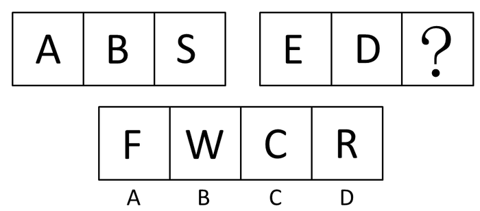

A. A

B. B

C. C

D. D

第 46 题 · 答案与解析

**参考答案（粉笔题库参考内容）**

C

**解析**

元素组成凌乱，可以先考虑元素属性。本题经过验证考查曲直性。第一组图形中第一幅图形是全直，第二幅图形是半直半曲，第三幅图片是全曲。第二组图形与第一组的曲直性相对应，第三个图形应该为全曲。

A、B两项为全直，D项为半直半曲，C项是全曲，只有C项符合规律。

故正确答案为C。

**考点**：属性规律-曲直性、文字/字母/数字类

**来源**：2008年深圳市公务员录用考试《行测》题（下半年）第46题

### 第 47 题

请从所给的这几个选项中，选择最合适的一个填在问号处，使之呈现一定的规律：

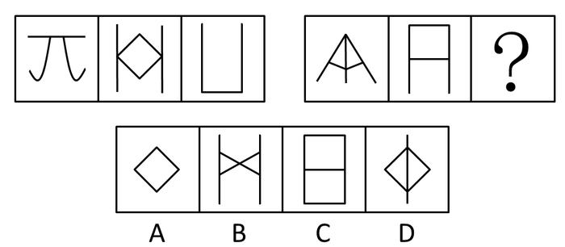

A. A

B. B

C. C

D. D

第 47 题 · 答案与解析

**参考答案（粉笔题库参考内容）**

C

**解析**

元素组成不同，优先考虑属性规律。题干图形较规整，且出现等腰元素，考虑对称性。观察发现，第一组图形分别是字母J、K、L关于竖轴对称组合而成的图形，第二组前两幅图形分别是字母A、F关于竖轴对称的图形，因此“？”处图形应是某个字母关于竖轴对称组合而成的图形，只有C项是字母E关于竖轴对称组合而成的图形。

故正确答案为C。

**考点**：属性规律-对称性、文字/字母/数字类

**来源**：2008年深圳市公务员录用考试《行测》题（下半年）第47题

### 第 48 题

请从所给的这几个选项中，选择最合适的一个填在问号处，使之呈现一定的规律：

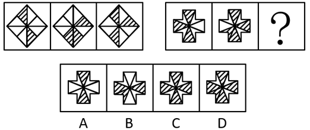

A. A

B. B

C. C

D. D

第 48 题 · 答案与解析

**参考答案（粉笔题库参考内容）**

B

**解析**

元素组成相似，且有阴影部分出现，考查黑白运算。根据第一组：阴影+阴影=空白，空白+空白=空白，阴影+空白=阴影，空白+阴影=阴影，即相同颜色相加为白色，不同颜色相加为阴影，根据这个规律，只有B项符合。

故正确答案为B。

**考点**：样式规律-黑白运算

**来源**：2008年深圳市公务员录用考试《行测》题（下半年）第48题

### 第 49 题

请从所给的这几个选项中，选择最合适的一个填在问号处，使之呈现一定的规律：

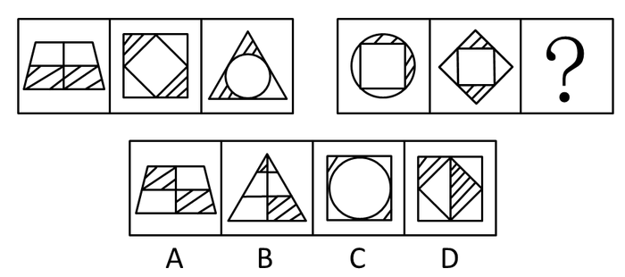

A. A

B. B

C. C

D. D

第 49 题 · 答案与解析

**参考答案（粉笔题库参考内容）**

C

**解析**

元素组成凌乱，且有明显的阴影。

思路一：第一组每个图形都是轴对称图形，并且图形中的阴影部分都是对称的，第二组也依据第一组的规律，只有C项符合。

思路二：特殊考点，图形的内部特征。只关注阴影部分，发现每个图形中的两个阴影部分面积相等，选项中C项满足这个特征，只有C项符合。

故正确答案为C。

**考点**：属性规律-对称性

**来源**：2008年深圳市公务员录用考试《行测》题（下半年）第49题

### 第 50 题

请从所给的这几个选项中，选择最合适的一个填在问号处，使之呈现一定的规律：

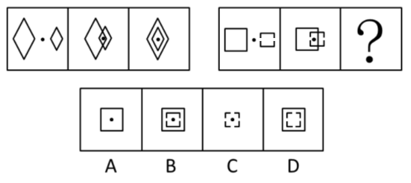

A. A

B. B

C. C

D. D

第 50 题 · 答案与解析

**参考答案（粉笔题库参考内容）**

B

**解析**

元素组成相同，考查位置-平移。第一组中两个不同大小的相同元素向中间移动，以黑点为原点，最后经过2步中心重合，第二组图形也按照此规律移动，两个图形最后中心重合，且保留黑点，只有B项符合。

故正确答案为B。

**考点**：位置规律-平移

**来源**：2008年深圳市公务员录用考试《行测》题（下半年）第50题

### 第 51 题

请从所给的这几个选项中，选择最合适的一个填在问号处，使之呈现一定的规律：

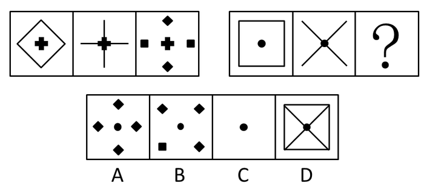

A. A

B. B

C. C

D. D

第 51 题 · 答案与解析

**参考答案（粉笔题库参考内容）**

B

**解析**

元素组成相似，考虑元素的另类叠加。第一组图形中前两个图形中相同的部分保留，不同的部分消掉。同时第二个图给出了中间小元素的移动方向，即沿着十字架的方向。第二组其小元素的叠加方向是对角线方向，第二组中符合此规律的只有B项。

故正确答案为B。

**考点**：样式规律-加减同异

**来源**：2008年深圳市公务员录用考试《行测》题（下半年）第51题

### 第 52 题

请从所给的这几个选项中，选择最合适的一个填在问号处，使之呈现一定的规律：

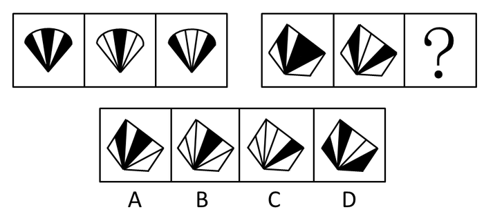

A. A

B. B

C. C

D. D

第 52 题 · 答案与解析

**参考答案（粉笔题库参考内容）**

B

**解析**

元素组成相似，出现明显的颜色变化，考虑黑白运算。根据第一组的我们得到：黑+白=黑，白+白=白，黑+黑=白，第二组根据这个规律进行叠加，得到B项。

故正确答案为B。

**考点**：样式规律-黑白运算

**来源**：2008年深圳市公务员录用考试《行测》题（下半年）第52题

### 第 53 题

请从所给的这几个选项中，选择最合适的一个填在问号处，使之呈现一定的规律：

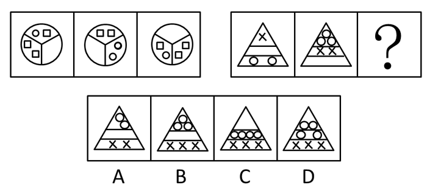

A. A

B. B

C. C

D. D

第 53 题 · 答案与解析

**参考答案（粉笔题库参考内容）**

C

**解析**

元素组成相似，但没有明显规律，采用逆向思维，我们发现第一组中空白部分分别在原图形的不同部分，第二组也依据这个规律，空白部分应该在最上边。

故正确答案为C。

**考点**：样式规律-遍历

**来源**：2008年深圳市公务员录用考试《行测》题（下半年）第53题

### 第 54 题

请从所给的这几个选项中，选择最合适的一个填在问号处，使之呈现一定的规律：

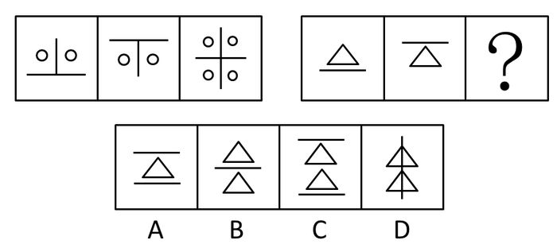

A. A

B. B

C. C

D. D

第 54 题 · 答案与解析

**参考答案（粉笔题库参考内容）**

B

**解析**

元素组成相似，元素的运算-叠加。第一组中第一幅在上，第二幅图在下，叠加在一起组成第三个图形。第二组也依据此规律，只有B项符合。

故正确答案为B。

**考点**：样式规律-加减同异

**来源**：2008年深圳市公务员录用考试《行测》题（下半年）第54题

### 第 55 题

请从所给的这几个选项中，选择最合适的一个填在问号处，使之呈现一定的规律：

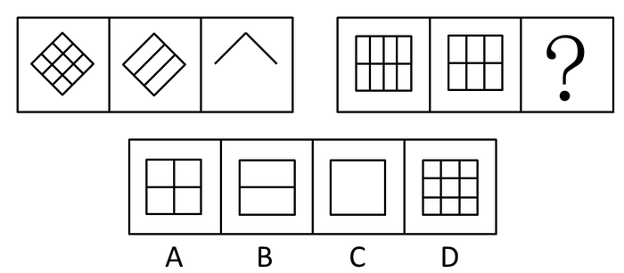

A. A

B. B

C. C

D. D

第 55 题 · 答案与解析

**参考答案（粉笔题库参考内容）**

B

**解析**

元素组成相似，但经过验证排除元素的运算。本题考查元素的线段数量，第一组分别是8、6、2，其差分别为2和4。第二组前两幅图线段数量为8、7，那么二者差为1，下一个差应该为2才符合，所以线段数量应为5，只有B项符合。

故正确答案为B。

**考点**：数量规律-线

**来源**：2008年深圳市公务员录用考试《行测》题（下半年）第55题

### 第 56 题

蛋白质变性是指生物大分子的天然构象遭到破坏导致其生物活性丧失的现象，蛋白质在受到光照、热的作用时，刺激键受到破坏，使蛋白质生物活性丧失，蛋白质遇热会变性沉淀。

因此如果衣服上弄上血渍之后，最好的处理办法是：

A. 尽快用温水洗涤

B. 尽快用开水洗涤

C. 用强力洗衣粉洗涤

D. 尽快用冷水洗涤

第 56 题 · 答案与解析

**参考答案（粉笔题库参考内容）**

D

**解析**

日常推理题。根据题干提炼有效信息为：蛋白质遇热会发生变质，因为刺激键受到破坏，所以使蛋白质活性丧失，形成沉淀。血液中含有蛋白质，所以要想将血液洗净，应该避免热作用，排除A、B两项，C项与题干无关，故D项使用冷水进行冲洗是可以的。

故正确答案为D。

**考点**：日常结论

**来源**：2008年深圳市公务员录用考试《行测》题（下半年）第56题

### 第 57 题

只有全世界各国都承认要尊重任何一个国家的主权，并且真正执行这一条约时，世界才能真正的和平。但是由于某些国家持霸权主义的态度，对本国和其他国家采取了双重原则，因此并没有尊重某些国家的主权。

由此可见：

A. 每个国家都应该尊重其他国家的主权

B. 目前世界已经实现了真正的和平

C. 持霸权主义态度的国家是可耻的

D. 目前世界并没有实现真正的和平

第 57 题 · 答案与解析

**参考答案（粉笔题库参考内容）**

D

**解析**

第一步，翻译题干。

根据第一句话，必要关系的表达可得：世界才能真正的和平→全世界各国都承认要尊重任何一个国家的主权，并且真正执行这一条约。

第二步：逐一分析选项。

A项表达本身无误，但根据题干条件无法推出；

B项跟D项结论相反，排除；

C项与A项都是无法推出的知识背景的代入，排除；

D项通过某些国家的霸权主义否定了后件，那么我们可以得到前件，即目前世界并没有实现真正的和平，推导正确。

故正确答案为D。

**考点**：常规翻译

**来源**：2008年深圳市公务员录用考试《行测》题（下半年）第57题

### 第 58 题

大多数植物只能在0°C以上的环境中生长，到了0°C以下就会停止生长，甚至会被冻死。而某种植物却恰恰相反，不但不怕低温寒冷，相反只有在0°C以下才能生存。极地的岩石给这种植物提供了最佳的生长环境。

由此可以推出：

A. 这种植物只能在极地的岩石上生长

B. 一般植物生长的环境也适合这种植物的生长

C. 这种植物在0°C以上环境无法生存

D. 0°C以下只有这种植物可以生存

第 58 题 · 答案与解析

**参考答案（粉笔题库参考内容）**

C

**解析**

第一步：翻译题干。

“这种植物只有在0°C以下才能生存”得到的结果为：生存→0°C以下。

第二步：分析选项。

A项，“这种植物只能在极地的岩石上生长”，与题干提供的最佳生长环境不符，偷换概念，排除；

B项，“一般植物生长的环境也适合这种植物的生长”，根据第一句话大多数植物适合生长在0°C以上，所以应该是不适合这种植物，排除；

C项，0°C以上代入以上推导关系，是否定后件，否后必否前，得到不能生存，那么C项正确；

D项，“0°C以下只有这种植物可以生存”，从题干中无法得到，排除。

故正确答案为C。

**考点**：常规翻译

**来源**：2008年深圳市公务员录用考试《行测》题（下半年）第58题

### 第 59 题

窝藏、包庇罪是指非共同犯罪人明知他人犯罪，而为其提供隐藏处所、财物，帮助其逃匿或者作假证明包庇的行为。

以下属于窝藏、包庇罪的是：

A. 王某儿子把同学欺负了，王某让孩子去姥姥家住上一段时间

B. 女儿因为感情问题，在男朋友的饮用水中放了铊，其母王女士拿出家中存款，交给女儿让她离开家

C. 赵和李酒后打伤了人，李领着赵去其老家躲避

D. 小强在伤人后，躲到其女朋友所在的城市，对女友及其家属隐瞒了伤人的事情

第 59 题 · 答案与解析

**参考答案（粉笔题库参考内容）**

B

**解析**

第一步：关键词查找。

窝藏、包庇罪关键词是：非共同犯罪人明知他人犯罪，而为其提供隐藏处所、财物，帮助其逃匿或者作假证明包庇的行为。

第二步：逐一分析选项。

A项，王某儿子欺负同学不构成犯罪，所以不符合定义关键词，排除；

B项，女儿的行为是犯罪，王女士提供了隐藏的财物，符合定义；

C项，李和赵是共同犯罪人，没有非共同犯罪人；

D项，小强是在自主躲避，其女友及家人不知情，不符合“明知”，排除。

故正确答案为B。

**考点**：单定义-其他句式

**来源**：2008年深圳市公务员录用考试《行测》题（下半年）第59题

### 第 60 题

交通肇事罪是指违反公路、水路交通运输管理法规，因而发生重大事故，致人重伤、死亡或者使公私财产遭受重大损失的行为。

根据定义，下列属于交通肇事罪的是：

A. 张某在驾驶火车路过岔路时，没有鸣笛，将一过路孩子撞死

B. 王某酒后驾驶，被交警拦截时，超速通过

C. 郑某驾车运输货物时，因刹车失灵，为躲避行人而冲下山崖

D. 一辆由北向南行驶的摩托车将一骑自行车的中年妇女撞倒在地，导致其头部大出血，这辆车居然不顾躺在地上痛苦呻吟的伤员，向东迅速逃离现场

第 60 题 · 答案与解析

**参考答案（粉笔题库参考内容）**

D

**解析**

第一步：关键词查找。

交通肇事罪的关键词是“违反公路、水路交通运输管理法规”，结果是“发生重大事故，致人重伤、死亡或者使公私财产遭受重大损失”。

第二步：逐一分析选项。

A项，违反的是铁路运输条例，不是“公路、水路交通运输”，排除；

B项，王某酒后驾车以及被交警拦截后超速通过的行为违反交通运输管理法规，但没有体现后果，故不符合，排除；

C项，刹车失灵不符合违反交通运输法规，也不属于交通肇事罪，排除；

D项，根据《道路交通安全法》第76条第2款规定：“机动车与非机动车驾驶人、行人之间发生交通事故的，由机动车一方承担责任。”另外摩托车驾驶员在事故发生之后还逃离现场，已经构成交通肇事逃逸罪，正确。

故正确答案为D。

**考点**：原因结果

**来源**：2008年深圳市公务员录用考试《行测》题（下半年）第60题

### 第 61 题

前几年新闻曝光某知名酒厂实际上以次充好，产生巨大轰动，使这个酒厂更加“闻名”，但销售额却从此一落千丈，从这件事情中我们可以看到公共关系学中所讲到的知名度和美誉度的关系。知名度和美誉度反映了社会公众对一个组织的认知和赞许的程度，只有不断提高知名度，才能不断提高组织的美誉度。但知名度只有以美誉度为基础才能产生积极的效应。同时，美誉度要以知名度为条件，才能充分显示其社会价值。

知名度和美誉度的关系是：

A. 知名度低，美誉度必然低

B. 知名度高，美誉度必然高

C. 只有美誉度高，知名度才能高

D. 只有知名度高，美誉度才能高

第 61 题 · 答案与解析

**参考答案（粉笔题库参考内容）**

D

**解析**

第一步：翻译题干。

根据：“只有不断提高知名度，才能不断提高组织的美誉度。”得到：提高美誉度→提高知名度。

第二步：逐一分析选项。

A项，知名度低为否后，否后必否前，所以得到的结果为美誉度不能提高，不提高不等于低，排除；

B项，知名度高推出美誉度高是肯后推肯前，肯后无法得出确定性结论，排除；

C项，意思是“知名度高→美誉度高”，肯后推肯前，排除；

D项，“只有知名度高，美誉度才能高”符合上述推导关系，当选。

故正确答案为D。

**考点**：常规翻译

**来源**：2008年深圳市公务员录用考试《行测》题（下半年）第61题

### 第 62 题

特定物，指具有自身单独的特征，不能为其他物所代替的物。

据此定义，下列属于特定物的是：

A. 外婆传给妈妈的手镯

B. 汉朝的一个出土文物

C. 小张的结婚钻戒

D. 宠物商店里待售的狗粮

第 62 题 · 答案与解析

**参考答案（粉笔题库参考内容）**

B

**解析**

第一步：关键词查找。

特定物关键词：自身具有单独的特征，不能以其他物代替的物。

第二步：逐步分析选项

B项是特定物，自身具有独立的特征，在现代没有别的可以替代的物品，其他三项都有可以替代的物品。

故正确答案为B。

**考点**：单定义-其他句式

**来源**：2008年深圳市公务员录用考试《行测》题（下半年）第62题

### 第 63 题

内感性不适是感觉障碍的一种，它是指躯体内部产生的各种不适感和难以忍受的异样感觉，如牵拉、挤压、游走、蚁爬感等。与内脏性幻觉不同，患者不能明确指出具体不适的部位，多见于精神症、精神分裂症、抑郁状态和脑外伤后精神障碍。

下列哪项属于内感性不适

A. 一位刚做完手术还未从麻醉中彻底苏醒的患者，把塑料管看成了一条蛇，于是拼命躲避，并试图拔掉

B. 某精神分裂症患者感觉到自己的胃先是被大火灼伤，又被很多针穿了孔

C. 某抑郁症患者感觉眼花，声音变得十分低而且遥远，周围环境的颜色变得模糊不清

D. 某精神症患者感觉到身体内部仿佛有气在四处游窜，但却不能指出具体是哪里感觉不舒服

第 63 题 · 答案与解析

**参考答案（粉笔题库参考内容）**

D

**解析**

第一步：找出定义关键词。

“躯体内部产生的各种不适感和难以忍受的异样感觉”、“不能明确指出具体不适的部位”。

第二步：逐一分析选项。

A项：患者把塑料管看成一条蛇，是幻觉，不符合“患者不能明确指出具体不适的部位”，不符合定义，排除；

B项：患者觉得自己的胃不适，能明确指出具体不适的部位，不符合“患者不能明确指出具体不适的部位”，不符合定义，排除；

C项：患者觉得眼睛不适，能够明确指出不适的部位，不符合“患者不能明确指出具体不适的部位”，不符合定义，排除；

D项：患者内感性不适且满足不能明确具体不适的部位，符合“躯体内部产生的各种不适感和难以忍受的异样感觉”、“不能明确指出具体不适的部位”，符合定义，当选。

故正确答案为D。

**考点**：单定义-其他句式

**来源**：2008年深圳市公务员录用考试《行测》题（下半年）第63题

### 第 64 题

被控制妄想是思维障碍的一种，它是指患者体验到自己的意志、思想、语言、情感和行为被某种外力所控制，丧失了自主支配的能力。

下列不属于被控制妄想的是：

A. 某患者从半年前开始听到半空中有一个声音总对他发号施令，要他做这做那，他要是不服从就威胁恐吓

B. 某患者觉得周围的人都对他很不满，往单位饮水机里放药，而这种药只对他发生作用，使他身体日渐虚弱

C. 某患者认为国家安全局在他的体内植入了一种遥控装置，那边的人一按遥控器，他就必须按照指令去说话和做事情

D. 某患者坚信自己掌握着世界核武器的按钮，动不动就拿着一个烟盒告诉别人，如果别人不听他的指挥，他就按下核按钮

第 64 题 · 答案与解析

**参考答案（粉笔题库参考内容）**

D

**解析**

第一步：关键词查找。

被控制妄想的关键词是：“患者体验到自己的意志、思想、语言、情感和行为被某种外力所控制”、“丧失了自主支配能力。”

第二步：逐步分析选项。

A项，是听见空中有个声音，这符合被某种外力控制，符合定义；

B项，是他自己的思想被某种外力控制，总是认为有人给他下毒，符合定义；

C项，是国家安全局这个外力远程对某患者进行控制，使其丧失自主支配能力，符合定义；

D项，是患者主动幻想去控制别人，不符合被外力控制，不符合定义。

本题为选非题，故正确答案为D。

**考点**：单定义-其他句式

**来源**：2008年深圳市公务员录用考试《行测》题（下半年）第64题

### 第 65 题

只有政府停止向农民征税并且保障农民的最低生活保障，农民才可能脱去沉重的生活负担，但是由于我国农民人口众多，占到总人口的三分之二，而政府并没有负担如此大的人口的经济财力。

由此可见：

A. 农民是政府的负担，应该将农民搬迁入城镇来减少政府负担

B. 农民的生活负担依然沉重

C. 要在农村发展手工业提高农民生活水平

D. 要加强农村的教育建设，让改变从教育开始

第 65 题 · 答案与解析

**参考答案（粉笔题库参考内容）**

B

**解析**

第一步：翻译题干有效信息。

题干中的“只有······才······”是必要条件表达，题干翻译为“农民可能脱去沉重的生活负担→政府停止向农民征税 且 保障农民的最低生活保障”。

第二步：逐一分析选项。

题干中的事实：我国农民人口众多，并且政府没有负担如此大的人口的经济财力，所以很难保证农民的最低生活保障。把这个结果代入推导关系，即否定了后件，我们可以得到否定前件，即农民无法脱去沉重的生活负担。

A项，题干中没有提及，排除；

B项，符合这个结果，当选；

C项，未涉及发展手工业，排除；

D项，教育也没有提到，排除。

故正确答案为B。

**考点**：常规翻译

**来源**：2008年深圳市公务员录用考试《行测》题（下半年）第65题

## 材料 1

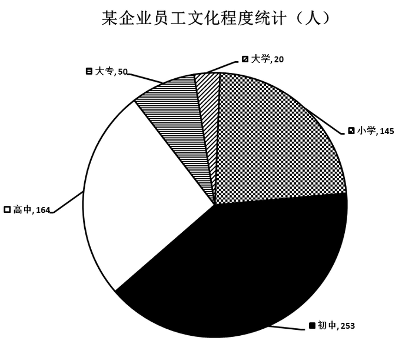

### 第 66 题

该企业中，什么文化程度的员工所占比例最大：

A. 大学

B. 大专

C. 高中

D. 初中

第 66 题 · 答案与解析

**参考答案（粉笔题库参考内容）**

D

**解析**

由图可知，初中文化程度的员工人数最多，为253人，所以所占比例最大。

故正确答案为D。

**考点**：直接找数、统计图

**来源**：2008年深圳市公务员录用考试《行测》题（下半年）第66题

### 第 67 题

在该企业中，大学、大专、高中学历员工总数和初中学历相比：

A. 一样多

B. 少

C. 多

D. 不确定

第 67 题 · 答案与解析

**参考答案（粉笔题库参考内容）**

B

**解析**

由图可知，大学、大专、高中学历的员工总数=20+50+164=234人，初中学历的员工为253人，所以初中学历的员工比较多。

故正确答案为B。

**考点**：简单加减计算、统计图

**来源**：2008年深圳市公务员录用考试《行测》题（下半年）第67题

### 第 68 题

在该企业中，大专和大学学历人数占总数的：

A. 13.4%

B. 11.1%

C. 12.8%

D. 14.2%

第 68 题 · 答案与解析

**参考答案（粉笔题库参考内容）**

B

**解析**

由图可知，该企业的员工总数=50+20+164+253+145=632人，大专和大学学历人数=50+20=70人，所以大专和大学学历人数占总数的比列。

故正确答案为B。

**考点**：现期比重、统计图

**来源**：2008年深圳市公务员录用考试《行测》题（下半年）第68题

### 第 69 题

在该企业中，初中人数比高中人数多：

A. 79人

B. 99人

C. 54.3%

D. 66.22%

第 69 题 · 答案与解析

**参考答案（粉笔题库参考内容）**

C

**解析**

由图可知，初中人数比高中人数多253-164=89人，比例为。

故正确答案为C。

**考点**：现期倍数、统计图

**来源**：2008年深圳市公务员录用考试《行测》题（下半年）第69题

### 第 70 题

以下说法正确的是：

A. 员工中小学学历人数占总数的25.3%

B. 员工中高中学历人数占总数的28.1%

C. 员工中大专学历人数占总数的20.2%

D. 员工中初中和小学学历人数占总数的63.0%

第 70 题 · 答案与解析

**参考答案（粉笔题库参考内容）**

D

**解析**

A项，员工中小学学历人数占总数的百分比为，错误；

B项，员工中高中学历人数占总数的百分比为，错误；

C项，员工中大专学历人数占总数的百分比为，错误；

D项，员工中初中和小学学历人数占总数的百分比为（145+253）÷632=398÷632≈63%，正确。

故正确答案为D。

**考点**：现期比重、统计图

**来源**：2008年深圳市公务员录用考试《行测》题（下半年）第70题

## 材料 2

2007年一季度，全国税收收入累计完成11284亿元，比上年同期增收2296亿元，增长25.5%。全国共办理出口退税1175亿元，比上年同期增长17.1%。

        一季度，各月份收入规模均在3000亿元以上，分别完成4843亿元、3156亿元和3285亿元。收入增幅均在20%以上，分别增长27.6%、25%和23.2%，月度收入的均衡性为近年最好水平。

        前2个月，与工业增值税对应的全国规模以上工业完成增加值同比增长18.5%，相应地，一季度工业增值税完成3102亿元，同比增长19.7%；房地产投资同比增长24.3%，与房地产投资相关的建筑安装业和房地产业营业税增长35.3%；一般贸易进口增幅同比增长24%，相应地，一季度，海关代征进口税收完成1419亿元，同比增长27%；汽车市场销售形势较好，前2个月，汽车销量同比增长25%，一季度车辆购置税完成204亿元，同比增长28%。

        一季度，地方各税共完成677亿元，比上年同期增收145亿元，高于全国平均增速1.7个百分点，其中，资源税在去年政策调整以及加强源泉控管的带动下，完成64亿元，同比增长33%；由于房地产市场供需两旺以及各地税务机关加强对土地增值税预征和清算的征管力度，土地增值税完成88亿元，同比增长85.2%；城镇土地使用税增长势头也比较好，完成46亿元，同比增长37.3%。

        一季度，东、中、西三大地区呈现全面较快增涨态势，西部增长领先。东部地区税收收入完成7921亿元，比上年同期增长24.9%，占全国税收收入的比重为70.2%；中部地区税收收入完成1762亿元，增长24.6%，占全国税收收入的比重为15.6%；西部地区税收收入完成1601亿元，增长29.8%，占全国税收收入的比重为14.2%，较上年同期提高0.5个百分点。

### 第 71 题

2007年一季度全国出口退税总额比去年同期增加了：

A. 160亿元

B. 172亿元

C. 185亿元

D. 201亿元

第 71 题 · 答案与解析

**参考答案（粉笔题库参考内容）**

B

**解析**

根据材料，“全国共办理出口退税1175亿元，比上年同期增长17.1%”，则出口退税增加了亿元。

故正确答案为B。

**考点**：增长量计算、文字资料

**来源**：2008年深圳市公务员录用考试《行测》题（下半年）第71题

### 第 72 题

以下税种在2007年一季度增长幅度由大到小排序正确的是：

A. 工业增值税，车辆购置税、海关代征进口税

B. 海关代征进口税，车辆购置税，工业增值税

C. 车辆购置税，工业增值税，海关代征进口税

D. 车辆购置税，海关代征进口税，工业增值税

第 72 题 · 答案与解析

**参考答案（粉笔题库参考内容）**

D

**解析**

根据材料，工业增值税增长19.7%，海关代征进口税增长27%，车辆购置税增长28%。

故正确答案为D。

**考点**：排序类、文字资料

**来源**：2008年深圳市公务员录用考试《行测》题（下半年）第72题

### 第 73 题

2006年一季度共完成车辆购置税约：

A. 159亿元

B. 164亿元

C. 173亿元

D. 184亿元

第 73 题 · 答案与解析

**参考答案（粉笔题库参考内容）**

A

**解析**

根据材料，2007年一季度车辆购置税完成204亿元，同比增长28%，则2006年一季度完成车辆购置税为亿元。

故正确答案为A。

**考点**：基期计算、文字资料

**来源**：2008年深圳市公务员录用考试《行测》题（下半年）第73题

### 第 74 题

与上年同期相比，地方税收增长了约：

A. 20.5%

B. 21.4%

C. 24.8%

D. 27.3%

第 74 题 · 答案与解析

**参考答案（粉笔题库参考内容）**

D

**解析**

根据材料，“一季度，地方各税共完成677亿元，比上年同期增收145亿元”，则地方税收比上年同期增长。

故正确答案为D。

**考点**：一般增长率、文字资料

**来源**：2008年深圳市公务员录用考试《行测》题（下半年）第74题

### 第 75 题

根据上述材料，下列关于2007年一季度税收情况的说法中不正确的是：

A. 一季度各月份税收收入增长超过了20%

B. 工业增值税、海关代征进口税等主体税种增长较快，且与相关经济发展基本协调

C. 材料中提到的地方税中，按增长幅度由大到小为土地增值税、资源税、城镇土地使用税

D. 东部地区税收约占全国税收的七成

第 75 题 · 答案与解析

**参考答案（粉笔题库参考内容）**

C

**解析**

A项，根据材料第二段“收入增幅均在20%以上”，故正确；

B项，根据材料第三段“与工业增值税对应的全国规模以上工业完成增加值同比增长18.5%，相应地，一季度工业增值税完成3102亿元，同比增长19.7%”“相应地，一季度，海关代征进口税收完成1419亿元，同比增长27%”“汽车销量同比增长25%，一季度车辆购置税完成204亿元，同比增长28%”，故正确；

C项，根据材料，增长幅度由大到小为土地增值税85.2%、城镇土地使用税37.3%、资源税33%，故错误；

D项，根据材料第五段“东部地区税收收入完成7921亿元，比上年同期增长24.9%，占全国税收收入的比重为70.2%”，故正确。

本题为选非题，故正确答案为C。

**考点**：文字资料、综合分析

**来源**：2008年深圳市公务员录用考试《行测》题（下半年）第75题

## 材料 3

2002年底，全国在运管部门登记注册的公路运输汽车达826.3万辆，比上年增加61.9万辆。运力结构继续调整。全国拥有大型运输客车16.1万辆，大型普通运输货车183.5万辆，分别比上年减少0.6万辆和2.6万辆；专用载货汽车16.5万辆，增长30.8%。其中集装箱货车增加了0.7万辆，增长28.2%。

        公路运输总量继续增长。2002年全社会完成公路客运量147.5亿人，旅客周转量7805.8亿人公里，分别比上年增长5.1%和8.3%；全社会完成公路货运量111.6亿吨，货物周转量6782.5亿吨公里，分别比上年增长5.7%和7.1%。公路客运量、旅客周转量在综合运输体系中所占比重分别为91.8%和55.3%；公路运输量、货物周转量在综合运输体系中所占比重分别为75.3%和13.4%。

        水路货运总量持续增长。2002年全社会完成水路货运量14.2亿吨，货物周转量27510.6亿吨公里，分别比上年增长6.8%和5.9%。水路客运量持续下降的局面得到扭转，但旅客周转量的下降趋势仍在延续。2002年全社会完成水路客运量1.9亿人，比上年增长0.5%，旅客周转量81.8亿人公里，比上年下降9.0%。水路客运量、旅客周转量在综合运输体系中所占比重分别为1.2%和0.6%；水路货运量、货物周转量在综合运输中所占比重分别为9.6%和54.5%。

        在全社会水路货运中，内河运输完成货运量7.6亿吨、货物周转量1508.7亿吨，分别占全社会水路货运量、货物周转量的53.3%和5.5%；沿海运输完成货运量3.6亿吨、货物周转量4269.2亿吨公里，分别占25.6%和15.5%；远洋运输完成货运量3.0亿吨、货物周转量21732.7亿吨公里，分别占21.1%和79.0%。

### 第 76 题

与上年相比，2002年登记注册的公路运输汽车增长了：

A. 7.5%

B. 7.7%

C. 8.1%

D. 9.2%

第 76 题 · 答案与解析

**参考答案（粉笔题库参考内容）**

C

**解析**

根据材料，“全国在运管部门登记注册的公路运输汽车达826.3万辆，比上年增加61.9万辆”，可得增长率为。

故正确答案为C。

**考点**：一般增长率、文字资料

**来源**：2008年深圳市公务员录用考试《行测》题（下半年）第76题

### 第 77 题

集装箱货车增加量占专用货车增加量的：

A. 17.9%

B. 18.4%

C. 20.0%

D. 22.1%

第 77 题 · 答案与解析

**参考答案（粉笔题库参考内容）**

A

**解析**

根据材料，“专用载货汽车16.5万辆，增长30.8%。其中集装箱货车增加了0.7万辆，增长28.2%”，可得集装箱货车增加量占专用货车增加量。

故正确答案为A。

**考点**：文字资料、现期比重

**来源**：2008年深圳市公务员录用考试《行测》题（下半年）第77题

### 第 78 题

2002年综合运输体系共完成旅客周转量：

A. 11347.5亿人公里

B. 12568.9亿人公里

C. 14115.4亿人公里

D. 14876.5亿人公里

第 78 题 · 答案与解析

**参考答案（粉笔题库参考内容）**

C

**解析**

根据材料，2002年“旅客周转量7805.8亿人公里”“公路客运量、旅客周转量在综合运输体系中所占比重分别为91.8%和55.3%”，可知2002年综合运输体系共完成旅客周转量亿人公里。

故正确答案为C。

**考点**：文字资料、现期比重

**来源**：2008年深圳市公务员录用考试《行测》题（下半年）第78题

### 第 79 题

下列数据中，增长幅度最大的是：

A. 公路客运量

B. 公路旅客周转量

C. 公路货运量

D. 公路货物周转量

第 79 题 · 答案与解析

**参考答案（粉笔题库参考内容）**

B

**解析**

根据材料，公路客运量的增长幅度为5.1%，公路旅客周转量增长幅度为8.3%，公路货运量增长幅度为5.7%，公里货物周转量增幅为7.1%，故公路旅客周转量增幅最大。

故正确答案为B。

**考点**：文字资料、直接找数

**来源**：2008年深圳市公务员录用考试《行测》题（下半年）第79题

### 第 80 题

根据上述材料，下列说法中不正确的是：

A. 在综合运输体系中，公路客运量占了九成还多

B. 公路货运量在综合运输中所占比重约为水路货运量的8倍

C. 公路货物周转量在综合运输中所占的比重还不及三分之一

D. 水路货运量的主体是沿海运输，它占了水路货运总量的一半还多

第 80 题 · 答案与解析

**参考答案（粉笔题库参考内容）**

D

**解析**

A项，公路客运量在综合运输体系中所占比重为91.8%，即九成多，故正确；

B项，根据材料，“全社会完成公路货运量111.6亿吨”“2002年全社会完成水路货运量14.2亿吨”，所以公路货运量在综合运输中所占比重与水路货运量所占比重比为111.6÷14.2≈8，故正确；

C项，公路货物周转量在综合运输中的比重为13.4%，不到1/3，故正确；

D项，根据材料，水路货运量的主体是内河运输，占水路货运总量的53.3%，不是沿海运输，故错误。

本题为选非题，故正确答案为D。

**考点**：文字资料、综合分析

**来源**：2008年深圳市公务员录用考试《行测》题（下半年）第80题

## 材料 4

我国2000—2004年城镇就业人口的状况单位：万人

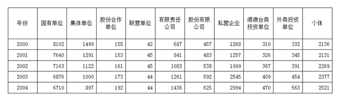

### 第 81 题

从表上可以得出，从2000年到2004年就业人口最多的单位是：

A. 国有单位

B. 集体单位

C. 私营企业

D. 个体

第 81 题 · 答案与解析

**参考答案（粉笔题库参考内容）**

A

**解析**

由表可知，国有单位在2000-2004年中就业人口最多，所以总和也是最多。

故正确答案为A。

**考点**：直接找数、统计表

**来源**：2008年深圳市公务员录用考试《行测》题（下半年）第81题

### 第 82 题

从2000年到2004年就业人口一直呈上升状态的有几类单位：

A. 4

B. 5

C. 6

D. 7

第 82 题 · 答案与解析

**参考答案（粉笔题库参考内容）**

A

**解析**

由表可知，就业人口一直呈上升状态的包括：有限责任公司、股份有限公司、港澳台商投资单位和外商投资单位4类单位。

故正确答案为A。

**考点**：直接找数、统计表

**来源**：2008年深圳市公务员录用考试《行测》题（下半年）第82题

### 第 83 题

2000~2004年集体单位平均每年减少多少万人口：

A. 1204000

B. 1505000

C. 120.4

D. 150.5

第 83 题 · 答案与解析

**参考答案（粉笔题库参考内容）**

D

**解析**

由表可知，2000年集体单位的就业人口有1499万人，2004年有897万人，所以，平均每年减少（1499-897）÷4≈150万人。

故正确答案为D。

**考点**：年均增长量、统计表

**来源**：2008年深圳市公务员录用考试《行测》题（下半年）第83题

### 第 84 题

2004年的总就业人口为多少人：

A. 16452

B. 157310000

C. 15731

D. 164520000

第 84 题 · 答案与解析

**参考答案（粉笔题库参考内容）**

D

**解析**

可以把2004年所有单位的就业人口相加，根据选项末位数字不同，可以用尾数法。所有单位就业人员末位数相加为2，注意表格单位是万人，题目单位是人。

故正确答案为D。

**考点**：简单加减计算、统计表

**来源**：2008年深圳市公务员录用考试《行测》题（下半年）第84题

### 第 85 题

下列说法错误的是：

A. 2004年的总就业人口与2003年相比有所增加

B. 就业人口一直在减少的只有国有单位和集体单位

C. 2004年有限责任公司的就业人口与2000年相比增长了52%

D. 联营单位的就业人口这几年变化较小

第 85 题 · 答案与解析

**参考答案（粉笔题库参考内容）**

C

**解析**

A项，由表可知，2004年虽然有的单位就业人口减少，但整体就业人口还是有所增加，故正确；

B项，由表可知，就业人口一直在减少的只有国有单位和集体单位，其他单位均有升有降，故正确；

C项，2004年有限责任公司的就业人口比2000年增加了，故错误；

D项，由表可知，联营单位的就业人口变化最小，浮动在0-3人，故正确。

本题为选非题，故正确答案为C。

**考点**：统计表、综合分析

**来源**：2008年深圳市公务员录用考试《行测》题（下半年）第85题

### 第 86 题

划分哲学史上可知论与不可知论的客观标准是：

A. 思维与存在谁是第一性、谁是第二性问题

B. 思维能否认识存在

C. 物质派生意识，还是意识派生物质问题

D. 世界是否联系发展

第 86 题 · 答案与解析

**参考答案（粉笔题库参考内容）**

B

**解析**

可知论：认为世界是可知的，是可以为人所认知的。世界是物质的，若我们的思维，意识可以正确的反映物质世界，则我们承认思维与存在具有同一性，即这个世界是可知的（就是可以被我们了解，认识，知道的）。

不可知论：认为世界不可名状，是不可知的，是时刻变化着的。我们的思维无法正确反映物质世界（即我们无法了解认识知道这个世界）。

思维和存在的关系问题是哲学的基本问题。即思维能否认识存在的问题，这是划分可知论和不可知论的标准。

故正确答案为B。

**考点**：总论

**来源**：2008年深圳市公务员录用考试《行测》题（下半年）第86题

### 第 87 题

在我国刑罚执行中，对判处哪种刑法采取吸收原则？

A. 有期徒刑

B. 无期徒刑

C. 拘役

D. 管制

第 87 题 · 答案与解析

**参考答案（粉笔题库参考内容）**

B

**解析**

吸收原则，是指对一人所犯数罪采用重罪吸收轻罪或者重罪刑吸收轻罪刑的合并处罚规则。换言之，它是由一人所犯数罪中法定刑最重的罪吸收其它较轻的罪，或者由最重宣告刑吸收其它较轻的宣告刑，仅以最重罪的宣告刑或者已宣告的最重刑罚作为执行刑罚的合并处罚规则。这种原则对死刑、无期徒刑比较适宜。

故正确答案为B。

**考点**：刑法

**来源**：2008年深圳市公务员录用考试《行测》题（下半年）第87题

### 第 88 题

关于行政征收与征用的区别，错误的是：

A. 两者都具有强制性

B. 前者的范围仅限于相对人的财产；而后者的范围限于相对人的财产或劳务

C. 前者是将相对人的财产所有权转移给国家；而后者则是对相对人财产的暂时性使用

D. 两者都具有补偿性

第 88 题 · 答案与解析

**参考答案（粉笔题库参考内容）**

D

**解析**

相同点：都具有强制性，都是单方行政行为。

法律后果：行政征收，财产所有权从相对人转向国家。行政征用，行政主体暂时取得了被征用方财产的使用权，不发生财产所有权的转移。

行为标的：行政征收，一般限于财产。行政征用，除财产外，可能还包括劳务。

能否取得补偿：行政征收，无偿或有偿。行政征用，一般有偿。

D项错误，行政征收是无偿的，行政征用是有偿的。

本题为选非题，故正确答案为D。

**考点**：行政法

**来源**：2008年深圳市公务员录用考试《行测》题（下半年）第88题

### 第 89 题

下列行政处罚的种类中，哪一个属于行为罚？

A. 驱逐出境

B. 没收

C. 责令停产停业

D. 警告

第 89 题 · 答案与解析

**参考答案（粉笔题库参考内容）**

C

**解析**

行为罚亦称能力罚，是行政主体对违反行政法律规范的行政相对方所采取的限制或剥夺其特定行为能力或资格的一种处罚措施。行为罚包括责令停产停业，暂扣或吊销许可证、执照两种形式。

故正确答案为C。

**考点**：行政法

**来源**：2008年深圳市公务员录用考试《行测》题（下半年）第89题

### 第 90 题

建立现代企业的根本目的是：

A. 增强企业活力，加大市场竞争力

B. 迎接经济全球化的挑战，与国际接轨

C. 调动企业员工的积极性、创造性

D. 强化社会主义市场经济的微观基础，进一步解放和发展社会主义社会的生产力

第 90 题 · 答案与解析

**参考答案（粉笔题库参考内容）**

D

**解析**

A、B、C三项错误，建立现代企业制度的根本目的是解放和发展生产力，A、B、C三项内容也是现代企业制度带来的好处，但不是根本目的。

故正确答案为D。

**考点**：市场经济

**来源**：2008年深圳市公务员录用考试《行测》题（下半年）第90题

### 第 91 题

市场体系的三大支柱不包括：

A. 商品市场

B. 资本市场

C. 劳动力市场

D. 信息市场

第 91 题 · 答案与解析

**参考答案（粉笔题库参考内容）**

D

**解析**

市场体系是相互联系的各类市场的有机统一体，商品市场、资本市场、劳动力市场是市场体系的最基本内容,是市场体系的三大支柱。

D项错误，不是市场体系的三大支柱之一。

本题为选非题，故正确答案为D。

**考点**：市场经济

**来源**：2008年深圳市公务员录用考试《行测》题（下半年）第91题

### 第 92 题

什么是建立社会主义市场经济体制的内在要求，是政府职能转变的关键？

A. 精简机构

B. 提高效率

C. 政企分开

D. 科学管理

第 92 题 · 答案与解析

**参考答案（粉笔题库参考内容）**

C

**解析**

政府职能转变是指政府在一定时期内，根据经济和社会发展的需要，对其职能的范围、内容、方式的转移与变化。政企分开是建立社会主义市场经济体制的内在要求，是政府职能转变的关键，也是当前中国机构改革成功的必要条件。

故正确答案为C。

**来源**：2008年深圳市公务员录用考试《行测》题（下半年）第92题

### 第 93 题

行政管理是指国家行政机关依法管理：

A. 国家事务

B. 社会事务

C. 民族事务

D. 国家事务和社会事务

第 93 题 · 答案与解析

**参考答案（粉笔题库参考内容）**

D

**解析**

行政管理是运用国家权力对社会事务的一种管理活动。在我国，行政管理主体是国务院和地方各级人民政府，公共行政客体是国家事务、社会公共事务和行政机关的内部事务。

故正确答案为D。

**来源**：2008年深圳市公务员录用考试《行测》题（下半年）第93题

### 第 94 题

解决“三农”问题是实现全面建设小康社会和中华民族伟大复兴的中坚，需要一代又一代共产党人带领全国各族人民不断接力奋斗。因此，中共十七大三中全会审议通过的哪项决定，是一个非常重要的纲领性文献？

A. 《中共中央关于推进农村小康社会建设若干重大问题的决定》

B. 《中共中央关于推进农村改革发展若干重大问题的决定》

C. 《中共中央关于推进农业优先发展若干重大问题的决定》

D. 《中共中央关于推进农民全面富裕若干重大问题的决定》

第 94 题 · 答案与解析

**参考答案（粉笔题库参考内容）**

B

**解析**

中国共产党第十七届中央委员会第三次全体会议通过《中共中央关于推进农村改革发展若干重大问题的决定》全面分析了形势和任务，认为在改革开放三十周年之际，系统回顾总结我国农村改革发展的光辉历程和宝贵经验，进一步统一全党全社会认识，加快推进社会主义新农村建设，大力推动城乡统筹发展，对于全面贯彻党的十七大精神，深入贯彻落实科学发展观，夺取全面建设小康社会新胜利、开创中国特色社会主义事业新局面，具有重大而深远的意义。

故正确答案为B。

**考点**：经济建设、重要文件

**来源**：2008年深圳市公务员录用考试《行测》题（下半年）第94题

### 第 95 题

第二十九届奥运会于2008年8月1日至24日举行，作为东道主，中国体育代表团取得多少枚金牌，创造了中国体育代表团参加奥运会以来的最好成绩？

A. 39

B. 45

C. 51

D. 57

第 95 题 · 答案与解析

**参考答案（粉笔题库参考内容）**

C

**解析**

本题考查人文常识。

中国代表团在2008年第二十九届奥运会上取得了51枚金牌、21枚银牌、28枚铜牌的好成绩，排在各代表团金牌榜的首位。

故正确答案为C。

**考点**：中国历史

**来源**：2008年深圳市公务员录用考试《行测》题（下半年）第95题

### 第 96 题

一般由标题、正文、发文机关名称和成文日期三部分构成的文种是：

A. 通告

B. 通知

C. 批复

D. 请示

第 96 题 · 答案与解析

**参考答案（粉笔题库参考内容）**

A

**解析**

通告一般由标题、正文、发文机关名称和成文日期三部分构成，无主送机关；通知一般由标题、主送机关、正文、发文机关名称和发文日期组成，知照性通知可以不写主送机关；批复和请示都有主送机关这一部分。

故正确答案为A。

**来源**：2008年深圳市公务员录用考试《行测》题（下半年）第96题

### 第 97 题

深圳拥有全国最大的陆路货运口岸，即＿＿＿＿＿口岸。该口岸实行24小时通关，对促进深港两地的客流、物流畅通、经济发展发挥积极作用。

A. 皇岗口岸

B. 沙头角口岸

C. 罗湖口岸

D. 文锦渡口岸

第 97 题 · 答案与解析

**参考答案（粉笔题库参考内容）**

A

**解析**

皇岗口岸位于广东省深圳市福田区，与香港新界落马洲口岸相对，是深圳与香港之间的5个一线口岸之一，皇岗口岸是目前中国规模最大的客货综合性公路口岸，也是全国最大的陆路口岸之一，是继珠海的拱北口岸之后的全中国第三大客运口岸。

故正确答案为A。

**考点**：中国地理

**来源**：2008年深圳市公务员录用考试《行测》题（下半年）第97题

### 第 98 题

十七大通过的党章修正案把中国共产党在社会主义初级阶段的基本路线表述为：领导和团结全国各族人民，以经济建设为中心，坚持四项基本原则，坚持改革开放，自力更生，艰苦创业，为把我国建设成为＿＿＿＿＿＿的社会主义现代国家而奋斗。

A. 富强民主文明

B. 民主富强和谐

C. 富强民主文明和谐

D. 富强文明和谐

第 98 题 · 答案与解析

**参考答案（粉笔题库参考内容）**

C

**解析**

经过新中国成立以来特别是改革开放以来的不懈努力，我国取得了举世瞩目的发展成就，但我国仍处于并将长期处于社会主义初级阶段的基本国情没有变，人民日益增长的物质文化需要同落后的社会生产之间的矛盾这一社会主要矛盾没有变。一致同意在党章中把党的基本路线中的奋斗目标表述为把我国建设成为富强民主文明和谐的社会主义现代化国家。要求全党毫不动摇地坚持党的“一个中心、两个基本点”的基本路线，团结带领全国各族人民为把我国建设成为社会主义现代化国家而奋斗。

故正确答案为C。

**来源**：2008年深圳市公务员录用考试《行测》题（下半年）第98题

### 第 99 题

十六大以来，党中央坚持以邓小平理论和“三个代表”重要思想为指导，根据新的发展要求，集中全党智慧，提出了：

A. 中国特色社会主义理论

B. 全面建设小康社会的新目标

C. 社会主义初级阶段理论

D. 以人为本，全面协调可持续发展的科学发展观

第 99 题 · 答案与解析

**参考答案（粉笔题库参考内容）**

D

**解析**

党中央提出了以人为本，深化了中国特色社会主义建设和发展的根本理念提出了全面协调可持续发展，顺应了当今时代发展变化的新要求提出了统筹兼顾，体现了辩证发展的理论品格科学发展观是我国经济社会发展的重要指导方针，是发展中国特色社会主义必须坚持和贯彻的重大战略思想。

故正确答案为D。

**来源**：2008年深圳市公务员录用考试《行测》题（下半年）第99题

### 第 100 题

主张认识的主体是从事实践活动的人，是哪个主义的观点？

A. 唯心主义

B. 旧唯物主义

C. 形而上学

D. 辩证唯物主义

第 100 题 · 答案与解析

**参考答案（粉笔题库参考内容）**

D

**解析**

辩证唯物主义认为，人的认识是客观物质世界的运动经细化在人脑中的反映。辩证唯物主义的认识论既唯物地又是辩证地解决了人的认识的内容、来源和发展过程的问题。它认为物质可以变成精神，精神可以变成物质，而这种主观和客观辩证统一的实现都必须通过实践。实践的观点是辩证唯物主义认识论的第一的和基本的观点。认识来源于实践，又转过来为实践服务。实践、认识、再实践、再认识，循环往复，以至无穷，这就是人们正确地认识世界和能动地改造世界的无限发展的过程。

故正确答案为D。

**考点**：唯物论

**来源**：2008年深圳市公务员录用考试《行测》题（下半年）第100题

