# 2008年深圳市公务员录用考试《行测》题（上半年）

<!-- gwy:overview:start -->
> **深圳 · 2008 · 行测 · 统考** ｜ 100 题 · 图片 108 处 · 答案随题折叠

| 题型模块 | 题量 | 题号 |
| --- | ---: | ---: |
| 数量关系 | 15 | 1–15 |
| 言语理解与表达 | 25 | 16–40 |
| 判断推理 | 25 | 41–65 |
| 资料分析 | 20 | 66–85 |
| 公共基础知识 | 15 | 86–100 |
| **合计** | **100** | |

导航：[题型与作答说明](#题型与作答说明) · [题目](#题目) · [材料 1](#材料-1)
<!-- gwy:overview:end -->

> 候选采集稿。参考答案及解析来自粉笔页面，不代表官方答案或真实高分答卷；来源使用许可与原卷对应关系仍需人工核实。

## 题型与作答说明

数量关系

（15题）

本部分包括数字推理与数学运算两种类型的题目。

言语理解与表达

（25题）

每道题给出一段文字，从四个选项中选出一个最恰当的答案。

判断推理

（25题）

本部分包括图形推理、事件排序、判断与推理三种类型的试题。

资料分析

（20题）

针对下列图、表或文字回答问题。你应该根据资料提供的信息进行分析、比较、计算、处理。

公共基础知识

（15题）

根据题目要求，在四个选项中选出一个正确答案。

## 题目

### 第 1 题

1，4，27，16，125，36，。

A. 252

B. 343

C. 49

D. 108

第 1 题 · 答案与解析

**参考答案（粉笔题库参考内容）**

B

**解析**

根据题目。

原数列可以变为，，，，，；

底数为：1，2，3，4，5，6，公差为1的等差数列；

指数为：3，2，3，2，3，2是周期数列。

所以。

故正确答案为B。

**来源**：2008年深圳市公务员录用考试《行测》题（上半年）第1题

### 第 2 题

1，6，7，43，。

A. 90

B. 91

C. 92

D. 93

第 2 题 · 答案与解析

**参考答案（粉笔题库参考内容）**

C

**解析**

根据题目，原数列可以化为，，即符合：。所以。

故正确答案为C。

**来源**：2008年深圳市公务员录用考试《行测》题（上半年）第2题

### 第 3 题

5，16，50，153，。

A. 256

B. 369

C. 454

D. 463

第 3 题 · 答案与解析

**参考答案（粉笔题库参考内容）**

D

**解析**

根据题目，原数列可以化为，，，即符合：，所以。

故正确答案为D。

**来源**：2008年深圳市公务员录用考试《行测》题（上半年）第3题

### 第 4 题

3，9，13，39，14，42，23，。

A. 46

B. 58

C. 68

D. 69

第 4 题 · 答案与解析

**参考答案（粉笔题库参考内容）**

D

**解析**

根据题目，对原数列进行两两分组(3,9)，(13,39)，(14,42)，第一项×3=第二项。所以。

故正确答案为D。

**来源**：2008年深圳市公务员录用考试《行测》题（上半年）第4题

### 第 5 题

4，4，16，144，。

A. 162

B. 2304

C. 242

D. 512

第 5 题 · 答案与解析

**参考答案（粉笔题库参考内容）**

B

**解析**

根据题目，原数列可以化为，，，即符合：。所以。

故正确答案为B。

**来源**：2008年深圳市公务员录用考试《行测》题（上半年）第5题

### 第 6 题

有面值为1分、2分、5分的硬币各4枚，如果用它们去支付2角3分，则有多少种不同的支付办法？

A. 5

B. 6

C. 7

D. 8

第 6 题 · 答案与解析

**参考答案（粉笔题库参考内容）**

A

**解析**

选项数字较小，考虑枚举法。根据题目，1分和2分的总钱数为1角2分，要支付2角3分至少需要用3个5分的硬币。

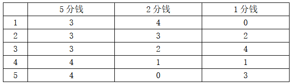

总计5种方法。

故正确答案为A。

**考点**：基础排列组合

**来源**：2008年深圳市公务员录用考试《行测》题（上半年）第6题

### 第 7 题

甲、乙两车同时从A、B两地相向而行，在距B地54千米处相遇，它们各自到达对方车站后立即返回，在距A地42千米处相遇。请问A、B两地相距多少千米？

A. 120

B. 100

C. 90

D. 80

第 7 题 · 答案与解析

**参考答案（粉笔题库参考内容）**

A

**解析**

根据题目，设A、B两地相距为S千米，则第一次相遇时甲所走的路程为S-54，第二次相遇时甲所走的路程为2S-42。又因为第一次相遇两个人共走一个全程，第二次共走三个全程，甲速度保持不变的情况下，第二次相遇所需的时间是第一次的3倍，则第二次相遇甲走的路程也应为第一次的三倍。所以，2S-42=3(S-54)，解得S=120。

故正确答案为A。

**考点**：相遇追及

**来源**：2008年深圳市公务员录用考试《行测》题（上半年）第7题

### 第 8 题

某建筑工程队施工时要把一个池塘的水抽出，如果用15台抽水机，每天抽水8小时，那么7天可以排水12600吨。如果每天抽水12小时，要求14天排水75600吨，那么应该有几台抽水机？

A. 25

B. 30

C. 32

D. 35

第 8 题 · 答案与解析

**参考答案（粉笔题库参考内容）**

B

**解析**

根据题目，每台抽水机每小时的排水量为吨，所以“每天抽水12小时，要求14天排水75600吨”需要抽水机台。

故正确答案为B。

**考点**：给具体单位型

**来源**：2008年深圳市公务员录用考试《行测》题（上半年）第8题

### 第 9 题

某商品按20%利润定价，然后按8.8折卖出，共获得利润84元，求商品的成本是多少元？

A. 1500

B. 950

C. 840

D. 760

第 9 题 · 答案与解析

**参考答案（粉笔题库参考内容）**

A

**解析**

根据题目，设商品的成本为x元，则初始定价为(1+20%)x=1.2x，根据最后的获利可知，解得x=1500。

故正确答案为A。

**考点**：经济利润问题

**来源**：2008年深圳市公务员录用考试《行测》题（上半年）第9题

### 第 10 题

某服装厂生产的一批衬衫中，大号和小号各占一半，其中25%是白色的，75%是蓝色的。如果这批衬衫总共有100件，其中大号白色衬衫有10件，问小号蓝色衬衫有多少件？

A. 10

B. 25

C. 35

D. 50

第 10 题 · 答案与解析

**参考答案（粉笔题库参考内容）**

C

**解析**

根据题意，可列表如下：

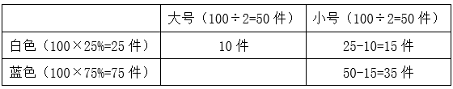

则小号蓝色衬衫有35件。

故正确答案为C。

**考点**：和差倍比问题

**来源**：2008年深圳市公务员录用考试《行测》题（上半年）第10题

### 第 11 题

某商店有两个进价不同的计算器都卖了64元，其中一个赢利60%，另一个亏本20%。在这次买卖中，这家商店：

A. 不赔不赚

B. 赚了8元

C. 赔了8元

D. 赚了32元

第 11 题 · 答案与解析

**参考答案（粉笔题库参考内容）**

B

**解析**

根据利润问题公式：，即，所以两个计算器的成本价分别为元，元，64+64-40-80=8元，赚了8元。

故正确答案为B。

**考点**：经济利润问题

**来源**：2008年深圳市公务员录用考试《行测》题（上半年）第11题

### 第 12 题

从3、5、7、11四个数中任取两个数相乘，可以得到多少个不相等的积？

A. 5

B. 4

C. 6

D. 7

第 12 题 · 答案与解析

**参考答案（粉笔题库参考内容）**

C

**解析**

根据题目，发现3、5、7、11都为质数，任取两个数相乘均可得到不相等的乘积，所以有个不相等的积。

故正确答案为C。

**考点**：排列组合问题-其他

**来源**：2008年深圳市公务员录用考试《行测》题（上半年）第12题

### 第 13 题

若n＞0，且对于所有的x，都成立，则m-n的值为：

A. 24

B. 30

C. 36

D. 42

第 13 题 · 答案与解析

**参考答案（粉笔题库参考内容）**

B

**解析**

根据题目，，整理得：，由于x为任何值该等式都成立，所以mx=6nx，又因为n>0，所以n=6，m=36，m-n=30。

故正确答案为B。

**来源**：2008年深圳市公务员录用考试《行测》题（上半年）第13题

### 第 14 题

足球比赛的记分规则为：胜1场得3分，平1场得1分，输1场得0分，一支足球队在某个赛季中共需比赛14场，现已比赛了8场，输了1场，得了17分，请问，前8场比赛中，这支球队赢了几场：

A. 7

B. 6

C. 5

D. 4

第 14 题 · 答案与解析

**参考答案（粉笔题库参考内容）**

C

**解析**

根据题目，设在前8场比赛中赢了x场，则平了(8-1-x)=(7-x)场，又因为胜1场得3分，平1场得1分，输1场得0分，前8场比赛得了17分，所以3x+(7-x)=17，解得x=5。

故正确答案为C。

**考点**：和差倍比问题

**来源**：2008年深圳市公务员录用考试《行测》题（上半年）第14题

### 第 15 题

小芳和爸爸、妈妈三人玩跷跷板，三人的体重一共为150千克，爸爸坐在跷跷板的一端，体重只有妈妈一半的小芳和妈妈一同坐在跷跷板的另一端，这时，爸爸的那一端仍然着地，则小芳的体重应小于：

A. 49千克

B. 50千克

C. 26千克

D. 25千克

第 15 题 · 答案与解析

**参考答案（粉笔题库参考内容）**

D

**解析**

根据题目，设小芳的体重为x千克，则妈妈的体重为2x千克，爸爸的体重为(150-3x)千克，得出不等式x+2x&lt;150-3x，解得x&lt;25，所以小芳的体重应小于25千克。

故正确答案为D。

**考点**：和差倍比问题

**来源**：2008年深圳市公务员录用考试《行测》题（上半年）第15题

### 第 16 题

本校按照确立的“素质为本，多元发展”的办学\_\_\_\_\_\_\_\_，将培养学生能力作为教学重点。

填入划横线处最恰当的一项是：

A. 概念

B. 方向

C. 特点

D. 理念

第 16 题 · 答案与解析

**参考答案（粉笔题库参考内容）**

D

**解析**

文段中的“素质为本，多元发展”是学校办学的指导思想或核心观念，是用于指导教学、管理等一系列办学行为的基本信念和原则。D项，理念指思想、观念、信念，特别是指具有指导意义的核心观念，且“办学理念”是常见固定搭配，保留。

A项，概念指对事物本质的抽象概括，偏重认知层面的定义，与“办学”搭配不当，排除；

B项，方向强调发展的方位或趋势，而“素质为本，多元发展”更侧重于一种价值观和指导思想，与文意不符，排除；

C项，特点指人或事物所具有的独特之处，常用于描述已经呈现的特征，而“确立”一词后接指导性原则更为合理，排除。

故正确答案为D。

**考点**：实词填空、词的辨析-搭配对象

**来源**：2008年深圳市公务员录用考试《行测》题（上半年）第16题

### 第 17 题

园中的书阁则如历史长河中的一柱悠悠文脉，默默守候着一段\_\_\_\_\_\_\_\_而婉约的传说。填入划横线处最恰当的一项是：

A. 凄美

B. 酣畅

C. 优美

D. 动人

第 17 题 · 答案与解析

**参考答案（粉笔题库参考内容）**

B

**解析**

书阁中的藏书是历史文化的载体，横线处要填的词与“婉约”共同用来形容书阁中藏书的两个方面。

“婉约”指和顺婉转、柔美，可指作品形式或情节上的起伏婉转。

A项错误，“凄美”带有作者的主观感情色彩，并且与句意不符；

B项正确，“酣畅”引申为舒适畅快，如笔墨酣畅，可以形容书阁中藏书内容方面的淋漓尽致；

C项错误，“优美”多用来形容文笔，指的是形式层面；

D项错误，“动人”与句意不符。

故正确答案为B。

**考点**：实词填空、对应关系-前后呼应

**来源**：2008年深圳市公务员录用考试《行测》题（上半年）第17题

### 第 18 题

她总是喜欢\_\_\_\_\_\_\_\_她的美丽。填入划横线处最恰当的一项是：

A. 表示

B. 夸奖

C. 夸口

D. 炫耀

第 18 题 · 答案与解析

**参考答案（粉笔题库参考内容）**

D

**解析**

A项错误，“表示”与“美丽”存在动宾搭配不当的问题，可排除；

B项错误，“夸奖”指赞美、称赞。可以是自己对别人的赞美，也可以是别人对自己的赞美，不可用于自己对自己，可排除；

C项错误，“夸口”指吹牛，说大话，与文意不符，可排除；

D项正确， “炫耀”指向别人展示自己比别人好的事物，而文中的“美丽”就是自己比别人好的事物，当选。

故正确答案为D。

**考点**：实词填空、词的辨析-搭配对象

**来源**：2008年深圳市公务员录用考试《行测》题（上半年）第18题

### 第 19 题

他过多地使用安眠药，实在已经达到了\_\_\_\_\_\_\_\_的地步，必须想办法制止他的行为。填入划横线处最恰当的一项是：

A. 滥用

B. 适用

C. 胡用

D. 使用

第 19 题 · 答案与解析

**参考答案（粉笔题库参考内容）**

A

**解析**

本题可以根据语义轻重来作答。

四个选项的词语虽都有使用之意，但是只有A项“滥用”表示的程度最深，且其经常跟“药物、职权、权力”搭配，和语境的严重程度相对应；

B、D错误，文中“过多地”“实在已经”“必须”等词表明现在的情况非常严重，并且文段应该是消极色彩的，故中性词“使用、适用”不合适，均排除；C错误，“胡用”是口语化的表达方式，用在此处过于随意，排除。

故正确答案为A。

**考点**：实词填空、词的辨析-程度轻重

**来源**：2008年深圳市公务员录用考试《行测》题（上半年）第19题

### 第 20 题

面对如此美丽绝伦的景色，大家不禁发出\_\_\_\_\_\_\_\_。填入划横线处最恰当的一项是：

A. 赞扬

B. 赞叹

C. 赞服

D. 感叹

第 20 题 · 答案与解析

**参考答案（粉笔题库参考内容）**

B

**解析**

本题属于实词辨析题。

A、C两项错误，“赞扬”强调“表扬”、“赞服”强调“佩服”，两者均不符合语境；

B项正确，“赞叹”指赞美感叹，用在这里感叹景色之美，很合适；

D项错误，“感叹”主要指有所感触而叹息，语境并无叹息之意。

故正确答案为B。

**考点**：实词填空、词的辨析-词义侧重

**来源**：2008年深圳市公务员录用考试《行测》题（上半年）第20题

### 第 21 题

下列语句中有语病的一句为：

A. 尽管学界对于两个坑的年代与性质尚存争议，然而，文物所折射出来的三星堆高度发达的文明已是不争的事实

B. 硅谷与128公路地区这两个科技工业园处于同一个社会制度、同样的社会环境与机遇之下，为什么发展的结果竟然如此迥异

C. 十月一日，中共中央、国务院在人民大会堂举行宴会，招待来自五大洲的华侨、港澳同胞、台湾同胞和中国血统的外籍人士共度国庆佳节

D. 风风雨雨中，他每天都在山里敲呀、凿呀，他用手锤敲醒了太阳，他又用手锤敲落了月亮，敲得石头都有了感情

第 21 题 · 答案与解析

**参考答案（粉笔题库参考内容）**

C

**解析**

本题属于病句辨析题。

A、B、D三项均不是病句，只有C项存在句式杂糅的语病，“招待”和“与······共度国庆佳节”杂糅，可将“招待”改为“与”。即C项的正确表述为：十月一日，中共中央、国务院在人民大会堂举行宴会，与来自五大洲的华侨、港澳同胞、台湾同胞和中国血统的外籍人士共度国庆佳节。

故正确答案为C。

**来源**：2008年深圳市公务员录用考试《行测》题（上半年）第21题

### 第 22 题

下列选项中语病与其他三项不同的一项是：

A. 《青春之歌》这部小说出色地塑造了共产党员的事迹

B. 出席这次职工代表大会的有青年工人、老工人和妇女

C. 中国青年对于前苏联作家的作品、奥斯特洛夫斯基的作品非常熟悉

D. 我上街买了牙膏、牙刷和日用品

第 22 题 · 答案与解析

**参考答案（粉笔题库参考内容）**

A

**解析**

A项属于搭配不当，“塑造”与“事迹”不能搭配，“塑造”通常与“形象”搭配，故本句子可以将“事迹”改为“光辉形象”；

而B、C、D三项都犯了范围不清的错误：B选项妇女与青年工人中的一部分人、老工人中的一部分人存在交叉重叠；C项奥斯特洛夫斯基属于前苏联作家；D项牙膏和牙刷都属于日用品。

因此，本题中A项的语病与其他三项不同。

故正确答案为A。

**来源**：2008年深圳市公务员录用考试《行测》题（上半年）第22题

### 第 23 题

下列语句中没有歧义的一句为：

A. 马路的一边有一个广告栏

B. 岁月流逝磨蚀了她年轻时的锐气

C. 她没有听取老师的意见，报考文科，结果导致高考失利

D. 三星公司这一新款电脑的厚度给人的感觉，并不像联想公司的产品那样，有一种比实际厚度稍薄的错觉

第 23 题 · 答案与解析

**参考答案（粉笔题库参考内容）**

B

**解析**

本题属于歧义句辨析，需要寻找歧义句。

A项有歧义，可以有两种理解：“马路的某一侧有一个广告栏”；“马路的两边各有一个广告栏”；

C项有歧义，可以有两种理解：“老师的意见是报考文科，她没听取”；“老师的意见是报考理科，她没听而报了文科”；

D项有歧义：给人“一种比实际厚度稍薄的错觉”的到底是“三星公司这一新款电脑”还是“联想公司的产品”。

A、C、D三项均有歧义，可排除。

故正确答案为B。

**来源**：2008年深圳市公务员录用考试《行测》题（上半年）第23题

### 第 24 题

下列语句中没有语病的一句为：

A. 南昌八一起义纪念馆里陈列着好多种当年周恩来使用过的东西

B. 近年来中美经贸关系发展所呈现的另一个特点，就是美国对华经贸政策安全化的倾向

C. 领导住址研究听取了大家的意见

D. 会场上爆发出一阵热闹的掌声

第 24 题 · 答案与解析

**参考答案（粉笔题库参考内容）**

B

**解析**

本题属于病句辨析，需要寻找病句。

A项存在语序不当的问题，“当年周恩来使用过的东西”应改为“周恩来当年使用过的东西”；C项句子成分残缺，缺少主语，应改为“领导就住址研究的问题听取了大家的意见”；D项词语搭配不当，“热闹”不能形容“掌声”，应改为“热烈”。排除A、C、D三项。

故正确答案为B。

**来源**：2008年深圳市公务员录用考试《行测》题（上半年）第24题

### 第 25 题

下列选项中没有语病的一句为：

A. 大家可能都比较清楚，免疫系统是身体的防御系统

B. 这对于纠正我们目前较为普遍的浮躁之风也是一个很好的推动

C. 经过刻苦努力，他这次考试5门功课平均都在90分以上

D. 过去我看书时，既不做读书笔记，又不写提纲和摘要

第 25 题 · 答案与解析

**参考答案（粉笔题库参考内容）**

A

**解析**

本题属于病句辨析，需要寻找病句。

B项搭配不当，“对于”是介词，后面应跟名词短语搭配，而不能和动词短语搭配，应将“对于”改成“对”；C项句式杂糅，“平均”后面应是个具体值，应将“以上”删去；D项语序不当，读书时应先写提纲和摘要，读完书后再做读书笔记，所以应该改为“过去我看书时，既不写提纲和摘要，又不做读书笔记”。

故正确答案为A。

**来源**：2008年深圳市公务员录用考试《行测》题（上半年）第25题

### 第 26 题

下列选项中有语病的一句为：

A. 经过艰难跋涉，我们发现：如果没有科学发展观作指导，任何理顺国家、市场、社会关系的举措都将事倍功半

B. 由于我国的国际影响和汉语在国际事务中的作用越来越大，联合国大会第二十八届会议一致通过，把汉语列为大会和安理会的六种工作语言之一(其他五种是英语、法语、俄语、西班牙语和阿拉伯语)

C. 某些商家违背商业道德，利用中小学生具有的好奇心理和在考试作弊并不鲜见的情况下，为“隐形笔”大做广告

D. 哲学家叔本华曾经说过，“人生必修的一课，就是承受孤独。因为孤独是幸福、安乐的源泉。”

第 26 题 · 答案与解析

**参考答案（粉笔题库参考内容）**

C

**解析**

本题为病句辨析。

C选项的中心语和修饰语搭配不当，句子“在考试作弊并不鲜见的情况下”不应作为“利用”的宾语，应单独做状语，因此需将“和”改为“，”。

其它选项均不存在语病。

故正确答案为C。

**来源**：2008年深圳市公务员录用考试《行测》题（上半年）第26题

### 第 27 题

下列选项中有语病的一句为：

A. 东部地区玉器繁荣，是东部文化宗教发达的物化表现

B. 针对国际原油价格步步攀升，美国、印度等国家纷纷建立或增加了石油储备，我国也必须尽快建立国家的石油战略储备体系

C. 我国80年代高新技术开发区的创办，被誉为20世纪在科技产业化方面最重要的创举

D. 思维科学体系作为一种综合科学体系，它纳入了许多学科

第 27 题 · 答案与解析

**参考答案（粉笔题库参考内容）**

B

**解析**

本题属于病句辨析。

B选项的错误为成分残缺，即句子缺少中心语，“针对”后面应该加一个名词或名词性短语，应在“国际原油价格步步攀升”后面加“的现象（或问题）”。

故正确答案为B。

**来源**：2008年深圳市公务员录用考试《行测》题（上半年）第27题

### 第 28 题

下列各句中没有歧义的一句为：

A. 她觉得天地是那么广阔，心里是那么豁朗

B. 参加这次募捐活动的有我校教职工将近八百多人

C. 员工对于保管员揭发公司营销部谋私利的问题，普遍感到非常气愤

D. 伊拉克游击队对美军的进攻是早有准备的

第 28 题 · 答案与解析

**参考答案（粉笔题库参考内容）**

A

**解析**

A项没有歧义，当选。

B项“将近八百多人”有歧义，“将近”意为不到，“多”意为超过，二者同时出现则语意不明确。

C项有歧义，可以理解为“员工对营销部谋私利的行为感到气愤”，也可以理解为“员工对于保管员的揭发行为感到气愤”。

D项有歧义，可以理解为“伊拉克游击队进攻美军”，也可以理解为“美军进攻伊拉克游击队”。

故正确答案为A。

**来源**：2008年深圳市公务员录用考试《行测》题（上半年）第28题

### 第 29 题

下列各句中没有语病的一句是：

A. 为期一周的布鲁塞尔会议将就各种国际性犯罪活动以及国际之间的执法合作问题展开广泛的讨论

B. 吴菲生性好动，像个野小子似的，为此，她没少受妈妈的训斥和挨骂

C. 大批灾区儿童重新走进了宽敞明亮的教室，坐上了崭新的木制桌凳，广大家长对此十分满意

D. 他从小就受到唐诗宋词的熏陶，这有利于他准确地把握肖邦的旋律所蕴含的诗境

第 29 题 · 答案与解析

**参考答案（粉笔题库参考内容）**

A

**解析**

本题属于病句辨析题。

B项有语病，句子成分多余，“受妈妈的训斥”和“挨骂”重复，且“挨骂”和“受到”搭配不当；C项有语病，谓语和宾语搭配不当，“坐上了”与“桌凳”搭配不妥，因为凳可坐，但是桌不可坐，因此应改为“用上了崭新的木制桌凳”，同时C项还犯了“前后不一致”的错误，前面的主语是“大批灾区儿童”后面的主语是“广大家长”；D项有语病，动宾搭配不当，“把握”和“诗境”不匹配。可排除B、C、D三项。

故正确答案为A。

**来源**：2008年深圳市公务员录用考试《行测》题（上半年）第29题

### 第 30 题

下列选项中有语病的一句为：

A. 课程的调整不仅来自于课程的结构变革，还来自课程实施者对课程具体内容的选择、设计和解读

B. 雅典奥运会上，七名大力士因服用兴奋剂被责令回国不得参加比赛

C. 国务院决定免征关税和进口增值税的目的和意义，在于进一步扩大利用外资，鼓励引进国外的先进技术和设备，促进产业结构的调整，使其更趋完善

D. 只有学有收获的学生，才会对该学科产生浓厚的兴趣

第 30 题 · 答案与解析

**参考答案（粉笔题库参考内容）**

B

**解析**

本题为病句辨析题。

B选项是歧义句，语意不明，可以理解为两种意思：“大力士被责令不能参加雅典奥运会”；“大力士被责令回国后不能参加自己国内的比赛”。

其它三项均非病句。

故正确答案为B。

**来源**：2008年深圳市公务员录用考试《行测》题（上半年）第30题

## 材料 1

太阳热能发电，这是在不久的将来发展前景最光明的太阳能技术。这类系统将太阳的热汇集起来，产生—的温度。热可以用于工业过程（如罐头制造与食品生产）、脱盐和水的净化。

        收集太阳光以提供热能的主要手段有三：中央接收器、抛物面反射盘、抛物反射槽。在中央接收器系统中，由分布在一片地上的反射镜将太阳光聚焦在中央塔的塔顶上一台集热器上。70年代，分析家曾认为这是最有发展前途的系统。但由于下列几个问题的存在，影响了它的发展：中央聚热器必须在高温下操作；需要能在白天极热和夜晚低温之间循环作业的材料，这种材料很昂贵。为了避免这些问题，一些公司正在恢复使用外燃机，其中有几家在试用“斯特林循环”外燃机。

        斯特林系统是迄今效率最好的太阳能发电方法。原因之一是发动机所产生的是交流电。这种受太阳能驱动的外燃机保留了光伏电池的许多优点：大小型装置效率都很好，易于安装，无污染。

        时下很受欢迎的另一种太阳能技术是行一聚焦器。在今后50年内，它很可能在太阳能市场上居主导地位。行一聚集器是呈抛物状的聚焦器，将太阳光聚在槽中央沿槽长方向配置的管子上。流体通过管子时被加热，变为蒸气或热液从管子的另一端出来。可用驱动涡轮机或其他机械。它设计简单，易于掌握，只需增减槽子的数量便能产生较大、较小的电量，在较低温度下也能运行。

### 第 31 题

本文中，收集太阳光提供热能的主要目的是：

A. 用于工业过程（如罐头制造与食品生产）、脱盐和水的净化

B. 利用太阳光，开发新能源

C. 太阳能发电

D. 产生—的温度

第 31 题 · 答案与解析

**参考答案（粉笔题库参考内容）**

C

**解析**

收集太阳光提供热能的目的相关内容出现在文段的首句：“太阳热能发电，这是在不久的将来发展前景最光明的太阳能技术”，而且通读全文，本句为文章的中心句，全文都是围绕这句话展开。C项正确，由文段可知收集太阳光提供热能的主要目的是将太阳光产生的热能转化为电能。

A项错误，说法过于片面，“用于工业过程（如罐头制造与食品生产）、脱盐和水的净化”只是太阳能产生热之后的几个用途，排除；

B项错误，说法过于宽泛，开发的新能源主要用于何种用途，没有明确表示，排除；

D项错误，“产生—的温度”只是对热的温度的描述，不属于收集热能的目的，排除。

故正确答案为C。

**来源**：2008年深圳市公务员录用考试《行测》题（上半年）第31题

### 第 32 题

从下列选项中选出与文意相符的一项：

A. 使用“斯特林循环”外燃机能从根本上避免中央接收器系统的弊端

B. 70年代，分析家对中央接收器系统的发展前途的预见是完全错误的

C. 中央接收器系统在运作中发现的问题不是不能解决的

D. 使用外燃机的根本原因是为了降低中央接收器的成本

第 32 题 · 答案与解析

**参考答案（粉笔题库参考内容）**

C

**解析**

本题为细节判断题。

A项错误，相关内容出现在第二段的段尾及第三段，“斯特林系统是迄今效率最好的太阳能发电方法”但不足以说明斯特林循环外燃机能从根本上避免中央接收器系统的弊端，此种说法过于绝对，与原文不符；

B项错误，相关内容出现在第二段，虽然中央接收器确实存在着弊端，但说其预见是完全错误的太过绝对，与原文不符；

C项正确，中央接收器本身存在问题，但是由文中“为了避免这些问题，一些公司正在恢复使用外燃机，其中有几家在试用‘斯特林循环’外燃机。”可知，中央接收器系统在运作中发现的问题是可以解决的，符合原文；

D项错误，由文中“为了避免这些问题，一些公司正在恢复使用外燃机，其中有几家在试用‘斯特林循环’外燃机。”可知，恢复使用外燃机的根本原因是中央接收器的弊端和外燃机自身的优点，并不是为了降低中央接收器的成本，与原文不符。

故正确答案为C。

**来源**：2008年深圳市公务员录用考试《行测》题（上半年）第32题

### 第 33 题

不属于行一聚集器特点的是：

A. 设计简单、易掌握

B. 产电量大小易控制

C. 较低温下可运行

D. 无噪音污染

第 33 题 · 答案与解析

**参考答案（粉笔题库参考内容）**

D

**解析**

本题为细节判断题。

相关内容出现在第四段，由文中“它设计简单，易于掌握，只需增减槽子的数量便能产生较大或较小的能量，在较低温度下也能运行”可知，A、B、C三项都是行一聚集器的特点。

D项错误，文章并没有提到行一聚焦器具有“无噪音污染”这一特点。

本题为选非题，故正确答案为D。

**来源**：2008年深圳市公务员录用考试《行测》题（上半年）第33题

### 第 34 题

下列说法符合原文意思的一项是：

A. 在不久的将来，发展前景最光明的太阳能技术主要是指收集太阳光提供热能，并利用太阳热能发电

B. 中央接收器、抛物面反射盘和抛物面反射槽，是收集太阳热能发电的三种主要手段

C. 由于斯特林系统发电机能产生高压交流电，这使它成为迄今效率最好的太阳能发电方法

D. 行一聚焦集热器是时下最受欢迎的并将在今后太阳能市场上居主导地位的一种太阳能技术

第 34 题 · 答案与解析

**参考答案（粉笔题库参考内容）**

A

**解析**

本题为细节判断题。

A项正确，由文中“太阳热能发电，这是在不久的将来发展前景最光明的太阳能技术。这类系统将太阳的热汇集起来······水的净化”可知，说法符合原文文意，当选；

B项错误，其内容出现在第二段首句，文中说“中央接收器、抛物面反射盘和抛物面反射槽”是收集太阳光以提供热能的三种主要手段，并非“是收集太阳热能发电的三种主要手段”，排除；

C项错误，文中只是说“斯特林系统是迄今效率最好的太阳能发电方法。原因之一是发动机所产生的是交流电”，并没有说是“高压交流电”，且并未提及是否为主要原因，排除；

D项错误，文中只说行一聚焦器“很受欢迎”并没说“最受欢迎”，且也没说它将来一定会在今后太阳能市场上居主导地位，只是说很可能，表述过于绝对，排除。

故正确答案为A。

**来源**：2008年深圳市公务员录用考试《行测》题（上半年）第34题

### 第 35 题

根据全文提供的信息，以下推断正确的一项是：

A. 随着技术的成熟，不久的将来，太阳热能发电将成为最主要的发电形式

B. 目前效率最好的太阳能发电系统是斯特林系统，但在今后50年内，很可能会被行一聚热器所取代

C. 行一聚热器是今后太阳能发电的主导形式，它甚至在温度较低的阴天或是夜晚也能运行

D. 太阳能发电的技术目前还不是很成熟，还不能大规模地推广应用

第 35 题 · 答案与解析

**参考答案（粉笔题库参考内容）**

D

**解析**

A项错误，文章只是说太阳热能发电将来“最有前景”，并没说它将来会成为“最主要的”发电形式，表述过于绝对，排除；

B项错误，其说法偷换概念，文中只是说行一聚热器将来很可能占据主导地位，并没说会取代斯特林系统，也有可能是两种方式并存，排除；

C项错误，文章只是说行一聚热器“很可能”是今后太阳能发电的主导形式，并没说一定会会成为主导，并且行一聚热器的特点之一是在低温度下也能运行，但是文中并没有说是能在“温度较低的阴天或是夜晚”运行，表述过于绝对且过度引申，排除；

D项正确，“太阳能发电的技术目前还不是很成熟”可以从文段中推断出来，当选。

故正确答案为D。

**来源**：2008年深圳市公务员录用考试《行测》题（上半年）第35题

### 第 36 题

尽管他后来步入了哲学上悲观主义的路途，但这和他的生活状况是不相干的，在现实世界中，他可以算是个幸运儿了。

这段话的主要意思是说：

A. 尽管他的生活很不幸，但他在哲学上始终是幸运的

B. 他在现实世界中的幸运反而导致了他在哲学上的悲观主义

C. 他的生活景况虽然不佳，但在现实世界中依然是幸运的

D. 在现实世界中，他的命运还是不错的

第 36 题 · 答案与解析

**参考答案（粉笔题库参考内容）**

D

**解析**

本题为中心理解题。文段结构简单，转折后内容为重点，即“在现实世界中，他可以算是个幸运儿”，他在现实中生活得还不错，故D项“在现实世界中，他的命运还是不错的”符合重点句含义。

A、C两项，表述均与文意相左，他在现实生活中是幸运的，排除；B项，现实生活中的幸运与哲学上的悲观主义不相干，无关选项，排除。

故正确答案为D。

**考点**：关联词-转折

**来源**：2008年深圳市公务员录用考试《行测》题（上半年）第36题

### 第 37 题

老师曾因我某段时期在写作中过于拘泥于语法规范而向我表示过不满，以为这样太琐细，太刻板，太学究气了。

这段话主要支持了这样一种观点：

A. 老师认为拘泥于语法规范太刻板

B. 老师对我不满

C. 老师向我抱怨

D. 老师拘泥于语法规范

第 37 题 · 答案与解析

**参考答案（粉笔题库参考内容）**

A

**解析**

文段开篇表明老师对我写作中过于拘泥于语法规范的行为表达不满，随后具体说明老师认为该行为存在琐细、刻板、学究气的问题。故文段重点强调老师认为“我拘泥于语法规范的做法”过于刻板、缺乏灵活性，对应A项。

B项，老师并非对“我”本人不满，而是对“我”写作中的特定行为不满，排除；

C项“抱怨”表述不明确，没有指明“抱怨”的具体内容，排除；

D项，文段中拘泥于语法规范的是“我”，而非老师，偷换概念，排除。

故正确答案为A。

**考点**：特殊问法

**来源**：2008年深圳市公务员录用考试《行测》题（上半年）第37题

### 第 38 题

千栏居是一种将房屋同桩柱架高地面的宫室形式。《新唐书·南平獠传》称：“山有毒草、沙风、蚣蛇，人楼居，揹而上，君曰‘千栏’。”《说文》中的“泽中守草楼”它应是千栏形式。与其认为千栏居是巢居的演化，倒不如说千栏居就是巢居的一种较高级形式，并且与楼阁的起源有着密切关系，千栏居以下都架空的桩柱或“千栏”得名，都与上都房屋的结构形制并无确定关系，故就整座建筑而言，千栏居并不能算作一种结构类型。

下列关于“千栏居”的表述正确的一项是：

A. 千栏居是巢居的一种较高级形式，属宫室演化过程中的一种建筑类型

B. 楼阁建筑应是居定宫室演化过程中的高级阶段，它的起源就是千栏居

C. 千栏居不因上都房屋的结构形制取名，而是因为下都架空的桩柱或“千栏”得名

D. 就整座建筑而言，千栏居形制的建筑并不是一种房屋结构类型

第 38 题 · 答案与解析

**参考答案（粉笔题库参考内容）**

A

**解析**

本题为细节判断题。

A项正确，由文中“与其认为千栏居是巢居的演化，倒不如说千栏居就是巢居的一种较高级形式”可知，前半句正确。由文中“千栏居是一种将房屋同桩柱架高地面的宫室形式”可知，千栏居是一种宫室形式，也由此推知千栏居属宫室演化过程中的一种建筑类型，即后半句说法正确。

B项错误，文中只是说千栏居与楼阁的起源有着密切关系，并没有确定楼阁的起源就是千栏居，无关选项，排除；

C项错误，从文中“千栏居以下都架空的桩柱或‘千栏’得名，都与上都房屋的结构形制并无确定关系”这句话中，只能得出“千栏居因为下都架空的桩柱或‘千栏’得名”，但是推不出“千栏居不因上都房屋的结构形制取名”，说法错误，是对原文的曲解，排除；

D项错误，文中只是说就整座建筑而言，“千栏居并不能算作一种结构类型”，并没有说“千栏居形制的建筑”不是一种房屋结构类型，两者是不同的概念，偷换概念，排除。

故正确答案为A。

**考点**：细节判断题

**来源**：2008年深圳市公务员录用考试《行测》题（上半年）第38题

### 第 39 题

与真菌、细菌、病毒、昆虫等生物相比，人可能更脆弱，作为一种对有害生物所向披靡的杀虫剂，溴甲烷对人的毒害也是显而易见的，它是一种强烈的神经毒剂，可对人的皮肤、肺、肾脏和肝脏造成直接的损伤。中毒严重者可出现心脏衰竭、休克等症状，个别中毒者还会双目失明。经溴甲烷消毒后的土壤，有助于农作物的生长。然而，溴甲烷在杀灭病原菌的同时，也杀灭了土壤中一些对农作物生长有益的生物。而这些生物对于调节土壤的微生态、抑制病原菌的种群数量和改善土壤结构都是至关重要的。所以，经溴甲烷熏蒸处理后，土壤中的生物种类急剧减少，形成一种“生物真空”的临界状态。由于没有其他种类生物的竞争和牵制，农作物的病原菌势必大量繁殖、积累，这就影响了农作物的正常生长；反过来，又不得不加大溴甲烷的用量，从而进入恶性循环。更为严重的是，溴甲烷在使用过程中，会排放到大气中，影响大气臭氧层，破坏大气环境。正是由于溴甲烷存在“不光彩”的一面，一些国际组织和发达国家呼吁尽快禁止使用溴甲烷。

从上下文看，下列对溴甲烷“‘不光彩’的一面”的理解，不正确的一项是：

A. 溴甲烷在使用过程中，会挥发到大气中，破坏大气臭氧层，恶化大气环境

B. 溴甲烷无色无味，作为熏蒸剂使用时，容易使人放松警惕，从而存在安全隐患

C. 溴甲烷虽然能杀灭病原菌，但同时也杀灭了土壤中一些对农作物生长有益的生物

D. 溴甲烷可使有的中毒者出现心脏衰竭、休克、双目失明等症状

第 39 题 · 答案与解析

**参考答案（粉笔题库参考内容）**

B

**解析**

本题为细节判断题

A项属于，由“更为严重的是，溴甲烷在使用过程中，会排放到大气中，影响大气臭氧层，破坏大气环境”可知，A属于“不光彩”的一面之一；

C项属于，由文段“然而，溴甲烷在杀灭病原菌的同时，也杀灭了土壤中一些对农作物生长有益的生物”可知，C选项说法正确；

D项由文段“溴甲烷对人的毒害也是显而易见的，它是一种强烈的神经毒剂，可对人的皮肤、肺、肾脏和肝脏造成直接的损伤。中毒严重者可出现心脏衰竭、休克等症状，个别中毒者还会双目失明”可知，D选项正确。

故排除A、C、D。

B项不属于，通读全文之后，从文段找不到“溴甲烷无色无味，作为熏蒸剂使用时，容易使人放松警惕，从而存在安全隐患”的说法，故B选项不是溴甲烷“‘不光彩’的一面”。

本题为选非题，故正确答案为B。

**考点**：细节判断题

**来源**：2008年深圳市公务员录用考试《行测》题（上半年）第39题

### 第 40 题

当然，能够只是送出去，也不算坏事情，一者见得丰富，二者见得大度。尼采就自诩过他是太阳，光热无穷，只是给与，不想取得。然而尼采究竟不是太阳，他发了疯。中国也不是，虽然有人说，掘起地下的煤来，就足够全世界几百年之用。但是，几百年之后呢?几百年之后，我们当然是化为魂灵，或上天堂，或落了地狱，但我们的子孙是在的，所以还应该给他们留下一点礼品。要不然，则当佳节大典之际，他们拿不出东西来，只好磕头贺喜，讨一点残羹冷炙作奖赏。

这段文字的主旨是：

A. 批判“送去主义”者自诩“丰富”、“大度”的愚昧

B. 揭露帝国主义者侵占中国资源的罪行

C. 说明中国煤炭资源即使丰富，也会有开采完的一日，所以不能一味“送去”

D. 揭示“送去主义”所造成的祸国殃民的严重危害

第 40 题 · 答案与解析

**参考答案（粉笔题库参考内容）**

D

**解析**

本题为中心理解题。

文段先说如果能够只是送出去，也不算坏事情，并以尼采自诩太阳只求给与、中国挖掘煤炭给全世界都不可行的例子进行解释说明，随后通过表示转折关系的“但是”揭示了重点句为转折后的内容，重点句部分主要阐释了送去主义的危害和严重后果。D选项是本题中心的同义替换，当选。

A项错误，文段谈论的是“送出去”以后的严重后果，而不仅仅是批判“送去主义”者的愚昧，故A项不全面，也不是重点；

B项错误，“帝国主义者侵占中国资源的罪行”文中并未涉及；

C项错误，“中国煤炭资源”只是文中所举的例子，而不是主旨。

排除A、B、C三项。

故正确答案为D。

**考点**：关联词-转折

**来源**：2008年深圳市公务员录用考试《行测》题（上半年）第40题

### 第 41 题

（1）销售

（2）生产

（3）购材

（4）赢利

（5）还贷

A. 3—2—4—5—1

B. 3—2—1—4—5

C. 3—4—2—5—1

D. 3—1—2—5—4

第 41 题 · 答案与解析

**参考答案（粉笔题库参考内容）**

B

**解析**

是个生产销售的事件过程，根据选项可知购材为首句。购材是生产的准备，生产的产品销售后才能赢利，赢利后才有资本还贷。

故正确答案为B。

**来源**：2008年深圳市公务员录用考试《行测》题（上半年）第41题

### 第 42 题

（1）甲被大众遗忘

（2）甲被卷入丑闻事件

（3）甲一夜成名

（4）甲是一个默默无闻的小演员

（5）甲被新闻媒体封杀

A. 4—3—2—5—1

B. 3—4—5—2—1

C. 1—4—3—2—5

D. 4—3—5—2—1

第 42 题 · 答案与解析

**参考答案（粉笔题库参考内容）**

A

**解析**

整体观察几个题干，“（4）甲是一个默默无闻的小演员”一定在“（3）甲一夜成名”前面，“（2）甲被卷入丑闻事件”一定在“（5）甲被新闻媒体封杀”之前，“（5）甲被新闻媒体封杀”后才有“（1）甲被大众遗忘”，所以（5）在（1）之前， 完全满足上述三个条件的是A项。

故正确答案为A。

**来源**：2008年深圳市公务员录用考试《行测》题（上半年）第42题

### 第 43 题

（1）与厂家洽谈

（2）参加展销会

（3）支付违约金

（4）签订购货合同

（5）单方面违约

A. 2—3—1—4—5

B. 2—4—1—5—3

C. 2—1—4—5—3

D. 2—1—3—4—5

第 43 题 · 答案与解析

**参考答案（粉笔题库参考内容）**

C

**解析**

事件发展的顺序，是一个签约违约的过程。“（4）签订购货合同”一定在“（1）与厂家洽谈”之后，所以排除B项；又因为“（5）单方面违约”之后才是“（3）支付违约金”，所以排除A、D两项。

故正确答案为C。

**来源**：2008年深圳市公务员录用考试《行测》题（上半年）第43题

### 第 44 题

（1）通过反馈回路，心脏向大脑发出信号

（2）情绪紧张和精神压力对心脏造成冲击，使血液涌向心脏

（3）心肌失常，心率失调，引发猝死

（4）大脑输出更多信号，加速心脏跳动

（5）大脑接收到心脏泵血信号

A. 2—1—5—4—3

B. 2—4—1—5—3

C. 1—4—3—2—5

D. 1—2—4—5—3

第 44 题 · 答案与解析

**参考答案（粉笔题库参考内容）**

A

**解析**

跟在“（5）大脑接收到心脏泵血信号”后面的必定是“（4）大脑输出更多信号，加速心脏跳动”，而不是“（3）心肌失常，心率失调，引发猝死”，排除B项；

通读事件是一个压力造成心率失常进而猝死的过程。根据首尾句原则，可知“（3）心肌失常，心率失调，引发猝死”一定是尾句，排除C项；

 当“（1）通过反馈回路，心脏向大脑发出信号”后，“（5）大脑接收到心脏泵血信号”一定紧随其后，排除 D项。

故正确答案为A。

**来源**：2008年深圳市公务员录用考试《行测》题（上半年）第44题

### 第 45 题

（1）甲向警察局报案

（2）甲在网上认识了一个网友

（3）诈骗团伙被绳之以法

（4）甲到异地去见网友

（5）甲的钱被网友骗光了

A. 4—5—1—3—2

B. 4—5—3—1—2

C. 2—4—5—1—3

D. 2—3—1—4—5

第 45 题 · 答案与解析

**参考答案（粉笔题库参考内容）**

C

**解析**

通读全部条件，可以肯定的是“（2）甲在网上认识了一个网友”一定在“（4）甲到异地去见网友”之前，排除A、B两项；

同时必然是“（5）甲的钱被网友骗光了”之后“（1）甲向警察局报案”，排除D项。

故正确答案为C。

**来源**：2008年深圳市公务员录用考试《行测》题（上半年）第45题

### 第 46 题

请从所给的这几个选项中，选择最合适的一个填在问号处，使之呈现一定的规律：

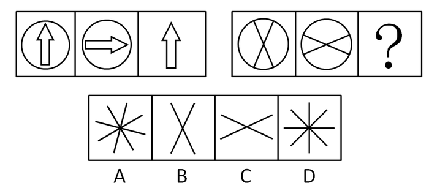

A. A

B. B

C. C

D. D

第 46 题 · 答案与解析

**参考答案（粉笔题库参考内容）**

B

**解析**

图形组成元素相同，本题考查的是位置类题目。

 第二幅图是从第一幅图顺时针旋转得到。第三幅图是在第二幅图逆时针旋转之后并去掉外部图形。第二组图形根据这个规律只有B选项符合。

故正确答案为B。

**考点**：位置规律-旋转、样式规律-加减同异

**来源**：2008年深圳市公务员录用考试《行测》题（上半年）第46题

### 第 47 题

请从所给的这几个选项中，选择最合适的一个填在问号处，使之呈现一定的规律：

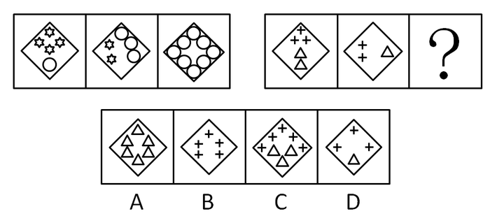

A. A

B. B

C. C

D. D

第 47 题 · 答案与解析

**参考答案（粉笔题库参考内容）**

D

**解析**

元素组成凌乱，元素间数量无法成规律，需要总体对应，第一组中，小星星的数量和是6，小圆圈的数量和是12，成2倍关系，第二组中十字架为5，三角形为3，代入选项，只有D项加和后能成2倍关系。

故正确答案为D。

**考点**：数量规律-素

**来源**：2008年深圳市公务员录用考试《行测》题（上半年）第47题

### 第 48 题

请从所给的这几个选项中，选择最合适的一个填在问号处，使之呈现一定的规律：

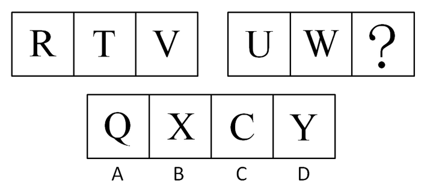

A. A

B. B

C. C

D. D

第 48 题 · 答案与解析

**参考答案（粉笔题库参考内容）**

D

**解析**

本题考查字母的顺序。

由字母顺序表顺序QRSTUVWXYZ得：每个字母之间间隔一个字母，W后面是X，X后面是Y。

故正确答案为D。

**考点**：文字/字母/数字类

**来源**：2008年深圳市公务员录用考试《行测》题（上半年）第48题

### 第 49 题

请从所给的这几个选项中，选择最合适的一个填在问号处，使之呈现一定的规律：

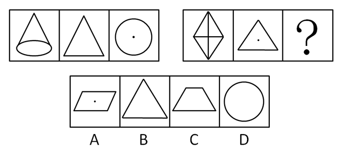

A. A

B. B

C. C

D. D

第 49 题 · 答案与解析

**参考答案（粉笔题库参考内容）**

B

**解析**

本题考查三视图。

第一组图中：分别是圆锥体，圆锥体的左视图，圆锥体的俯视图；

第二组图中：分别是四面体，俯视图，选项应为正四面体的左视图。

故正确答案为B。

**考点**：空间类-三视图

**来源**：2008年深圳市公务员录用考试《行测》题（上半年）第49题

### 第 50 题

请从所给的这几个选项中，选择最合适的一个填在问号处，使之呈现一定的规律：

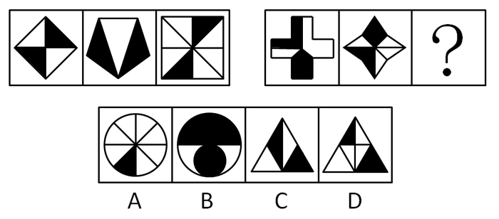

A. A

B. B

C. C

D. D

第 50 题 · 答案与解析

**参考答案（粉笔题库参考内容）**

C

**解析**

元素有明显的阴影部分，且两个阴影部分的面积是相等的，第二组图形也应该遵循这个规律，只有C项的图形两个阴影面积是相等的，当选。

故正确答案为C。

**考点**：数量规律-面、黑白块类

**来源**：2008年深圳市公务员录用考试《行测》题（上半年）第50题

### 第 51 题

请从所给的这几个选项中，选择最合适的一个填在问号处，使之呈现一定的规律：

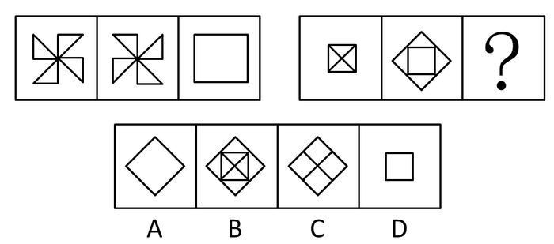

A. A

B. B

C. C

D. D

第 51 题 · 答案与解析

**参考答案（粉笔题库参考内容）**

C

**解析**

元素组成相似，考查元素。本题考查元素运算的去同存异。

第一组图形第一幅图与第二幅图相加，去掉相同的部分，得到第三幅图。第二组按照这个规律，只有C选项符合。

故正确答案为C。

**考点**：样式规律-加减同异

**来源**：2008年深圳市公务员录用考试《行测》题（上半年）第51题

### 第 52 题

请从所给的这几个选项中，选择最合适的一个填在问号处，使之呈现一定的规律：

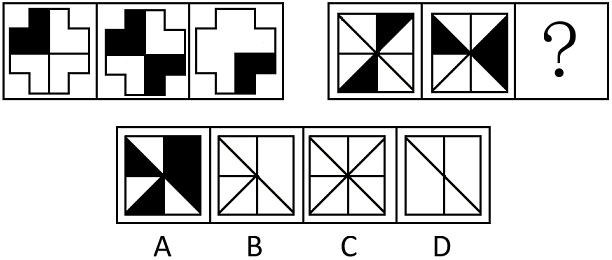

A. A

B. B

C. C

D. D

第 52 题 · 答案与解析

**参考答案（粉笔题库参考内容）**

A

**解析**

元素组成相似，元素黑白叠加。

观察第一组的规律：同色变白，异色变黑。第二组依据此规律，叠加后得到A项。

故正确答案为A。

**考点**：样式规律-黑白运算

**来源**：2008年深圳市公务员录用考试《行测》题（上半年）第52题

### 第 53 题

请从所给的这几个选项中，选择最合适的一个填在问号处，使之呈现一定的规律：

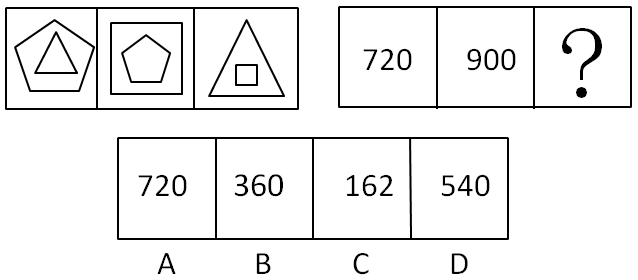

A. A

B. B

C. C

D. D

第 53 题 · 答案与解析

**参考答案（粉笔题库参考内容）**

D

**解析**

本题为特殊考点。

发现第一组和第二组间是整体的对应，计算可得，第一幅中两个图形的内角和为，第二幅图两个图形的内角和为，第三组图是三角形和四边形的组合，内角和为。

故正确答案为D。

**来源**：2008年深圳市公务员录用考试《行测》题（上半年）第53题

### 第 54 题

请从所给的这几个选项中，选择最合适的一个填在问号处，使之呈现一定的规律：

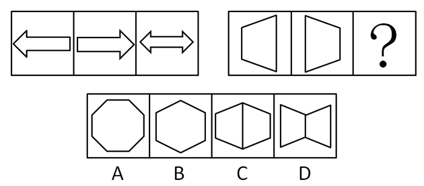

A. A

B. B

C. C

D. D

第 54 题 · 答案与解析

**参考答案（粉笔题库参考内容）**

B

**解析**

元素组成相似，考查元素的叠加。

第一组图形中，第一个图与第二个图重叠，相接的边去掉得第三个图。第二组图形依此规律叠加只有B项符合。

故正确答案为B。

**考点**：样式规律-加减同异

**来源**：2008年深圳市公务员录用考试《行测》题（上半年）第54题

### 第 55 题

请从所给的这几个选项中，选择最合适的一个填在问号处，使之呈现一定的规律：

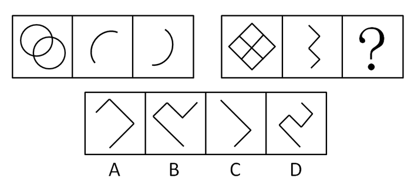

A. A

B. B

C. C

D. D

第 55 题 · 答案与解析

**参考答案（粉笔题库参考内容）**

D

**解析**

元素组成相似，但已经超出了元素周遍和运算。考查路线途径。

发现第一组图形中后两条曲线的端点是相同的。

第二组图形中，后两个图形应该是在第一个图中从底部端点到顶部端点的两种途径，只有D项符合。

故正确答案为D。

**来源**：2008年深圳市公务员录用考试《行测》题（上半年）第55题

### 第 56 题

斯金纳的操作性条件反射学说是强化原则的基础部分。斯金纳所说的强化指的是在条件作用中，能使个体操作性反应的概率增加的一切事件。他区分了两种类型的强化：正强化和负强化。当环境中某种刺激增加而行为反应出现的概率增加时，这种刺激的增加就是正强化；当环境中某种刺激减少而行为反应出现的概率增加时，此种刺激的减少就是负强化。

下列不属于正强化的是：

A. 教师对上课守纪律的学生进行表扬

B. 家长对考试成绩好的孩子给予物质鼓励

C. 学校为某个行为有所改善的学生解除处分

D. 公司老板为努力工作的雇员增加薪水

第 56 题 · 答案与解析

**参考答案（粉笔题库参考内容）**

C

**解析**

第一步：关键词查找。

题干中的正强化是指“环境中某种刺激增加而行为反应出现的概率增加”。

第二步：逐一分析选项。

A项“教师对上课守纪律的学生进行表扬”，在上课的过程中对学生进行表扬是正强化；

B项“家长对考试成绩好的孩子给予物质鼓励”，考试成绩好给予的鼓励也是正强化；

C项中的解除处分没有体现刺激增加，不是正强化；

D项“公司老板为努力工作的雇员增加薪水”，增加薪水给予的鼓励是正强化。

故正确答案为C。

**考点**：常规问法

**来源**：2008年深圳市公务员录用考试《行测》题（上半年）第56题

### 第 57 题

概念是人脑对客观事物的本质特征的认识，事物的本质特征是决定事物的性质，并使一事物区别于其他事物的特征。根据概念所包含的属性的抽象与概括程度，概念可分为具体概念和抽象概念。按事物的指认属性形成的概念称为具体概念，按事物的内在、本质属性形成的概念称为抽象概念。

下列哪项是抽象概念？

A. 香蕉和术棒都是长形的，而球和西瓜都是网形的

B. 香蕉和西瓜都是水果，白菜和土豆都是蔬菜

C. 巧克力和土地都是棕色的，雪和面粉都是白色的

D. 冰和雪都是冷的，火和血液都是热的

第 57 题 · 答案与解析

**参考答案（粉笔题库参考内容）**

B

**解析**

第一步：关键词查找。

抽象概念的关键词是：“内在、本质属性”

第二步：逐一分析选项。

A项是根据他们的形状进行的分类，属于外在形状；

B项是人脑按事物的内在本质属性形成的概念，为抽象概念；

C项巧克力、土地、雪以及面粉的颜色是直观的，并且是按照事物的指认形成的，为具体概念；

D项冰和雪的温度，火和血液都是直接的触觉，不是内在本质属性。

故正确答案为B。

**考点**：常规问法

**来源**：2008年深圳市公务员录用考试《行测》题（上半年）第57题

### 第 58 题

要识别一个判断是否为关系判断，就要看它断定的是对象的性质还是对象之间的关系，如果断定的是对象的性质，则它只能是性质判断。如果一个句子可以拆成两个或两个以上的简单性质判断，那它也是性质判断；如果断定的是对象之间的关系，则不能将其拆为两个或两个以上的简单性质判断，由此即可判定此判断为关系判断。

因此，下列各项中，属于关系判断的是：

A. 甲是党员

B. 甲和乙是党员

C. 甲和乙是同时入党的

D. 甲是党员和班干部

第 58 题 · 答案与解析

**参考答案（粉笔题库参考内容）**

C

**解析**

第一步：关键词查找。

关系判断的关键词是：对象之间的关系，则不能将其拆为两个或两个以上的简单性质判断。

第二步：逐一分析选项。

A项只有一个对象，是对象的性质判断；

B项可以拆成甲是党员，乙是党员；

C项不能拆成两个简单的性质判断。说明的是甲和乙的关系，符合关系判断；

D项同理，可以拆成两个简单的性质判断，属于性质判断。

故正确答案为C。

**考点**：常规问法

**来源**：2008年深圳市公务员录用考试《行测》题（上半年）第58题

### 第 59 题

最高明的骗子，可能在某个时刻欺骗所有的人，也可能在所有时刻欺骗某些人，但不可能在所有时刻欺骗所有的人。

如果上述断定是真的，那么下述哪项断定是假的？

A. 人可能在任何时候都不受骗

B. 不存在某一时刻有人可能不受骗

C. 骗子也可能在某个时刻受骗

D. 不存在某个时刻所有的人都必然不受骗

第 59 题 · 答案与解析

**参考答案（粉笔题库参考内容）**

B

**解析**

第一步：翻译题干。

①可能在某个时刻欺骗所有的人；

②可能在所有的时刻欺骗某些人；

③不可能在所有的时刻欺骗所有的人。

第二步：逐一分析选项。

A项：题干中①和②只是可能性的描述，没有明确指出所有人都必然会受骗，所以可能存在某人在任何时候都不受骗，排除；

B项：选项可以转化为“存在所有时刻所有人必然受骗”，与③矛盾，一定为假，当选；

C项：根据①可知最高明的骗子可能在某个时刻欺骗所有的人，“所有的人”包括骗子，所以可以推出骗子也可能在某个时刻受骗，排除；

D项：选项可以转化为“存在所有时刻有的人可能受骗”，与②相同，可以推出，排除。

故正确答案为B。

**来源**：2008年深圳市公务员录用考试《行测》题（上半年）第59题

### 第 60 题

A、B、C、D参赛，其成绩各不相同，甲、乙、丙三人对此作了猜测。甲说：“A得第一名，B得第二名”；乙说：“C得第二名，D得第四名”；丙说：“A得第二名，D得第四名”。实际情况是三人都猜对了一半。

则下列哪项是正确的？

A. A第二，D第四

B. A第一，C第三

C. B第一，D第三

D. C第一，D第四

第 60 题 · 答案与解析

**参考答案（粉笔题库参考内容）**

D

**解析**

第一步：分析题干。

题干信息过于庞杂，而且所述的对象不一致，这个时候不适合找矛盾或反对关系，代入选项排除是最快的方法。

第二步：逐一代入选项。

代入A选项 ，则甲的话全部错误，与“实际情况是三人都猜对了一半”不符，排除；

代入B选项，则有A第一、B不为第二、C第三、D第四，由A、C、D的位置排名得知，B只能为第二名，前后B的排名矛盾，排除；

代入C项与A结果类似，排除；

代入D项，则有C第一、D第四、A第三、B第二，符合题干所有条件，当选。

故正确答案为D。

**考点**：框架题

**来源**：2008年深圳市公务员录用考试《行测》题（上半年）第60题

### 第 61 题

美国科学家研究动物冬眠的原因，从正在冬眠的黄鼠身上抽血分别注射到两只已经脱离了冬眠的黄鼠的腿静脉中，并放入冷房中，几天后，这两只脱离冬眠的黄鼠又进入了冬眠。同年六月，又从这两只黄鼠身上抽血注射到三只处于活动期的黄鼠腿静脉中，这时虽已是夏季，但这三只活动期的黄鼠又进入了冬眠。同年七月，又从这三只黄鼠身上抽血注射到五只处于活动期的黄鼠的腿静脉中，结果那五只黄鼠也进入冬眠。他们还从冬眠旱獭身上抽血注射到活动期的黄鼠的腿静脉中，结果黄鼠也进入了冬眠。

由此可以得出哪个结论？

A. 美国科学家破坏动物冬眠的规律是不人道的做法

B. 黄鼠的冬眠期很长

C. 活动期动物被注射冬眠动物的血，就能进入冬眠

D. 旱獭和黄鼠的血液不会引起排斥反应

第 61 题 · 答案与解析

**参考答案（粉笔题库参考内容）**

C

**解析**

本题叙述了一个实验，给脱离了冬眠的黄鼠注射从冬眠的黄鼠身上抽的血等一系列的实验，随着冬眠血液的传播，非冬眠期的黄鼠相继冬眠。

A项是评论性质，我们从题干中看不出来，排除；

B项我们无从得知黄鼠冬眠期的长短，排除；

C项“活动期动物被注射冬眠动物的血，就能进入冬眠”正是对这个实验的合理描述，当选；

D项从最后一句话也能看出来，但是根据主题一致原则，我们认为C项更能体现文段的结论，排除。

故正确答案为C。

**考点**：日常结论

**来源**：2008年深圳市公务员录用考试《行测》题（上半年）第61题

### 第 62 题

只有抓好基础教育的建设，才能使我们的教育水平迈上更高的台阶。为了立足于世界强国之林，我们必须要有过硬的教育水平。

由此可见：

A. 我们必须要使全社会都关注教育

B. 为了立足于世界强国之林，我们必须要抓好基础教育的建设

C. 为了使教育水平迈上更高的台阶，要增加高校教师的薪酬

D. 为了抓好基础教育建设，要让所有小学教师必须拥有本科以上学历

第 62 题 · 答案与解析

**参考答案（粉笔题库参考内容）**

B

**解析**

第一步：提取题干信息。

第一句话：提高教育水平抓好基础教育建设。

第二句话：立足世界强国有过硬的教育水平。

得到：立足世界强国有过硬的教育水平抓好基础教育建设。

第二步：逐一分析选项。

A项题目中没有提到，排除；

B项“为了立足于世界强国之林，我们必须要抓好基础教育的建设”符合上述推导，正确；

C项教师的薪资未涉及，排除；

D项小学教师的学历没有涉及，排除。

故正确答案为B。

**考点**：日常结论

**来源**：2008年深圳市公务员录用考试《行测》题（上半年）第62题

### 第 63 题

某地新发现了一处遗址，专家们进行分析之后有如下假设：该遗址如果是西汉或者东汉时期的，那么它不是南晋和北晋时期的。经过专家的进一步鉴定得知：该遗址不是西汉时期的。

由此可见：

A. 它不是东汉时期的

B. 它是东汉时期的

C. 它是南晋时期的

D. 它可能是北晋时期的

第 63 题 · 答案与解析

**参考答案（粉笔题库参考内容）**

D

**解析**

第一步：翻译题干，提取有效信息。

文段中的“如果······那么······”为充分条件，翻译结果是：西汉 或 东汉时期南晋 且 -北晋时期。

已知确定信息为：该遗址不是西汉时期的。

第二步：逐一分析选项。

已知条件是对前件的部分否定，但是“或关系”否定一支并不能否定前件本身，所以我们得不到确切的结论。

D选项“可能是北晋时期的”可能成立；

A选项“不是东汉”、B选项“是东汉”、C选项“是南晋”说法均太绝对，无法推出。

故正确答案为D。

**考点**：常规翻译

**来源**：2008年深圳市公务员录用考试《行测》题（上半年）第63题

### 第 64 题

某地对网络成瘾者的调查显示，对网络游戏成瘾者占被调查对象的81%。同时发现，有半数以上的网络成瘾者在生活中都感觉非常挫败，而生活中感觉挫败常常会有吸烟、酗酒等不良行为。由此可见：

A. 网络游戏成瘾者中可能并没有感觉生活挫败的人

B. 网络游戏成瘾者一定会吸烟或者酗酒

C. 网络游戏成瘾者中一定有人在生活中感觉非常挫败

D. 网络游戏成瘾者中一定没有吸烟者

第 64 题 · 答案与解析

**参考答案（粉笔题库参考内容）**

C

**解析**

第一步：抓住题干关键信息。

81%的网络成瘾者网络游戏成瘾者；半数以上的网络成瘾者感觉非常挫败；感觉挫败者常常会有吸烟、酗酒等不良行为。

第二步：逐一判断选项。

A项，根据题干中“网络游戏成瘾者占被调查对象的81%”以及“有半数以上的网络成瘾者在生活中都感觉非常挫败”，可以推出感觉非常挫败的半数以上的网络成瘾者中一定有网络游戏成瘾者，即网络游戏成瘾者中一定有人感觉非常挫败，该说法不正确。

B项，感觉挫败者常常会有吸烟、酗酒等不良行为，不代表一定会吸烟或酗酒，该说法不正确。

C项，根据题意可知“81%的网络成瘾者网络游戏成瘾者，半数以上的网络成瘾者感觉非常挫败”，而81%+50%＞1，则“网络游戏成瘾者”与“50%的网络成瘾者”有交集，可以推出“网络游戏成瘾者中一定有人在生活中感觉非常挫败”，该说法正确。

D项，根据“81%的网络成瘾者网络游戏成瘾者，50%的网络成瘾者常常会吸烟、酗酒”，可以推出“有的网络游戏成瘾者常常会吸烟、酗酒”，与该项的“网络游戏成瘾者吸烟者”矛盾。

第三步：再次标注答案

故正确答案为C。

**考点**：日常结论

**来源**：2008年深圳市公务员录用考试《行测》题（上半年）第64题

### 第 65 题

某原始森林里有两个原始部落，两个部落的图腾崇拜不一样，甲部落崇拜蛇，认为蛇是他们的祖先。乙部落崇拜鸟，认为鸟是他们的祖先。这两个部落中的人的图腾崇拜与他所在部落的图腾崇拜完全相同。如果部落内通婚，所生的孩子归属于此部落，如果部落间通婚，所生的孩子归属于母亲的部落。

已知某人崇拜鸟，则下列哪项一定是错误的？

A. 某人的父亲是甲部落的

B. 某人的母亲是甲部落的

C. 某人的父母都是乙部落的

D. 某人的母亲是乙部落的

第 65 题 · 答案与解析

**参考答案（粉笔题库参考内容）**

B

**解析**

第一步：翻译题干，提取有效信息。

部落间通婚孩子归属于母亲部落

第二步：根据已知关系分析选项。

已知某人崇拜鸟，可知其母亲一定是乙部落的，其父亲可能是部落间，可能是部落内部，故A、C两项可能正确，D项一定正确，B项一定错误。

故正确答案为B。

**考点**：从确定信息开始推

**来源**：2008年深圳市公务员录用考试《行测》题（上半年）第65题

## 材料 2

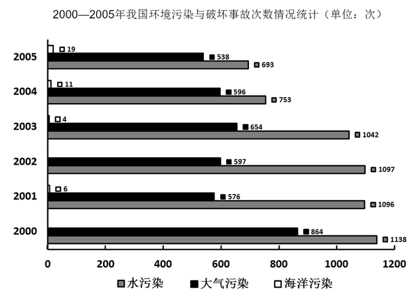

### 第 66 题

2000年至2005年间，我国水污染次数最多的一年是：

A. 2000年

B. 2001年

C. 2002年

D. 2003年

第 66 题 · 答案与解析

**参考答案（粉笔题库参考内容）**

A

**解析**

定位图形材料可得，2000年至2005年，我国水污染次数分别为1138、1096、1097、1042、753、693次，则水污染次数最多的一年是2000年。

故正确答案为A。

**考点**：直接找数、统计图

**来源**：2008年深圳市公务员录用考试《行测》题（上半年）第66题

### 第 67 题

2005年我国大气污染次数比水污染次数：

A. 多155次

B. 少155次

C. 多184次

D. 少184次

第 67 题 · 答案与解析

**参考答案（粉笔题库参考内容）**

B

**解析**

由图可知，2005年，水污染次数为693次，大气污染次数为538次，所以大气污染次数-水污染次数=538-693=-155次。

故正确答案为B。

**考点**：简单加减计算、统计图

**来源**：2008年深圳市公务员录用考试《行测》题（上半年）第67题

### 第 68 题

十五期间（2001年至2005年）海洋污染事故次数为：

A. 20次

B. 30次

C. 40次

D. 无法判断

第 68 题 · 答案与解析

**参考答案（粉笔题库参考内容）**

C

**解析**

由图可知，2001年至2005年海洋污染事故次数分别为6、0、4、11、19次，则十五期间海洋污染事故次数=6+0+4+11+19=40次。

故正确答案为C。

**考点**：简单加减计算、统计图

**来源**：2008年深圳市公务员录用考试《行测》题（上半年）第68题

### 第 69 题

从图中不能直接推断出来的是：

A. 2005年海洋污染次数比2004年增长了70%

B. 2005年水污染次数比2004年减少了60%

C. 水污染在2002年造成的损失比2001年大

D. 2003年大气污染的次数比2002年有所增加

第 69 题 · 答案与解析

**参考答案（粉笔题库参考内容）**

C

**解析**

A项：定位图形材料可得，2004年、2005年海洋污染次数分别为11次和19次，代入公式：增长率，可以直接推断出来本项错误，排除。

B项：定位图形材料可得，2004年、2005年水污染次数分别为753次和693次，代入公式：增长率，可以直接推断出来本项错误，排除。

C项：图中没有提及水污染的损失情况，无法直接推断其正误，当选。

D项：定位图形材料可得，2003年大气污染的次数654>2002年大气污染的次数597，可以直接推断出来本项正确，排除。

本题为选非题，故正确答案为C。

**考点**：统计图、综合分析

**来源**：2008年深圳市公务员录用考试《行测》题（上半年）第69题

### 第 70 题

十五期间（2001年至2005年）的最后三年里，污染事故次数的发展趋势与其他两种污染事故次数的发展趋势不同的是：

A. 水污染

B. 大气污染

C. 海洋污染

D. 无法判断

第 70 题 · 答案与解析

**参考答案（粉笔题库参考内容）**

C

**解析**

根据题目。

2003年-2005年水污染次数分别为：1042、753、693次，水污染次数逐年减少；

2003年-2005年大气污染次数分别为：654、596、538次，大气污染的次数逐年减少；

2003年-2005年海洋污染次数分别为：4、11、19次，海洋污染的次数逐年增加。

所以只有海洋污染次数呈上升趋势。

故正确答案为C。

**考点**：直接找数、统计图

**来源**：2008年深圳市公务员录用考试《行测》题（上半年）第70题

## 材料 3

2006年我国进口铜材109.3万吨，比上年下降2.3%，价值63.6亿美元，增长45.3%。进口平均价格达5821美元/吨。其主要特点有：

        加工贸易占主导地位，保税区仓储转口货物大幅增长，2006年，以加工贸易方式进口钢材90.9万吨，下降2.5%，占进口钢材总量的83.2%；保税区仓储转口货物进口铜材10.5万吨，增长24.4%，此外，一般贸易进口7.2万吨，下降16.9%。

        进口主要来自周边国家和地区，国货复进口小幅增长。2006年，大陆自台湾地区进口铜材38.7万吨，下降3.9%；自韩国进口18.8万吨，下降15.3%；自日本进口9.9万吨，增长19.3%；自东盟进口8.5万吨，下降5.8%。自上述4个市场合计占69.4%。此外，国货复进口17万吨，增长2.8%。

        外商投资企业是进口的主力军。2006年，外商投资企业进口铜材78.2万吨，增长1.6%；国有企业进口25.7万吨，下降8.1%；私营企业进口4.5万吨，下降19.6%。

        2006年我国进口铜材量减价的主要原因有：国内市场供给能力有所增强；国内铜材生产上游产品供给持续增加；铜材价格攀升遏制了部分需求。2006年我国进口铜材加工的上游原材料电解铜的平均价格为6254美元/吨，上升74.5%。值得关注的是，我国作为铜资源短缺的国家，2006年铜材出口却呈快速上升趋势。2006年，我国铜材出口达55.9万吨，增长20.6%，相当于当年铜材进口量的一半以上。铜材的冶炼和加工属于高耗能和高污染行业，大量出口铜材既扩大了国内的供需缺口，也使国内能源和环保承受更大的压力，所以，需要采取合适的政策措施促使铜材的进出口更加趋于合理。

### 第 71 题

与上年相比，2006年我国铜材进口平均价格：

A. 上涨了48.7%

B. 下跌了47.6%

C. 上涨了47.6%

D. 下跌了47.8%

第 71 题 · 答案与解析

**参考答案（粉笔题库参考内容）**

A

**解析**

根据题干“与上年相比，2006年我国铜材进口平均价格”结合选项“上涨/下跌+%”，判定本题为平均数的增长率问题。平均价格，定位文字材料第一段可得，2006年我国进口铜材增长率b=-2.3%，进口额增长率a=45.3%。代入公式，只有A项符合。

故正确答案为A。

**考点**：平均数的增长率、文字资料

**来源**：2008年深圳市公务员录用考试《行测》题（上半年）第71题

### 第 72 题

2006年保税区仓储转口货物进口铜材占全年的：

A. 8.2%

B. 9.6%

C. 6.7%

D. 11.8%

第 72 题 · 答案与解析

**参考答案（粉笔题库参考内容）**

B

**解析**

根据题干“2006年······占······”，结合材料时间为2006年，判定本题为现期比重问题。定位文字材料第一段可得，2006年我国进口铜材109.3万吨；定位文字材料第二段可得，保税区仓储转口货物进口铜材10.5万吨。则比重，与B项最接近。

故正确答案为B。

**考点**：文字资料、现期比重

**来源**：2008年深圳市公务员录用考试《行测》题（上半年）第72题

### 第 73 题

资料中提到的4个铜材进口来源地中，在我国2006年进口铜材量所占份额最大的国家或地区比所占份额最小的国家或地区多：

A. 31.2万吨

B. 27.6个百分点

C. 25.6个百分点

D. 3.3倍

第 73 题 · 答案与解析

**参考答案（粉笔题库参考内容）**

B

**解析**

根据题干“2006年······占份额”，判定本题为现期比重问题。定位文字材料第一段可得，2006年我国进口铜材109.3万吨；定位文字材料第三段可得，最多的进口铜材来源地为台湾地区，进口38.7万吨，最少的为东盟地区，进口8.5万吨。根据比重，可列式为，即比重约多了27.7个百分点，与B项最接近。

故正确答案为B。

**考点**：文字资料、现期比重

**来源**：2008年深圳市公务员录用考试《行测》题（上半年）第73题

### 第 74 题

与上年相比，2006年增长速度最快的是：

A. 进口铜材价值

B. 保税区仓储转口货物进口铜材数量

C. 电解铜的平均价格

D. 铜材出口数量

第 74 题 · 答案与解析

**参考答案（粉笔题库参考内容）**

C

**解析**

定位文字材料“2006年我国进口铜材······价值63.6亿美元，增长45.3%”“保税区仓储转口货物进口铜材10.5万吨，增长24.4%”“电解铜的平均价格为6254美元/吨，上升74.5%”“2006年，我国铜材出口达55.9万吨，增长20.6%”可得，2006年我国电解铜的平均价格上升74.5%，增长速度最快。

故正确答案为C。

**考点**：文字资料、直接找数

**来源**：2008年深圳市公务员录用考试《行测》题（上半年）第74题

### 第 75 题

根据上述资料，下列说法不正确的是：

A. 2006年铜材进口企业中，只有外商投资企业的数量出现增长

B. 我国目前的铜材进出口结构不合理

C. 铜材价格的大幅上涨是铜材进口数量锐减的主要原因

D. 国内市场供给能力有所增强是造成目前铜材进口量减价的原因之一

第 75 题 · 答案与解析

**参考答案（粉笔题库参考内容）**

C

**解析**

A项：定位文字材料第四段可得，2006年，外商投资企业进口铜材78.2万吨，增长1.6%，国有企业进口25.7万吨，下降8.1%，私营企业进口4.5万吨，下降19.6%，只有外商投资企业的数量出现增长，正确。

B项：定位文字材料第五段可得，“需要采取合适的政策措施促使铜材的进出口更加趋于合理”，即目前铜材进出口结构不合理，正确。

C项：定位文字材料第一段可得，进口铜材数量比上年下降2.3%，并没有锐减，错误。

D项：定位文字材料第五段可得，“2006年我国进口铜材量减价的主要原因有：国内市场供给能力有所增强；国内铜材生产上游产品供给持续增加；铜材价格攀升遏制了部分需求”，正确。

本题为选非题，故正确答案为C。

**考点**：文字资料、综合分析

**来源**：2008年深圳市公务员录用考试《行测》题（上半年）第75题

## 材料 4

孩子的经济成本由孩子出生前后费用支出构成。

        孩子出生前的有关支出，即从怀孕至孩子出生这段时期与孩子相关的费用估计平均为2685.36元。其中在孩子出生前费用比中名列前三名的是怀孕期间的营养费（38.58%）、住院接生费（26.91%）和婴儿用品预购费（23.46%）。胎教支出相对有限，只占6.03%。处于各项支出的最后一位。统计结果表明，男孩的妊娠分娩费用（3216元）要比女孩的费用（2109元）高，高出的部分主要体现在额外营养费、雇工照顾费和婴儿用品预购费上的性别差别，生男孩的母亲要比生女孩的母亲多进补289元，高出37.1%；生女孩的家庭几乎不请雇工帮忙，比生男孩的家庭少支出195元的雇工照顾费；男孩的婴儿用品预购费比女孩高出631元，是女孩的3.5倍。

        孩子出生后，抚养其0—16周岁的费用为118934.45元。食品费用支出最多，为52314.68元；教育费用次之，为23615.31元；然后依次是家庭生活服务费（12651.68元）、衣着费用（11683.94元）、零花和压岁钱的支出（9876.85元）、文化娱乐活动的支出（8431.25元）、健康保险费（5216.34元）、日用品支出（4562.31元）和医疗保健费（3984.62元）。

### 第 76 题

如果某位母亲孩子出生前的费用支出为4682.45元，那么：

A. 比平均水平高出1865.47元

B. 比平均水平高出2064.67元

C. 比平均水平高出74.37%

D. 比平均水平高出68.52%

第 76 题 · 答案与解析

**参考答案（粉笔题库参考内容）**

C

**解析**

根据材料，“与孩子相关的费用估计平均为2685.36元”，所以高出4682.45-2685.36=1997.09元，高出。

故正确答案为C。

**考点**：一般增长率、文字资料

**来源**：2008年深圳市公务员录用考试《行测》题（上半年）第76题

### 第 77 题

生女孩的母亲怀孕期间的营养费和婴儿用品预购费的总支出约为：

A. 1031元

B. 976元

C. 1263元

D. 1134元

第 77 题 · 答案与解析

**参考答案（粉笔题库参考内容）**

A

**解析**

根据材料，“生男孩的母亲要比生女孩的母亲多进补289元，高出37.1%”，则生女孩的营养费为元。“男孩的婴儿用品预购费比女孩高出631元，是女孩的3.5倍”，则生女孩的婴儿用品预购费为元，总支出元。

故正确答案为A。

**考点**：文字资料、现期倍数

**来源**：2008年深圳市公务员录用考试《行测》题（上半年）第77题

### 第 78 题

男孩的婴儿用品预购费占出生前妊娠分娩费用的比例为：

A. 27.5%

B. 19.6%

C. 20.5%

D. 32.6%

第 78 题 · 答案与解析

**参考答案（粉笔题库参考内容）**

A

**解析**

根据材料，“男孩的妊娠分娩费用（3216元）”，根据上题，男孩的婴儿用品预购费为252.4+631=883.4元。所以男孩的婴儿用品预购费占出生前妊娠分娩费用的比例为。

故正确答案为A。

**考点**：文字资料、现期比重

**来源**：2008年深圳市公务员录用考试《行测》题（上半年）第78题

### 第 79 题

从孩子出生后的抚养费用构成来看，食品费用支出占抚养费的比例约是文化娱乐活动支出所占比例的：

A. 5.3倍

B. 4.7倍

C. 7.3倍

D. 6.2倍

第 79 题 · 答案与解析

**参考答案（粉笔题库参考内容）**

D

**解析**

根据材料“食品费用支出最多，为52314.68元”“文化娱乐活动的支出（8431.25元）”可得，食品费用支出占抚养费的比例约是文化娱乐活动支出所占比例的倍。

故正确答案为D。

**考点**：文字资料、现期平均数

**来源**：2008年深圳市公务员录用考试《行测》题（上半年）第79题

### 第 80 题

根据上述材料，可以得出结论是：

①通过母亲进补的方式促进胎儿健康发育的传统方式仍然受到认可

②代表现代育婴潮流的胎教仍然没有获得应有的重视

③家庭对男孩的偏爱在妊娠期间就已经表现出来了

A. ①②

B. ①②③

C. ②③

D. ①③

第 80 题 · 答案与解析

**参考答案（粉笔题库参考内容）**

B

**解析**

表述①：“怀孕期间的营养费38.58%”，是所有投入中比例最大的，所以表述①正确；

表述②：“胎教支出相对有限，只占6.03%”，所以表述②正确；

表述③：“男孩的妊娠分娩费用3216元要比女孩的费用2109元高”，所以表述③正确。

故正确答案为B。

**考点**：文字资料、综合分析

**来源**：2008年深圳市公务员录用考试《行测》题（上半年）第80题

## 材料 5

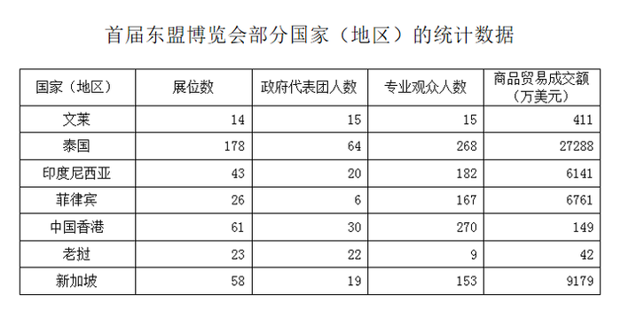

### 第 81 题

中国香港共有多少人参加此次东盟博览会？

A. 321人

B. 291人

C. 300人

D. 382人

第 81 题 · 答案与解析

**参考答案（粉笔题库参考内容）**

C

**解析**

根据材料，中国香港参加此次东盟博览会的政府代表团人数为30人、专业观众人数为270人，所以共有30+270=300人。

故正确答案为C。

**考点**：简单加减计算、统计表

**来源**：2008年深圳市公务员录用考试《行测》题（上半年）第81题

### 第 82 题

泰国平均每个展位商品贸易成交额为多少万美元：

A. 151.3

B. 152.3

C. 153.3

D. 154.3

第 82 题 · 答案与解析

**参考答案（粉笔题库参考内容）**

C

**解析**

根据材料，泰国商品贸易成交额为27288万美元，展位数为178个，所以泰国平均每个展位商品贸易成交额为万美元。

故正确答案为C。

**考点**：现期平均数、统计表

**来源**：2008年深圳市公务员录用考试《行测》题（上半年）第82题

### 第 83 题

商品贸易成交额超过4000万美元的国家（地区）有几个：

A. 3

B. 4

C. 5

D. 6

第 83 题 · 答案与解析

**参考答案（粉笔题库参考内容）**

B

**解析**

根据材料，可以发现泰国、印度尼西亚、菲律宾和新加坡四个国家（地区）的商品贸易成交额均超过4000万美元。

故正确答案为B。

**考点**：直接找数、统计表

**来源**：2008年深圳市公务员录用考试《行测》题（上半年）第83题

### 第 84 题

政府代表团人数和专业观众人数差距最小的是哪个国家（地区）？

A. 文莱

B. 印度尼西亚

C. 中国香港

D. 新加坡

第 84 题 · 答案与解析

**参考答案（粉笔题库参考内容）**

A

**解析**

根据材料，文莱的政府代表团和专业观众人数都为15人时，差距最小为0。

故正确答案为A。

**考点**：直接找数、统计表

**来源**：2008年深圳市公务员录用考试《行测》题（上半年）第84题

### 第 85 题

以下说法正确的是：

A. 泰国的展位数超过其他国家(地区)展位数的总和

B. 展位数越多的国家(地区)专业观众人数就越多

C. 政府代表团人数越多，参展商人数也会越多

D. 参展商人数越多的国家，商品贸易成交额不一定越多

第 85 题 · 答案与解析

**参考答案（粉笔题库参考内容）**

D

**解析**

A选项，泰国的展位数为178个，其他国家（地区）的展位数总和为14+43+26+61+23+58=225个>178个，错误；

B选项，泰国展位数最多为178个，香港展位数为61个，但是泰国的专业观众人数为268人，少于香港的专业观众人数为270人，错误；

C选项，老挝的政府代表团人数最多为22人，菲律宾的政府代表团人数为6人，但是老挝的专业观众人数为9人，少于菲律宾的专业观众人数167人，错误；

D选项，香港的参展商人数为30人，菲律宾参展商6人，但香港商品贸易成交额为149万美元，少于菲律宾商品贸易成交额6761万美元，正确。

故正确答案为D。

**考点**：统计表、综合分析

**来源**：2008年深圳市公务员录用考试《行测》题（上半年）第85题

### 第 86 题

唯物辩证法和形而上学对立的实质是：

A. 是否承认联系和发展的观点

B. 是否承认质量互变规律

C. 是否承认否定之否定规律

D. 是否承认对立统一规律

第 86 题 · 答案与解析

**参考答案（粉笔题库参考内容）**

D

**解析**

唯物辩证法与形而上学的对立，关键在于是否承认矛盾是物质世界发展的根本原因，唯物辩证法承认矛盾，主张用联系的、发展的、全面的观点看问题，形而上学否认矛盾，主张用孤立的、静止的、片面的、观点看问题。因此唯物辩证法和形而上学的最根本上的对立，也是其他对立问题的根源。唯物辩证法和形而上学对立的实质是是否承认对立统一规律。

故正确答案为D。

**考点**：唯物辩证法

**来源**：2008年深圳市公务员录用考试《行测》题（上半年）第86题

### 第 87 题

毛泽东说中国民主革命的主要斗争形式是：

A. 非武装斗争

B. 武装斗争

C. 工人运动

D. 农民运动

第 87 题 · 答案与解析

**参考答案（粉笔题库参考内容）**

B

**解析**

毛泽东运用马克思主义关于无产阶级革命的普遍原理，从理论和实践的结合上，创造性地解决了在一个半殖民地半封建的中国，如何进行新民主主义革命，以什么斗争为主要形式的问题，中国革命只能以长期的武装斗争为主要形式。离开了武装斗争，就没有无产阶级和人民的地位，就不能完成任何革命任务。这是由中国社会的性质和中国革命的特点决定的。

故正确答案为B。

**来源**：2008年深圳市公务员录用考试《行测》题（上半年）第87题

### 第 88 题

著作财产权包括：

A. 发表权

B. 署名权

C. 修改权

D. 演绎权

第 88 题 · 答案与解析

**参考答案（粉笔题库参考内容）**

D

**解析**

著作财产权又称“著作经济权”，是著作人身权的对称，指作者及传播者通过某种形式使用作品，从而依法获得经济报酬的权利。

1、发表权、修改权和署名权属于著作权中的占有权，是专属著作权人的人身权利。

2、著作权中的财产权其实是指因著作权而产生的收益权，包括出版作品、允许他人转载自己作品等获得报酬的权利。演绎权即属此类。

A、B、C三项均属著作人身权，错误，D项正确。

故正确答案为D。

**考点**：民法典

**来源**：2008年深圳市公务员录用考试《行测》题（上半年）第88题

### 第 89 题

根据行政监督主体监督权的来源不同，行政监督可分为：

A. 一般监督和特别监督

B. 事前监督和事后监督

C. 专门监督和业务监督

D. 依职权的监督和依授权的监督

第 89 题 · 答案与解析

**参考答案（粉笔题库参考内容）**

D

**解析**

行政监督可根据不同的标准进行分类。通常由：

（1）以行政监督的对象是否特定为标准，可以分为一般监督与特别监督。

（2）以行政监督的内容为标准，可以分为公安、工商、海关、资源、环境保护、审计等行政监督。

（3）以其实施的时期为标准，可以分为事前监督、事中监督和事后监督。

（4）以行政监督主体监督权的来源不同为标准，可分为依职权的监督与依授权的行政监督。

D项正确，符合题干的划分标准。

故正确答案为D。

**考点**：行政法

**来源**：2008年深圳市公务员录用考试《行测》题（上半年）第89题

### 第 90 题

通报不具有什么特点：

A. 典型性

B. 教育性

C. 权威性

D. 说理性

第 90 题 · 答案与解析

**参考答案（粉笔题库参考内容）**

D

**解析**

通报的特点有：1．告知性。通报的内容，常常是把现实生活当中一些正反面的典型或某些带倾向性的重要问题告诉人们，让人们知晓、了解。2．教育性。通报的目的，不仅仅是让人们知晓内容，它主要的任务是让人们知晓内容之后，从中接受先进思想的教育，或警戒错误，引起注意，接受教训。这就是通报的教育性。3．政策性。政策性并不是通报独具的特点，其他公文也同样具有这一特点。通报同时还具备公文的五大特点之一——权威性，但不具有说理性。

本题为选非题，故正确答案为D。

**来源**：2008年深圳市公务员录用考试《行测》题（上半年）第90题

### 第 91 题

政府职能转变的内在动力是：

A. 社会环境的变迁

B. 公共行政的科学化

C. 技术手段的创新

D. 经济的发展

第 91 题 · 答案与解析

**参考答案（粉笔题库参考内容）**

B

**解析**

按照依法治国、依法行政的要求，加强政府职能体系的法制建设，实现政府职能运行的法制化。社会环境变迁是政府职能转变的外在动因。公共行政科学化是政府职能转变的内在动力。技术手段的创新是政府职能转变的根本保障。传统行政文化是影响政府职能转变的制约因素。

故正确答案为B。

**来源**：2008年深圳市公务员录用考试《行测》题（上半年）第91题

### 第 92 题

什么适用于对下级机关布置工作，阐明工作活动的指导原则？

A. 指示

B. 批复

C. 决定

D. 通知

第 92 题 · 答案与解析

**参考答案（粉笔题库参考内容）**

A

**解析**

“指示”作为公文名称，是领导机关对下级机关布置工作，阐明工作活动要点及要求、步骤和方法时所使用的一种具有指导原则的下行公文。指示具有较强的指导性、政策性，可以使某项重要事项、工作能顺利进行，起着决定性作用。

故正确答案为A。

**来源**：2008年深圳市公务员录用考试《行测》题（上半年）第92题

### 第 93 题

下列①—⑥项中，属于深圳努力发展的四大支柱产业的是：

①金融服务业

②高新技术产业

③现代物流业

④旅游服务业

⑤电子设备制造业

⑥文化产业

A. ①②③④

B. ①②④⑥

C. ③④⑤⑥

D. ①②③⑥

第 93 题 · 答案与解析

**参考答案（粉笔题库参考内容）**

D

**解析**

本题考查时事政治。

属于深圳努力发展的四大支柱产业是高新技术产业、金融服务业、现代物流业和文化产业四大支柱产业。

因此深圳努力发展的四大支柱产业是①②③⑥。

故正确答案为D。

**来源**：2008年深圳市公务员录用考试《行测》题（上半年）第93题

### 第 94 题

行政复议的原则不包括：

A. 便民原则

B. 公开原则

C. 调解原则

D. 及时原则

第 94 题 · 答案与解析

**参考答案（粉笔题库参考内容）**

C

**解析**

行政复议基本原则，是指由行政复议法确立和体现的，反映行政复议基本特点，贯穿于行政复议全过程，并对行政复议起规范和指导作用的基本行为准则。主要包括：1、合法、公正、公开、及时和便民原则。2、书面审查原则。3、合法性和适当性审查原则。

本题为选非题，故正确答案为C。

**考点**：行政法

**来源**：2008年深圳市公务员录用考试《行测》题（上半年）第94题

### 第 95 题

公民能够以自己的行为取得民事权利、承担民事义务的法律资格称为：

A. 民事权能

B. 民事权利能力

C. 民事行为能力

D. 民事行为资格

第 95 题 · 答案与解析

**参考答案（粉笔题库参考内容）**

C

**解析**

民事行为能力是指民事主体能以自己的行为取得民事权利、承担民事义务的资格。简言之，民事行为能力为民事主体享有民事权利、承担民事义务提供了现实性。

故正确答案为C。

**考点**：民法典

**来源**：2008年深圳市公务员录用考试《行测》题（上半年）第95题

### 第 96 题

我国的根本政治制度是：

A. 一国两制

B. 人民民主专政制度

C. 人民代表大会制度

D. 社会主义制度

第 96 题 · 答案与解析

**参考答案（粉笔题库参考内容）**

C

**解析**

人民代表大会制度之所以成为我国的根本政治制度，是由人民代表大会制度的特征和在我国政治生活中的地位决定的：（1）人民代表大会制度直接反映着我们国家的阶级本质，体现了各阶级、各阶层和各民族在国家生活中的地位。（2）人民代表大会制度是适合我国国情的根本政治制度。它是中国人民革命的创造性产物，是马克思主义关于政治制度学说在中国的具体应用。（3）人民代表大会制度体现出我国政治生活的全貌，是其他制度赖以建立的基础。（4）人民代表大会制度是人民实现国家权力的组织形式。我国各族人民通过这一制度来行使国家权力，保证了国家政权机关的高效运行，从而体现了“一切权力属于人民”的原则，这也是对人民利益加以维护的根本保证。

故正确答案为C。

**考点**：宪法

**来源**：2008年深圳市公务员录用考试《行测》题（上半年）第96题

### 第 97 题

行政管理过程的首要职能是：

A. 组织职能

B. 计划职能

C. 控制职能

D. 协调职能

第 97 题 · 答案与解析

**参考答案（粉笔题库参考内容）**

B

**解析**

行政管理的首要职能是计划职能。因为计划职能是：一、组织内的一部“宪法”（原则和规矩）。二、行动纲领。含有目标、途径、方法、措施、时限和责任等一整套行动的线路图。三、前进的方向、工作的任务和凝聚的纽带。四、其他职能的参考框架。

故正确答案为B。

**来源**：2008年深圳市公务员录用考试《行测》题（上半年）第97题

### 第 98 题

函在文种上属于：

A. 规范性公文

B. 领导指导性公文

C. 商洽性公文

D. 陈述呈请性公文

第 98 题 · 答案与解析

**参考答案（粉笔题库参考内容）**

C

**解析**

行政公文和党的机关公文都把函列为主要文种。《国家行政机关公文处理办法》对函的功能作如下表述：适用于不相隶属机关之间商洽工作，询问和答复问题，请求批准和答复审批事项。属商洽性公文。

故正确答案为C。

**来源**：2008年深圳市公务员录用考试《行测》题（上半年）第98题

### 第 99 题

中国共产党第十七届中央委员会第一次全体会议选举产生了新一届中央领导机构，其中中央政治局常委共多少人：

A. 7

B. 9

C. 11

D. 13

第 99 题 · 答案与解析

**参考答案（粉笔题库参考内容）**

B

**解析**

十七届一中全会选举胡锦涛、吴邦国、温家宝、贾庆林、李长春、习近平、李克强、贺国强、周永康为中央政治局常委，共9人。

故正确答案为B。

**考点**：时事政治-其他

**来源**：2008年深圳市公务员录用考试《行测》题（上半年）第99题

### 第 100 题

中国共产党坚持独立自主的和平外交政策，坚持＿＿＿＿＿道路，坚持互利共赢的开放战略，统筹国内国际两个大局，积极发展对外关系，努力为我国的改革开放和现代化建设争取有利的国际环境：

A. 和平发展

B. 和平合作

C. 和平崛起

D. 和谐发展

第 100 题 · 答案与解析

**参考答案（粉笔题库参考内容）**

A

**解析**

中国共产党第十七次全国代表大会做部分修改的《中国共产党章程》规定：坚持独立自主的和平外交政策，坚持和平发展道路，为现代化建设营造良好的周边环境和国际环境。

故正确答案为A。

**考点**：其他建设

**来源**：2008年深圳市公务员录用考试《行测》题（上半年）第100题

