# 2011年深圳市公务员录用考试《行测》题

<!-- gwy:overview:start -->
> **深圳 · 2011 · 行测 · 统考** ｜ 100 题 · 图片 136 处 · 答案随题折叠

| 题型模块 | 题量 | 题号 |
| --- | ---: | ---: |
| 数量关系 | 15 | 1–15 |
| 言语理解与表达 | 25 | 16–40 |
| 判断推理 | 25 | 41–65 |
| 资料分析 | 20 | 66–85 |
| 公共基础知识 | 15 | 86–100 |
| **合计** | **100** | |

导航：[题型与作答说明](#题型与作答说明) · [题目](#题目) · [材料 1](#材料-1)
<!-- gwy:overview:end -->

> 候选采集稿。参考答案及解析来自粉笔页面，不代表官方答案或真实高分答卷；来源使用许可与原卷对应关系仍需人工核实。

## 题型与作答说明

数量关系

（15题）

本部分包括数字推理与数学运算两种类型的题目。

言语理解与表达

（25题）

每道题给出一段文字，从四个选项中选出一个最恰当的答案。

判断推理

（25题）

本部分包括图形推理、事件排序、判断与推理三种类型的试题。

资料分析

（20题）

针对下列图、表或文字回答问题。你应该根据资料提供的信息进行分析、比较、计算、处理。

公共基础知识

（15题）

根据题目要求，在四个选项中选出一个正确答案。

## 题目

### 第 1 题

4，11，20，29，30，。

A. 39

B. 40

C. 41

D. 42

第 1 题 · 答案与解析

**参考答案（粉笔题库参考内容）**

C

**解析**

作差后无规律，考虑多重数列，分组找规律，原数列两两分组为：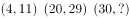，组内作差分别得7、9、？，猜测为公差为2的等差数列，即下一项为11，则所求项为41。在选项中查找，C项与之对应。

故正确答案为C。

### 第 2 题

5，25，61，113，。

A. 213

B. 181

C. 125

D. 154

第 2 题 · 答案与解析

**参考答案（粉笔题库参考内容）**

B

**解析**

原数列作差得到新数列：20、36、52、（    ），是公差为16的等差数列，故下一项为52+16=68，所求项=68+113=181。

故正确答案为B。

### 第 3 题

0，，，，。

A. 

B. 

C. 

D. 

第 3 题 · 答案与解析

**参考答案（粉笔题库参考内容）**

C

**解析**

观察数列趋势，原数列可转化为：、、、、，相邻两项分子之差为：1、3、5、(  )，为公差为2的等差数列，下一项为7，则所求项分子为16；相邻两项分母之差为：6、8、10、(  )，为公差为2的等差数列，下一项为12，则所求项分母为42。故所求项为，化简得。

故正确答案为C。

### 第 4 题

，，，，，。

A. 

B. 

C. 

D. 

第 4 题 · 答案与解析

**参考答案（粉笔题库参考内容）**

A

**解析**

由到，可以看出分子、分母各呈逐步递增趋势，将第二个与进行反约分，使之符合整体趋势，则原数列可以转化为：、、、、、。分子为连续自然数列，下一项应为6；分母为公比为2的等比数列，下一项应为64。因此所求项为，化简得。

故正确答案为A。

### 第 5 题

11，22，20，40，12，24，34，。

A. 50

B. 64

C. 56

D. 68

第 5 题 · 答案与解析

**参考答案（粉笔题库参考内容）**

D

**解析**

数列较长考虑分组，相邻两项分组，原数列可划分为：(11、22)(20、40)(12、24)(34、？)，观察可以发现，每组的后一项为前一项的2倍，故所求为。

故正确答案为D。

### 第 6 题

国家为了继续刺激消费，规定私人购买耐用消费品的，不超过其价格的50%的款项可以用抵押的方式向银行贷款，蒋老师欲购买一辆家用轿车，他现在的全部积蓄为P元，只够支付车款的60%，则蒋老师应向银行贷款多少元：

A. 

B. 

C. 

D. 

第 6 题 · 答案与解析

**参考答案（粉笔题库参考内容）**

B

**解析**

蒋老师的积蓄仅能支付车款的60%，故应向银行贷款车款的40%。由题意可知，车款，则所应贷款为。

故正确答案为B。

### 第 7 题

甲乙两人从P、Q两地同时出发相向匀速而行，5小时后于M点相遇。若其他条件不变，甲每小时多行4千米，乙速度不变，则相遇地点距M点6千米；若甲速度不变，乙每小时多行4千米，则相遇地点距M点12千米。则甲乙两人最初的速度之比为：

A. 2:1

B. 2:3

C. 5:8

D. 4:3

第 7 题 · 答案与解析

**参考答案（粉笔题库参考内容）**

A

**解析**

在题目中，每种走法，甲乙二人所用的时间都是相同的。设甲的初始速度为x，乙的初始速度为y，第一种走法，甲乙分别走了5x、5y的路程；第二种走法，甲速度提高了4千米每小时，走了5x+6千米，乙速度不变走了5y-6千米，

由所用时间相同可得：，化简可得：3x=7y-12 ①；

同理，第三种走法可列方程：，化简可得：2x=3y+12 ②；

①②式相加可得5x=10y，则x:y=2:1。

故正确答案为A。

### 第 8 题

英雄骑马射箭，路遇猛虎，相距50米，适逢箭矢已尽，遂驱汗血宝马逐之，意欲生擒。今知宝马步幅较猛虎为大，宝马2步值猛虎3步，然猛虎动作较宝马迅捷，宝马奔跑3步之时猛虎已经狂奔4步，则英雄追上猛虎之时，汗血宝马跑了多少米：

A. 320

B. 360

C. 420

D. 450

第 8 题 · 答案与解析

**参考答案（粉笔题库参考内容）**

D

**解析**

设宝马的步长为3，则猛虎的步长为2，宝马每单位时间可跑3步，路程为；而猛虎每单位时间可跑4步，路程为。故宝马与猛虎速度之比为9:8。在宝马追及猛虎的过程中，二者所用时间相同。时间相同，路程与速度成正比，因此在这个过程中，宝马与猛虎所走的路程比为9:8。二者路程比相差1份即为原相距的路程50米，一份为50，宝马共跑9份即为米。

故正确答案为D。

### 第 9 题

某公司年终分红，董事会决定拿出公司当年利润的10%奖励甲乙丙三位高管，原本打算依据职位高低按甲乙丙比例为3:2:1的方案进行分配，最终董事会决定根据实际贡献按甲乙丙比例为4:3:2的方案分配奖金。请问最终方案中哪位高管得到的奖金比原有方案有所提高：

A. 甲

B. 乙

C. 丙

D. 不清楚

第 9 题 · 答案与解析

**参考答案（粉笔题库参考内容）**

C

**解析**

在初始方案中，甲乙丙分配比例为3:2:1，则甲可以获得奖金的，乙可获得奖金的，丙可获得奖金的；在实际方案中，甲乙丙的分配比例为4:3:2，则甲获得了奖金的，乙获得了奖金的，丙获得了奖金的。对比可以得知甲得到的奖金比原方案下降了，乙持平，丙提高了。

故正确答案为C。

### 第 10 题

哥哥和弟弟各有若干本书，如果哥哥给弟弟4本，两人书一样多，如果弟弟给哥哥2本，哥哥的书是弟弟的4倍，哥哥和弟弟一共有多少本书：

A. 20

B. 9

C. 17

D. 28

第 10 题 · 答案与解析

**参考答案（粉笔题库参考内容）**

A

**解析**

方法一：由题干“如果弟弟给哥哥2本，哥哥的书是弟弟的4倍”可知，兄弟二人书的总量一定是5的倍数，由此排除B、C、D三项。

方法二：由题干“如果哥哥给弟弟4本，两人书一样多”可知，兄弟二人书的总量一定是2的倍数，由此排除B、C两项。代入A项，当书的总和为20时，由题意可得哥哥有书14本，弟弟有书6本，弟弟给哥哥2本，哥哥的书为弟弟的4倍，符合题意，当选。

故正确答案为A。

### 第 11 题

小刚买了3支钢笔、1个笔记本、2瓶墨水花去35元钱，小强在同一家店买同样的5支钢笔、1个笔记本、3瓶墨水花去52元钱，则买1支钢笔、1个笔记本、1瓶墨水共需多少元：

A. 9

B. 12

C. 15

D. 18

第 11 题 · 答案与解析

**参考答案（粉笔题库参考内容）**

D

**解析**

方法一：

设商店钢笔价格为x，笔记本价格为y，墨水价格为z。

根据题意可得方程组：3x+y+2z=35 ①；5x+y+3z=52 ②。通过观察可以发现①×2-②即得。

方法二：

因所求为一支钢笔、一个笔记本、一瓶墨水的价格总和，故无需将物品价格逐个求出。设钢笔价格为0，笔记本价格为x，墨水价格为y，则可得方程组：x+2y=35 ①；x+3y=52 ②。解得x=1，y=17，故三者价格之和为0+1+17=18。

故正确答案为D。

### 第 12 题

奶奶有6颗口味各不相同的糖，现分给3个孙子，其中1人得1颗，1人得2颗，1人得3颗，则共有多少种分法：

A. 60

B. 120

C. 240

D. 360

第 12 题 · 答案与解析

**参考答案（粉笔题库参考内容）**

D

**解析**

分步考虑，首先将不同的糖块分成三组，第一组1个，第二组2个，第三组3个，则共有种分法；然后分成的三组糖分别分给三个孙子，共有种分法。因此，总的分法应为种。

故正确答案为D。

### 第 13 题

已知一对幼兔能在一个月后长成一对成年兔子，一对成年兔子能在一个月后生出一对幼兔，如果现在给你一对幼兔，问一年后共有多少对兔子（假设每对兔子都为雌雄各一只）：

A. 88

B. 100

C. 144

D. 204

第 13 题 · 答案与解析

**参考答案（粉笔题库参考内容）**

C

**解析**

在一月时，有一对幼兔；在第二月成长为一对成年兔子；在第三月会生下一对幼兔，共一对幼兔一对成年兔；在第四月成年兔会生下一对幼兔，同时三月的幼兔已成长为成年兔，共两对成年兔与一对幼兔；第五月，两对成年兔会生下两对幼兔，同时四月幼兔成长为成年兔，共三对成年兔与两对幼兔；六月三对成年兔会生下三对幼兔，同时五月两对幼兔成长为成年兔，共计五对成年兔与三对幼兔。观察可以发现，1月有1对兔子，2月有1对兔子，3月有2对兔子，4月有3对兔子，5月有5对兔子，6月有8对兔子，前两月兔子对数之和为下一月兔子对数，故7月有13对兔子，8月有21对兔子，9月有34对兔子，10月有55对兔子，11月有89对兔子，12月有144对兔子。

故正确答案为C。

### 第 14 题

某疗养院同一个房间的四位病友，把他们的年龄（均为整数）两两相加得到6个不同的数，已知其中5个数为：99，113，125，130，144，四人中年龄最大者与年龄最小者岁数之和为多少岁：

A. 113

B. 118

C. 121

D. 125

第 14 题 · 答案与解析

**参考答案（粉笔题库参考内容）**

D

**解析**

设四位病友的年龄分别是A、B、C、D(A&lt;B&lt;C&lt;D)，结合选项，最小的为99（113可直接排除），其次为113，第二大的为130，最大的为144，则可得：A+B=99，A+C=113，B+D=130，C+D=144，A+D和B+C的值不能得出。根据方程组可得，C-B=113-99=14为偶数，根据数字奇偶特性，B+C也应该为偶数，故，因此125只能为A+D的值。

故正确答案为D。

### 第 15 题

依法纳税是公民的义务，按规定，全月工资薪金所得不超过800元的部分不必纳税，超过800元的部分，按下列分段累进计算税款，某人5月份应缴纳此项税款26.78元，则他的当月工资薪金所得介于：

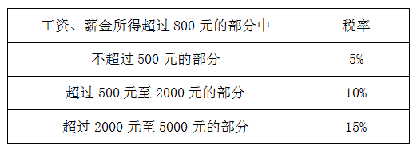

A. 800~900

B. 900~1200

C. 1200~1500

D. 1500~2800

第 15 题 · 答案与解析

**参考答案（粉笔题库参考内容）**

C

**解析**

税款采取分段累进计算方式，超过工资800的部分中，不超过500的部分税率为5%，即工资中800-1300的部分，需纳税元；某人实际纳税26.78元，则还剩下26.78-25=1.78元税款，即为超过1300元的工资所应缴纳的税款，则此人在1300元以上的工资部分为元。故此人当月工资总额为1300+17.8=1317.8元。

故正确答案为C。

### 第 16 题

将下列选项中的词语依次填入各句横线处，最恰当的一组是：

①两汉时期汉代衣服几经\_\_\_\_\_\_，绕至臀部，然后用绸带系束，衣上还绘有精美华丽的纹样。

②王子和公主的婚礼办得十分盛大，亲眼目睹的民众们无不\_\_\_\_\_\_。

A. 周折 欣羡

B. 周折 歆羡

C. 转折 欣羡

D. 转折 歆羡

第 16 题 · 答案与解析

**参考答案（粉笔题库参考内容）**

C

**解析**

本题考查实词含义。

第一空，“周折”是指（事情进展等）曲折、不顺利，而文段讲述为衣服的回旋弯折，与“绕”相应，故“周折”词意不符。“转折”有回旋弯折之意，可以形容衣服的走势，符合题意，排除A、B两项。

第二空，对比“欣羡”与“歆羡”，二者都含“羡慕”之意，区别在于“欣羡”侧重于非常羡慕，而“歆羡”侧重于爱慕。原句所表达的为民众对王室盛大婚礼的羡慕之情，故“欣羡”更为合适，排除D项。

故正确答案为C。

### 第 17 题

依次填入下列句子横线上的词语，最恰当的一组是：

如果很难向一侧游出，可以漂浮在水面\_\_\_\_\_\_。直到流势明显减缓后，再向一侧努力游出。如果已经\_\_\_\_\_\_，应不失时机地大声疾呼或发出其他有效求救信号。

A. 因势利导 筋疲力尽

B. 随波逐流 力不从心

C. 左右逢源 计穷力竭

D. 见风使舵 殚精竭虑

第 17 题 · 答案与解析

**参考答案（粉笔题库参考内容）**

B

**解析**

通读可以得出文段所讲述的为在游泳遇到急流时所应采取的应对方案。

第一空，选项ABCD与文段“漂浮在水面，直到流势明显减缓后，再向一侧努力游出”对应合理的只有“随波逐流”一词。“因势利导”指顺着事情发展的趋势向有利于实现目的的方向加以引导；“左右逢源”指到处遇到充足的水源，原指赏识广博，应付裕如，后也比喻做事得心应手，非常顺利，有时也用来讽刺为人圆滑，善于投机；“见风使舵”指看风向转发动舵柄，比喻看势头或看别人的眼色行事。这三个词的含义与此处语境均不符合，排除ACD三项。

第二空，“如果已经力不从心，应不失时机地大声疾呼或发出其他有效求救信号”，“力不从心”指心里想做，可是力量不够，与文段意思相符，语句通顺语义明确。

故正确答案为B。

释义

“因势利导”指顺着事情发展的趋势向有利于实现目的的方向加以引导。

“随波逐流”的原意就是随着波浪起伏，跟着流水漂荡。

“左右逢源”指到处遇到充足的水源。原指赏识广博，应付裕如。后也比喻做事得心应手，非常顺利。有时也用来讽刺为人圆滑，善于投机。

“见风使舵”指看风向转发动舵柄。

“殚精竭虑”指尽心竭力，多指用尽心思去做某件事。

“计穷力竭”指计谋、力量都用尽了。

“筋疲力尽”指精神疲惫，力气用尽，形容精神和身体极度疲劳。

“力不从心”指心里想做，可是力量够不上。

### 第 18 题

依次填入下列句子横线上的词语，最恰当的一组是：

诚然，在相当长一段时间里，对抗或叛逆确实是中国当代诗歌完成自我\_\_\_\_\_\_的法则之一。以真实取代虚假，以个人反抗群体，以感性抵制理性，以平面消除深度，中国当代诗歌正是在这种不断的反叛中实行着某种\_\_\_\_\_\_。

A. 衍变 更新

B. 蜕变 更迭

C. 嬗变 替换

D. 演变 置换

第 18 题 · 答案与解析

**参考答案（粉笔题库参考内容）**

B

**解析**

本题考查实词含义。

第一空，文段指出“中国当代诗歌以真实取代虚假，以个人反抗群体，以感性抵制理性，以平面消除深度”，与此句相呼应最为切合的词语应为“蜕变”。“衍变”指经过自然进化而发展，文段所讲述的中国诗歌并非自然进化，“嬗变”指彻底改变（如特征或条件的改变），“演变”指历时较久的发展变化，二者一般指客观上的改变，“自我嬗变”“自我演变”搭配不当。只有B项“蜕变”能够体现出中国当代诗歌积极、全新的变化，同时“自我蜕变”也为固定搭配，排除ACD三项。

第二空，“更迭”意为轮回、替换，与句意相符。

故正确答案为B。

### 第 19 题

依次填入下列各句横线处的词语，最恰当的一组是：

①学校图书馆为我们\_\_\_\_\_\_了良好的阅读条件。②部队在陈村进行了整编，\_\_\_\_\_\_了不少人员。③\_\_\_\_\_\_教师节，市里派来了慰问团。

A. 创设 扩大 邻近

B. 创造 扩大 临近

C. 创造 扩充 临近

D. 创设 扩充 邻近

第 19 题 · 答案与解析

**参考答案（粉笔题库参考内容）**

C

**解析**

本题考查实词含义。

第二空，“扩大了不少人员”明显搭配不当，“扩大”多为面积上的增多，“扩充”多为数量上的增多，“扩充人员”搭配合理，排除A、B两项。

第三空，“临近”指时间上的接近，“邻近”指空间上的接近。句中“教师节”是一个时间概念，故应选择“临近”，排除D项。

第一空，“创造了良好条件”表达正确。

故正确答案为C。

### 第 20 题

依次填入下列各句横线处的词语，最恰当的一组是：

①共青团中央、教育部在京举行新闻发布会，全面\_\_\_\_\_\_2004年大学生志愿服务西部计划。消息\_\_\_\_\_\_发布，全国各地大学生反响强烈。

②要积极鼓励有条件的乡村集体经济组织对本地新型农村合作医疗给予适当\_\_\_\_\_\_，但集体出资部分不得向农民摊派。

③第二轮北京六方会谈虽然未能使美朝之间的分歧有明显减少，\_\_\_\_\_\_确定了6月底前举行第三轮会谈，\_\_\_\_\_\_决定成立工作组，六方会谈的解决机制得以确认。

A. 起动 一经 扶植 但 还

B. 启动 一旦 扶持 但 并

C. 起动 一旦 扶植 并 还

D. 启动 一经 扶持 但 并

第 20 题 · 答案与解析

**参考答案（粉笔题库参考内容）**

D

**解析**

本题考查实词与虚词的混搭填空。

本题可从第二空入手，“一经”常在动词或表示条件的词语前面作副词使用，表示只要经过某种行为或某个步骤，就可以产生相应的结果。“一旦”表示还未发生不能确定的条件副词，而通过前文可知这个计划已经发布，故此空应选择“一经”一词，排除B、C两项。

第三空，“扶植”意为扶持培植，比喻以某种手段培养人才或势力的壮大。“扶持”意为支持、帮助。“扶植”与“扶持”相比，更侧重于“培养”之意。②句意在表达要鼓励、支持新型农村合作医疗，并非培养，故“扶持”更为合适，排除A项。

第一空代入验证，“启动”指发动、开动、开始，“全面启动2004年大学生志愿服务西部计划”符合文意。

第四、五空代入验证，“虽然······但”是关联词固定搭配，“举行第三轮会谈，并决定成立工作组”符合文意。

故正确答案为D。

### 第 21 题

下列语句中有语病的一项为：

A. 步入青城山，仿佛步入天外仙境，那如梦如幻、充满诗情画意的自然风貌深深地让我陶醉了

B. 能源专家预测，瓦斯是世界上正在崛起的新型能源，是煤炭、石油、天然气之外最大的接替能源

C. 铃声响起，他急忙拿起听筒，电话那端传来一个操着普通话的中年男子的声音说：“你被录取了。”

D. 2006年赣台经贸合作研讨会，9月23日在庐山开幕，1700多名台湾知名人士和工商界人士齐聚庐山，共赴盛会

第 21 题 · 答案与解析

**参考答案（粉笔题库参考内容）**

C

**解析**

本题考查病句辨析。

C项语病在于句式杂糅。“传来……声音”为一个完整的句子，后面又出现了谓语动词“说”，构成句式杂糅，可删除其一，改为“电话那端传来一个操着普通话的中年男子的声音”或“电话那端一个操着普通话的中年男子说”。

故正确答案为C。

### 第 22 题

下列选项中没有语病的一项为：

A. 他如果不能实事求是，事业就会受到巨大损失，长期以来所恪守的诚信待人的美好品德也会丧失

B. 我们对于“比较文学”是个陌生的概念，读读钱钟书的《谈中国诗》或许能引你走进这一陌生的境地

C. 这篇通讯是《光明日报》记者邵云环同志在贝尔格莱德已遭北约空袭，并扬言“加大轰炸力度”的日子里写的

D. 我们主张社会利益与个人利益一致、贡献与索取一致的观点，并不是主张把人生的价值仅仅归结到对个人需要的满足和个人向社会的索取上

第 22 题 · 答案与解析

**参考答案（粉笔题库参考内容）**

D

**解析**

D项语句通顺语义明确。

A项语病在于关联词位置不当，可改为“如果他不能实事求是······”；B项语病在于主客倒置，可改为“‘比较文学’对于我们是个陌生的概念”；C项语病在于句子成分残缺，“扬言‘加大轰炸力度’”的主语不明。

本题为选非题，故正确答案为D。

### 第 23 题

下列选项中，有语病的一项为：

A. 汉字是一种符号而不是图画，符号是约定的，其“形”与其表示的“义”没有必然的联系

B. 忠王李秀成临刑前是不是很英勇呢？从一些记载上看，不是这样的

C. 全球将形成一种崭新的信息与通信网络系统，它能以更快的速度传送和处理数量日益增加的数据、信息和知识，对于人类来说，这是一种前所未有的科技革命

D. 目前人们正在研究蓝蝶的反光机理，想仿造应用

第 23 题 · 答案与解析

**参考答案（粉笔题库参考内容）**

B

**解析**

B项语病在于语义不明，疑问句“李秀成临刑前是不是很英勇呢”包含两层意思：英勇和不英勇，代词“这样”指代不明确，导致语义不明。

故正确答案为B。

### 第 24 题

下列选项中，没有语病的一项是（  ）。

A. 应用这种罗盘，无论在阴云密布以及黎明或傍晚看不到太阳的时候，也不会迷失方向

B. 在我们中间，一个人发生困难，就有上百、上千、上万个素不相识的人热切地伸出手，不遗余力地帮助你

C. 文章关于环境污染问题作了比较具体的分析，引起人们对环境科学的重视

D. 荔枝是亚热带水果，现在科学发达，使荔枝北移，将来也许不是完全不可能的事

第 24 题 · 答案与解析

**参考答案（粉笔题库参考内容）**

D

**解析**

A项，关联词搭配错误，应将“无论······也······”改为“无论······都······”或“即使······也······”。

B项，句末的“你”改为“他”。

C项，应将“文章”后面的“关于”改为“对”。

D项无语病。

本题为选非题，故正确答案为D。

### 第 25 题

下列各句中，没有语病的一句是：

A. 组委会在特意把奖杯送到袁隆平海南的水稻实验基地后，这位闻名世界的科学家就在田地里接过了“2007年十大经济年度人物奖”奖杯

B. 江苏省政府昨天下午召开新闻发布会，颁布2007年度江苏国税百强排行榜，省电力公司、南京卷烟厂、徐州卷烟厂位列百强榜榜首

C. 我国环境保护转机的曙光虽然隐约可见，但由于传统经济增长方式的巨大惯性、生态变化的不可逆性，生态恢复和环境保护并不容乐观

D. 2008年奥运会圣火取火仪式前，伊格娜迪欧表示，作为最高女祭司必须拥有一张典型的希腊面孔，个子要高，能够表现出高贵优雅的气质

第 25 题 · 答案与解析

**参考答案（粉笔题库参考内容）**

D

**解析**

D项语句通顺语义明确。

A项语病在于偷换主语，语句前半句的主语为“组委会”，后半句的主语为“科学家”，可将句首的“在”提到“组委会”之前；B项语病在于概念误用，“榜首”意为第一，只能指代一个名额，而句中对应了三个公司，可修改为“省电力公司、南京卷烟厂、徐州卷烟厂并列百强榜榜首”或将“榜首”修改为“前三名”；C项语病在于关联词位置不当，“虽然”应放在句首，且句子成分残缺，应是生态恢复和环境保护的“前景”或“形势”不容乐观。

本题为选非题，故正确答案为D。

### 第 26 题

下列各句中，没有语病的一句是（  ）。

A. 比赛采用马拉松竞赛方法，取男女各前三十名

B. 丈夫看着妻子黑发中夹藏着的白发，妻子看着丈夫脸上的皱纹，两个人都觉得又增加了几根

C. 可当他经过原来的办公室时，却闻到扑鼻的酒香，刺耳的狂笑，窗口上那前仰后合的黑影，使他头皮发炸

D. 有关专家认为，这部专著标志着我国的巴克莱研究朝世界一流水平迈进了坚实有力的一大步

第 26 题 · 答案与解析

**参考答案（粉笔题库参考内容）**

D

**解析**

A项，“各”应放在“取”之前。

B项，“几根”只能用来修饰头发，而不能用来修饰“皱纹”。

C项，闻到的只能是酒香，后面的“狂笑”只能是“听到”，“黑影”只能是“看到”。

本题为选非题，故正确答案为D。

### 第 27 题

下列各句中，成语使用恰当的一句是：

A. 刚才放的那几首歌都不大好听，只有这一首还差强人意

B. 他爸爸是乐队指挥，妈妈是歌唱家，平日耳闻目睹，所以他也爱好音乐

C. 小明犯了错误总好狡辩，你说他一句，他就举一反三，还你好多句

D. 这本书的情节引人入胜，读起来真让人津津乐道

第 27 题 · 答案与解析

**参考答案（粉笔题库参考内容）**

A

**解析**

这是一道成语辨析题。

A项“差强人意”指大体上使人满意，勉强可以，符合语境，成语使用恰当。

B项“耳闻目睹”意为亲耳听到，亲眼看到，形容亲身见证，千真万确，用在句中不合语境，可修改为“耳濡目染”，意为耳朵经常听到，眼睛经常看到，不知不觉地受到影响；C项“举一反三”比喻从一件事情而推知其他许多事情，作褒义，用在句中感情色彩不符；D项“津津乐道”意为有滋有味地讲谈某件事情，与原文读书语境不符，可修改为“回味无穷”。

故正确答案为A。

### 第 28 题

下列选项中，有歧义的一项是：

A. 通过中微子来探测太阳内部的想法至今无法实现

B. 一位年轻的美国外交官在访问中国时，问了一个令他自己尴尬的问题

C. 歌德是德国18世纪到19世纪的伟大诗人

D. 解放前一年的冬天我见到了他

第 28 题 · 答案与解析

**参考答案（粉笔题库参考内容）**

D

**解析**

D项语句歧义在于“解放前一年”，既可指“解放的前一年”，也可为“解放前的某一年”，定语修饰指代不清存在语法歧义。

故正确答案为D。

### 第 29 题

下列各句中，没有语病的一句是：

A. 他如果天天都熬夜看奥运会，精力不济，影响工作，那么我们就应该及时向他提出意见甚至警告

B. 9月21日12时35分，执行“神七”飞行任务的航天员抵达酒泉卫星发射中心，他们将在这里进行适应性训练和心理调整，为太空飞行做好最后的准备

C. “神舟”七号载人飞船的成功发射，再次赢得了世界各国的广泛赞誉，中华民族能有今天的荣耀，靠的是勤劳智慧的中国人民的共同奋斗所取得的

D. 根据中方要求，世卫组织总部正在开展三聚氰胺的毒性研究，目前已进入动物测试，但在最终研究报告出炉之前尚无法对三聚氰胺的毒性进行明确定义

第 29 题 · 答案与解析

**参考答案（粉笔题库参考内容）**

B

**解析**

B项语句通顺语义明确。

A项语病在于句子成分多余，出现两个主语，可修改为“如果他天天都熬夜看奥运会，精力不济，影响工作，那么我们就应该及时向他提出意见甚至警告”；C项语病在于句式杂糅，“靠的……所取得的”构成句式杂糅，可删除其一；D项语病在于成分残缺，缺少宾语，可在“动物测试”后加上“阶段”。

本题为选非题，故正确答案为B。

### 第 30 题

下列各句中，没有语病的一句是：

A. 江西东乡县、湖北宜昌市伍家岗区、云南昆明市官渡区发现了疑似高致病性禽流感，疫情发生后，当地政府立即采取了捕杀和紧急强制免疫，疫情已得到控制

B. 古城淮安历史悠久，钟灵毓秀，洪泽湖、铁山寺、明祖陵、周恩来故居等名胜古迹无不以流光溢彩的风姿为中外游人所倾倒

C. 当今社会中，信用缺乏已成为一种普遍性的社会现象，它扰乱了市场秩序，降低了经济运行效率，使企业难以正常地发展，对整个社会贻害无穷

D. 联合国医疗署的官员警告说，中国需要采取紧急行动防止艾滋病的传播，否则不采取紧急行动，今后10年里还会有1000万人成为艾滋病感染者

第 30 题 · 答案与解析

**参考答案（粉笔题库参考内容）**

C

**解析**

C项语句通顺语义明确。

A项语病在于句子成分残缺，缺少宾语，可在“采取了捕杀和紧急强制免疫”后补充宾语“的措施”；B项语病在于语序不当主谓倒置，应该是“中外游人无不为流光溢彩的风姿所倾倒”；D项语病在于用词重复，“否则”与“不采取紧急行动”意思重复，可删除“不采取紧急行动”或将“否则”修改为“如果”。

本题为选非题，故正确答案为C。

### 第 31 题

对弱势群体的态度是检验一个人、一个政党的试金石。据中国人民大学社会研究报告《走向更加公正的社会》的计算，如果将城乡贫困人口、经济结构调整中的失业和下岗职工、残疾人、灾难中的求助者、农民工等各类处于弱势地位的人口加总，再扣除彼此重叠的部分，大约有亿人。这只是从经济上看的，同时还有“看病难、上学难、打官司难”的人，他们算不算弱势群体?是不是存在越不承认有弱势群体，弱势群体越大的问题?

这段话其实只是想说：

A. 弱势群体的状况是区别社会文明的分水岭

B. 目前的弱势群体划分还存在分歧和许多值得质疑之处

C. 弱势群体的实际范围要比已公开宣布的范围大得多

D. 对于弱势群体，我们应该有一个正确的政策

第 31 题 · 答案与解析

**参考答案（粉笔题库参考内容）**

C

**解析**

文段共包含四句话，首句引出主题“弱势群体”，其次对中国人民大学社会研究报告中对“弱势群体”的计算进行简单介绍。然后提出疑问，为文段重点，也为作者的态度，即想要表达的观点。联系文段语意，由两个疑问句可知，除了报告中经济上的约1.4~1.8亿人的弱势群体，还有“看病难、上学难、打官司难”的弱势群体，即弱势群体的实际范围要比宣布的数据大。

因此，结合选项应该选择C，只有C项是作者最想要表达的意思。

A项文段主要讲述弱势群体的计算范围，“社会文明”并未体现，排除；B项，文段并未体现出对弱势群体划分中存在分歧，只是想要表明数据统计不够完整，排除；D项，“政策”在文中也未提及，排除。

故正确答案为C。

### 第 32 题

长期以来，在传统观念的影响下，对于司法机关在执法过程中侵害公民、法人和其他组织的合法权益的行为，缺乏有效可行的保障机制来恢复和弥补被侵权人的权利。遭受侵害的当事人不知道怎样保护自己的合法权益，更没有一条光明、可靠的渠道来支持这种保护。

这段文字的主旨是：

A. 司法机关执法受到传统观念的深刻影响

B. 司法机关的执法过程也应有法可依、有法必依

C. 目前缺少保障机制来弥补被司法机关侵犯的权利

D. 制定规范和约束司法机关执法过程的法律势在必行

第 32 题 · 答案与解析

**参考答案（粉笔题库参考内容）**

C

**解析**

文段共两句话，第一句说明目前尚缺乏有效可行的机制来恢复和弥补被司法机关侵害合法权益的被侵权人的权利；第二句采用递进手法进一步说明没有可靠的渠道支持受害人保护自己的权益。综合两句句意可知，文段旨在说明目前缺少有效的保障机制来保护受害当事人的合法权益。

因此，结合选项应该选择C，C项是对文段的全面概括，与主旨相符。

A、B两项的主体为“司法机关”，与题干文意不合，排除；D项是对于文段含义的引申，并非文段主旨，排除。

故正确答案为C。

### 第 33 题

宋代学者称杜甫为“圣手诗者”，这主要是指杜甫在诗歌史上的地位而言。他们把杜甫视为“集大成”者，认为他是位无体不工、无美不备的诗人。到了后世把杜甫简称为“诗圣”，这突出了杜诗的道德含义（郭沫若称其为“诗中圣哲”也是此意），符合杜诗中的儒学内涵。“诗圣”的名号，使得杜诗所确立的“忧国忧民”精神逐渐成为了主流理论。不管你是否赞成，但都不能不承认诗歌写作应该反映现实和关注国家与人民的命运。南宋诗人就说：“忧时本是诗人职，莫怪吟中感慨多。”这是赞成诗人应该忧国忧民的。也有不赞成的，明代的公安派代表作家袁宏道，提倡个性解放，不同意诗人应有“忧国忧民”的责任感。他在《显灵官集诸公以城市山林为韵》中说“新诗日日千余言，诗中无一忧民字”，“自从老杜得诗名，忧君爱国成儿戏”，仔细咀嚼诗意，可见袁氏虽然不赞成此说，但还是把“忧君爱国”看做当时诗歌创作中大多数诗人所遵循的原则。

下列叙述中，不属于称杜甫“圣手诗者”或“诗圣”的根据的一项是：

A. 杜甫在诗歌史上地位很高，人们视之为“集大成”者

B. 杜甫写诗技艺很高，无体不工、无美不备

C. 杜诗中“忧国忧民”精神是诗歌界主流理论

D. 杜诗中有伦理价值思想，儒学内涵丰富

第 33 题 · 答案与解析

**参考答案（粉笔题库参考内容）**

C

**解析**

由文段中“‘诗圣’的名号，使得杜诗所确立的‘忧国忧民’精神逐渐成为了主流理论”可知，因为杜甫有“诗圣”的称号，所以他的诗中“忧国忧民”的精神成为主流，“诗圣”名号为因，精神成为主流为果，故C项不属于杜甫成为“诗圣”的根据。由文段中“宋代学者称杜甫为‘圣手诗者’”可知，这主要是指杜甫在诗歌史上的地位而言。

从“他们把杜甫视为‘集大成’者，认为他是位无体不工、无美不备的诗人”中可以得出，A、B两项正是人们称杜甫为“诗圣”的根据；从“到了后世把杜甫简称为‘诗圣’，这突出了杜诗的道德含义（郭沫若称其为‘诗中圣哲’也是此意），符合杜诗中的儒学内涵”可以得出，D项也是人们称其为“诗圣”的根据，因此A、B、D三项均属于“诗圣”称号获得的根据。

本题为选非题，故正确答案为C。

### 第 34 题

华山脚下的玫瑰与燕山以北的龙在桑乾河上游（河北、山西北部）对接。二者真正结合到一起的证据是在大凌河上游的凌源、建平、喀左（辽宁西部）发现的。近年来那里发现了红山文化后期的祭坛、女神庙和积石冢群，其中有玉雕猪龙、玉雕玫瑰、玫瑰图案彩陶筒座和彩陶盆，这些距今不晚于五千年。玉雕猪龙放在男性墓主人身上，玫瑰图案彩陶筒座和彩陶盆配置在积石冢四周——以龙和花（华）为象征的两个不同文化传统结合成了共同体，迸发出文明的“火花”。

上述文字主要说明了：

A. 以龙和花（华）为标志的两种古文化的结合

B. 以龙和花（华）为标志的两种不同文化真正结合到一起的证据

C. 以龙和花（华）为标志的两种不同文化结合的地点、时间

D. 近年来红山文化后期的考古发现

第 34 题 · 答案与解析

**参考答案（粉笔题库参考内容）**

A

**解析**

文段首先指出玫瑰和龙在桑乾河上游对接，其次论述了证明两种文化结合在一起的证据，最后总结说明以龙和花（华）为象征的两种不同文化结合在一起迸发出了文明的“火花”。第一句指出结合地点，第二句说明结合的证据所处的地点和时间，最后一句说明结合的具体方式。只有A项是对全文的高度概括。

因此，结合选项应该选择A。

全文都在讲述龙与花（华）两种文化的结合，B项证据与C项地点、时间，并非文段重点，表述过于片面。

故正确答案为A。

### 第 35 题

很多学者都谈到勤奋和坚持这两者的重要性，我深有同感。假如有人问：治学有没有诀窍？那么我想，勤奋和坚持就是最基本的诀窍。勤能补拙，业精于勤，这是中国的古话。无数事实证明，任何一个人的任何一点成就，都是从勤学、勤思、勤问中得来的。当然，勤奋和坚持是不可分的。事实上，勤字中间就包含了恒的意思，譬如我们劝人多读书，决不是希望他读一本书，读一天书，而是希望他天天读，持之以恒，把每天读书养成习惯。

这段文字主要谈论的是：

A. 勤奋和坚持的重要性

B. 治学的诀窍

C. 勤奋和坚持不能分开

D. 勤能补拙，业精于勤

第 35 题 · 答案与解析

**参考答案（粉笔题库参考内容）**

A

**解析**

文段首句即为主旨句，指出勤奋与坚持的重要性，其后以勤奋和坚持是治学的基本诀窍、勤奋和坚持二者不可分离进行论证，通篇都围绕着“勤奋与坚持的重要性”进行展开。

因此，结合选项应该选择A。只有A项“勤奋和坚持的重要性”为文段所谈论的重点。

B项“治学”的诀窍、C项“勤奋和坚持不能分开”、D项“勤能补拙、业精于勤”均出现在论据当中。

故正确答案为A。

### 第 36 题

从1969年美国“阿波罗”号登上月球开始，人类走向航天空间有40余年了，3600多颗人造星体为太空添丁，这是人类的骄傲，但“神龟虽寿，犹有竟时”，至今外层空间的残骸、失效的整体装置、飞行物碎片、宇航员丢弃的工具等，已多达10亿余个，这无异于开辟了太空垃圾场。

本文采用“太空垃圾场”的比喻，旨在说明：

A. 航天技术的负效应大于正效应

B. 高新技术的负效应造成了环境污染

C. 航天技术必须尽快克服负效应

D. 高新技术负效应在航天领域的表现

第 36 题 · 答案与解析

**参考答案（粉笔题库参考内容）**

D

**解析**

文段首先指出近40余年中人类在航天领域所取得的成绩，其后以“但”转折，说明航天技术在发展的同时也带来了负效应，转折后为重点。只有D项是对文段主旨的概括，“太空垃圾”也就是高新技术负效应在航天领域的表现。

因此，结合选项应该选择D。

A项“航天技术的负效应大于正效应”，二者之间的大小关系在文段中并未提及，属于无中生有，排除；B项“负效应造成了环境污染”说法错误，并不是负效应造成了环境污染，排除；C项“必须尽快克服负效应”在文中也未提及，属于引申项，并非文段主旨，排除。

故正确答案为D。

### 第 37 题

1999年英国剑桥大学评选“千年第一思想家”，马克思位居第一；英国广播公司同年开展的同名活动，再次得出同样的结论；2002年英国路透社“千年伟人”评选，马克思以一分之差略逊于爱因斯坦；2005年英国广播公司开展“古今最伟大哲学家”评选，马克思再居榜首。

这段文字说明：

A. 当代英国人推崇马克思

B. 马克思是英国人心目中的“千年伟人”

C. 马克思主义对世界的影响很大

D. 英国人热衷伟人评选

第 37 题 · 答案与解析

**参考答案（粉笔题库参考内容）**

A

**解析**

文段通过两个分号引导三个并列，都在强调“马克思”在“英国人”心目中的重要地位，故正确答案为A。

B项由原文中“2002年英国路透社‘千年伟人’评选，马克思以一分之差略逊于爱因斯坦”可知，“千年伟人”是爱因斯坦，故排除。

C项偷换概念，“马克思主义”偷换掉了文中的“马克思”，且“世界”在文段中并未体现，超出了文中“英国”的范畴，故排除。

D项属于曲解文意且没有强调出马克思的伟大，直接排除。

故正确答案为A。

### 第 38 题

北京城最早的基础是唐代的幽州城，在此后的一千年中，北京曾经有过四次大规模的发展，或扩建，或新修，分别为金代的元都、元代的大都、明代早期所修的内城及中叶以后所建的外城，北京的凸字形城墙就是这样完成的。清代继承了明朝的北京，对城市的整体布局系统未加改动，一直到了现代。

根据这段文字，下列表述正确的是：

A. 北京城首次大规模发展是在元代

B. 北京城在明代早期扩建了外城

C. 北京城的凸字形城墙形成于明代

D. 北京城的整体布局在历史上没有大的改动

第 38 题 · 答案与解析

**参考答案（粉笔题库参考内容）**

C

**解析**

此题属于细节判断题。

北京城首次大规模发展是在金代，A项错误；北京城在明代中叶以后修建的外城，B项错误；北京城的整体布局系统在清代以后没有大的变动，D项错误。

故正确答案为C。

### 第 39 题

我们身上穿的衣服可以使我们自我感觉更好，其中一个原因就是衣服的颜色。科学家做了许多实验，测试当人们只能穿一种颜色的衣服时情绪会有什么变化。事实证明穿特定颜色的衣服，会影响我们的情绪。通常当我们心情不好时，我们会穿颜色灰暗的衣服。相反，当我们心情愉快时，我们常常会选择颜色鲜亮的衣服。这是因为我们选择的颜色是我们心情的外在反映。每一种颜色都有它的治疗作用：如果我们穿的是红色衣服，我们会觉得自己更有活力；穿黄色衣服，会觉得自己更聪明；穿蓝色衣服，会觉得自己更有想法；穿橙色衣服，会觉得自己更快乐；穿绿色衣服，会觉得自己更平和；穿白色的衣服，会觉得自己更乐于助人；穿褐色衣服，会觉得自己学习更好；穿粉色衣服，会觉得自己更浪漫；穿紫色衣服，会觉得自己更易坠入爱河；穿黑色的衣服，会觉得自己更安全。所以记住，如果你的情绪没有达到最高点，你始终可以尝试穿一些不同颜色的衣服。即使某个颜色无法改变你的情绪，另一个也会的。

下列说法中不符合原文的一项是：

A. 衣服可以使我们自我感觉更好，因为衣服的颜色会影响我们的情绪

B. 衣服的颜色不但会影响我们的情绪，也可以作为我们心情的外在反映

C. 虽然每一种颜色都有它的治疗作用，但总的来看，穿深色衣服不如浅色衣服时候情绪好

D. 如果你的情绪没有达到最高点，总会有一个颜色可以改变你的情绪

第 39 题 · 答案与解析

**参考答案（粉笔题库参考内容）**

C

**解析**

文段中写到“我们身上穿的衣服可以使我们自我感觉更好”、“事实证明穿特定颜色的衣服，会影响我们的情绪”。而材料中并没有对穿深色衣服和浅色衣服做出好与坏的对比，只是说心情不好时会穿颜色灰暗的衣服，心情愉快的时候会穿颜色鲜亮的衣服，故C项表述并不正确。

因此，结合选项应该选择C。

由文段中“这是因为我们选择的颜色是我们心情的外在反映”可知，B项正确；由文段最后“如果你的情绪没有达到最高点，你始终可以尝试穿一些不同颜色的衣服。即使某个颜色无法改变你的情绪，另一个也会的”可知，D项正确。

本题为选非题，故正确答案为C。

### 第 40 题

新写实小说和新历史小说专注着现实和历史的平民心态和世俗生活，以平民化甚至平庸化的社会坐标、艺术坐标，消解历史和现实生活中的主流精神和理想价值，使艺术的人文精神和作家的人文操守在瓦解中实现着某种转型。

这段话主要支持了这样一个论点：

A. 专注平民心态和世俗生活是新写实小说和新历史小说的特征

B. 专注平民心态和世俗生活使得历史和现实生活中的主流精神和理想价值消解

C. 专注平民心态和世俗生活使艺术的人文精神和作家的人文操守在瓦解中转型

D. 在新写实小说和新历史小说中，中国传统的人文精神在悄然消失

第 40 题 · 答案与解析

**参考答案（粉笔题库参考内容）**

C

**解析**

通过阅读，文段为一个以“使”为关联词的因果关系复句，由此可知，重点为文段的后半句，即“艺术的人文精神和作家的人文操守在瓦解中实现着某种转型”。只有C项是对原文的高度概括。

因此，结合选项应该选择C。

A项关注平民心态和世俗生活是新写实小说和新历史小说的特征，但并非文段的重点，排除；B项并非专注平民心态和世俗生活使得历史和现实生活中的主流精神和理想价值消解，而是新写实小说和新历史小说导致的，排除；D项“中国传统的人文精神”与文段中的“艺术的人文精神”偷换概念，且表述不够全面，排除。

故正确答案为C。

### 第 41 题

(1)拍摄资金不足

(2)改编成电影剧本

(3)影片获奖

(4)小说获奖

(5)企业资助

A. 4-2-1-5-3

B. 4-1-3-5-2

C. 1-3-4-2-5

D. 3-4-5-2-1

第 41 题 · 答案与解析

**参考答案（粉笔题库参考内容）**

A

**解析**

通读5个事件，可以确认尾句为（3），只有A项。梳理A项:先有（4）小说获奖，才有（2）改编成电影剧本，因为（1）拍摄资金不足，从而（5）企业资助，最后（3）影片获奖。

故正确答案为A。

### 第 42 题

(1)水库边钓鱼

(2)送交水库管理处

(3)小明放暑假

(4)放归水库中

(5)捉到一只百年乌龟

A. 1-5-2-4-3

B. 5-2-4-1-3

C. 3-1-5-2-4

D. 3-5-4-1-2

第 42 题 · 答案与解析

**参考答案（粉笔题库参考内容）**

C

**解析**

本题属于事件发生的先后顺序，最后一件事情应该是把乌龟(4)放归水库中，只有C项。梳理C项：放暑假，去钓鱼，捉到百年乌龟，送交水库管理处，最后放归水库。与事件逻辑相符。

故正确答案为C 。

### 第 43 题

(1)罗德曼抢断成功

(2)邓肯盖帽

(3)罗宾逊抢下篮板球迅速前传

(4)皮蓬起跳投篮

(5)乔丹飞身补篮成功

A. 1-3-5-2-4

B. 2-3-5-1-4

C. 5-1-3-4-2

D. 3-1-4-2-5

第 43 题 · 答案与解析

**参考答案（粉笔题库参考内容）**

D

**解析**

通读五件事情，是篮球入篮的过程。 很明显最后一件事情是(5)乔丹飞身补篮成功。选项中只有D项以（5）为尾句。梳理D项，前传-抢断成功-投篮-盖帽-补篮，非常顺畅。

故正确答案为D。

### 第 44 题

(1)专家研究保护措施

(2)石刻出土

(3)重新入土归藏

(4)石刻遭到严重风化

(5)石刻被常年展览

A. 3-1-2-5-4

B. 2-5-4-1-3

C. 3-2-5-4-1

D. 2-3-4-5-1

第 44 题 · 答案与解析

**参考答案（粉笔题库参考内容）**

B

**解析**

首尾句确认法。通读五件事情，为出土文物被风化最后重新入土的顺序，第一件事情应该是（2）石刻出土， 是因为（5）石刻被常年展览，才导致（4）石刻遭到严重风化，于是（1）专家研究保护措施，从而（3）重新入土归藏。依据此顺序，本题答案为B选项。

故正确答案为B。

### 第 45 题

(1)白色轿车紧急刹车

(2)红色轿车从东向西通过十字路口

(3)红色轿车的保险杠被撞坏

(4)白色轿车的左前挡泥板被撞坏

(5)十字路口发生了车祸

A. 2-1-5-3-4

B. 2-5-4-1-3

C. 5-2-3-4-1

D. 3-4-2-1-5

第 45 题 · 答案与解析

**参考答案（粉笔题库参考内容）**

A

**解析**

通读五件事情，发生车祸之前应该是：（2）红色轿车从东向西通过十字路口和（1）白色轿车紧急刹车；（5）十字路口发生了车祸在中间；车祸之后的情况是：（3）红色轿车的保险杠被撞坏和（4）白色轿车的左前挡泥板被撞坏。

故正确答案为A。

### 第 46 题

从所给的这几个选项中，选择最合适的一个填在问号处，使之呈现一定的规律性：

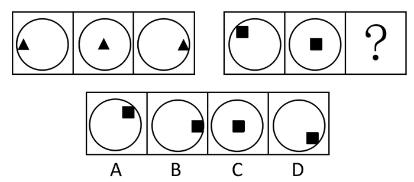

A. A

B. B

C. C

D. D

第 46 题 · 答案与解析

**参考答案（粉笔题库参考内容）**

D

**解析**

元素组成相同， 考查元素位置的平移。题干给出的第一组图形中小黑三角的位置在向右平移，按水平直线进行运动，第二组中小黑方块是按照斜线方向从左上向右下平移，那么问号处应该为D项。

故正确答案为D。

### 第 47 题

请从所给的这几个选项中，选择最合适的一个填在问号处，使之呈现一定的规律性：

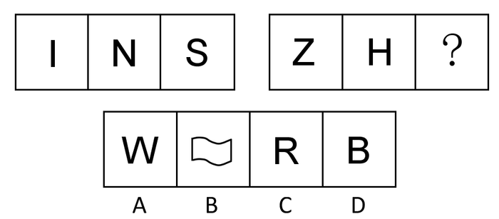

A. A

B. B

C. C

D. D

第 47 题 · 答案与解析

**参考答案（粉笔题库参考内容）**

B

**解析**

本题为争议题

思路一：

观察图形可知，题干中组成元素的字母，均有明显的对称性，且满足特殊对称——中心对称。选项中符合中心对称的只有B项，故B项符合题意。

思路二：

此题也可从图形的开闭性方向思考，题干中的元素均为开放图形，且没有封闭空间，而B、C、D三项都存在封闭空间，只有A项是开放图形，故此思路下A项也符合题意。

因历年真题中对称性的考查频率远高于开闭性，故本题给出倾向性答案为B。

故正确答案为B。

### 第 48 题

请从所给的这几个选项中，选择最合适的一个填在问号处，使之呈现一定的规律性：

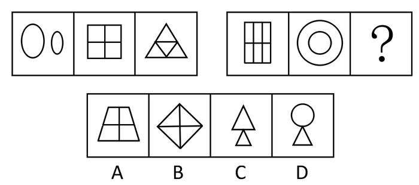

A. A

B. B

C. C

D. D

第 48 题 · 答案与解析

**参考答案（粉笔题库参考内容）**

B

**解析**

元素组成各自相同，考虑元素的种类。 第一组图形都是由一种元素组成，第二组图形前两个也是由一种元素组成， 因此第三幅图应该是由样式相同大小也相同的元素组成。

选项中B、C两项都满足，比较B项和C项，C项两个三角有大小之分，那么第一组中第一幅图和第二组中第二幅图都满足，所以选择三角大小相等的B项。

故正确答案为B。

### 第 49 题

请从所给的这几个选项中，选择最合适的一个填在问号处，使之呈现一定的规律性：

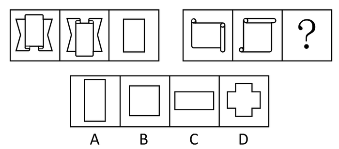

A. A

B. B

C. C

D. D

第 49 题 · 答案与解析

**参考答案（粉笔题库参考内容）**

B

**解析**

元素组成相似，元素考点。

本题具体考查的是元素的叠加运算——求同，即去掉不同的部分，保留相同的部分。第二组求同得到的图形为中间的矩形。

故正确答案为B。

### 第 50 题

请从所给的这几个选项中，选择最合适的一个填在问号处，使之呈现一定的规律性：

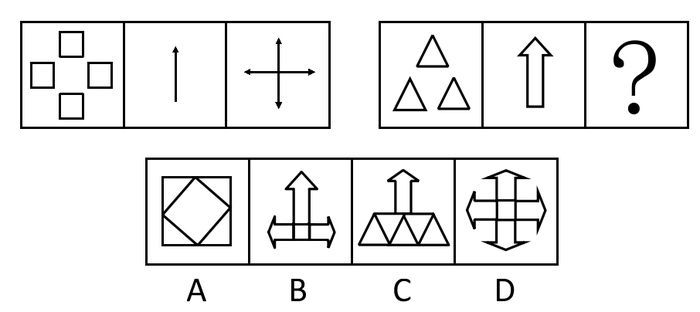

A. A

B. B

C. C

D. D

第 50 题 · 答案与解析

**参考答案（粉笔题库参考内容）**

B

**解析**

元素组成相似，考查元素的叠加运算。第一组中第一个图形给出的是方向，第二个图形给出的是组合的元素，第三个图形就依据前两个给出的元素和方向进行叠加运算，第二组依照此规律，B项符合。

故正确答案为B。

### 第 51 题

请从所给的这几个选项中，选择最合适的一个填在问号处，使之呈现一定的规律性：

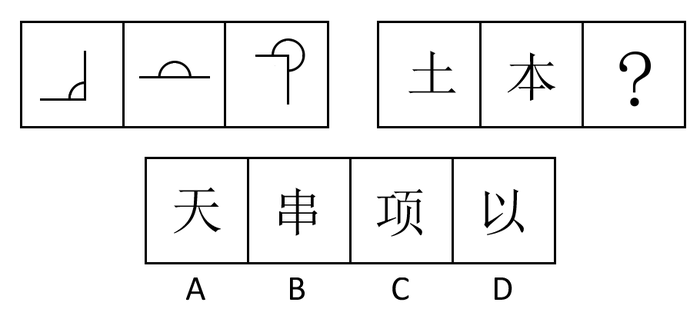

A. A

B. B

C. C

D. D

第 51 题 · 答案与解析

**参考答案（粉笔题库参考内容）**

B

**解析**

元素组成凌乱，考虑数量。 题干给出的第一组图形，根据弧线标志，明显表示的是角度在变化，并且角度是按照等差数列在变：90度、180度、270度， 第二组图形没有角度变化 ，但是呈现的汉字笔画数有规律，笔画数从左到右是：3、5、？， 所以也是按照等差数列这个规律在变。答案笔画数应该为7画，四个选项的笔画分别是4，7，9 ，4 。

故正确答案为B。

### 第 52 题

请从所给的这几个选项中，选择最合适的一个填在问号处，使之呈现一定的规律性：

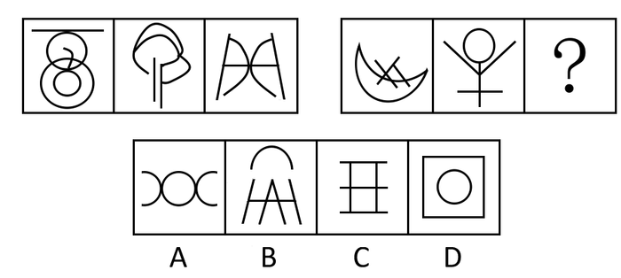

A. A

B. B

C. C

D. D

第 52 题 · 答案与解析

**参考答案（粉笔题库参考内容）**

C

**解析**

元素组成凌乱，排除属性，看数量规律。有直线曲线构成，先分开数，发现直线曲线是各自成规律的，第一组图形的直线数是1、2、3，曲线数是4、3、2，第二组图形的直线数是3、4、？，曲线数是2、1、？所以？处图形应该由5条直线和0条曲线构成，只有C项符合。

故正确答案为C。

### 第 53 题

请从所给的这几个选项中，选择最合适的一个填在问号处，使之呈现一定的规律性：

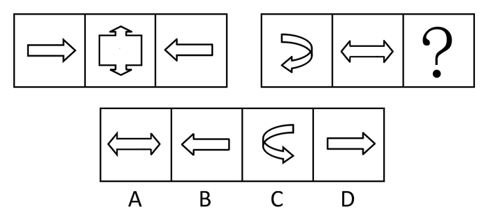

A. A

B. B

C. C

D. D

第 53 题 · 答案与解析

**参考答案（粉笔题库参考内容）**

C

**解析**

元素组成整体观察，题目考查的是对称性，第一组三个图形整体是对称的，第二组也是这个规律，问号处的图形应该是与第二组第一个图形竖轴对称的图形。

故正确答案为C。

### 第 54 题

请从所给的这几个选项中，选择最合适的一个填在问号处，使之呈现一定的规律性：

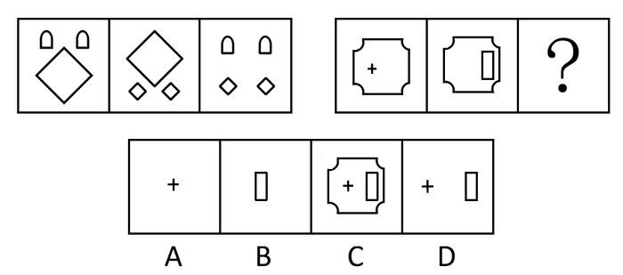

A. A

B. B

C. C

D. D

第 54 题 · 答案与解析

**参考答案（粉笔题库参考内容）**

D

**解析**

元素组成相似，考查元素--元素的运算。

第一组中，前两个图形去同存异得到第三个图形，第二组中也去同存异，保留不同的元素，即小加号和小矩形。

故正确答案为D。

### 第 55 题

请从所给的这几个选项中，选择最合适的一个填在问号处，使之呈现一定的规律性：

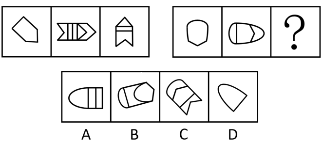

A. A

B. B

C. C

D. D

第 55 题 · 答案与解析

**参考答案（粉笔题库参考内容）**

D

**解析**

元素组成相似，优先考虑样式规律。第一组图中图1与图3旋转后相加可以得到图2，第二组图遵循相似的规律，第二组中图1只能与旋转后的D项图形相加得到图2。

故正确答案为D。

### 第 56 题

某市一项对交谊舞爱好者的调查表明，那些称自己每周固定去跳交谊舞一至两次的人近三年来由28%增加到35%，而对该市大多数舞厅的调查显示，近三年来交谊舞厅的顾客人数明显下降。以下各项如果是真的，都有助于解释上述看来矛盾的断定，除了：

A. 不定期去舞厅的人在数量上明显减少

B. 为了吸引更多的顾客，该市交谊舞厅普遍调低了营业价格

C. 家庭交谊舞会逐渐流行

D. 迪斯科舞厅的兴起抢了交谊舞厅的生意

第 56 题 · 答案与解析

**参考答案（粉笔题库参考内容）**

B

**解析**

第一步，分析题干的矛盾。

题干的矛盾是：定期跳交谊舞人数的增多和到交谊舞厅顾客人数减少之间的矛盾。

第二步：逐一分析选项。

A选项：说不定期的减少，也就是定期的增多了，不定期减少的可能更多，导致交谊舞厅的人数下降，可以解释矛盾；

B选项：说的是该市交谊舞厅普遍调低了营业价格，调低价格，应该更能吸引顾客才对，这样就加深了上述矛盾，不能够解释题干中说的每月固定去跳交谊舞的人数增加和到交谊舞厅顾客人数减少之间的矛盾。因此，本题答案为B选项；

C选项：家庭交谊舞会的流行，说明人们都在家庭聚会，不用去交谊舞厅了，也解释了上述矛盾；

D选项：迪斯科舞厅的兴起，说明增加的定期跳舞的人数有了新的地点，分流导致交谊舞厅顾客的减少，故也能解释题干矛盾。

本题为选非题，故正确答案为B。

### 第 57 题

世界粮食年产量略微超过粮食需求量，可以提供世界人口所需要的最低限度的食物。那种预计粮食产量不足必将导致世界粮食饥荒的言论全是危言耸听。与其说饥荒是由于粮食产量不足引起的，毋宁说是由于分配不公造成的。

以下哪种情形是作者所设想的：

A. 将来世界粮食需求量比现在的粮食需求量要小

B. 一个好的分配制度也难以防止世界粮食饥荒的出现

C. 世界粮食产量将持续增加，可以满足粮食需求

D. 现存的粮食供应分配制度没有必要改进

第 57 题 · 答案与解析

**参考答案（粉笔题库参考内容）**

C

**解析**

第一步：首先分析题干，找到论点论据。

论点：表明世界粮食产量是可以满足需求的，粮食产量不足导致粮食饥荒是危言耸听。

论据：饥荒只不过是分配造成的问题，对粮食产量表达的是较乐观的态度。

第二步：逐一分析选项。

A选项：说的将来世界粮食需求比现在粮食需求量小，题干当中没有涉及到，无关，排除；

B选项：如果好的分配制度也难以防止世界粮食饥荒的出现，说明饥荒并不是由分配不公导致的，与作者的意思不符，排除；

C选项：说的世界粮食产量将持续增加，是为了保证可以满足粮食需求；

D选项：是题干的引申，但应该是有必要改进，排除。

故正确答案为C。

### 第 58 题

在20世纪60年代以前，斯塔旺格尔一直是挪威的一个安静而平和的小镇。从60年代早期以来，它已成为挪威近海石油勘探的中心。在此过程中，暴力犯罪和毁坏公物在斯塔旺格尔也急剧增加了。显然，这些社会问题产生的根源就在于斯塔旺格尔因石油而导致的繁荣。

下面哪一项，假如也发生在20世纪60年代至现在，则对上面的论证给予最强的支持：

A. 对他们的城市成为挪威近海石油勘探中心，斯塔旺格尔的居民并不怎么感到遗憾

B. 挪威社会学家十分关注暴力犯罪和毁坏公物在斯塔旺格尔的急剧增加

C. 在好些没有因石油而繁荣的挪威城镇，暴力犯罪和毁坏公物一直保持着低水平

D. 非暴力犯罪、毒品、离婚，在斯塔旺格尔增加得与暴力犯罪和毁坏公物一样多

第 58 题 · 答案与解析

**参考答案（粉笔题库参考内容）**

C

**解析**

第一步：首先分析题干，找到论点论据。

论点：因石油而繁荣的斯塔旺格尔导致这些社会问题产生。

论据： 60年代前是安静的小镇，从60年代早期以来，成为挪威近海石油勘探的中心。

第二步：逐一分析选项。

A选项：没有说明繁荣和社会问题的关系，无关选项，排除；

B选项：社会学家十分关注也没有涉及，无法支持，排除；

C选项：用的方法是类比试验，在那些没有因石油而繁荣的挪威城镇，暴力犯罪和毁坏公物一直保持着低水平，即说明导致其社会问题增多的就是因石油带来的繁荣，所以能够加强；

D选项：也不能说明论点，只是对其社会问题的分析，无关选项，排除。

故正确答案为C。

### 第 59 题

已知有甲、乙、丙、丁四个数，甲、乙之和大于丙、丁之和，甲、丁之和大于乙、丙之和，乙、丁之和大于甲、丙之和。

根据以上内容，请判断这四个数谁最小：

A. 甲最小

B. 丙最小

C. 乙最小

D. 丁最小

第 59 题 · 答案与解析

**参考答案（粉笔题库参考内容）**

B

**解析**

第一步：整理题干信息。

（1）甲＋乙>丙＋丁；（2）甲＋丁>乙＋丙；（3）乙＋丁>甲＋丙。

第二步：根据信息整合。

将不等式相加，同方向的不等号不变，（1）+（2）可得甲>丙，（2）+（3）可得丁>丙，（1）+（3）可得乙>丙，综合三个结果可知丙最小。

故正确答案为B。

### 第 60 题

如果赵川参加宴会，那么钱华、孙旭和李元将一起参加宴会。如果上述断定是真的，那么，以下哪项也是真的：

A. 如果赵川没参加宴会，那么钱、孙、李三人中至少有一人没参加宴会

B. 如果赵川没参加宴会，那么钱、孙、李三人都没参加宴会

C. 如果钱、孙、李都参加宴会，那么赵川参加宴会

D. 如果孙旭没参加宴会，那么赵川和李元不会都参加宴会

第 60 题 · 答案与解析

**参考答案（粉笔题库参考内容）**

D

**解析**

第一步：翻译题干。

赵川参加→钱华参加且孙旭参加且李元参加。

第二步：逐一分析选项。根据上述关联词推导关系进行分析。

A、B两项：根据“否定前件不能得出确定结论”的规则，可以判断A、B两项错误，排除；

C项：肯定后件，不能推出前件一定成立，推导错误，排除；

D项：否定后件，可以否定前件，孙旭没参加，赵川一定没参加，那么D项的赵川和李元不会都参加就成立，当选。

故正确答案为D。

### 第 61 题

有些南京人不爱吃辣椒，那么有些爱吃甜食的南京人肯定不爱吃辣椒。

以下哪项能保证上述推理成立：

A. 所有南京人都不爱吃辣椒

B. 有些南京人不爱吃甜食

C. 所有爱吃甜食的南京人都爱吃辣椒

D. 所有的南京人都爱吃甜食

第 61 题 · 答案与解析

**参考答案（粉笔题库参考内容）**

D

**解析**

第一步：首先分析题干。

将题干进行翻译就是：

一个条件，由有些南京人推出不爱吃辣椒。

一个结论，有些爱吃甜食的南京人推出不爱吃辣椒。

第二步，找到论证成立的方式。

要想使得结论成立，我们需要在南京人和爱吃甜食间搭设桥梁。

即隐含的一个前提就是，所有的南京人⇒爱吃甜食。

故正确答案为D。

### 第 62 题

高脂肪、高糖含量的食物有害人的健康。因此，既然越来越多的国家明令禁止未成年人吸烟和喝含酒精的饮料，那么，为什么不能用同样的方法对待那些有害健康的食品呢？应该明令禁止18岁以下的人食用高脂肪、高糖食品。

以下哪项如果为真，最能削弱上述建议：

A. 许多国家已经把未成年人的标准定在16岁以下

B. 烟、酒对人体的危害比高脂肪、高糖食物的危害要大

C. 禁止有害健康的食品的生产，要比禁止有害健康的食品的食用更有效

D. 高脂肪、高糖食品主要危害中年人的健康

第 62 题 · 答案与解析

**参考答案（粉笔题库参考内容）**

D

**解析**

第一步：首先分析题干，找到论点论据。

论点是：明令禁止18岁以下的人食用高脂肪、高糖食品。

论据是：高脂肪、高糖含量的食物有害人的健康，国家明令禁止未成年人吸烟和喝含酒精的饮料。

第二步：逐一分析选项。

A选项：说的是国家对未成年人年龄的界定，与论点论据均无关系，排除；

B选项：说的是烟酒等对人体的危害比高脂肪、高糖食物的危害要大，也无法削弱国家禁令，无关选项，排除；

C选项：说禁止生产比禁止食用有效，无关，排除；

D选项：说高脂肪、高糖食品主要针对的人群是中年人，那么禁止18岁以下的人就无意义，能够削弱论点。

故正确答案为D。

### 第 63 题

大学生利用假期当保姆已不再是新鲜事。一项调查显示，63%的被调查者赞成大学生当保姆，但是，当问到自己家里是否会请大学生保姆时，却有近60%的人表示“不会”。

以下哪项陈述如果为真，能够合理地解释上述看似矛盾的现象：

A. 赞成大学生当保姆的人中，有69%的人认为做家政工作对大学生自身有益，只有31%的人认为大学生保姆能提供更好的家政服务

B. 在不赞成大学生当保姆的人中，有40%的人认为，学生实践应该选择与自己专业相关的领域

C. 在选择“会请大学生当保姆”的人中，有75%的人打算让大学生担任家教或秘书工作，只有25%的人想让大学生从事家务劳动

D. 调查中有62%的人表示只愿意付给大学生保姆800元到1000元左右的月薪

第 63 题 · 答案与解析

**参考答案（粉笔题库参考内容）**

A

**解析**

第一步：分析题干。

题干中的矛盾是：赞成大学生当保姆与不愿请大学生保姆之间的矛盾。

第二步：逐一分析选项。
A项：意思是更多人觉得大学生当保姆对大学生有益，解释了赞成的原因，很少人认为大学生能提供更好的家政服务，解释了不愿请大学生保姆的原因，合理解释了题干中的矛盾现象，当选；

B项：指出的问题与题干的矛盾无关，不能解释，排除；

C项：是在愿意请大学生当保姆的人群比例中的计划问题，无法解释题干中很多人不愿意请大学生保姆，排除；

D项：是对大学生当保姆薪酬的观点，与题干矛盾无关，排除。

故正确答案为A。

### 第 64 题

在50年代，我国森林覆盖率为19%，60年代为11%，70年代为6%，80年代不到4%。随着森林覆盖率的逐渐减少，植被大量破坏，土地对雨水的拦蓄作用被削弱了，一下暴雨，水卷泥沙滚滚而下，使洪涝灾害逐年严重。可见，森林资源的破坏，是酿成洪灾的原因。

以下哪项使用的方法与上文最类似：

A. 敲锣有声，吹箫有声，说话有声。这些发声现象都伴有物体附近空气的振动，因而可以断定物体附近空气的振动是发声的原因

B. 把一群鸡分为两组，一组喂精白米，鸡得一种病，脚无力，不能行走，症状与人的脚气病相似；另一组用带壳稻米喂，鸡不得这种病。由此推测带壳稻米中含有的某些精白米中所没有的东西是造成这种病的原因。进一步研究发现，这种东西就是维生素

C. 意大利的雷地反复进行一个实验，在4个大口瓶里，放进肉和鱼，然后盖上盖或蒙上纱布，苍蝇进不去，结果一个蛆都没有。另4个大口瓶里，放进同样的肉和鱼，敞开瓶口，苍蝇飞进去产卵，腐烂的肉和鱼很快生满了蛆。可见，苍蝇产卵是鱼肉腐烂生蛆的原因

D. 在有空气的玻璃罩内通电击铃，随着抽出空气量增多，铃声越来越小。若把空气全抽出，则完全听不到铃声。可见，声音是靠空气传播的

第 64 题 · 答案与解析

**参考答案（粉笔题库参考内容）**

D

**解析**

第一步：翻译题干。

森林覆盖率逐年减少洪涝灾害逐年严重，结论：森林资源被破坏酿成洪灾。

题干的推导方法是，从一种现象的变化引起另一种现象的变化，得出前一现象是后一现象的原因。

第二步：逐一翻译选项并判断正确答案。

A项：发声现象伴有物体附近空气的振动，结论：物体附近空气的振动发声；

B项：喂精白米的鸡得病，喂带壳稻米的鸡不得病，结论：带壳稻米含有某些精白米中所没有的东西避免得脚无力；

C项：没有苍蝇进瓶里没有蛆，有苍蝇进瓶里产卵有蛆，结论：苍蝇产卵有蛆；

D项：空气量逐渐减少铃声逐渐变小，结论：空气声音传播。

对比选项和题干的格式，只有D项和题干一样，即通过两种现象之间的变化关系，得出前一种现象是后一种现象的原因；A项推导的因果关系与题干相反，B、C两项都是通过求同求异的方法来推导因果关系，与题干的推导方法不同。

故正确答案为D。

### 第 65 题

土家狗是一种仅仅在美国南部生活的无毛小型野兽。在人类定居美国南部之前，土家狗的天敌都不强大，因此土家狗在美国南部繁衍旺盛。当人类开始猎取它们之后，土家狗灭绝了。因此，肯定是人们对它的猎取导致了其灭绝。

下面哪一项如果为真，最严重地削弱了上文中的推理：

A. 人类在美国南部定居的同时，也带来了新的可能是土家狗天敌的物种

B. 在第一批人类定居美国南部以来，土家狗在美国南部的某些地区仍旧存在了约300年

C. 土家狗的一些品种跑得比豹类还快

D. 在美国南部人们猎取了另一种容易被天敌捕食，但从来没有灭绝的哺乳动物

第 65 题 · 答案与解析

**参考答案（粉笔题库参考内容）**

A

**解析**

第一步：找出论点和论据。

论点：人们对它的猎取导致了其灭绝。

论据：在人类定居美国南部之前，土家狗的天敌都不强大，因此土家狗在美国南部繁衍旺盛。当人类开始猎取它们之后，土家狗灭绝了。

第二步：判断削弱方式。

本题论点和论据存在因果关系，所以需要削弱论点。

第三步：逐一判断选项的作用。

A项：说明土家狗灭绝的原因可能是土家狗的天敌导致的，说明有其他原因导致土家狗灭绝，他因削弱，当选；

B项：说的是土家狗灭绝的时间，无法削弱论点，排除；

C项：说的是土家狗奔跑的速度，这些都无法说明其灭绝原因是否与人们的猎取有关，无法削弱论点，排除；

D项提到的是另一种哺乳动物，但题干没有谈及这种哺乳动物和土家狗的关系，两者不能加以对比，故D项也无法削弱论点，排除。

故正确答案为A。

## 材料 1

2010年1月某家电连锁超市的销售情况统计

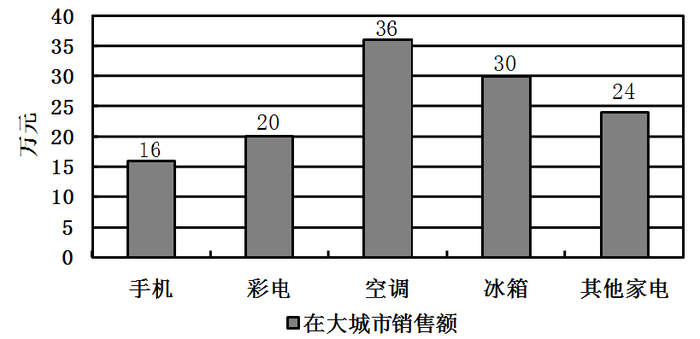

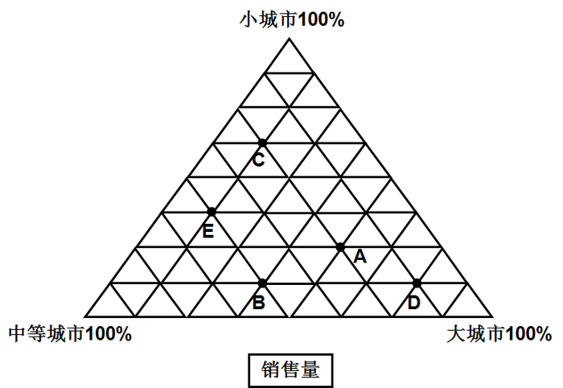

A代表手机；B代表彩电；C代表空调；D代表冰箱；E代表其他家电

### 第 66 题

销售量中在大城市占比最高的家电是：

A. 冰箱

B. 空调

C. 彩电

D. 手机

第 66 题 · 答案与解析

**参考答案（粉笔题库参考内容）**

A

**解析**

观察三角坐标图，每个三角形顶点代表100%，底线代表0，故越接近顶点的即代表占比程度越高。离大城市最接近的为D冰箱，在选项中为A项。

故正确答案为A。

### 第 67 题

手机在各类城市的销售总额是：

A. 16万元

B. 24万元

C. 30万元

D. 32万元

第 67 题 · 答案与解析

**参考答案（粉笔题库参考内容）**

D

**解析**

根据三角坐标图，2010年1月A点手机在大城市的销量占总销售量的比值为，其在大城市的销售额为16万元，则其在各类城市的总销售额为万元。

故正确答案为D。

### 第 68 题

空调在小城市的销售额是：

A. 36万元

B. 72万元

C. 144万元

D. 180万元

第 68 题 · 答案与解析

**参考答案（粉笔题库参考内容）**

D

**解析**

根据三角坐标图，2010年1月C点空调在大城市的销量占总销售量的，销售额为36万元，则空调在各类城市的销售总额为万元；空调在小城市的销量占总销售量的，则其销售额为万元。

故正确答案为D。

### 第 69 题

彩电和冰箱在各类城市的销售总额相差：

A. 约15.3万元

B. 约14.3万元

C. 约13.3万元

D. 约12.3万元

第 69 题 · 答案与解析

**参考答案（粉笔题库参考内容）**

C

**解析**

根据三角坐标图，2010年1月B点彩电在大城市的销量占总销售量的，销售额为20万元，则彩电在各类城市的销售总额为万元；D点冰箱在大城市的销量占总销售量的，销售额为30万元，则冰箱在各类城市的销售总额为万元。则2010年1月，彩电和冰箱在各类城市的销售总额相差万元。

故正确答案为C。

### 第 70 题

其他家电销售额在各类城市家电销售总额中所占的比重：

A. 约为31.7%

B. 约为35.4%

C. 约为40.4%

D. 约为44.8%

第 70 题 · 答案与解析

**参考答案（粉笔题库参考内容）**

A

**解析**

根据三角坐标图，2010年1月E点其他家电在大城市的销量占总销售量的，销售额为24万元，则其他家电在各类城市的销售总额为万元；各类城市家电销售总额为 +192=605.3万元； 则其比重为，只有A项满足。

故正确答案为A。

## 材料 2

2009年，在江苏省委、省政府的正确领导下，全省深入贯彻科学发展观，认真落实中央决策部署和一系列政策措施，积极应对国际金融危机带来的严峻挑战和严重困难，统筹做好保增长保民生保稳定各项工作，经济企稳向好态势不断增强，结构调整和自主创新取得重大进展，发展质量稳步提高，民生继续得到改善，改革开放深入推进，各项社会事业全面进步，较好地完成了年初确定的各项目标任务。

        全省实现生产总值34061.2亿元，比上年增长12.4%。先进制造业水平提升，全年实现高新技术产业产值21987.0亿元，增长19.5%，占规模以上工业比重达30.0%，比上年提高1.5个百分点。服务业特别是现代服务业增长加快、比重上升，实现服务业增加值13555.6亿元，比上年增长13.6%，占GDP比重39.8%，提高1.1个百分点。新兴行业加快发展，新能源、新医药、新材料、环保产业产值分别增长66.0%、30.0%、22.0%和21.0%，软件业销售收入增长35.7%，服务外包执行总额增长177.0%。非公有制经济进一步发展，实现增加值在地区生产总值中的份额达到64.1%，其中私营个体经济比重为39.4%，分别提高0.9个和2.3个百分点。城市化和城市现代化水平稳步提高，年末城市化率达55.6%，比上年提高1.3个百分点。区域发展格局进一步改善，加快推进苏南转型升级，巩固苏中、苏北快速发展局面，苏中、苏北对全省经济增长的贡献份额达到42.3%，提高2.9个百分点，全面实施沿海地区发展规划。

        节能减排取得明显成效。大力推进资源节约型、环境友好型社会建设，实施重点节能减排项目，淘汰落后产能，深入开展化工生产企业专项整治。全年共实施1121个减排项目，关闭小火电组687.6万千瓦，淘汰落后炼钢铁能力792.2万吨，分别完成“十一五”总目标的224.3%、51.1%和77.4%。预计超额完成单位GDP能耗降低率的年度目标。化学需氧量、二氧化硫排放量分别削减3.1%和4.1%，累计完成“十一五”减排总目标的98.93%和121.1%。

### 第 71 题

2008年江苏省规模以上工业产值为多少亿元：

A. 64558.5

B. 67216.5

C. 70348.6

D. 73290.5

第 71 题 · 答案与解析

**参考答案（粉笔题库参考内容）**

A

**解析**

选项差距较大，保留两位有效数字不会影响计算结果。通过材料可得，2008年高新技术产业产值为亿元，占规模以上工业产值的比重为30%-1.5%=28.5%。则2008年江苏省规模以上工业产值为，与A项最为接近。

故正确答案为A。

### 第 72 题

2008年服务业增加值为多少亿元：

A. 10574.0

B. 11143.8

C. 11932.7

D. 12598.7

第 72 题 · 答案与解析

**参考答案（粉笔题库参考内容）**

C

**解析**

由材料可知，2009年实现服务业增加值13555.6亿元，比去年增长13.6%，故2008年服务业增加值为，略大于，C项最为符合。

故正确答案为C。

### 第 73 题

增速的顺序为：

A. 新能源>新医药>新材料>软件业

B. 新能源>软件业>新医药>新材料

C. 新医药>软件业>新材料>新能源

D. 软件业>新材料>新能源>新医药

第 73 题 · 答案与解析

**参考答案（粉笔题库参考内容）**

B

**解析**

由材料直接可得，2009年新能源、新医药、新材料产业产值分别增长66.0%、30.0%、22.0%，软件业销售收入增长35.7%。故增速从大到小分别为：新能源＞软件业＞新医药＞新材料。

故正确答案为B。

### 第 74 题

2009年该省全年实施的减排项目比“十一五”总目标超额完成了：

A. 500个

B. 621个

C. 786个

D. 901个

第 74 题 · 答案与解析

**参考答案（粉笔题库参考内容）**

B

**解析**

选项差距较大，可使用直除法直接求解。由材料可知，2009年全年共实施1121个减排项目，完成“十一五”减排总目标的224.3%，故超额完成了：，与B项最为接近。

故正确答案为B。

### 第 75 题

2008年，非公有制经济实现的增加值为：

A. 21833.2亿元

B. 20254.3亿元

C. 19633.6亿元

D. 19151.8亿元

第 75 题 · 答案与解析

**参考答案（粉笔题库参考内容）**

D

**解析**

由材料可得，2008年江苏省生产总值为亿元，其中非公有制经济份额为64.1%-0.9%=63.2%。故2008年非公有制经济实现的增加值为，略大于，与D项最为接近。

故正确答案为D。

## 材料 3

国家统计局2010年2月25日发布2009年国民经济和社会发展统计公报，称中国去年全面落实应对国际金融危机的一揽子计划和政策措施，国民经济形势总体回升向好，各项社会事业取得新的进展。初步核算，全年国内生产总值335353亿元，比上年增长8.7%。

        统计公报分综合、农业、工业和建筑业、固定资产投资、国内贸易、对外经济、交通邮电和旅游、金融、教育和科学技术、文化卫生和体育、人口人民生活和社会保障，以及资源、环境和安全生产等十二部分，展示了2009年中国国民经济和社会发展状况。

        公报显示，截至2009年年末，国家外汇储备23992亿美元，比上年末增加4531亿美元，增速减慢4个百分点；全年财政收入68477亿元，比上年增加7147亿元，增长11.7%；全国就业人员77995万人，比2008年末增加515万人，比2007年末增加1005万人。

        中国政府2009年推出四万亿元的刺激计划。公报显示，2009年全年全社会固定资产投资224846亿元，比上年增长30.1%。其中，中西部投资增长高于东部和东北地区。

### 第 76 题

根据2009年国民经济和社会发展统计公报初步核算的结果，2009年全年国内生产总值比上年增加了约：

A. 26841亿元

B. 26897亿元

C. 26954亿元

D. 26995亿元

第 76 题 · 答案与解析

**参考答案（粉笔题库参考内容）**

A

**解析**

选项差距较小，需精确计算。由材料可知，2009年全国国内生产总值为335353亿元，比上年增长8.7%，故增长额为。

故正确答案为A。

### 第 77 题

2007年末我国国家外汇储备是：

A. 15288亿元

B. 15376亿元

C. 15288亿美元

D. 15376亿美元

第 77 题 · 答案与解析

**参考答案（粉笔题库参考内容）**

C

**解析**

选项差距较小，精确计算。由材料可得，2008年国家外汇储备为23992-4531=19461亿美元，故2009年外汇储备的增长率为，则2008年外汇储备的增速为23.3%+4%=27.3%。因此2007年国家外汇储备应为亿美元。

故正确答案为C。

### 第 78 题

2008年末全国就业人员比上年增长了：

A. 2.53%

B. 1.97%

C. 1.26%

D. 0.64%

第 78 题 · 答案与解析

**参考答案（粉笔题库参考内容）**

D

**解析**

根据材料可得，2007年末全国就业人员为77995-1005=76990万人，2008年比2007年多增加1005-515=490万人，因此2008年末全国就业人员比2007年增长了，只有D项符合。

故正确答案为D。

### 第 79 题

2008年全年全社会固定资产投资约为：

A. 172475亿元

B. 172826亿元

C. 173056亿元

D. 173217亿元

第 79 题 · 答案与解析

**参考答案（粉笔题库参考内容）**

B

**解析**

根据材料，2009年全年全社会固定资产投资为224846亿元，比上年增长了30.1%，故2008年全年全社会固定资产投资应为，比实际值应略大一些，B项最为贴合。

故正确答案为B。

### 第 80 题

以下说法错误的是：

A. 2009年我国国民经济形势总体回升向好，各项社会事业取得新的进展

B. 2008年全年财政收入为61330亿元

C. 2008年末全国就业人员比2007年末全国就业人员增加490万人

D. 2009年全年中西部的全社会固定资产投资增长低于东部和东北地区

第 80 题 · 答案与解析

**参考答案（粉笔题库参考内容）**

D

**解析**

A项：为材料原文，正确；

B项：2009年全年财政收入为68477亿元，比上年增加7147亿元，故2008年全年财政收入为68477-7147=61330亿元，正确；

C项：2008年末全国就业人员比2007年末增加了1005-515=490万人，正确；

D项：材料为“中西部投资增长高于东部和东北地区”，选项中的“低于”与之相反，故D项错误。

本题为选非题，故正确答案为D。

## 材料 4

我国平均每天的消费量

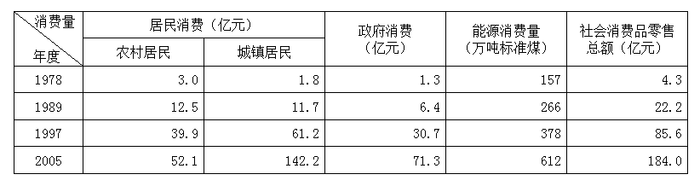

### 第 81 题

1978年我国居民总消费额约为多少亿元：

A. 1752.0

B. 1068.3

C. 640.8

D. 4.8

第 81 题 · 答案与解析

**参考答案（粉笔题库参考内容）**

A

**解析**

图表所给出的为每天的消费量，城镇、农村每天消费量之和=1.8+3.0=4.8，则1978年国家居民总消费额，所得为整数。

故正确答案为A。

### 第 82 题

城镇居民消费和社会消费品零售总额相差最大的一年是：

A. 1978年

B. 1989年

C. 1997年

D. 2005年

第 82 题 · 答案与解析

**参考答案（粉笔题库参考内容）**

D

**解析**

由图表得：

1978年城镇居民消费和社会消费品零售总额之差=4.3-1.8=2.5；

1989年城镇居民消费和社会消费品零售总额之差=22.2-11.7=10.5；

1997年城镇居民消费和社会消费品零售总额之差=85.6-61.2=24.4；

2005年城镇居民消费和社会消费品零售总额之差=184-142.2=41.8。

相差最大的一年为2005年。

故正确答案为D。

### 第 83 题

1978年至2005年日均能源消费量的年均增长量为多少万吨标准煤：

A. 17.55

B. 16.85

C. 16.25

D. 16.15

第 83 题 · 答案与解析

**参考答案（粉笔题库参考内容）**

B

**解析**

由图表得，1978年至2005年日均能源消费量的年均增长量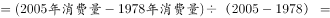，略小于，B项最为切合。

故正确答案为B。

### 第 84 题

与1997年相比，2005年的日均居民消费和政府消费之和增加了多少亿元：

A. 133.8

B. 92.8

C. 90.8

D. 79.8

第 84 题 · 答案与解析

**参考答案（粉笔题库参考内容）**

A

**解析**

由图表得，与1997年相比，2005年的日均居民消费和政府消费之和增加了： (52.1+142.2+71.3)-(39.9+61.2+30.7)≈265-132=133。

故正确答案为A。

### 第 85 题

与1997年相比，2005年增长比率最高的消费类别是：

A. 农村居民消费

B. 城镇居民消费

C. 社会消费品零售总额

D. 无法判定

第 85 题 · 答案与解析

**参考答案（粉笔题库参考内容）**

B

**解析**

由图表得，2005年农村居民消费的增长率为；城镇居民消费的增长率为；社会消费品零售总额的增长率为。城镇居民消费的增长率最高。

故正确答案为B。

### 第 86 题

聘任制公务员在聘期内年度考核结果均为＿＿＿＿＿＿且聘任期考核合格，本人提出续聘的，用人机关应与其续签聘任合同：

A. 优秀

B. 良好以上

C. 称职以上

D. 基本称职以上

第 86 题 · 答案与解析

**参考答案（粉笔题库参考内容）**

C

**解析**

深圳市人民政府办公厅2010年印发的《深圳市行政机关聘任制公务员管理办法（试行）》第三十四条第二款规定：“聘任制公务员在聘期内年度考核结果均为称职以上且聘任期考核合格，本人提出续聘的，用人机关应与其续签聘任合同。”

故正确答案为C。

### 第 87 题

我国公务员的任职程序不包括：

A. 考察

B. 决定任命

C. 提出拟任职人选

D. 上级人事机关审批

第 87 题 · 答案与解析

**参考答案（粉笔题库参考内容）**

D

**解析**

本题考查法律常识。

任职程序是指任命公务员职务过程中必须经过和完成的步骤。我国公务员制度规定，任命国家公务员职务，按下列程序进行：（1）用人单位或上级提出拟任职人选；（2）对拟任职人选进行考核；（3）按照管理权限，由有关机关领导集体讨论决定是否任职；（4）对决定任职者颁发任职通知和任命书。结合选项，可知D项“上级人事机关审批”不包括在我国公务员的任职程序中。

本题为选非题，故正确答案为D。

### 第 88 题

专业技术类公务员管理坚持什么原则：

A. 公开公正竞争择优

B. 公平公开竞争择优

C. 公开平等竞争择优

D. 公正公平公开竞争

第 88 题 · 答案与解析

**参考答案（粉笔题库参考内容）**

A

**解析**

根据《深圳市行政机关专业技术类公务员管理办法》第三条规定：“专业技术类公务员管理坚持公开、公正、竞争、择优的原则，以专业能力为导向，以工作实绩为核心，以精细化管理为手段，实现专业化的科学发展。”

故正确答案为A。

### 第 89 题

《国务院关于深圳市城市总体规划的批复》(国函〔2010〕78号)提出，深圳市应合理控制城市规模，到2020年，城市常住人口控制在多少万人以内：

A. 900

B. 1000

C. 1100

D. 1300

第 89 题 · 答案与解析

**参考答案（粉笔题库参考内容）**

C

**解析**

2010年8月《国务院关于深圳市城市总体规划的批复》（国函〔2010〕78号）第四条提出，深圳市应该合理控制城市规模。到2020年，城市常住人口控制在1100万人以内，城市建设用地控制在890平方公里以内。

故正确答案为C。

### 第 90 题

外国人在我国领域之外，但对我国国家或公民犯罪，按我国刑法规定的最低刑为几年以上有期徒刑。并且按犯罪地的法律应受处罚的，可以适用我国刑法追究其刑事责任:

A. 2

B. 3

C. 1

D. 4

第 90 题 · 答案与解析

**参考答案（粉笔题库参考内容）**

B

**解析**

《中华人民共和国刑法》第八条规定：“外国人在中华人民共和国领域外对中华人民共和国国家或者公民犯罪，而按本法规定的最低刑为三年以上有期徒刑的，可以适用本法，但是按照犯罪地的法律不受处罚的除外。”这体现的是我国刑法在空间效力上的保护管辖原则。

故正确答案为B。

### 第 91 题

行政主体对违法行为给予的行政处罚的种类、幅度要与违法行为人的违法程度相适应，避免畸轻畸重的不合理不公平的情况，这是行政处罚原则的：

A. 处罚法定的原则

B. 处罚公开的原则

C. 一事不再罚的原则

D. 过罚相当的原则

第 91 题 · 答案与解析

**参考答案（粉笔题库参考内容）**

D

**解析**

A项错误，处罚法定原则是指实施行政处罚的主体是法定的；实施行政处罚的依据是法定的；实施行政处罚的程序是法定的。法无明文规定的，不处罚；

B项错误，处罚公开原则是指行政处罚的依据及处罚中的有关内容必须公开；

C项错误，一事不再罚原则是指对当事人的同一个违法行为，不得给予两次以上罚款的行政处罚；

D项正确，行政处罚原则的过罚相当原则是指行政主体对违法行为给予的行政处罚的种类、幅度要与违法行为人的违法程度相适应，避免畸轻畸重的不合理不公平的情况。

故正确答案为D。

### 第 92 题

行政法律关系的客体不包括：

A. 物质财富

B. 权利和义务

C. 智力成果

D. 行为

第 92 题 · 答案与解析

**参考答案（粉笔题库参考内容）**

B

**解析**

A、C、D三项正确，行政法律关系客体是行政法律关系的构成要素之一，指行政法律关系的内容即权利和义务所指向的目标，主要包括人身、行为、财物和智力成果；

B项错误，权利和义务是行政法律关系的内容，不是客体。

本题为选非题，故正确答案为B。

### 第 93 题

建设富强、民主、文明的社会主义现代化国家的政治保证是：

A. 四项基本原则

B. 党的领导

C. 邓小平理论

D. 团结全国各族人民

第 93 题 · 答案与解析

**参考答案（粉笔题库参考内容）**

A

**解析**

A项正确，中国共产党在社会主义初级阶段的基本路线的内容是：领导和团结全国各族人民，以经济建设为中心，坚持四项基本原则，坚持改革开放，自力更生，艰苦奋斗，为把我国建设成为富强、民主、文明的社会主义现代化国家而奋斗。其中，四项基本原则是立国之本，是我们党和国家生存发展的政治基石；改革开放是强国之路，是我们党和国家发展进步的活力源泉。

B、C、D三均不符合题意，特别提一下，B项坚持党的领导是坚持四项基本原则的核心。

故正确答案为A。

### 第 94 题

在社会主义的发展动力问题上，强调：

A. 走自己的路

B. 坚持党的领导

C. 自力更生，艰苦奋斗

D. 改革也是一场革命，也是解放生产力

第 94 题 · 答案与解析

**参考答案（粉笔题库参考内容）**

D

**解析**

改革是社会主义的发展动力，在改革问题上，邓小平指出，改革是中国的第二次革命。改革开放是一场新的伟大革命，它不是对原有经济体制的细枝末节的修补，而是对其进行根本性的变革，它要从根本上改变束缚我国生产力发展的经济体制，建立充满生机和活力的社会主义新经济体制，同时，相应地改革政治体制和其他方面的体制。改革主要是对原有经济体制的根本性变革，会引起社会生活各个方面的深刻变化。改革是解放和发展生产力的必由之路，是社会主义发展的重要动力。可见，在社会主义的发展动力问题上，强调改革也是一场革命，也是解放生产力。

故正确答案为D。

### 第 95 题

我国社会主义建设发展战略目标是：

A. 全面实现工业、农业、国防和科学技术现代化

B. 把我国建设成为富强、民主、文明的社会主义现代化国家

C. 实现工业化和经济的社会化、市场化和现代化

D. 把我国建设成为高度民主，高度文明的社会主义现代化国家

第 95 题 · 答案与解析

**参考答案（粉笔题库参考内容）**

B

**解析**

中国共产党在社会主义初级阶段的基本路线的内容是：领导和团结全国各族人民，以经济建设为中心，坚持四项基本原则，坚持改革开放，自力更生，艰苦奋斗，为把我国建设成为富强、民主、文明的社会主义现代化国家而奋斗。由此可知，我国社会主义建设发展战略目标是把我国建设成为富强、民主、文明的社会主义现代化国家。

故正确答案为B。

### 第 96 题

划分历史唯物主义和历史唯心主义的基本依据是：

A. 经济基础和上层建筑的关系问题

B. 生产力和生产关系之间的关系问题

C. 社会存在和社会意识的关系问题

D. 人民群众和杰出人物的关系问题

第 96 题 · 答案与解析

**参考答案（粉笔题库参考内容）**

C

**解析**

A、B、D三项均不是划分历史唯物主义和历史唯心主义的基本依据。

A项，经济基础和上层建筑的关系为：经济基础决定上层建筑，上层建筑对经济基础具有反作用；

B项，生产力和生产关系之间的关系为生产力决定生产关系，生产关系反作用于生产力；

D项，人民群众和杰出人物的关系问题体现的是唯物史观和唯心史观在历史创造者问题上的对立；

C项正确，历史观是人们在认识社会历史现象、解决社会问题时所采取的根本观点。社会存在与社会意识的关系问题，是社会历史观的基本问题，是划分历史唯物主义和历史唯心主义的基本依据。

故正确答案为C。

### 第 97 题

实施“科教兴国”战略，体现了邓小平理论中的什么思想：

A. 发展才是硬道理

B. 尊重知识，尊重人才

C. 科学技术是第一生产力

D. 教育要面向现代化，面向世界，面向未来

第 97 题 · 答案与解析

**参考答案（粉笔题库参考内容）**

C

**解析**

A项错误，“发展才是硬道理”是社会主义改革开放和现代化建设事业中的重要指导原则；

B项错误， “尊重知识，尊重人才”是邓小平人才观的基本内容，其内涵包括：人才是我国社会主义事业成败的关键；科技人员是先进生产力的开拓者；

C项正确，“科教兴国”思想的理论基础是邓小平同志关于科学技术是第一生产力的思想。1977年，邓小平在科学和教育工作座谈会上提出：“我们国家要赶上世界先进水平，从何着手呢？我想，要从科学和教育着手”，“不抓科学、教育，四个现代化就没有希望，就成为一句空话”，明确把科教发展作为发展经济、建设现代化强国的先导，摆在我国发展战略的首位。从70年代后期到90年代初期，邓小平同志坚持“实现四个现代化，科学技术是关键，基础是教育”的核心思想，为“科教兴国”发展战略的形成奠定了坚实的理论和实践基础；

D项错误，“教育要面向现代化，面向世界，面向未来”体现了邓小平对教育地位的全面审视和战略思考，形成了改革开放新时期教育工作的重要指导方针。

故正确答案为C。

### 第 98 题

确定我国经济体制改革的目标，核心问题是正确认识和处理：

A. 经济体制与经济制度的关系

B. 改革与发展的关系

C. 计划与市场的关系

D. 发展与稳定的关系

第 98 题 · 答案与解析

**参考答案（粉笔题库参考内容）**

C

**解析**

党的十四大明确把建设社会主义市场经济体制作为我国经济体制改革目标。确立这一目标后，核心问题是正确认识和处理计划和市场的关系问题，要清楚计划和市场都是经济手段，作为调节经济的两种手段，计划和市场对经济活动的调节各有自己的优势和长处。

故正确答案为C。

### 第 99 题

公文区别于其他文章的主要一点是：

A. 公文形成的主体是国家机关及其他社会组织

B. 公文形成的条件是行使职权和实施管理

C. 公文是具有法定效用与规范格式的文件

D. 公文是办理公务的重要工具之一

第 99 题 · 答案与解析

**参考答案（粉笔题库参考内容）**

C

**解析**

《国家行政机关公文处理办法》第一章第二条明确指出，“行政机关的公文（包括电报，下同），是行政机关在行政管理过程中形成的具有法定效力和规范体式的文书，是依法行政和进行公务活动的重要工具。”可见公文与其他文章的主要区别在于公文具有法定效力和规范格式。

故正确答案为C。

### 第 100 题

政府机构组建的前提和行使相应行政权力的根据是：

A. 职能目标

B. 权责体系

C. 行政经费

D. 机构设置

第 100 题 · 答案与解析

**参考答案（粉笔题库参考内容）**

A

**解析**

我国政府机构设置原则包括职能优先原则、完整统一原则、管理幅度与管理层次相适应原则、权责一致原则、精简与效能原则和依法设置原则。其中，职能是机构存在的前提，以政府职能是否顺利实现来检验政府机构设置的合理性，职能目标是政府机构组建的前提和行使相应行政权力的根据。

故正确答案为A。

