# 2013年深圳市公务员录用考试《行测》题

<!-- gwy:overview:start -->
> **深圳 · 2013 · 行测 · 统考** ｜ 100 题 · 图片 14 处 · 答案随题折叠

| 题型模块 | 题量 | 题号 |
| --- | ---: | ---: |
| 常识判断 | 20 | 1–20 |
| 判断推理 | 20 | 21–40 |
| 数量关系 | 15 | 41–55 |
| 言语理解与表达 | 30 | 56–85 |
| 资料分析 | 15 | 86–100 |
| **合计** | **100** | |

导航：[题型与作答说明](#题型与作答说明) · [题目](#题目) · [材料 1](#材料-1)
<!-- gwy:overview:end -->

> 候选采集稿。参考答案及解析来自粉笔页面，不代表官方答案或真实高分答卷；来源使用许可与原卷对应关系仍需人工核实。

## 题型与作答说明

常识判断

（20题）

根据题目要求，在四个选项中选出一个正确答案。

判断推理

（20题）

本部分包括图形推理、事件排序、判断与推理三种类型的试题。

数量关系

（15题）

本部分包括数字推理与数学运算两种类型的题目。

言语理解与表达

（30题）

每道题给出一段文字，从四个选项中选出一个最恰当的答案。

资料分析

（15题）

针对下列图、表或文字回答问题。你应该根据资料提供的信息进行分析、比较、计算、处理。

## 题目

### 第 1 题

《深圳市行政机关专业技术类公务员管理办法（试行）》所称专业技术类公务员，是指在深圳市行政机关中从事专业技术工作，履行专业技术职责，为机关实施公共管理提供专业技术支持和技术手段保障的＿＿＿＿＿＿＿公务员：

A. 聘任制

B. 选任制

C. 领导职务

D. 非领导职务

第 1 题 · 答案与解析

**参考答案（粉笔题库参考内容）**

D

**解析**

《深圳市行政机关专业技术类公务员管理办法（试行）》第二条规定：“本法所称专业技术类公务员，是指在深圳市行政机关中从事专业技术工作，履行专业技术职责，为机关实施公共管理提供专业技术支持和技术手段保障的非领导职务公务员。”

故正确答案为D。

**考点**：行政法

**来源**：2013年深圳市公务员录用考试《行测》题第1题

### 第 2 题

党的十八大提出“扎实推进社会主义文化强国建设”，指出要推动学雷锋活动，学习宣传道德模范：

A. 长效化

B. 广泛化

C. 具体化

D. 常态化

第 2 题 · 答案与解析

**参考答案（粉笔题库参考内容）**

D

**解析**

党的十八大报告提出“扎实推进社会主义文化强国建设”，指出要“深化群众性精神文明创建活动，广泛开展志愿服务，推动学雷锋活动、学习宣传道德模范常态化”。

故正确答案为D。

**来源**：2013年深圳市公务员录用考试《行测》题第2题

### 第 3 题

2012年底，首都各界齐聚人民大会堂，隆重纪念《中华人民共和国宪法》公布施行30周年，习近平总书记强调指出，宪法与国家前途、人民命运息息相关。保证宪法实施，就是保证：

A. 人民民主专政的实现

B. 依法治国的实现

C. 人民根本利益的实现

D. 社会主义政治文明的实现

第 3 题 · 答案与解析

**参考答案（粉笔题库参考内容）**

C

**解析**

2012年12月4日，习近平总书记在隆重纪念《中华人民共和国宪法》公布施行30周年的报告中指出：宪法与国家前途、人民命运息息相关。维护宪法权威，就是维护党和人民共同意志的权威。捍卫宪法尊严，就是捍卫党和人民共同意志的尊严。保证宪法实施，就是保证人民根本利益的实现。只要我们切实尊重和有效实施宪法，人民当家作主就有保证，党和国家事业就能顺利发展。

故正确答案为C。

**考点**：宪法

**来源**：2013年深圳市公务员录用考试《行测》题第3题

### 第 4 题

调查报告的结构一般包括：

A. 标题、导语、正文、结语

B. 标题、正文、落款

C. 开头、导语、主体、结尾

D. 标题、正文、结语

第 4 题 · 答案与解析

**参考答案（粉笔题库参考内容）**

A

**解析**

A项正确，调查报告属于事务公文的一种，其结构一般包括标题、导语、正文、结语；

B项错误，标题、正文、落款是工作计划书的写作结构；

C项错误，不属于某种特定文体的写作结构；

D项错误，标题、正文、结语是会议纪要的写作结构。

故正确答案为A。

**来源**：2013年深圳市公务员录用考试《行测》题第4题

### 第 5 题

2013年3月26~27日，金砖国家领导人第五次会晤在哪里举行，这是金砖国家峰会首次在非洲举行：

A. 尼日利亚

B. 刚果

C. 南非

D. 坦桑尼亚

第 5 题 · 答案与解析

**参考答案（粉笔题库参考内容）**

C

**解析**

2013年3月26日至27日，金砖国家领导人第五次会晤在南非德班举行，主题为“金砖国家与非洲：致力于发展、一体化和工业化的伙伴关系”。

故正确答案为C。

**考点**：其他建设、时事政治-其他

**来源**：2013年深圳市公务员录用考试《行测》题第5题

### 第 6 题

在现代市场经济中，什么是所有资源的一般代表形式：

A. 生产要素

B. 商品

C. 货币

D. 资本

第 6 题 · 答案与解析

**参考答案（粉笔题库参考内容）**

C

**解析**

A项错误，生产要素指进行社会生产经营活动时所需要的各种社会资源，包括劳动力、土地、资本、技术、信息等内容。市场经济要求生产要素商品化，以商品形式在市场上通过市场交易实现流动和配置，从而形成各种生产要素市场，排除；

B项错误，商品是指满足人们某种需要的，用来交换的劳动产品。商品市场在市场体系中处于基础地位，其他市场从某种意义上说是为商品市场服务的，排除；

C项正确，在现代市场经济中，货币是所有资源的一般代表形式；资源的分配，首先表现为资金的分配，当选；

D项错误，资本在经济学意义上是指用于生产的基本生产要素，即资金、厂房、设备、材料等物质资源；资本市场在市场体系中占有极其重要的地位，因为在现代市场经济中，货币是所有资源的一般代表形式，排除。

故正确答案为C。

**考点**：市场经济

**来源**：2013年深圳市公务员录用考试《行测》题第6题

### 第 7 题

公务员职务与职级的对应关系，由（    ）规定。

A. 国家人力资源与社会保障部

B. 省级公务员主管部门

C. 市级公务员主管部门

D. 国家

第 7 题 · 答案与解析

**参考答案（粉笔题库参考内容）**

D

**解析**

本题考查行政法。

《公务员法》第二十一条第一、二款规定：“公务员的领导职务、职级应当对应相应的级别。公务员领导职务、职级与级别的对应关系，由国家规定。”

故正确答案为D。

**来源**：2013年深圳市公务员录用考试《行测》题第7题

### 第 8 题

“满眼风光多闪烁，看山恰似走来迎；仔细看山山不动，是船行。”这一诗句包含的哲理是：

A. 时空的无限性和有限性的统一

B. 运动的绝对性和静止的相对性的统一

C. 物质运动的无限性和时空的有限性的统一

D. 物质运动的客观性和时空的主观性的统一

第 8 题 · 答案与解析

**参考答案（粉笔题库参考内容）**

B

**解析**

B项正确，题干诗句出自敦煌曲子词《浣溪沙》，大意是站在船上看着两岸秀丽的风光，看见山好像山迎面走来。仔细看山山不动，原来是“我”的船在走。“看山恰似走来迎”、“船行”说的是绝对运动；“仔细看山山不动”，说的是相对静止。诗句反映的正是运动的绝对性和静止的相对性的统一；

A、C、D三项错误，题干强调的是运动和静止的关系，跟时空、客观性和主观性无直接关系，A、C、D不选。

故正确答案为B。

**考点**：唯物辩证法

**来源**：2013年深圳市公务员录用考试《行测》题第8题

### 第 9 题

广东省委书记胡春华在省委十一届二次全会报告中用“十个广东”描绘了广东的目标，其中摆在第一位是：

A. 忧患广东

B. 升级广东

C. 和谐广东

D. 清廉广东

第 9 题 · 答案与解析

**参考答案（粉笔题库参考内容）**

A

**解析**

A项正确，2013年1月17日，中央政治局委员、新任广东省委书记胡春华在广东省委十一届二次全会上作了报告。在报告中，胡春华用“十个广东”描绘了广东的目标，涵盖了从经济转型升级，区域均衡发展到社会法治，民生幸福等领域，其中摆在第一位的是“忧患广东”。

B、C、D项错误，“十个广东”分别为“忧患广东”、“升级广东”、“均衡广东”、“腹地广东”、“民生广东”、“和谐广东”、“平安广东”、“法治广东”、“党建广东”和“清廉广东”。“升级广东”摆在第二位，“和谐广东”摆在第六位，“清廉广东”摆在第十位。

故正确答案为A。

**来源**：2013年深圳市公务员录用考试《行测》题第9题

### 第 10 题

政府把就业作为保障和改善民生的头等大事，实施积极的就业政策，加强重点人群就业工作，提高职业培训和就业培训服务水平。目前，什么产业成为我国吸纳就业最多的产业：

A. 制造业

B. 服务业

C. 节能环保产业

D. 信息技术产业

第 10 题 · 答案与解析

**参考答案（粉笔题库参考内容）**

B

**解析**

2013年3月5日，第十二届全国人民代表大会第一次会议在人民大会堂开幕，听取国务院总理温家宝作政府工作报告，审查计划报告和预算报告。温家宝说，过去五年，我国清洁能源、节能环保、新一代信息技术、生物医药、高端装备制造等一批战略性新兴产业快速发展。产品质量整体水平不断提高。服务业增加值占国内生产总值比重提高2.7个百分点，成为吸纳就业最多的产业。

故正确答案为B。

**来源**：2013年深圳市公务员录用考试《行测》题第10题

### 第 11 题

实事求是的首要要求是：

A. 理论联系实际

B. 在实践中检验和发展真理

C. 从群众中来，到群众中去

D. 一切从实际出发

第 11 题 · 答案与解析

**参考答案（粉笔题库参考内容）**

D

**解析**

A、B项错误，D项正确，实事求是内在地包含一切从实际出发、理论联系实际、在实践中检验真理和发展真理的内容。一切从实际出发，是实事求是的首要要求，是实事求是思想路线的前提和基础；理论联系实际，是实事求是思想路线的根本途径和方法；在实践中检验真理和发展真理，是实事求是思想路线的验证条件；

C项错误，从群众中来，到群众中去是群众路线的基本内容之一。

故正确答案为D。

**考点**：认识论

**来源**：2013年深圳市公务员录用考试《行测》题第11题

### 第 12 题

计划生育属于政府的：

A. 经济职能

B. 政治职能

C. 文化职能

D. 社会职能

第 12 题 · 答案与解析

**参考答案（粉笔题库参考内容）**

D

**解析**

A、B、C项错误，经济职能、政治职能、文化职能和社会职能都属于政府的基本职能。经济职能是指政府为国家经济的发展，对社会经济生活进行管理的职能。政治职能是指政府为维护国家统治阶级的利益，对外保护国家安全，对内维持社会秩序的职能。文化职能是指政府为满足人民日益增长的文化生活的需要，依法对文化事业所实施的管理，故排除A、B、C三项；

D项正确，计划生育属于政府的社会职能。政府的社会职能是指除政治、经济、文化职能以外政府必须承担的其他职能。我国政府目前社会职能主要有：①调节社会分配和组织社会保障的职能；②保护生态环境和自然资源的职能；③促进社会化服务体系建立的职能；④提高人口质量，实行计划生育的职能，当选。

故正确答案为D。

**来源**：2013年深圳市公务员录用考试《行测》题第12题

### 第 13 题

深圳中部和西北部主要为：

A. 低山

B. 平原

C. 平缓台地

D. 丘陵

第 13 题 · 答案与解析

**参考答案（粉笔题库参考内容）**

D

**解析**

D项正确，深圳中部和西北部主要为丘陵。

深圳全境地势东南高，西北低。土地形态大部分为低山、平缓台地和阶地丘陵。东南部主要为低山；中部和西北部主要为丘陵，也有500米以上的低山突起，山间有较大片冲击平原；西南部主要为较大片的滨海冲击平原。

故正确答案为D。

**考点**：中国地理

**来源**：2013年深圳市公务员录用考试《行测》题第13题

### 第 14 题

《深圳经济特区文明行为促进条例》是国内首部文明行为促进条例，条例创新设置了社会服务制度，规定违法行为人因不文明行为受到处罚的，可以申请参加有关部门安排的社会服务抵扣罚款，但最高不得超过：

A. 50元

B. 100元

C. 所处罚款金额的三分之一

D. 所处罚款金额的一半

第 14 题 · 答案与解析

**参考答案（粉笔题库参考内容）**

D

**解析**

D项正确，2012年12月25日深圳市第五届人民代表大会常务委员会第十九次会议通过《深圳经济特区文明行为促进条例》。《条例》第四十四条规定：“违法行为人因违法的不文明行为受到罚款处罚的，可以申请参加有关行政执法部门安排的社会服务。参加前款规定的社会服务时间可以折抵罚款，但最高不得超过所处罚款金额的一半。参加社会服务应当由违法行为人本人完成，他人代替或者有其他弄虚作假行为的，有关行政执法部门应当恢复执行原罚款决定，并将弄虚作假行为作为个人信用信息告知征信机构。”

故正确答案为D。

**来源**：2013年深圳市公务员录用考试《行测》题第14题

### 第 15 题

“国五条”，是指国务院常务会议2013年2月20日确定的五项加强房地产市场调控的政策措施，以下关于“国五条”的内容，错误的是：

A. 坚决抑制投机投资性购房

B. 增加商品房和土地供应

C. 加快保障性安居工程规划建设

D. 完善稳定房价工作责任制

第 15 题 · 答案与解析

**参考答案（粉笔题库参考内容）**

B

**解析**

2013年2月20日，国务院总理温家宝主持召开国务院常务会议，研究部署继续做好房地产市场调控工作。会议确定了五项加强房地产市场调控的政策措施（称为“国五条”）：①完善稳定房价工作责任制，②坚决抑制投机投资性购房，③增加普通商品住房及用地供应，④加快保障性安居工程规划建设，⑤加强市场监管。

A、C、D项错误，均属于“国五条”的内容；

B项正确，不是属于“国五条”的内容。

本题为选非题，故正确答案为B。

**考点**：经济建设、重要会议讲话

**来源**：2013年深圳市公务员录用考试《行测》题第15题

### 第 16 题

用人机关应当在市政府公务员主管部门同意聘任后多少日内，根据公开招聘或招聘计划与聘任制公务员按照平等自愿的原则，订立聘任合同，确定双方的权利和义务：

A. 30

B. 45

C. 60

D. 90

第 16 题 · 答案与解析

**参考答案（粉笔题库参考内容）**

C

**解析**

深圳市人民政府办公厅2010年印发的《深圳市行政机关聘任制公务员管理办法（试行）》第二十条规定：“用人机关应当在市政府公务员主管部门同意聘任后60日内，根据公开招聘或选聘计划与聘任制公务员按照平等自愿的原则，订立聘任合同，确定双方的权利和义务。”

故正确答案为C。

**考点**：行政法

**来源**：2013年深圳市公务员录用考试《行测》题第16题

### 第 17 题

党的思想路线的理论基础是：

A. 联系的观点

B. 马克思主义认识论

C. 对立统一规律

D. 唯物主义历史观

第 17 题 · 答案与解析

**参考答案（粉笔题库参考内容）**

B

**解析**

A项错误，联系的观点是指事物内部各要素之间和事物之间相互影响、相互制约和相互作用的关系；

B项正确，党的思想路线又称作“实事求是的思想路线”，实事求是思想路线在中国共产党的确立，是以马克思主义认识论为哲学基础的，是马克思主义认识论在马克思主义中国化实践过程中的运用、丰富和发展；

C项错误，对立统一规律又称矛盾规律，矛盾是辩证法的核心概念；

D项错误，唯物主义历史观解决的是社会存在与社会意识的关系问题。

A、C、D项均不是党的思想路线的理论基础，排除。

故正确答案为B。

**考点**：认识论

**来源**：2013年深圳市公务员录用考试《行测》题第17题

### 第 18 题

关于我国在过去五年来取得的成绩，说法不正确的是：

A. 国内生产总值跃升到世界第二位

B. 载人航空、探月工程、载人深潜、北斗卫星导航系统等实现重大突破，第一艘航母“辽宁舰”入列

C. 非化石能源快速发展，水电装机容量位居世界第一

D. 进出口总额从世界第三位提升到第二位，其中进口额跃居世界第一位

第 18 题 · 答案与解析

**参考答案（粉笔题库参考内容）**

D

**解析**

本题考查时事政治。

A、B项正确，这两项同样出自温家宝总理所作的政府工作报告。报告中指出，过去五年，我国国内生产总值从26.6万亿元增加到51.9万亿元，跃升到世界第二位；创新型国家建设取得新成就，载人航天、探月工程、载人深潜、北斗卫星导航系统、超级计算机、高速铁路等实现重大突破，第一艘航母“辽宁舰”入列，排除AB两项；

C项正确，2012年《能源白皮书》中指出，我国非化石能源快速发展，2011年全国水电装机容量达到2.3亿千瓦，居世界第一，排除；

D项错误，2013年3月，温家宝总理在第十二届全国人民代表大会第一次会议上作了政府工作报告，报告中提到过去五年，我国进出口总额年均增长12.2%，从世界第三位提升到第二位，其中出口额跃居世界第一位，当选。

本题为选非题，故正确答案为D。

**考点**：重要文件

**来源**：2013年深圳市公务员录用考试《行测》题第18题

### 第 19 题

习近平总书记在视察广东的重要讲话中，对广东提出了殷切希望，下列不属于对广东“三个定位”要求的是：

A. 成为探索科学发展的实验区

B. 成为建成小康社会的示范点

C. 成为深化改革开放的先行地

D. 成为发展中国特色社会主义的排头兵

第 19 题 · 答案与解析

**参考答案（粉笔题库参考内容）**

B

**解析**

2012年12月，习近平总书记在视察广东的重要讲话中提出：广东要努力成为发展中国特色社会主义的排头兵、深化改革开放的先行地、探索科学发展的试验区，为率先全面建成小康社会、率先基本实现社会主义现代化而奋斗。这“三个定位、两个率先”，成为广东省今后工作的前进方向和行动指南，是广东工作的总目标。结合选项，可知B项“成为建成小康社会的示范点”不属于广东“三个定位”要求。

本题为选非题，故正确答案为B。

**考点**：经济建设

**来源**：2013年深圳市公务员录用考试《行测》题第19题

### 第 20 题

行政行为以什么为标准，可分为羁束行为和自由裁量行政行为：

A. 受法律规范拘束的程度

B. 管理对象是否特定

C. 行政机关是否可以主动作出行政行为

D. 适用与效力作用的对象范围

第 20 题 · 答案与解析

**参考答案（粉笔题库参考内容）**

A

**解析**

A项正确，行政行为依据不同的标准，可以分为不同的类别。以受法律规范约束的程度为标准，可分为羁束行政行为与自由裁量行政行为。

B项错误，以管理对象是否特定为标准，行政行为分为抽象行政行为和具体行政行为。

C项错误，以行政机关是否可以主动作出行政行为为标准，行政行为分为依职权行政行为与需申请的行政行为。

D项错误，以适用与效力作用的对象范围为标准，可分为内部行政行为与外部行政行为。

故正确答案为A。

**考点**：行政法

**来源**：2013年深圳市公务员录用考试《行测》题第20题

### 第 21 题

图形具有一定的规律，也存在某种差异。要求你从四个选项中选择你认为最适合取代问号的一个：

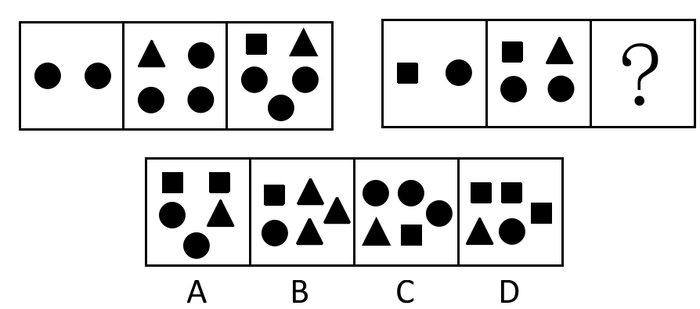

A. A

B. B

C. C

D. D

第 21 题 · 答案与解析

**参考答案（粉笔题库参考内容）**

A

**解析**

图形组成的元素部分相似，优先考虑元素，发现没有规律，然后整体观察，相同元素数量在变化，考查元素的转换。1个三角形=1个小黑圆，1个正方形=2个小黑圆，第一组图包含的小黑圆的个数为2、4、6，第二组图包含的小黑圆的个数为3、5、7。

故正确答案为A。

本题为争议题，存在另外一种解释。

图形组成的元素部分相似，优先考虑元素，发现没有规律，然后整体观察，相同元素数量在变化，考查元素的转换。1个三角形=1个小黑圆，1个正方形=2个小黑圆，第一组图包含的小黑圆的个数为2+4=6，第二组图包含的小黑圆的个数为3+5=8，故正确答案为D。

**考点**：数量规律-素

**来源**：2013年深圳市公务员录用考试《行测》题第21题

### 第 22 题

图形具有一定的规律，也存在某种差异。要求你从四个选项中选择你认为最适合取代问号的一个：

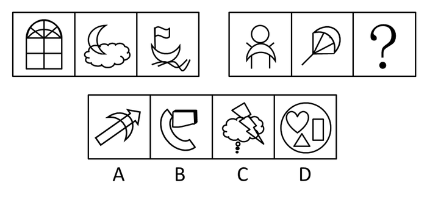

A. A

B. B

C. C

D. D

第 22 题 · 答案与解析

**参考答案（粉笔题库参考内容）**

A

**解析**

图形组成的元素部分相似，优先考虑样式遍历类——单元素遍历。

第一组图中的三个图形都包含月亮形的图形，第二组图的前两个图形也包含有月亮形的图形。

故正确答案为A。

**考点**：数量规律-素、样式规律-遍历

**来源**：2013年深圳市公务员录用考试《行测》题第22题

### 第 23 题

图形具有一定的规律，也存在某种差异。要求你从四个选项中选择你认为最适合取代问号的一个：

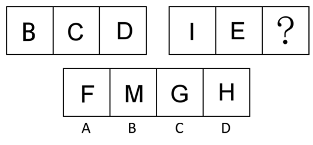

A. A

B. B

C. C

D. D

第 23 题 · 答案与解析

**参考答案（粉笔题库参考内容）**

D

**解析**

图形组成的元素均为字母，整体观察，考虑对称轴。

题干中的所有图形都关于横轴对称，选项中只有D关于横轴对称。

故正确答案为D。

**考点**：属性规律-对称性

**来源**：2013年深圳市公务员录用考试《行测》题第23题

### 第 24 题

图形具有一定的规律，也存在某种差异。要求你从四个选项中选择你认为最适合取代问号的一个：

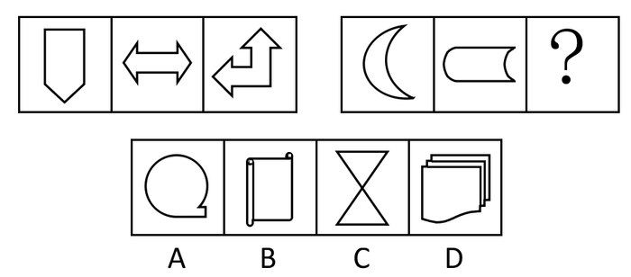

A. A

B. B

C. C

D. D

第 24 题 · 答案与解析

**参考答案（粉笔题库参考内容）**

A

**解析**

解析一：每幅图的组成不同，考虑数量类。

题干中的所有图形都只有一个封闭空间。只有A符合条件。

解析二：每个图形都是轴对称图形，选项中只有C是轴对称。

注：粉笔认为本题看面个数的规律更严谨，因为对称性前后两组的规律不完全一致，第一组对称性分别为：竖轴对称、横竖+中心对称、斜轴对称，第二组为横轴对称、横轴对称，故前后不完全一致，因此倾向于选A，前后规律完全一致。

故正确答案为A。

**考点**：数量规律-面

**来源**：2013年深圳市公务员录用考试《行测》题第24题

### 第 25 题

图形具有一定的规律，也存在某种差异。要求你从四个选项中选择你认为最适合取代问号的一个：

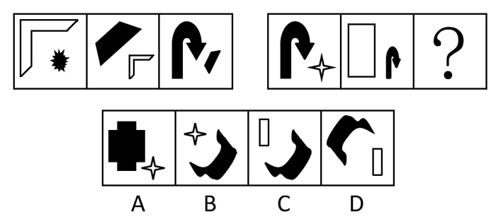

A. A

B. B

C. C

D. D

第 25 题 · 答案与解析

**参考答案（粉笔题库参考内容）**

D

**解析**

图形组成的元素部分相似，优先考虑元素，相邻元素有一个是相同的。并且前一个图形中的大图形变成后一个图形中的小图形，而且小图形都位于大图形的右侧。

故正确答案为D。

**考点**：数量规律-素

**来源**：2013年深圳市公务员录用考试《行测》题第25题

### 第 26 题

(1)扬长避短

(2)充分利用有利地理条件

(3)因地制宜地发展经济

(4)对不利地理条件进行合理改造

(5)区域要实现可持续发展

A. 5—2—4—1—3

B. 5—1—2—4—3

C. 2—4—1—5—3

D. 4—2—1—5—3

第 26 题 · 答案与解析

**参考答案（粉笔题库参考内容）**

B

**解析**

首句确定法。题目说的是要怎样才能实现可持续发展 ，根据选项（5）为总括句，可以为首句，（2）和（4）不能是首句，排除C和D。（2）和（4）是恰好是（1）的解释，所以（2）和（4）应该在（1）之后。正确顺序为51243。

故正确答案为B。

**来源**：2013年深圳市公务员录用考试《行测》题第26题

### 第 27 题

(1)攻克技术理论难题

(2)新型家电产品面市

(3)带动家电消费新趋势

(4)应用到系列家电产品上

(5)研究国际行业发展趋势

A. 2—1—4—5—3

B. 2—5—1—3—4

C. 5—1—4—2—3

D. 5—4—1—3—2

第 27 题 · 答案与解析

**参考答案（粉笔题库参考内容）**

C

**解析**

根据选项，先确定首句。比较（2）或（5）这两句，应该是先研究行业发展趋势之后才研发出新型产品，（5）作首句比较合适，排除A项和B项。再根据（1）和（4），先攻克难题，再将其应用到系列产品上，故（1）在（4）之前。正确顺序为51423。

故正确答案为C。

**来源**：2013年深圳市公务员录用考试《行测》题第27题

### 第 28 题

(1)河水化学需氧量浓度超标

(2)整改排污点

(3)引起环保部门高度重视

(4)化工厂排放污水

(5)鱼虾大面积死亡

A. 4—5—3—2—1

B. 4—1—5—3—2

C. 1—3—2—4—5

D. 1—3—4—5—2

第 28 题 · 答案与解析

**参考答案（粉笔题库参考内容）**

B

**解析**

根据所给条件，可知是事件发展顺序，工业造成的水污染及治理过程。观察选项，首句在（1）和（4）中，先有化工厂排放污水，河水化学需氧量浓度才会超标，（4）应该在前，排除C项和D项。化工厂排放污水引发的直接结果是河水化学需氧量浓度超标，接着才会有鱼虾死亡、引起重视、整改等动作。正确顺序为41532。

故正确答案为B。

**来源**：2013年深圳市公务员录用考试《行测》题第28题

### 第 29 题

(1)但愿人长久，千里共婵娟

(2)落霞与孤鹜齐飞

(3)莫等闲，白了少年头，空悲切

(4)人生得意须尽欢

(5)夕阳西下，断肠人在天涯

A. 2—4—1—3—5

B. 2—4—3—1—5

C. 4—2—1—5—3

D. 4—2—3—1—5

第 29 题 · 答案与解析

**参考答案（粉笔题库参考内容）**

A

**解析**

古诗词作者的年代排序。（2）和（4）为唐代，（1）和（3）为宋词，（5）为元曲。

（1）为北宋词人苏轼的《水调歌头》；（2）为初唐诗人王勃的《滕王阁序》；（3）为南宋岳飞的《满江红》；（4）为盛唐诗人李白的《将进酒》；（5）为元代马致远的《天净沙·秋思》。按照作者所在朝代的先后顺序，正确的顺序为2—4—1—3—5。

故正确答案为A。

**来源**：2013年深圳市公务员录用考试《行测》题第29题

### 第 30 题

(1)均田制

(2)班超出使西域

(3)巨鹿之战

(4)蔡伦改进造纸术

(5)两税法实行

A. 2—3—4—5—1

B. 2—4—3—1—5

C. 3—2—1—4—5

D. 3—2—4—1—5

第 30 题 · 答案与解析

**参考答案（粉笔题库参考内容）**

D

**解析**

古代历史事件按朝代排序。（1）均田制是中国北魏至唐中叶的一种土地制度，（2）班超出使西域发生在东汉时期，（3）巨鹿之战发生在秦末时期，（4）蔡伦改进造纸术发生在东汉时期，（5）两税法实行发生在唐朝。按照时间先后顺序，（3）最先发生，排除A、B两项，（4）在（1）前，排除C项。

故正确答案为D。

**来源**：2013年深圳市公务员录用考试《行测》题第30题

### 第 31 题

意大利生物学家特里布奇知道了动物在地震前的种种异常行为之后，尤其是当他听到钟表匠楚德尔告诉他，震前无法把拆开的钟表重新组装起来后，他便对动物预报地震产生了强烈的兴趣。特里布奇想，被拆开的钟表零件互相排斥，不能组装在一起，说明它们带有同样的电荷。这些电荷来自空气，在木制的工作台上又不能导电，所以，这些带电荷的零件难以组装起来。特里布奇最后证明动物预报地震确实是由于空气中的电荷。以上陈述如果为真，则必须有下列哪项作为科学依据（    ）。

A. 地震是一种灵异的现象，动物的特异功能使它们能对此预测

B. 地震发生前，空气中产生了一种带电的气溶胶微粒，能使动物体内产生一种特殊激素，而对中枢神经起作用，因而使动物产生反常行为

C. 动物的导电性比人体高

D. 人体是导电体

第 31 题 · 答案与解析

**参考答案（粉笔题库参考内容）**

B

**解析**

第一步：首先分析题干，找到论点论据。

论点：动物预报地震确实是由于空气中的电荷。

论据：动物在地震前有异常行为；震前被拆开的钟表零件互相排斥，不能组装在一起。

第二步：逐一分析选项。

A项，特异功能不属于科学，且没有体现电荷的作用，不能作为科学依据，排除。

B项，该项指出，是地震发生前空气中产生的带电的气溶胶微粒使动物产生反常行为，将地震与动物行为联系在一起，起到搭桥作用，可以作为依据，当选。

C项，没有说明动物导电性高低与地震的关系，不能作为依据，排除。

D项，人体是否是导体与动物预报地震无关，不能作为依据，排除。

第三步：再次标注答案。

故正确答案为B。

**考点**：搭桥

**来源**：2013年深圳市公务员录用考试《行测》题第31题

### 第 32 题

代位继承是指被继承人的子女先于被继承人死亡时，由被继承人的死亡子女的晚辈直系血亲继承该死亡子女应继承的遗产份额的制度。

根据定义，下列属于代位继承的是：

A. 老王膝下无子，老王立遗嘱，财产由他弟弟的儿子继承

B. 张文夫妇因海难失踪，其子继承了他们的财产

C. 李华只有一子，远居国外，李华死前未立遗嘱，李华的外甥欲继承李华的财产

D. 吕先生一家不幸在旅游途中遭遇意外事件身亡，只有7岁的孙子因为留在外婆家，而幸免于难。另外吕先生唯一的儿子前年因病去世，7岁的孙子因此继承吕先生的遗产

第 32 题 · 答案与解析

**参考答案（粉笔题库参考内容）**

D

**解析**

第一步：关键词查找。

属于代位继承的定义条件包括：（1）被继承人的子女先于被继承人死亡；（2）由被继承人的死亡子女的晚辈直系血亲继承该死亡子女应继承的遗产份额。

第二步：逐一分析选项。

A选项中“弟弟的儿子”与定义不符合，排除；

B选项中是“其子”，排除；

C选项中“外甥”不符合晚辈直系血亲，排除；

D选项中吕先生唯一的儿子前年因病去世，7岁的孙子继承吕先生的遗产，符合关键词，当选。

故正确答案为D。

**考点**：大前提

**来源**：2013年深圳市公务员录用考试《行测》题第32题

### 第 33 题

有些人认为举办世界杯足球赛耗资巨大，然而世界杯足球赛的门票并不是非常昂贵，是世界杯足球赛主办方的广告收入降低了票价。因此，世界杯足球赛的现场观众从世界杯足球赛主办方拉的广告中获得了经济利益。但有些人认为最终是消费者为厂家支付了世界杯足球赛的广告费用，其中也包括世界杯现场的观众，厂家通过提高商品的价格把广告费用摊到了消费者的身上。

如果后一种说法是错误的，那么最有力地支持前者的一项是：

A. 世界杯足球赛的票价一般要远高于普通体育比赛的票价

B. 利用世界性体育比赛做广告的厂家越来越多，广告费用也越来越高

C. 各厂家的广告支出总体上是一个常量，只是在广告形式上有所选择

D. 世界杯足球赛的举办带有越来越多的商业色彩，引起了普遍的不满

第 33 题 · 答案与解析

**参考答案（粉笔题库参考内容）**

C

**解析**

第一步：分析题干，找到论点论据。

论点：世界杯足球赛的现场观众从世界杯足球赛主办方拉的广告中获得了经济利益。

论据：足球赛主办方的广告收入降低了世界杯比赛的票价。

第二步：逐一分析选项。

A项：世界杯足球赛的票价与普通体育比赛票价之间的比较与论点广告是否给观众带来经济利益没有关系，为无关选项，排除；

B项：广告厂家广告费用的提高，与结论广告是否给观众带来经济利益没有关系，为无关选项，排除；

C项：指出广告支出总体是常量，意味着世界杯的广告没有给厂家增加广告费用，而世界杯现场观众确实享受到了降低的票价，补充论据，支持了结论，当选；

D项：对于世界杯商业色彩的不满与结论广告是否给观众带来经济利益没有关系，为无关选项，排除；

故正确答案为C。

**考点**：补充论据

**来源**：2013年深圳市公务员录用考试《行测》题第33题

### 第 34 题

A、B、C、D四个女生住在同一个宿舍，她们当中有一个人在洗水果，一个人在画画，一个人在上网，一个人在复习功课。其中：

（1）A不在洗水果，也不在复习功课；

（2）B不在上网，也不在洗水果；

（3）如果A不在上网，那么D不在洗水果；

（4）C不在复习功课，也不在洗水果；

（5）D不在复习功课，也不在上网。

下列说法正确的是：

A. B在复习功课，C在画画

B. C在洗水果，D在复习功课

C. A在上网，B在画画

D. A在复习功课，D在画画

第 34 题 · 答案与解析

**参考答案（粉笔题库参考内容）**

A

**解析**

第一步：分析题干条件。

（1）A≠洗水果，A≠复习功课；

（2）B≠上网，B≠洗水果；

（3）D洗水果→A上网；

（4）C≠复习功课，C≠洗水果；

（5）D≠复习功课，D≠上网；

（6）A、B、C、D 四人中，一个人洗水果、一个人画画、一个人上网、一个人复习功课。

第二步：根据题干条件进行推理。

根据题干条件发现，“洗水果”提到的次数最多，从最大信息开始推理。根据条件（1）（2）（4）（6）可知，A不洗水果，B不洗水果，C不洗水果，故D洗水果。再根据条件（3）可知，D洗水果，是对条件（3）肯前，肯前必肯后，可得A上网。根据条件（4）（6）可知，C不复习功课，不洗水果，也不能上网，故C画画，则B复习功课，只有A项说法正确。

故正确答案为A。

**考点**：从最大信息开始推

**来源**：2013年深圳市公务员录用考试《行测》题第34题

### 第 35 题

政府应该不允许烟草公司在其营业收入中扣除广告费用。因为如果这样的话，烟草公司将会缴纳更多的税金。他们只好提高自己的产品价格，而产品价格的提高正好可以起到减少烟草购买的作用。

以下选项中，作为上述论点前提的是：

A. 烟草公司不可能降低其他方面的成本来抵消多缴的税金

B. 如果烟草公司需要付高额的税金，他们将不再继续做广告

C. 政府从烟草公司的应税收入增加所得的收入将用于宣传吸烟的害处

D. 烟草公司由此所增加的税金应该等于价格上涨所增加的盈利

第 35 题 · 答案与解析

**参考答案（粉笔题库参考内容）**

A

**解析**

第一步：首先分析题干，找到论点论据。

论点：政府应该不允许烟草公司在其营业收入中扣除广告费用。

论据：烟草公司只能通过提高产品的价格来抵消因不扣除广告费用而多缴的税金。

第二步：逐一分析选项。

A项是必需的前提。要想使推论成立，需要添加的前提是烟草公司没有别的办法来抵消多缴的税金。否则，如果烟草公司还有其他方式来抵消多缴的税金，那么就不会被迫用提高产品价格的方法，当选。

B、C、D三项都属于无关选项，对其多缴纳税金的结果无法改变，不影响结论的成立，故三项均不是前提，排除。

故正确答案为A。

**考点**：必要条件

**来源**：2013年深圳市公务员录用考试《行测》题第35题

### 第 36 题

像“无息贷款”、“重金求子”、“办证”等手段拙劣的街头诈骗广告，即使早已被曝光也仍然屡见不鲜。骗子们宁愿继续使用这些已被大多数人识破的广告内容，也不去研究一些更具欺骗性、隐蔽性的诈骗广告内容，这只能说骗子太愚蠢，太没有“专业精神”了。

以下陈述如果为真，最能够反驳上述结论的一项是：

A. 骗子肯定不是愚蠢的，愚蠢的人是不能做骗子的

B. 如果一种行骗方式不能骗到任何人，那么骗子肯定不会使用

C. 骗子使用这种拙劣的行骗手段，是因为他们一开始就不打算骗聪明人

D. 骗子行骗时会费尽心思以不引起社会关注

第 36 题 · 答案与解析

**参考答案（粉笔题库参考内容）**

C

**解析**

第一步：找出论点和论据。

论点：骗子太愚蠢，太没有“专业精神”了。

论据：骗子使用手段拙劣的街头诈骗广告而不使用隐蔽性的诈骗广告。

本题论点和论据讨论的都是骗子使用的手段能否说明其愚蠢，二者话题一致，削弱优先考虑削弱论点。

第二步：逐一分析选项。

A项：该项指出骗子本身不愚蠢，与论点讨论的骗子使用的手段能否说明其愚蠢无关，为无关项，排除；

B项：该项指出骗子用这样的行骗方式还是能够骗到人的，但没有明确说明到底多少人会被骗，不明确骗子使用的手段是否高明，为不明确项，排除；

C项：该项指出骗子不打算骗聪明人，说明骗子使用拙劣的街头诈骗广告是为了筛选自己的目标群体，这恰恰是骗子的高明之处，削弱论点，可以削弱，当选；

D项：该项指出骗子行骗尽力不引起社会关注，与论点讨论的骗子使用的手段能否说明其愚蠢无关，为无关项，排除。

故正确答案为C。

**考点**：削弱论点

**来源**：2013年深圳市公务员录用考试《行测》题第36题

### 第 37 题

有70个病人，都患难治病R，并服用过同样的常规药物。这些病人被分为人数相等的两组，第一组服用用于治疗R的试验药物K素，第二组服用不含K素的安慰剂。10年后的统计显示，两组都有34人死亡。因此，这种药物是无效的。

以下选项如果为真，最能削弱上述论证的是：

A. 在上述活着的病人中，第二组的比第一组的更年长

B. 在上述死亡病人中，第二组的平均寿命比第一组的小两岁

C. 在上述活着的病人中，第二组的比第一组的病情更严重

D. 在上述死亡病人中，第二组的平均死亡年份比第一组的早两年

第 37 题 · 答案与解析

**参考答案（粉笔题库参考内容）**

D

**解析**

第一步，分析题干，找论点论据。

论点：服用治疗R的试验药物K素是无效的。

论据：实验类分组，一组服用K素，一组没有服用K素，结果发现10年后的死亡人数一样。

思考削弱方式：题干强调该药物无效。现要削弱，只要证明该药物是有效的即可。而要想证明一个药物有效与否，需要看病人从服药的那刻起该药物对治病是否有效。

第二步，逐一分析选项。

A项强调活着的人中第二组比第一组年长，强调的是年龄的大小，为无关项。

B项强调死亡的病人中第二组比第一组平均寿命小，因为我们不清楚这两组人服药前的年龄情况，所以寿命的长短与药物是否有效果，关系如何是不明确的。

C项强调活着的病人中第二组比第一组病情更严重，间接说明药可能有效，有一定的削弱作用，保留；

D项强调死亡病人中，第二组平均死亡年份更早。说明服药的第一组比不服药的第二组死亡时间要晚，即服药后能有效延长寿命，药是有效的。削弱了论点，保留。

比较C和D，题干是由死亡的人数推知药物的无效，死亡人数每组34，也就意味着每组活下来1个人。因此相比较之下，C的范围太小，D的说服力更强。

故正确答案为D。

**考点**：削弱-实验类、削弱论点

**来源**：2013年深圳市公务员录用考试《行测》题第37题

### 第 38 题

汇编作品是指汇编若干作品、作品的片段或者不构成作品的数据或者其他材料，对其内容的选择或者编排体现独创性的作品。根据上述定义，下列不属于汇编作品的是（    ）。

A. 2013年3月5日的《人民日报》

B. 小张在图书馆期刊阅览室借阅的《小说选刊》

C. 小许因参加电视答题竞赛节目进行突击训练所阅读的《百科全书》

D. 高铁上供乘客取阅的《列车时刻表》

第 38 题 · 答案与解析

**参考答案（粉笔题库参考内容）**

D

**解析**

第一步：找出定义关键词。

“汇编若干作品、作品的片段或者不构成作品的数据或者其他材料”、“内容的选择或编排体现独创性”。

第二步：逐一分析选项。

A项：某天的《人民日报》是将不同稿件、不同版面编排在一起，符合“汇编若干作品、作品的片段或者不构成作品的数据或者其他材料”，且其可以体现独创性，符合“内容的选择或编排体现独创性”，符合定义，排除；

B项：《小说选刊》是将若干小说内容加以选择汇编，符合“汇编若干作品、作品的片段或者不构成作品的数据或者其他材料”，且其选择可以体现独创性，符合“内容的选择或编排体现独创性”，符合定义，排除；

C项：《百科全书》收录各个学科常用基础知识，是以条目为基本单元综合性编排的工具书，符合“汇编若干作品、作品的片段或者不构成作品的数据或者其他材料”，且其可以体现独创性，符合“内容的选择或编排体现独创性”，符合定义，排除；

D项：列车时刻表是各次列车时刻的汇总，这种集合没有独创性，不符合“内容的选择或编排体现独创性”，不符合定义，当选。

本题为选非题，故正确答案为D。

**考点**：方式目的

**来源**：2013年深圳市公务员录用考试《行测》题第38题

### 第 39 题

赵、钱、孙、李四人合作完成一项统计工作，工作完成后领导发现其中有一个统计表出现数据错误，遂询问赵、钱、孙、李四人。询问情况如下：赵说：“这个统计表不是我做的。”钱说：“这个部分是李完成的。”孙说：“这个统计表是钱做的。”李说：“钱说的是不对的。”他们当中只有三人说真话，且该统计表由四人中的一人独立完成，是（    ）。

A. 赵

B. 钱

C. 孙

D. 李

第 39 题 · 答案与解析

**参考答案（粉笔题库参考内容）**

B

**解析**

第一步：寻找突破口。

由题干可知，钱说的话和李说的话是矛盾关系，必有一真一假。

第二步：看其余的话。

根据条件“他们当中只有三人说真话”可知，赵和孙的话都是真话，即这个统计表是钱做的。

第三步：再次标注答案。

故正确答案为B。

**考点**：只有一真/一假

**来源**：2013年深圳市公务员录用考试《行测》题第39题

### 第 40 题

某网络公司服务器被黑客攻击，大量数据信息被窃。经过侦查，警方锁定了三名犯罪嫌疑人：王某、徐某、吴某。经过审讯，查明了以下事实：（1）该网络公司采用特殊的加密方式对服务器进行保护，破解这种加密方式需要掌握某种特定的计算机语言；（2）如果王某作案，那么吴某也参与作案；（3）徐某不熟悉破解加密服务器必须掌握的计算机语言；（4）罪犯就是这三人中的一个或多个。以下结论，正确的是（    ）。

A. 王某和徐某是罪犯，吴某情况不明

B. 王某是罪犯，徐某和吴某情况不明

C. 吴某是罪犯，王某和徐某情况不明

D. 徐某是罪犯，王某和吴某情况不明

第 40 题 · 答案与解析

**参考答案（粉笔题库参考内容）**

C

**解析**

第一步：翻译题干。

①破解→懂计算机语言；

②王→吴；

③徐不懂计算机语言；

④至少1个人作案。

第二步：根据题干信息进行推导。

根据条件③可知，如果徐某作案，他不可能一个人完成，则王某和吴某两人中至少还有一人作案；如果徐某没有作案，由条件④可知，王某和吴某两人中仍然至少有一人作案。因此，王某和吴某两人中至少有一人作案。

根据条件②可知，如果王某作案，那么吴某也参与作案；如果王某没作案，由王某和吴某两人中至少有一人作案可知，吴某仍参加作案。

不管何种情况，吴某都参加作案，而王某和徐某的情况不能确定，C项当选。

第三步：再次标注答案。

故正确答案为C。

**考点**：常规翻译

**来源**：2013年深圳市公务员录用考试《行测》题第40题

### 第 41 题

36，81，131，( )。

A. 144

B. 169

C. 171

D. 186

第 41 题 · 答案与解析

**参考答案（粉笔题库参考内容）**

D

**解析**

原数列作差可得45，50，（55），是公差为5的等差数列，故所求项为131+55=186。

故正确答案为D。

**来源**：2013年深圳市公务员录用考试《行测》题第41题

### 第 42 题

67，49，55，37，43，25，( )。

A. 28

B. 31

C. 36

D. 40

第 42 题 · 答案与解析

**参考答案（粉笔题库参考内容）**

B

**解析**

数列项数较多，可考虑分组或交叉，但项数为奇数，首先考虑交叉。其奇数项为：67、55、43、(  )，为公差为-12的等差数列，则所求项为43-12=31。验证：其偶数项为：49、37、25，同为公差为-12的等差数列，符合规律。

故正确答案为B。

**来源**：2013年深圳市公务员录用考试《行测》题第42题

### 第 43 题

| | | | |
| ---: | ---: | ---: | ---: |
| 20 | 22 | 19 | 21 |
| 17 | 19 | 16 | ? |
| 19 | 21 | ? | 20 |
| 16 | 18 | 15 | ? |

A. 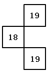

B. 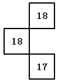

C. 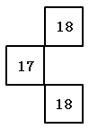

D. 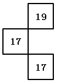

第 43 题 · 答案与解析

**参考答案（粉笔题库参考内容）**

B

**解析**

观察数阵图，可以发现横排与竖列之间都成规律。横排之间1列和2列、3列和4列之间相差都为2；竖列之间，1排和2排、3排和4排之间相差都为3。故所求数项分别为18、18、17。

故正确答案为B。

**来源**：2013年深圳市公务员录用考试《行测》题第43题

### 第 44 题

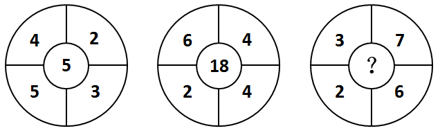

A. 2

B. 8

C. 9

D. 10

第 44 题 · 答案与解析

**参考答案（粉笔题库参考内容）**

C

**解析**

观察可以发现，中心数字 = 左上角 × 右下角-(左下角+右上角)，所求项= 3 × 6 − (2 + 7) = 9。

故正确答案为C。

**来源**：2013年深圳市公务员录用考试《行测》题第44题

### 第 45 题

11，11，13，21，47，( )。

A. 125

B. 126

C. 127

D. 128

第 45 题 · 答案与解析

**参考答案（粉笔题库参考内容）**

C

**解析**

原数列作差可得：0、2、8、26、(  )，再次作差得：2、6、18、(  )，为公比为3的等比数列，则后面括号内的数值为18 × 3 = 54，前面括号内的数值为26+54=80。故所求项为47+80=127。

故正确答案为C。

**来源**：2013年深圳市公务员录用考试《行测》题第45题

### 第 46 题

一小偷藏匿于某商场，三名保安甲、乙、丙分头行动搜查商场的100家商铺。已知甲检查过80家，乙检查过70家，丙检查过60家，则三人都检查过的商铺至少有多少家：

A. 5

B. 10

C. 20

D. 30

第 46 题 · 答案与解析

**参考答案（粉笔题库参考内容）**

B

**解析**

共有100家商铺，则可得甲未检查的商铺有20家，乙未检查的商铺有30家，丙未检查的商铺有40家。要求三人同时都检查过的商铺最少，则就应要三人未同时检查的商铺最多。当且仅当这20，30，40家都没有重复时（即三者没有任何交集的情况下），三人未同时检查的商铺最多，为20+30+40=90家。故三人同时都检查过的商铺至少有100-90=10家。

故正确答案为B。

**考点**：多集合反向构造

**来源**：2013年深圳市公务员录用考试《行测》题第46题

### 第 47 题

小王的旅行箱密码为3位数，且三个数字全是非0的偶数，而且这个三位数恰好是小王今年年龄的平方数。则小王今年多少岁：

A. 17

B. 20

C. 22

D. 34

第 47 题 · 答案与解析

**参考答案（粉笔题库参考内容）**

C

**解析**

将选项一一带入，若小王的年龄为17岁，则旅行箱密码为17^2 = 289，并非全是偶数，与题干矛盾，排除；若小王年龄为20岁，则旅行箱密码为20^2 = 400，并非全是非零偶数，与题干矛盾，排除；若小王年龄为22岁，则旅行箱密码为22^2 = 484，满足题干全部条件；若小王年龄为34岁，则旅行箱密码为34^2 = 1156，并非为三位数，与题干矛盾，排除。

故正确答案为C。

**考点**：年龄问题

**来源**：2013年深圳市公务员录用考试《行测》题第47题

### 第 48 题

如下图所示，在一个边长为8米的正方形与一个直径为8米的半圆形组成的花坛中，阴影部分栽种了新引进的郁金香，则郁金香的栽种面积为多少平方米：

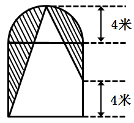

A. 4+4π

B. 4+8π

C. 8+8π

D. 16+8π

第 48 题 · 答案与解析

**参考答案（粉笔题库参考内容）**

C

**解析**

要求不规则图形面积，需采用割补平移法，将其转化为规则图形进行求解。连接正方形底边中点及圆弧中点，则图中阴影面积即可转化为：正方形面积+半圆面积-三角形面积-梯形面积=8^2 + 1/2 π × 4^2− 1/2 × 4 × 12 −(1/2) × (4 + 12) × 4= (8 + 8π)平方米。

故正确答案为C。

**考点**：几何公式类-平面图形

**来源**：2013年深圳市公务员录用考试《行测》题第48题

### 第 49 题

参加奥运开幕式表演的某方阵正在彩排，如果减少一行和一列，人数减少319人。

则该方阵原来最外围的四边共有多少人：

A. 636

B. 638

C. 640

D. 644

第 49 题 · 答案与解析

**参考答案（粉笔题库参考内容）**

A

**解析**

设原方阵每行有x人，减少一行和一列，则总人数减少了2x-1人，根据“人数减少319人”，可列式：2x-1=319，解得x=160；根据方阵最外层公式：4（N-1），原方阵最外层共有：4(x−1)=4×159=636人。

故正确答案为A。

**来源**：2013年深圳市公务员录用考试《行测》题第49题

### 第 50 题

如下图所示，正方形ABCD的边长是14cm，其中，BE=CE=7cm。如果点P以2 cm/s的速度沿着边线CD从点C出发到点D，那么ΔAEP的面积将以每秒多少平方厘米的速度增加：

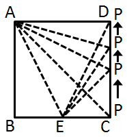

A. 7

B. 8

C. 9

D. 10

第 50 题 · 答案与解析

**参考答案（粉笔题库参考内容）**

A

**解析**

当点P在端点C未出发时，ΔAEP的面积= S△AEC = 1/2 × 7 × 14 = 49平方厘米；

当点P到达D点时，ΔAEP的面积=S_△AED=1/2×14×14=98平方厘米；P点以2厘米每秒的速度行动，到达D点需7秒钟，故ΔAEP的面积将以每秒(98 − 49)/7 = 49/7 = 7平方厘米的速度增加。

故正确答案为A。

**考点**：几何公式类-平面图形

**来源**：2013年深圳市公务员录用考试《行测》题第50题

### 第 51 题

一块合金净重200克，用线吊住全部浸没在水里称重为180克。已知合金包含甲、乙两种金属，由于浮力的作用甲金属在水里减轻1/11的重量，乙金属在水中减轻1/9的重量。

则此块合金中包含的甲乙金属重量相差多少克：

A. 10

B. 20

C. 30

D. 40

第 51 题 · 答案与解析

**参考答案（粉笔题库参考内容）**

B

**解析**

由题意可知，由于浮力的作用，甲金属在水里减轻1/11的重量，乙金属在水中减轻1/9的重量，可知甲的重量是11的倍数，乙的重量是9的倍数，设甲的重量为11x，乙的重量为9y，列方程：11x + 9y = 200，10x + 8y = 180，解得x=10、y=10。故可推知甲的重量为110克，乙的重量为90克，其二者相差110-90=20克。

故正确答案为B。

**考点**：和差倍比问题

**来源**：2013年深圳市公务员录用考试《行测》题第51题

### 第 52 题

五个各不相等的自然数分别两两相加，10种相加组合共得到8个不同的结果，分别是17、22、25、28、31、33、36与39，则五个数中最大的数与最小的数之和为：

A. 25

B. 28

C. 31

D. 33

第 52 题 · 答案与解析

**参考答案（粉笔题库参考内容）**

B

**解析**

设五个自然数分别为a&lt;b&lt;c&lt;d&lt;e，则根据题意可得a+b=17①，a+c=22②，c+e=36③，d+e=39④。

观察可知，②+③，得a+c+c+e=22+36=58，a+e=58-2c，58-2c为偶数，只有B项28是偶数。

故正确答案为B。

**考点**：和差倍比问题

**来源**：2013年深圳市公务员录用考试《行测》题第52题

### 第 53 题

李明倡导低碳出行，每天骑自行车上下班，如果他每小时的车速比原来快3千米，他上班的在途时间只需原来时间的4/5；如果他每小时的车速比原来慢3千米，那么他上班的在途时间就比原来的时间多:

A. 1/3

B. 1/4

C. 1/5

D. 1/6

第 53 题 · 答案与解析

**参考答案（粉笔题库参考内容）**

A

**解析**

设原速度为xkm/h，则速度提升后为(x+3)km/h；速度提升后所用时间只需原来的4/5，设原用时间为5小时，则现用时间为4小时。根据路程相同，可列方程为：5x=4(x+3)，解得x=12km/h，路程5x=60km；如果速度比原来减慢3km/h，即为12-3=9km/h，走完整个路程需60/9=20/3h。则在途时间比原来的时间多(20/3 - 5)/5 = 1/3。

故正确答案为A。

**考点**：普通行程

**来源**：2013年深圳市公务员录用考试《行测》题第53题

### 第 54 题

将512个体积为1立方厘米的小立方体，合成一个边长为8厘米的大立方体，并在大立方体的六面分别刷上不同的颜色，再分开为原来的小立方体，则被刷上两种不同颜色的小立方体的数目是多少个？

A. 72

B. 80

C. 88

D. 96

第 54 题 · 答案与解析

**参考答案（粉笔题库参考内容）**

A

**解析**

整体思考可以得出，在大正方体每条棱上的小正方体都会被刷上两种或两种以上的颜色，但每条棱的顶点都是被刷上了三种颜色，需要排除，则每条棱上有8-2=6个小正方体被刷上了两种颜色，故被刷上两种颜色的小正方体的总个数=6×12=72个。

故正确答案为A。

**考点**：几何结论类-几何小题型

**来源**：2013年深圳市公务员录用考试《行测》题第54题

### 第 55 题

化学实验中，需要使用现有不同浓度的A、B两种氯化钠溶液配置新的浓度为15%的氯化钠溶液。已知A溶液的浓度是B溶液的5倍，且若将50克A溶液与250克B溶液混合即能完成配置，那么A溶液的浓度是：

A. 45%

B. 40%

C. 35%

D. 30%

第 55 题 · 答案与解析

**参考答案（粉笔题库参考内容）**

A

**解析**

设B溶液的浓度为x，A为B的5倍，则A溶液的浓度为5x。根据浓度公式可列方程为：(50×5x+250x)/(50+250) = 15%，解得x=9%，则A溶液的浓度为5×9%=45%。

故正确答案为A。

**来源**：2013年深圳市公务员录用考试《行测》题第55题

### 第 56 题

将下列选项中的词语依次填入各句横线处，最恰当的一组是：

①精神不集中，就容易出\_\_\_\_\_\_。

②这座城市的许多道路还\_\_\_\_\_着解放前的街名。

A. 差错 延用

B. 差错 沿用

C. 差池 沿用

D. 差池 延用

第 56 题 · 答案与解析

**参考答案（粉笔题库参考内容）**

B

**解析**

首先观察第一空，“差错”与“差池”的区别在于，前者侧重于错误，后者侧重于意外，而题干强调的为“精神不集中就会出现错误”，故第一空应填入“差错”，排除C、D。

第二空在现代汉语中，形容“继续使用原有的（方法、制度等）”的规范词汇为“沿用”，并无“延用”，《辞海》和《现代汉语词典》均只收录了“沿用”一词。

故正确答案为B。

**考点**：实词填空、词的辨析-词义侧重

**来源**：2013年深圳市公务员录用考试《行测》题第56题

### 第 57 题

将下列选项中的词语依次填入各句横线处，最恰当的一组是：

①两国的\_\_\_\_\_\_\_\_期满，将于今年的八月再次签订。

②有问题可以\_\_\_\_\_\_\_\_解决嘛，千万别伤了和气。

③美伊双方达成\_\_\_\_\_\_\_\_，停战后美国将驻军伊拉克并帮其重建。

A. 协约 协商 协议

B. 协议 协议 协商

C. 协议 协商 协约

D. 协商 协议 协约

第 57 题 · 答案与解析

**参考答案（粉笔题库参考内容）**

A

**解析**

可从第三空入手快速排除得出答案。“达成协议”为固定搭配，故可排除B、C、D。

“协约”指国家之间协商签订的条约，名词词性，根据题干各句意，故应置于第一空；“协商”指共同商量以便取得一致意见，为动词词性，故应置于第二空；“协议”指经过谈判、协商而制定的共同承认、共同遵守的文件，或泛指双方经协商取得的一致意见；“达成协议”为固定搭配，故应置于第三空。

故正确答案为A。

**考点**：实词填空、词的辨析-搭配对象、词的辨析-词义侧重

**来源**：2013年深圳市公务员录用考试《行测》题第57题

### 第 58 题

将下列选项中的词语依次填入各句横线处，最恰当的一组是：

①在他小伫濠梁之上领悟了鱼的乐趣之后，\_\_\_\_\_\_\_\_想养鱼致富，挖起鱼塘来了。

②咱这河里的水，是从东海议价买来的。您是明白人，每吨当然\_\_\_\_\_\_\_\_一元。

③提货单\_\_\_\_\_\_\_\_卖来卖去，水还躺在东海里，纹丝儿没动。

A. 居然 不只 只管

B. 居然 不止 尽管

C. 竟然 不只 尽管

D. 竟然 不止 只管

第 58 题 · 答案与解析

**参考答案（粉笔题库参考内容）**

B

**解析**

首先观察第二空，“不只”作连词，“不但、不仅”的意思；“不止”作副词，表示超出某个数目或范围。联系题干语境，意思为“超出一元”，故应选择“不止”一词，排除A、C。

再看第三空，题干句意为：虽然提货单卖来卖去，但是水依旧在东海里，纹丝儿不动。第一句与后两句之间为转折关系，故应为“尽管”，排除D。

故正确答案为B。

**来源**：2013年深圳市公务员录用考试《行测》题第58题

### 第 59 题

将下列选项中的词语依次填入各句横线处，最恰当的一组是：

①这项实验几经\_\_\_\_\_\_\_\_后，终于圆满完成了。

②我终于申请到了留学美国的奖学金，梦想的船就要\_\_\_\_\_\_。

③他\_\_\_\_\_\_\_\_飞鸟的自由，向往着无拘无束的生活。

A. 转折 启运 散羡

B. 转折 启程 欲羡

C. 周折 启运 欣羡

D. 周折 启程 欣羡

第 59 题 · 答案与解析

**参考答案（粉笔题库参考内容）**

D

**解析**

首先观察第一空，“转折”指事物在发展过程中改变原来的方向、形势等；“周折”多用来形容事情曲折并不顺利。题干“实验”的圆满完成，并未改变原来的方向，因此应为“周折”一词，且“几经周折”为固定搭配，排除A、B。

其次观察第二空，“启运”指货物开始运出；“启程”意为上路、出发。题干“梦想的船”应为要出发了，故选“启程”，排除C。

第三空，“欣羡”指非常羡慕，填入此处符合语境。

故正确答案为D。

**考点**：实词填空、对应关系-前后呼应、词的辨析-搭配对象、词的辨析-词义侧重

**来源**：2013年深圳市公务员录用考试《行测》题第59题

### 第 60 题

依次填入下列各句横线上的词语，最恰当的一组是：

①新县长上任后，大胆\_\_\_\_\_\_\_\_了精明能干的张强，使濒于倒闭的制药厂起死回生。

②一个有抱负的人，必将会成大器；一个懂得\_\_\_\_\_\_\_\_的人，或许会雄霸一方；一个充满自信的人，往往能从容地面对各种困境。

③长江流域，无疑也是中华民族文化的\_\_\_\_\_\_\_\_之一。

A. 启用 未雨绸缪 发源地

B. 选拔 从长计议 发祥地

C. 任用 顾全大局 发源地

D. 起用 运筹帷幄 发祥地

第 60 题 · 答案与解析

**参考答案（粉笔题库参考内容）**

D

**解析**

释义

“未雨绸缪”指趁着天没下雨，先把门窗绑牢，比喻事先做准备，防患于未然。

“从长计议”指慎重考虑而不急于作出决定；也指慢慢设法解决。

“顾全大局”指从整体的利益着想，使不遭受损害。

“运筹帷幄”常指在后方决定作战方案，也泛指主持大局，考虑决策，常用于军事、政治等。

第一空，搭配“张强”，搭配对象为人。

C项，“任用”指委派人员担任一个职务；

D项，“起用”意为重新任用已退职或免职的官员或提拔使用，置于此处均符合语境。

A项，“启用”指开始使用，通常搭配物，与人搭配不当，排除。

B项，“选拔”侧重强调指按条件进行挑选，而文段强调新官上任，直接“大胆”地用了某人，并没有选拔的过程，不符合文段语境，排除。

第二空，C项，“顾全大局”指从整体的利益着想；“运筹帷幄”常指在后方决定作战方案，也泛指主持大计，考虑决策，常用于军事、政治中。与题干“雄霸一方”相呼应的，“运筹帷幄”更为切合。

第三空，“发源地”指河流开始流出的地方或指事物发端、起源的所在；“发祥地”指民族、革命、文化等起源的地方。题干与“中华民族文化”搭配，应选择“发祥地”，排除C项。

故正确答案为D。

**考点**：对应关系-前后呼应、混搭填空、词的辨析-搭配对象

**来源**：2013年深圳市公务员录用考试《行测》题第60题

### 第 61 题

依次填入下列各句横线上的词语，最恰当的一组是：

①不说你无用，反来怨我，真是\_\_\_\_\_\_\_\_，唯知饮食之徒。

②我半生以来不作\_\_\_\_\_\_\_\_，不取不义之财，有何罪过，要遭此报应呢？

③她自恃年轻漂亮，态度傲慢，\_\_\_\_\_\_\_\_，目中无人，是一朵带刺的玫瑰。

A. 饭囊衣架 非分之想 孤高自许

B. 饭糗茹草 非池中物 孤芳自赏

C. 饭囊衣架 非分之想 孤芳自赏

D. 饭糗茹草 非池中物 孤高自许

第 61 题 · 答案与解析

**参考答案（粉笔题库参考内容）**

C

**解析**

释义：

“饭囊衣架”比喻无用之人。

“饭糗茹草”指吃的是干粮、野菜。形容生活清苦。

“非分之想”比喻妄想得到本分以外的好处。

“非池中物”比喻胸怀大志、不安于现状，一旦机遇来临便可飞黄腾达之士。

“孤高自许”指孤僻清高，自命不凡。

“孤芳自赏”比喻自命清高，自我欣赏。也指脱离群众，自以为了不起。

第一空，后文“唯知饮食之徒”是对横线处所填词语的解释说明，故所填词语应体现出只知道吃，没有用的意思。A、C两项的“饭囊衣架”比喻无用之人，符合文意，保留。B、D两项的“饭糗茹草”指吃的是干粮、野菜，形容生活清苦，不符合文意，排除。

第二空，“非池中物”比喻胸怀大志、不安于现状，一旦机遇来临便可成为飞黄腾达之士；由“不取不义之财”可知，应填入贬义词汇，与“不义之财”相对应，故“非分之想”填入此空符合文意。

第三空，与“自恃年轻漂亮”、“带刺的玫瑰”相对应的“孤芳自赏”更为恰当，体现出自命清高，而“孤高自许”更偏向于孤僻。

故正确答案为C。

**考点**：关联关系-并列关系、成语填空、词的辨析-词义侧重

**来源**：2013年深圳市公务员录用考试《行测》题第61题

### 第 62 题

依次填入下列各句横线处的词语，最恰当的一组是：

①文学的美，终其一生，将是我追求的\_\_\_\_\_\_\_\_了。

②天空高临在我们的头上，没有一丝云层，浩渺的清空呈现着神秘无边的伟大\_\_\_\_\_\_\_\_。

③一个人，心里觉得愉快时喜欢唱一唱歌是自然的\_\_\_\_\_\_\_\_。

A. 理想 气象 表露

B. 目标 气息 表露

C. 目标 气象 流露

D. 理想 气息 流露

第 62 题 · 答案与解析

**参考答案（粉笔题库参考内容）**

C

**解析**

首先观察第三空，“表露”侧重于主动表达；“流露”侧重于不经意表达。与“自然的”对应的应为不经意的“流露”，排除A、B。

第二空，“气息”指呼吸时进出的气，而“浩渺的清空”为景象，并非“气息”，排除D。

故正确答案为C。

**考点**：实词填空、对应关系-前后呼应、词的辨析-词义侧重

**来源**：2013年深圳市公务员录用考试《行测》题第62题

### 第 63 题

依次填入下列各句横线处的词语，最恰当的一组是：

①所谓特权，历史地说，乃是少数得势的阶级单独地享有某些待遇，而多数无权阶层的人民则被\_\_\_\_\_\_\_\_于外，不得分润。

②我们把平等的社会含义落实到权利平等与机会平等上，问题的讨论便\_\_\_\_\_\_\_\_得多了。

③传统的民主自由制度究竟当如何改进自身以\_\_\_\_\_\_\_\_更高的平等境界呢？

A. 屏除 具体 通向

B. 摒除 具体 迈向

C. 屏除 详细 迈向

D. 摒除 详细 通向

第 63 题 · 答案与解析

**参考答案（粉笔题库参考内容）**

B

**解析**

首先观察第一空，“屏除”意为使（某人或物）摆脱或去掉，如“屏除陈规旧习”；“摒除”意为排除。此处语境强调“人民被排除在外”，故应为“摒除”，排除A、C。

第二空，由“把平等的社会含义落实到权利平等与机会平等上”可知，概念的范围更加明确化，故“具体”更为得当。

故正确答案为B。

**考点**：实词填空、对应关系-前后呼应、词的辨析-词义侧重

**来源**：2013年深圳市公务员录用考试《行测》题第63题

### 第 64 题

依次填入下列各句横线处的词语，最恰当的一组是：

①对现代政府治理来说，政府部门间的有效\_\_\_\_\_\_\_\_是一个永恒的主题。

②我国经济的成功，离不开政府的积极\_\_\_\_\_\_\_\_。

③今年两会的一个重要成果是\_\_\_\_\_\_\_\_了我国新一轮的政府机构改革。

A. 协调 引导 起动

B. 协作 引导 启动

C. 协调 领导 启动

D. 协作 领导 起动

第 64 题 · 答案与解析

**参考答案（粉笔题库参考内容）**

B

**解析**

首先观察第一空，“协作”指互相配合，共同完成任务；“协调”指和谐一致，配合得当。由“现代政府治理”“政府部门间”可知，强调的是共同工作，并非单一的协调，故“协作”更为恰当，排除A、C。

第二空我国政府与我国经济之间并非上下级关系，“引导”更为准确。

第三空，“启动”意为开始、发动，与后文的“改革”搭配恰当。

故正确答案为B。

**考点**：实词填空、对应关系-前后呼应、词的辨析-词义侧重

**来源**：2013年深圳市公务员录用考试《行测》题第64题

### 第 65 题

依次填入下列各句横线处的词语，最恰当的一组是：

因为小说的范围至为广泛，作者挑选的\_\_\_\_\_\_\_\_、写作的动机、\_\_\_\_\_\_\_\_的选择、创作的方法以及内心的喜怒哀乐等等感情各有不同。

A. 体裁 题材

B. 体裁 素材

C. 体例 素材

D. 体例 题材

第 65 题 · 答案与解析

**参考答案（粉笔题库参考内容）**

A

**解析**

第一空，“体例”是指著作的编写格式或文章的组织形式，包括标题、断限、序言、评议、注解、目录、凡例、索引等项内容；“体裁”指艺术作品的种类和样式。题干讨论内容为“小说的范围”，与之对应的应为“体裁”，排除C、D两项。

第二空，横线处所填词语应搭配“选择”，且根据文意可知，此处为作者创作小说时前期过程中的一个步骤。A项“题材”指构成文学和艺术作品的材料，即作品中具体描写的生活事件或生活现象，B项“素材”指文学或艺术作品中尚未经过提炼、加工的原始材料。由作家创作逻辑顺序可知，应先确立小说所要描写的事件或现象，再对手中材料进行加工，故与“选择”进行搭配，A项“题材”相较B项“素材”更符合文段语境，当选。

故正确答案为A。

【文段出处】《事实—故事—真实》

**考点**：实词填空、对应关系-前后呼应、词的辨析-词义侧重

**来源**：2013年深圳市公务员录用考试《行测》题第65题

### 第 66 题

下列语句中，有语病的一句为：

A. 剑桥大学材料科学教授林·汉弗莱认为，只要解决了芯片与大脑的接口问题，把刻在微型芯片上的微型记忆电路加入大脑中的设想就完全有可能变为现实。

B. 病毒的生存能力既然这么弱，为什么还会那样猖獗呢？

C. 旨在培养中小学生爱国热情的德育打卡制度，由于一些单位和个人的认识问题，出现“走过场”现象，的确让人叹息。

D. 不久前，中国社科院等发布的《中国城市智慧低碳发展报告》，深圳因其经济、能源、设施、环境和社会等方面的成绩，在110座城市中位列前三。

第 66 题 · 答案与解析

**参考答案（粉笔题库参考内容）**

D

**解析**

D项两处语病：一是成分残缺，“报告”后缺少动词，第二句应改为“中国社科院等发布的《中国城市智慧低碳发展报告》显示”；二是逻辑矛盾，主语仅为深圳一座城市，无法对应“前三”，“位列前三”应改为“位列第三”，当选；

A、B、C三项均不存在语病，排除。

故正确答案为D。

**来源**：2013年深圳市公务员录用考试《行测》题第66题

### 第 67 题

下列语句中，有语病的一句为：

A. 四周或高或低的果林花丛，多姿而又调匀地簇成这小园地的整体的和谐美。

B. 喜欢文字的人和现实总有一种不可企及的距离，即使我深陷其中，依然有局外的感觉，但我不会和身边的人诉说。

C. 旁人永远无法看见我最寂寞的时候，因为我只有在别人看不见的时候才会最寂寞。

D. 外面还下着毛毛雨，地面上的积水浅一洼深一洼的，倒映出灰暗的天空，葱茏的树影，还有衣着光鲜的人群。

第 67 题 · 答案与解析

**参考答案（粉笔题库参考内容）**

B

**解析**

B项，不可企及形容远远赶不上，与距离搭配不当，应修改为“喜欢文字的人和现实总有一种遥不可及的距离”，当选；

A、C、D三项，均表意明确，没有语病，排除。

本题为选非题，故正确答案为B。

**来源**：2013年深圳市公务员录用考试《行测》题第67题

### 第 68 题

下列语句中，成语使用不当的一句是：

A. 如今这里是经济开发区，高楼林立，机声隆隆，给人以面目一新的美好感觉

B. 我本来就对那里的情况不熟悉，你却硬要派我去，这不是差强人意吗

C. 掐丝工人心里有谱，不用在铜胎上打稿，就能自由自在地把铜丝粘成图案

D. 如果没有无数默默的枕木，力大无穷的火车头也只能站着叹气

第 68 题 · 答案与解析

**参考答案（粉笔题库参考内容）**

B

**解析**

A项，“面目一新”指样子完全变新，用于形容经济开发区高楼林立的新变化，使用恰当，排除；

B项，“差强人意”指大体上还能使人满意，而句中“我本来就对那里的情况不熟悉，你却硬要派我去”表达的是不满、为难之意，“差强人意”与句意不符，可改为“强人所难”，使用不当，当选；

C项，“自由自在”指无拘无束，不受任何限制，用于形容掐丝工人熟练、自如地粘铜丝，使用恰当，排除；

D项，“力大无穷”形容力气极大，用于形容火车头的力量，使用恰当，排除。

本题为选非题，故正确答案为B。

**来源**：2013年深圳市公务员录用考试《行测》题第68题

### 第 69 题

下列语句中，没有语病的一句为：

A. 根据新的会议精神，文件对于商业流通领域出现的问题，从政策上和理论上作了深刻的说明和详细的规定。

B. 有没有远大的抱负和顽强的意志，是一个人取得成功的关键。

C. “推动科学发展，促进社会和谐”是党的十七大主题的重要内容，它向世界表达了中国人民对内致力于构建和谐社会，对外努力建设和平繁荣的美好世界。

D. 倡议和领导世界上第一次测量子午线的是我国唐代天文学家僧一行。

第 69 题 · 答案与解析

**参考答案（粉笔题库参考内容）**

D

**解析**

A项语序不当，可改为“从政策上和理论上作了详细的规定和深刻的说明”，使之相互对应；B项搭配不当，犯了两面对一面的错误，应删除“有没”；C项成分残缺，可改为“表达了······宗旨/决心”。

故正确答案为D。

**来源**：2013年深圳市公务员录用考试《行测》题第69题

### 第 70 题

下列语句中，没有语病的一句为：

A. 石油和天然气价格的不断上涨，引起消费者信心指数连续下降，造成工业农业生产成本大幅提高，给世界经济复苏蒙上了一层阴影。

B. 时间过得如此之慢，经过整整两个小时左右，这场百无聊赖的会议才结束。

C. 这些生动的事例，反映的是政府进行行政审批改革前后部分事项办理情况的有效改善。

D. 我虽然和他只有一面之缘，但从他那里学到了许多东西，包括他的学识和人品。

第 70 题 · 答案与解析

**参考答案（粉笔题库参考内容）**

D

**解析**

A项搭配不当，“引起信心指数下降”搭配不当，应将“引起”改为“导致”；B项语义矛盾，“整整两个小时”与“两个小时左右”，“整整”与“左右”矛盾，应删除其一；C项搭配不当，“前后”与“有效改善”搭配不当，可改为“反映的是政府进行行政审批改革后部分事项办理情况的有效改善”。

故正确答案为D。

**来源**：2013年深圳市公务员录用考试《行测》题第70题

### 第 71 题

下列语句中，没有语病的一句为：

A. 中国男子游泳史上第一枚奥运会金牌得主孙杨，对于青少年游泳爱好者是一点也不陌生。

B. 希腊人当时如能团结，他们不仅可以保存而且可以推广希腊的文化，敌人虽强亦无可奈何，但团结这一点希腊人不能做到。

C. 工厂多个部门都参加了上周六举行的义务植树活动，其中包括管理部、营业部、生产部和生产线员工等。

D. 不仅“绿色出行”可以节约能源，而且还能促进身心健康。

第 71 题 · 答案与解析

**参考答案（粉笔题库参考内容）**

B

**解析**

A项，主客颠倒，“孙杨，对于······不陌生”应改为“青少年游泳爱好者对于孙杨一点也不陌生”，排除；

B项，语句通顺，表意明确，没有语病，当选；

C项，并列不当，“管理部、营业部、生产部”是部门，而“生产线员工”是人员，不能与部门并列使用“等”来概括，排除；

D项，关联词语序不当，“不仅······而且······”连接两个分句且主语相同时，“不仅”应放在主语“绿色出行”之后，排除。

本题为选非题，故正确答案为B。

**来源**：2013年深圳市公务员录用考试《行测》题第71题

### 第 72 题

下列语句中，没有语病的一句为（    ）。

A. 由于他1米90的身高，顺利获得了进入学校篮球队的资格。

B. 6月29日，澳门国际机场专营股份有限公司联同体育发展局举行“舞动全城欢呼奥运”，以健身操的方式迎接北京奥运会到来。

C. 当然，知识分子中也有进步分子，他们努力于和平运动，对新中国的和平劳动的人民，抱着很大的好感和敬意。

D. 不管你在一次又一次的智力竞赛中名落孙山，但在某一方面，你也许可以发挥你独有的、奇迹般的创造力，使生活充满无尽的乐趣。

第 72 题 · 答案与解析

**参考答案（粉笔题库参考内容）**

C

**解析**

这是一道病句辨析题。

A项，语序不当。应改为“他由于1米90的身高，顺利获得了进入学校篮球队的资格”，排除；

B项，成分残缺。应改为“6月29日，澳门国际机场专营股份有限公司联同体育发展局举行‘舞动全城欢呼奥运’的活动，以健身操的方式迎接北京奥运会到来”，排除；

C项，表意明确，没有语病，当选；

D项，关联词搭配错误。将“不管”改为“尽管”，应改为“尽管你在一次又一次的智力竞赛中名落孙山，但在某一方面，你也许可以发挥你独有的、奇迹般的创造力，使生活充满无尽的乐趣”，排除。

故正确答案为C。

**来源**：2013年深圳市公务员录用考试《行测》题第72题

### 第 73 题

把下面几个句子组成语意连贯的一段文字，排序正确的一项是：

（1）我们吃了早餐后，便坐着船出发。

（2）天平山，从苏州前去，是比较遥远的途程。

（3）河道两旁的田野，青绿地活趣欲跃。

（4）所走的水路是运河的故道。

（5）一路多枫树、短桥，对之令人感到一种清隽的散文诗的风味。

A. 1-2-4-3-5

B. 2-1-4-5-3

C. 4-1-3-2-5

D. 2-5-1-4-3

第 73 题 · 答案与解析

**参考答案（粉笔题库参考内容）**

B

**解析**

由“便坐着船出发”、“所走的水路是运河的故道”可知，①④为连续动作，二者应依次相连，排除A、C；⑤一路多枫树、短桥，对之令人感到一种清隽的散文诗的风味，是对行船过程中的景色评价，应在④之后，排除D。

故正确答案为B。

**考点**：确定捆绑、确定顺序

**来源**：2013年深圳市公务员录用考试《行测》题第73题

### 第 74 题

把下面几个句子组成语意连贯的一段文字，排序正确的一项是：

（1）人们，尤其是青年朋友，对于一切变的都有着无限的向往之情

（2）是不是过去的种种都该彻底革除呢？

（3）变与常的关系又到底如何呢？

（4）而对于一切现存的，也就是常的，则有着说不出的厌恶之感

（5）抑或社会应当一成不变呢？

（6）不可否认，这是一个变的时代：从社会到个人，从制度到思想，都在剧烈地变动着。

A. 6-1-4-2-5-3

B. 1-4-6-3-2-5

C. 1-4-6-2-5-3

D. 6-2-5-3-1-4

第 74 题 · 答案与解析

**参考答案（粉笔题库参考内容）**

A

**解析**

首句对比①⑥，⑥为对大背景的描述，是对整个文段的铺垫，且⑥句中“从社会到个人”与①句的“人们”构成衔接，故⑥句应在①句之前，排除B、C；根据行文逻辑，应先描写人们对变与常的态度后提出“变与常的关系又到底如何”这一问题引发思考，故①④应在②⑤③之前，排除D项。

故正确答案为A。

**考点**：确定顺序、确定首句-首句特征

**来源**：2013年深圳市公务员录用考试《行测》题第74题

### 第 75 题

把下面几个句子组成语意连贯的一段文字，排序正确的一项是：

（1）同样一本书每再看看，领悟的又是一番境界

（2）后来觉着不对，因为年龄不同了

（3）这竟成了我少年时代消磨大半时间的方法

（4）所以买书回来放在架上，想起来时再反复地去回看它们

（5）一本好书，以前是当故事看。

A. 1-4-3-5-2

B. 1-4-5-2-3

C. 5-2-4-1-3

D. 5-2-1-4-3

第 75 题 · 答案与解析

**参考答案（粉笔题库参考内容）**

D

**解析**

首先比较①⑤两句，①句中“再”、“又”等词汇为补充类描述，不做段首，排除A、B；再次比较④①，阅读可以得知，①为④的原因，构成因果关联，故①应排在④之前，③句中的代词“这”指代前面的整个过程。

故正确答案为D。

**考点**：确定顺序、确定首句-非首句特征

**来源**：2013年深圳市公务员录用考试《行测》题第75题

### 第 76 题

我们的生活中，充满了大大小小的挫折和失败，很多人都会经历失业、离婚、失去心爱的人，或其他各种痛苦。常常我们最梦寐以求的东西，再也不存在了；常常我们最爱的人，再也不能回到我们身边。每当这些时刻来临我们都会体验到悲伤、痛苦、甚至绝望。通常，由这些明确现实事件引起的抑郁和悲伤，是正常的、短暂的，有的甚至有利于个体的成长。但是，有些人的抑郁症状并没有十分明确、合理的外部诱因；另外一些人，虽然在他们的生活中发生了一些负性生活事件，但是，他们的抑郁症状持续得很久，远远超过了一般人对这些事件的情绪反应，而且抑郁症状日趋恶化，严重地影响了工作、生活和学习。如果是这样，那么很可能，他们患了当今世界第一大心理疾病——抑郁症。抑郁症通常指的是情绪障碍，是一种以心境低落为主要特征的综合症。这种障碍可能从情绪的轻度不佳到严重的抑郁，它有别于正常的情绪低落。

下列对文章的理解正确的一项是：

A. 经历挫败和失败等负性生活事件的时候，我们就会体验到抑郁

B. 没有十分明确、合理的外部诱因陷入抑郁，而且持续时间很长，才可判断为抑郁症

C. 抑郁症是一种以心境低落为主要特征的情绪障碍，和正常的情绪低落相比，没有区别

D. 抑郁情绪是每个人都会有的，所以它是当今世界第一大心理疾病

第 76 题 · 答案与解析

**参考答案（粉笔题库参考内容）**

A

**解析**

由文段可知，“没有十分明确、合理的外部诱因”、“抑郁症持续时间长”多种原因都会导致抑郁症，而并非二者缺一不可，B项错误；C项颠倒黑白，抑郁症会严重影响个人的工作、学习和生活，和正常的情绪低落是有区别的，C项错误；D项抑郁情绪与抑郁症并非同一概念，且犯了强加因果的逻辑错误，并非每个人都具有就是世界第一大心理疾病，D项错误。

故正确答案为A。

**考点**：细节判断题

**来源**：2013年深圳市公务员录用考试《行测》题第76题

### 第 77 题

为什么要提初等教育?正是多亏了这些学校，美国的早期技工才普遍能读会写，并精通算术，掌握一定的几何和三角知识，这种情况在新英格兰和大西洋中部各州尤为常见。目光敏锐的外国观察家认为美国人的适应能力和创造能力得益于这种教育。正如1853年访美的一个英国访问团成员所报道的那样，“由于有了学校彻底训练过的头脑，美国孩子迅速地成为技术熟练的工人。”

文章暗示早期美国技工的适应能力和创造能力（  ）。

A. 从他们的数学知识中获益匪浅

B. 显示了他们有严格的学校管理方式

C. 产生于享有特权的家庭训练

D. 基本上归因于发展

第 77 题 · 答案与解析

**参考答案（粉笔题库参考内容）**

B

**解析**

本题属于细节判断题。可将各选项代回原文进行一一对应。

A项，对应原文“美国的早期技工才普遍能读会写，并精通算术，掌握一定的几何和三角知识”，表达了两层含义，一是能读会写，二是数学知识，而且这两层含义是并列的，无侧重点；该项只谈及数学知识，不全面，故排除。

B项，对应原文“正是多亏了这些学校，美国的早期技工才······”“美国人的适应能力和创造能力得益于这种教育”“由于有了学校彻底训练过的头脑，美国孩子迅速地成为技术熟练的工人”，强调学校教育对美国技工的作用，该项表述与学校教育相关，符合文意。

C项，原文未涉及“家庭训练”，属于无中生有，故排除。

D项，原文未涉及“发展”，属于无中生有，故排除。

故正确答案为B。

**考点**：细节判断题

**来源**：2013年深圳市公务员录用考试《行测》题第77题

### 第 78 题

一批杰出的科学家认为，鱼是具有社会智商的动物，它们不应被称为动物王国中的笨蛋。研究组的科学家们说，鱼类不是简单地凭本能行事，它们很机灵，有控制能力，甚至很有教养。三位来自爱丁堡、圣安德鲁斯和利兹大学的专家说，科学界在最近几年里对鱼的心理和心智能力的认识发生了巨大的变化。生物学家富勒姆·布朗、凯文·莱兰和延斯·克劳斯在《鱼类和渔业》杂志上发表文章说，目前鱼被认为是非常聪明的动物。他们说：“过去鱼类被看作单调乏味、脑袋只有豌豆大的笨蛋，只会受‘本能’驱使，仅有的一点儿行动灵活性也被它那臭名昭著的‘三秒钟记性’严重阻碍了。如今这种说法已经一去不返了（或者至少是过时了）。”现在，鱼被认为充满着社会智商，运用马基雅维利式的策略，诸如操纵、惩罚和顺从，表现出固有的文化传统，并通过合作来勘查敌情和捕捉食物。最近的研究表明鱼可以识别各自的鱼群伙伴，社会威望，甚至相关的人际关系。科学家们也观察到它们会使用工具，修筑结构复杂的窝，还表现出长期的记忆力。科学家们补充说：“尽管对于那些习惯于以脑容量来事先判断动物智商的人来说这看起来非常特别，但是在某些认知领域，鱼甚至可以和人类以外的灵长类动物相媲美。”他们说鱼是最古老的主要脊椎动物，他们有“足够多的时间”来进化出复杂多样并且有适应能力的行为模式，与其他脊椎动物相抗衡。科学家们说：“这些进化就是重新评价鱼类行为灵活性的有力依据，并且突出了有必要进一步了解鱼类刚被认可的行为和社交复杂性的进化过程。”

下列说法中不符合原文意思的一项是：

A. 过去鱼类被认为是动物王国中的笨蛋，只凭本能行事，只有“三秒钟记性”

B. 现在鱼类被认为是充满社会智商的动物，有固有的文化传统，有教养

C. 关于鱼类的行为和社交复杂性的进化过程还需要进一步了解

D. 鱼虽然脑容量小智商很低，但这并未妨碍其进化出可与灵长类动物相媲美的认知能力

第 78 题 · 答案与解析

**参考答案（粉笔题库参考内容）**

D

**解析**

A项，根据“过去鱼类被看作单调乏味、脑袋只有豌豆大的笨蛋，只会受‘本能’驱使，仅有的一点儿行动灵活性也被它那臭名昭著的‘三秒钟记性’严重阻碍了”可知，选项表述正确，排除；

B项，根据“它们很机灵，有控制能力，甚至很有教养”以及“现在，鱼被认为充满着社会智商，运用马基雅维利式的策略，诸如操纵、惩罚和顺从，表现出固有的文化传统”可知，选项表述正确，排除；

C项，根据“有必要进一步了解鱼类刚被认可的行为和社交复杂性的进化过程”可知，选项表述正确，排除；

D项，根据“过去鱼类被看作单调乏味、脑袋只有豌豆大的笨蛋······如今这种说法已经一去不返了（或者至少是过时了）”以及“现在，鱼被认为充满着社会智商”可知，“鱼虽然脑容量小智商很低”表述错误，当选。

本题为选非题，故正确答案为D。

【文段出处】中国日报《英国科学家：鱼类的智商超乎我们的想象》

**考点**：细节判断题

**来源**：2013年深圳市公务员录用考试《行测》题第78题

### 第 79 题

澳大利亚研究人员在实验鼠体内用干细胞成功培养出活动的心脏组织。这一突破性进展意味着也许在不久的未来，人们将无需担心在器官移植中出现排异问题。据澳大利亚媒体８日报道，澳大利亚墨尔本的一个研究小组在一只实验鼠体内植入一个有血管的特制空腔，然后把从其他实验鼠身上提取的干细胞加入这个空腔内。一段时间后，这些干细胞长成不同类型的组织，其中包括跳动的心脏组织。研究小组负责人莫里森教授说，这项成果将最终使得人们能用干细胞按需制造各种器官和组织，比如完整的心脏或修补心脏缺陷时所要用的“补丁”。如果器官和组织是用患者自己的干细胞制造的，移植后就不会出现排异反应。但他说：“我估计这项成果要进入实用还需10年。”目前，该小组已成功培养了乳房组织、肌肉、能产生胰岛素的胰腺组织等。研究人员计划在几年以后开始人体试验。

下列说法中不符合原文意思的一项是：

A. 研究小组通过在一个有血管的特制空腔内加入干细胞来培养多种组织

B. 在实验鼠体内用干细胞培养出活动的心脏组织的研究取得了成功

C. 人的乳房组织、肌肉、能产生胰岛素的胰腺组织等的培养已获成功

D. 如果采用患者自己的干细胞制造器官和组织，移植后就不会出现排异反应

第 79 题 · 答案与解析

**参考答案（粉笔题库参考内容）**

C

**解析**

根据文段最后一句“研究人员计划在几年以后开始人体试验”可知，“乳房组织、肌肉、能产生胰岛素的胰腺组织等”并未在人的体内培养成功，C项属于偷换概念。

根据“澳大利亚墨尔本的一个研究小组在一只实验鼠体内植入一个有血管的特制空腔，然后把从其他实验鼠身上提取的干细胞加入这个空腔内。一段时间后，这些干细胞长成不同类型的组织，其中包括跳动的心脏组织”可知，A项表述正确；根据“澳大利亚研究人员在实验鼠体内用干细胞成功培养出活动的心脏组织”可知，B项表述正确；根据“如果器官和组织是用患者自己的干细胞制造的，移植后就不会出现排异反应”可知，D项表述正确。

本题为选非题，故正确答案为C。

**考点**：细节判断题

**来源**：2013年深圳市公务员录用考试《行测》题第79题

### 第 80 题

重大科技创造中很少有能像大型水坝这样让人痴迷的。可能正是因为人类长期遭受旱涝灾害的摆布才使得让水听人的调遣如此令人痴迷。但让人着迷有时也就使人盲目。有几个巨型大坝项目就有弊大于利的危险。建造大坝的教训是：大的未必总是好的。建一座巨大的、功能强的水坝已成为那些努力显示自己的国家和人民的一个成就的标志。但对国家和民族并没有多大益处，埃及在阿拉伯世界的领导地位因阿斯旺大坝而得以巩固。土耳其在力图跻身第一世界的计划中也包括修建阿塔特克大坝。

但大坝往往不如预期那样发挥功效。第一段第三句话暗示了：

A. 人们若对现实视而不见便会很高兴。

B. 盲人可能比看得见的人更幸福。

C. 过于兴奋的人往往忽视至关重要的东西。

D. 迷恋使人们丧失判断。

第 80 题 · 答案与解析

**参考答案（粉笔题库参考内容）**

D

**解析**

文段意为，大型水坝在令人痴迷的同时，也使人陷入盲目而忽略利弊大小，埃及的阿斯旺大坝和土耳其的阿塔特克大坝就是最好的案例。故第三句话“但让人着迷有时也就使人盲目”暗示了“迷恋使人们丧失判断”，“丧失判断”是对“盲目”的同义替换。

故正确答案为D。

**考点**：句子

**来源**：2013年深圳市公务员录用考试《行测》题第80题

### 第 81 题

美国宇航局计划在未来10年发射两个价值几十亿美元的航天器，以寻找太阳系外类地行星的存在，而欧空局（ESA）也计划发射一个类似的寻找行星的航天器。科技日报报道，据最新出版的《科学》杂志报道，目前，科学家们已在太阳系以外探测到120多颗行星，但在其中发现和研究类地星体，还需要技术上的重大突破。近几年，美国和欧洲的天文学家和工程师正竞相研发各自的相关技术。2020年前，欧空局和美宇航局计划分别发射“达尔文”号（Darwin）航天器和“类地行星发现器”（TPF）。欧空局（ESA）的研发力量集中在研制和发射自由飞行干涉仪上，这种干涉仪可汇集若干台太空望远镜收集到的光，并形成单一的红外图像。天文学家通过对系统捕获的来自某一方向的光的研究发现小行星的存在。美宇航局则追求多种选择方案，其中包括一组自由飞行干涉仪和单一航天器干涉仪，同时他们也在加紧研制光学日冕仪。在日冕仪的研制中，科学家设计一个特别平坦的透镜，可将恒星产生的光压减100亿倍，从而使天文学家能全神贯注于可能存在行星区域的光子。美宇航局喷气推进实验室已开始研制两台中等尺寸、4米×6米以及10米×12米的椭圆透镜。

下列说法中不符合原文意思的一项是：

A. 目前在发现和研究类地星体方面，还没有技术上的重大突破。

B. 光学日冕仪实际上是一种光学滤镜。

C. 美国宇航局和欧空局在发现和研究类地星体方面展开了激烈的竞争。

D. 科学家已在太阳系以外探测到120多颗行星。

第 81 题 · 答案与解析

**参考答案（粉笔题库参考内容）**

B

**解析**

A项，根据“科学家们已在太阳系以外探测到120多颗行星，但在其中发现和研究类地星体，还需要技术上的重大突破”可知，该项与原文相符，排除；

B项，根据“在日冕仪的研制中，科学家设计一个特别平坦的透镜”可知，科学家将日冕仪设计成透镜，而非“滤镜”，该项与原文不符，当选；

C项，根据全文可知，文段指出美国宇航局与欧空局均计划发射一个航天器寻找类地行星，并竞相研发各自的相关技术，该项与原文相符，排除；

D项，根据“目前，科学家们已在太阳系以外探测到120多颗行星”可知，该项与原文相符，排除。

本题为选非题，故正确答案为B。

**考点**：细节判断题

**来源**：2013年深圳市公务员录用考试《行测》题第81题

### 第 82 题

近日英国研究衰老的专家说，身心适度紧张有助于身体健康，可以延年益寿。在伦敦举行的第二届抗衰老大会上，英国长寿协会医疗主任马里奥斯·基里亚齐斯医生发表了一篇研究报告，他称紧张疗法是抗衰老的一种新途径。报告中说，适度的紧张，可以使人体增加有助于修补身体细胞的蛋白数量（包括脑蛋白），使之发挥最佳效应，有助于提高人的天然防疫力，以免遭受疾病的侵袭，可以预防老年痴呆症、关节炎和心脏病。基里亚齐斯曾经做过一个实验，经病人同意后他开了些中等强度的活动处方，例如在周末重新装饰客厅或迅速收拾行李及时赶到机场。在病人完成了这些紧张的任务之后，都表示感觉身体舒服，人也更年轻了。基里亚齐斯解释说，当人们从事一项紧张活动时，人的身体或脑中的细胞跟着也会紧张起来，随之开始损坏。接着，细胞本身的修补机制便被激活，制造用来修补损失的蛋白，并增加细胞数量消除对身体有害的化学物质。这个过程被称为“兴奋效应”。基里亚齐斯说：“从35岁左右起，随着身体的衰老这种自我修补机制便开始放慢。保持这个过程有效运作的最佳途径，就是不断地‘锻炼’它，这意味着你必须寻找紧张，以便使你的身体继续对紧张做出反应。”但是，必须是适度的紧张才对身体有益。适度的紧张都是短时间的，具有中等的刺激作用，能给人一种成功感。

根据文意，下列表述不正确的一项是：

A. 身心适度紧张将有助于身体健康，保持活力，紧张疗法是抗衰老的一种新途径。

B. 适度的紧张可使人体增加有助于修补身体细胞的蛋白数量，使之发挥最佳途径。

C. 从35岁左右起，随着身体的衰老，必须寻找紧张刺激，紧张刺激越多越强越好。

D. “兴奋效应”是指当人们从事一项紧张活动时身体或脑中的细胞随之跟着紧张起来，并开始损坏，接着，细胞本身的修补机制便被激活，制造用来修补损失的蛋白，并增加细胞数量消除对身体有害的化学物质。

第 82 题 · 答案与解析

**参考答案（粉笔题库参考内容）**

C

**解析**

A项，文段提到“身心适度紧张有助于身体健康，可以延年益寿”“紧张疗法是抗衰老的一种新途径”，表述与原文一致，排除；

B项，文段提到“适度的紧张，可以使人体增加有助于修补身体细胞的蛋白数量（包括脑蛋白），使之发挥最佳效应”，表述与原文相符，排除；

C项，文段提到“必须是适度的紧张才对身体有益。适度的紧张都是短时间的，具有中等的刺激作用”，可知并非紧张刺激越多越强越好，“紧张刺激越多越强越好”与文意相悖，当选；

D项，根据“基里亚齐斯解释说，当人们从事一项紧张活动时······这个过程被称为‘兴奋效应’”可知，表述与原文一致，排除。

本题为选非题，故正确答案为C。

**考点**：细节判断题

**来源**：2013年深圳市公务员录用考试《行测》题第82题

### 第 83 题

不久前，在美国丹佛市举行的国际癌专家会议上，医学家宣布：他们经过临床试验发现，普通的感冒病毒可以杀死癌细胞。有多名自愿接受试验的癌症患者在接受这项治疗后，身上的癌细胞都呈萎缩状。专家们指出，要运用基因工程的办法研究出能引起感冒的腺病毒有机体，让含有易变基因的癌细胞染上感冒。而这项新技术，估计每年可望挽救10万个癌症病人的生命。

上面文字传达的最重要的一条信息是：

A. 目前，正在开展的用感冒病毒治疗癌症的试验取得可喜的成果

B. 目前，癌细胞在感冒病毒作用下萎缩这一事实引起医学界重视

C. 今后，将日益广泛地推广用感冒病毒治疗癌症这一新方法

D. 今后，要攻克运用基因工程让癌细胞染上感冒的新技术

第 83 题 · 答案与解析

**参考答案（粉笔题库参考内容）**

D

**解析**

文段首先介绍了“感冒病毒可以杀死癌细胞”的临床试验结果，随后运用癌症患者的治疗结果证明了这项治疗工程的可行性，然后提出“要运用基因工程的方法让癌细胞染上感冒”，为文段重点。故文字最重要的信息就是“要运用这一项新技术”，即“运用基因工程的方法让癌细胞染上感冒”。

故正确答案为D。

**考点**：关联词-对策

**来源**：2013年深圳市公务员录用考试《行测》题第83题

### 第 84 题

在一项有奖征答活动中，有一个题目是：在一艘小船上载有三人，第一位是医学专家，他可使人们免于因癌症疾病而死亡的厄运；第二位是核专家，他有能力防止全球性的核战争；第三位是粮食专家，他能使几千万人脱离饥荒。此刻小船即将沉没，必须丢出一个人以减轻载重，问该丢下谁？应答信如雪片飞来，结果，巨额奖金的得主是一个小男孩。他的答案是：最胖的下去。

对这段文字的理解正确的是：

A. 这是办法总比问题多的实例

B. 这是复杂问题简单化的典范

C. 这是棘手事情快处理的选择

D. 这是小顽童解决大难题的故事

第 84 题 · 答案与解析

**参考答案（粉笔题库参考内容）**

B

**解析**

在面对问题时，小男孩没有根据三位专家的身份和贡献的大小来解决问题，而是着眼根本，从最简单的“身体重量”来考虑问题，将复杂的问题最简单的解决，说明的就是“复杂问题简单化”的道理。A、C、D选项中的“多、快、顽童”等，在文段中均未体现。

故正确答案为B。

**考点**：细节判断题

**来源**：2013年深圳市公务员录用考试《行测》题第84题

### 第 85 题

要证明一个事物的可能，有两条途径，一条是指出他的确存在，即过去曾经存在，或者现在正在存在；另一条途径是从逻辑上证明它的存在，即使它现在并不存在，过去不曾存在，但按理它应该存在，或者在将来的某一天总会存在。

这段文字表明（  ）。

A. 要从两条途径证明一个事物的可能

B. 一个事物的可能与否不确定

C. 证明可能即证明存在

D. 存在分为确实存在和逻辑存在

第 85 题 · 答案与解析

**参考答案（粉笔题库参考内容）**

D

**解析**

本题属于中心理解题。文段为“总-分”结构，首句介绍“要证明一个事物的可能，有两条途径”，后文将这两种途径分别作了具体阐述，即“的确存在”和“逻辑存在”。结合选项，D项将两条途径全面加以概括，符合文段中心，当选。

A项，原文介绍的是证明事物的可能有两条途径，符合其中一条便能证明，而A项所说的意思是要同时符合两条途径才能证明，与原文不符，故排除。

B、C项在原文均未涉及，属于无中生有，故排除。

故正确答案为D。

【文段出处】《巴门尼德的存在论》

**考点**：分述句特征-其他

**来源**：2013年深圳市公务员录用考试《行测》题第85题

## 材料 1

统计文字资料：根据下面的文字资料，回答它后面的5道题目。（单项选择题，5题，每题1.0分）

        2009年江西省全年自产地表水资源量1133.4亿立方米，比上年减少15.1%。人均拥有水资源量2557立方米，减少17.0%。平均降水量1391.2毫米，减少9.4%。年末25座大型水库蓄水总量68.9亿立方米。全年总用水量238.3亿立方米，增长1.7%。人均用水量为538立方米，增长1.1%。

        年末共有县级以上环境监测站107个。对环境空气质量进行监测的11个设区市城区环境空气质量全部达到二级（达标）。南昌市和九江市城市环境空气质量优良天数分别为347天和363天。城镇地表水集中式饮用水源地水质达标率100%。

        年末已建有自然保护区172个，其中国家级自然保护区8个；自然保护区总面积达10310平方公里，占全省土地面积6.2%。已批准国家级生态示范区12个，已批准全国环境优美乡镇10个。

        初步核算，全年万元生产总值综合能耗0.88吨标准煤，比上年下降4.5%；万元规模以上工业增加值能耗1.67吨标准煤，下降10.1%；万元生产总值电耗622.5千瓦时，下降1.5%。

        全年生产安全事故10577起。其中，道路交通事故4262起，工矿商贸事故199起，铁路交通事故88起，水上交通事故7起，火灾事故5889起。全年生产安全事故死亡2025人，比上年下降6.9%。其中，道路交通事故死亡1664人，下降7.5%；工矿商贸事故277人，增长14.9%；铁路交通事故死亡60人，下降30.2%；水上交通事故死亡9人，下降25.0%；火灾事故死亡23人，与上年持平。

### 第 86 题

2009年末江西省平均每座大型水库蓄水多少亿立方米：

A. 2.5

B. 2.6

C. 2.8

D. 2.9

第 86 题 · 答案与解析

**参考答案（粉笔题库参考内容）**

C

**解析**

方法一：根据题干“2009年末······平均每座大型水库蓄水······亿立方米”，且时间与材料一致，可判断此题为现期平均数问题。定位材料第一段，“年末25座大型水库蓄水总量68.9亿立方米”，则2009年末江西省平均每座大型水库蓄水：68.9/25≈2.75亿立方米，与C项最为接近。

方法二：68.9/25 = (68.9 × 4)/(25 × 4)=0.689×4≈ 0.69 × 4=2.76亿立方米，与C项最为接近。

故正确答案为C。

**考点**：文字资料、现期平均数

**来源**：2013年深圳市公务员录用考试《行测》题第86题

### 第 87 题

2008年江西省人均拥有水资源是人均用水量的多少倍：

A. 5.9

B. 5.8

C. 5.7

D. 5.6

第 87 题 · 答案与解析

**参考答案（粉笔题库参考内容）**

B

**解析**

根据题干“2008年······人均拥有水资源是人均用水量的······倍”，且材料时间为2009年，可判断此题为基期倍数问题。定位材料第一段，“2009年人均拥有水资源量2557立方米，减少17.0%······人均用水量为538立方米，增长1.1%”，则2008年江西省人均拥有水资源是人均用水量的倍数为：A/B×(1+b)/(1+a)= 2557/538 ×(1 + 1.1%)/(1 - 17%)≈ (2557×1.01)/(538×(1-1/6))≈ 2582/448 ≈ 5.76，与B项最接近。

故正确答案为B。

**考点**：基期倍数、文字资料

**来源**：2013年深圳市公务员录用考试《行测》题第87题

### 第 88 题

江西省土地面积为多少平方公里：

A. 166290.3

B. 166879.4

C. 167525.1

D. 167914.7

第 88 题 · 答案与解析

**参考答案（粉笔题库参考内容）**

A

**解析**

根据题干“江西省土地面积为······平方公里”，结合材料，已知部分和比重求总体，可判断此题为现期比重问题。定位材料第三段，江西省“自然保护区总面积为10310平方公里，占全省土地面积的6.2%”，则江西省土地面积=10310/6.2%平方公里，选项差距较小，需精确计算，故直除约等于166290.3平方公里。

故正确答案为A。

**考点**：文字资料、现期比重

**来源**：2013年深圳市公务员录用考试《行测》题第88题

### 第 89 题

2009年江西省全年生产安全事故中（    ）类的事故发生的最多。

A. 道路交通

B. 工矿商贸

C. 火灾

D. 铁路交通

第 89 题 · 答案与解析

**参考答案（粉笔题库参考内容）**

C

**解析**

定位材料最后一段，“2009年江西省发生道路交通事故4262起，工矿商贸事故199起，铁路交通事故88起，水上交通事故7起，火灾事故5889起”，比较得火灾事故最多。

故正确答案为C。

**考点**：文字资料、直接找数

**来源**：2013年深圳市公务员录用考试《行测》题第89题

### 第 90 题

根据材料，以下说法错误的是：

A. 2009年对环境空气质量进行监测的11个设区市城区环境空气质量全部达标

B. 2009年万元生产总值电耗622.5千瓦时，比上年下降1.5%

C. 2009年末省内国家级自然保护区8个，总面积达10310.0平方公里

D. 2009年全年生产安全事故死亡人数中，道路交通事故死亡人数所占比重最大

第 90 题 · 答案与解析

**参考答案（粉笔题库参考内容）**

C

**解析**

A项：定位材料第二段，2009年江西省，对环境空气质量进行监测的11个设区市城区环境空气质量全部达到二级（达标），正确；

B项：定位材料第四段，2009年万元生产总值电耗622.5千瓦时，下降1.5%，正确；

C项：定位材料第三段，“2009年年末已建有自然保护区172个，其中国家级自然保护区8个，自然保护区总面积达10310平方公里。”10310平方公里为自然保护区总面积，而非国家级自然保护区总面积，错误；

D项：定位材料最后一段，2009年道路交通事故死亡1664人，工矿商贸事故277人，铁路交通事故死亡60人，水上交通事故死亡9人，火灾事故死亡23人，故道路交通死亡人数最多，死亡人数所占比重最大，正确。

本题为选非题，故正确答案为C。

**考点**：文字资料、综合分析

**来源**：2013年深圳市公务员录用考试《行测》题第90题

## 材料 2

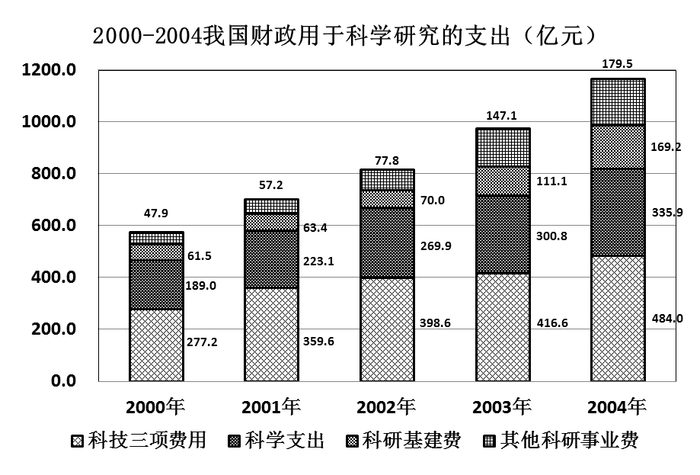

### 第 91 题

2000年至2004年中，科学支出首次超过300亿元的是：

A. 2001

B. 2002

C. 2003

D. 2004

第 91 题 · 答案与解析

**参考答案（粉笔题库参考内容）**

C

**解析**

定位图形，科学支出首次超过300亿元的为2003年。

故正确答案为C。

**考点**：直接找数、统计图

**来源**：2013年深圳市公务员录用考试《行测》题第91题

### 第 92 题

2001年我国财政用于科学研究的总支出比2000年增长了：

A. 137.6亿元

B. 约26.4%

C. 约26.9%

D. 约22.2%

第 92 题 · 答案与解析

**参考答案（粉笔题库参考内容）**

D

**解析**

根据“2001年······比2000年增长了”，结合选项，可判断此题为一般增长率问题。定位图形数据，2000年我国财政用于科学研究的总支出为277.2＋189＋61.5＋47.9＝575.6亿元；

2001年我国财政用于科学研究的总支出为359.6＋223.1＋63.4＋57.2＝703.3亿元；

故2001年比2000年增长了703.3－575.6＝127.7亿元，增长率 = 127.7/575.6 × 100%≈127.7/576 × 100%≈22%，与D项最接近。

故正确答案为D。

**考点**：一般增长率、统计图

**来源**：2013年深圳市公务员录用考试《行测》题第92题

### 第 93 题

2001年至2004年中，科研基建费和前一年相比，增长率最大的是：

A. 2001

B. 2002

C. 2003

D. 2004

第 93 题 · 答案与解析

**参考答案（粉笔题库参考内容）**

C

**解析**

根据题干“2001年至2004年中······和前一年相比，增长率最大的是······”，可判断本题为一般增长率比较问题。定位图形数据，可得：

2001年增长率：(63.4-61.5)/61.5 ≈ 2/62；

2002年增长率：(70 - 63.4)/63.4 ≈ 7/63；

2003年增长率：(111.1−70)/70 ≈ 41/70；

2004年增长率：(169.2−111.1)/111.1≈58/111。

观察发现，2001年和2002年增长率明显小于后两年，A、B项直接排除。又41/70 ≈ 58%，58/111 ＜ 58/100 = 58%，故2003年增长率最大。

故正确答案为C。

**考点**：一般增长率、统计图

**来源**：2013年深圳市公务员录用考试《行测》题第93题

### 第 94 题

2004年科技三项费用在总支出的比重和2000年相比：

A. 增加了约12.3个百分点

B. 增加了约4.9个百分点

C. 减少了约6.8个百分点

D. 减少了约8.8个百分点

第 94 题 · 答案与解析

**参考答案（粉笔题库参考内容）**

C

**解析**

根据题干“2004年科技三项费用在总支出的比重和2000年相比······”，可判断本题为两期比重问题。定位图形数据，可得2004年科技三项费用占总支出的比重约为484/(179.5 + 169.2 + 335.9 + 484)≈ 484/(180+170+336+484)=484/1170≈41%，2000年科技三项费用占总支出的比重约为277.2/575.6≈277.2/576≈48%。故2004年科技三项费用占总支出的比重和2000年相比下降了，排除选项A、B； 又41%-48%=-7%，即下降了约7个百分点，与C项最接近。

故正确答案为C。

**考点**：两期比重、统计图

**来源**：2013年深圳市公务员录用考试《行测》题第94题

### 第 95 题

下列说法正确的是：

A. 2004年，其他科研事业费所占比重是22.4%

B. 2004年与2003年相比，科研基建费的增长率低于科学研究总费用的增长率

C. 2000年至2004年科技三项费用占总支出的比重一直在下降

D. 2001年至2004年，我国用于科学支出的财政累计超过1100亿

第 95 题 · 答案与解析

**参考答案（粉笔题库参考内容）**

D

**解析**

A项：定位图形，2004年其他科研费为179.5亿元，占总费用的比重约为179.5/1170×100%≈15%，错误；

B项：定位图形，2004年科研基建费增长率为(169.2-111.1)/111.1 × 100% ≈ 58/110 × 100% ≈ 53%，科研总费用增长率约为[1170-(147.1+111.1+300.8+416.6)]/(147.1+111.1+300.8+416.6)×100%≈(1170-980)/980×100%=190/980×100%≈19%，故前者高于后者，错误；

C项：定位图形，2000年科技三项费用占总支出的比重约为277.2/575.6 × 100% ≈ 277.2/576 × 100% ≈ 48%，2001年科技三项费用占总支出的比重约为359.6/703.3 × 100% ≈ 359.6/700 × 100% ≈ 51%，故2000-2001年比重上升，错误；

D项：定位图形，2001—2004年科学支出的总额约为230＋270＋300＋340=1140亿元，累计超过1100亿，正确。

故正确答案为D。

**考点**：统计图、综合分析

**来源**：2013年深圳市公务员录用考试《行测》题第95题

## 材料 3

统计表：根据下面的统计表，回答它后面的5道题目。（单项选择题，5题，每题1.0分）

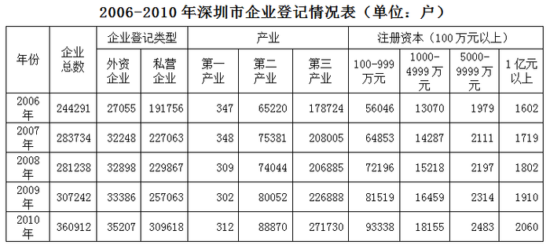

| 年份 | 企业总数 | 企业登记类型 外资企业 | 企业登记类型 私营企业 | 产业 第一产业 | 产业 第二产业 | 产业 第三产业 | 注册资本（100万元以上） 100-999万元 | 注册资本（100万元以上） 1000-4999万元 | 注册资本（100万元以上） 5000-9999万元 | 注册资本（100万元以上） 1亿元以上 |
| :--- | ---: | ---: | ---: | ---: | ---: | ---: | ---: | ---: | ---: | ---: |
| 2006年 | 244291 | 27055 | 191756 | 347 | 65220 | 178724 | 56046 | 13070 | 1979 | 1602 |
| 2007年 | 283734 | 32248 | 227063 | 348 | 75381 | 208005 | 64853 | 14287 | 2111 | 1719 |
| 2008年 | 281238 | 32898 | 229867 | 309 | 74044 | 206885 | 72196 | 15218 | 2197 | 1802 |
| 2009年 | 307242 | 33386 | 257063 | 302 | 80052 | 226888 | 81519 | 16459 | 2314 | 1910 |
| 2010年 | 360912 | 35207 | 309618 | 312 | 88870 | 271730 | 93338 | 18155 | 2483 | 2060 |

### 第 96 题

2006-2010年，深圳市三大产业中，企业数逐年增加的产业有多少个：

A. 0

B. 1

C. 2

D. 3

第 96 题 · 答案与解析

**参考答案（粉笔题库参考内容）**

A

**解析**

定位表格可以发现，三大产业中，企业数逐年增加的产业数为0，都在2008年出现了下滑。

故正确答案为A。

**考点**：直接找数、统计表

**来源**：2013年深圳市公务员录用考试《行测》题第96题

### 第 97 题

2007-2010年，深圳市企业登记总数增长率最高的是：

A. 2007

B. 2008

C. 2009

D. 2010

第 97 题 · 答案与解析

**参考答案（粉笔题库参考内容）**

D

**解析**

根据“2007-2010年，深圳市企业登记总数增长率最高的是······”，可判断此题为一般增长率比较问题。定位表格，可得：

2007年增长率 =(283734-244291)/244291≈ 40000/244291≈ 40/244 ≈ 16%；

2008年为下降；

2009年增长率 =(307242-281238)/281238≈26000/281238，结果发现与2007年相比，分子小，分母大，故分数值小，排除；

2010年增长率 =(360912−307242)/307242≈53000/307242≈ 53/307 ≈ 17%。

故2010年增长率最高。

故正确答案为D。

**考点**：一般增长率、统计表

**来源**：2013年深圳市公务员录用考试《行测》题第97题

### 第 98 题

2008-2010年，深圳市外资企业登记数年平均增长率约为：

A. 3.08%

B. 3.16%

C. 3.45%

D. 3.84%

第 98 题 · 答案与解析

**参考答案（粉笔题库参考内容）**

C

**解析**

根据“2008-2010年，深圳市外资企业登记数年平均增长率约为······”，可判断此题为年均增长率问题。由年均增长率的公式(1 + r)^n =末期值/初期值，定位表格数据，可得(1 + r)^2 =35207/32898，即1 + 2r + r^2=35207/32898。观察选项可知r较小，r^2值可忽略不计，即2r=(35207−32898)/32898≈2310/32900≈0.07，即r ≈ 0.035，与C项最接近。

故正确答案为C。

**考点**：年均增长率、统计表

**来源**：2013年深圳市公务员录用考试《行测》题第98题

### 第 99 题

2006-2010年，注册资本100万以上企业中，注册资本为100-999万元的企业所占比例最高的一项是：

A. 2006年

B. 2008年

C. 2009年

D. 2010年

第 99 题 · 答案与解析

**参考答案（粉笔题库参考内容）**

D

**解析**

根据“2006-2010年，注册资本100万以上企业中······所占比例最高的一项是······”，且时间与表格一致，可判断此题为现期比重问题。定位表格数据，可得注册资本100万以上企业中，注册资本为100-999万元的企业：

2006年所占比例56046/(56046+13070+1979+1602)=56046/72697≈560/727≈77%；

2008年所占比例72196/(72196+15218+2197+1802)=72196/91413≈72200/91400≈79%；

2009年所占比例81519/(81519+16459+2314+1910)= 81519/102202≈ 81500/102200≈79.7%；

2010年所占比例93338/(93338 + 18155 + 2483 + 2060)= 93338/116036≈ 93300/116000≈80.4%。

故所占比例最高的为2010年。

故正确答案为D。

**考点**：现期比重、统计表

**来源**：2013年深圳市公务员录用考试《行测》题第99题

### 第 100 题

根据上述统计表，以下说法不正确的是：

A. 私营企业在企业总数中所占比例逐年上升

B. 2006至2010年，注册资本1亿元以上企业平均每年增加115户

C. 2008年，三大产业企业登记数均呈负增长

D. 2009年，注册资本100万元以上企业登记数增长率为11.80%，增速比上年提高1.72%

第 100 题 · 答案与解析

**参考答案（粉笔题库参考内容）**

D

**解析**

A项：定位表格数据，可得私营企业在企业总数中：

2006年所占比例：191756/244291 ≈192/244 ≈ 79%；

2007年所占比例：227063/283734≈227/284 ≈ 80%；

2008年所占比例：229867/281238 ≈230/281≈82%；

2009年所占比例：257063/307242 ≈ 257/307≈84%；

2010年所占比例：309618/360912 ≈310/361≈86%。

故所占比例逐年上升，正确（该选项需大量计算，实际做题过程中可先从后面选项验证）；

B项：定位表格数据，可得2006-2010年，注册资本1亿元以上企业平均每年增加的数量为(2060−1602)/4=114.5，正确；

C项：定位表格数据可以得出，2008年三大产业企业登记数均同比下降，故均呈负增长，正确；

D项：定位表格数据，可得注册资本100万元以上企业登记数，2009年增长率为(81519+16459+2314+1910)/(72196+15218+2197+1802)-1= 102202/91413 − 1≈1022/914-1≈11.8%；2008年增长率为91413/(64853 + 14287 + 2111 + 1719)-1=91413/82970−1≈10.2%，故2009年比2008年同比提高了1.6个百分点，错误。

本题为选非题，故正确答案为D。

**考点**：统计表、综合分析

**来源**：2013年深圳市公务员录用考试《行测》题第100题

