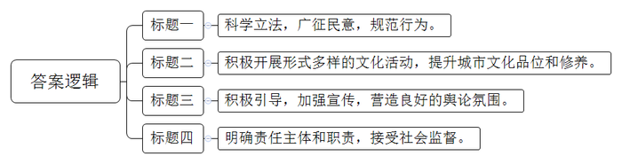
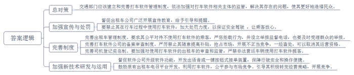
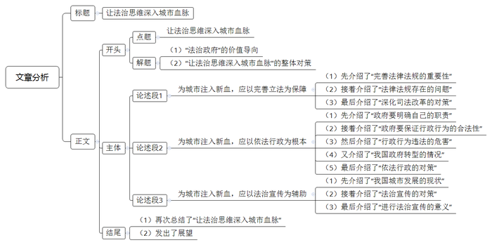

# 2014年深圳市公务员考试《申论》题

<!-- gwy:overview:start -->
> **深圳 · 2014 · 申论 · 统考** ｜ 3 题 · 图片 3 处 · 答案随题折叠

导航：[题目](#题目) · [材料 1](#材料-1)
<!-- gwy:overview:end -->

> 候选采集稿。参考答案及解析来自粉笔页面，不代表官方答案或真实高分答卷；来源使用许可与原卷对应关系仍需人工核实。

## 给定材料

### 材料 1

据《史记》记载，战国时期，商鞅在秦国实施变法之初，“令既具，未布，恐民之不信”，为树立法令的公信力，商鞅在都城市场南门立下一根三丈长的木柱，并发布告示：将木柱搬到北门者可得十金。老百姓不相信，没人去搬。于是，商鞅再次发布告示：将木柱搬到北门者可得五十金。这次，有一个人半信半疑地将木柱搬到了北门，商鞅立即付给他五十金，以示令出必行。此事很快就传遍了秦国，商鞅也因此赢得了老百姓的信任，随后就顺势颁布了一系列变法法令。

### 材料 2

李克强总理强调，对市场主体是法无禁止即可为，对政府则是法无授权不可为，这为打造法治政府指明了方向。最近，国务院要求各部门向社会公开目前保留的行政审批事项清单，以锁定行政审批项目“底数”，接受社会监督；各部门不得擅自新设行政审批事项，政府要向审批事项的“负面清单”管理方向迈进，逐步做到审批清单之外的事项，均由市场主体依法自行决定。截至2014年2月20日，75个国务院部门中，有47个部门公布了目前保留的行政审批事项，占总数的62.7%。

### 材料 3

马年春晚小品《扶不扶》引发了全国热议：扶，面临被讹诈风险；不扶，面临良心的拷问。不久前，在江苏泰兴街头，一名骑车女子倒在马路中央，路上车来车往，非常危险，好几个人看见了，但是没人上前。这时，一位开着奔驰的大叔刚好路过，他停下车来，先拍照取证，再将倒地女子扶到路边，面对记者采访，“奔驰大叔”坦言：“说实话，一开始也有些担心，救人时也要懂得保护自己。”

### 材料 4

近年来，救助人员被诬告的事件在全国各地时有发生，以至于不少人看到有人摔倒也不扶。为此，深圳专门出台了《深圳经济特区救助人权益保护规定》，旨在通过立法保护救助人合法权益，遏制救助行为中发生诬告陷害，恩将仇报的丑恶现象，弘扬助人为乐的正能量。该规定主要从无过错推定，举证责任等方面保护“活雷锋”。全文仅10条，不足700字，却是国内首部为保护救助人行为的专门立法，被网友称赞是“微规定，开先河，保义举”的“好人法”。

### 材料 5

有媒体对湖南某地一起因执法违法产生的行政赔偿案件进行了报道。村民宁某乘坐尹某无证驾驶的无牌照三轮摩托车赶集，车到镇农贸市场时，被运管所工作人员发现。为逃避检查，尹某当即驾车超速行驶，执法人员开车紧追，在追赶过程中三轮车发生侧翻，压在被甩出车外的宁某身上，致宁某重伤。宁某要求运管所赔偿遭拒后，依法提起诉讼。当地法院一审认定，运管所的执法行为违法，判令其赔偿宁某医疗费、残疾赔偿金等共计13.6万余元。

### 材料 6

最近，一条配有“南阳市卧龙区非正常上访训诫教育中心”图片的微博引发了网友关注。有媒体报道，除南阳外，驻马店、新乡、邓州等地均建有类似的“非正常上访训诫教育中心”，职能多为对非正常上访人员“进行24小时不间断训诫、警告和劝导教育”，被网友称为“新型劳教所”。很快，河南省政法委、信访局回应称，设立训诫中心的做法不符合法律规定，相关部门已发出通知，立即开展全省范围内的排查清理工作，并表示将认真总结反思，诚恳接受媒体和社会监督。

### 材料 7

为解决“行政执法尺度不一”的问题，深圳市福田区出台了《福田区行政处罚裁量权实施标准》，按照“自清行政处罚家底，自晒行政处罚清单，自限行政处罚权力”的原则，将区直19家行政执法单位的825项行政处罚事项，优化细化为2243项具体裁量标准。这些裁量标准通过多个网络平台公示，使公众对自己的行为有所预期，对他人违法行为的举报、投诉更精准，对相关执法部门的监督也能更全面、到位。

### 材料 8

某市对创建全国文明城市工作提出如下具体措施：

1.         。率先启动《文明行为促进条例》的立法工作，以立法形式对市民的文明行为进行规范，开展文明行为立法前期研究，举行专题会，确定立法主旨，提高立法的科学性。加快推进城市文明行为立法调研，通过听证会、论证会和座谈会等方式，充分听取利益相关群体、人大代表、专家学者以及广大市民意见，广泛收集民意。

2.         。广泛开展创建全国文明城市主题口号、格言、徽标征集活动，认真制定文明机关、文明单位、文明家庭、文明市民、文明学生准则。开展“我为创建文明城市做贡献”活动，精心组织好“关爱行动”、“读书月”、“百万市民讲外语”、“金秋艺术节”等深受群众喜爱的文化活动，提升城市文化品位。积极组织丰富多彩的广场文化、社区文化、校园文化、企业文化活动，以及诗词歌曲创作、文艺节目表演、演讲比赛、书法美术比赛等活动，提升市民文化素养。

3.         。各新闻单位要充分发挥舆论的先行导向作用，营造创建工作的良好舆论氛围，倡导自我提升、广泛参与、健康向上的文明生活方式，开辟“创建全国文明城市巡礼”专栏，及时总结报道各区、各部门、各单位、各社区以及居民家庭开展创建活动的新经验、新成果、新风尚，设立“百姓论坛”，了解群众呼声，报道创建中的社情民意，促进相关单位和个人及时改正，共塑城市文明形象。开设专题新闻栏目，发动广大市民举报、鞭笞社会上各种不文明行为，对一些隐患顽症、不良社会现象、消极应对等问题予以曝光，促进整改。

4.         。各级领导班子要围绕创建文明城市目标责任书，将创建任务分解，建立工作责任制，做到级级有指标、层层有任务、人人有责任。各相关部门要定期向社会公布创建工作进度，接受群众监督，设立群众接待日和热线电话，解决群众呼声强烈的各种问题。充分发挥人大、政协和新闻媒体的监督作用，促进创建工作落到实处。

### 材料 9

近期，“打车软件”引起社会广泛关注和争论，有的支持，有的反对。支持者认为，打车软件有很多好处：一是给乘客带来了方便和实惠；二是可以减少出租车空载，从而节约能源，降低成本，提高运力；三是在交通高峰时段或遇到恶劣天气，可以更容易打车；四是乘客议价、软件公司补贴等竞争行为体现了市场调节作用。反对者认为，打车软件存在的问题不容忽视：一是出租车司机在行车中不时低头查看手机，容易引发交通事故；二是不使用打车软件的乘客经常被拒载，有违公平；三是打车软件公司竞相提高补贴抢占市场，扰乱了市场秩序；四是违法营运车辆也会利用打车软件揽客，增加了监管难度；五是对原有出租车电召平台的运营带来冲击。目前，各地交通主管部门对出租车司机使用打车软件持不同态度，有的允许，有的禁止，还有的只允许在非交通高峰时段使用。

### 材料 10

原商务部郭某的落马，揭示了利用法规的制定和解释权谋取不当利益的贪腐链条：企业通过律师向官员行贿——官员与律师一起制定相关部门法规，利用专业知识塞入企业意向或者留下审批漏洞——企业向部门递交审批申请——官员授意企业去找特定律师——企业通过律师费的方式支付贿金——按照律师规划的路径并在官员的帮助下通过审批。有学者认为，相比以往的贪腐手段，在立法领域尤其是行政法规、规章的制定过程中，将企业利益法制化、部门利益法制化，是一种隐蔽性更强、危害更大的腐败方式，对此应给予高度的警惕和重视。

### 材料 11

近年来，司法公开的力度不断加强，到2012年底，全国已有600多家法院开设微博，2013上半年又新增了7个省级高等法院微博。同时，“微博庭审直播”让司法透明“飞入寻常百姓家”，打造了让群众满意的阳光司法“升级版”。2014年1月1日正式实施的《最高人民法院关于人民法院在互联网公布裁判文书的规定》明确要求，除法律有特殊规定的情形外，人民法院的生效裁判文书应当在互联网公布。并设立中国裁判文书网统一公布各级人民法院的生效裁判文书。

### 材料 12

2013年7月，中央政法委出台关于切实防止冤假错案的指导意见，意见要求应坚持疑罪从无原则，依法宣告被告人无罪，不能降格作出“留有余地”的判决；不能因舆论炒作，当事人及其亲属闹访或“限时破案”等压力，作出违反法律规定的裁判和决定；不能片面追求破案率、批捕率、起诉率、定罪率等指标。

### 材料 13

建设法治中国，必须深化司法体制改革，深圳在全国率先推出了法院工作人员分类管理和法官职业化改革。根据改革方案，法院工作人员被划分为法官、审判辅助人员和司法行政人员三大类，按照工作性质和岗位特点，各类人员实行不同管理制度，其中，法官按照法官职务序列进行管理，法官不得兼任司法行政岗位领导。这次改革标志着法官与行政级别脱钩，法官不再为竞职晋级而追求“官位”、挤占“官道”，从而真正打破了科级法官、处级法官的管理体制。

### 材料 14

近年来，我国企业主动起诉国外企业的案件开始增多，一些企业在涉外知识产权纠纷中取得胜诉或和解：深圳朗科诉美国PNY公司侵权案，最终以庭外和解方式维护了朗科的合法权益；北京赤东文化传媒公司起诉亚太传媒日本株式会社侵权播放中国电视剧一案，几经波折，中方最终获得胜诉；正泰集团股份公司诉施耐德电气低压(天津)有限公司“小型断路器”实用新型专利案以和解结束，正泰公司获得补偿金人民币1.575亿元。有学者表示：“中国企业从被动挨打到主动出击，说明我国企业对知识产权规则的运用程度明显提高。”

### 材料 15

2012年4月11日，浦东机场20名旅客因不满航班延误，冲入机场跑道拦截飞机，这是严重的危害公共安全的行为。然而，肇事旅客不仅没有受到任何处罚，反而还获得了1000元的赔偿。这一结果立即引起了社会热议，两天后，广州白云机场也出现了因航班延误而引发部分滞留旅客飞行控制区并走向滑行道的事件，其中一名旅客不听工作人员劝告强行走上停机坪和滑行道，并鼓动其他旅客效仿，白云机场公安局依法对旅客处以7天拘留。

### 材料 16

深圳市多部门联合开办的“深圳市公民法律知识大讲堂”围绕市委、市政府中心工作、民生热点开展法制宣传教育，向市民传播最急需的法律知识和信息。多年来，大讲堂已经成为市民提升个人法律素养的免费课堂，也是深圳普及法律知识、传播法制精神的重要平台，被评为“市民最满意活动项目”，《光明日报》将其誉为“一所没有围墙的法律大学”。

### 材料 17

2012年7月，《国务院关于支持深圳前海深港现代服务业合作区开发开放有关政策的批复》正式对外发布。推进前海开发开放，是中央从全局考虑作出的重大战略决策，也是深圳新时代市场化、法治化、国际化改革的一个“聚合点”。有学者认为，前海地区的开发开放，“软环境”建设至关重要，如果“软环境”不好，再减税企业也不会来，只有营造良好的营商环境和生活环境，提升社会管理和法治建设的水准，做好规划和制度设计，才能吸引更多高素质人才和大企业前来创业和发展。

### 材料 18

习近平同志在首都各界纪念现行宪法公布实施30周年大会上强调：“各级领导干部要提高运用法治思维和法治方式深化改革、推动发展、化解矛盾、维护稳定能力，努力推动形成办事依法、遇事找法、解决问题用法、化解矛盾靠法的良好法治环境，在法治轨道上推动各项工作。”十八届三中全会通过的《中共中央关于全面深化改革若干重大问题的决定》指出，要“坚持依法治理，加强法治保障，运用法治思维和法治方式化解社会矛盾”。

2013年12月，深圳市委召开全市加快建设一流法治城市工作会议，明确提出加强法治是一项全局性、战略性任务，要把建设一流法治城市作为深圳全面深化改革的“突破口”，开创经济特区新一轮改革开放新局面。

## 题目

### 第 1 题

**仔细阅读“材料8”，根据所给内容及各段联系，依次为标有下划线的四个段落拟标题。（20分）**

关联材料：材料 8

作答要求：

（1）文字精炼，用词准确；

（2）结构合理，有逻辑性；

（3）每个标题不超过30字，并标明段落序号。

第 1 题 · 答案与解析

**参考答案（粉笔题库参考内容）**

一、科学立法，广征民意，规范行为。

二、积极开展形式多样的文化活动，提升城市文化品位和修养。

三、积极引导，加强宣传，营造良好的舆论氛围。

四、明确责任主体和职责，接受社会监督。

**解析**

**参考答案说明：**一方面，本参考答案中的标题在形式、结构和字数上都符合题目要求；另一方面，标题1突出了“科学立法”这一主题词，标题2突出了“开展文化活动”这一主题词，标题3突出了“加强宣传引导”这一主题词，标题4突出了“明确责任主体和职责”这一主题词，所有标题都做到了主题突出。

**考点**：填空类

**来源**：2014年深圳市公务员考试《申论》题

### 第 2 题

**仔细阅读“材料9”，请就如何对待打车软件及其引发的问题，提出政策建议，并作简要说明，以供交通部门参考。（30分）**

关联材料：材料 9

作答要求：

（1）观点鲜明，内容具体；

（2）对策合理，有操作性；

（3）参考“材料9”，但不拘泥于“材料9”；

（4）不超过500字。

第 2 题 · 答案与解析

**参考答案（粉笔题库参考内容）**

交通部门应该建立和完善打车软件管理制度，依法加强对打车软件相关主体的监管，解决其存在的问题，使其更好地造福民众。

一、加强宣传与处罚。督促出租车公司广泛开展宣传教育，给予引导和提醒。要禁止其在行车过程中使用打车软件，加大处罚力度，以保证安全驾驶，让乘客放心。

二、完善制度。1.完善出租车管理制度。要求其公平对待不使用打车软件的乘客，严惩拒载行为，并设立举报监督电话，也要及时受理群众的举报。2.完善打车软件公司的备案审查制度。严厉禁止其随意提高补贴，抢占市场，开展不正当竞争，一经查处，可以取消其运营资格。3.完善司机登记实名制。要加强对使用打车软件的出租车的审查和监管，严禁非法营运车辆使用打车软件揽客。

三、加强新技术研发与运用。督促软件公司升级软件功能，开发出语音或一键按钮式接单装置，保障行驶安全和操作便捷。鼓励原有出租车电召平台开发、利用打车软件，公平参与市场竞争。引导其积极转变经营策略，开展竞争。

**解析**

**参考答案说明：**本答案先总体提出对策，接着从“加强宣传与处罚”“完善制度”“加强新技术研发与运用”这三个方面提出了具体建议，各条要点之间在内容上是并列关系，没有交叉。

**考点**：提出对策类

**来源**：2014年深圳市公务员考试《申论》题

### 第 3 题

**建设一流法治城市更需要注重法治思维的培养和运用，请参考“给定材料”，并结合你对法治思维的理解，以“让法治思维深入城市血脉”为题，写一篇文章。（50分）**

关联材料：材料 1、材料 2、材料 3、材料 4、材料 5、材料 6、材料 7、材料 8、材料 9、材料 10、材料 11、材料 12、材料 13、材料 14、材料 15、材料 16、材料 17、材料 18

作答要求：

（1）观点鲜明，紧扣主题，见解深刻；

（2）结构严谨，条理清晰，语言流畅；

（3）参考“给定材料”，但不拘泥于“给定材料”；

（4）字数1000字左右。

第 3 题 · 答案与解析

**参考答案（粉笔题库参考内容）**

**让法治思维深入城市血脉**

“对市场主体是法无禁止即可为，对政府则是法无授权不可为”李克强总理掷地有声的话语，标注出法治政府的价值导向。这就要求我们应该将法律作为解决问题和推进工作的准绳，营造崇尚法治、尊重法律，善于运用法律的良好氛围。**将法治思维的“新血”注入城市建设的躯体，融入到城市的建设发展中。**这是城市持续有序稳定发展的前提，更是我们奋斗的目标。

**为城市注入新血，应以完善立法为保障。**法治思维的深入人心，必然要以完善的法律法规为基础。正如深圳市专门出台的《深圳经济特区救助人权益保护规定》，被网友点赞，称为“好人法”，便是通过完善立法，保障了救助人群的合法利益，解决了群众“扶不扶”的困扰。但我国人治思想积弊已久，即便有法可依，部分工作人员仍然忽视程序正义，为提高工作效率违背法律规定，利用法规的制定和解释权谋取不当利益，进而形成贪腐链条。长此以往，势必引发法治乱象。因此，还应不断深化司法改革，实行政务公开，为社会大众监督提供便利。

**为城市注入新血，应以依法行政为根本。**政府一方面需要合理归位，扮演自己应该有的角色，实现政企分开，政事分开，向审批事项的“负面清单”管理方向迈进，做到不越位、不错位、不缺位。另一方面，要保证行政行为的目的、权限、手段等符合法律规定，杜绝执法违法等行为。正如许多地方设立训诫中心的做法就是一个典型的例子，阻碍了民意的表达，降低了政府的公信力。我国政府正处于转型升级的关键时期，由多年的“管控型”到今日的“服务型”需要一个过程，但政府作为市民榜样，必须转变行政方式，做到有法必依、执法必严、违法必究。

**为城市注入新血，应以法治宣传为辅助。**我国城市发展的速度日新月异，规模不断扩大，人口也在不断增加，但相关规则意识，文明意识却并未与时俱进。比如旅客因不满航班延误，拦截飞机，大闹机场，严重危害公共安全，便是法律意识的淡薄，公共意识的缺乏。为此，相关宣传部门应加大法治宣传教育力度，让法治观念深入人心。遵纪守法的城市环境可以保证市民安居乐业，可以吸引到优秀人才和企业，打造良好的营商环境，更可以助力法治中国的建立。

全面依法治国不断推进，法治无疑是社会最大的“底数”，也是社会发展的一大共识。进一步推进法治社会建设，将“依法行政”深入工作，将“完善立法”落实下去，将“法治意识”宣传教育，才能让法治思维深入城市血脉，打造一流法治城市，为全面深化改革打下坚实的基础。

**解析**

**文章分析**

**让法治思维深入城市血脉**

【**标题的优点：**严格按照题目的要求，以“让法治思维深入城市血脉”为标题。】

（1）“对市场主体是法无禁止即可为，对政府则是法无授权不可为”李克强总理掷地有声的话语，标注出法治政府的价值导向。（2）这就要求我们应该将法律作为解决问题和推进工作的准绳，营造崇尚法治、尊重法律，善于运用法律的良好氛围。**将法治思维的“新血”注入城市建设的躯体，融入到城市的建设发展中**。这是城市持续有序稳定发展的前提，更是我们奋斗的目标。

【**开头的优点：**★内容方面。范文的开头是紧扣题目给定的“让法治思维深入城市血脉”这一标题展开的。首先，开头即点出主题，做到了主题明确。其次，对“让法治思维深入城市血脉”这一主题进行了分析阐述，指出了（1）“法治政府”的价值导向。（2）“让法治思维深入城市血脉”的整体对策。注意以上两个方面的阐述在逻辑上有先后顺序：先写“法治政府”的价值导向，再写“让法治思维深入城市血脉”的整体对策，亮出文章的主要观点。★文字表达方面使用了拟人的修辞手法，使文字表达更加形象。】

**为城市注入新血，应以完善立法为保障。**（1）法治思维的深入人心，必然要以完善的法律法规为基础。正如深圳市专门出台的《深圳经济特区救助人权益保护规定》，被网友点赞，称为“好人法”，便是通过完善立法，保障了救助人群的合法利益，解决了群众“扶不扶”的困扰。（2）但我国人治思想积弊已久，即便有法可依，部分工作人员仍然忽视程序正义，为提高工作效率违背法律规定，利用法规的制定和解释权谋取不当利益，进而形成贪腐链条。长此以往，势必引发法治乱象。因此，（3）还应不断深化司法改革，实行政务公开，为社会大众监督提供便利。

【**论述段1的优点：**★观点句：范文的观点句是紧扣“让法治思维深入城市血脉”这一文章主题提出的。形式上，它在段首处直接写出，位置突出，容易发现。内容上，关键词突出，内容要点明确，可以明显看出它是从“立法、司法”的角度入手，指出了“完善立法是保障”。★论述内容：（1）先介绍了“完善法律法规的重要性”；（2）接着介绍了“法律法规存在的问题”；（3）最后介绍了“深化司法改革的对策”。注意：以上三个方面的内容都是紧扣“为城市注入新血，应以完善立法为保障”这个观点句进行分析论述的，论述的针对性强，内容层次丰富。最后，在论述方法和论据的选取上做到了讲道理、举例子相结合，做到了丰富多样。】

**为城市注入新血，应以依法行政为根本。**（1）政府一方面需要合理归位，扮演自己应该有的角色，实现政企分开，政事分开，向审批事项的“负面清单”管理方向迈进，做到不越位、不错位、不缺位。另一方面，（2）要保证行政行为的目的、权限、手段等符合法律规定，杜绝执法违法等行为。正如许多地方设立训诫中心的做法就是一个典型的例子，（3）阻碍了民意的表达，降低了政府的公信力。（4）我国政府正处于转型升级的关键时期，由多年的“管控型”到今日的“服务型”需要一个过程，（5）但政府作为市民榜样，必须转变行政方式，做到有法必依、执法必严、违法必究。

【**论述段2的优点：**★观点句：范文的观点句是紧扣“让法治思维深入城市血脉”这一文章主题提出的。形式上，它在段首处直接写出，位置突出，容易发现。内容上，关键词突出，内容要点明确，可以明显看出它是从“行政”这一角度入手，指出了“依法行政是根本”。★论述内容：（1）先介绍了“政府要明确自己的职责”；（2）接着介绍了“政府要保证行政行为的合法性”；（3）然后介绍了“行政行为违法的危害”；（4）又介绍了“我国政府转型的情况”；（5）最后介绍了“依法行政的对策”。注意：以上五个方面的内容都是紧扣“为城市注入新血，应以依法行政为根本”这个观点句进行分析论述的，论述的针对性强，内容层次丰富。最后，在论述方法和论据的选取上做到了讲道理、举例子相结合，做到了丰富多样。】

**为城市注入新血，应以法治宣传为辅助。**（1）我国城市发展的速度日新月异，规模不断扩大，人口也在不断增加，但相关规则意识，文明意识却并未与时俱进。比如旅客因不满航班延误，拦截飞机，大闹机场，严重危害公共安全，便是法律意识的淡薄，公共意识的缺乏。为此，（2）相关宣传部门应加大法治宣传教育力度，让法治观念深入人心。（3）遵纪守法的城市环境可以保证市民安居乐业，可以吸引到优秀人才和企业，打造良好的营商环境，更可以助力法治中国的建立。

【**论述段3的优点：**★观点句：范文的观点句是紧扣“让法治思维深入城市血脉”这一文章主题提出的。形式上，它在段首处直接写出，位置突出，容易发现。内容上，关键词突出，内容要点明确，可以明显看出它是从“宣传”这一角度入手，指出了“法治宣传是辅助”。★论述内容：（1）先介绍了“我国城市发展的现状”；（2）接着介绍了“法治宣传的对策”；（3）然后介绍了“法治宣传的意义”。注意：以上三个方面的内容都是紧扣“为城市注入新血，应以法治宣传为辅助”这个观点句进行分析论述的，论述的针对性强，内容层次丰富。最后，在论述方法和论据的选取上做到了讲道理、举例子相结合，做到了丰富多样。】

【**论述段之间的关系**：★内容的内在逻辑：范文的论述段之间是依照“并列”的逻辑展开的。论述段1先写了“为城市注入新血，应以完善立法为保障”，论述段2再写了“为城市注入新血，应以依法行政为根本”，论述段3接着写了“为城市注入新血，应以法治宣传为辅助”。★段与段的外在衔接：论述段2的段首处的“为城市注入新血，应以依法行政为根本”，起到了承接论述段1、引出了论述段2的作用。论述段3的段首处的“为城市注入新血，应以法治宣传为辅助”，起到了承接论述段2、引出了论述段3的作用。】

全面依法治国不断推进，法治无疑是社会最大的“底数”，也是社会发展的一大共识。进一步推进法治社会建设，将“依法行政”深入工作，将“完善立法”落实下去，将“法治意识”宣传教育，（1）才能让法治思维深入城市血脉，（2）打造一流法治城市，为全面深化改革打下坚实的基础。

【**结尾的优点：**范文的结尾回扣了“让法治思维深入城市血脉”这一主题。（1）再次总结了“让法治思维深入城市血脉”；（2）发出了展望。】

**考点**：文章写作题

**来源**：2014年深圳市公务员考试《申论》题

