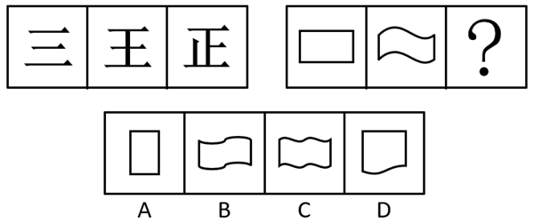
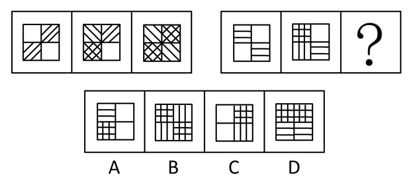
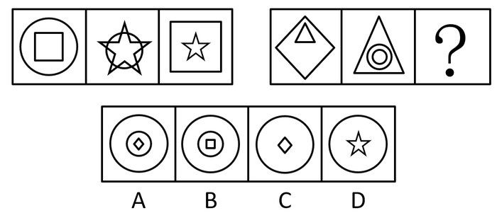
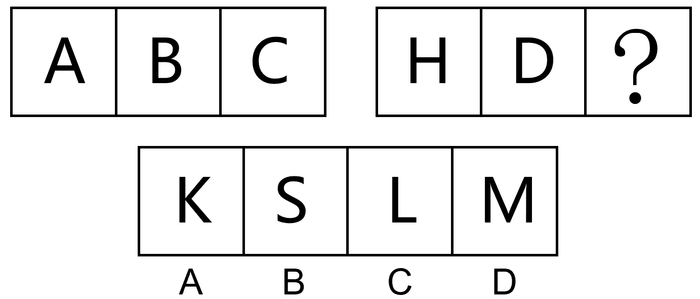
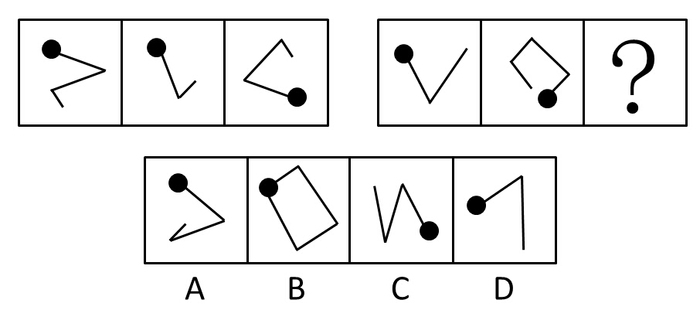
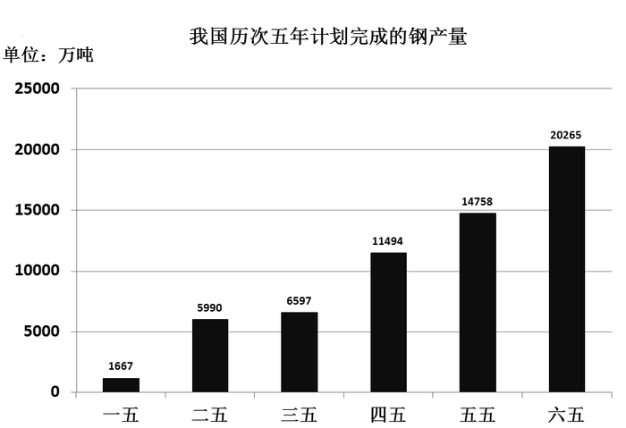
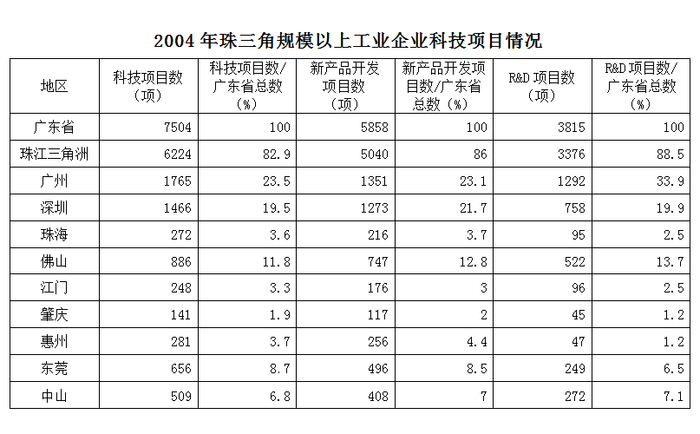

# 2014年深圳市公务员录用考试《行测》题

<!-- gwy:overview:start -->
> **深圳 · 2014 · 行测 · 统考** ｜ 100 题 · 图片 7 处 · 答案随题折叠

| 题型模块 | 题量 | 题号 |
| --- | ---: | ---: |
| 常识判断 | 20 | 1–20 |
| 判断推理 | 20 | 21–40 |
| 数量关系 | 15 | 41–55 |
| 言语理解与表达 | 30 | 56–85 |
| 资料分析 | 15 | 86–100 |
| **合计** | **100** | |

导航：[题型与作答说明](#题型与作答说明) · [题目](#题目) · [材料 1](#材料-1)
<!-- gwy:overview:end -->

> 候选采集稿。参考答案及解析来自粉笔页面，不代表官方答案或真实高分答卷；来源使用许可与原卷对应关系仍需人工核实。

## 题型与作答说明

常识判断

（20题）

根据题目要求，在四个选项中选出一个正确答案。

判断推理

（20题）

本部分包括图形推理、事件排序、判断与推理三种类型的试题。

数量关系

（15题）

本部分包括数字推理与数学运算两种类型的题目。

言语理解与表达

（30题）

每道题给出一段文字，从四个选项中选出一个最恰当的答案。

资料分析

（15题）

针对下列图、表或文字回答问题。你应该根据资料提供的信息进行分析、比较、计算、处理。

## 题目

### 第 1 题

社会主义初级阶段理论提出的历史依据是：

A. 我国的基本国情

B. 马克思列宁主义

C. 我国社会主义脱胎于近代半殖民地半封建社会

D. 我国生产力发展的低水平和不均衡

第 1 题 · 答案与解析

**参考答案（粉笔题库参考内容）**

C

**解析**

社会主义初级阶段理论提出的主要依据有：一是历史依据，即我国社会主义社会脱胎于近代半封建半殖民地社会；二是现实依据，即我国的基本国情。

故正确答案为C。

**考点**：新思想总论

**来源**：2014年深圳市公务员录用考试《行测》题第1题

### 第 2 题

党的先进性，归根到底要看：

A. 党在解放生产力、发展生产力中的作用

B. 党在维护和实现最广大人民根本利益中的作用

C. 党在推动先进文化中的作用

D. 党在推动历史前进中的作用

第 2 题 · 答案与解析

**参考答案（粉笔题库参考内容）**

D

**解析**

党的十六大报告指出：党的先进性是具体的、历史的，必须放到推动当代中国先进生产力和先进文化的发展中去考察，放到维护和实现最广大人民根本利益的奋斗中去考察，归根到底要看党在推动历史前进中的作用。

故正确答案为D。

**考点**：其他建设

**来源**：2014年深圳市公务员录用考试《行测》题第2题

### 第 3 题

根据相关法律法规，下列各类经济组织，无需对自身债务承担无限责任的是：

A. 甲、乙、丙三人合伙开办的律师事务所

B. 小丽在服装市场租下店铺注册成立的服装个体工商户

C. Z是国有独资钢铁制造公司

D. 小王个人注册登记的从事电子贸易的独资企业

第 3 题 · 答案与解析

**参考答案（粉笔题库参考内容）**

C

**解析**

A项错误，根据《合伙企业法》第二条第二三款规定：“普通合伙企业由普通合伙人组成，合伙人对合伙企业债务承担无限连带责任。本法对普通合伙人承担责任的形式有特别规定的，从其规定。有限合伙企业由普通合伙人和有限合伙人组成，普通合伙人对合伙企业债务承担无限连带责任，有限合伙人以其认缴的出资额为限对合伙企业债务承担责任。”

B项错误，根据《民法典》第五十六条规定：“个体工商户的债务，个人经营的，以个人财产承担；家庭经营的，以家庭财产承担；无法区分的，以家庭财产承担。农村承包经营户的债务，以从事农村土地承包经营的农户财产承担；事实上由农户部分成员经营的，以该部分成员的财产承担。”

C项正确，国有独资公司是指国家单独出资、由国务院或者地方人民政府授权本级人民政府国有资产监督管理机构履行出资人职责的有限责任公司。国有独资公司符合有限责任公司的一般特征：股东以其出资额为限对公司承担责任，公司以其全部法人财产对公司的债务承担责任。

D项错误，根据《个人独资企业法》第二条规定：“本法所称个人独资企业，是指依照本法在中国境内设立，由一个自然人投资，财产为投资人个人所有，投资人以其个人财产对企业债务承担无限责任的经营实体。”

故正确答案为C。

**考点**：其他法律法规

**来源**：2014年深圳市公务员录用考试《行测》题第3题

### 第 4 题

。是国家发展战略的核心，是提高综合国力的关键。要坚持走中国特色自主创新道路，把增强自主创新能力贯彻到现代化建设各个方面：

A. 提高自主创新能力，建设创新型国家

B. 加快转变经济发展方式，推动产业结构优化升级

C. 加强能源资源节约和生态环境保护，增强可持续发展能力

D. 独立自主、自力更生，注重速度、结构、质量和效益的统一

第 4 题 · 答案与解析

**参考答案（粉笔题库参考内容）**

A

**解析**

党的十七大报告指出：提高自主创新能力，建设创新型国家，这是国家发展战略的核心，是提高综合国力的关键。要坚持走中国特色自主创新道路，把增强自主创新能力贯彻到现代化建设各个方面。认真落实国家中长期科学和技术发展规划纲要，加大对自主创新的投入，着力突破制约经济社会发展的关键技术。

故正确答案为A。

**考点**：经济建设

**来源**：2014年深圳市公务员录用考试《行测》题第4题

### 第 5 题

根据《公务员法》的相关规定，下列哪个不属于公务员在机关外兼职应符合的条件：

A. 因工作需要

B. 非领导职务公务员

C. 经有关机关批准

D. 不领取兼职报酬

第 5 题 · 答案与解析

**参考答案（粉笔题库参考内容）**

B

**解析**

《中华人民共和国公务员法》第四十四条规定：“公务员因工作需要在机关外兼职，应当经有关机关批准，并不得领取兼职报酬。”对应A、C、D项。

本题为选非题，故正确答案为B。

**考点**：行政法

**来源**：2014年深圳市公务员录用考试《行测》题第5题

### 第 6 题

2013年11月15日，《中共中央关于全面深化改革若干重大问题的决定》发布，《决定》明确了（ ）是全面深化改革的重点。

A. 政府职能改革

B. 宏观调控体系改革

C. 行政体制改革

D. 经济体制改革

第 6 题 · 答案与解析

**参考答案（粉笔题库参考内容）**

D

**解析**

《中共中央关于全面深化改革若干重大问题的决定》表明经济体制改革是全面深化改革的重点，核心问题是处理好政府和市场的关系，使市场在资源配置中起决定性作用和更好发挥政府作用。

故正确答案为D。

**考点**：经济建设、重要文件

**来源**：2014年深圳市公务员录用考试《行测》题第6题

### 第 7 题

深圳市成海公司是一家依法成立的有限责任公司，在成海公司，（ ）机构有权决定公司的经营方针：

A. 董事长

B. 董事会

C. 监事会

D. 股东会

第 7 题 · 答案与解析

**参考答案（粉笔题库参考内容）**

D

**解析**

股东会是公司的权力机构，行使下列职权：

（一）决定公司的经营方针和投资计划；

（二）选举和更换非由职工代表担任的董事、监事，决定有关董事、监事的报酬事项；

（三）审议批准董事会的报告；

（四）审议批准监事会或者监事的报告；

（五）审议批准公司的年度财务预算方案、决算方案；

（六）审议批准公司的利润分配方案和弥补亏损方案；

（七）对公司增加或者减少注册资本作出决议；

（八）对发行公司债券作出决议；

（九）对公司合并、分立、解散、清算或者变更公司形式作出决议；

（十）修改公司章程；

（十一）公司章程规定的其他职权。

故正确答案为D。

**考点**：市场经济

**来源**：2014年深圳市公务员录用考试《行测》题第7题

### 第 8 题

紧缩性财政政策的功能在于：

A. 实现社会总供给与总需求的基本平衡

B. 抑制社会总需求的增长

C. 增加财政收入

D. 减少财政支出

第 8 题 · 答案与解析

**参考答案（粉笔题库参考内容）**

B

**解析**

紧缩性财政政策是宏观财政政策的类型之一，是指通过增加财政收入或减少财政支出以抑制社会总需求增长的政策。由于增收减支的结果集中表现为财政结余，因此，紧缩性财政政策也称盈余性财政政策。紧缩性财政政策的功能是抑制社会总需求的增长，从而抑制通货膨胀。

故正确答案为B。

**考点**：宏观经济与调控政策

**来源**：2014年深圳市公务员录用考试《行测》题第8题

### 第 9 题

广东省司法厅对深圳市司法局的监督属于：

A. 职能监督

B. 主管监督

C. 司法监督

D. 审计监督

第 9 题 · 答案与解析

**参考答案（粉笔题库参考内容）**

B

**解析**

A项错误，职能监督是由职能部门依据法律赋予的职能而实行的监督，监督部门与被监督部门可能没有行政隶属关系。

B项正确，主管监督是具有行政隶属关系的上级部门对下级部门的监督，广东省司法厅和深圳市司法局具有行政隶属关系，所以应该是主管监督。

C项错误，司法监督是指司法机关通过司法手段和司法程序对国家行政机关及其工作人员的行政行为的监督与限制。

D项错误，审计监督是指设在各级政府内部的专门监督机构，即审计机关依法对各级行政机关及其工作人员、国有的金融机构和企事业组织等在进行财政、财务活动过程中是否坚持依法办事和廉洁奉公所实施的监督。

故正确答案为B。

**考点**：政治建设

**来源**：2014年深圳市公务员录用考试《行测》题第9题

### 第 10 题

将行政领导体制划分为层级制与职能制的依据在于：

A. 行政领导机关中决策人数多少的不同

B. 行政领导体系中各层级领导机关与领导者职权的集中与分散程度的不同

C. 行政领导体系内部各机构的职权性质与范围的不同

D. 上级行政领导机关对下级行政领导机关的指挥、控制方式与程度的不同

第 10 题 · 答案与解析

**参考答案（粉笔题库参考内容）**

C

**解析**

行政领导体制纷繁复杂，按照不同的标准可以划分为不同的类型：

（1）集权制与分权制。根据领导系统中各层级领导机关与领导者职责权限的集中与分散程度的不同，将行政领导体制划分为集权制与分权制。

（2）一长制与委员会制。根据行政领导机关中决策人数多少的不同，将行政领导体制划分为一长制与委员会制。

（3）完整制与分离制。根据上级行政领导机关对下级行政领导机关的指挥、控制方式与程度的不同，将行政领导体制划分为完整制与分离制。

（4）层级制与职能制。根据行政领导体系内部各机构的职权性质与范围的不同，将行政领导体制划分为层级制与职能制。

故正确答案为C。

**来源**：2014年深圳市公务员录用考试《行测》题第10题

### 第 11 题

下列公文用语中，有歧义的一项是：

A. 节假日期间，各地区、各部门要妥善安排好值班和安全、保卫等工作

B. 市纪委决定严厉打击少数违规违纪公务人员

C. 以上意见如可行，建议批转×××办理

D. 你单位《关于开展2014年文化大讲堂系列讲座活动的请示》收悉，现批复如下

第 11 题 · 答案与解析

**参考答案（粉笔题库参考内容）**

B

**解析**

B项可以有两种理解：一是打击的对象是违规违纪的公务人员，这一部分人只占整个公务队伍的少数；二是打击的对象是违规违纪的公务人员中的少数人，因而有歧义。

故正确答案为B。

**来源**：2014年深圳市公务员录用考试《行测》题第11题

### 第 12 题

2013年12月15日，嫦娥三号着陆器与巡视器即（ ）月球车成功分离，并顺利完成互拍。中国探月工程总指挥马兴瑞宣布，嫦娥三号任务取得圆满成功。

A. 揽月号

B. 登月号

C. 月兔号

D. 玉兔号

第 12 题 · 答案与解析

**参考答案（粉笔题库参考内容）**

D

**解析**

2013年12月15日4时35分，嫦娥三号着陆器与巡视器（“玉兔号”月球车）成功分离，登陆月球后玉兔号月球车将开展3个月巡视勘察。

故正确答案为D。

**考点**：科技理论与成就

**来源**：2014年深圳市公务员录用考试《行测》题第12题

### 第 13 题

循环经济应遵循的原则不包括：

A. 减量化原则

B. 高利用原则

C. 再使用原则

D. 再循环原则

第 13 题 · 答案与解析

**参考答案（粉笔题库参考内容）**

B

**解析**

循环经济主要有三大原则，即“减量化、再使用、资源化（即再循环）”原则，每一原则对循环经济的成功实施都是必不可少的。

故正确答案为B。

**考点**：宏观经济与调控政策

**来源**：2014年深圳市公务员录用考试《行测》题第13题

### 第 14 题

下列元素，空气中含量最多的是：

A. 氧

B. 氖

C. 氦

D. 氮

第 14 题 · 答案与解析

**参考答案（粉笔题库参考内容）**

D

**解析**

空气中含量最多的气体是氮气，约占空气体积的78%。氧气占21%，稀有气体占0.94%，二氧化碳占0.03%，水和杂质占0.03%。

故正确答案为D。

**考点**：化学常识

**来源**：2014年深圳市公务员录用考试《行测》题第14题

### 第 15 题

在香港回归15周年之际，中央政府制定一系列政策措施，加强内地与香港的合作，措施包括赋予深圳          深港现代服务业合作区优惠的税收政策，实行比经济特区更加特殊的先行先试政策。

A. 盐田

B. 赤湾

C. 前海

D. 蛇口

第 15 题 · 答案与解析

**参考答案（粉笔题库参考内容）**

C

**解析**

在香港回归祖国15周年之际，中央政府制定一系列政策措施，加强内地与香港合作，进一步支持香港经济社会发展。措施包括赋予深圳前海深港现代服务业合作区优惠的税收政策，实行比经济特区更加特殊的先行先试政策。

故正确答案为C。

**考点**：经济建设

**来源**：2014年深圳市公务员录用考试《行测》题第15题

### 第 16 题

马克思主义产生的阶级基础是：无产阶级和资产阶级的矛盾上升为社会的主要矛盾，无产阶级开始作为          政治力量登上历史舞台。

A. 独立的

B. 分散的

C. 暂时依附于资产阶级的

D. 有组织的、团结的

第 16 题 · 答案与解析

**参考答案（粉笔题库参考内容）**

A

**解析**

马克思主义产生的阶级基础：无产阶级的产生和发展（三大工人武装起义：法国里昂工人起义、英国宪章运动、德国西里西亚纺织工人起义，标志无产阶级已经作为一支独立的政治力量登上历史舞台）。

故正确答案为A。

**考点**：科学社会主义

**来源**：2014年深圳市公务员录用考试《行测》题第16题

### 第 17 题

下列关于国体与政体的说法，错误的是：

A. 国体决定政体，政体体现国体

B. 中国的国体为人民民主专政

C. 中国的政体是人民代表大会制度

D. 常见的资本主义国家国体的种类有总统制、议会制

第 17 题 · 答案与解析

**参考答案（粉笔题库参考内容）**

D

**解析**

国体即国家性质，也就是哪个阶级占统治地位，资本主义国家的国体是资产阶级专政，总统制、议会制都属于资本主义国家的政体，而非国体。

本题为选非题，故正确答案为D。

**考点**：宪法

**来源**：2014年深圳市公务员录用考试《行测》题第17题

### 第 18 题

市场交易中不准缺斤少两、以次充好、降低服务标准。这属于市场管理内容中对         的管理。

A. 市场主体

B. 市场客体

C. 市场价格

D. 市场经营活动和竞争方式

第 18 题 · 答案与解析

**参考答案（粉笔题库参考内容）**

D

**解析**

市场交易中不准缺斤少两、以次充好、降低服务标准，属于市场管理内容中对市场经营活动和竞争方式的管理。

故正确答案为D。

**考点**：市场经济

**来源**：2014年深圳市公务员录用考试《行测》题第18题

### 第 19 题

2014年3月3日下午，十二届全国人大二次会议广东代表团在北京正式成立，（ ）被推选为代表团团长。

A. 朱小丹

B. 徐少华

C. 肖志雄

D. 黄龙云

第 19 题 · 答案与解析

**参考答案（粉笔题库参考内容）**

D

**解析**

2014年3月3日下午，参与十二届全国人大二次会议的广东代表团在驻地举行全体会议，正式成立十二届全国人大二次会议广东代表团。会议推选代表团团长、副团长，经表决通过，黄龙云为广东代表团团长，朱小丹、徐少华、肖志恒、雷于蓝为副团长。

故正确答案为D。

**考点**：其他建设

**来源**：2014年深圳市公务员录用考试《行测》题第19题

### 第 20 题

下列叙述中，不正确的是：

A. 第22届冬季奥林匹克运动会开幕式在俄罗斯索契举行

B. 日前，世界最大规模的比特币交易所因交易平台遭到网络攻击，比特币被盗一空而破产

C. 泰国反政府集会领导人素贴2月底宣布反对派对首都曼谷的“封城”行动将无限期持续，直至推翻英拉政府

D. 韩国总统朴槿惠在“三一”运动95周年纪念大会上敦促日本政府正视历史，承认错误

第 20 题 · 答案与解析

**参考答案（粉笔题库参考内容）**

C

**解析**

泰国反政府集会领导人素贴于2014年2月28日晚宣布，将结束“封锁曼谷”行动，把曼谷所有集会人群都合并到隆披尼公园，但他同时表示包围政府部门和西那瓦家族企业的行动还将继续，C项与之不符。

本题为选非题，故正确答案为C。

**考点**：时事政治-其他

**来源**：2014年深圳市公务员录用考试《行测》题第20题

### 第 21 题

从所给四个选项中，选择最合适的一个填入问号处，使之呈现一定的规律性的是：

A. A

B. B

C. C

D. D

第 21 题 · 答案与解析

**参考答案（粉笔题库参考内容）**

B

**解析**

元素组成不同，属性无明显规律，考虑数量规律。观察发现，第一组图横线数均为3，竖线数为0、1、2；第二组竖线数均为2，横着的曲线数为0、2、？，问号处应该是有4条横着的曲线的图形，只有B项符合。

故正确答案为B。

**考点**：数量规律-线、文字/字母/数字类

**来源**：2014年深圳市公务员录用考试《行测》题第21题

### 第 22 题

从所给四个选项中，选择最合适的一个填入问号处，使之呈现一定的规律性：

A. A

B. B

C. C

D. D

第 22 题 · 答案与解析

**参考答案（粉笔题库参考内容）**

B

**解析**

前一串图形中白色和左下方倾斜的阴影数均依次是2,1,0，十字交叉和右下方倾斜的阴影数均依次是0，1，2。后一串图形中白色和横线阴影数均依次是2，1，0。方格阴影和竖线阴影数均依次是0，1，2。按照这种规律，问号处为B选项。

故正确答案为B。

**考点**：数量规律-素

**来源**：2014年深圳市公务员录用考试《行测》题第22题

### 第 23 题

请从下面的四个选项中，选择最合适的一项填在问号处，使右边图形的变化规律与左边图形一致：

A. A

B. B

C. C

D. D

第 23 题 · 答案与解析

**参考答案（粉笔题库参考内容）**

A

**解析**

本题的考点为元素叠加运算。左侧图形中，前两个图形去同存异，得到由“☆”和“□”组成的第三个图形。按照这种规律，第二组图形去同存异，得到由“◎”和“◇”组成的第三个图形。

故正确答案为A。

**考点**：样式规律-加减同异

**来源**：2014年深圳市公务员录用考试《行测》题第23题

### 第 24 题

请从所给的四个选项中，选择最合适的一项填在问号处，使之呈现一定的规律性：

A. A

B. B

C. C

D. D

第 24 题 · 答案与解析

**参考答案（粉笔题库参考内容）**

B

**解析**

本题考点为图形属性中的曲直性，元素组成凌乱是判断该考点的依据。第一组图形中，“A”由直线构成；“B”由曲线+直线构成；“C”是曲线。第二组图形中，“H”由直线构成；“D”由曲线+直线构成。按照第一组的构成规律，问号处应是曲线构成的。

故正确答案为B。

**考点**：属性规律-曲直性、文字/字母/数字类

**来源**：2014年深圳市公务员录用考试《行测》题第24题

### 第 25 题

从所给四个选项中，选择最合适的一个填入问号处，使之呈现一定的规律性：

A. A

B. B

C. C

D. D

第 25 题 · 答案与解析

**参考答案（粉笔题库参考内容）**

D

**解析**

解法一：元素组成不同，且无明显属性规律，考虑数量规律。观察发现，第一组图直线数分别为3、2、3，相加之和为8，第二组前两幅图直线数分别为2、4，故？处应选择一个直线数为2的图形，只有D项符合。

解法二：元素组成不同，且无明显属性规律，考虑数量规律。观察发现，第一组图交点数分别为2、1、2，相加之和为5，第二组前两幅图交点数分别为1、3，故？处应选择一个交点数为1的图形，只有D项符合。

故正确答案为D。

**考点**：数量规律-线、数量规律-点

**来源**：2014年深圳市公务员录用考试《行测》题第25题

### 第 26 题

（1）天下兴亡，匹夫有责

（2）鞠躬尽瘁，死而后已

（3）人生自古谁无死，留取丹心照汗青

（4）海纳百川，有容乃大；壁立千仞，无欲则刚

（5）业精于勤，荒于嬉；行成于思，毁于随

将以上5个句子重新排列，语序正确的是：

A. 3-5-2-1-4

B. 2-3-5-4-1

C. 2-5-3-1-4

D. 3-2-5-4-1

第 26 题 · 答案与解析

**参考答案（粉笔题库参考内容）**

C

**解析**

本题考查年代前后顺序。顾炎武（1613年—1682年）明朝南直隶苏州府昆山人，著名思想家、史学家、语言学家，与黄宗羲、王夫之并称为明末清初三大儒。他提出了“天下兴亡，匹夫有责”的响亮口号。诸葛亮（181年－234年），字孔明，号卧龙，徐州琅琊阳都人，三国时期蜀汉丞相，杰出的政治家、军事家、散文家、书法家、发明家。“鞠躬尽瘁，死而后已”出自三国蜀国诸葛亮《后出师表》。文天祥（1236年－1283年），字宋瑞，又字履善。自号文山、浮休道人。江西吉州庐陵人，宋末政治家、文学家，爱国诗人，抗元名臣，与陆秀夫、张世杰并称为“宋末三杰”。“人生自古谁无死，留取丹心照汗青”出自文天祥的《过零丁洋》。林则徐（1785年－1850年），福建省侯官人，字元抚，晚号俟村老人、俟村退叟、七十二峰退叟、瓶泉居士、栎社散人等，是中国清朝后期政治家、思想家和诗人。“海纳百川，有容乃大；壁立千仞，无欲则刚”。此联为清末政治家林则徐任两广总督时在总督府衙题书的堂联。韩愈（768年-824年），字退之，唐代文学家、思想家、政治家，汉族，河南河阳人，晚年任吏部侍郎，谥号“文”，又称韩文公，唐宋八大家之一，有“文起八代之衰”的美誉。“业精于勤，荒于嬉；行成于思，毁于随”。出自韩愈的《进学解》。所以按照时间先后的排序应该是2-5-3-1-4。

故正确答案为C。

**来源**：2014年深圳市公务员录用考试《行测》题第26题

### 第 27 题

（1）出现了电子管数字计算机

（2）大规模集成电路数字计算机问世

（3）使用晶体管数字计算机

（4）使用计算器

（5）发明集成电路数字计算机

A. 1-4-5-3-2

B. 1-5-4-2-3

C. 4-1-3-5-2

D. 4-5-3-1-2

第 27 题 · 答案与解析

**参考答案（粉笔题库参考内容）**

C

**解析**

本题考查时间前后顺序。1642年,年仅19岁的法国伟大科学家帕斯卡引用算盘的原理,发明了第一部机械式计算器。1946年2月14号（ENIAC）艾尼克问世，标志着世界第一台电子管数字计算机问世。英国年轻的企业家、发明家克里夫·辛克莱，1972年发明电子计算机。第2代计算机：晶体管数字计算机（1958—1964年）。第3代计算机：集成电路数字计算机（1964—1970年）。第4代计算机：大规模集成电路计算机（1970年至今）。

故正确答案为C。

**来源**：2014年深圳市公务员录用考试《行测》题第27题

### 第 28 题

（1）不注意打坏商品

（2）不得已买下商品

（3）拒绝并走开

（4）吃完饭在超市闲逛

（5）推销员前来推销商品

A. 1-4-5-3-2

B. 1-5-4-2-3

C. 4-1-3-5-2

D. 4-5-3-1-2

第 28 题 · 答案与解析

**参考答案（粉笔题库参考内容）**

D

**解析**

本题考查时间前后顺序。首先浏览选项，按常理应该先吃完饭在超市闲逛，才能有推销员上前来推销商品，然后拒绝并走开，期间不注意打坏商品，导致不得已买下商品。

故正确答案为D。

**来源**：2014年深圳市公务员录用考试《行测》题第28题

### 第 29 题

（1）伯乐立即判断，这是一匹难得的骏马

（2）伯乐受楚王的委托，购买能日行千里的骏马

（3）跑了好几个国家，还是没发现中意的良马

（4）看到一匹马拉着盐车，很吃力地在陡坡上行进

（5）马见伯乐走近，突然昂起头来瞪大眼睛，大声嘶鸣

A. 1-2-3-4-5

B. 2-3-4-5-1

C. 3-2-4-1-5

D. 4-2-3-5-1

第 29 题 · 答案与解析

**参考答案（粉笔题库参考内容）**

B

**解析**

本题考查时间前后顺序。首先浏览选项，应该是伯乐受楚王的委托，购买能日行千里的骏马，然后跑了好几个国家，还是没发现中意的良马，这时看到一匹马拉着盐车，很吃力地在陡坡上行进，马见伯乐走近，突然昂起头来瞪大眼睛，大声嘶鸣，伯乐立即判断，这是一匹难得的骏马。所以正确顺序为2-3-4-5-1。

故正确答案为B。

**来源**：2014年深圳市公务员录用考试《行测》题第29题

### 第 30 题

（1）身体不舒服（2）病情好转（3）接受治疗（4）医院检查（5）康复（ ）。

A. 1-3-5-2-4

B. 1-4-3-2-5

C. 1-5-4-2-3

D. 1-3-4-5-2

第 30 题 · 答案与解析

**参考答案（粉笔题库参考内容）**

B

**解析**

第一步：给出解题思路。

题干主要描述生病至痊愈的过程，利用事件前后因果关系进行排序即可。

第二步：逐一判断选项。

A项，病情好转后才会康复，2应在5前。该项逻辑错误，应排除。

B项，身体不舒服后，到医院去检查，再接受治疗，进而病情好转，最后康复。该项逻辑正确，应选。

C项，病情好转后才会康复，2应在5前。该项逻辑错误，应排除。

D项，病情好转后才会康复，2应在5前。该项逻辑错误，应排除。

故正确答案为B。

**来源**：2014年深圳市公务员录用考试《行测》题第30题

### 第 31 题

据统计显示，某市人口发病率在前三名的是咽炎、高血压、糖尿病。其中，高血压和糖尿病的发病率随着年龄的增长而增加，而咽炎在各个年龄段的发病率没有明显的不同，该市在未来10年间，老年人人口比例将呈明显上升态势。

根据题干提供的信息，以下推断最为恰当的是：

A. 10年后，发病率最高的将是高血压

B. 10年后，发病率最高的将仍是咽炎

C. 在未来10年间，咽炎患者的平均年龄将增大

D. 10年后，咽炎的老年患者将多于非老年患者

第 31 题 · 答案与解析

**参考答案（粉笔题库参考内容）**

C

**解析**

本题考查逻辑推理里面的归纳结论。从“而咽炎在各个年龄段的发病率没有明显的不同，该市在未来10年间，老年人人口比例将呈明显上升态势”这句话可以推出C选项。

A、B两项出现最高，推不出来，排除。D项文中未提及非老年患者，排除。

故正确答案为C。

**考点**：日常结论

**来源**：2014年深圳市公务员录用考试《行测》题第31题

### 第 32 题

一起诈骗案经过侦查将目标锁定在赵、李二人身上，赵、李二人都可能是诈骗犯或目击者。已知诈骗犯只说假话，而目击者则只说真话，审讯人员问赵：“你们两人中肯定有一个是目击者？”赵回答：“没有。”

则赵和李分别是：

A. 赵是目击者，李是诈骗犯

B. 赵和李都是目击者

C. 赵是诈骗犯，李是目击者

D. 赵和李都是诈骗犯

第 32 题 · 答案与解析

**参考答案（粉笔题库参考内容）**

C

**解析**

本题考查真假推理。题干中无法明确得知真假信息，可以采用假设法。假设赵是目击者，则他的回答是真的，即赵、李两人中没有一个是目击者，即赵、李都是诈骗犯，与假设矛盾，则假设不成立；赵是诈骗犯，那么赵说假话，即赵、李中有一个是目击者，则李为目击者。

故正确答案为C。

**考点**：假设

**来源**：2014年深圳市公务员录用考试《行测》题第32题

### 第 33 题

近年来，尤其在一线城市，购买一手新房而非二手房的购房者的比例已经下跌了，部分购房者认为这缘于一手新房价格的上涨。作为价格上涨的依据，他们利用数据证明，即使通过通货膨胀调整，一手新房购买者所付的购房款也远远高于几年前的房价。下列选项中，最能说明上述购房者的论断缺乏说服力的是（ ）。

A. 购买的新房的价值下降得比二手房的价值快得多

B. 新房的购买者比例的下降一定表示二手房购买者的比例已然增加

C. 二手房的销售相对增加可能由所有购房者中仅仅小份额的购房者的决定来解释

D. 数据显示，二手房购买者所付的购房款也远远高于几年前的房价

第 33 题 · 答案与解析

**参考答案（粉笔题库参考内容）**

D

**解析**

第一步：找出论点论据。

论点：一手新房而非二手房的购房者的比例已经下跌了，部分购房者认为这缘于一手新房价格的上涨。

论据：一手新房购买者所付的购房款也远远高于几年前的房价。

第二步：逐一分析选项。

A项，本题讨论的是一手新房和二手房价格和其购买比例之间的关系，与房的价值无关，属于偷换概念。

B项，论点讨论的是一手新房而非二手房的购房者的比例已经下跌的原因，跟二手房购买比例是否增加没有关系。

C项，该项讨论的是二手房销售量增加的原因，而题干并没有提及。

D项，二手房购买者所付的购房款也远远高于几年前的房价，说明无论是新房还是二手房的购买者所花的购房款都高于几年前，即一手新房购买比例下跌并不一定因为房价上涨，削弱论证。

故正确答案为D。

**考点**：拆桥

**来源**：2014年深圳市公务员录用考试《行测》题第33题

### 第 34 题

某饭店为了在下一季度进一步吸引顾客、提高利润，决定与团购公司合作，推出优惠团购套餐。

该饭店的上述促销计划假设了以下各项，除了：

A. 该饭店能够接待比现在更多的顾客前来用餐

B. 团购公司能够使该饭店的团购优惠让更多的潜在消费者得知

C. 团购套餐的优惠价格跟实际成本相比仍有盈利

D. 团购套餐中的菜式是年轻人所喜欢的

第 34 题 · 答案与解析

**参考答案（粉笔题库参考内容）**

D

**解析**

第一步：找出论点和论据。

论点：为了在下一季度进一步吸引顾客、提高利润，决定与团购公司合作，推出优惠团购套餐。

论据：无。

第二步：逐一分析选项。

A项：该项表明该饭店有足够的能力接待更多的客人，是与团购公司合作的前提条件，可以支持，排除；

B项：团购公司能使更多的潜在消费者得知该饭店的优惠，故该饭店才会能够进一步的吸引客户，可以支持，排除；

C项：团购套餐的优惠价格跟实际成本相比仍有盈利，所以才能够提高利润，可以支持，排除；

D项：团购套餐的菜式是年轻人喜欢的，但是没有提及必须和团购公司合作，无法支持，当选。

本题为选非题，故正确答案为D。

**考点**：加强选非题

**来源**：2014年深圳市公务员录用考试《行测》题第34题

### 第 35 题

有人认为牛奶的浓度与奶牛所吃的有机牧草有关。为了验证这个观点，下列实验方法最可靠的是：

A. 挑选品种优良的奶牛作为实验样本

B. 化验比较有机牧草与施过化肥的牧草的营养成分

C. 尽可能挑选品种相同、等级一致的两批奶牛，一批使用有机牧草喂养，另一批则使用施过化肥的牧草进行喂养，一段时间后，对比两批奶牛所产牛奶的浓度

D. 对同一批奶牛逐步减少或增加其食物中有机牧草的比例，对比不同时期这批奶牛所产牛奶的浓度

第 35 题 · 答案与解析

**参考答案（粉笔题库参考内容）**

C

**解析**

本题考查对比实验。论点是有人认为牛奶的浓度与奶牛所吃的有机牧草有关，那选项中一定要出现牛奶浓度和牧草这两个关键词。符合条件的只有C项。A、B两项都只提到其中一个对象，D项提到的是有机牧草的比例，而题干中没有提到比例的问题，所以排除。

故正确答案为C。

**来源**：2014年深圳市公务员录用考试《行测》题第35题

### 第 36 题

在一次介绍英国历史的讲座中，演讲嘉宾介绍：根据1701年制定的英国王位继承法，君主的长子拥有绝对的王位继承优先权。现场听众中有人提出质疑：那不正确，包括现任女王在内，英国历史上有很多女王都继承了王位。

这位现场听众可能产生了以下误解，除了：

A. 只有君主的长子才能够合法继承王位

B. 英国历届女王都作为第一顺序继承人直接继承了王位

C. 英国历史上诸位女王可能并不都是通过王位继承法合法继承王位的

D. 只有儿子才是合法的王位继承人

第 36 题 · 答案与解析

**参考答案（粉笔题库参考内容）**

C

**解析**

第一步：翻译题干。

嘉宾的话为：根据1701年制定的英国王位继承法，君主的长子拥有绝对的王位继承优先权

现场听众的质疑为：包括现任女王在内，英国历史上有很多女王都继承了王位。

题干的问法为“这位现场听众可能产生了以下误解，除了”，即需要把现场观众可能产生的误解都排除掉。

第二步：逐一分析选项。

A项：翻译为：继承王位→君主长子，历任女王的例子说明，继承王位的也不都是君主长子，可以质疑此句话，可能为现场观众的误解，排除；

B项：若女王是第一顺序继承人，则可以质疑长子的王位优先继承权，可以质疑嘉宾的话，可能为现场观众的误解，排除；

C项：若诸位女王可能并不都是通过王位继承法合法继承王位的，则说明女王继承王位并不一定遵守了继承法，与嘉宾说的继承法的内容无关，无法质疑嘉宾的内容，不可能是现场观众的误解，当选；

D项：翻译为：继承王位→儿子，历任女王的例子说明，继承王位的也不都是儿子，可以质疑此句话，可能为现场观众的误解，排除。

本题为选非题，故正确答案为C。

**考点**：日常结论

**来源**：2014年深圳市公务员录用考试《行测》题第36题

### 第 37 题

李明和周强关于喝酒有以下对话，李明：“我认为，你不该总劝我戒酒。”周强：“何以见得？”李明：“至少我没总劝你戒酒啊！”李明的回答中所隐含的前提是（ ）。

A. 如果我总劝你戒酒，你就可以总劝我戒酒

B. 喝酒对身体健康并没有多大危害

C. 喝酒的人不会对不喝酒的人造成什么影响

D. 如果我没总劝你戒酒，你也不应该总劝我戒酒

第 37 题 · 答案与解析

**参考答案（粉笔题库参考内容）**

D

**解析**

第一步：找到论点和论据。

论点：周强不该劝李明戒酒。

论据：李明没有经常劝周强戒酒。

第二步：逐一分析选项。

A项，该项是由我劝你戒酒得出你可以劝我戒酒，不能得出应不应该不劝酒。该项不是李明的前提。

B项，喝酒对身体的伤害与题干论述无关。该项不是李明的前提。

C项，喝酒人对不喝酒人的影响与题干论述无关。该项不是李明的前提。

D项，如果我没劝你戒酒，你也不应该劝我戒酒。该项在论点与论据之间建立联系，加强论证，是李明的前提。

故正确答案为D。

**考点**：搭桥

**来源**：2014年深圳市公务员录用考试《行测》题第37题

### 第 38 题

五岳归来不看山，九寨归来不看水，李先生决定以后都不再去游山玩水了，他肯定曾经游览过五岳和九寨。

下列各项中与上述句子逻辑推理结构最为相似的是：

A. 植物甾醇是一种重要的生理活性物质，摄取植物甾醇对降低胆固醇有很大帮助，胆固醇过高的人肯定极少食用植物甾醇含量高的食物

B. 绿茶是不发酵的茶叶，红茶是全发酵的茶叶，铁观音是半发酵的茶叶，既不属于绿茶也不属于红茶，所以被称为乌龙茶

C. 城市清洁车经过的路面总是湿漉漉的，今天高架上路面非常干爽，清洁车肯定还没有去过

D. 肺部疾病很大程度上与吸烟有关，查出肺部有肿瘤的病人通常会选择戒烟，李刚最近打算戒烟，他肯定是已经查出了肺部有肿瘤

第 38 题 · 答案与解析

**参考答案（粉笔题库参考内容）**

D

**解析**

第一步：分析题干。

本题考查推理结构。题干中的结构是李先生决定以后都不再去游山玩水了，推出曾经游览过五岳和九寨。即A→B，肯定B→肯定A。

第二步：逐一分析选项。

A、B、C选项都属于A→B，否定B→否定A，不符合题意，排除。

只有D选项符合A→B，肯定B→肯定A的结构：患肿瘤→戒烟，肯定戒烟→肯定患肿瘤。

故正确答案为D。

**考点**：推理形式

**来源**：2014年深圳市公务员录用考试《行测》题第38题

### 第 39 题

为了提高计程车司机的收入，F市计程车公司打算更改其计程车收费方案，该公司将在第一个5公里或不到5公里的路程内收取10元起步费，往后每公里收取2元车费；而不是此前的第一个3公里或不到3公里的路程内收取6元起步费，往后每公里收取2元车费。

该公司认为上述计划可以达到提高收入的目的，最可能基于以下前提中的：

A. F市地域非常小，很多人坐计程车不会超过3公里

B. 在过去几年的运营中，计程车保养的成本在不断上涨，计程车司机的收入却没有上涨

C. F市经常坐计程车出行的人有时会要求计程车司机不按公司制定的收费方案来收取车费

D. 即使计程车使用汽油的价格在上涨，但2元每公里的定价使计程车司机仍有所盈利

第 39 题 · 答案与解析

**参考答案（粉笔题库参考内容）**

A

**解析**

第一步：找到论点和论据。

论点：为提高司机的收入，将第一个3公里或不到3公里的路程内收取6元起步费，往后每公里收取2元车费调整为第一个5公里或不到5公里的路程内收取10元起步费。

无论据。

第二步：逐一分析选项。

A项说F市地域非常小，很多人坐计程车不会超过3公里意味着司机收取的费用却从6元增加到10元，从而增加了司机的收入，支持论点，当选；

B、D两项都与出租车收费方式的转变无关，无法证明收费方式的转变是否能够增加司机的收入，无法支持论点，排除；

C项说即使收费方式转变了但客人不按此付费，证明收费方式的转变也不一定增加司机收入，属于削弱项，排除。

故正确答案为A。

**考点**：必要条件

**来源**：2014年深圳市公务员录用考试《行测》题第39题

### 第 40 题

一家有限公司的股东会成员共有15人，每个股东所持表决权相等。按照公司章程约定，股东会的一般决议需要过半数股东同意方可通过，一旦股东之间形成8人或8人以上的小团体，那其余股东的表决权实际上已经处于无效的状态。假设15个股东之间因为彼此的利益关系结成了人数分别为5、5、3、2的4个小团体，此时每个小团体所持有的表决权不尽相同。由此可以推出（ ）。

A. 人数为5、5、3的小团体所持有的表决权实际上相等，而人数为2的小团体所持有的表决权实际效果为0

B. 人数为5、5、3的小团体所持有的表决权实际上相等，而人数为2的小团体所持有的表决权实际效果为2

C. 若15个人结成3个小团体，则每个小团体所持有的表决权相等

D. 是否结成小团体不影响股东会进行表决，每个股东所持有的表决权实际效果仍然相等

第 40 题 · 答案与解析

**参考答案（粉笔题库参考内容）**

A

**解析**

第一步：抓住题干主要信息。

题干主要信息有：一旦股东之间形成8人或8人以上的小团体，那其余股东的表决权实际上已经处于无效的状态；15个股东结成了5、5、3、2的4个小团体。

第二步：逐一判断选项。

A项，小团体一旦大于等于8人，则其他股东的表决权实际上无效。人数为5、5、3的小团体任意两个组合均可实现总人数大于等于8人，即这三个小团体持有的表决权实际上相等，而人数为2的小团体所持有的表决权实际效果为0。该项正确。

B项，由上述分析可知，人数为2的小团体所持有的表决权实际效果为0。该项错误。

C项，由上述分析可知，3个小团体，无论怎么组合，人数为2的小团体所持有的表决权实际效果都为0，与其他小团体所持有的表决权不相等。该项错误。

D项，由上述分析可知，人数为2的小团体所持有的表决权实际效果为0，与其他小团体所持有的表决权不相等。该项错误。

故正确答案为A。

**考点**：日常结论

**来源**：2014年深圳市公务员录用考试《行测》题第40题

### 第 41 题

6，62，214，()。

A. 500

B. 510

C. 342

D. 344

第 41 题 · 答案与解析

**参考答案（粉笔题库参考内容）**

B

**解析**

数列起伏较大，且存在敏感数字62、214，优先考虑幂次数列。6=2^3−2；62 = 4^3 − 2；214=6^3-2，则可推出所求数应为：8^3−2=510。

故正确答案为B。

**考点**：幂次数列

**来源**：2014年深圳市公务员录用考试《行测》题第41题

### 第 42 题

\-5，20，95，220，()。

A. 395

B. 367

C. 252

D. 251

第 42 题 · 答案与解析

**参考答案（粉笔题库参考内容）**

A

**解析**

题干数列并无递推与幂次规律，考虑作差。作差后得到新数列为：25、75、125、( )，新数列是公差为50的等差数列，则下一项应为125+50=175，故题干所求应为：175+220=395。

故正确答案为A。

**考点**：多级数列

**来源**：2014年深圳市公务员录用考试《行测》题第42题

### 第 43 题

7，9，23，41，87，()。

A. 129

B. 137

C. 150

D. 169

第 43 题 · 答案与解析

**参考答案（粉笔题库参考内容）**

D

**解析**

数列起伏不大，首先考虑作差，作差后并无规律，考虑三项之间的运算递推规律。

方法一：7×2-5=9，9×2+5=23，23×2-5=41，41×2+5=87，故所求应为：87×2-5=169；

方法二：7 × 2 + 9 = 23；9 × 2 + 23 = 41；23 × 2 + 41 = 87；故所求应为：41 × 2 + 87 = 169。

故正确答案为D。

**考点**：递推数列、作和作积数列

**来源**：2014年深圳市公务员录用考试《行测》题第43题

### 第 44 题

5，5，15，75，()。

A. 125

B. 350

C. 455

D. 525

第 44 题 · 答案与解析

**参考答案（粉笔题库参考内容）**

D

**解析**

数列起伏较大，但并无幂次规律，考虑作商数列。作商后得到新数列为：1、3、5、( )，为奇数数列，则下一项为7，故所求应为7 × 75 = 525。

故正确答案为D。

**考点**：作商数列

**来源**：2014年深圳市公务员录用考试《行测》题第44题

### 第 45 题

\-3，0，5，12，21，()。

A. 29

B. 32

C. 37

D. 35

第 45 题 · 答案与解析

**参考答案（粉笔题库参考内容）**

B

**解析**

数列无明显特征，优先考虑作差。后项减前项得到新数列：3、5、7、9、( )，是连续奇数列，则下一项为11，故所求项为11+21=32。

故正确答案为B。

**考点**：多级数列

**来源**：2014年深圳市公务员录用考试《行测》题第45题

### 第 46 题

1995+1996+1997+1998+1999+2000的值为：

A. 12987

B. 12985

C. 11988

D. 11985

第 46 题 · 答案与解析

**参考答案（粉笔题库参考内容）**

D

**解析**

方法一：根据等差数列求和公式：Sn=n(a1+an)/2= (1995+2000) × 6/2=3995×3=12000-15=11985。

方法二：原式＜2000×6=12000，排除A、B两项，根据尾数法：5+6+7+8+9=5，排除C项。

故正确答案为D。

**考点**：数列问题

**来源**：2014年深圳市公务员录用考试《行测》题第46题

### 第 47 题

甲、乙两厂生产同一种汽车，甲厂每月产量保持不变，乙厂每月产量翻番。已知第1个月甲、乙两厂共生产88辆汽车，第2个月甲、乙两厂共生产96辆汽车，那么乙厂每月产量第一次超过甲厂是在第几个月：

A. 4

B. 5

C. 6

D. 7

第 47 题 · 答案与解析

**参考答案（粉笔题库参考内容）**

B

**解析**

由题意可知，第1个月甲乙两厂共生产88辆，第2个月甲乙两厂共生产96辆，甲每月产量保持不变，乙每月产量翻番，故总量第2个月比第1个月多96-88=8辆为乙厂翻番得来，则乙第1个月生产了8辆，甲每月生产80辆。乙第2个月生产16辆，第3个月生产32辆，第4个月生产64辆，第5个月生产128辆，第一次超过甲的月产量。

故正确答案为B。

**考点**：和差倍比问题

**来源**：2014年深圳市公务员录用考试《行测》题第47题

### 第 48 题

甲、乙二人从同一地点同时出发，绕西湖匀速背向而行，35分钟后甲、乙二人相遇。已知甲绕西湖一圈需要60分钟，则乙绕西湖一圈需要多少分钟：

A. 25

B. 70

C. 80

D. 84

第 48 题 · 答案与解析

**参考答案（粉笔题库参考内容）**

D

**解析**

根据题意，背向而行，相遇路程和为西湖一圈的路程S，即S=(V甲+V乙)×35；由“甲绕西湖一圈需要60分钟”得，S = V甲 × 60；联立两式，可得，V_甲/V_乙 = 7/5。又因为S一定，T与V成反比可得，T甲/T乙 = 5/7，甲绕西湖一圈需要60分钟，则乙绕西湖一圈需要7 × 60/5 = 84分钟。

故正确答案为D。

**考点**：相遇追及

**来源**：2014年深圳市公务员录用考试《行测》题第48题

### 第 49 题

玩具店的橱窗里有四种玩具，把四种玩具的价格（均为整数）两两相加得到6个不同的数字，已知其中五个数字为：144、130、125、113、99，则四种玩具中，价格最高的比价格最低的贵多少元：

A. 26

B. 31

C. 45

D. 57

第 49 题 · 答案与解析

**参考答案（粉笔题库参考内容）**

B

**解析**

依据题意，设四种玩具的价格分别为：a、b、c、d，且a＜b＜c＜d。则(a+b)+(c+d)=(a+c)+(b+d)=(a+d)+(b+c)。已知其中的5个数据分别为：144、130、125、113、99，只有99+144=113+130=125+x，解得x=118。根据数值大小可以得出：a+b<a+c<b+c<b+d<c+d，故c+d=144，a+c=113。则价格最高的比价格最低的贵：d-a=(c+d)-(a+c)=144-113=31。

故正确答案为B。

**考点**：和差倍比问题

**来源**：2014年深圳市公务员录用考试《行测》题第49题

### 第 50 题

小王、小李、小张三人决定各自开车自驾游从S市出发前往L市。小张最先出发，若小李比小张晚出发10分钟，则小李出发后40分钟追上小张；若小王又比小李晚出发20分钟，则小王出发后1小时30分钟追上小张；假设S市与L市相距足够远，且三人均匀速行驶，则小王出发后多少小时追上小李：

A. 1

B. 2

C. 3

D. 5

第 50 题 · 答案与解析

**参考答案（粉笔题库参考内容）**

D

**解析**

根据追及问题公式可得，10 × v张 = (v李 − v张) × 40 ……①；30 × v张 = (v王 - v张) × 90 …… ②。根据①②两式，可求得v张 : v李 : v王 = 12 : 15 : 16，则小王追上小李所用的时间应为：(20×v李)÷(v王−v李)=(20 × 15) ÷ (16 − 15) = 300分钟 = 5小时。

故正确答案为D。

**考点**：相遇追及

**来源**：2014年深圳市公务员录用考试《行测》题第50题

### 第 51 题

用5、6、7、8四个数字组成五位数，数字可重复，组成的五位数中至少有连续三位是5的数字有多少个：

A. 30

B. 33

C. 37

D. 40

第 51 题 · 答案与解析

**参考答案（粉笔题库参考内容）**

D

**解析**

为清晰计算，可将全部情况数分为：仅有3个5相连、有4个5相连、5个5相连三种情况。

（1）假设数字中仅有3个5相连，简单设为“A”，则符合条件的数字包括：A\_ \_、\_ \_A、\_A\_三种情况。

当为第一种情况“A\_ \_”时，第一空只能为6、7、8，第二空可为5、6、7、8，共计3 × 4 = 12种情况；

当为第二种情况“\_ \_A”时，第一空可为5、6、7、8，第二空只能为6、7、8，共计4 × 3 = 12种情况；

当为第三种情况“\_A\_”时，第一空可为6、7、8，第二空也可为6、7、8，共计3×3=9种情况。

因此当仅有3个5相连时，一共有12+12+9=33种情况。

（2）假设数字中有4个5相连，简单设为“B”，则符合条件的数字包括B\_与\_B。

当为第一种情况“B\_”时，共计有6、7、8三种情况；

当为第二种情况“\_B”时，同样共计有6、7、8三种情况。

因此当有4个5相连时，一共有3+3=6种情况。

（3）假设数字中有5个5相连，则只有1种可能，即“55555”。

故组成至少有连续三位是5的数字共有33+6+1=40种情况。

故正确答案为D。

**考点**：基础排列组合

**来源**：2014年深圳市公务员录用考试《行测》题第51题

### 第 52 题

一个长方体形状的玻璃鱼缸，从鱼缸内侧量，它的2个相邻的侧面及底面的面积分别是5、6、7.5平方分米，则这个玻璃鱼缸最多可以装多少立方分米的水：

A. 12

B. 15

C. 16

D. 18

第 52 题 · 答案与解析

**参考答案（粉笔题库参考内容）**

B

**解析**

设长方体鱼缸的长宽高分别为a、b、c，根据数值可列式为ab=7.5；ac=6；bc=5。则ab×bc×ac=(abc)^2=225，则abc=15，即为长方体鱼缸的体积。

故正确答案为B。

**考点**：几何公式类-立体图形

**来源**：2014年深圳市公务员录用考试《行测》题第52题

### 第 53 题

甲乙两人各有一堆苹果，如果甲拿12个给乙，那么两个人的苹果数就一样多；如果乙拿12个给甲，那么甲的苹果数就是乙的2倍。则甲、乙共有多少个苹果：

A. 120

B. 144

C. 148

D. 154

第 53 题 · 答案与解析

**参考答案（粉笔题库参考内容）**

B

**解析**

根据题干条件，可快速列方程求解：甲-12=乙+12；(甲+12)=(乙-12)×2，解得甲=84，乙=60，则二人共有84+60=144个。

故正确答案为B。

**考点**：和差倍比问题

**来源**：2014年深圳市公务员录用考试《行测》题第53题

### 第 54 题

8名同学参加公益义卖活动，义卖结束时筹得的善款前3名的同学平均每人筹得150元，而排名后5名的同学平均每人筹得的善款比8人的平均数少15元，则这8名同学平均每人筹得善款多少元：

A. 110

B. 115

C. 120

D. 125

第 54 题 · 答案与解析

**参考答案（粉笔题库参考内容）**

D

**解析**

设这8名同学平均每人筹得善款x元，根据“排名后5名的同学平均每人筹得的善款比8人的平均数少15元”可知，排名后5名的同学平均每人筹得的善款为(x-15)元。由前3名同学筹得的善款+后5名同学筹得的善款=全部善款得，3×150+5×（x-15）=8x，解方程得x=125。

故正确答案为D。

**考点**：平均数问题

**来源**：2014年深圳市公务员录用考试《行测》题第54题

### 第 55 题

一辆汽车将一批货物从A地运送到B地，又从B地运送另一批货物返回A地，往返共用了13.5小时。去时用的时间是回来时用的时间的1.25倍，去的速度比返回时的速度每小时慢6千米。

A、B两地之间距离为：

A. 150千米

B. 160千米

C. 170千米

D. 180千米

第 55 题 · 答案与解析

**参考答案（粉笔题库参考内容）**

D

**解析**

根据题干可知，返回时所用的时间应为：13.5 ÷ (1 + 1.25) = 6小时，则去时所用的时间就应为13.5-6=7.5小时。当路程一定时，速度与时间成反比，则V去/V回=6/7.5，由“去的速度比返回时的速度每小时慢6千米”得V去/(V去+6)=6/7.5，去时的速度就等于6/(7.5-6) × 6 = 24千米/小时，故A、B两地之间的距离为24×7.5=180千米。

故正确答案为D。

**考点**：普通行程

**来源**：2014年深圳市公务员录用考试《行测》题第55题

### 第 56 题

依次填入下列各句横线处的词语，最恰当的一组是：

①在野外露营，如果要采摘蘑菇，一定要能           出有毒和无毒的蘑菇。

②几个月来，我国多地遭遇雾霾天气，严重的地区连交通信号灯都难以              。

③幸亏我再三             ，他才勉强相信这件事情并不是因我而起。

A. 分辩 分辨 分辩

B. 分辩 分辩 分辨

C. 分辨 分辩 分辨

D. 分辨 分辨 分辩

第 56 题 · 答案与解析

**参考答案（粉笔题库参考内容）**

D

**解析**

本题主要考查考生实词辨析的能力。

第一空，根据语境，是要求把有毒和无毒的蘑菇区分清楚，应填“分辨”。分辨指区分、辨别，通过观察、调查等手段分析一件事物的真伪、好坏等；

第二空，根据语境，雾霾天气，交通信号灯难以区分清楚。也应填“分辨”；

第三空，根据语境，与解释说话有关，应填“分辩”。分辩指通过语言论证自己的论点（未必是正确的论点）。

故正确答案为D。

**考点**：词的辨析-词义侧重、实词填空

**来源**：2014年深圳市公务员录用考试《行测》题第56题

### 第 57 题

依次填入下列各句横线处的词语，最恰当的一组是：

①西欧的政治与社会制度，在刚有文字记载的远古时代，即已表现出原始的民主          。

②如果我们只           于现实生活之内，则我们显然无法看清人生的全部，找不到自己的生命方向。

A. 意旨 限定

B. 意旨 局限

C. 意味 限定

D. 意味 局限

第 57 题 · 答案与解析

**参考答案（粉笔题库参考内容）**

D

**解析**

第一空，根据语境，所填词语修饰“政治与社会制度”与“民主”的关系，且应表达出“含义、意义、特点、特征”之意，C、D两项中“意味”有两层意思：①意义和情趣，如：意味深长；②表明和包含的意思，符合文意。A、B两项中“意旨”指目的、意向和意图，多指尊者的意向。如：秉承意旨。二者的区别在于“意旨”侧重旨意，“意味”侧重表示。 “制度”可体现“民主”这一含义或特点，但“旨意、主旨”无从得出，故排除A、B两项。

第二空，根据语境，含限制在狭隘范围内的意思，应填“局限”。局限就是限制在狭小的范围内的意思。限定指一定范围、限度，不许超过或确定的界线或范围。一般搭配“限定于······之中”，与“······之内”搭配不当，排除。

故正确答案为D。

【文段出处】《民主制度与近代文明》

**考点**：词的辨析-词义侧重、实词填空、对应关系-前后呼应

**来源**：2014年深圳市公务员录用考试《行测》题第57题

### 第 58 题

依次填入下列各句横线处的词语，最恰当的一组是：

①长期以来，年终检查评比就像吃年夜饭一样，成了许多部门和单位的\_\_\_\_\_\_。

②从印刷术的普及，到声光电传播，再到信息技术的兴起，任何一次传媒工具的重大\_\_\_\_\_\_，都会带来文化话语权的转移。

③某商业领域之所以成为蓝海，就是现有市场格局中存在未被\_\_\_\_\_\_的空白领域。

A. 惯例 改革 占据

B. 习惯 变革 占据

C. 惯例 变革 占领

D. 习惯 改革 占领

第 58 题 · 答案与解析

**参考答案（粉笔题库参考内容）**

C

**解析**

本题主要考查实词的辨析。第一空，根据语境，年终检查评比成了通常的做法，而不是生活习惯，故选“惯例”。“惯例”指通常方法、习惯做法、常规；“习惯”指积久养成的生活方式，故排除B、D两项。

第二空，“改革”指改良革新，“变革”指改变事物的本质。根据语义，传媒工具从印刷术的普及到声光电的传播再到信息技术的兴起的变化，不仅仅是在原有的基础上改良革新，更属于质变，故选“变革”，排除A项。

第三空，代入验证，根据语境，从市场格局和空白领域入手，填“占领”合适。

故正确答案为C。

**考点**：词的辨析-词义侧重、实词填空、对应关系-前后呼应

**来源**：2014年深圳市公务员录用考试《行测》题第58题

### 第 59 题

依次填入下句横线处的词语，最恰当的一组是：

云山雾霭之间，一定流动着         的香火气息。登高一望，便会对“人间烟火”这四个常见的文字多了一重超拔的见解与           。

A. 幽静 感悟

B. 清幽 感触

C. 幽静 感触

D. 清幽 感悟

第 59 题 · 答案与解析

**参考答案（粉笔题库参考内容）**

D

**解析**

本题主要考查考生实词辨析的能力。

第一空，根据语境，清幽气息是常见搭配，有道是：清幽静谧，气息依旧。幽静多指环境优美、安静。清幽一般用于形容风景，比喻秀丽而幽静，也可修饰气息。

第二空，根据语境，填的词和见解是并列关系，故选“感悟”。感悟指人们对特定事物或经历所产生的感想与体悟。感触指跟外界事物接触而引起的思想感情。如：他在电脑方面深有感触。

故正确答案为D。

**考点**：词的辨析-词义侧重、词的辨析-搭配对象、实词填空、对应关系-前后呼应

**来源**：2014年深圳市公务员录用考试《行测》题第59题

### 第 60 题

填入下列横线处的词语，最恰当的是：

色彩绚烂的火烧云，波浪起伏的松花江，三三两两的渔船，构成一幅       的《夕阳鱼归》图。

A. 艳丽

B. 秀丽

C. 绮丽

D. 壮丽

第 60 题 · 答案与解析

**参考答案（粉笔题库参考内容）**

D

**解析**

根据语境，文段表达火烧云、松花江、渔船三部分组成的一个画卷，表达整体的一个宏大的画面，对应D项。A项“艳丽”、C项“绮丽”均侧重于颜色鲜艳，虽然可以对应文段“色彩绚烂的火烧云”，但是文段强调的是由云、水、船组成的整体的一个大的图画，而非单指图画颜色鲜艳，排除。B项“秀丽”指清秀优雅，美丽脱俗，泛指风景优美也指人的样貌清秀靓丽，与“图画”搭配不当，排除。

故正确答案为D。

**考点**：词的辨析-词义侧重、词的辨析-搭配对象、实词填空、对应关系-前后呼应

**来源**：2014年深圳市公务员录用考试《行测》题第60题

### 第 61 题

依次填入下列各句横线处的词语，最恰当的一组是：

①想想看，哪一个伟大的作家不是学问          又积极劳动的人呢？

②有女儿在身边，她能得到一丝            。

③那月色          了我多年内心的创伤，所有的仇恨在一瞬间消融了。

A. 广博 安抚 安慰

B. 渊博 安慰 抚慰

C. 渊博 抚慰 安抚

D. 广博 安慰 安抚

第 61 题 · 答案与解析

**参考答案（粉笔题库参考内容）**

B

**解析**

本题主要考查考生实词辨析的能力。

第一空，根据语境，伟大的作家，常见搭配为渊博的知识、学问渊博。应填“渊博”。广博其意是指宽广博大，多形容学识、胸怀等。渊博指精深而广博，形容知识广且深，博学多才。

第二空，根据语境，应填“安慰”。安抚指安息、抚慰发怒或焦虑的人。安慰指安顿抚慰，用欢娱、希望、保证以及同情心减轻、安抚或鼓励。抚慰指抚恤、安慰，帮助别人从错误、忧虑中醒悟过来。

第三空，根据语境，抚慰创伤为常见搭配，应填“抚慰”。

故正确答案为B。

**考点**：词的辨析-词义侧重、实词填空、对应关系-前后呼应

**来源**：2014年深圳市公务员录用考试《行测》题第61题

### 第 62 题

依次填入下列各句横线处的词语，最恰当的一组是：

①这价钱哪儿贵呀？这可是          的黄金。

②看着乡亲们干劲          地重建家园，县长悬着的心终于放下来。

③你放心，本店的商品，分量         ，童叟无欺。

A. 十足 十足 实足

B. 实足 十足 十足

C. 十足 实足 十足

D. 实足 实足 实足

第 62 题 · 答案与解析

**参考答案（粉笔题库参考内容）**

A

**解析**

本题主要考查考生实词辨析的能力。

第一空，根据语境，是达到充足的地步，应填“十足”。十足指达到充足的程度或完全的地步。如：神气十足、十足的理由。

第二空，根据语境，是程度上充足，应填“十足”。

第三空，根据语境，分量确实足数，填“实足”。实足指确实足数的。如：实足年龄、实足一百人。

故正确答案为A。

**考点**：词的辨析-词义侧重、实词填空、对应关系-前后呼应

**来源**：2014年深圳市公务员录用考试《行测》题第62题

### 第 63 题

依次填入下列各句横线处的词语，最恰当的一组是：

要说美，也没有什么美，屋外的路泥泞难走，院中的花零落不堪，夜行的人浑身湿透。但正是在这种情境下，你会感受到往常的世俗\_\_\_\_\_\_一时浇灭，天上人间只剩下被雨声统一的安定，被雨声\_\_\_\_\_\_的寂寥。人人都悄然归位，死心塌地地在雨帘包围中默默端坐。

A. 喧嚣 阻隔

B. 喧哗 阻碍

C. 喧哗 阻隔

D. 喧嚣 阻碍

第 63 题 · 答案与解析

**参考答案（粉笔题库参考内容）**

A

**解析**

本题主要考查考生实词辨析的能力。第一空，“世俗喧嚣”为常见搭配，填“喧嚣”。喧嚣指声音杂乱，不清静，有叫嚣、喧嚷之意。喧哗形容声音大而杂乱。第二空，根据上下文，通过前文“统一的安宁”和“寂寥”可知，应填“阻隔”。阻隔指有障碍物阻挡，难以往来。阻碍指阻挡住，起阻碍作用的事物。

故正确答案为A。

**考点**：词的辨析-词义侧重、实词填空、对应关系-前后呼应

**来源**：2014年深圳市公务员录用考试《行测》题第63题

### 第 64 题

依次填入下列各句横线处的词语，最恰当的一组是：

我们在日常生活中所体验的“经济”有着        的地理属性，没有什么经济是脱离现实生活的。相反，经济是一系列实实在在的真实世界中的过程，是一组伴随着地理空间，并在地理空间的影响下        变化的复杂社会关系。

A. 自然 显明

B. 天然 显明

C. 自然 显著

D. 天然 显著

第 64 题 · 答案与解析

**参考答案（粉笔题库参考内容）**

C

**解析**

第一空，搭配“地理属性”，地理属性即事物与地理空间相关联的内在特征、规律和影响方式等，A、C两项“自然”侧重符合自然规律，符合文意，且与“地理属性”搭配恰当，保留。B、D两项“天然”侧重未经加工，与文意不符，排除。

第二空，搭配“变化”，C项“显著”指明显、引人注目，与“变化”搭配恰当，当选。A项“显明”指清楚明白，与“变化”搭配不当，排除。

故正确答案为C。

**考点**：词的辨析-搭配对象、实词填空、对应关系-前后呼应

**来源**：2014年深圳市公务员录用考试《行测》题第64题

### 第 65 题

依次填入下列各句横线处的词语，最恰当的一组是：

伴随着中国走向世界舞台中央的脚步，春节——这个中华民族的传统节日开始走出华人圈，成为中华文化最        的品牌和符号之一。为了推进对华关系的发展，一些国家的政治家往往借春节来表达他们对发展双边关系的良好        。

A. 美丽 祝愿

B. 亮丽 祝愿

C. 亮丽 祝福

D. 美丽 祝福

第 65 题 · 答案与解析

**参考答案（粉笔题库参考内容）**

B

**解析**

本题主要考查考生实词辨析的能力。

第一空，根据文段的意思，修饰品牌和符号用亮丽，侧重于明亮、知名度高，应填“亮丽”。美丽：作形容词，指对所有事物来说，好看、漂亮。亮丽：指明亮美丽，重点在“亮”字。

第二空，根据常见搭配，发展双边关系的良好祝愿是常见搭配，应填“祝愿”。祝愿：形容（人）对事物的一种迫切的意愿心态。祝福：本意指祈神赐福，现泛指祝人顺遂幸福。

故正确答案为B。

**考点**：词的辨析-词义侧重、实词填空、对应关系-前后呼应

**来源**：2014年深圳市公务员录用考试《行测》题第65题

### 第 66 题

下列各句中，没有语病的一句为：

A. 敦煌艺术宝库的保存，使我们有可能来理解一千五百年来的中国艺术的成长

B. 小苗每天很早到校打扫教室是她热爱班集体的好思想

C. 影片《生死抉择》是一部给人以强烈震撼和深刻警示的反腐倡廉的文艺作品，是党风廉政建设的文艺作品，是党风廉政建设生动教材和重要措施

D. 同时，我们也提醒各位朋友，在没有见到样品之前，不要轻信对那些非正式出版单位上的花言巧语

第 66 题 · 答案与解析

**参考答案（粉笔题库参考内容）**

A

**解析**

B项不正确，属于句式杂糅。把“小苗每天很早到校打扫教室”和“打扫教室是她热爱班集体的好思想”这两句话杂糅在一起，同时后一句话“打扫教室是好思想”也犯了主宾搭配不当的错误，排除；

C项不正确，提炼主谓宾，分别为“影片《生死抉择》是文艺作品”和“影片《生死抉择》是重要措施”，而“影片《生死抉择》是重要措施”，犯了主宾搭配不当的错误，排除；

D项不正确，应删掉介词“对”，排除。

本题为选非题，故正确答案为A。

**来源**：2014年深圳市公务员录用考试《行测》题第66题

### 第 67 题

下列各句中，最通畅、恰当的一句是：

A. 一旦运动员从自我加强的禁锢中解放出来，人类的潜能便会得到惊人的释放

B. 在五十七街，那里有许多鞋店，她会站在那里很久，欣赏着各式各样的皮鞋

C. 她以为这样谈谈很有趣味，但倘若话说得太多，或是过分兴奋的时候，那就让人头痛了

D. 屋里的米黄色沙发如果有知，他一定会作证，说这是千真万确的事实

第 67 题 · 答案与解析

**参考答案（粉笔题库参考内容）**

D

**解析**

A项不正确，前后主体不一致，前半句主语是运动员，后半句变成人类，内容不对应，应把“人类”换成“人体”，排除；

B项不正确，“那里”这一指代词使用过于重复，且“在五十七街”用法不对，应该是“五十七街有许多鞋店”，排除；

C项不正确，最后分句中的“那”应该指代“话说得太多，或是过分兴奋”这种情况，应把“的时候”去掉，排除；

D项表述正确恰当，没有歧义，当选。

故正确答案为D。

**来源**：2014年深圳市公务员录用考试《行测》题第67题

### 第 68 题

下列各句中，有语病的一句是：

A. 人类历史上前所未有的快速现代化和城市化的进程，反映在文化领域，将使我们在相当长的时间内，注定要面对传统与现代并存、高雅与“低俗”共舞的现象

B. 综合海冰实况、未来天气形势及海流预测分析，国家海洋预报台认为，雪龙船撤离的最佳时间为当地时间7日凌晨至8日中午，这期间出现的偏西风有利于海冰冰情缓解，对雪龙船脱困有利

C. 随着网络购物的盛行，商家以次充好、骗取网络订金以及钓鱼网站等网络购物诈骗事件的频率和程度正在增加，网络资金安全已成为网络消费者必须共同面对的挑战

D. 如果以山峰为喻，从山脚的村歌社鼓、到山巅的阳春白雪，不同层次、不同人群、不同类型文化构成的群落，拼贴出文化中国的四季春秋

第 68 题 · 答案与解析

**参考答案（粉笔题库参考内容）**

C

**解析**

C项“频率和程度正在增加”中的“程度”与“增加”搭配不恰当，常见搭配为“程度加深”或“程度加重”，存在语病，当选。

A、B、D三项，均表述正确，没有语病，排除。

故正确答案为C。

**来源**：2014年深圳市公务员录用考试《行测》题第68题

### 第 69 题

下列各句中，没有语病的一句为：

A. 学海无涯，公务员要着力持续更新自己的心态和工作水平，不能成为社会主义事业建设的拦路虎

B. 中国国家羽毛球队的林丹可以堪称羽坛霸主，吊球、推球、扣球技术精湛，让对手防不胜防

C. 那些引起较为严重后果和社会较大关注、成为一时舆论热点的群体性事件和突发性事件充其量不过是属于社会的短期危机，对于这类危机，我们当然不能掉以轻心

D. 周恩来同志为民族的崛起、国家的兴亡不辞辛苦地奋斗了一生尤其为新中国的外交事业做出了长足贡献

第 69 题 · 答案与解析

**参考答案（粉笔题库参考内容）**

C

**解析**

A项，搭配不当，“更新”与“心态和工作水平”搭配不当，排除；

B项，成分赘余，“可以堪称”成分赘余，删掉“可以”，排除；

D项，“长足贡献”搭配不当，且“兴亡”用词不当，应改为“兴盛”，排除。

故正确答案为C。

**来源**：2014年深圳市公务员录用考试《行测》题第69题

### 第 70 题

下列各句中，没有语病的一句为：

A. 今年持续升温的房地产市场，以及越调越高的畸高房价让“房地产泡沫”一词一直为大家所热议

B. 不管载人深潜对深海潜水器硬件和软件的挑战都非常巨大，技术人员仍克服难关，顺利自主设计并研制出中国第一台载人深海潜水器“蛟龙号”

C. 这一服装品牌发展到今天，在商业上获得巨大的成功，但却离设计者追求艺术的原始初衷越来越远

D. 女人依靠自己的能力在现代社会中生存发展，实现自我价值也未尝不是一种不好的生活方式

第 70 题 · 答案与解析

**参考答案（粉笔题库参考内容）**

A

**解析**

A项，表述正确，没有语病，当选；

B项，关联词运用不当，应把“不管”改成“尽管”，排除；

C项，“原始”与“初衷”重复，“原始”即最开始的、最初的，“初衷”指最开始的、最初的愿望，本身就包括“原始”的意思，应该去掉“原始”，排除；

D项，肯否矛盾，“未尝”“不是”“不好”是三重否定，三重否定还是否定，应改为 “未尝不是一种好的”，存在语病，排除。

故正确答案为A。

**来源**：2014年深圳市公务员录用考试《行测》题第70题

### 第 71 题

下列各句中，没有语病的一句为：

A. 目前我国教育领域的新课程改革的目标之一，在于改变课程内容过于注重书本知识的现状，关注和提高学生的学习兴趣和学习经验

B. 班主任召集班委进行协商，通过民主决议安排了主题班会的主题、时间、内容、环节，以及班会中应注意的问题

C. 林语堂先生认为，最懂得读书之乐者，莫如中国第一女诗人李清照及其夫赵明诚

D. 这就是创造了“楚辞”文体，被后世尊称为“诗歌之父”的爱国主义诗人屈原祠

第 71 题 · 答案与解析

**参考答案（粉笔题库参考内容）**

C

**解析**

A项词语搭配不当，“关注和提高学生的学习兴趣和学习经验”搭配不当，排除；

B项词语搭配不当，“安排问题”搭配不当，排除；

D项“创造了‘楚辞’文体，被后世尊为‘诗歌之父’的爱国主义诗人”只能是屈原，而不能是“屈原祠”，排除。

故正确答案为C。

**来源**：2014年深圳市公务员录用考试《行测》题第71题

### 第 72 题

下列各句中，有语病的一句为：

A. 中方呼吁乌克兰有关各方通过对话和谈判寻求政治途径解决分歧，维护地区和平稳定

B. 怎样才能使改变风气的一时成效转为常态化、长效化，似乎是一个永恒的课题

C. 凯恩斯说，市场的非理性比理性的寿命还长

D. 红嘴鸥被授予“春城”昆明的“荣誉市民”，每年秋冬季节都会来到昆明越冬，与昆明市民人鸥同乐，其乐融融

第 72 题 · 答案与解析

**参考答案（粉笔题库参考内容）**

D

**解析**

A、B、C三项句子表意明确，没有语病，排除。

D项，“与昆明市民人鸥同乐”成分多余，应删掉“人鸥”，存在语病，当选。

故正确答案为D。

**来源**：2014年深圳市公务员录用考试《行测》题第72题

### 第 73 题

下列各句中，没有语病的一句为：

A. 司法程序的透明与否，法官素质的高低，法院监督机制的强弱，是做到司法公正的重要保障

B. 百年奥运的历史上，不乏有著名运动员因服用兴奋剂被赛会收回金牌并决定给予取消参加下一届奥运会的资格

C. 中国古代钱币最晚在西周就已经出现，发展于东周，统一于秦皇，此后历经汉唐宋元明清两千多年的漫长历史，演进出了系统完整、内容丰富、脉络清晰、内涵博大的中国古代钱币文化

D. 深圳市在司法公开领域的探索和实践卓有成效，尤其是审判公开对普通市民的法律水平有了很大的提高

第 73 题 · 答案与解析

**参考答案（粉笔题库参考内容）**

C

**解析**

A项词语正反面搭配不当，“与否”“高低”和“强弱”都是两面，最后一句话“是做到司法公正的重要保障”只谈了正面，反面没有谈，词语正反面搭配不当，排除；

B项缺少宾语，应在“资格”后加上“的处罚”，排除；

D项主客体颠倒，改为“通过审判公开，普通市民的法律水平有了很大的提高”，排除。

故正确答案为C。

**来源**：2014年深圳市公务员录用考试《行测》题第73题

### 第 74 题

下列各句中，没有语病的一句为：

A. 近年来，不正之风浸染了节日文化，月饼、大闸蟹、电子卡、年货等节礼越送越奢侈，勤俭节约的传统美德不但渐行渐远，公款购买节礼也不同程度地存在

B. 影片改编自二战真实寻宝行动，讲述一群史学家、艺术家为保卫600万件珍贵艺术品，冒着生命危险深入前线与纳粹周旋，粉碎了希特勒掠夺艺术品和文化遗产，建立属于自己的史上最大艺术博物馆

C. 前几年来银川的务工者凭着对秦腔的爱好，组建了“晨曦青年艺术团”，一唱就是3年，如今艺术团已吸收成员30多人，平均年龄大约37岁左右

D. 中华民族的文化基因正是在传统文化资源与现代生活的水乳交融中得以延续，也让我们不管走多远都不至于也不可能无法找到回家的路

第 74 题 · 答案与解析

**参考答案（粉笔题库参考内容）**

D

**解析**

A项，“月饼、大闸蟹、电子卡、年货”并列不当，因为年货包含前面的物品。并且此处关联词使用错误，两个分句的主语不同，“不但”应移至句首，应改为“不但勤俭节约的传统美德渐行渐远，公款购买节礼也不同程度地存在”，该项存在语病，排除；

B项，缺少宾语，应在“最大艺术博物馆”后加上“的企图”，该项存在语病，排除；

C项，搭配不当，“平均”后接确数，不能接概数，所以“平均年龄大约37岁左右”搭配不当，应删掉“大约”和“左右”，该项存在语病，排除；

D项，句意明确，不存在语病，当选。

本题为选非题，故正确答案为D。

**来源**：2014年深圳市公务员录用考试《行测》题第74题

### 第 75 题

把下面几个句子组成语意连贯的一段文字，排序正确的一项是：

（1）后母戊鼎的铸造，充分说明商代后期青铜铸造不仅规模宏大，而且组织严密，分工细致。

（2）鼎身共使用8块陶范，每个鼎足各使用3块陶范，器底及器内各使用4块陶范。

（3）铸造此鼎，所需金属材料超过1000千克。

（4）显示出商代青铜铸造业的生产规模与杰出的技术成就，足以代表高度发达的商代青铜文化。

（5）根据铸痕观察，鼎身与四足为整体铸造。

（6）后母戊鼎的铸造工艺十分复杂。

（7）鼎耳则是在鼎身铸成之后再装范浇筑而成。

（8）而且，制作如此的大型器物，在塑造泥模、翻制陶范、合范灌注等过程中，存在一系列复杂的技术问题，同时必须配备大型熔炉。

A. 1-5-2-7-3-6-8-4

B. 1-3-2-5-7-6-8-4

C. 6-3-2-5-7-1-8-4

D. 6-5-2-7-3-8-1-4

第 75 题 · 答案与解析

**参考答案（粉笔题库参考内容）**

D

**解析**

浏览选项，（1）和（6）对比，发现（6）更适合做首句，所以排除A、B选项。根据内容一致的原则，我们发现，（1）讲的话题是“商代后期青铜铸造”，接下来也要论述的是“商代后期青铜铸造”，只有（4）讲到“商代后期青铜铸造”的话题，所以（1）后面应接（4）。

故正确答案为D。

**考点**：确定捆绑、确定顺序

**来源**：2014年深圳市公务员录用考试《行测》题第75题

### 第 76 题

美国芝加哥市郊外的霍桑工厂是一个制造电话交换机的工厂。它具有较完善的娱乐设施、医疗制度和养老金制度等，但工人们仍愤愤不平，生产状况也很不理想。为了解决这一问题，工厂一直在竭力地探求原因。

1924年11月，美国国家研究委员会组织了一个由心理学家等多方专家参加的研究小组，在该工厂开展一系列研究试验。这一系列试验的中心课题是生产效率与工作物质条件之间的相互关系。系列试验中有个“谈话试验”，即用两年多的时间，由专家们找工人个别谈话达两万余次。规定在谈话过程中，要耐心倾听工人对厂方的各种意见，并做详细记录；对工人的不满意见一律不准反驳和训斥。这一“谈话试验”收到了意想不到的效果：霍桑工厂的产量大幅度的提高。为什么？这是由于工人长期以来对工厂的各种管理制度和方法有诸多不满，一向无处发泄。“谈话试验”使他们这些不满的情绪得到了充分地发泄，从而感到心情舒畅，干劲倍增。社会心理学家将这种奇妙的现象称为“霍桑效应”。

下列说法中，不正确的一项是：

A. “霍桑效应”是在霍桑工厂的研究试验中偶然发现的，初衷是为了找到工厂的客观条件很好的情况下，生产状况不尽如人意的原因

B. “谈话试验”就是用接纳和支持的态度给工人一个宣泄的空间和机会

C. 工人们在不满情绪得到发泄后，心情舒畅，干劲倍增——使工厂产量大幅度提高

D. “霍桑效应”给我们的启示是，关注人们的心理状态是提高工作效率的唯一途径

第 76 题 · 答案与解析

**参考答案（粉笔题库参考内容）**

D

**解析**

结合主题一致原则分析各选项：

A项符合原文内容；

B项和C项符合原文“谈话试验”使他们这些不满的情绪得到了充分地发泄，从而感到心情舒畅，干劲倍增；

D项为绝对化表达。说“关注人们的心理状态是提高工作效率的唯一途径”，原文中只是说它可以提高产量，但是没有说是唯一途径。

本题为选非题，故正确答案为D。

**考点**：细节判断题

**来源**：2014年深圳市公务员录用考试《行测》题第76题

### 第 77 题

近日，瑞典公布的一项最新研究结果显示，那些饱受折磨的牛皮癣病患者死于心脏病的可能性要比其他人高很多。

据英国《每日邮报》10月29日报道，由瑞典科学进行的研究发现，对于患牛皮癣病的患者来说，他们实际死于心脏病的概率要比其他人高50%。从年龄角度来看，患者的年龄越小，死于心脏病的风险越大。该项研究所涉及的对象包括约9000名已被确诊并住院治疗的牛皮癣病患者以及1.9万名无需住院治疗的牛皮癣病病人。

瑞典科研人员认为，基因缺陷导致牛皮癣病与心脏病之间建立了“密切”联系。牛皮癣病患者血液中的胆固醇水平往往较高，而这也是衡量一个人是否患有心脏病或血管疾病的重要指标。以前，人们总是把牛皮癣病患者胆固醇水平高归咎于两种原因：其一，认为可能是由于患者年龄偏大造成的；其二，认为可能是由于为治好牛皮癣病而长期服用有副作用的药所造成的。但此次瑞典科研人员在对600名新近被确诊患有牛皮癣病时间不足1年的人进行的研究中发现，这些患者血液中的胆固醇水平从一开始就很高。

下列说法中，不符合原文意义的一项是：

A. 瑞典的一项研究显示，牛皮癣病患者死于心脏病的风险要高于其他人

B. 牛皮癣病患者的年龄和死于心脏病的概率成反比

C. 科研人员认为，牛皮癣病与心脏病之间的“密切”联系是由基因缺陷导致的

D. 牛皮癣病患者年龄偏大以及所服用的药物使得患者胆固醇水平从一开始就很高

第 77 题 · 答案与解析

**参考答案（粉笔题库参考内容）**

D

**解析**

D项属于语意偷换。“使得”不符合原文最后一句话“此次瑞典科研人员在对600名新近被确诊患有牛皮癣病时间不足1年的人进行的研究中发现，这些患者血液中的胆固醇水平从一开始就很高。”

因此，结合选项应该选择D项。

A项与原文“对于患牛皮癣病的患者来说，他们实际死于心脏病的概率要比其他人高50%”符合；B项与原文“从年龄角度来看，患者的年龄越小，死于心脏病的风险越大”符合；C项与原文“瑞典科研人员认为，基因缺陷导致牛皮癣病与心脏病之间建立了‘密切’联系”符合。

本题为选非题，故正确答案为D。

**考点**：细节判断题

**来源**：2014年深圳市公务员录用考试《行测》题第77题

### 第 78 题

机械损伤、化学物质的腐蚀或人体本身自身有的基因缺陷等因素可能会造成牙釉质永久性的缺损和牙齿内部结构的损伤，严重时还会造成牙齿缺失。目前修复牙齿的方法主要是利用非生物材料或人造的填充物修补牙齿，以及直接将种植义齿插入上下颌骨以替代缺少的牙齿，但这些方法都容易使口腔产生异物感，并且由于人体自身的主要组织相容性等原因，可能会引起免疫排斥。随着干细胞生物学、发育生物学和组织工程学的迅猛发展，学者们开始从器官发育的角度出发，根据目前已知的与牙齿发育相关的分子机制，探索将干细胞技术与组织工程学技术相结合应用于牙齿的修复和再生研究。

近年来，干细胞治疗的研究成果为牙齿的修复和再生研究奠定了有力的理论基础。根据牙齿的发育特征，牙齿再生需要牙源性的上皮干细胞和牙源性的间充质干细胞。目前研究表明，牙源性的间充质干细胞可应用于牙齿再生，例如牙髓干细胞和牙周韧带干细胞。但是，人牙源性上皮干细胞仅存在于胚胎期，萌发后的牙齿并不含有牙源性上皮干细胞，因此学者们开始探索将非牙源性干细胞替代牙源性上皮干细胞应用于牙齿再生研究。

根据上述文段，以下选项中正确的是：

A. 目前修复牙齿主要是利用非生物材料或人造填充物，或直接将种植义齿插入上下颌骨以替代缺少的牙齿，因此易使口腔产生异物感，从而引起免疫排斥

B. 学者们从器官发育的角度进行的探索将干细胞技术与组织工程学技术相结合应用于牙齿的修复和再生的研究，随着干细胞生物学、发育生物学和组织工程学的迅猛发展而取得成果

C. 研究已经表明，牙源性的间充质干细胞例如牙髓干细胞和牙周韧带干细胞可应用于牙齿再生，但根据牙齿的发育特征，牙齿再生还需要牙源性的上皮干细胞

D. 牙齿再生所需要的牙源性上皮干细胞因为在萌发后的牙齿中并不含有，所以学者们使用非牙源性干细胞替代牙源性上皮干细胞应用于牙齿再生

第 78 题 · 答案与解析

**参考答案（粉笔题库参考内容）**

C

**解析**

C项与原文第二段的语句“根据牙齿的发育特征，牙齿再生需要牙源性的上皮干细胞和牙源性的间充质干细胞。目前研究表明，牙源性的间充质干细胞可应用于牙齿再生，例如牙髓干细胞和牙周韧带干细胞”符合。因此，结合选项应该选择C。

A项逻辑偷换，原文中“以及直接将种植义齿插入上下颌骨以替代缺少的牙齿”的“以及”偷换成“或”；B项说学者们的研究取得成果，但是原文只是提及“学者们开始从器官发育的角度出发，根据目前已知的与牙齿发育相关的分子机制，探索将干细胞技术与组织工程学技术相结合应用于牙齿的修复和再生研究”；D项属于语意偷换。原文最后一句话只是说“学者们开始探索将非牙源性干细胞替代牙源性上皮干细胞应用于牙齿再生研究”而并非是“使用非牙源性干细胞替代牙源性上皮干细胞应用于牙齿再生”。

故正确答案为C。

**考点**：细节判断题

**来源**：2014年深圳市公务员录用考试《行测》题第78题

### 第 79 题

世界上还没有包治百病的万应丹。平常所谓良药，用之得法固然可以起沉疴，但用之不得法也许会杀人。泰戈尔劝人少读书，他对于东方的文艺，虽然洞见症结，对准了毛病发药，但是说给现在的中国人听，实在像煎了一剂催命汤。新中国诚然有许多地方用得着外国朋友的指导，可是不读书那一层是无须劝驾了。

作者这段话主要想表达的观点是：

A. 新中国的发展需要外国朋友的指导

B. 现在的中国人本就读书少，不应如泰戈尔所讲劝人少读书

C. 泰戈尔对于东方的文艺可谓洞见症结，对准了毛病发药

D. 世界上没有包治百病的万应丹

第 79 题 · 答案与解析

**参考答案（粉笔题库参考内容）**

B

**解析**

文段开篇指出世上并无包治百病的灵药这一背景，一般良药用之不得法也许危害极大。后引出泰戈尔劝人少读书。利用转折关联词“但”强调了泰戈尔的观点并不适用于现在的中国人，对应B项。

A项，文段重点强调泰戈尔的观点不适应现在的中国，故与中心无关，排除；

C项，对应转折之前，非重点，排除；

D项，对应首句，引出背景部分，排除。

故正确答案为B。

**考点**：关联词-转折

**来源**：2014年深圳市公务员录用考试《行测》题第79题

### 第 80 题

在网络技术高速发展的当下，县域政府既需要直面城镇化、信息化过程中舆情高发的现实，更需要学习、提高利用网络履职的能力。如何借助网络对舆情事件进行恰当合理的处理、积极回应民众诉求，树立良好的县域网络形象，成为检验县域政府执政能力的重要标尺，迫切需要城市管理者认真思考和积极研究。

这段话直接支持了这样一个论点，即：

A. 县域网络形象体现了县域政府的执政能力

B. 县域政府当务之急是学习、提高利用网络履职的能力

C. 只有借助网络，才能对舆情事件进行恰当合理的处置

D. 城镇化、信息化带来的舆情高发需要城市管理者认真思考和积极研究

第 80 题 · 答案与解析

**参考答案（粉笔题库参考内容）**

B

**解析**

文段开篇指出县域政府要直面舆情高发的现实，然后通过程度词“更”强调要学习和提高利用网络履职的能力，紧接着指出借助网络应对舆情是重要标尺，需要思考和研究，即进行具体解释说明，故文段重点在首句，强调县域政府学习和提高利用网络履职的能力，对应B项。

A项，“体现了县域政府的执政能力”对应尾句解释说明的部分，非重点，排除；

C项，文段仅说要借助网络处理舆情，并未否定其他处置方式，无中生有，排除；

D项，没有主题词“网络”，偏离文段核心话题，排除。

故正确答案为B。

**考点**：关联词-对策

**来源**：2014年深圳市公务员录用考试《行测》题第80题

### 第 81 题

中国古代都城的规划建设，特别注重的是突出皇权至上的思想，这一思想的体现莫过于历代对于宫阙正门的精心设计和建筑布局的巧妙构思。天安门就是这种建筑的典型形式。因此，追溯天安门的历史，不能不提到古都北京的历史与演变。天安门和北京城的每一处古城垣一样，都在历史的长河中烙下了深深的印记。

下列说法中，不符合上文意思的一项是：

A. 皇权至上的思想极大的影响了中国古代都城的规划建设

B. 天安门的历史与北京城的历史与演变有着莫大的关系

C. 作为一座历史悠久的古都，北京城每一处古城垣都体现出历代的精心设计和巧妙构思

D. 天安门是典型的中国封建时代的都城建筑

第 81 题 · 答案与解析

**参考答案（粉笔题库参考内容）**

C

**解析**

C项属绝对化表述。“作为一座历史悠久的古都，北京城每一处古城垣都体现出历代的精心设计和巧妙构思”表述绝对，不符合原文，原文是说“天安门和北京城的每一处古城垣一样，都在历史的长河中烙下了深深的印记。”

因此，结合选项应该选择C。

A项与原文“中国古代都城的规划建设，特别注重的是突出皇权至上的思想”符合；B选与原文“追溯天安门的历史，不能不提到古都北京的历史与演变”符合；D项与原文“天安门就是这种建筑的典型形式”相符。

本题为选非题，故正确答案为C。

**考点**：细节判断题

**来源**：2014年深圳市公务员录用考试《行测》题第81题

### 第 82 题

传统的直接连接存储方式完全以服务器为中心，通过线缆直接连接到计算机处理器，并寄生在服务器或客户端上。随着应用系统的扩大和数据量的增长，随着用户对数据服务的要求不断提高，存储方式由传统直连式走向分离式存储。

由此可推出下文将要论述的是：

A. “分离式存储”的弊端

B. “直连式存储” 的弊端

C. “分离式存储”将满足用户的需求

D. “分离式存储”的含义和形式

第 82 题 · 答案与解析

**参考答案（粉笔题库参考内容）**

D

**解析**

这是一道接语选择题，重点关注文段最后一句话，把握尾句的核心话题。尾句强调“存储方式由传统直连式走向分离式存储”，强调分离式存储。故下文可首先介绍“分离式存储”的相关话题， D项“分离式存储”的含义和形式符合要求，当选。B项“直连式存储”与文段尾句核心话题不一致，排除；A项“分离式存储”的弊端，文段尾句讨论存储方式会走向“分离式存储”，而非强调弊端，与尾句核心话题不一致，排除；C项“分离式存储”将满足用户的需求，虽然下文也可论述，但应先介绍完分离式存储的含义和形式之后，再论述其意义，故C项不如D项与尾句衔接紧密，排除。

故正确答案为D。

**考点**：接语选择题

**来源**：2014年深圳市公务员录用考试《行测》题第82题

### 第 83 题

谣言在网络上传播的时候，为何人们不质疑其真实性，在某种情况下还把它们当作权威的信源呢?主要原因可能在于社会转型期缺乏公共空间发育的不成熟性。这里既有特殊的因素，也有网络世界共性的原因。特殊是指当前的社会文化中缺乏公共空间的概念，缺少公共空间意识，缺失公共空间的维护。共性则是指网络这个看似自由的平台背后，恰恰蕴含着虚拟世界中各个参与者、行动者的不平等性。

这段话支持了这样一种观点，即：

A. 谣言在网络上传播时，不仅不会被质疑真实与否，还常被人们当作是权威的信源

B. 人们不质疑网络谣言的真实性的原因在于社会转型期公共空间发育的不成熟性

C. 社会转型期公共空间的发育之所以不成熟，是由当前社会文化的特殊性和网络世界的共性共同造成的

D. 防止网络谣言的传播，主要需要解决网络平台背后各个参与者、行动者的不平等性问题

第 83 题 · 答案与解析

**参考答案（粉笔题库参考内容）**

B

**解析**

文段首先提出为何人们不质疑网络上的谣言而把其当做权威的问题，紧接着给出答案，即主要是由于社会转型期缺乏公共空间发育的不成熟性，后文从“特殊的因素”和“共性的原因”两个方面对前文原因进行解释说明，故文段是总分的结构，重点强调人们不质疑网络谣言的原因是社会转型期缺乏公共空间发育的不成熟性，对应B项。

A项，属于首句问题的陈述，并非文段重点，排除；

C项，选项内容为针对“公共空间发育不成熟”的解释说明，非重点，排除；

D项，选项内容对应解释说明中的“共性”，非重点且表述片面，排除。

故正确答案为B。

**考点**：特殊问法

**来源**：2014年深圳市公务员录用考试《行测》题第83题

## 材料 1

无论是经济、艺术亦或科技，每个行业都有专业术语。专业术语的功能一方面是填补一般用语对某些专有事物或过程未曾命名的空缺，另一方面是为了确保对专有事物或过程的描述更加精确。专业术语在专业性的沟通和交流中必不可少，因为它们为所在领域的专业人士们所认同，在实际应用中就像数学中的方程式一样准确地发挥作用。
不同的专业领域，术语是千差万别的。由于商业、手工业、农林牧渔业等行业自古已有，所以这些行业的术语比较陈旧，且大多由土语或借入语构成，已经融入了大众的日常用语中。因此，尽管有些术语的专业性很强，但由于我们对其熟悉度较高，比起其他行业的术语则更容易被我们理解。法律、医学、神学和哲学领域的一些专业术语也在源远流长的历史发展中被受过良好教育的阶层所熟知应用，继而将其中一部分融入到大众词汇中。
但每个行业都仍有一些让即使受过良好教育的人也感到陌生费解的术语，这些术语在最近的五十年内明显增多，尤其是在自然科学、行政学以及机械技术等领域。在这些领域新鲜提法很容易闪现，尔后又在完成了历史使命后被舍弃。这些新鲜提法大多都仅在特定范围内使用，极少或根本不会被用于日常交流。尽管如此，现如今任何一个行业都不会像过去那样故步自封。
此外，科普使我们每个人都能了解到最新的发现和最前沿的观点。任何重要的实验或项目，哪怕是与大众生活看似相距甚远的学科领域，只要有所发现或突破都会很快被各类媒体所报道，并迅速被人们热议，比如说深海科考或航天技术等。这样一来，人们的日常交流中也会出现专业性话题并时常使用新的专业术语，从而使这些术语越来越普及。

### 第 84 题

根据原文，对“在专业话题的交流中使用专业术语”这一现象理解正确的是：

A. 这种现象只会出现在特定专业领域内

B. 这种现象类似于在数学中使用方程

C. 这种现象只存在于少数历史发展较为悠久的领域

D. 这种现象可能会成为人们日常交流的一部分

第 84 题 · 答案与解析

**参考答案（粉笔题库参考内容）**

D

**解析**

A项与原文“由于商业、手工业、农林牧渔业等行业自古已有，所以这些行业的术语比较陈旧，且大多由土语或借入语构成，已经融入了大众的日常用语中”不相符；

B项属于无中生有，原文没有提及；

C项与原文“无论是经济、艺术亦或科技，每个行业都有专业术语”不符合；

D项与原文“已经融入了大众的日常用语中”符合。

故正确答案为D。

**考点**：细节判断题、普通篇章

**来源**：2014年深圳市公务员录用考试《行测》题第84题

### 第 85 题

根据原文，下列推论正确的是：

A. 每个人都对科学实验或项目感兴趣

B. 受过良好教育的人熟知并经常应用大部分的专业术语

C. 与大部分行业相比，行政类的专业术语的数量近半个世纪增幅明显

D. 不同的专业和行业经常交换使用专业术语，使专业术语得到普及

第 85 题 · 答案与解析

**参考答案（粉笔题库参考内容）**

C

**解析**

A项为表述绝对化，排除；

B项与原文“法律、医学、神学和哲学领域的一些专业术语也在源远流长的历史发展中被受过良好教育的阶层所熟知应用”不符，排除；

C项与原文“这些术语在最近的五十年内明显增多，尤其是在自然科学、行政学以及机械技术等领域”相符，当选；

D项语意偷换，专业术语的普及可以从原文找出：“所以这些行业的术语比较陈旧，且大多由土语或借入语构成，已经融入了大众的日常用语中”“但由于我们对其熟悉度较高，比起其他行业的术语则更容易被我们理解”“法律、医学、神学和哲学领域的一些专业术语也在源远流长的历史发展中被受过良好教育的阶层所熟知应用，继而将其中一部分融入到大众词汇中”，排除。

故正确答案为C。

**考点**：细节判断题、普通篇章

**来源**：2014年深圳市公务员录用考试《行测》题第85题

## 材料 2

2009年，某省国民经济平稳回升，民生状况不断改善，社会保持和谐稳定，农林牧渔业全面增长。农业增加值1883.4亿元，比上年增长2.7%；林业增加值71.3亿元，比上年增长9.8%；牧业增加值691.1亿元，比上年增长5.2%；渔业增加值459.8亿元，比上年增加6.1%；农林牧渔服务业增加值121.0亿元，比上年增长10.1%。主要农牧产品质优量增。小麦和玉米全部实现优质化，无公害农产品、绿色食品和有机食品基地面积分别达到800万亩、1160万亩和51万亩。畜牧产品产量稳定增长。

该省粮食连续七年实现增产，2009年总产量达到4316.3万吨，比上年增长1.3%，其中夏粮产量为2047.7万吨，比上年增长0.6%；秋粮产量为2268.6万吨，比上年增长1.9%。棉花产量92.1万吨，比上年减少11.5%。油料作物产量334.5万吨，比上年减少1.8%。蔬菜产量8937.2万吨，比上年增长3.5%，增速加快0.8个百分点。园林水果产量为1419.1万吨，比上年增长1.7%。

### 第 86 题

2008年，该省农业增加值为多少亿元：

A. 1883.4

B. 1866.8

C. 1850.2

D. 1833.9

第 86 题 · 答案与解析

**参考答案（粉笔题库参考内容）**

D

**解析**

根据“2008年，该省农业增加值为······亿元”，且材料时间为2009年，可判断此题为基期计算问题。定位文字材料第一段，“2009年，农业增加值1883.4亿元，比上年增长2.7%”，可得2008年农业增加值= 1883.4/(1+2.7%) ≈ 1883.4 × (1−2.7%) ≈ 1883 × (1−1/40) ≈ 1883 − 47 = 1836亿元，与D项最为接近。

故正确答案为D。

**考点**：文字资料、基期计算

**来源**：2014年深圳市公务员录用考试《行测》题第86题

### 第 87 题

2008年，除去农林牧渔服务业，该省农林牧渔四个产业的总增加值为多少亿元：

A. 2989.1

B. 3014.5

C. 3066.3

D. 3105.6

第 87 题 · 答案与解析

**参考答案（粉笔题库参考内容）**

A

**解析**

根据“2008年，······该省农林牧渔四个产业的总增加值为······亿元”，且材料时间为2009年，可判断此题为基期和差问题。定位文字材料第一段，可知：

2008年林业增加值为：71.3/(1 + 9.8%) ≈ 71.3/1.1 ≈ 65亿元；

2008年牧业增加值为：691.1/(1+5.2%)≈691.1/1.05≈658亿元；

2008年渔业增加值为：459.8/(1 + 6.1%) ≈ 460/1.06 ≈ 433亿元；

根据本篇材料第一题可知2008年农业增加值约为1834亿元。

故2008年农林牧渔业总增加值为1834+65+658+433=2990亿元，与A项最接近。

故正确答案为A。

**考点**：文字资料、基期和差

**来源**：2014年深圳市公务员录用考试《行测》题第87题

### 第 88 题

2009年，包括农林牧渔服务业，该省农林牧渔业的总增加值比2008年多多少亿元：

A. 112.3

B. 145.7

C. 127.6

D. 185.4

第 88 题 · 答案与解析

**参考答案（粉笔题库参考内容）**

C

**解析**

定位文字材料第一段，结合本篇材料第二题计算结果，农林牧渔总增加值2009年比2008年约增加：(1883.4-1834)+(71.3-65)+（691.1-658）+（459.8-433）≈115亿元；农林牧渔服务业2009年比2008年增加：121/(1+10.1%)×10.1%≈121/(1+1/10)×1/10=121/11=11亿元。则总计增加了115+11=126亿元，与C项最接近。

故正确答案为C。

**考点**：文字资料、简单加减计算

**来源**：2014年深圳市公务员录用考试《行测》题第88题

### 第 89 题

2007年，该省蔬菜产量为多少万吨：

A. 8325.7

B. 8408.0

C. 8514.7

D. 8635.0

第 89 题 · 答案与解析

**参考答案（粉笔题库参考内容）**

B

**解析**

根据“2007年，该省蔬菜产量为······万吨”，且材料时间为2009年，可判断此题为间隔基期问题。定位文字材料第二段，“2009年，蔬菜产量8937.2万吨，比上年增长3.5%，增速加快0.8个百分点”，可知2008年蔬菜产量增长率为3.5%-0.8%=2.7%，则间隔增长率r=r1+r2+r1r2=3.5%+2.7%+3.5%×2.7%≈6.2%，故2007年蔬菜产量= 8937.2/(1+6.2%) ≈ 8937/1.06 ≈ 8430万吨，与B项最接近。

故正确答案为B。

**考点**：文字资料、间隔基期

**来源**：2014年深圳市公务员录用考试《行测》题第89题

### 第 90 题

2008年，该省秋粮产量占当年粮食总产量的比重为：

A. 53.4%

B. 53.1%

C. 52.5%

D. 52.2%

第 90 题 · 答案与解析

**参考答案（粉笔题库参考内容）**

D

**解析**

根据“2008年，······占······的比重为······”，且材料时间为2009年，可判断此题为基期比重问题。定位文字材料第二段，“2009年总产量达到4316.3万吨，比上年增长1.3%，其中······秋粮产量为2268.6万吨，比上年增长1.9%。”可知2008年，该省秋粮产量占当年粮食总产量的比重= A/B × (1 + b)/(1 + a) =(2268.6 × 1.013)/(4316.3 × 1.019) ＜ 2268.6/4316.3≈ 2268.6/4320 ≈ 52.5%，观察选项，小于52.5%的只有D项。

故正确答案为D。

**考点**：文字资料、基期比重

**来源**：2014年深圳市公务员录用考试《行测》题第90题

## 材料 3

### 第 91 题

下列关于不同时期钢产量的比较中，错误的是：

A. “六五”时期钢产量最大

B. “一五”时期钢产量最小

C. 处于钢产量正中位置的是“三五”时期

D. “四五” 时期钢产量小于“二五”与“三五”时期钢产量的总和

第 91 题 · 答案与解析

**参考答案（粉笔题库参考内容）**

C

**解析**

定位柱状图，可知“六五”时期钢产量最大，“一五”时期钢产量最小，故A、B选项正确；“二五”与“三五”时期的钢产量总和=5990+6597>12000万吨，大于“四五”时期钢产量11494万吨，故D项正确；“三五”时期钢产量并不处于正中位置，故C项错误。

本题为选非题，故正确答案为C。

**考点**：综合分析、统计图

**来源**：2014年深圳市公务员录用考试《行测》题第91题

### 第 92 题

“六五”时期钢产量是“一五”时期钢产量的多少倍：

A. 12.16

B. 10.89

C. 13.21

D. 11.46

第 92 题 · 答案与解析

**参考答案（粉笔题库参考内容）**

A

**解析**

根据“······是······的······倍”，可判断此题为现期倍数问题。定位柱状图 ，可得“六五”时期钢产量是“一五”时期的倍数为：20265/1667 ≈ 2/0.167 ≈ 2/(1/6) = 2 × 6 = 12，与A项最接近。

故正确答案为A。

**考点**：现期倍数、统计图

**来源**：2014年深圳市公务员录用考试《行测》题第92题

### 第 93 题

前三个五年计划的钢产量比后三个五年计划的钢产量少多少万吨：

A. 22212

B. 25631

C. 27854

D. 32263

第 93 题 · 答案与解析

**参考答案（粉笔题库参考内容）**

D

**解析**

定位柱状图，可直接列式为：20265+14758+11494-6597-5990-1667，因选项结果为精确计算，故可用尾数法判断，即5+8+4-7-7=3，只有D项满足。

故正确答案为D。

**考点**：统计图、简单加减计算

**来源**：2014年深圳市公务员录用考试《行测》题第93题

### 第 94 题

“六五”时期比“五五”时期，“四五”时期比“三五”时期的钢产量各增长了多少倍：

A. 0.55、0.63

B. 0.37、0.74

C. 1.25、0.83

D. 0.37、1.74

第 94 题 · 答案与解析

**参考答案（粉笔题库参考内容）**

B

**解析**

根据“······比······增长了······倍”，可判断此题为一般增长率问题。定位柱状图，可得“六五”时期比“五五”时期增长了：20265/14758 − 1 ≈ 203/148 − 1 ≈ 0.37，排除A、C两项；“四五时期”比“三五时期”增长了：11494/6597 − 1 ＜ 2 − 1 = 1，只有B项符合。

故正确答案为B。

**考点**：一般增长率、统计图

**来源**：2014年深圳市公务员录用考试《行测》题第94题

### 第 95 题

下列说法不正确的是：

A. “三五”时期钢产量与“二五”时期相比，增幅不超过20%

B. 钢产量首次突破5000万吨是在“二五”时期

C. 钢产量比上一时期增长幅度最大的是“二五”时期

D. 六个五年计划共完成钢产量70000万吨

第 95 题 · 答案与解析

**参考答案（粉笔题库参考内容）**

D

**解析**

A项：定位柱状图，可得“三五时期”相比“二五时期”的增长率为：6597/5990-1≈66/60-1=10%，故增幅不超过20%，正确；

B项：定位柱状图可知，钢产量首次突破5000万吨是在“二五时期”，正确；

C项：定位柱状图，可得“二五时期”钢产量相比“一五时期”的增长率为：5990/1667 − 1 ≈ 6000/1670 − 1 ≈ 260%，明显大于其他时期，正确；

D项：定位柱状图可得六个五年计划完成的钢产量约为：0.17+0.6+0.66+1.15+1.48+2.03=6.09亿吨，远未达到7亿吨，错误。

本题为选非题，故正确答案为D。

**考点**：综合分析、统计图

**来源**：2014年深圳市公务员录用考试《行测》题第95题

## 材料 4

| 地区 | 科技项目数（项） | 科技项目数/广东省总数（%） | 新产品开发项目数（项） | 新产品开发项目数/广东省总数（%） | R&D项目数（项） | R&D项目数/广东省总数（%） |
| :--- | ---: | ---: | ---: | ---: | ---: | ---: |
| 广东省 | 7504 | 100 | 5858 | 100 | 3815 | 100 |
| 珠江三角洲 | 6224 | 82.9 | 5040 | 86 | 3376 | 88.5 |
| 广州 | 1765 | 23.5 | 1351 | 23.1 | 1292 | 33.9 |
| 深圳 | 1466 | 19.5 | 1273 | 21.7 | 758 | 19.9 |
| 珠海 | 272 | 3.6 | 216 | 3.7 | 95 | 2.5 |
| 佛山 | 886 | 11.8 | 747 | 12.8 | 522 | 13.7 |
| 江门 | 248 | 3.3 | 176 | 3 | 96 | 2.5 |
| 肇庆 | 141 | 1.9 | 117 | 2 | 45 | 1.2 |
| 惠州 | 281 | 3.7 | 256 | 4.4 | 47 | 1.2 |
| 东莞 | 656 | 8.7 | 496 | 8.5 | 249 | 6.5 |
| 中山 | 509 | 6.8 | 408 | 7 | 272 | 7.1 |

### 第 96 题

广州、深圳、佛山三市的科技项目数占广东总数的：

A. 66.1%

B. 54.8%

C. 50.2%

D. 48.8%

第 96 题 · 答案与解析

**参考答案（粉笔题库参考内容）**

B

**解析**

定位表格材料可知，广州、深圳、佛山三市的科技项目占广东总数的：23.5%+19.5%+11.8%=54.8%。

故正确答案为B。

**考点**：统计表、简单加减计算

**来源**：2014年深圳市公务员录用考试《行测》题第96题

### 第 97 题

广州、深圳、佛山三市的新产品开发项目数在珠三角地区的新产品比例为：

A. 66.9%

B. 57.6%

C. 50.2%

D. 48.8%

第 97 题 · 答案与解析

**参考答案（粉笔题库参考内容）**

A

**解析**

根据“······在······比例为······”，且时间与表格一致，可判断此题为现期比重问题。

方法一：定位表格材料，可得广州、佛山、深圳三市的新产品开发数分别为1351项、1273项、747项；珠三角的新产品开发数为5040项。故广州、深圳、佛山三市在珠三角地区的新产品中比例为(1351+1273+747)/5040=3371/5040≈67%，与A项最接近。

方法二：定位表格材料，可得广州、佛山、深圳三市的新产品开发数占广东省总数的比例为：23.1%+21.7%+12.8%=57.6%；珠三角的新产品开发数占广东省总数的：86%。故广州、深圳、佛山三市在珠三角地区的新产品中比例为：57.6%/86% ≈ 67%，与A项最接近。

故正确答案为A。

**考点**：现期比重、统计表

**来源**：2014年深圳市公务员录用考试《行测》题第97题

### 第 98 题

新开发项目数在广东省所占比例排在珠三角地区第六位的城市是：

A. 珠海

B. 肇庆

C. 惠州

D. 江门

第 98 题 · 答案与解析

**参考答案（粉笔题库参考内容）**

C

**解析**

定位表格材料可得，新开发项目数在广东省所占比例排在珠三角地区第六位的城市为惠州。

故正确答案为C。

**考点**：统计表、直接找数

**来源**：2014年深圳市公务员录用考试《行测》题第98题

### 第 99 题

各类科技项目的数目在广东省所占比例都是珠三角地区中最低的城市是：

A. 江门

B. 东莞

C. 肇庆

D. 惠州

第 99 题 · 答案与解析

**参考答案（粉笔题库参考内容）**

C

**解析**

定位表格材料可知，各类科技项目的数目在广东省所占比例都是珠三角地区中最低的城市是肇庆。

故正确答案为C。

**考点**：统计表、直接找数

**来源**：2014年深圳市公务员录用考试《行测》题第99题

### 第 100 题

下列说法不正确的是：

A. 珠三角地区是广东省科技发展的主要力量

B. 广东省各地区的科技发展很不平衡

C. 各类科技中，广州、深圳的项目数之和均占珠三角地区总数的一半以上

D. 广州、深圳、珠海是广东省的科技核心

第 100 题 · 答案与解析

**参考答案（粉笔题库参考内容）**

D

**解析**

A项：定位表格材料，可知珠三角地区各类项目所占比例都达到80%以上，故珠三角地区是广东省科技发展的主要力量，正确；

B项：定位表格材料，可知广东省各地区项目数比例相差较大，发展不平衡，正确；

C项：定位表格材料，可知在科技项目数、新产品开发项目数、R&D项目数三个项目中，广州与深圳各项目数之和均占珠三角地区项目总数的一半以上，正确；

D项：定位表格材料，珠海在各项目数的比重中，比值较低，故不能称之为“广东省的科技核心”，错误。

本题为选非题，故正确答案为D。

**考点**：综合分析、统计表

**来源**：2014年深圳市公务员录用考试《行测》题第100题

