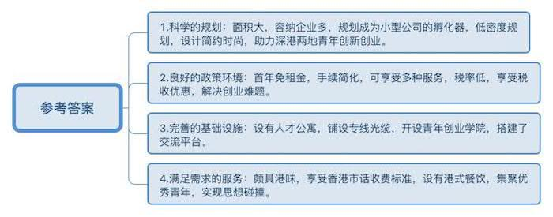
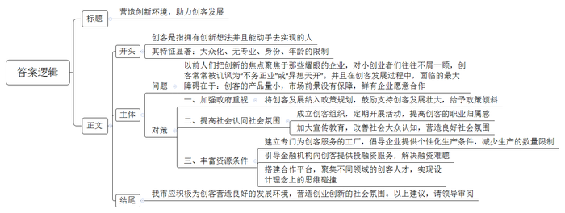
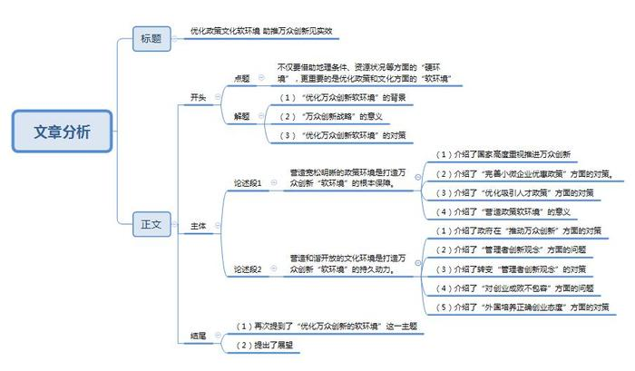

# 2015年深圳市公务员考试《申论》题（A卷）

<!-- gwy:overview:start -->
> **深圳 · 2015 · 申论 · A类** ｜ 3 题 · 图片 3 处 · 答案随题折叠

导航：[题目](#题目) · [材料 1](#材料-1)
<!-- gwy:overview:end -->

> 候选采集稿。参考答案及解析来自粉笔页面，不代表官方答案或真实高分答卷；来源使用许可与原卷对应关系仍需人工核实。

## 给定材料

### 材料 1

十八大以来，习近平总书记就改革创新发表了一系列重要讲话，强调创新始终是推动一个国家，一个民族向前发展的重要力量。实施创新驱动发展战略，最根本的是要增强自主创新能力，最紧迫的是要破除体制机制障碍。最大限度解放和激发科技作为第一生产力所蕴藏的巨大潜能。面向未来，增强自主创新能力，最重要的就是要坚定不移走中国特色自主创新道路，坚持自主创新、重点跨越、支撑发展、引领未来的方针，加快创新型国家建设步伐。要研究在一些省市区系统推进全面创新改革试验，形成几个具有创新示范和带动作用的区域性创新平台。

### 材料 2

2014年9月17日，李克强总理主持召开国务院常务会议，部署进一步扶持小微企业发展推动大众创业万众创新。会议指出，小微企业是发展的生力军、就业的主渠道、创新的重要源泉。在推进简政放权，尤其是实施商事制度等改革后，新设企业大幅增加。加大对小微企业、个体工商户特别是在改革中“呱呱坠地”新生者的扶持，让它们在公平竞争中搏击壮大，可形成示范效应，推动大众创业、万众创新，也能增添社会活力和发展内生动力，促进经济稳定增长和民生改善。有学者表示，过去我们的创新主要源于大中型企业、科研机构、少数精英的创新，而万众创新则需要进一步激发小微企业、草根大众的创新活力。

### 材料 3

近年来，深圳创新发展令人瞩目。解码深圳独特的创新基因，可以看到，深圳有活跃的创新企业群体，企业有强烈的创新冲动，城市有适宜的创新氛围。有学者认为，相对于地理条件、资源状况、基础设施等“硬环境”而言，政府对“软环境”的营造是深圳创新发展的重要原因。一家知名企业的负责人表示：“来了深圳大不一样。规章制度比较明晰，按部就班做就可以。我每天都能保证有7小时呆在实验室，企业的创新发展相当程度上得益于政府营造的宽松的环境。”

### 材料 4

最近，“创客(Maker)”进入大众视野，并被赋予了代表创新前沿的新标签。S市就是这样一个创客集聚的城市，这几天，S市“源动力”创客工作室门前人头攒动，很多人专程赶来，迫不及待地想在这里找到实现自己创意的办法和途径，也有些人满怀好奇前来一探究竟。

在“源动力”创始人杨女士看来，创客并非高不可攀，也没有身份、专业、年龄的限制，任何人只要有想法并且动手去实现这个想法就是创客，很多人只是没有意识到这一点，没有迈出第一步。谈到创客工作室的未来，杨女士信心满满，这种信心一方面来源于她对创客未来发展所持的坚定信念，另一方面也是源于S市独有的环境。杨女士坦言：“别的地方一说起创新，就会聚焦于那些耀眼的企业，对小创业者们往往不屑一顾，创客常常被讥讽为‘不务正业’‘异想天开’。可在S市，我们获得了社会的认同，而且有条件把创意变成现实。”对此，很多创客深有同感。

创客A说：“在S市，设计、制造上有很多资源可以利用，个把小时车程范围内就可以找到所有你需要的东西。”

创客B说：“在别的城市，我想开发一些有创意但是不赚钱的项目，很难获得别人的支持和合作，但在S市就很容易找到志同道合的人。这几年我接触到的创客来自各个不同的领域，他们平时是设计师、工程师、教师、医生，下班后大家聚在一起聊的是如何制造各种好玩的东西，如何用技术去实现天马行空的想法。当然，纯玩可以让大家很开心，但变成产品就更有意义。”可现实中，创意转化为产品存在着诸多挑战。在很多地方，创客面临的最大障碍在于，创客的产品量小，市场前景没有保障，鲜有企业愿意合作。

创客C也深有体会，他2013年设计出了一款智能手环，一开始在老家某城市找了几家电器设备生产厂商，但厂商一听说订单只有几百件，都断然拒绝了，可在S市，有不少愿意为创客服务的工厂，能为创客生产个性化产品，而且没有数量限制。现在，这款智能手环已经在S市成功投产。目前，已经有多家全球知名企业在S市建立了专门为创客服务的工厂，越来越多的金融机构愿意向创客提供投融资服务。S市政府也在今年的政府工作中提出要鼓励支持创客的发展壮大。

S市正成为创客的天堂和乐园。微信朋友圈流传着这样一个段子：在S市，只要你端着一杯咖啡，打开笔记本电脑故作沉思，很快就会有人过来找你聊创意、聊合作。

### 材料 5

近几年来，北京、上海、深圳等地出现了一些以创业服务为主题的咖啡馆，如“车库咖啡”“爱塔咖啡”“起点咖啡”等。车库咖啡馆的创始人说：“它其实是一间民间自发生成的，披着咖啡厅外衣的小微企业孵化器。”这些咖啡馆的投资者并不以咖啡馆的短期收益为目的，而是为创业者搭建一个开放、交流、合作、资源对接的聚合平台，构建找人、找钱、找市场的生态圈，通过帮助创业者成长壮大来分享未来收益。不少初创企业从这里孵化出来，快速成长。

### 材料 6

2014年，某省“两会”上，一位人大代表“晒”出了他制作的“行政审批长征图”，长达5页的A3纸张，详细记录着一个投资项目从获得土地到办完手续，需经过30多项审批，盖上百个章，全程最少需历经272个审批日。但实际上，很多项目审批需时少则1年，多则3年，“审批涉及的部门太多！”该人大代表说，“有些流程盖章是‘章套章’，既费时，又费事，企业三天两头在这些部门转悠，却总有办不完的手续，盖不完的章。”

### 材料 7

目前世界上有许多科学园、研究园、高新技术产业园等各类科技园区，在林林总总的园区中，不乏客观条件比硅谷更加优越的，但目前还没有一个园区可以跟硅谷相提并论。例如，美国“128公路”地区与硅谷在同一市场上活动，开发的技术相近，区内都有举世闻名的大学，结果却是后者蒸蒸日上，前者逐渐衰落。某著名经济学家指出，发生这种差异的根本原因，在于他们存在的制度环境和文化环境不同。因此，如果希望本地区的高新技术产业蓬勃地发展起来，就不能只盯着物质资本或技术本身，而要把主要的注意力放到创建有利于发挥人力资本作用的经济体制和社会文化环境等方面去。

### 材料 8

为优化创新创业环境，深圳推出了一系列人才政策和举措。如：设立了产业发展与创新人才奖，奖励在产业发展与自主创新能力方面做出突出贡献的人员，实施“孔雀计划”，提出5年内重点引进并支持50个以上海外高层次人才团队和1000名以上海外高层次人才来深圳创业创新，吸引带动10000名以上各类海外人才来深工作；实施人才安居工程，对世界一流杰出人才、国家级的领军人才提供购房补贴，对急需紧缺的骨干人才以及国内外全日制高校博士、硕士、本科毕业生提供租房补助；设立海外高层次人才联络处，进一步拓展海外人才联系和引才渠道，畅通用人单位和海外人才之间的供需信息交流。

### 材料 9

某市最近举办了一次企业家创新论坛，在谈到知识产权方面的问题时，企业家们感触颇多，尽管近几年来政府采取了很多措施，但是仍有部分领域存在薄弱之处，比如：行政执法能力薄弱，司法保护能力不强；专利成果转化率低下，特别是在发明专利方面，空有申请数量，却无转化的质量；<u>有的企业知识产权保护意识不强，有的企业维权积极性不高，有的企业维权经验不足，维权的成本高、时间长、尤其是异地维权相当困难。</u>

### 材料 10

“为了1亿元贷款，我跑了全国近10个大中型城市，”某生物科技公司负责人说，“创新型轻资产企业没有贷款抵押物，新生产线始终无法落定，最终是深圳某银行放款1亿元，救了急。”

金融服务从“生产环节”向“创新全链条”延伸，是有效链接资本和创新资源的桥梁，也是深圳综合创新生态的基石，有学者指出，深圳目前是金融机构协同效应最为显著的城市，通过建立主板、中小板、创业板、柜台交易、技术产权交易、技术市场等多层次资本市场，深圳的科技金融体系已初具样本效应。

### 材料 11

2014年12月，深圳第十届“创意十二月”的重头戏——“琴舞之魂”大型原创晚会在南山区文体中心剧场上演，这台晚会堪称一场精彩纷呈的“青春艺术汇”，汇聚了音乐、舞蹈、美术等多个艺术门类涌现的精品佳作，在继承传统艺术的基础上大胆创新，充分融入了创意元素，以其独辟蹊径的创意，令人叫绝的舞台呈现和寓意丰沛的内容征服了观众，成为本届“创意十二月”的抢眼之作。至今，“创意十二月”活动已经走过了十年的历程，在深圳乃至全国影响深远，成为深圳市民追求创新的一个重大节日。

### 材料 12

据统计，2013年，全国公共财政科技支出超过5000亿元，比1978年增长了近100倍，但在基础研究、社会公益研究和共性关键技术研究领域的投入严重偏低，占科技支出的比例不到5%，远低于创新型国家15%以上的比例。

2014年，某市财政安排科技经费占财政支出近6%，力度不可谓不大，但由于申请程序严苛又繁杂，只有8%的创新型中小微企业得到过政府资金扶持，大量创新型中小微企业难以获得政府资金的“雪中送炭”。

### 材料 13

2014年12月7日，国内首个深港合作的国际化青年创新创业社区——前海深港青年梦工场开园，梦工场占地面积5.8万平方米，可容纳约200家创业企业或团队入驻，规划打造成为有创意、有活力的小型公司的孵化器，助力深港两地青年创新创业。

“在香港，找间好点的办公室，租金起码每月两万港元，但在梦工厂，入驻企业首年免租，省去创业初期的租金烦恼，对我们相当有吸引力。”香港青年创业代表说，“在这里开办企业手续大大简化，还能享受投融资、会计、法律等服务，帮助我们解决了创业过程中的各种难题。”

“整个园内低密度规划，设计简约时尚，附近设有人才公寓，铺设了专线光缆，速度达百兆，免费WIFI全覆盖。同时，这里还开设了青年创业学院，为我们搭建了跨界交流的平台。”有意入驻园区的某企业负责人说。“入驻企业都将按15%的税率征收企业所得税，境外高端和紧缺人才可享15%个人工资薪金所得税优惠。”

“园区颇具港味，通讯可享受香港市话收费标准，设有港式餐饮，很有亲切感。”某企业员工认为，“园区的很多服务都是从创业者的需求出发来创设的，集聚了众多的优秀创业青年，可以实现思想的碰撞，我感觉这里就是创业者的天堂。”

“深圳毗邻香港，两地发展息息相关。加强合作，把市场做大了，更有利于外资的进入，从而推动产业化的发展。”香港青年联合负责人表示。

### 材料 14

目前，深圳某园区举办了一场跨越太平洋两岸的实时互动论坛，众多国际企业巨头在位于硅谷的会场，与深圳的会场实时分享最新鲜的“干货”。该论坛是2015年全球移动互联网盛事——全球APP开发创意争霸赛的系列活动之一，是深圳同硅谷之间首次就某一具体领域展开的、由全球顶级企业高层参与的实时互动论坛。据悉，这种类型的分享会有望在今后成为常态，深圳的创业者将有机会加快融入全球创新圈。

### 材料 15

有关资料显示，科研创新成功率仅有10%左右，而失败率却高达90%，显而易见，失败是创新的常态。但在我国，“以成败论英雄”的思想长期以来十分盛行。很多人对创新抱有急功近利的态度，恨不能“今天给鸡撒把米，明天就要鸡下蛋”。这就导致在创新活动中，原始性的创新难上加难，勇于创新者碍于舆论压力等常常半路退出。在这方面，我们有必要借鉴国外的先进经验。据报道，美国每年至少投50亿美元支持癌症研究，成果产出却十分缓慢，“失败”的研究人员却没有因此而受“白眼”或者被终止资助。他们有价值的新想法依然能得到政府的大力支持。在英国，有企业规定，如果员工在一年之内没有“合理失败”过一次，将会被解雇，因为他们认为没有失败就证明员工在岗位上没有创新。以色列的文化和制度培养了人们面对失败的独特态度，它引导创业者对失败的创业经历不断地进行建设性的总结和利用。然后再尝试；而不是让他们长久忍受非难，并将其边缘化。在以色列雇主来看，如果来应聘的员工没有经历过创业失败，那他的经历可能是不完整的。

### 材料 16

一位诺贝尔经济学奖获得者指出，大多数创新并不是孤独的梦想家所带来的，而是由千百万普通人共同推动的。他认为，中国本土创新现在已经达到了相当高的水平，但这种创新还没有覆盖到企业界的每一个人，一直到草根阶层。公共部门或者国有企业因缺乏商业判断力、商业洞察力和商业经验，难以在创新上发挥很大的作用。而且，本土创新、大众创新需要人们有所为，人们更有意识进行创新，需要有特殊的文化，需要有一系列的价值观。

## 题目

### 第 1 题

**根据材料13，参照下面示例的概括方式，再列举出前海深港青年梦工场的4点主要优势。**

**示例：“1.良好的区位条件：园区位于前海，毗邻香港，便于开展深港合作。”（20分）**

关联材料：材料 13

作答要求：

要求：

（1）概括准确，用词恰当，条理清晰；

（2）总字数不超过300字

第 1 题 · 答案与解析

**参考答案（粉笔题库参考内容）**

一、科学的规划：面积大，容纳企业多，规划成为小型公司的孵化器，低密度规划，设计简约时尚，助力深港两地青年创新创业。

二、良好的政策环境：首年免租金，手续简化，可享受多种服务，税率低，享受税收优惠，解决创业难题。

三、完善的基础设施：设有人才公寓，铺设专线光缆，开设青年创业学院，搭建了交流平台。

四、满足需求的服务：颇具港味，享受香港市话收费标准，设有港式餐饮，集聚优秀青年，实现思想碰撞。

**解析**

**参考答案说明：**本参考答案从“科学的规划”、“良好的政策环境”、“完善的基础设施”、“满足需求的服务”4个方面进行了分条撰写。各条要点之间在内容上没有交叉。并且撰写要点时，都提炼出来概括性强的总括词前置，与题目当中的示例形式一致。

**考点**：特点类

**来源**：2015年深圳市公务员考试《申论》题（A卷）

### 第 2 题

**假如你是某市政府派驻S市的工作人员，请写一篇短文，向你市领导简要介绍“创客”这一新生事物。（30分）**

关联材料：材料 1、材料 2、材料 3、材料 4、材料 5、材料 6、材料 7、材料 8、材料 9、材料 10、材料 11、材料 12、材料 13、材料 14、材料 15、材料 16

作答要求：

要求：

（1）抓住重点，简明扼要，条理清晰，语言流畅；

（2）参考“给定材料”，但不拘泥于“给定材料”；

（3）字数不超过500字。

第 2 题 · 答案与解析

**参考答案（粉笔题库参考内容）**

参考答案一

营造创新环境，助力创客发展

创客是指拥有创新想法并且能动手去实现的人。其特征显著：大众化、无专业、身份、年龄的限制。

以前人们把创新的焦点聚焦于那些耀眼的企业，对小创业者们往往不屑一顾，创客常常被讥讽为“不务正业”或“异想天开”。并且在创客发展过程中，面临的最大障碍在于：创客的产品量小，市场前景没有保障，鲜有企业愿意合作。因此，基于S市经验，建议如下：

一、加强政府重视。将创客发展纳入政策规划，鼓励支持创客发展壮大，给予政策倾斜。

二、提高社会认同。成立创客组织，定期开展活动，提高创客的职业归属感；加大宣传教育，改善社会大众认知，营造良好社会氛围。

三、丰富资源条件。建立专门为创客服务的工厂，倡导企业提供个性化生产条件，减少生产的数量限制；引导金融机构向创客提供投融资服务，解决融资难题；搭建合作平台，聚集不同领域的创客人才，实现设计理念上的思维碰撞。

我市应积极为创客营造良好的发展环境，营造创业创新的社会氛围。以上建议，请领导审阅！

**解析**

**参考答案说明：**（1）格式方面，本参考答案写到了“标题”。（2）正文部分，一方面从内容来看，围绕着“创客”这一主题，本参考答案的开头介绍了“创客的含义及其特征”，主体部分从“创客发展面临的问题”“我市发展创客可采取的对策”展开，结尾进行了总结。另一方面，形式上，本参考答案做到了整体上条理较为清晰。（3）本参考答案能够结合题目要求“简明扼要，语言流畅”，在语言表达上做到了简洁、流畅。

参考答案二

创新的标志——创客

创客是指拥有想法并且能动手去实现的人。其特征显著：大众化、无专业、身份、年龄的限制；来自于各个不同的领域，基于共同的兴趣、爱好和认知，利用技术将创意转化为产品。

以前人们把创新的焦点聚焦于那些耀眼的企业，对小创业者们往往不屑一顾，创客常常被讥讽为“不务正业”或“异想天开”。现如今，习近平总书记提出了国家创新战略，扶持小微企业发展推动大众创业万众创新。诚然，S市积极利用本市创新战略的优势：不仅在于有活跃的创新企业群体，提供投融资服务，生产个性化产品且数量不限；更在于有城市创新氛围，除了地理条件、资源状况、基础设施等“硬环境”，还有政府营造的“软环境”，并在设计、制造上调配资源。

然而，创客的发展并非一帆风顺，其存在产品量小，市场前景无保障，企业不愿合作，急功近利，并且创新未覆盖企业界等问题。因此，要立足优势，推动创客发展，需要我市注重有利于创新的文化和政策，完善融资环境、提升创客的社会认同感！

**考点**：总结类

**来源**：2015年深圳市公务员考试《申论》题（A卷）

### 第 3 题

**请从政府工作角度，围绕“如何优化万众创新的软环境”这一主题，自拟题目，写一篇文章。（50分）**

关联材料：材料 1、材料 2、材料 3、材料 4、材料 5、材料 6、材料 7、材料 8、材料 9、材料 10、材料 11、材料 12、材料 13、材料 14、材料 15、材料 16

作答要求：

要求：

（1）观点鲜明，紧扣主题，论述充分；

（2）结构严谨，条理清晰，语言流畅；

（3）参考“给定材料”，但不拘泥于“给定材料”；

（4）字数1000字左右。

第 3 题 · 答案与解析

**参考答案（粉笔题库参考内容）**

**参考范文一**

**优化政策文化软环境 助推万众创新见实效**

十八大以来，以习近平总书记为核心的党中央始终强调要不断增强自主创新能力，坚定不移走中国特色自主创新道路，加快建设创新型国家。为此，李克强总理率先提出了万众创新发展战略，掀起了一股迎合时代发展的新浪潮。万众创新战略的提出，即是一种突破，也是一种挑战，**要将万众创新真正落到实处，不仅要借助地理条件、资源状况等方面的“硬环境”，更重要的是优化政策和文化方面的“软环境”**。

**——营造宽松明晰的政策环境是打造万众创新“软环境”的根本保障。**

无论是习总书记就改革创新发表的一系列重要演讲还是李克强总理在国务院常务会议中的相关讲话，都可以看出政府对万众创新的战略导向和坚定决心。一方面，政府加大对小微企业优惠政策的扶持力度，主动抓住小微企业这个生力军，挖掘创新的源泉，不断强调简政放权，简化行政审批的流程，避免让那些想创新的企业和个人被盖不完的章，办不完的手续消耗了激情和时间。另一方面，良好的政策环境还体现在对人才的吸引方面，例如深圳推出了一系列的人才政策和举措，通过实施人才安居工程，对世界一流杰出人才提供购房补贴，为万众创新提供了强大的人才支持。

S市就是一个典型的例子，在S市政府良好政策环境的大力支持下，许多创客在这里找到了契机，慢慢地把创意变成现实，正在演绎着一桩桩草根阶层的创新，正在以最好的行动诠释万众创新。政策虽是一种软性环境，但却是一种硬性的基础保障，是推动大众创业万众创新的一种硬性前提。

**——营造和谐开放的文化环境是打造万众创新“软环境”的持久动力。**

说到创新的文化环境，不得不谈到知识产权方面的内容，这是我国许多企业的薄弱环节，要真正推动万众创新，政府必须下大力气出台相应的激励机制和援助，保护创意的产权。过去，在推动万众创新发展过程中，多数管理者过度聚焦于明星企业，忽略了个人的创意和想法，因此需要转变管理者的创新价值观，对创客们好的创意给予认可和支持。

我国传统观念中“成败定英雄”的思想根深蒂固，加之创新失败往往是一种常态，因此很多人碍于舆论的压力常常半路退出。如果此时此刻没有软性文化环境的支持，许多创业失败者只能忍受非难，再也不敢尝试创意，万众创业便难以推进。这一点，许多国家做得不错，合理引导，用文化和制度培养人们对失败的正确态度。因为万众创新需要每一个人的亲身参与，更需要每一个参与的人都在经历磨难之后还可以依然保持活力。

30多年前，我们用改革开放的实际行动演绎了一次规模宏大的创新，今天，我们要以政策文化环境为保障将万众创新的巨大潜力激发出来，才能让大众创业、万众创新这个中国经济继续前行的核心动力产生更为持久更为强大的力量！

**参考范文二**

**政策和文化齐助万众创新**

万众创新战略的提出，是一个突破，给每个创业青年举托起一个宽广的平台。万众创新战略的落实，是一个挑战，给政府优化环境提出了许多待解的课题。万众创新，它不是传统的集聚于精英群里，也不是局限于技术的革新。它离每一个有着创业梦想的人都很近，它需要一个软硬皆优的环境，而软环境在此显得尤为重要。

——**打造良好的政策环境就是打好软环境中的“硬环境”。**

无论是李克强总理在国务院常务会议中的讲话还是习总书记就改革创新发表的一系列重要演讲，都可以看出政府对万众创新的战略导向和坚定决心。具体在政策上的体现也非常明显，抓住小微企业这个生力军，挖掘创新的源泉，不断强调简政放权，简化行政审批的流程，不要总是让那些想创新的企业和个人存在盖不完的章，办不完的手续，每天围着这些部门转悠，消耗了激情，也消磨了时间。良好的政策环境还体现在对人才的吸引方面，深圳推出了一系列的人才政策和举措，通过实施人才安居工程，对世界一流杰出人才提供购房补贴，为万众创新提供了强大的人才支持。

S市就是一个典型的例子，在S市政府良好的政策环境的大力支持下，许多创客在这里找到了契机，慢慢地把创意变成现实，正在演绎着一桩桩草根阶层的创新，正在以最好的行动诠释万众创新。政策虽是一种软性环境，但却是一种硬性的基础保障，是推动大众创业万众创新的一种硬性前提。

——**打造良好的文化环境就是打好软环境中的“软环境”。**

说道创新的文化环境，不得不谈到知识产权方面的内容，这是我国许多企业薄弱的环节，要真正推动万众创新，政府必须下大力气出台相应的激励机制和援助，保护创意的产权。但更深层次的东西应该是一系列价值观的重建。万众创新曾经是一个让人感觉距离遥远的想法，或是聚焦于那些耀眼的企业，往往创客们的好创意得不到认可。

我国传统观念中“成败定英雄”的思想根深蒂固，加之创新的失败往往是一种常态，因此很多人碍于舆论的压力常常半路退出。如果此时此刻没有软性文化环境的支持，许多创业失败者智能忍受非难，再也不敢尝试创意，万众创业便难以推进。这一点，许多国家做得不错，合理引导，用文化和制度培养人们对失败的正确态度。因为大众创新需要每一个人的亲身参与，更需要每一个参与的人都在经历磨难之后还可以依然保持活力。

30多年前，我们用改革开放的实际行动演绎了一次规模宏大的创新，今天，我们要以政策文化环境为保障将万众创新的巨大潜力激发出来，才能让大众创业、万众创新这个中国经济继续前行的核心动力产生更为持久更为强大的力量！

**文章分析**

**优化政策文化软环境 助推万众创新见实效**

【**标题的优点：**首先，范文的标题“优化政策文化软环境 助推万众创新见实效”突出了“优化万众创新的软环境”这一主题。其次，形式上采用对称式结构，前半句点出手段，后半句点出目的，使标题而更加完整、饱满。】

十八大以来，（1）<u>以习近平总书记为核心的党中央始终强调要不断增强自主创新能力</u>，<u>坚定不移走中国特色自主创新道路</u>，<u>加快建设创新型国家</u>。为此，李克强总理率先提出了万众创新发展战略，（2）<u>掀起了一股迎合时代发展的新浪潮</u>。万众创新战略的提出，即<u>是一种突破</u>，也<u>是一种挑战</u>，要将万众创新真正落到实处，（3）<u>不仅要借助地理条件</u>、<u>资源状况等方面的</u>“<u>硬环境</u>”，<u>更重要的是优化政策和文化方面的</u>“<u>软环境</u>”。

【**开头的优点：★内容方面。**范文的开头是紧扣题目给定的“优化万众创新的软环境”这一主题展开的。首先，文章开头点出主题，做到了主题明确。其次，对“优化万众创新的软环境”这一主题进行了分析阐述，指出了（1）“优化万众创新软环境”的背景；（2）“万众创新战略”的意义；（3）“优化万众创新软环境”的对策。**★文字表达方面：**使用了“即是……也是……”“不仅……更重要……”等关联词，使语言表达有逻辑性。】

**——营造宽松明晰的政策环境是打造万众创新“软环境”的根本保障。**

（1）<u>无论是习总书记就改革创新发表的一系列重要演讲还是李克强总理在国务院常务会议中的相关讲话</u>，<u>都可以看出政府对万众创新的战略导向和坚定决心</u>。一方面，（2）<u>政府加大对小微企业优惠政策的扶持力度</u>，主动抓住小微企业这个生力军，挖掘创新的源泉，不断强调简政放权，简化行政审批的流程，<u>避免让那些想创新的企业和个人被盖不完的章</u>，<u>办不完的手续消耗了激情和时间</u>。另一方面，（3）<u>良好的政策环境还体现在对人才的吸引方面</u>，<u>例如深圳推出了一系列的人才政策和举措</u>，<u>通过实施人才安居工程</u>，<u>对世界一流杰出人才提供购房补贴</u>，<u>为万众创新提供了强大的人才支持</u>。

S市就是一个典型的例子，在S市政府良好政策环境的大力支持下，（4）<u>许多创客在这里找到了契机</u>，<u>慢慢地把创意变成现实</u>，正在演绎着一桩桩草根阶层的创新，正在以最好的行动诠释万众创新。<u>政策虽是一种软性环境</u>，<u>但却是一种硬性的基础保障</u>，<u>是推动大众创业万众创新的一种硬性前提</u>。

【**论述观点1的优点：★观点句：**范文的观点句是紧扣“优化万众创新的软环境”这一文章主题提出的。形式上，它在段首处直接写出，位置突出，容易发现。内容上，关键词突出，内容要点明确，可以明显看出它是从“政策环境”入手，指出了“优化万众创新‘软环境’的对策”。**★论述内容：**（1）介绍了国家高度重视推进万众创新；（2）介绍了“完善小微企业优惠政策”方面的对策；（3）介绍了“优化吸引人才政策”方面的对策；（4）介绍了“营造政策软环境”的意义。以上几个方面的内容都是紧扣“营造宽松明晰的政策环境是打造万众创新‘软环境’的根本保障”这个观点句进行分析论述的，论述的针对性强，内容层次丰富。最后，在论述方法上主要采取了讲道理和举例子相结合，做到了丰富多样。】

**——营造和谐开放的文化环境是打造万众创新“软环境”的持久动力。**

说到创新的文化环境，不得不谈到知识产权方面的内容，这是我国许多企业的薄弱环节，（1）<u>要真正推动万众创新</u>，<u>政府必须下大力气出台相应的激励机制和援助</u>，<u>保护创意的产权</u>。过去，在推动万众创新发展过程中，（2）<u>多数管理者过度聚焦于明星企业</u>，<u>忽略了个人的创意和想法</u>，（3）<u>因此需要转变管理者的创新价值观</u>，<u>对创客们好的创意给予认可和支持</u>。（4）<u>我国传统观念中</u>“<u>成败定英雄</u>”<u>的思想根深蒂固</u>，<u>加之创新失败往往是一种常态</u>，<u>因此很多人碍于舆论的压力常常半路退出</u>。如果此时此刻没有软性文化环境的支持，<u>许多创业失败者只能忍受非难</u>，<u>再也不敢尝试创意</u>，<u>万众创业便难以推进</u>。这一点，（5）<u>许多国家做得不错</u>，<u>合理引导</u>，<u>用文化和制度培养人们对失败的正确态度</u>。<u>因为万众创新需要每一个人的亲身参与</u>，<u>更需要每一个参与的人都在经历磨难之后还可以依然保持活力</u>。

【**论述观点2的优点：★观点句：**范文的观点句是紧扣“优化万众创新的软环境”这一文章主题提出的。形式上，它在段首处直接写出，位置突出，容易发现。内容上，关键词突出，内容要点明确，可以明显看出它是从“文化环境”入手，指出了“优化万众创新‘软环境’需要营造和谐开放的文化环境”。**★论述内容：**（1）介绍了政府在“推动万众创新”方面的对策；（2）介绍了“管理者创新观念”方面的问题；（3）介绍了转变“管理者创新观念”的对策；（4）介绍了“对创业成败不包容”方面的问题；（5）介绍了“外国培养正确创业态度”方面的对策。以上几个方面的内容都是紧扣“营造和谐开放的文化环境是打造万众创新‘软环境’的持久动力”这个观点句进行分析论述的，论述的针对性强，内容层次丰富。最后，在论述方法上主要采取了讲道理和举例子相结合，做到了丰富多样。】

【**论述段之间的关系：★内容的内在逻辑：**范文的论述段之间是依照“并列”的逻辑展开的。论述观点1先写了“营造宽松明晰的政策环境”，论述观点2再写了“营造和谐开放的文化环境”。**★段与段的外在衔接：**论述观点1段首处的过渡句“无论是习总书记就改革创新发表的一系列重要演讲还是李克强总理在国务院常务会议中的相关讲话，都可以看出政府对万众创新的战略导向和坚定决心”，起到了承接开头、引出了论述观点1的作用。论述观点2段首处的过渡句“说到创新的文化环境”，起到了承接论述观点1、引出了论述观点2的作用，文章承接性较好，逻辑性较强。】

30多年前，我们用改革开放的实际行动演绎了一次规模宏大的创新，今天，（1）<u>我们要以政策文化环境为保障将万众创新的巨大潜力激发出来</u>，（2）<u>才能让大众创业</u>、<u>万众创新这个中国经济继续前行的核心动力产生更为持久更为强大的力量</u>！

【**结尾的优点：**范文的结尾回扣了“优化万众创新的软环境”这一主题。（1）再次提到了“优化万众创新的软环境”这一主题；（2）提出了展望。】

**解析状态：unknown（来源未提供）**

**考点**：文章写作题

**来源**：2015年深圳市公务员考试《申论》题（A卷）

