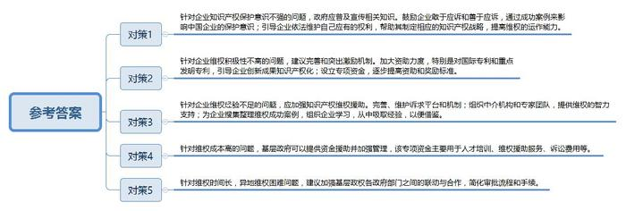
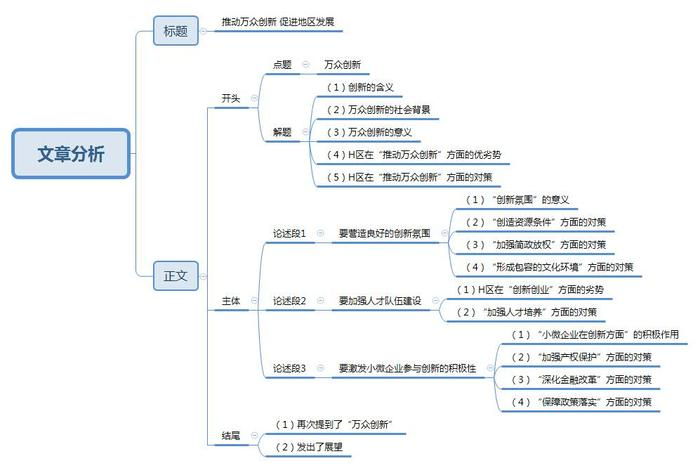

# 2015年深圳市公务员考试《申论》题（B卷）

<!-- gwy:overview:start -->
> **深圳 · 2015 · 申论 · B类** ｜ 3 题 · 图片 3 处 · 答案随题折叠

导航：[题目](#题目) · [材料 1](#材料-1)
<!-- gwy:overview:end -->

> 候选采集稿。参考答案及解析来自粉笔页面，不代表官方答案或真实高分答卷；来源使用许可与原卷对应关系仍需人工核实。

## 给定材料

### 材料 1

十八大以来，习近平总书记就改革创新发表了一系列重要讲话，强调创新始终是推动一个国家，一个民族向前发展的重要力量。实施创新驱动发展战略，最根本的是要增强自主创新能力，最紧迫的是要破除体制机制障碍。最大限度解放和激发科技作为第一生产力所蕴藏的巨大潜能。面向未来，增强自主创新能力，最重要的就是要坚定不移走中国特色自主创新道路，坚持自主创新、重点跨越、支撑发展、引领未来的方针，加快创新型国家建设步伐。要研究在一些省市区系统推进全面创新改革试验，形成几个具有创新示范和带动作用的区域性创新平台。

### 材料 2

2014年9月17日，李克强总理主持召开国务院常务会议，部署进一步扶持小微企业发展推动大众创业万众创新。会议指出，小微企业是发展的生力军、就业的主渠道、创新的重要源泉。在推进简政放权，尤其是实施商事制度等改革后，新设企业大幅增加。加大对小微企业、个体工商户特别是在改革中“呱呱坠地”新生者的扶持，让它们在公平竞争中搏击壮大，可形成示范效应，推动大众创业、万众创新，也能增添社会活力和发展内生动力，促进经济稳定增长和民生改善。有学者表示，过去我们的创新主要源于大中型企业、科研机构、少数精英的创新，而万众创新则需要进一步激发小微企业、草根大众的创新活力。

### 材料 3

近年来，深圳创新发展令人瞩目。解码深圳独特的创新基因，可以看到，深圳有活跃的创新企业群体，企业有强烈的创新冲动，城市有适宜的创新氛围。有学者认为，相对于地理条件、资源状况、基础设施等“硬环境”而言，政府对“软环境”的营造是深圳创新发展的重要原因。一家知名企业的负责人表示：“来了深圳大不一样。规章制度比较明晰，按部就班做就可以。我每天都能保证有7小时呆在实验室，企业的创新发展相当程度上得益于政府营造的宽松的环境。”

### 材料 4

最近，“创客（Maker）”进入大众视野，并被赋予了代表创新前沿的新标签。S市就是这样一个创客集聚的城市，这几天，S市“源动力”创客工作室门前人头攒动，很多人专程赶来，迫不及待地想在这里找到实现自己创意的办法和途径，也有些人满怀好奇前来一探究竟。

在“源动力”创始人杨女士看来，创客并非高不可攀，也没有身份、专业、年龄的限制，任何人只要有想法并且动手去实现这个想法就是创客，很多人只是没有意识到这一点，没有迈出第一步。谈到创客工作室的未来，杨女士信心满满，这种信心一方面来源于她对创客未来发展所持的坚定信念，另一方面也是源于S市独有的环境。杨女士坦言：“别的地方一说起创新，就会聚焦于那些耀眼的企业，对小创业者们往往不屑一顾，创客常常被讥讽为‘不务正业’‘异想天开’。可在S市，我们获得了社会的认同，而且有条件把创意变成现实。”对此，很多创客深有同感。

创客A说：“在S市，设计、制造上有很多资源可以利用，个把小时车程范围内就可以找到所有你需要的东西。”

创客B说：“在别的城市，我想开发一些有创意但是不赚钱的项目，很难获得别人的支持和合作，但在S市就很容易找到志同道合的人。这几年我接触到的创客来自各个不同的领域，他们平时是设计师、工程师、教师、医生，下班后大家聚在一起聊的是如何制造各种好玩的东西，如何用技术去实现天马行空的想法。当然，纯玩可以让大家很开心，但变成产品就更有意义。”可现实中，创意转化为产品存在着诸多挑战。在很多地方，创客面临的最大障碍在于，创客的产品量小，市场前景没有保障，鲜有企业愿意合作。

创客C也深有体会，他2013年设计出了一款智能手环，一开始在老家某城市找了几家电器设备生产厂商，但厂商一听说订单只有几百件，都断然拒绝了，可在S市，有不少愿意为创客服务的工厂，能为创客生产个性化产品，而且没有数量限制。现在，这款智能手环已经在S市成功投产。目前，已经有多家全球知名企业在S市建立了专门为创客服务的工厂，越来越多的金融机构愿意向创客提供投融资服务。S市政府也在今年的政府工作中提出要鼓励支持创客的发展壮大。

S市正成为创客的天堂和乐园。微信朋友圈流传着这样一个段子：在S市，只要你端着一杯咖啡，打开笔记本电脑故作沉思，很快就会有人过来找你聊创意、聊合作。

### 材料 5

近几年来，北京、上海、深圳等地出现了一些以创业服务为主题的咖啡馆，如“车库咖啡”“爱塔咖啡”“起点咖啡”等。车库咖啡馆的创始人说：“它其实是一间民间自发生成的，披着咖啡厅外衣的小微企业孵化器。”这些咖啡馆的投资者并不以咖啡馆的短期收益为目的，而是为创业者搭建一个开放、交流、合作、资源对接的聚合平台，构建找人、找钱、找市场的生态圈，通过帮助创业者成长壮大来分享未来收益。不少初创企业从这里孵化出来，快速成长。

### 材料 6

2014年，某省“两会”上，一位人大代表“晒”出了他制作的“行政审批长征图”，长达5页的A3纸张，详细记录着一个投资项目从获得土地到办完手续，需经过30多项审批，盖上百个章，全程最少需历经272个审批日。但实际上，很多项目审批需时少则1年，多则3年，“审批涉及的部门太多！”该人大代表说，“有些流程盖章是‘章套章’，既费时，又费事，企业三天两头在这些部门转悠，却总有办不完的手续，盖不完的章。”

### 材料 7

目前世界上有许多科学园、研究园、高新技术产业园等各类科技园区，在林林总总的园区中，不乏客观条件比硅谷更加优越的，但目前还没有一个园区可以跟硅谷相提并论。例如，美国“128公路”地区与硅谷在同一市场上活动，开发的技术相近，区内都有举世闻名的大学，结果却是后者蒸蒸日上，前者逐渐衰落。某著名经济学家指出，发生这种差异的根本原因，在于他们存在的制度环境和文化环境不同。因此，如果希望本地区的高新技术产业蓬勃地发展起来，就不能只盯着物质资本或技术本身，而要把主要的注意力放到创建有利于发挥人力资本作用的经济体制和社会文化环境等方面去。

### 材料 8

为优化创新创业环境，深圳推出了一系列人才政策和举措。如：设立了产业发展与创新人才奖，奖励在产业发展与自主创新能力方面做出突出贡献的人员，实施“孔雀计划”，提出5年内重点引进并支持50个以上海外高层次人才团队和1000名以上海外高层次人才来深圳创业创新，吸引带动10000名以上各类海外人才来深工作；实施人才安居工程，对世界一流杰出人才、国家级的领军人才提供购房补贴，对急需紧缺的骨干人才以及国内外全日制高校博士、硕士、本科毕业生提供租房补助；设立海外高层次人才联络处，进一步拓展海外人才联系和引才渠道，畅通用人单位和海外人才之间的供需信息交流。

### 材料 9

某市最近举办了一次企业家创新论坛，在谈到知识产权方面的问题时，企业家们感触颇多，尽管近几年来政府采取了很多措施，但是仍有部分领域存在薄弱之处，比如：行政执法能力薄弱，司法保护能力不强；专利成果转化率低下，特别是在发明专利方面，空有申请数量，却无转化的质量；<u>有的企业知识产权保护意识不强，有的企业维权积极性不高，有的企业维权经验不足，维权的成本高、时间长、尤其是异地维权相当困难。</u>

### 材料 10

“为了1亿元贷款，我跑了全国近10个大中型城市，”某生物科技公司负责人说，“创新型轻资产企业没有贷款抵押物，新生产线始终无法落定，最终是深圳某银行放款1亿元，救了急。”

金融服务从“生产环节”向“创新全链条”延伸，是有效链接资本和创新资源的桥梁，也是深圳综合创新生态的基石，有学者指出，深圳目前是金融机构协同效应最为显著的城市，通过建立主板、中小板、创业板、柜台交易、技术产权交易、技术市场等多层次资本市场，深圳的科技金融体系已初具样本效应。

### 材料 11

2014年12月，深圳第十届“创意十二月”的重头戏——“琴舞之魂”大型原创晚会在南山区文体中心剧场上演，这台晚会堪称一场精彩纷呈的“青春艺术汇”，汇聚了音乐、舞蹈、美术等多个艺术门类涌现的精品佳作，在继承传统艺术的基础上大胆创新，充分融入了创意元素，以其独辟蹊径的创意，令人叫绝的舞台呈现和寓意丰沛的内容征服了观众，成为本届“创意十二月”的抢眼之作。至今，“创意十二月”活动已经走过了十年的历程，在深圳乃至全国影响深远，成为深圳市民追求创新的一个重大节日。

### 材料 12

据统计，2013年，全国公共财政科技支出超过5000亿元，比1978年增长了近100倍，但在基础研究、社会公益研究和共性关键技术研究领域的投入严重偏低，占科技支出的比例不到5%，远低于创新型国家15%以上的比例。

2014年，某市财政安排科技经费占财政支出近6%，力度不可谓不大，但由于申请程序严苛又繁杂，只有8%的创新型中小微企业得到过政府资金扶持，大量创新型中小微企业难以获得政府资金的“雪中送炭”。

### 材料 13

2014年12月7日，国内首个深港合作的国际化青年创新创业社区——前海深港青年梦工场开园，梦工场占地面积5.8万平方米，可容纳约200家创业企业或团队入驻，规划打造成为有创意、有活力的小型公司的孵化器，助力深港两地青年创新创业。

“在香港，找间好点的办公室，租金起码每月两万港元，但在梦工厂，入驻企业首年免租，省去创业初期的租金烦恼，对我们相当有吸引力。”香港青年创业代表说，“在这里开办企业手续大大简化，还能享受投融资、会计、法律等服务，帮助我们解决了创业过程中的各种难题。”

“整个园内低密度规划，设计简约时尚，附近设有人才公寓，铺设了专线光缆，速度达百兆，免费WIFI全覆盖。同时，这里还开设了青年创业学院，为我们搭建了跨界交流的平台。”有意入驻园区的某企业负责人说。“入驻企业都将按15%的税率征收企业所得税，境外高端和紧缺人才可享15%个人工资薪金所得税优惠。”

“园区颇具港味，通讯可享受香港市话收费标准，设有港式餐饮，很有亲切感。”某企业员工认为，“园区的很多服务都是从创业者的需求出发来创设的，集聚了众多的优秀创业青年，可以实现思想的碰撞，我感觉这里就是创业者的天堂。”

“深圳毗邻香港，两地发展息息相关。加强合作，把市场做大了，更有利于外资的进入，从而推动产业化的发展。”香港青年联合负责人表示。

### 材料 14

有关资料显示，科研创新成功率仅有10%左右，而失败率却高达90%，显而易见，失败是创新的常态。但在我国，“以成败论英雄”的思想长期以来十分盛行。很多人对创新抱有急功近利的态度，恨不能“今天给鸡撒把米，明天就要鸡下蛋”。这就导致在创新活动中，原始性的创新难上加难，勇于创新者碍于舆论压力等常常半路退出。在这方面，我们有必要借鉴国外的先进经验。据报道，美国每年至少投50亿美元支持癌症研究，成果产出却十分缓慢，“失败”的研究人员却没有因此而受“白眼”或者被终止资助。他们有价值的新想法依然能得到政府的大力支持。在英国，有企业规定，如果员工在一年之内没有“合理失败”过一次，将会被解雇，因为他们认为没有失败就证明员工在岗位上没有创新。以色列的文化和制度培养了人们面对失败的独特态度，它引导创业者对失败的创业经历不断地进行建设性的总结和利用。然后再尝试；而不是让他们长久忍受非难，并将其边缘化。在以色列雇主来看，如果来应聘的员工没有经历过创业失败，那他的经历可能是不完整的。

### 材料 15

一位诺贝尔经济学奖获得者指出，大多数创新并不是孤独的梦想家所带来的，而是由千百万普通人共同推动的。他认为，中国本土创新现在已经达到了相当高的水平，但这种创新还没有覆盖到企业界的每一个人，一直到草根阶层。公共部门或者国有企业因缺乏商业判断力、商业洞察力和商业经验，难以在创新上发挥很大的作用。而且，本土创新、大众创新需要人们有所为，人们更有意识进行创新，需要有特殊的文化，需要有一系列的价值观。

### 材料 16

某市H区下辖10个街道，110个社区。该区是典型的工业大区，高端产业和低端产业共存、大企业和小企业并存，辖区内即有3家高新技术企业巨头，也有为数众多的加工制造企业。作为全市后发地区，该区基础设施显著滞后，教育、医疗等公共服务资源十分短缺，大型机构较为匮乏。人口总体素质不高，外来务工人员多，且80%以上的外来务工人员为大专学历。近年来，H区采取了一系列举措，营造“创新空气”，驱动全区创新发展。区领导表示：“H区要打造创新创业沃土，无论是‘高大上’创新人才，还是草根创业者，都能在这里找到创业机会，实现创业梦想。”

## 题目

### 第 1 题

**根据“给定材料**4**”简要概括S市吸引“创客”集聚的5点主要优势。（20分）**

关联材料：材料 4

作答要求：

要求：

（1）概括准确，用词恰当，条理清晰；

（2）总字数不超过200字。

第 1 题 · 答案与解析

**参考答案（粉笔题库参考内容）**

优势有：

一、社会认同度高，对创客包容性强，容易被接纳。

二、具备将创意变成现实的条件，设计、制造资源丰富且便利。

三、不同领域人才荟萃，聚集许多志同道合的人，更易交流，更易获得支持和合作。

四、具有专门服务创客的企业，生产个性化产品且无数量限制；政府重视创客发展，为其提供政策支持，提供融资服务的金融机构多。

五、创新氛围浓厚，拥有良好的创业环境。

**解析**

**参考答案说明：**本参考答案从“社会认同”“创业资源条件”“创业人才”“创业扶持”“创业环境”五个方面对S市吸引“创客”集聚的优势进行了分条撰写。各条答案要点之间在内容上是并列关系，没有交叉。

### 第 2 题

**针对“给定材料**9**”下划线部分所反映的问题，你认为基层政府应有何作为？（30分）**

关联材料：材料 1、材料 2、材料 3、材料 4、材料 5、材料 6、材料 7、材料 8、材料 9、材料 10、材料 11、材料 12、材料 13、材料 14、材料 15、材料 16

作答要求：

要求：

（1）观点鲜明，内容具体；

（2）对象合理，有操作性；

（3）字数不超过500字。

第 2 题 · 答案与解析

**参考答案（粉笔题库参考内容）**

一、针对企业知识产权保护意识不强的问题，政府应普及宣传相关知识。鼓励企业敢于应诉和善于应诉，通过成功案例来影响中国企业的保护意识；引导企业依法维护自己应有的权利，帮助其制定相应的知识产权战略，提高维权的运作能力。

二、针对企业维权积极性不高的问题，建议完善和突出激励机制。加大资助力度，特别是对国际专利和重点发明专利，引导企业创新成果知识产权化；设立专项资金，逐步提高资助和奖励标准。

三、针对企业维权经验不足的问题，应加强知识产权维权援助。完善、维护诉求平台和机制；组织中介机构和专家团队，提供维权的智力支持；为企业搜集整理维权成功案例，组织企业学习，从中吸取经验，以便借鉴。

四、针对维权成本高的问题，基层政府可以提供资金援助并加强管理，该专项资金主要用于人才培训、维权援助服务、诉讼费用等。

五、针对维权时间长，异地维权困难问题，建议加强基层政权各政府部门之间的联动与合作，简化审批流程和手续。

**解析**

**参考答案说明：**参考答案针对五个方面的问题，分别从“普及宣传相关知识”“完善和突出激励机制”“加强维权援助”“提供维权援助资金”“加强部门之间的联动与合作”等方面对答案要点进行了分条撰写。各条要点之间是并列关系，没有交叉。

### 第 3 题

**阅读“给定材料”，针对“给定材料**16**”所反映的H区实际情况，从该区的政府工作出发，围绕“如何推动万众创新”，自拟题目，写一篇文章。（50分）**

关联材料：材料 1、材料 2、材料 3、材料 4、材料 5、材料 6、材料 7、材料 8、材料 9、材料 10、材料 11、材料 12、材料 13、材料 14、材料 15、材料 16

作答要求：

要求：

（1）观点鲜明，紧扣主题，见解深刻；

（2）结构严谨，条理清晰，语言流畅；

（3）字数在1000字左右。

第 3 题 · 答案与解析

**参考答案（粉笔题库参考内容）**

**推动万众创新 促进地区发展**

创新始终是推动一个国家，一个民族向前发展的内生动力。在经济进入“新常态”的当下，创新已经不再是少数精英的专利，而是更注重激发小微企业活力，更注重每一个人的身体力行。这新一轮万众创新大潮，必将打造出我国社会经济全面协调发展的不熄引擎。

H区作为一个典型的工业大区，高端产业和低端产业共存、小企业和大企业并存，存在着基础设施滞后、公共服务资源短缺、人口总体素质低等问题，为推动万众创新，H区既要搭建硬环境，还要改善软环境，既要让大企业带头，也要让小企业加入。

**首先，要营造良好的创新氛围。**创新的空气可以激发灵感，解除束缚，促进创客间的交流合作，使创新者在这样的氛围中收获认同和尊重。这就需要当地政府为他们创造资源条件，搭建平台，完善基础设施建设，加强财政、税赋支持力度，弥补教育、医疗等公共服务资源的缺失。同时要加强简政放权，简化审批流程，释放市场活力，打造现代政府，为万众创业创造公平竞争的环境。此外，还要努力形成包容的文化环境，加强宣传工作，提高舆论宽容度，让创新者不但有敢于创新的勇气，还有重新再来的底气。

**其次，要加强人才队伍建设。**创业创新必须要有大批有激情、有创新点子的年轻人参与，这是H区比较薄弱的地方，较低的人口素质显然给万众创新的推进拖了后腿，少了人才也就少了不竭的动力。这方面需要加强创新型人才的培养工作，通过完善激励机制、颁布人才政策等方式激发人才创新力、创造力。比如设立产业发展与创新人才奖，奖励在产业发展与自主创新能力方面作出突出贡献的人员；实施人才安居工程，进一步拓展引才渠道，畅通人才之间的供需信息交流等。

**最后，要激发小微企业参与创新的积极性。**小微企业虽属草根阶层，却拥有不可小觑的大力量，在促进经济增长、增加就业、科技创新与社会和谐稳定等方面具有积极作用。政府要积极改善小微企业创新环境，一方面要加强知识产权保护，严惩侵权案件，降低维权成本；另一方面要深化金融机构改革，解决“融资难”“融资贵”的问题，鼓励、引导社会资本进入创新领域。此外，各地各部门要确保政策尽快落实，提出配套措施，真正帮助小微企业赢得“大未来”，推动新一轮经济加速增长，推动万众创新“落地生根”。

时至今日，通过几代人的努力，中国改革已经驶入一片开阔而光明的海域。让人人享有出彩的机会，是党和政府的庄严承诺；让创新驱动发展，是党和政府的战略方向。而抵达这一梦想的速度，很大程度上取决于万众创新的实现程度。新一轮万众创新必将推动转型期的中国涉过险滩、穿越激流，实现更高层次的发展。

**文章分析**

**推动万众创新 促进地区发展**

【**标题的优点：**首先，范文的标题“推动万众创新 促进地区发展”突出了“万众创新”这一主题词。其次，它在形式上采用对称式结构，前半句点出主题，后半句点出意义，使标题更加完整、饱满，富有逻辑性。】

（1）创新始终是<u>推动一个国家</u>，<u>一个民族向前发展的内生动力</u>。（2）在<u>经济进入</u>“<u>新常态</u>”的当下，创新已经<u>不再是少数精英的专利</u>，而是更<u>注重激发小微企业活力</u>，更<u>注重每一个人的身体力行</u>。这新一轮（3）<u>万众创新大潮</u>，必将<u>打造出我国社会经济全面协调发展的不熄引擎</u>。

（4）<u>H区作为一个典型的工业大区</u>，<u>高端产业和低端产业共存</u>、<u>小企业和大企业并存</u>，<u>存在着基础设施滞后</u>、<u>公共服务资源短缺</u>、<u>人口总体素质低</u>等问题，（5）为推动万众创新，<u>H区既要搭建硬环境</u>，<u>还要改善软环境</u>，既要<u>让大企业带头</u>，<u>也要让小企业加入</u>。

【**开头的优点：★内容方面。**范文的开头是紧扣“推动万众创新”这一主题展开的。首先，开头在段首处点出主题，做到了主题明确。其次，对“推动万众创新”这一主题进行了分析阐述，指出了（1）创新的含义；（2）万众创新的社会背景；（3）万众创新的意义；（4）H区在“推动万众创新”方面的优劣势；（5）H区在“推动万众创新”方面的对策。**★文字表达方面。**使用了“而是……”“既要……也要……”等关联词，使语言表达有逻辑性。】

**首先，要营造良好的创新氛围。**（1）<u>创新的空气</u>可以<u>激发灵感</u>，<u>解除束缚</u>，<u>促进创客间的交流合作</u>，使创新者在这样的氛围中<u>收获认同和尊重</u>。这就需要当地政府为他们（2）<u>创造资源条件</u>，<u>搭建平台</u>，<u>完善基础设施建设</u>，<u>加强财政</u>、<u>税赋支持力度</u>，<u>弥补教育</u>、<u>医疗等公共服务资源的缺失</u>。同时要（3）<u>加强简政放权</u>，<u>简化审批流程</u>，<u>释放市场活力</u>，<u>打造现代政府</u>，<u>为万众创业创造公平竞争的环境</u>。此外，还要努力（4）<u>形成包容的文化环境</u>，<u>加强宣传工作</u>，<u>提高舆论宽容度</u>，让创新者不但有敢于创新的勇气，还有重新再来的底气。

【**论述段****1****的优点：★观点句：**范文的观点句是紧扣“推动万众创新”这一文章主题提出的。形式上，它在段首处直接写出，位置突出，容易发现。内容上，关键词突出，内容要点明确，可以明显看出它是从“创新氛围”入手，指出了“推动万众创新”的对策。**★论述内容：**（1）介绍了“创新氛围”的意义；（2）介绍了“创造资源条件”方面的对策；（3）介绍了“加强简政放权”方面的对策；（4）介绍了“形成包容的文化环境”方面的对策。以上四个方面的内容都是紧扣“要营造良好的创新氛围”这个观点句进行分析论述的，论述的针对性强。最后，在论述方法上主要采取了讲道理的论证方式，在论述的时候做到了层次多样，内容丰富，具有一定说服力。】

**其次，要加强人才队伍建设。**（1）创业创新<u>必须要有大批有激情、有创新点子的年轻人参与</u>，这是<u>H区比较薄弱的地方</u>，较低的人口素质显然给万众创新的推进拖了后腿，少了人才也就少了不竭的动力。这方面需要（2）<u>加强创新型人才的培养工作</u>，通过<u>完善激励机制</u>、<u>颁布人才政策</u>等方式<u>激发人才创新力</u>、<u>创造力</u>。比如设立产业发展与创新人才奖，<u>奖励在产业发展与自主创新能力方面作出突出贡献的人员</u>；<u>实施人才安居工程</u>，进一步<u>拓展引才渠道</u>，<u>畅通人才之间的供需信息交流</u><u>等</u>。

【**论述段****2****的优点：★观点句：**范文的观点句是紧扣“推动万众创新”这一文章主题提出的。形式上，它在段首处直接写出，位置突出，容易发现。内容上，关键词突出，内容要点明确，可以明显看出它是从“人才队伍建设”入手，指出了“推动万众创新”的对策。**★论述内容：**（1）介绍了H区在“创新创业”方面的劣势；（2）介绍了“加强人才培养”方面的对策。以上两个方面的内容都是紧扣“要加强人才队伍建设”这个观点句进行分析论述的，论述的针对性强，内容层次丰富。最后，在论述方法上主要采取了讲道理和举例子相结合，做到了丰富多样。】

**最后，要激发小微企业参与创新的积极性。**（1）<u>小微企业</u>虽属草根阶层，却拥有不可小觑的大力量，<u>在促进经济增长、增加就业、科技创新与社会和谐稳定等方面具有积极作用</u>。政府要积极改善小微企业创新环境，一方面要（2）<u>加强知识产权保护</u>，<u>严惩侵权案件</u>，<u>降低维权成本</u>；另一方面要（3）<u>深化金融机构改革</u>，解决“融资难”“融资贵”的问题，<u>鼓励、引导社会资本进入创新领域</u>。此外，各地各部门要（4）<u>确保政策</u>尽快<u>落实</u>，<u>提出配套措施</u>，真正帮助小微企业赢得“大未来”，推动新一轮经济加速增长，推动万众创新“落地生根”。

【**论述段****3****的优点：★观点句：**范文的观点句是紧扣“推动万众创新”这一文章主题提出的。形式上，它在段首处直接写出，位置突出，容易发现。内容上，关键词突出，内容要点明确，可以明显看出它是从“小微企业参与”入手，指出了“推动万众创新”的对策。**★论述内容：**（1）介绍了“小微企业在创新方面”的积极作用；（2）介绍了“加强产权保护”方面的对策；（3）介绍了“深化金融改革”方面的对策；（4）介绍了“保障政策落实”方面的对策。以上四个方面的内容都是紧扣“要激发小微企业参与创新的积极性”这个观点句进行分析论述的，论述的针对性强，内容层次丰富。最后，在论述方法上主要采取了讲道理的方式，具有一定说服力。】

【**论述段之间的关系：★内容的内在逻辑：**范文有两层逻辑。第一层，整体上是从“背景-问题-对策”的逻辑展开的。第二层，论述段1、2、3均从“对策”出发，论述段1先写了“创新氛围”方面的对策，论述段2再写了“人才培养”方面的对策，论述段3又写了“小微企业”方面的对策。**★段与段的外在衔接：**论述段1、2、3用“首先”“其次”“最后”连接，文章承接性较好，逻辑性较强。】

时至今日，通过几代人的努力，中国改革已经驶入一片开阔而光明的海域。让人人享有出彩的机会，是党和政府的庄严承诺；让创新驱动发展，是党和政府的战略方向。而抵达这一梦想的速度，很大程度上取决于（1）<u>万众创新</u>的实现程度。（2）<u>新一轮万众创新必将推动转型</u><u>期的</u><u>中国</u>涉过险滩、穿越激流，<u>实现更高层次的发展</u>。

【**结尾的优点：**范文的结尾回扣了“万众创新”这一主题。（1）再次提到了“万众创新”；（2）发出了展望。】

**解析状态：unknown（来源未提供）**

