# 2015年深圳市公务员录用考试《行测》题

<!-- gwy:overview:start -->
> **深圳 · 2015 · 行测 · 统考** ｜ 100 题 · 图片 97 处 · 答案随题折叠

| 题型模块 | 题量 | 题号 |
| --- | ---: | ---: |
| 常识判断 | 20 | 1–20 |
| 判断推理 | 20 | 21–40 |
| 数量关系 | 15 | 41–55 |
| 言语理解与表达 | 30 | 56–85 |
| 资料分析 | 15 | 86–100 |
| **合计** | **100** | |

导航：[题型与作答说明](#题型与作答说明) · [题目](#题目) · [材料 1](#材料-1)
<!-- gwy:overview:end -->

> 候选采集稿。参考答案及解析来自粉笔页面，不代表官方答案或真实高分答卷；来源使用许可与原卷对应关系仍需人工核实。

## 题型与作答说明

常识判断

（20题）

根据题目要求，在四个选项中选出一个正确答案。

判断推理

（20题）

本部分包括图形推理、事件排序、判断与推理三种类型的试题。

数量关系

（15题）

本部分包括数字推理与数学运算两种类型的题目。

言语理解与表达

（30题）

每道题给出一段文字，从四个选项中选出一个最恰当的答案。

资料分析

（15题）

针对下列图、表或文字回答问题。你应该根据资料提供的信息进行分析、比较、计算、处理。

## 题目

### 第 1 题

我国加强对“裸官”的监督和管理，根据《关于对配偶子女均已移居国（境）外的国家工作人员加强管理的暂行规定》，国家工作人员有规定所列需要报告情形的，应当在配偶、子女移居国（境）外60日内向（ ）书面报告有关情况。

A. 纪检监察机关

B. 宣传部门

C. 组织（人事）部门

D. 外事部门

第 1 题 · 答案与解析

**参考答案（粉笔题库参考内容）**

C

**解析**

本题主要考查法律法规。《关于对配偶子女均已移居国（境）外的国家工作人员加强管理的暂行规定》第二条规定：“本规定适用于有下列情形之一的国家工作人员，但经组织批准引进的海外高层次人才、国家特需高级科技人才和通过其他途径回国的海外高层次人才除外：配偶、子女均已移居国（境）外的；没有子女，配偶已移居国（境）外的；没有配偶，子女均已移居国（境）外的。前款所称‘移居国（境）外’，是指获得外国国籍，或者获得国（境）外永久居留权、长期居留许可。”第三条规定：“本规定发布前，国家工作人员有本规定第二条所列情形的，应当在本规定发布后60日内，按照干部管理权限向组织（人事）部门书面报告配偶、子女移居国（境）外的有关情况。本规定发布后，国家工作人员有本规定第二条所列情形的，应当在配偶、子女移居国（境）外60日内，按照干部管理权限向组织（人事）部门书面报告有关情况。”

故正确答案为C。

**考点**：其他法律法规

**来源**：2015年深圳市公务员录用考试《行测》题第1题

### 第 2 题

中国共产党某县县委向全县党的各级组织印发《关于整治庸懒散奢等不良风气切实改进工作作风的意见》，应适用的公文文种是：

A. 函

B. 请示

C. 通报

D. 通知

第 2 题 · 答案与解析

**参考答案（粉笔题库参考内容）**

D

**解析**

本题主要考查公文文种。

A项错误，《党政机关公文处理工作条例》第八条（十四）规定：“函适用于不相隶属机关之间商洽工作、询问和答复问题、请求批准和答复审批事项。”本题涉及的是上级向下级印发公文，与题干不符。

B项错误，《党政机关公文处理工作条例》第八条（十一）规定：“请示适用于向上级机关请求指示、批准。”请示属于上行文，而题干中表述的是上级向下级印发公文。

C项错误，《党政机关公文处理工作条例》第八条（九）规定：“通报适用于表彰先进、批评错误、传达重要精神和告知重要情况。”印发《关于整治庸懒散奢等不良风气切实改进工作作风的意见》只是一般性文件，不需要使用通报。

D项正确，《党政机关公文处理工作条例》第八条（八）规定：“通知适用于发布、传达要求下级机关执行和有关单位周知或者执行的事项，批转、转发公文。”题干中县委向下级党组织印发上级发来的公文，属于需要有关单位周知、执行的事项，应采用通知。

故正确答案为D。

**来源**：2015年深圳市公务员录用考试《行测》题第2题

### 第 3 题

行政执法类公务员：

A. 可以越级晋升职级

B. 不得越级晋升职级

C. 原则上不可越级晋升职级，但因工作特殊需要且符合有关条件的，按管理权限批准后，可越级晋升职级

D. 经省级以上政府公务员主管部门批准后可越级晋升职级

第 3 题 · 答案与解析

**参考答案（粉笔题库参考内容）**

B

**解析**

本题主要考查法律法规。《深圳市行政机关行政执法类公务员管理办法(试行)》第二十七条规定：“行政执法类公务员晋升职级，应当逐级晋升。特别优秀或者工作特殊需要且符合有关条件的，按管理权限批准后，可以破格晋升。行政执法类公务员不得越级晋升职级。”

A项错误，行政执法类公务员晋升职级，应当逐级晋升，不能越级晋升职级。

B项正确，行政执法类公务员不得越级晋升职级。

C项错误，行政执法类公务员特别优秀或者工作特殊需要且符合有关条件的，按管理权限批准后，可以破格晋升，而不是越级晋升。

D项错误，行政执法类公务员不得越级晋升职级。

故正确答案为B。

**考点**：其他法律法规

**来源**：2015年深圳市公务员录用考试《行测》题第3题

### 第 4 题

聘任制公务员聘任合同类型不包括：

A. 固定期限聘任合同

B. 无固定期限聘任合同

C. 以完成一定工作任务为期限的聘任合同

D. 终身聘任合同

第 4 题 · 答案与解析

**参考答案（粉笔题库参考内容）**

D

**解析**

本题主要考查法律法规。《深圳市行政机关聘任制公务员管理办法(试行)》第二十四条规定：“聘任合同分为固定期限聘任合同、无固定期限聘任合同和以完成一定工作任务为期限的聘任合同。”因此ABC项正确，D项错误。

本题为选非题，故正确答案为D。

**考点**：其他法律法规

**来源**：2015年深圳市公务员录用考试《行测》题第4题

### 第 5 题

我国古代思想家史伯提出“和实生物”，“以土与金、木、水、火杂，以成百物”。该观点属于：

A. 多元论观点

B. 辩证唯物主义观点

C. 朴素唯物主义观点

D. 主张矛盾调和的形而上学观点

第 5 题 · 答案与解析

**参考答案（粉笔题库参考内容）**

C

**解析**

本题主要考查哲学常识。五行学说是我国古代人民创造的一种哲学思想，以日常生活的五种物质金、木、水、火、土元素，作为构成宇宙万物及各种自然现象变化的基础。“和实生物”意为实现了和谐，则万物即可生长发育。

A项错误，多元论主张世界是由多种本原构成的，分为两种子学说：一种将世界归结为多种物质本原，是唯物主义的多元论；二是将世界归结为多种精神本原的学说，是唯心主义的多元论。如果单纯强调“五行”学说则属于典型的唯物主义的多元论思想，但是题干中所述内容重点放在不同的五行元素相结合形成新的具体物质形态层面，而这些具体物质形态是事物的本原，所以不属于多元论观点。

B项错误，辩证唯物主义是马克思主义的一种哲学理论，是将唯物主义和辩证法有机地统一起来的科学世界观，它是唯物主义的高级形式。题干中的表述是唯物主义发展的最初形态，还未达到辩证唯物主义。

C项正确，朴素唯物主义肯定世界的物质本原性和统一性，但是由于认识水平的限制，它总是把某种或具体的物质形态看作是世界的物质本原和统一的物质基础。“和实生物”，“以土与金、木、水、火杂，以成百物”中的“土、金、木、水、火”都是具体的物质形态，且相结合后会形成不同的物质形态，是典型的朴素唯物主义观点。

D项错误，形而上学观点也被称为机械唯物主义，是唯物主义发展的第二种形态，以孤立的、静止的、片面的观点解释自然界和认识论问题。题干中的表述是唯物主义发展的最初形态，不符合形而上学观点的特征。

故正确答案为C。

**考点**：唯物论

**来源**：2015年深圳市公务员录用考试《行测》题第5题

### 第 6 题

深圳是一座生态园林城市，全市建成区绿化覆盖率45.07%，是中国首个：

A. 国家卫生城市

B. “全球环境500佳”城市

C. 国家园林城市

D. 国际花园城市

第 6 题 · 答案与解析

**参考答案（粉笔题库参考内容）**

D

**解析**

本题考查地理常识，主要考查深圳市相关的荣誉称号。

A项错误，1990年，威海被评为中国第一个国家卫生城市。

B项错误，2001年6月1日，联合国环境规划署授予大连市“全球环境500佳”城市。大连也因此成为中国第一个被联合国授予“全球环境500佳”城市。2002年深圳被联合国环境规划署评为“环境保护全球500佳”，成为这项评选活动自1987年开展以来，全球第7个、中国第2个荣膺这一奖项的城市。

C项错误，国家园林城市，是根据中华人民共和国住房和城乡建设部《国家园林城市标准》评选出的分布均衡、结构合理、功能完善、景观优美、人居生态环境清新舒适、安全宜人的城市，是国内重要的城市品牌之一。深圳市被评为第二批（1994年）国家园林城市。

D项正确，国际花园城市竞赛活动，是全球公认的“绿色奥斯卡”大赛，也是世界城市建设与社区管理领域的最高荣誉之一。该项竞赛活动及奖项由联合国环境规划署所认可，国际公园协会与联合国环境规划署共同主办。2000年，深圳市成为中国大陆第一座国际花园城市。

故正确答案为D。

**考点**：中国地理

**来源**：2015年深圳市公务员录用考试《行测》题第6题

### 第 7 题

果农赵某在柑橘成熟季节为防止柑橘被偷，在果园四周私拉电网。某晚，孙某欲偷柑橘不慎触电，经送医院抢救，不治身亡。赵某对这一损害结果的主观心理状态是：

A. 直接故意

B. 间接故意

C. 过于自信的过失

D. 疏忽大意的过失

第 7 题 · 答案与解析

**参考答案（粉笔题库参考内容）**

B

**解析**

本题考查法律常识，主要考查犯罪的主观方面。

A项错误，直接故意，是指行为人明知自己的行为会发生危害社会的结果，并且希望这种结果的发生。本题中，赵某主观目的是防止柑橘被偷而不是希望别人被伤到，因而其主观心态不是直接故意。

B项正确，间接故意，是指行为人明知自己的行为可能发生危害社会的结果，并且放任这种结果发生的心理态度。所谓放任，是指行为人对于危害结果的发生，虽然没有希望、积极地追求，但也没有阻止、反对，而是放任自流，听之任之，任凭、同意它的发生。赵某明知可能会有人偷柑橘并被电伤，虽然其主观上对伤人结果的发生不是积极追求，但对结果的发生也并不反对，属于放任的、无所谓的态度，因而属于间接故意。

C项错误，过于自信的过失，是指行为人已经预见自己的行为可能发生危害社会的结果，但轻信能够避免以致发生这种结果的心理态度。赵某对拉电网会电伤人这一结果的心理状态是放任，其知道会有人来偷柑橘并且可能会触电，因而不是轻信不会有人偷柑橘而触电。

D项错误，疏忽大意的过失，行为人应当预见自己的行为可能发生危害社会的结果，因为疏忽大意而没有预见，以致发生了这种危害结果的心理态度。赵某明知私拉电网会导致他人伤亡而放任其发生，造成李某死亡的结果，属于间接故意。

故正确答案为B。

**考点**：刑法

**来源**：2015年深圳市公务员录用考试《行测》题第7题

### 第 8 题

世界经济论坛于2014年9月发布《2014—2015年全球竞争力报告》，报告排名中，中国内地竞争力较此前上升一位，名列第二十八位，（ ）连续六年位居第一。

A. 美国

B. 日本

C. 新加坡

D. 瑞士

第 8 题 · 答案与解析

**参考答案（粉笔题库参考内容）**

D

**解析**

本题考查政治常识，主要考查世界经济的有关时政热点。

2014年9月3日，总部位于日内瓦的世界经济论坛发布了《2014－2015年全球竞争力报告》，瑞士连续六年位居榜首，成为全球最具竞争力的国家。

A项错误，美国排第三位，连续两年位次保持上升。这主要是因为美国已经走出危机，其社会结构特点使得它的经济复苏非常富有成效；

B项错误，日本排第六位，较去年上升三位；

C项错误，新加坡排第二位，在商品市场效率、劳动力市场效率、金融市场发展以及基础设施方面得分均较高；

D项正确，瑞士连续6年稳居榜首，主要得益于学术研发机构与商业界紧密合作而带来的巨大创新能力。

故正确答案为D。

**考点**：时事政治-其他

**来源**：2015年深圳市公务员录用考试《行测》题第8题

### 第 9 题

行政沟通行为的特点不包括：

A. 交互性

B. 统一性

C. 目的性

D. 媒介性

第 9 题 · 答案与解析

**参考答案（粉笔题库参考内容）**

B

**解析**

本题考查管理常识，主要考查行政沟通行为的特点。行政沟通行为是实现政府管理目标的一种管理活动，其主要有交互性、目的性、媒介性和期待性四个特点。

A项正确，交互性强调沟通是在行政体系与外界环境之间、行政体系内部各部门之间、层次之间、人员之间的一种彼此交互性沟通行为。

B项错误，统一性不是行政沟通行为的特点之一。

C项正确，目的性强调作为行政沟通行为，最终目的是达到沟通双方的相互了解、支持与合作，最终实现行政体系的和谐有序运转。

D项正确，媒介性强调行政沟通行为的发生必须凭借一定的媒介和渠道来传递思想、观点和情感等信息。

本题为选非题，故正确答案为B。

**来源**：2015年深圳市公务员录用考试《行测》题第9题

### 第 10 题

2014年6月22日，包括中国在内的三国联合申报的( )顺利进入世界文化遗产名录，成为首例跨国合作成功申遗的项目。

A. 南方喀斯特

B. 海上丝绸之路

C. 丝绸之路：长安-天山廊道路网

D. 大运河

第 10 题 · 答案与解析

**参考答案（粉笔题库参考内容）**

C

**解析**

本题考查时事政治，主要考查深圳市相关的荣誉称号。

A项错误，中国南方喀斯特于2007年6月被列入《世界遗产名录》，属于我国独立申报的项目。

B项错误，我国海上丝绸之路正在申遗，但仍未有具体结果。

C项正确，2014年6月22日，在第38届世界遗产大会上，中国、哈萨克斯坦、吉尔吉斯斯坦三国联合对“丝绸之路：长安－天山廊道路网”申报世界遗产，并获得了成功。中国与吉尔吉斯斯坦、哈萨克斯坦联合提交的这一文化遗产项目，正式列入世界遗产名录。这是我国第一个跨国联合申遗项目，是世界上第一段列入遗产名录的丝绸之路遗产。这是我国第33项世界文化遗产，世界遗产总数已达47项。

D项错误，2014年6月22日，中国大运河在第38届世界遗产大会上获准列入世界遗产名录，成为中国第46个世界遗产项目，包括中国8个省、直辖市，27座城市，大运河河道遗产27段，以及运河水工遗存、运河附属遗存、运河相关遗产共计58处遗产点，河道总长度1011公里。大运河在我国境内，属于我国独立申报的世界文化遗产。

故正确答案为C。

**考点**：时事政治-其他

**来源**：2015年深圳市公务员录用考试《行测》题第10题

### 第 11 题

下列哪组物品均属可燃固体？

A. 香蕉水、酒精

B. 面粉、油漆

C. 沥青、松香

D. 甲烷、乙炔

第 11 题 · 答案与解析

**参考答案（粉笔题库参考内容）**

C

**解析**

本题考查常识判断中化学常识，主要考查物体的性质等有关知识点，需要结合题干材料分析。

A项错误，香蕉水是由多种有机溶剂配制而成的无色透明易挥发的液体，微溶于水，能溶于各种有机溶剂，易燃，但不是固体；酒精又称乙醇，是一种有机物，是一种易燃、易挥发的无色透明液体，不是固体。

B项错误，面粉是一种易燃易爆的粉状物，当面粉颗粒在空气中达到一定浓度时，遇到明火会爆炸；油漆为粘稠油性颜料，未干情况下易燃，不溶于水，微溶于脂肪。

C项正确，沥青是一种有毒的易燃物，沥青有固体的，粘稠状的，还有液体状的，一般认作可融化固体；松香是易燃物，呈固体状，透明，颜色为淡黄色或棕色。二者均为可燃固体。

D项错误，甲烷是最简单的有机物，是天然气，沼气，坑气等的主要成分，俗称瓦斯，在标准状态下甲烷是一无色无味的易燃气体；乙炔在室温下是一种无色、极易燃的气体。

故正确答案为C。

**考点**：化学常识

**来源**：2015年深圳市公务员录用考试《行测》题第11题

### 第 12 题

下列关于市场经济的表述，正确的是：

A. 市场参与者仿佛由一只“看不见的手”指引行事，产生了使社会福利最大化的结果

B. 税收有助于沟通生产者与消费者的成本与利益

C. 在有足够强大的电脑时，中央计划者可以比市场更有效地指导生产

D. 市场体制的力量倾向于在消费者中平等地分配资源

第 12 题 · 答案与解析

**参考答案（粉笔题库参考内容）**

A

**解析**

本题考查常识判断中经济常识，主要考查市场经济等有关知识点，需要结合选项内容分析。

A项正确，市场参与者包括生产者、销售者和消费者，而“看不见的手”指的是市场机制。在市场经济体制中，生产者依据利润最大化的原则做生产决策，销售者依据利润最大化的原则做销售决策，消费者依据效用最大化的原则做购买决策，从而产生了使社会福利最大化的结果。

B项错误，价格有助于沟通生产者与消费者的成本与利益，因为价格是在供给与需求之间的互相影响、平衡中产生的，生产者负责供给，以满足消费者需求，而价格会自发的在二者之间进行调整，以沟通二者之间的成本与利益。

C项错误，市场在资源配置中起决定性作用，国家的宏观调控是市场功能和作用发挥的重要支撑。拥有强大的电脑，意味着生产、消费等要靠指令性计划完成，而这将会导致资源的高度集中，不利于经济的发展。

D项错误，资源在消费者中并非平等地分配，因为在市场经济体制下，资源分配受消费者主权的约束，生产什么取决于消费者的需求（市场需求），生产多少取决于消费者的支付能力的需求水平。

故正确答案为A。

**考点**：市场经济

**来源**：2015年深圳市公务员录用考试《行测》题第12题

### 第 13 题

根据法律关系产生的依据、执行的职能和实现规范的内容不同，法律关系可以分为：

A. 绝对法律关系和相对法律关系

B. 第一性法律关系和第二性法律关系

C. 平权型法律关系和隶属型法律关系

D. 调整性法律关系和保护性法律关系

第 13 题 · 答案与解析

**参考答案（粉笔题库参考内容）**

D

**解析**

本题考查常识判断中法律常识，主要考查法律关系等有关知识点，需要结合题干分析。

A项错误，按照具体法律关系的主体是单方具体化还是多方具体化是否一致为根据，可将法律关系分为绝对法律关系和相对法律关系。绝对法律关系是指义务主体不特定，权利人以外的一切人均为义务人的民事法律关系；相对法律关系是指义务主体为特定人的民事法律关系。

B项错误，按照相关的法律关系作用和地位不同，可将法律关系分为第一性法律关系(主法律关系)和第二性法律关系(从法律关系)。第一性法律关系（主法律关系），是人们之间依法建立的不依赖其他法律关系而独立存在的或在多向法律关系中居于支配地位的法律关系；第二性从法律关系是指产生的、居于从属地位的法律关系。

C项错误，按法律主体在法律关系中的地位不同，可将法律关系分为平权型法律关系和隶属型法律关系。平权型法律关系又称横向法律关系，是存在于法律地位平等的当事人之间的法律关系；隶属型法律关系又称纵向法律关系，是一方当事人可依据职权而直接要求他方当事人为或不为一定行为的法律关系。

D项正确，按照法律关系产生的依据、执行的职能和实现规范的内容不同，可将法律关系分为调整性法律关系和保护性法律关系。调整性法律关系是基于人们的合法行为而产生的、执行法的调整职能的法律关系，它所实现的是法律规范(规则)的行为规则(指示)的内容；保护性法律关系是由于违法行为而产生的、旨在恢复被破坏的权利和秩序的法律关系，它执行着法的保护职能，所实现的是法律规范(规则)的保护规则(否定性法律后果)的内容，是法的实现的非正常形式。

故正确答案为D。

**考点**：法理学

**来源**：2015年深圳市公务员录用考试《行测》题第13题

### 第 14 题

中国共产党第十八届中央委员会第四次全体会议于2014年10月20至23日在北京召开，会议审议通过《中共中央关于全面推进依法治国若干重大问题的决定》，指出全面推进依法治国的总目标是：

A. 建设中国特色社会主义法治体系，建设社会主义法治国家

B. 完善和发展中国特色社会主义制度，推进国家治理体系和治理能力现代化

C. 社会主义民主法制更加完善，依法治国基本方略得到全面落实

D. 建设富强、民主、文明、和谐的社会主义法治国家

第 14 题 · 答案与解析

**参考答案（粉笔题库参考内容）**

A

**解析**

本题考查常识判断中政治常识，主要考查时政信息，需要结合题干分析。

A项正确，建设中国特色社会主义法治体系，建设社会主义法治国家是全面推进依法治国的总目标，是在十八届四中全会上提出的。

B项错误，完善和发展中国特色社会主义制度，推进国家治理体系和治理能力现代化是全面深化改革的总目标，是在十八届三中全会上提出的。

C项错误，社会主义民主更加完善，社会主义法制更加完备，依法治国基本方略得到全面落实是十六大报告提出的全面建设小康社会的目标之一。

D项错误，建设富强、民主、文明、和谐的社会主义法治国家是全面推进依法治国的总目标的一部分，还包括建设中国特色社会主义法治体系。

故正确答案为A。

**考点**：其他建设、重要文件

**来源**：2015年深圳市公务员录用考试《行测》题第14题

### 第 15 题

《深圳经济特区促进全民健身条例》自2015年1月1日起施行，条例规定每年的（ ）为市民长跑日。

A. 5月1日

B. 6月1日

C. 9月1日

D. 11月1日

第 15 题 · 答案与解析

**参考答案（粉笔题库参考内容）**

D

**解析**

本题考查常识判断中法律常识，主要考查政府信息公开条例等的有关知识点。《深圳经济特区促进全民健身条例》自2015年1月1日起施行，《条例》第十条规定：“每年11月1日为市民长跑日。在市民长跑日，市、区政府体育行政部门应当组织开展长跑活动，鼓励其他机关、企事业单位和各类社会团体组织开展长跑活动，鼓励市民参加长跑活动。”

故正确答案为D。

**考点**：行政法

**来源**：2015年深圳市公务员录用考试《行测》题第15题

### 第 16 题

以下发文字号，符合《党政机关公文格式》规定的是：

A. 中办发〔2012〕8号

B. 中办发〔2012〕第8号

C. 中办发〔2012〕08号

D. 中办发〔2012〕第08号

第 16 题 · 答案与解析

**参考答案（粉笔题库参考内容）**

A

**解析**

本题考查公文常识，主要考查发文字号的书写规范。《党政机关公文格式》规定：“发文字号编排在发文机关标志下空二行位置，居中排布。年份、发文顺序号用阿拉伯数字标注；年份应标全称，用六角括号‘〔〕’括入；发文顺序号不加‘第’字，不编虚位（即1不编为01），在阿拉伯数字后加‘号’字。”

A项正确，该发文字号符合《党政机关公文格式》的规定。

B项错误，发文顺序号不加“第”字。

C项错误，发文顺序号不编虚位（即1不编为01）。

D项错误，发文顺序号不加“第”字，不编虚位（即1不编为01）。

故正确答案为A。

**来源**：2015年深圳市公务员录用考试《行测》题第16题

### 第 17 题

《史记·孔子世家》记载：孔子读《易》，韦编三绝。其中“韦”是指：

A. 姓韦的人

B. 草绳

C. 丝线

D. 柔皮

第 17 题 · 答案与解析

**参考答案（粉笔题库参考内容）**

D

**解析**

本题考查文化常识。孔子读《易》，韦编三绝。其中韦：熟牛皮；韦编：用熟牛皮绳把竹简编联起来；三：概数，表示多次；绝：断。这句话的意思是孔子为读《周易》而多次翻断了编联竹简的牛皮带子。经常用来比喻读书勤奋。因此A、B、C三项错误，D项正确。

故正确答案为D。

**考点**：文化常识

**来源**：2015年深圳市公务员录用考试《行测》题第17题

### 第 18 题

以下公文标题中，最符合公文写作规范的是：

A. 《关于打击盗掘和走私文物活动的通报》

B. 《国务院关于清理规范税收等优惠政策的通报》

C. 《国务院表扬全国“两基”工作先进地区的通报》

D. 《国务院安委会办公室关于近期几起事故情况的通报》

第 18 题 · 答案与解析

**参考答案（粉笔题库参考内容）**

D

**解析**

本题考查公文常识，主要考查公文标题拟定格式的相关常识。公文标题一般由三个要素组成，即：发文机关、事由和文种。根据《党政机关公文处理工作条例》第八条规定：“通报适用于表彰先进、批评错误、传达重要精神和告知重要情况。”

A项错误，该标题缺少发文机关；

B项错误，此标题文种使用不正确。此处应当使用的公文文种是“通知”；

C项错误，缺少介词“关于”；

D项正确，标题正确。国务院安委会是发文机关，近期几起事故情况是事由，通报是文种。

故正确答案为D。

**来源**：2015年深圳市公务员录用考试《行测》题第18题

### 第 19 题

转变政府职能是深化行政体制改革的核心，而政府职能转变的核心则在于处理好（ ）的关系。

A. 政府与市场

B. 政府与人民

C. 计划与市场

D. 政府与企业

第 19 题 · 答案与解析

**参考答案（粉笔题库参考内容）**

A

**解析**

本题考查政府职能转变的知识。

十八届三中全会审议通过《中共中央关于全面深化改革若干重大问题的决定》，该《决定》指出：“经济体制改革是全面深化改革的重点，核心问题是处理好政府和市场的关系，使市场在资源配置中起决定性作用和更好发挥政府作用。”因此，政府职能转变的核心在于处理好政府与市场的关系。因此，B、C、D三项错误，A项正确。

故正确答案为A。

**来源**：2015年深圳市公务员录用考试《行测》题第19题

### 第 20 题

行政行为在主体上、权限上、内容上或者程序上存在缺陷，该行政行为属于：

A. 有效行政行为

B. 无效行政行为

C. 可撤销行政行为

D. 必须撤销行政行为

第 20 题 · 答案与解析

**参考答案（粉笔题库参考内容）**

C

**解析**

本题考查法律常识，主要考查行政行为效力的相关知识。

具体行政行为是指行政机关行使行政权力，对特定的公民、法人和其他组织作出的有关其权利义务的单方行为。

A项错误，有效行政行为的一般要件是：1、主体合法；2、权限合法；3、内容合法、适当；4、意思表示完全真实；5、程序合法。该题中表明主体、权限、内容、程序存在缺陷，不可能有效。

B项错误，无效行政行为是指已经成立了的行政行为但由于重大、明显违法而不具有公定力，从而自始、当然、确定不发生法律效力的行政行为。无效行政行为本质上是一种违法情形达到相当严重程度的违法行政行为。题干中并未指出该行政行为违法情形。

C项正确，可撤销行政行为有以下两种情形：1、不完全具备行政行为的合法要件，即行政行为在主体上、权限上、内容上或者程序上存在缺陷；2、行政行为不适当，即行政行为存在不合理、不公正、不符合现行政策、不合时宜、不合善良风俗等情形。

D项错误，具体行政行为的效力有三类：有效行政行为、无效行政行为、可撤销行政行为。不包括必须撤销行政行为。

故正确答案为C。

**考点**：行政法

**来源**：2015年深圳市公务员录用考试《行测》题第20题

### 第 21 题

从所给四个选项中，选择最合适的一个填入问号处，使之呈现一定规律性：

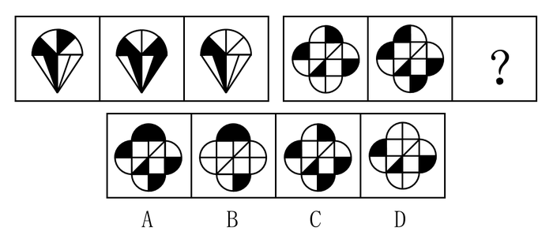

A. A

B. B

C. C

D. D

第 21 题 · 答案与解析

**参考答案（粉笔题库参考内容）**

D

**解析**

元素组成相似，优先考虑样式规律。观察发现，第一组图形和第二组图形外轮廓相同，内部黑白块数量不同，考虑样式运算中的黑白叠加，可以看出黑+黑=黑，白+白=白，黑+白=白，白+黑=白，即只有同为黑色时叠加后才为黑色。将此规律应用到第二组图形中，只有D项满足此规律。

故正确答案为D。

**考点**：样式规律-黑白运算

**来源**：2015年深圳市公务员录用考试《行测》题第21题

### 第 22 题

从所给四个选项中，选择最合适的一个填入问号处，使之呈现一定规律性：

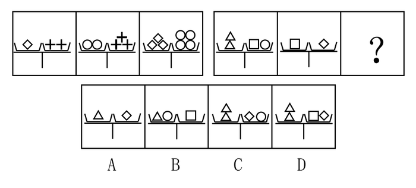

A. A

B. B

C. C

D. D

第 22 题 · 答案与解析

**参考答案（粉笔题库参考内容）**

C

**解析**

第一组图形和第二组图形中均出现了在“天平”的两端，且出现了三种不同的元素，考虑“天平”两边相等，即考虑三种元素之间的换算。第一组图形中，1菱形◇=2十字，2圆○=3十字，3菱形◇=6十字=4圆○，验证上述三种元素之间换算后“天平”两边相等的规律正确。观察第二组图形中元素之间的换算，2三角形△=1正方形□+1圆○，1正方形□=1菱形◇，在选项中应用上述等量关系，只有C项满足此规律。

故正确答案为C。

**考点**：数量规律-素

**来源**：2015年深圳市公务员录用考试《行测》题第22题

### 第 23 题

从所给四个选项中，选择最合适的一个填入问号处，使之呈现一定规律性：

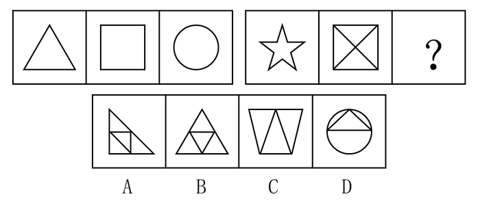

A. A

B. B

C. C

D. D

第 23 题 · 答案与解析

**参考答案（粉笔题库参考内容）**

B

**解析**

解析一：

元素组成不同，优先考虑属性规律。图形均为规整图形，且第一组图形和第二组图形均为轴对称图形，考虑对称性。观察发现，第一组图形均为多条对称轴图形，第二组图形前两幅图形也均为多条对称轴图形，故？处所选项图形应含有多条对称轴，只有B项满足此规律。同时我们可以发现，题干中图形的多条对称轴均能相交于同一点。

故正确答案为B。

解析二：

元素组成不同，且无明显属性规律，考虑数量规律。观察发现，第一组图形的线数量依次为3、4、1，前两幅图形线数量相减得到第三幅图形的线数量。第二组图形的线数量为10、6、？，前两幅图形线数量相减为4，因此？处应为线数量是4的图形。

故正确答案为D。

鉴于解析二的规律中，第一组为图2减图1的线条数量等于图3，第二组为图1减图2的线条数量等于图3，不是完全一致，看的是图1与图2线条数量相减的绝对值，而题干又出现了多个轴对称的典型图形，因此更偏向于将此题答案给B。

**考点**：属性规律-对称性

**来源**：2015年深圳市公务员录用考试《行测》题第23题

### 第 24 题

从所给四个选项中，选择最合适的一个填入问号处，使之呈现一定规律性：

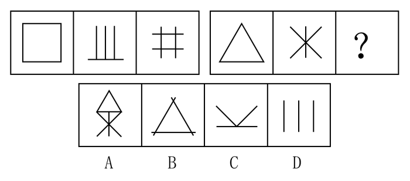

A. A

B. B

C. C

D. D

第 24 题 · 答案与解析

**参考答案（粉笔题库参考内容）**

B

**解析**

元素组成不同，无明显属性规律，优先考虑数量规律。观察题干图形，第一组图形均由4条长度相等直线构成，且面数量为1、0、1；第二组图形前两图均由3条长度相等的直线构成，面数量为1、0、？，故？处应该选一个由3条长度相等的直线构成且面数量为1的图形，只有B项符合。

故正确答案为B。

【注意】此题单独根据面数量亦可得出B，但是1、0、1的规律是否能得到公认未知，因此解析此题加入了线数量规律。

**考点**：数量规律-线、数量规律-面

**来源**：2015年深圳市公务员录用考试《行测》题第24题

### 第 25 题

从所给四个选项中，选择最合适的一个填入问号处，使之呈现一定规律性：

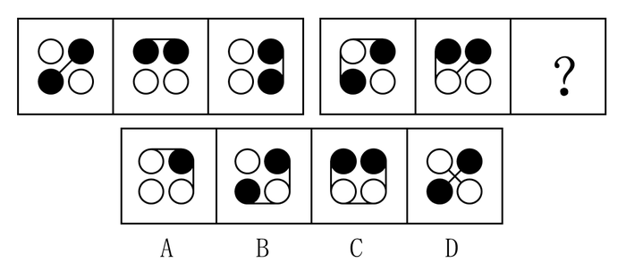

A. A

B. B

C. C

D. D

第 25 题 · 答案与解析

**参考答案（粉笔题库参考内容）**

B

**解析**

观察题干图形，第一组图形中均是两个黑圈相连，两个白圈不相连，即考虑黑圈白圈与线之间的连接。第二组图形中前两个图形，均是两个黑圈一个白圈相连，且两端的球为黑色，剩余的白球单独一个，只有B项符合此规律。

故正确答案为B。

**考点**：数量规律-素

**来源**：2015年深圳市公务员录用考试《行测》题第25题

### 第 26 题

（1）市场仓库起火

（2）房屋突发坍塌

（3）进入火场排除火患

（4）市民街头悼念

（5）消防战士被埋

A. 1-2-5-3-4

B. 1-3-5-2-4

C. 1-3-2-5-4

D. 3-1-4-2-5

第 26 题 · 答案与解析

**参考答案（粉笔题库参考内容）**

C

**解析**

第一步：先确定逻辑关系最为明显的事件顺序。

观察题干，五个事件主要围绕“消防战士救火”的过程。选项中首句为事件（1）或事件（3），只有先“市场仓库起火”，才能“进入火场排除火患”，因此事件（1）排在事件（3）前面，排除D项。

第二步：逐一对照选项并判断正确答案。

根据第一步得到的结果可以判断只有A、B、C三项符合，事件（2）、事件（3）和事件（5）的顺序不同。通过分析事件（2）、（3）和（5）得知，应先“进入火场排除火患”，再“房屋突发坍塌”，最后“消防战士被埋”，排除A、B两项。

故正确答案为C。

**来源**：2015年深圳市公务员录用考试《行测》题第26题

### 第 27 题

（1）第二次科技革命

（2）地理大发现和东西方航线开辟

（3）苏联解体、东欧剧变、西方发达国家从工业社会向信息社会转变

（4）第一次产业革命和资本主义制度的确立

（5）两次世界大战和东西方阵营的冷战

A. （2）-（1）-（3）-（5）-（4）

B. （2）-（4）-（1）-（3）-（5）

C. （4）-（2）-（1）-（5）-（3）

D. （2）-（4）-（1）-（5）-（3）

第 27 题 · 答案与解析

**参考答案（粉笔题库参考内容）**

D

**解析**

第一步：先确定逻辑关系最为明显的事件顺序。

观察题干，五个事件主要围绕“历史进程”。选项中首句为事件（2）或事件（4），只有先“地理大发现和东西方航线开辟”，才能“第一次产业革命和资本主义制度的确立”，因此事件（2）排在事件（4）前面，排除C项。

第二步：逐一对照选项并判断正确答案。

根据第一步得到的结果可以判断只有A项、B项和D项符合，事件（1）和事件（4）的顺序不同，事件（3）和事件（5）的顺序不同。应先有第一次革命，才会有第二次革命，事件（4）应该排在事件（1）前面，从而排除A项；应该先有第二次世界大战，才会有苏联解体等结果发生，事件（5）应该排在事件（3）前面，从而排除B项。

故正确答案为D。

**来源**：2015年深圳市公务员录用考试《行测》题第27题

### 第 28 题

（1）旅游井喷

（2）黄金周长假

（3）完善服务

（4）管理失位

（5）景点拥堵

A. 5-1-4-2-3

B. 2-1-4-5-3

C. 2-5-1-3-4

D. 3-2-4-5-1

第 28 题 · 答案与解析

**参考答案（粉笔题库参考内容）**

B

**解析**

第一步：先确定逻辑关系最为明显的事件顺序。

观察题干，五个事件主要围绕“旅游景点因黄金周拥堵而完善服务”的过程。选项中首尾句均不相同，根据事件的逻辑关系可知最后的结果是“完善服务”，即事件（3）是尾句，排最后，排除C、D项。

第二步：逐一对照选项并判断正确答案。

根据第一步得到的结果可以判断只有A项和B项符合，事件（1）和事件（5）的顺序不同。通过分析事件（1）和（5）得知，应先“旅游井喷”，才会“景点拥堵”，事件（1）应该排在事件（5）前面，从而排除A项。

故正确答案为B。

**来源**：2015年深圳市公务员录用考试《行测》题第28题

### 第 29 题

（1）盛世与法制相对健全分不开

（2）没有无法制的盛世

（3）历史上出现过文景等盛世

（4）没有盛世而法制衰微的现象

（5）法制是盛世的外在标志

A. 3-1-5-2-4

B. 5-3-4-2-1

C. 5-1-3-2-4

D. 3-5-1-4-2

第 29 题 · 答案与解析

**参考答案（粉笔题库参考内容）**

A

**解析**

第一步：先确定逻辑关系最为明显的事件顺序。

本题考查的是文段的行文顺序。这个文段是围绕“盛世和法制的关系”展开论述的。选项中首句为事件（3）或事件（5），事件（3）只提到了盛世，是通过历史上的出现的盛世引到法制这个话题，因此事件（3）应该放在句首，排除B、C项。

第二步：逐一对照选项并判断正确答案。

根据第一步得到的结果可以判断只有A项和D项符合。事件（3）由盛世引出了法制，接下来应该为讨论盛世和法制之间的关系且盛世应该为主语，即事件（1），因此事件（3）和（1）相连，从而排除D项。

故正确答案为A。

**来源**：2015年深圳市公务员录用考试《行测》题第29题

### 第 30 题

（1）交给警方

（2）落入法网

（3）拍下视频

（4）高速公路上经常发生抢劫案

（5）设计逮捕计划

A. 4-2-3-1-5

B. 2-3-1-5-4

C. 2-3-4-1-5

D. 4-3-1-5-2

第 30 题 · 答案与解析

**参考答案（粉笔题库参考内容）**

D

**解析**

第一步：先确定逻辑关系最为明显的事件顺序。

观察题干，五个事件主要围绕“在高速上拍摄抢劫案并交给警方”的过程。选项中首句为事件（2）或事件（4），根据事件的逻辑关系，事情的起因是“高速公路上经常发生抢劫案”，所以事件（4）为首句，排除B、C项。

第二步：逐一对照选项并判断正确答案。

根据第一步得到的结果可以判断只有A项和D项符合。选项尾句不同，通过分析事件（2）和（5）得知，应先“设计逮捕计划”，才会“落入法网”，事件（5）应该作为尾句排在事件（2）前面，从而排除A项。

故正确答案为D。

**来源**：2015年深圳市公务员录用考试《行测》题第30题

### 第 31 题

在20世纪90年代，几乎所有的地方国有企业都是地方专业银行的债务人，而其中的亏损企业又大都挂有地方专业银行的呆账。债权人出于对呆账变成死账的担心而反对债务人破产是一种可以理解的市场行为。但是，许多地方专业银行却宁愿继续给长期亏损企业贷款，继续使贷款成为已成定局的“死账”。这其中的原因是：只要企业不破产，反映银行工作成绩的指标——“贷款余额”就不会下滑。

从这段话中可以推出的观点是：

A. 在地方专业银行的“贷款余额”中实际有相当数量的“死账”

B. 地方专业银行反对企业破产的主要原因是担心呆账变成死账

C. 亏损企业的破产将损害银行的长期经济利益

D. 银行的账务利益直接影响到银行贷款工作人员的个人利益

第 31 题 · 答案与解析

**参考答案（粉笔题库参考内容）**

A

**解析**

根据题干信息逐一分析选项。

A项：题干中指出许多地方专业银行会继续给长期亏损的企业贷款，使贷款成为“死账”，所以地方专业银行中有相当数量的“死账”，可以推出，当选；

B项：题干中指出债权人担心呆账变成死账而反对债务人破产，但并没说明这就是银行这样做的主要原因，无法推出，排除；

C项：题干中没有提到银行的长期经济利益，无中生有，排除；

D项：题干中没有涉及到银行贷款工作人员的个人利益，无中生有，排除。

故正确答案为A。

**考点**：日常结论

**来源**：2015年深圳市公务员录用考试《行测》题第31题

### 第 32 题

在一项社会调查中，调查者通过电话向大约1000名随机选择的被调查者问及有关他们的目前家庭成员人数的问题。结果显示，被调查者的年龄越小，越不愿意回答这样的问题。这说明，年龄较大的人比年龄较小的人更愿意告诉别人自己的家庭成员人数。

以下选项如果为真，最能削弱上述论证的是：

A. 黎东不是被调查者，他在其他场合表示，不愿意告诉别人自己目前的家庭成员人数

B. 李林是被调查者，愿意告诉别人自己目前的家庭成员人数

C. 老胡是被调查者，愿意告诉别人自己目前的家庭成员人数，并在其他场合表示，自己年轻时不愿意告诉别人自己的家庭成员人数

D. 小李是被调查者，不愿意告诉别人自己目前的家庭成员人数，并在其他场合表示，自己的这种意愿不会随着年龄而改变

第 32 题 · 答案与解析

**参考答案（粉笔题库参考内容）**

D

**解析**

第一步：找出论点和论据。

论点：年龄较大的人比年龄较小的人更愿意告诉别人自己的家庭成员人数。

论据：被调查者的年龄越小，越不愿意回答这样的问题。

第二步：逐一分析选项。

A项：黎东不愿意告诉别人自己目前的家庭成员人数，但是其年龄是大是小，不得而知，属于不明确选项，无法削弱，排除；

B项：李林愿意告诉别人自己目前的家庭成员人数，但是其年龄是大是小，不得而知，属于不明确选项，无法削弱，排除；

C项：老胡愿意告诉别人自己目前的家庭成员人数，并且老胡是年龄较大的人，属于加强项，排除；

D项：小李不愿意告诉别人自己目前的家庭成员人数，并且这种意愿不会随着年龄而改变，表明年龄大小与是否愿意告诉别人家庭成员人数无关，可以削弱，当选。

故正确答案为D。

**考点**：削弱论点

**来源**：2015年深圳市公务员录用考试《行测》题第32题

### 第 33 题

上半年，国家食品药品监督管理局对市面上常见的6种抗生素进行了药效比较，得到结果如下：甲药比乙药有效，丙药的毒副作用比丁药大，戊药的药效最差，乙药与己药的药效相同。

由此可知：

A. 甲药与丁药的药效相同

B. 戊药的毒副作用最大

C. 甲药是最有效的药物

D. 己药比甲药的药效差

第 33 题 · 答案与解析

**参考答案（粉笔题库参考内容）**

D

**解析**

第一步：分析题干有效信息。

分析题干中的话可以得出，在药效比较中：甲药＞乙药；乙药=己药；戊药的药效最差。

在毒副作用中：丙药＞丁药。

第二步：逐一分析选项。

A项，根据已知条件，无法比较甲药与丁药的药效，排除；

B项，根据已知条件，无法推出戊药的毒副作用最大，排除；

C项，根据已知条件，只能推出甲药药效比乙、己、戊药的药效大，但是无法得知甲药与丙、丁药药效的大小，即无法推出甲药是最有效的药物，排除；

D项，根据已知条件，在药效比较中，甲药＞乙药并且乙药=己药，可以推出己药比甲药的药效差，当选。

故正确答案为D。

**考点**：从确定信息开始推

**来源**：2015年深圳市公务员录用考试《行测》题第33题

### 第 34 题

某次生物实践课上，教师在多媒体屏幕上给出五种鲜花的图片，并依次编号为①～⑤号，然后要求学生说出其中任意两种花名。

小春说：③号是茉莉花，②号是月季花。

小华说：④号是水仙花，②号是玉兰花。

小秋说：①号是水仙花，⑤号是杜鹃花。

小实说：④号是杜鹃花，③号是玉兰花。

小夏说：②号是茉莉花，⑤号是月季花。

结果是他们每人只对了一半，根据以上条件下列正确的是：

A. ①号是水仙花，②号是茉莉花

B. ②号是玉兰花，③号是杜鹃花

C. ③号是茉莉花，④号是杜鹃花

D. ④号是月季花，⑤号是杜鹃花

第 34 题 · 答案与解析

**参考答案（粉笔题库参考内容）**

C

**解析**

本题属于组合排列题，选项信息充分，优先考虑代入排除法。

代入A项，小华说的全错，与“他们每人只对了一半”矛盾，排除；

代入B项，小春说的全错，与“他们每人只对了一半”矛盾，排除；

代入C项，小春说的一对一错，可得出③号是茉莉花，④号是杜鹃花，②号不是月季花。小华说的一对一错，可得出②号是玉兰花。小秋说的一对一错，可得出①号是水仙花。那么五种鲜花的顺序为：①号是水仙花，②号是玉兰花，③号是茉莉花，④号是杜鹃花，⑤号是月季花。将此顺序验证小实、小夏的话，可以得知二者说的只对了一半，符合题意，当选；

代入D项，小春说的一对一错，可得出③号是茉莉花，④号是月季花，⑤号是杜鹃花。小华说的一对一错，可得出②号是玉兰花。那么五种鲜花的顺序为：①号是水仙花，②号是玉兰花，③号是茉莉花，④号是月季花，⑤号是杜鹃花。将此顺序验证小秋说的话，小秋的全对，与“他们每人只对了一半”矛盾，排除。

故正确答案为C。

**考点**：框架题

**来源**：2015年深圳市公务员录用考试《行测》题第34题

### 第 35 题

一位机场安全检查人员认为，他在长期工作经历中培养出了一种特殊的能力，即能够准确地判断一个人有没有欺骗他。他之所以这样认为的依据是，在旅客进行登机安全检查时，且未经机器检查前，他仅靠观察神色和简单交谈就能确定一个人是否可疑。而在他认为可疑的人中，无一例外地都检查出携带了禁止登机物品。

以下选项如果为真，最能削弱上述安检人员的论证的是：

Ⅰ.在他认为不可疑的人中，有旅客经机器检查携带了禁止登机物品，但经证实是无意的。

Ⅱ.在他认为不可疑的人中，有旅客经机器检查携带了禁止登机物品，且经证实是有意的。

Ⅲ.在他认为可疑并经机器检查确实携带了禁止登机物品的旅客中，有人经证实是无意的。

A. 只有Ⅰ

B. 只有Ⅱ

C. 只有Ⅲ

D. 只有Ⅱ和Ⅲ

第 35 题 · 答案与解析

**参考答案（粉笔题库参考内容）**

D

**解析**

第一步：找出论点和论据。

论点：他在长期工作经历中培养出了一种特殊的能力，即能够准确地判断一个人有没有欺骗他。

论据：在旅客进行登机安全检查时，且未经机器检查前，他仅靠观察神色和简单交谈就能确定一个人是否可疑。而在他认为可疑的人中，无一例外地都检查出携带了禁止登机物品。

第二步：逐一分析选项。

Ⅰ项：旅客无意携带违禁物品登机并且经过了他的检查，说明旅客在登机安检时并没有欺骗他，因为旅客也不知道自己携带了违禁物品，同时他认为旅客不可疑，说明该安全检查人员具有准确判断一个人是否欺骗他的特殊能力，加强项，排除；

Ⅱ项：旅客有意携带违禁物品登机并且他认为不可疑，说明他在观察神色和简单交谈时，没有发现旅客欺骗他，说明该安全检查人员没有准确判断一个人是否欺骗他的特殊能力，可以削弱，当选；

Ⅲ项：旅客无意携带违禁物品登机并且经过了他的检查，说明旅客在登机安检时并没有欺骗他，但是他认为旅客可疑，对其进行机器检查，说明该安全检查人员没有准确判断一个人是否欺骗他的特殊能力，可以削弱，当选。

故正确答案为D。

**考点**：削弱论点

**来源**：2015年深圳市公务员录用考试《行测》题第35题

### 第 36 题

窝藏、包庇罪是指非共同犯罪人明知他人犯罪，而为其提供隐藏处所、财物，帮助其逃匿或者作假证明包庇的行为。

以下属于窝藏、包庇罪的是：

A. 某人开了一家洗头店，为暗娼提供场所卖淫，并从中抽取场地费

B. 张某的丈夫在自己家里与前来挑衅的刘某斗殴，失手将刘某打死，为了帮助丈夫逃避法律的责罚，张某和丈夫一起把刘某的尸体以及凶器埋在后院里

C. 秦某撺掇李某去一富人家里行窃，等到李某得手之后，秦某负责把李某安全运送到一个偏远山村，并把这些赃物卖出去，他们二人平分赃款

D. 王某的哥哥来王某家探亲，王某热情地招待了他几天，临走王某哥哥还跟王某借了5万元，说是要到外省做生意。等他哥哥走了几天之后，公安机关到王某家侦查，说他哥哥十几天前刚刚杀人潜逃

第 36 题 · 答案与解析

**参考答案（粉笔题库参考内容）**

B

**解析**

第一步：找出定义关键词。

“非共同犯罪人”、“明知他人犯罪”、“为其提供隐藏处所、财物，帮助其逃匿或者作假证明包庇的行为”。

第二步：逐一分析选项。

A项：开洗头店为暗娼提供场所卖淫，属于共同犯罪，不符合定义，排除；

B项：张某知道丈夫失手杀人，符合“非共同犯罪人明知他人犯罪”，张某帮助丈夫埋藏尸体以及凶器，符合“为其提供隐藏处所、财物，帮助其逃匿或者作假证明包庇的行为”，符合定义，当选；

C项：秦某撺掇李某行窃，属于共同犯罪，不符合定义，排除；

D项：王某并不知道王某的哥哥杀人了，不符合“明知他人犯罪”，不符合定义，排除。

故正确答案为B。

**考点**：主客体

**来源**：2015年深圳市公务员录用考试《行测》题第36题

### 第 37 题

目前，此项科研成果要转化为现实生产力，还有几件事要做。首先得能在实验室研制出样品，其次还得能扩大产量以应市场之需。而要大量经济地生产，还得研制出廉价原料，利用其中的主要成分进行批量生产。

由此可以推出：

A. 研制出廉价原料是该项科研成果转化为现实生产力的关键

B. 目前已经能在实验室研制出样品

C. 只要有廉价的原料就能扩大产量

D. 目前的原料太昂贵

第 37 题 · 答案与解析

**参考答案（粉笔题库参考内容）**

D

**解析**

日常推理题，根据题干信息逐一分析选项。

A项：根据题干可知，研制出廉价原料只是该项成果转化为现实生产力的一个重要过程，但“关键”过于绝对，题干并未提及，无法推出，排除；

B项：题干中提到的是要能在实验室研制出样品，而不是现在已经可以研制出样品，无中生有，排除；

C项：题干中指出要大量经济地生产，还得研制出廉价原料，廉价的原料是大量经济地生产的必要条件，但无法推出只要有廉价的原料就能扩大产量，排除；

D项：题干中指出需要研制出廉价的原料，说明目前的原料太昂贵，可以推出，当选。

故正确答案为D。

**考点**：日常结论

**来源**：2015年深圳市公务员录用考试《行测》题第37题

### 第 38 题

某单位重视对年轻工作人员的职业培训，在一次培训计划中，单位负责人决定在赵、钱、孙、李、周、吴六人中挑几名参加培训，参加培训的人选需满足下列要求：赵、李两人中只挑一人参加；李、孙两人中也只挑一人参加；赵、钱两人中至少挑一人参加；赵、周、吴三人中需有两人参加；对钱和孙的安排要相同；如果周参加，那李也必须参加。

根据以上要求，可以推知肯定不参加培训的人为：

A. 赵、钱

B. 周、吴

C. 孙、李

D. 李、周

第 38 题 · 答案与解析

**参考答案（粉笔题库参考内容）**

D

**解析**

第一步：分析题干条件。

①要么赵要么李；

②要么李要么孙；

③赵 或 钱；

④赵、周、吴三人中需有两人参加；

⑤钱和孙安排相同；

⑥周→李。

第二步：根据题干条件分析选项。

根据条件⑤，对钱和孙的安排要相同，假设钱和孙都不参加，根据条件①②，得出李参加，赵不参加。再根据条件③，否一推一，赵不参加得出钱一定参加，与假设矛盾，因此钱和孙一定都参加，根据条件①②，得出李不参加，赵参加。根据条件⑥的逆否命题可知，周不参加。根据条件④，得出吴参加。那么参加的人有钱、孙、赵、吴，不参加的人为李、周。

故正确答案为D。

**考点**：假设

**来源**：2015年深圳市公务员录用考试《行测》题第38题

### 第 39 题

视觉适应是我们熟悉的一种感觉现象。它是由于刺激物的持续作用而引起的感受性的变化。在视觉范围内，可区分为暗适应和明适应。暗适应是指照明停止或由亮处转入暗处时视觉感受性提高的时间过程。明适应与暗适应相反，是指照明开始或由暗处转入亮处时人眼感受性下降的时间过程。

下列不属于明适应的是：

A. 我们从阳光照射的室外进入电影院，觉得一片漆黑，经过一段时间就可以看到黑暗中的物体

B. 医生让做完眼睛手术的人在光线比较昏暗的房间里摘掉蒙在眼睛上的纱布

C. 白天车辆驶出隧道时，驾驶员易感视觉不适，应降低行驶速度、缓慢驶出，缓解不适

D. 从地下室走出来会觉得阳光很耀眼，但很快就会恢复正常状态

第 39 题 · 答案与解析

**参考答案（粉笔题库参考内容）**

A

**解析**

第一步：找出定义关键词。

关键词为“照明开始或由暗处转入亮处时人眼感受性下降的时间过程”。

第二步：逐一分析选项。

A项：从阳光照射的室外进入电影院，属于从亮处转入暗处，不符合定义，当选；

B项：摘掉蒙在眼睛上的纱布，属于照明开始，符合定义，排除；

C项：白天车辆驶出隧道，属于由暗处转入亮处，符合定义，排除；

D项：从地下室走出，属于由暗处转入亮处，符合定义，排除。

本题为选非题，故正确答案为A。

**考点**：常规问法

**来源**：2015年深圳市公务员录用考试《行测》题第39题

### 第 40 题

噬菌体是一种病毒，它能够“捕食”细菌。目前随着医疗中植入技术的发展，越来越多的患者接受着诸如导尿管、心脏支架等医学植入装置，但随之也带来了细菌感染的风险，因此一些研究人员认为如果使噬菌体吸附在植入装置材料表面，再将其放入患者体内，就可以避免植入装置引发的感染。

以下哪项为真，最能削弱上述结论？

A. 对植入医学装置的患者，一般通过服用抗生素来防御细菌感染

B. 有细菌的场所就可能有相应噬菌体的存在，只是存在数量的差异

C. 噬菌体能够攻击致病细菌，但有时也会“捕食”有益的细菌

D. 一些噬菌体进入机体内后，无法适应体液环境，难以保持活性

第 40 题 · 答案与解析

**参考答案（粉笔题库参考内容）**

D

**解析**

第一步：找到论点论据。

论点：如果使噬菌体吸附在植入装置材料表面，再将其放入患者体内，就可以避免植入装置引发的感染。

论据：噬菌体是一种病毒，它能够“捕食”细菌。

第二步：逐一分析选项。

A项：对植入医学装置的患者，一般通过服用抗生素来防御细菌感染，没有涉及噬菌体的作用，无关项，排除；

B项：有细菌的场所就可能有相应噬菌体，但体内的噬菌体是否能消除感染并未提及，不明确项，排除；

C项：虽然有时也会“捕食”有益的细菌，但噬菌体依然能够攻击致病细菌，具有一定的加强作用，排除；

D项：一些噬菌体进入机体内后，难以保持活性，所以无法“捕食”细菌，那么植入噬菌体的装置也无法避免感染，可以削弱，当选。

故正确答案为D。

**考点**：削弱论点

**来源**：2015年深圳市公务员录用考试《行测》题第40题

### 第 41 题

1/2，4/7，7/12，10/17，（ ）

A. 11/20

B. 12/21

C. 13/22

D. 14/23

第 41 题 · 答案与解析

**参考答案（粉笔题库参考内容）**

C

**解析**

观察数列，全为分数，故该数列为分数数列，分子分母分别寻找规律。其中，分子：1，4，7，10，是公差为3的等差数列；分母：2，7，12，17，是公差为5的等差数列。故所求项的分子=10+3=13，分母=17+5=22，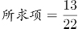。

故正确答案为C。

**考点**：分数数列

**来源**：2015年深圳市公务员录用考试《行测》题第41题

### 第 42 题

22，306，512，820，1330，（ ）

A. 1536

B. 1542

C. 2136

D. 2142

第 42 题 · 答案与解析

**参考答案（粉笔题库参考内容）**

D

**解析**

数列中含有多个三位及以上的多位数，考虑机械划分。将数列中的每一个数字划分后，得到新的一组数列：2,2；3,6；5,12；8,20；13,30。观察该组数列，每组数的前一项形成的数列为2,3,5,8,13，规律为第一项＋第二项=第三项；每组数的后一项形成的数列为2,6,12,20,30，将该数列作差，得到4,6,8,10，是公差为2的等差数列，故所求项的前一项=8+13=21，后一项=30+10+2=42，将两项组合，得到的数为2142。

故正确答案为D。

**考点**：机械划分

**来源**：2015年深圳市公务员录用考试《行测》题第42题

### 第 43 题

3，4，5，11，14，107，（ ）

A. 89

B. 118

C. 182

D. 293

第 43 题 · 答案与解析

**参考答案（粉笔题库参考内容）**

A

**解析**

数列无明显特征（14到107变化幅度大），优先考虑作差，作差无规律，考虑递推。观察数列发现：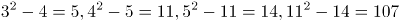，数列规律为，故。

故正确答案为A。

**考点**：递推数列

**来源**：2015年深圳市公务员录用考试《行测》题第43题

### 第 44 题

9654，4832，5945，7642，7963，8216，（ ）

A. 3649

B. 3469

C. 4396

D. 9436

第 44 题 · 答案与解析

**参考答案（粉笔题库参考内容）**

D

**解析**

数列数值较大，均为多位数且规律不明显，考虑机械划分。将数列中的每一个数字进行划分，划分后得到一组新的数列：9，6，54；4，8，32；5，9，45；7，6，42；7，9，63；8，2，16。观察发现：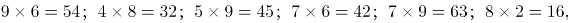数列规律为将数划分为3项后，，观察选项，只有9436符合该规律。

故正确答案为D。

**考点**：机械划分

**来源**：2015年深圳市公务员录用考试《行测》题第44题

### 第 45 题

11，8，-1，-28，（ ）

A. 54

B. \-84

C. \-102

D. \-109

第 45 题 · 答案与解析

**参考答案（粉笔题库参考内容）**

D

**解析**

数列无明显特征，变化幅度较大且呈递减趋势，优先考虑作差。后一项减前一项，得到的新数列为－3，－9，－27，为公比为3的等比数列，则下一个差为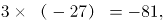则，故所求项=-81-28=-109。

故正确答案为D。

**考点**：多级数列

**来源**：2015年深圳市公务员录用考试《行测》题第45题

### 第 46 题

某高中学校举行运动会，高一、高二、高三学生列成方队，每个年级队伍均为240人，分成6个竖列依次行进。高一队伍前后每人间隔1米，高二队伍前后每人间隔1.5米，高三队伍前后每人间隔2.5米。每个年级队伍之间间隔5米，所有年级队伍的行进速度均为60米每分钟，则三个年级队伍通过35米长的主席台需要（ ）分钟。

A. 3

B. 4

C. 5

D. 6

第 46 题 · 答案与解析

**参考答案（粉笔题库参考内容）**

B

**解析**

本题排列成纵列通过主席台，可看作是火车过桥问题，只需用队伍总长度与主席台的长度和除以行进速度即可。首先算队伍总长度，每个年级分成6个竖列，则每列有，则中间共有40-1=39个空，再考虑每个年级间空5米，可得队伍总长度为，则总长度为205+35=240米，队伍通过主席台所需时间为。

故正确答案为B。

**考点**：方阵问题、火车过桥

**来源**：2015年深圳市公务员录用考试《行测》题第46题

### 第 47 题

甲、乙两汽车分别从P、Q两地同时出发相向而行，途中各自速度保持不变。他们第一次相遇在距P点16千米处，然后各自前行，分别到达Q、P两地后立即折返，第二次相遇在距P点32千米处，则甲、乙速度之比为：

A. 2：3

B. 2：5

C. 4：3

D. 4：5

第 47 题 · 答案与解析

**参考答案（粉笔题库参考内容）**

A

**解析**

假设第一次相遇乙走过的路程为S千米，由第一次相遇甲乙合走了1个全程，第二次相遇甲乙合走了3个全程，可得乙第一次相遇所走路程与第二次相遇所走总路程比为1:3，可得S：（S+16+32）=1:3，可得S=24。可得第一次相遇时甲走16千米，乙走24千米，则甲乙速度比为16:24=2:3。

故正确答案为A。

**考点**：相遇追及

**来源**：2015年深圳市公务员录用考试《行测》题第47题

### 第 48 题

用白铁皮做罐头盒，每张铁皮可制16个盒身或43个盒底，一个盒身与两个盒底配成一套罐头盒。现有150张白铁皮，则应用（ ）张来制盒身，余下的制盒底，可以正好全部制成整套的罐头盒。

A. 86

B. 78

C. 64

D. 54

第 48 题 · 答案与解析

**参考答案（粉笔题库参考内容）**

A

**解析**

本题题干为“正好全部制成整套的罐头盒”，可知材料没有浪费且2盒身数=盒底数。可设x张制盒身，则有150-x张制盒底，可得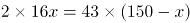，计算得到x=86。

故正确答案为A。

**考点**：和差倍比问题

**来源**：2015年深圳市公务员录用考试《行测》题第48题

### 第 49 题

一本书的上下册共835页，小刚看上册，每天看40页；小强看下册，每天看35页。5天后他们各自未看的书页数相等，此时小强下册还剩下（ ）页没看。

A. 180

B. 200

C. 210

D. 230

第 49 题 · 答案与解析

**参考答案（粉笔题库参考内容）**

D

**解析**

由于两人未看的页数相等，故欲求小强剩下未看页数，只需要用剩下的总页数除以2即可。由题意可得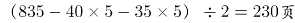。

故正确答案为D。

**考点**：和差倍比问题

**来源**：2015年深圳市公务员录用考试《行测》题第49题

### 第 50 题

世界石油价格上涨，导致油站供油不足。已知三辆油罐车分别运来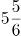，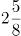，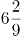吨油，农忙季节农用机车急需用油，为支援生产，把三罐油平均分成若干等份，每份尽可能多，每台农用机车一次凭车牌号领取一份油，则至少可满足（ ）台农用机车的需求。

A. 125

B. 138

C. 151

D. 163

第 50 题 · 答案与解析

**参考答案（粉笔题库参考内容）**

C

**解析**

本题要求将三罐油平均分成若干等份且每份尽可能多，可转化为求三辆油罐车运输量的最大公约数。将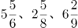三个分数进行通分可得到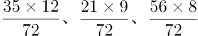，分子的最大公约数为7，则三个分数的最大公约数为7/72，即可满足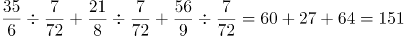台。

故正确答案为C。

**考点**：公倍数与公约数问题

**来源**：2015年深圳市公务员录用考试《行测》题第50题

### 第 51 题

一辆卡车车厢底面为4.8平方米，运送一种长方形包装箱，包装箱的棱长分别为0.5米、0.4米、0.3米。如果放三层，这辆卡车最多可装（ ）个包装箱。

A. 100

B. 120

C. 150

D. 200

第 51 题 · 答案与解析

**参考答案（粉笔题库参考内容）**

B

**解析**

本题层数固定，要使得放的越多，则要求每层放的越多。本题0.4米和0.3米正好能被4.8整除，故以此为底面时，底面最小且可被整除。此时将棱长0.5米作为高，下底面面积为，每层可放置箱子，卡车最多可装。

故正确答案为B。

**考点**：统筹规划问题、几何公式类-立体图形

**来源**：2015年深圳市公务员录用考试《行测》题第51题

### 第 52 题

某儿童娱乐场有两条圆形赛车跑道，大圆跑道直径80米，小圆跑道直径60米，两跑道于发车起点A处相切重合。假设甲、乙两辆车同时从A点以相同速度出发（甲跑大圈、乙跑小圈），且此后速度均保持不变。则第一次相距最远时，甲、乙各跑了（ ）圈。

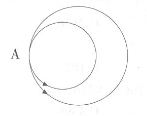

A. 2，3

B. 3/2，2

C. 3，2

D. 5/2，2

第 52 题 · 答案与解析

**参考答案（粉笔题库参考内容）**

B

**解析**

解析一：由题意大圆和小圆直径为80米和60米，两圆周长之比为直径之比，则两圆周长比为80:60=4:3，又由于两车速度相同，则两车跑的圈数比为3:4（两车速度相同，则跑的路程也相同，可假设跑的路程为S，则圈数比为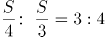），满足题意的只有B项。

解析二：为使两车相距最远，则两车应分别位于大圆直径的两端，即乙位于A点，甲位于与A相对的大圆直径另一端，此时乙车跑完小圈整圈，甲车应在半圈处。结合选项只有B项符合。将B项代入，两车所行驶的圈数比为3:4，与条件相符合。

故正确答案为B。

**考点**：普通行程

**来源**：2015年深圳市公务员录用考试《行测》题第52题

### 第 53 题

有家长（爸爸或妈妈，他们都不是老师）和老师共22人陪同小学生参加运动会，已知家长比老师多，妈妈比爸爸多，女老师比妈妈多2人，至少有一名男老师，那么在这22人中，共有爸爸（ ）人。

A. 7

B. 6

C. 5

D. 4

第 53 题 · 答案与解析

**参考答案（粉笔题库参考内容）**

C

**解析**

家长比老师多，则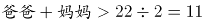，即爸爸+妈妈人数至少为12人（老师人数至多为10人）；同理，妈妈比爸爸多，则妈妈至少有7人；女老师比妈妈多2人，女老师人数至少为9人；又由于老师人数至多为10人且至少有一名男老师，则可得女老师人数=9人，男老师人数=1人，妈妈人数=7人，爸爸人数=5人。

故正确答案为C。

**考点**：和差倍比问题

**来源**：2015年深圳市公务员录用考试《行测》题第53题

### 第 54 题

某大学法学院72名研究生当中有36人是中国法律援助网志愿者，有28人是广东省法律援助中心志愿者，还有一些同学是学校法律援助协会会员。已知参加学校法律援助协会的人数是既是中国法律援助网志愿者又参加学校法律援助协会人数的3倍，是三种组织均参加了的人数的6倍；既参加了学校法律援助协会又是广东省法律援助中心志愿者的人数是三种组织都参加了的人数的2倍；既是中国法律援助网志愿者又是广东省法律援助中心志愿者的人数有10人，则参加了学校法律援助协会的有（ ）人。

A. 24

B. 28

C. 36

D. 48

第 54 题 · 答案与解析

**参考答案（粉笔题库参考内容）**

C

**解析**

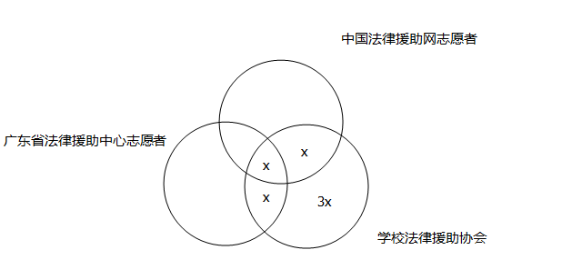

如图，假设三者都参加的人数为x，则由“参加学校法律援助协会的人数是既是中国法律援助网志愿者又参加学校法律援助协会人数的3倍，是三种组织均参加了的人数的6倍”，可得到参加学校法律援助协会的人数为6x，既是中国法律援助网志愿者又参加学校法律援助协会的人数为2x；又由“既参加了学校法律援助协会又是广东省法律援助中心志愿者的人数是三种组织都参加了的人数的2倍”，可知其人数为2x。则可得到72=36+28+6x-10-2x-2x+x，解得x=6，则参加了学校法律援助协会的人数为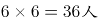。

故正确答案为C。

（备注：本题默认法学院研究生至少参加了三个组织中的一个，否则本题缺少条件。）

**考点**：三集合

**来源**：2015年深圳市公务员录用考试《行测》题第54题

### 第 55 题

某宠物美容中心的宠物美容业务需要经过三道工序，第一道工序每名员工每天可为15只宠物进行理毛，第二道工序每名员工每天可为10只宠物进行清洗，第三道工序每名员工每天可为12只宠物进行修饰造型。要使宠物美容中心人工效率最高、顾客等待时间最少，则三道工序至少需要（ ）名员工。

A. 15

B. 20

C. 30

D. 60

第 55 题 · 答案与解析

**参考答案（粉笔题库参考内容）**

A

**解析**

本题要求等待时间最短，即要求三者的总效率应相同。第一道工序效率∶第二道效率∶第三道效率= 15∶10：12，赋值每一道效率为60只宠物（15、10、12的最小公倍数），人数比=4∶6∶5，则至少安排4+6+5=15名。

故正确答案为A。

**考点**：统筹规划问题、给效率比例型

**来源**：2015年深圳市公务员录用考试《行测》题第55题

### 第 56 题

①遍地的春花同心花       开放。

②人和行李        到了，一件都没少。

③我明天进城，咱们        去吧。

依次填入划横线部分最恰当的一项是：

A. 一起 一起 一齐

B. 一起 一齐 一齐

C. 一齐 一起 一齐

D. 一齐 一齐 一起

第 56 题 · 答案与解析

**参考答案（粉笔题库参考内容）**

D

**解析**

“一齐”表示不同主体同时发出，强调时间上的一致性，而 “一起”指共同在一处，主要强调不同主体在地点上的一致。

第一空，①句表达“春花”与“心花”同时开放之意，表达“时间一致性”，故“一齐”当选，排除A、B两项。

第二空，②句表达“人和行李”同时到了，表达“时间一致性”，故“一齐”符合文意，排除C项。

第三空代入验证，③句强调主体“咱们”明天从同一个地点出发进城，故“一起”符合文意，当选。

故正确答案为D。

**考点**：词的辨析-词义侧重、实词填空、对应关系-前后呼应

**来源**：2015年深圳市公务员录用考试《行测》题第56题

### 第 57 题

①比尔·盖茨为       事业已投入260亿美元，超过全部财产的一半，甚至早早立下遗嘱，死后99%的财富都要捐献出去。

②晨曦中，山海关城楼的       隐约可见。

③国庆节前夕，党和国家领导人在人民大会堂举行盛大宴会，       各国贵宾。

填入划横线部分最恰当的一项是：

A. 慈善 雄姿 招待

B. 慈善 雄威 接待

C. 慈悲 雄威 招待

D. 慈善 雄姿 接待

第 57 题 · 答案与解析

**参考答案（粉笔题库参考内容）**

A

**解析**

第一空，所填词语与“事业”搭配，表达“比尔·盖茨”捐献财富的行为。“慈善事业”是固定搭配，指人们在没有外在压力的情况下自愿地奉献爱心与援助的行为和从事扶弱济贫的一种社会事业，与文意契合，A、B、D三项可选。“慈悲”泛指慈爱与怜悯，与“事业”无法形成搭配，排除C项。

第二空，所填词语形容“山海关城楼”这一建筑，且能“可见”，“雄姿”指雄壮威武的姿态，形容建筑物姿态雄壮，符合文意；“雄威”指强大的威势，可用来形容带有威势的建筑，但“雄威”是无法“可见”的，只能领略、感悟，故排除B项。

第三空，“招待”指对宾客给予应有的待遇，用于“主客”之间，与“各国贵宾”对应得当，A项当选。“接待”是一定的社会组织对公务活动中的来访者所进行的迎接、接洽和招待活动，含义中包含“招待”，也包含迎接、接洽等，而文段中仅仅指的是用“盛大晚宴”招待，排除D项。

故正确答案为A。

**考点**：词的辨析-词义侧重、实词填空

**来源**：2015年深圳市公务员录用考试《行测》题第57题

### 第 58 题

①网坛女将郑洁几经        ，才进了国家队。

②我将于18日        去上海参加比赛。

依次填入划横线部分最恰当的一项是：

A. 转折 启程

B. 周折 起程

C. 周折 启程

D. 转折 起程

第 58 题 · 答案与解析

**参考答案（粉笔题库参考内容）**

B

**解析**

第一空，根据“几经”可知，①句主要表达郑洁进国家队之前经历多次挫折，并不顺利。“周折”多用来形容事情曲折并不顺利，符合文意，B、C两项可选。“转折”指事物在发展过程中改变原来的方向、形式等，文段并无“郑洁改变去国家队这一最初目的”之意，且与文段“挫折、不顺利”之意不符，排除A、D两项。

第二空，②句表达“我18日当天动身前去上海”，“启程”与“起程”均可表达上路、出发，但“起程”对于动身、出发的时间和指向更明确，如：18日起程，今日起程，连夜起程，而“启程”则泛指行程，不强调“具体时间”，如：某某接受邀请，将于明年适当时间启程访问美国，排除C项。

故正确答案为B。

【文段出处】高中语文练习

**考点**：词的辨析-词义侧重、实词填空

**来源**：2015年深圳市公务员录用考试《行测》题第58题

### 第 59 题

①       了过去，瞻望了未来，但最重要的还是活在当下。

②她们总会利用一些精巧的搭配让那些略带休闲风格的衣服在正式        看起来与大环境也挺和谐。

③美国总统国家安全事务助理哈德利14日在接受美国有线电视新闻网采访时说，联合国是解决伊朗核问题的最佳        。

依次填入划横线部分最恰当的一项是：

A. 上溯 场所 场合

B. 回溯 场所 场所

C. 上溯 场合 场所

D. 回溯 场合 场合

第 59 题 · 答案与解析

**参考答案（粉笔题库参考内容）**

D

**解析**

第一空，①句重在考查对“过去、未来、当下”这些“时间概念”的掌握，所填词语与“过去”搭配，“回溯”指回忆，常与表示过去时间的词语搭配，如回溯历史、回溯过往，“回溯过去、瞻望未来”为常见的固定搭配；而“上溯”指逆着水流向上游走，也指从现在往过去推，用以表示回到某个时间，常搭配“到”某个时间，排除A、C两项。

第二、三空，“场所”特指环境的特定部分，即具体的建筑物或公共空间活动处所；“场合”泛指包涵时间和空间的环境氛围。②句强调的“正式”即指时间和空间的正式，与“场合”搭配得当；③句中的联合国也是一个概念，并非特指一个具体的建筑物或场所，故同样搭配“场合”。

故正确答案为D。

【文段出处】《正装的场合，你会打扮吗？》等

**考点**：词的辨析-搭配对象、实词填空

**来源**：2015年深圳市公务员录用考试《行测》题第59题

### 第 60 题

①有些职能部门         手中的权力，增加了人民群众的负担，这种情况在农村显得尤为严重。

②“神舟”十号在辽阔的宇宙空间遨游了15天，        了大量珍贵的科研资料。

依次填入划横线部分最恰当的一项是：

A. 滥用 收集

B. 乱用 搜集

C. 乱用 收集

D. 滥用 搜集

第 60 题 · 答案与解析

**参考答案（粉笔题库参考内容）**

A

**解析**

第一空，横线处所填词语与“权力”搭配，且造成了“人民群众负担增加”的后果。“滥用”指胡乱、过度地没有限制地使用，强调“多”和“乱”，“过多地”使用权力与“增加负担”形成因果对应，且“滥用权力”为常见搭配，A、D两项可选；“乱用”指不懂方法，随便使用，文段中“职能部门”不可能存在不懂怎么去使用权力的问题，故排除B、C两项。

第二空，横线处所填词语的主体为“神舟十号”，A项“收集”指的是招收聚集，一般侧重一些事物本身存在，将其收纳聚集在一起；D项“搜集”指的是搜索收集，除了收集之外，还有搜索的意思。②句中“神舟十号”在宇宙空间周遨游是早已设定好轨道的，不可能到处去搜索，只能将所遇到的、感知到的事物、信息等收集到一起，A项“收集”当选。

故正确答案为A。

【文段出处】高中语文练习

**考点**：词的辨析-搭配对象、实词填空、对应关系-前后呼应

**来源**：2015年深圳市公务员录用考试《行测》题第60题

### 第 61 题

①由达成共识到制订计划，       欧盟在军事一体化道路上迈出了可喜的一步。

②虽然时间紧，任务重，但领导既然这样要求，我们也只能       而为之了。

③实践证明，人的大脑愈用愈发达，不用则会       。

依次填入划横线部分最恰当的一项是：

A. 表明 勉励 蜕化

B. 说明 勉力 蜕化

C. 说明 勉励 退化

D. 表明 勉力 退化

第 61 题 · 答案与解析

**参考答案（粉笔题库参考内容）**

D

**解析**

本题可从第二空入手，②句主要表达“时间紧、任务重的情况下，我们只能按照领导要求尽力而为之”，故所填词语需体现“尽力”之意。“勉力”是指努力去做、尽力去做，符合文意，B、D二项可选；“勉励”是指鼓励别人，与文意无关，故排除A、C二项。

第三空，“则”连接前后表示转折，根据转折前的“愈用愈发达”可知，所填词语应体现“人的大脑不用”的后果，体现“越来越不好用”之意。D项“退化”指生物体在进化过程中某一器官变小，结构简化，机能减退甚至完全消失，符合文意，当选；B项“蜕化”比喻事物发生本质的变化，人脑即使不用也不会发生质变，排除B项。

第一空代入验证，“表明”指表示清楚、表达明白，置于①句中语义合适。

故正确答案为D。

【文段出处】高中语文练习

**考点**：词的辨析-词义侧重、实词填空、对应关系-前后呼应、关联关系-转折关系

**来源**：2015年深圳市公务员录用考试《行测》题第61题

### 第 62 题

2007年全球金融海啸肆虐，以家电为代表的消费性电子产品外销的需求急速衰退，家电企业可谓               。为了扩大国内市场，也为了让国内家电企业走出低谷，家电下乡、以旧换新、节能补贴等政策陆续出台。这些扶持性政策                  ，对家电业发展产生了巨大的推动作用。

依次填入划横线部分最恰当的一项是：

A. 如履薄冰 有的放矢

B. 今非昔比 有目共睹

C. 举步维艰 不负众望

D. 江河日下 任重道远

第 62 题 · 答案与解析

**参考答案（粉笔题库参考内容）**

C

**解析**

第一空，根据文意，金融海啸造成了家电产品外销衰退，且对应下文“为了让国内家电企业走出低谷”，故横线处所填词语需体现家电企业处于低谷、困境、处境艰难之意。C项“举步维艰”指迈步艰难，比喻办事情每向前进行一步都十分不容易，D项“江河日下”比喻情况一天天地坏下去，均可体现家电企业经营艰难的现状，符合文意，可选。A项“如履薄冰”比喻行事极为谨慎，存有戒心，与文段强调的家电企业经营困境无关，排除；B项“今非昔比”指现在不是过去能比得上的，多指形势、自然面貌等发生了巨大的变化，文段中并未进行现在与过去的比较，且不能表达家电企业现在处境困难之意，排除。

第二空，根据“对家电业发展产生了巨大的推动作用”可知,所填词语应该形容“扶持性政策”有作用。C项“不负众望”指不辜负大家的期望，符合文意，当选。D项“任重道远”比喻责任重大，要经历长期的奋斗，强调目标远未达成，与“产生了巨大推动作用”对应不当，排除。

故正确答案为C。

**考点**：对应关系-前后呼应、成语填空、对应关系-解释说明

**来源**：2015年深圳市公务员录用考试《行测》题第62题

### 第 63 题

尼采就自诩过他是太阳，光热无穷，只是给予，不想取得。       尼采毕竟不是太阳，他发了疯。中国也不是，       有人说，掘起地下的煤来，就足够全世界几百年之用。        几百年之后呢？几百年之后，我们当然是化为魂灵，或上天堂，或落了地狱,但我们的子孙是在的，        还应该给他们留下一点礼品。

依次填入划横线部分最恰当的一项是：

A. 但是 尽管 可是 那么

B. 然而 虽然 但是 所以

C. 因为 即使 然而 不过

D. 可是 或者 假如 或者

第 63 题 · 答案与解析

**参考答案（粉笔题库参考内容）**

B

**解析**

第一空，前文介绍“尼采自诩他是太阳······”与后文“尼采毕竟不是太阳”语义相反，故所填词语为转折关联词，A项“但是”、B项“然而”、D项“可是”均符合文意。C项“因为”是因果关系引导词，与文意不符，排除。

第二、三空，文段先指出“地下的煤足够用几百年”，之后以反问句指出“几百年之后，地下的煤未必可以满足子孙使用”，故前后语义相反，“尽管······可是······”、“虽然······但是······”均符合文段逻辑，A、B项可选，D项“假如”表假设关系，与文意不符，排除。

第四空，根据文意，“虽然我们不在了，但子孙是在的”及横线后的 “给子孙留下一点礼品”可知，横线处应体现出前后文之间应为因果关系， B项“所以”体现前后文的因果关系，当选；A项“那么”引出应有的结果时，前文需搭配“如果”引出的假设句，与“我们的子孙是在的”这一肯定句不符，排除。

故正确答案为B。

【文段出处】高中语文练习

**考点**：对应关系-前后呼应、关联关系-转折关系、关联关系-因果关系

**来源**：2015年深圳市公务员录用考试《行测》题第63题

### 第 64 题

①那时处处都是歌声和       的胡琴声，圆润的喉咙，确实是很少的。

②逛南京像逛古董铺子，到处都有些时代侵蚀的遗痕。你可以摩挲，可以凭吊，可以        遐想。

③一座依山傍水的江南宅院。在这个现代气息无所不在的时代里，它带着几分       ，想必此处已许久无人造访。

依次填入划横线部分最恰当的一项是：

A. 凄厉 悠然 寂寞

B. 凄厉 怡然 寂静

C. 凄凉 悠然 寂静

D. 凄凉 怡然 寂寞

第 64 题 · 答案与解析

**参考答案（粉笔题库参考内容）**

A

**解析**

第一空，所填词语形容“胡琴声”，根据“圆润的喉咙确实是很少的”可知，横线处所填词语需与“圆润”语义相反，“凄厉”可以形容声音，形容声音悲惨而尖锐，“尖锐”之意符合文意，A、B项保留；“凄凉”一般形容的是环境孤寂、冷清，无法形容声音，且其反义为热闹，与文意不符，排除C、D两项。

再看第三空，所填词语形容“江南宅院”。“寂寞”指冷清孤单，与文段“此处已许久无人造访”对应紧密，且与“现代气息无所不在”形成鲜明对比，符合文段语境，保留。B项“寂静”指没有声音、安静，而文段并非表达江南宅院很安静，没有声音之意，排除。

第二空代入验证，“悠然”形容安闲、闲适的样子，置于文段形容人，语义合适，可选。

故正确答案为A。

【文段出处】《插画里的南京｜那些你可能还不知道的景致》

**考点**：实词填空、对应关系-前后呼应、关联关系-并列关系

**来源**：2015年深圳市公务员录用考试《行测》题第64题

### 第 65 题

①我想于寒假中乘空来这里小住半月，以便尽量地        高寒幽寂的禅味。

②即使天冷了地冷了宇宙的一切都冷了，它们也会       地举起美的萌芽，决不肯把生命的篷帆轻易降落。

③那一片刚播种不久的麦田，已经有了许多绿意，似乎在对季节进行着顽强的       和挑衅。

依次填入划横线部分最恰当的一项是：

A. 领略 坚强 抗议

B. 领略 顽强 抗争

C. 领会 坚强 抗争

D. 领会 顽强 抗议

第 65 题 · 答案与解析

**参考答案（粉笔题库参考内容）**

B

**解析**

第一空，“领略”指了解事物的情况，进而认识它的意义，着重指感性上的体验和欣赏，比如“领略风光”；“领会”指领悟了事物中蕴涵的道理并对其深有体会，着重于理性上的理解，比如“领会精神”，横线处所填词语搭配“高寒幽寂的禅味”，“领略”更合适，排除C、D项。

第二空，“坚强”指不可摧毁，不动摇，不屈服，通常指力量、态度等；“顽强”比喻人做某事有毅力或不向困难低头，通常指生命力或意志，根据“决不肯把生命的篷帆轻易降落”可知，横线处填入“顽强”更合适，排除A项。

第三空代入验证，根据“和”可知，横线处所填词语与“挑衅”语义并列，“抗议”指对他方的行动提出强烈的反对意见；“抗争”指对抗斗争，与“抗议”相比，不仅仅是“提出反对意见”，更落实到了具体的行动，程度较重。与“挑衅”构成并列，“抗争”更合适，B项当选。

故正确答案为B。

【文段出处】高中语文练习

**考点**：词的辨析-词义侧重、词的辨析-搭配对象、实词填空、对应关系-前后呼应

**来源**：2015年深圳市公务员录用考试《行测》题第65题

### 第 66 题

下列各句中，有语病的一句为：

A. 科技工业园文化是生活在科技工业园中致力于发展高新技术产业的成员（科学家、工程师、管理人员、政府官员、技术工人等）所遵循的共同价值观念、制度环境和工作规章。

B. 身为中国人，不能熟练地使用母语进行思想、文化和生活上的交流，不懂得珍惜母语蕴含的丰富文化和历史价值，难道不是很悲哀吗？

C. 虽然目前禽流感人传人的现象不明显，但不排除将来会像SARS一样从动物到人，在人身上发生变异，进而有人传人的可能，因此在疫情出现早期就杀灭疫禽的决定是正确的。

D. 网络不仅是社会文明进步的标志，而且对经济、社会发展做出了积极的贡献，也给我们的生活带来了巨大的便利。

第 66 题 · 答案与解析

**参考答案（粉笔题库参考内容）**

D

**解析**

D项，逻辑错误，“不仅···而且”是表述递进关系的关联词语，语义程度前轻后重，故正确的表述应为“网络是社会文明进步的标志，不仅给我们的生活带来了巨大的便利，而且对经济、社会发展做出了积极的贡献”。

故正确答案为D。

【文段出处】《2015年深圳市考》

**来源**：2015年深圳市公务员录用考试《行测》题第66题

### 第 67 题

下列各句中，有语病的一句为：

A. 常州延龄书画社社员的年龄平均78岁，连续五年被评为市文联系统先进集体。

B. 科学研究发现，在各种矿物的内部，原子核在自然状态下会产生衰变。

C. 把文学作为一种社会现象看时，作家是生产者，读者是消费者，而文学批评家却是站在两者的中间，做一个介绍人的角色。

D. 中国海岸线曲折绵长，有1.8万多公里，仅潮间带滩涂面积就有217万公顷，沿海水域是为数众多的水生生物、鸟类和两栖动物的栖息地及一些洄游鱼类的繁殖地。

第 67 题 · 答案与解析

**参考答案（粉笔题库参考内容）**

A

**解析**

A项，句子主语为“社员的年龄”，“年龄”不能作第二个分句的主语，因此应将第二个分句的主语补充完整，改为“该书画社连续五年被评为市文联系统先进集体”。

故正确答案为A。

【文段出处】《高考语文练习题》

**来源**：2015年深圳市公务员录用考试《行测》题第67题

### 第 68 题

下列各句中，没有语病的一句是：

A. 将自重2吨的预制板直接架在砖墙上，大大超过了安全标准，非常危险。

B. 去年的学习成绩和今年的比较起来大不相同。

C. 在省级单位的政务新媒体较量中，广东和北京并列成为全国第三名，这一成绩靠的是政府不断创新问政平台，提高服务水平，重视政民沟通取得的。

D. 深圳市政府从培养高层次创新人才和开发高科技项目的目的出发，创办了以培养研究生为主的深圳虚拟大学园。

第 68 题 · 答案与解析

**参考答案（粉笔题库参考内容）**

D

**解析**

A项，第二个分句中的“超过了安全标准”意味着更安全，与后文“非常危险”矛盾，可改为“超过了安全限度”；B项，比较一先一后两件事,一般总是以后者为主体，应将“去年”和“今年”位置互换；C项，“靠的是······取得的”，为句式杂糅，需去掉“取得的”。

本题为选非题，故正确答案为D。

**来源**：2015年深圳市公务员录用考试《行测》题第68题

### 第 69 题

下列各项中，没有语病的一项是：

A. 班长关心我们，不让我们再加班了。我们再三恳求，终于答应了。

B. 有没有好的学习方法，是提高学习成绩的一个不可少的因素。

C. 在战争年代，人们对一身灰布制服，一件本色的粗毛线衣，或者自己打的一副手套、编的一双草鞋，都很有感情。

D. 蒲松龄的《聊斋志异》，行世300多年来，各种版本难于计数，至今仍拥有广大读者群。

第 69 题 · 答案与解析

**参考答案（粉笔题库参考内容）**

C

**解析**

A项，最后一个分句有歧义，没有表述清楚是“我们”答应了，还是“班长”答应了；B项，一面和两面搭配不当，应将第一个分句改为“好的学习方法”；D项，“读者群”本来就是集合概念，故不能用“广大”修饰，应去掉“群”。

本题为选非题，故正确答案为C。

**来源**：2015年深圳市公务员录用考试《行测》题第69题

### 第 70 题

下列各句中，没有语病的一句是：

A. 一年一度的东海市第六届集邮活动日主会场活动今天在邮电大厦举行，李副市长到会表示祝贺。

B. 人的素质的提高，不仅体现在物质生活条件和生活水平的改善上，也体现在精神生活和思想素质的提高上。

C. 现代文化，无论是其物质的、形式的或是精神的方面，都必须以传统作为根基，才能深沉，才能有底蕴，才能生生不息。

D. 林老师对自己的教学严格要求，对年轻教师悉心指导，所以我们选他作为学科带头人是当之无愧的。

第 70 题 · 答案与解析

**参考答案（粉笔题库参考内容）**

C

**解析**

A项，“一年一度”与“第六届”不能同时使用，应去掉其中的一个；

B项，第二个分句中的“生活水平”与“改善”不搭配，“精神生活”与“提高”不搭配；

C项，句意明确，当选；

D项，句式杂糅，应改为“所以我们选他作为学科带头人”或“他作为学科带头人是当之无愧的”。

本题为选非题，故正确答案为C。

**来源**：2015年深圳市公务员录用考试《行测》题第70题

### 第 71 题

下列各句中，没有语病的一句是：

A. 通州市五部门联合执法，取缔了多处非法经营的音像制品，近3万张盗版光盘被查获后销毁。

B. 《经济时报》称，中国经济今后一段时间还将保持高速增长的势头不会减弱，仍将是全球投资者向往的地方。

C. 非物质文化遗产涉及的范围非常广泛，每一个人都跟它脱不开关系，所以在每个人身上都存在着他所在社会的传统。

D. 《与台湾关系法》是美国的国内法，它不能超越国际法准则和中美三个联合公报等国际条约而成为干涉中国内政的法律依据。

第 71 题 · 答案与解析

**参考答案（粉笔题库参考内容）**

D

**解析**

A项，“取缔”与“音像制品”搭配不当，“取缔”的应该是“经营场所”；B项，“中国经济”与“地方”搭配不当，投资者向往的地方是“中国”，而不是“中国经济”，且第二个分句“保持高速增长的势头不会减弱”句子结构混乱，可将“不会减弱”去掉；C项，因果倒置，“每一个人都跟非物质文化遗产脱不开关系”不是“每个人身上都存在着他所在社会的传统”的原因，而是其结果，故应将“所以”改为“因为”。

本题为选非题，故正确答案为D。

**来源**：2015年深圳市公务员录用考试《行测》题第71题

### 第 72 题

下列各句中，没有语病的一句是：

A. 实践证明，一个人知识的多寡，成就的大小，关键在于勤劳的程度。

B. 记者又到学校采访了许多张老师的事迹。

C. 这次回到故乡，我又看到了阔别多年的母亲那熟悉的可爱的乡音和那爽朗的笑声。

D. 就目前来讲，我国人民的文化程度普遍偏低，还确切地需要大大提高。

第 72 题 · 答案与解析

**参考答案（粉笔题库参考内容）**

A

**解析**

B项，“采访”通常与“人”搭配，与“事迹”搭配不当；C项，“看到”与“乡音”和“笑声”搭配不当；D项，“确切”与“需要”不搭配，体现程度加重可将尾句改为“确实还需要大大提高”。

故正确答案为A。

**来源**：2015年深圳市公务员录用考试《行测》题第72题

### 第 73 题

下列各句中，没有语病的一句是：

A. 在当今商品经济的时代，当诗歌失却往昔荣耀而逐渐远离我们的时候，读到这样一首清纯明净、催人奋然前行的祖国颂歌，真是难得的精神享受。

B. 一切事物的发展都是有起有伏、波浪式前进的，这是由于事物的内部矛盾以及自然和社会的种种外因影响所决定的。

C. 文艺作品语言的好坏，不在于它用了一大堆华丽的词、用了某一行业的术语，而在于它的词语用得是地方。

D. 有的文章主旨比较隐晦，不是用明白晓畅的文字直接揭示出来，而是借用某种修辞手段或表现手法，含蓄地描写出来。

第 73 题 · 答案与解析

**参考答案（粉笔题库参考内容）**

A

**解析**

B项，“这是由于······所决定的”为句式杂糅，可改为“这是由事物的内部矛盾以及自然和社会的种种外因所决定的”；C项，一面与两面搭配不当，句子前半部分说明的是“好坏”两个方面，句子后半部分说明的只是“好”这一个方面；D项，“主旨”与“描写”搭配不当，可将“描写”改为“表现”。

故正确答案为A。

**来源**：2015年深圳市公务员录用考试《行测》题第73题

### 第 74 题

七彩瀑布群，位于香格里拉县尼汝村的一个群山深处，一条名为“尼汝河”的高原融雪河流和陡峭的山峰造就了这一旷世奇观。

上述语句的语病为：

A. 成分残缺

B. 表意不明

C. 结构混乱

D. 搭配不当

第 74 题 · 答案与解析

**参考答案（粉笔题库参考内容）**

C

**解析**

句子前半部分的陈述对象为“瀑布群”，而后半部分又将陈述对象改为 “河流”和“山峰”，句子前后陈述对象不一致，结构混乱。可将句子后半部分改为：这一旷世奇观是由一条名为“尼汝河”的高原融雪河流和陡峭的山峰造就的。

故正确答案为C。

**来源**：2015年深圳市公务员录用考试《行测》题第74题

### 第 75 题

把下面几个句子组成语意连贯的一段文字，排序正确的一项是：

（1）村庄人平时是很瞧不起“偷”字的。

（2）你不偷一点点，那些好收成很快就被日子带走了。

（3）但偷秋是例外，他们是渴望从岁月中偷出一点好时光。

（4）老人们说，秋是要偷的。

（5）是渴望从忙碌的生活中偷出一缕朴素的温馨和情趣。

（6）是渴望从丰收的季节里偷出一点好记忆。

（7）你偷秋，就偷来了好收成的种子，你就有好收成好运气。

A. 4-2-3-6-5-7-1

B. 4-1-3-6-5-2-7

C. 4-3-6-5-2-7-1

D. 4-2-7-1-3-6-5

第 75 题 · 答案与解析

**参考答案（粉笔题库参考内容）**

D

**解析**

首句都是（4），不做区分。观察7句话发现（3）句中出现转折词“但”，说明偷秋是例外，与平时有区别，（1）句说明“偷”字平时是让人瞧不起的，因此，（1）（3）两句可以构成转折关系，二者捆绑且（1）句在（3）句前，排除A、C两项。

比较B、D两项，区别在于（4）句后接（1）句还是接（2）句，（4）句提出“偷秋”的话题，（1）句只是说明“偷”字平时让人瞧不起，（2）句说明不“偷秋”的坏处，（2）句与（4）句话题一致，且（2）句解释了“秋是要偷的”原因，二者捆绑，对应D项。

故正确答案为D。

【文段出处】《偷秋》

**考点**：确定捆绑

**来源**：2015年深圳市公务员录用考试《行测》题第75题

### 第 76 题

经历过太空遨游的农作物种子，返回地面种植后，不仅植株明显增高增粗、果型增大、产量比原来普遍增长，而且品质也大为提高。太空环境对植物基因产生影响已得到各国科学家的证实。但是对太空育种原理的解释仍在争论之中。科学家认为，太空育种主要是通过强辐射、微重力和高真空等太空综合环境因素诱发植物种子的基因变异。由于亿万年来地球植物的形态、生理和进化始终深受地球重力的影响，一旦进入失重状态，同时受到其他物理辐射的作用，将更有可能产生在地面上难以获得的基因变异。综合太空辐射、微重力和高真空等因素的太空环境对植物种子的生理和遗传性状具有强烈影响，但是究竟主要是哪些因素产生影响，以及如何产生影响，至今还没有定论。

下列说法中不符合原文意义的一项是：

A. 经过太空育种，可以使作物在植株形态、果型特征以及产量和品质方面有很大改善

B. 各国科学家都承认太空环境对农作物育种的影响，但对其原理还莫衷一是

C. 太空育种是在太空环境中种植作物，利用各种特殊的环境因素来影响植物的各种形态特征，以获得优质的植株

D. 经历过太空邀游的种子会产生在地面上难以发生的基因变异，以使生理和遗传性状受到影响

第 76 题 · 答案与解析

**参考答案（粉笔题库参考内容）**

C

**解析**

A项，对应文段中“不仅植株明显增高增粗、果型增大、产量比原来普遍增长，而且品质也大为提高”，符合文意，排除；

B项，对应文段中“太空环境对植物基因产生影响已得到各国科学家的证实。但是对太空育种原理的解释仍在争论之中”，符合文意，排除；

C项，由文段首句可知，太空育种是农作物种子经历太空遨游后，“返回地面种植”，而非“在太空环境中种植作物”，另外“诱发植物种子的基因变异”而非“影响植物的各种形态特征”，不符合文意，当选；

D项，根据文段所述，经历过太空遨游的种子“将更有可能产生在地面上难以获得的基因变异”，且“综合太空辐射、微重力和高真空等因素的太空环境对植物种子的生理和遗传性状具有强烈影响”，可知符合文意，排除。

本题为选非题，故正确答案为C。

【文段出处】《太空洗礼过的种子》

**考点**：细节判断题

**来源**：2015年深圳市公务员录用考试《行测》题第76题

### 第 77 题

几乎每个人的内心深处，都有着对乌托邦和理想社会的向往。反乌托邦主题则是将其逻辑进行推演，最终会发现理想（主要是对制度和技术的崇拜）往往会导致种种无法控制的弊端：极权统治、非人性社会、精神压抑等。与乌托邦批判“旧”或允诺“新”的热度相比，反乌托邦的语汇更加冷峻，也更尊重人性的真实。大多数反乌托邦作品都充满想象力和黑色幽默，其辛辣的讽刺让我们哭笑不得，然后冷汗涔涔。

对这段文字概括最准确的是：

A. 揭示乌托邦理想的弊端

B. 介绍反乌托邦作品的特点

C. 描述理想与现实之间的鸿沟

D. 指出乌托邦与反乌托邦作品的差异

第 77 题 · 答案与解析

**参考答案（粉笔题库参考内容）**

B

**解析**

文段开篇借助于乌托邦引出反乌托邦这一重点概念，后文详细地介绍了反乌托邦这一主题，并展开了详细的论述，故文段的主题词是“反乌托邦”。B项是对原文主旨的凝练概括，即“介绍反乌托邦作品的特点”，当选。

A、C两项的主题词不是反乌托邦，排除；D项，文段重点强调的是“反乌托邦”，“乌托邦”为非重点，其次“乌托邦与反乌托邦作品的差异”反推文段，应该是围绕“乌托邦”与“反乌托邦”的并列文段，但此题强调“反乌托邦”，排除。

故正确答案为B。

**考点**：主题词、关联词-转折

**来源**：2014年河南省选调生选拔考试 《行政职业能力测验》试卷（精选）第18题

## 材料 1

阅读下面的一段文字，并回答后面的2道题目：

所有动物的神经系统都具有一些共同的基本功能，最明显的就是运动控制和感觉分析。人类大脑与众不同的是，它能够学会很多比较专门的活动技能。最突出的例子就是语言，没有一个人一生下来就懂某种语言，而实际上每一个人都能学会说话和听懂别人的话语，各民族的人都可以学会阅读和书写。在人类中，音乐也带有普遍性，没有受过专门训练的人也会分辨和重复不少乐曲。与此相似，几乎每一个人都能画简单的图形，而且进行精确复制的能力也并不鲜见。

人脑的这些高级功能中至少有一部分是由神经网络控制的。一百年前人们就已知道，人脑皮质中至少有两个区域对语言能力至关重要，它们似乎完全是按照言语信息处理过程的需要而构成的。颞叶内下侧表面的某些组织，包括海马状突起，明显地对于长时记忆必不可少。在某些情况下，神经系统功能的专门化很强。在人脑皮质两侧各有一个区域专管脸形辨别。其他智力活动大概也与各个专门的神经系统相联系。

人脑的另一个特性是，它的两半球有各种功能的分工。人脑功能不是完全对称的，这一点可以从对日常生活的观察中举例说明。大多数人惯用右手，而右手是左脑控制的，语言能力也基本上由左脑控制。由于这些原因，大脑左半球曾被认为是控制性的，而右半球是服从性的。但这个概念现已被修正，因为人们越来越清楚，大脑两半球各有其特殊的功能，由右脑控制的有音乐才能和复杂视觉图形的辨别能力等。右脑对感情的表达和分辨也更为重要。

### 第 78 题

根据上文，人脑的主要特性有两个，一个是“它的两半球有各种功能的分工”，还有一个特性是：

A. 运动控制和感觉分析

B. 能够学会很多比较专门的活动技能

C. 有些高级功能由神经网络控制

D. 能长时记忆和进行言语信息处理

第 78 题 · 答案与解析

**参考答案（粉笔题库参考内容）**

B

**解析**

根据第一段“人类大脑与众不同的是，它能够学会很多比较专门的活动技能”，“与众不同”即人脑不同于其他动物的特性，故可知人脑的另一个特性为“它能够学会很多比较专门的活动技能”，对应B项。

A项，根据文意，为所有动物神经系统的共性，排除；C项，为人脑特性的生理基础，而非特性本身，排除；D项，对应原文“一百年前人们就已知道，人脑皮质中至少有两个区域对语言能力至关重要，它们似乎完全是按照言语信息处理过程的需要而构成的。颞叶内下侧表面的某些组织，包括海马状突起，明显地对于长时记忆必不可少”，是对大脑生理基础的介绍，其本身并非大脑的特性，排除。

故正确答案为B。

【文段出处】《初中语文》

**考点**：细节判断题

**来源**：2015年深圳市公务员录用考试《行测》题第78题

### 第 79 题

下列说法中完全符合文段意思的一项是：

①人和动物都具有运动控制的能力

②语言能力是左右脑共同控制的

③并非每一个人都具有精确复制图形的能力

④有些人分辨乐曲不需要接受专门训练

⑤人类会读写、懂音乐、能画图，这些功能都是由神经网络控制的

⑥感情的表达和分辨是右脑控制性的表现

A. ①⑤⑥

B. ②③⑤

C. ③④⑥

D. ①②④

第 79 题 · 答案与解析

**参考答案（粉笔题库参考内容）**

C

**解析**

先分析①，根据文段所述“所有动物的神经系统都具有一些共同的基本功能，最明显的就是运动控制和感觉分析”，可知是任何动物的神经系统具有运动控制的能力，而非“人和动物”，偷换概念，排除A、D两项。

比较B、C两项，分析②，根据文段所述,“语言能力也基本上由左脑控制”，可知②表述错误，排除B项。初步判定正确答案为C。

验证③④⑥。根据文段所述，“与此相似，几乎每一个人都能画简单的图形，而且进行精确复制的能力也并不鲜见”，“几乎”表示不是所有人，可知③表述正确；“在人类中，音乐也带有普遍性，没有受过专门训练的人也会分辨和重复不少乐曲。”可知④表述正确；根据文段所述“右脑对感情的表达和分辨也更为重要”，可知⑥表述正确。

故正确答案为C。

【文段出处】《初中语文》

**考点**：细节判断题

**来源**：2015年深圳市公务员录用考试《行测》题第79题

### 第 80 题

作为非物质文化遗产，古琴艺术的价值不只在于古琴这种乐器本身，也不限于古琴曲目和弹奏技术，更重要的在于以古琴为聚合点而构建的传统美学特质及哲学意味，并且这种美学特质和哲学意味贯穿于中华雅文化的发展当中。由于钟子期和俞伯牙高山流水的故事是以古琴为依托的，所以不仅深远感人，而且历久弥新。可以说，知音意识和获得知音的愉悦成为雅士阶层不可分割的一种人生内容。

以上内容的主要意思是：

A. 钟子期和俞伯牙的故事深远感人，将知音获得的愉悦融合成一种人生内容

B. 古琴是知音哲学的依托

C. 古琴是非物质文化遗产，具有美学特质和哲学意味，知音的故事就是它的内涵之一

D. 古琴艺术的价值在于以古琴为聚合点而构建的并且历久弥新的传统美学特质及哲学意味

第 80 题 · 答案与解析

**参考答案（粉笔题库参考内容）**

D

**解析**

文段首先指出，古琴艺术作为非物质文化遗产，其价值更重要在于构建传统美学特质及哲学意味，且这种价值贯穿于中华雅文化之中，接下来列举钟子期与俞伯牙的例子进行详细地解释说明，D项为文段中心的同义替换，当选。

A项，“钟子期和俞伯牙的故事”、B项“知音哲学”，仅为举例说明的内容，本身非重点，均排除；C项“知音的故事就是它的内涵之一”无中生有，文段并未提及知音是古琴的内涵，排除。

故正确答案为D。

【文段出处】《正确理解非物质文化遗产》

**考点**：分述句特征-举例子

**来源**：2015年深圳市公务员录用考试《行测》题第80题

### 第 81 题

当前我国财富分配不均，贫富差距过大。在很多城市，商场、博物馆、影剧院门口摆放着“衣冠不整者禁止入内”的告示牌；听证会上不曾见到过农民工的身影；金融系统对贷款人担保或抵押都设有限制；巨额的择校费也把穷人及其子女挡在名校门外。

这段话支持了这样一种观点，即：

A. 当前中国经济领域广泛存在社会排斥现象

B. 当前中国在公共领域广泛存在排斥穷人的现象

C. 公平社会绝对不可以排斥穷人

D. 社会不公平最终将导致社会不稳定

第 81 题 · 答案与解析

**参考答案（粉笔题库参考内容）**

B

**解析**

文段首先提出“当前我国财富分配不均，贫富差距过大”的背景，接下来通过并列结构列举了四个例子说明社会上许多区别对待穷人和富人的现象，意在说明社会上广泛存在排斥穷人的现象，对应B项。

A项，“经济领域”概念缩小，文段中“商场、博物馆、影剧院”并非“经济领域”，排除；C项，“绝对不可以排斥穷人”无中生有，文段仅提到当前存在此种现象，并未对这一现象表明态度，排除；D项，“社会不稳定”无中生有，排除。

故正确答案为B。

**考点**：关联词-并列

**来源**：2015年深圳市公务员录用考试《行测》题第81题

### 第 82 题

传言有20多本关于创世论与进化论之争的书即将出版，且有几本已经面世了。所有这些书的目的是试图告诉那些迷感而且常常是还不开通的芸芸众生：就宇宙和生命的起源与发展问题而言，不可能存在两种都成立的科学理论。宇宙学、地质学、生物学对世上所发生的一切，已经提供了一贯的、统一的并且是在不断完善的解释。“科学”创世论——当课堂上讲授进化论时，有些人就想争抢“相同的课时”来解释它——是基于宗教，而非科学。实际上，所有科学家和大多数非原教旨主义宗教领袖们都已将“科学”创世论看作是拙劣的科学和拙劣的宗教。

非专业人士起码可以了解支持进化论的各种数据和观点。对每个人来说，著名哲学家肯切尔在《关于创世论者》的最后一章都阐述得极为清楚，这部优秀作品的护封上引用了斯蒂芬•杰•库德的一句话，“此书本身就代表了理性”。的确如此，如果理性是创世论和进化论之争的唯一标准，一切问题也就迎刃而解了。

根据本文，我们可以推断出：

A. 理性思维在争论中起了决定性作用

B. 创世论者的观点应以理性思维为基础

C. 对非专业人士来说，进化论显得难以理解

D. 创世论者的观点得到了科学发现的支持

第 82 题 · 答案与解析

**参考答案（粉笔题库参考内容）**

B

**解析**

文段由创世论与进化论之争的书籍切入，指出“科学”创世论实际上是基于宗教，而非科学。接着指出非专业人士可以了解支持进化论的各种数据和观点，言外之意是创世论缺乏令人信服的依据，缺乏理性思维。随后举了肯切尔的例子指出创世论者缺乏理性，故文段意在指出创世论者的观点应以理性思维为基础，B项表述正确。

A项，“争论”范围过大，没有指明是“创世论与进化论之争”，此外，根据文段尾句，“如果理性是创世论和进化论之争的唯一标准，一切问题也就迎刃而解了”，“如果”表示假设，可知实际上理性思维在争论中并没有起到决定性作用，排除；C项，根据文段“非专业人士起码可以了解支持进化论的各种数据和观点”，可知C项与文意相悖，排除；D项，根据文段所述“实际上，所有科学家和大多数非原教旨主义宗教领袖们都已将‘科学’创世论看作是拙劣的科学和拙劣的宗教”，可知创世论者的观点不被科学家支持，排除。

故正确答案为B。

**考点**：细节判断题

**来源**：2015年深圳市公务员录用考试《行测》题第82题

### 第 83 题

我们批判了只讲“义”不讲“利”的精神万能论，如今有些人又来了个180度大转弯，到处讲“见利忘义”的钱能通神论。社会工作是靠人去做的，中国要推动社会工作，需要千百万志愿者。因此，我们要从制度上、舆论上誉扬志愿者。是不是可以规定：年轻力壮的人如果不做志愿者就不许入团入党。不能动不动就用“党员也是人”来搪塞。党员是人，但却是先进分子，是“特殊材料”做成的人。“特殊材料”中的“特殊”很重要。这个“特殊”就特殊在“奉献”二字上。“奉献”是执政的首要素质。“奉献”是共产党人的第一形象。有人把“不怕牺牲”当作毛泽东语录来讥笑。错了！“不怕牺牲”是新党员入党宣誓的誓言，是老党员带领新党员举起右手，履行入党宣誓的庄严的誓言。

作者写作上述文段的目的在于：

A. 号召大家都勇于奉献和牺牲

B. 说明必须辩证地对待和处理“义”和“利”的关系

C. 强调要避免过左或者过右地对待现实问题

D. 表明反对悄然出现的拜金主义的态度

第 83 题 · 答案与解析

**参考答案（粉笔题库参考内容）**

A

**解析**

文段首先通过分析“利”和“义”的关系，指出当今社会需要从制度上、舆论上誉扬志愿者；然后由分析党员的特殊性得出，党员应具备志愿者“奉献”和“牺牲”精神的结论，故文段重在呼吁大家勇于奉献和牺牲，对应A项。

B项，“义”和“利”的关系是为了引出接下来的论述，本身非重点，排除；C项，“过左或过右”无中生有，排除；D项，文段重点并非阐述对“拜金主义”的态度，而是强调当前要讲究“奉献”，排除。

故正确答案为A。

【文段出处】《和谐社会十五题》

**来源**：2015年深圳市公务员录用考试《行测》题第83题

### 第 84 题

根据中央的十二五规划建议，深圳市深入分析了当前经济工作，明确了未来五年深圳市经济社会发展的奋斗目标。在未来五年，深圳不仅要在十二个五年计划期间实现经济发展方式的根本性转变，经济平稳较快发展，年均增长10%左右，2015年GDP超过1.5万亿元、人均可支配收入达到4.9万元的目标，还要将自身基本建成全国经济中心城市、国家创新型城市、民生幸福城市、国家低碳生态示范城市，加快向中国特色社会主义示范市和现代化国际化先进城市迈进。因此，实现“十二五规划建议”目标可谓是任重道远。

这段话主要支持了这样一个观点，即：

A. 深圳市明确了未来五年经济社会发展的奋斗目标、工作思路和重大任务

B. 深圳市“十二五规划建议”包括很多内容

C. 深圳市实现“十二五规划建议”目标任重道远

D. 未来五年深圳市经济社会发展的奋斗目标宏伟远大

第 84 题 · 答案与解析

**参考答案（粉笔题库参考内容）**

C

**解析**

文段首先指出深圳市明确了未来五年的奋斗目标，随后详细介绍了这一目标，尾句通过“因此”引导结论，指出深圳实现“十二五规划建议”目标任重道远，对应C项。

A项，对应文段首句，为结论前的内容，非重点，排除；B项，“十二五规划建议”内容多，仅对应文段详细介绍这一目标的内容，为结论之前，非重点，排除；D项，“奋斗目标宏伟远大”无中生有，文段并非强调目标远大，而是强调实现这一目标任重道远，排除。

故正确答案为C。

**考点**：关联词-因果

**来源**：2015年深圳市公务员录用考试《行测》题第84题

### 第 85 题

创新就像踢足球，即使是最出色的球员也会痛失进球机会，其射门被挡出的几率大大高于进球的几率。关键在于得分最多者正是那些射门次数最多的球员，而任何领域的创新活动都是如此。创新者与普通人的主要区别在于处理问题的方法不同。每一个人都有想法，但创新者会自觉地钻研他的想法，并不懈努力直到证明想法切实可行或不可行。许多被普通人认为是不切实际的东西，在创新者眼里却是极具可能性的。“也许创造性思维只不过意味着能够意识到按常规方法办事也并非一成不变。”语言权威人士鲁道夫·弗莱切写道。这解释了我们在看到看似简单但却使我们生活更方便的发明时——比如塑料垃圾袋和带轮箱子——的反应：“怎么过去就没有人想到这办法呢？”

文章引用鲁道夫·弗莱切的话是因为：

A. 鲁道夫·弗莱切是研究人类创造力最有名的专家

B. 强调有创造力的人经常探索做事的新方法

C. 作者熟悉鲁道夫·弗莱切的观点

D. 这个引语对前述信息添加了一个新观点

第 85 题 · 答案与解析

**参考答案（粉笔题库参考内容）**

B

**解析**

文段首先指出创新如同踢足球，得分最多者正是那些射门次数最多的球员，接着指出创新者与普通人的主要区别在于创新者会自觉地钻研他的想法，并不懈努力直到证明想法切实可行或不可行，在创新者眼里一切都是有可能的，后文引用鲁道夫·弗莱切的话进行详细的说明，故文段重在阐述创新者会钻研做事的方法，B项为文段中心句的同义替换。

A项“最有名的专家”、C项“作者熟悉······观点”均与文段无关，排除A、C两项；D项“添加了一个新观点”无中生有，文段列举鲁道夫·弗莱切的话是为了证明这一文段的观点，而非添加新的观点，排除。

故正确答案为B。

【文段出处】《最出色的球员》

**考点**：分述句特征-举例子

**来源**：2015年深圳市公务员录用考试《行测》题第85题

## 材料 2

山东省2007年全年人口继续保持低速增长。据全省1%人口抽样调查推算，2007年全省出生人口103.7万人，出生率为11.1‰；死亡人口57.1万人，死亡率为6.1‰；自然增长率为5.0‰。年末常住总人口9367.0万人。其中0～14岁1409.7万人，占总人口比重为15.1%；15～64岁7004.7万人，占74.8%；65岁及以上952.6万人，占10.2%。

城镇居民生活质量提高。城镇居民人均可支配收入为14265元，比上年增长17.0%，扣除物价上涨因素后，实际增长12.1%。其中，工资性收入11814元，增长13.1%；经营性收入730元，增长30.8%；财产性收入305元，增长38.1%；转移性收入2517元，增长25.7%。城镇居民人均消费性支出为9667元，增长14.1%。其中，食品支出3181元，增长17.3%。城镇居民恩格尔系数为32.9%，提高0.9个百分点，城镇居民人均住房建筑面积29.8平方米，增加0.5平方米。城镇在岗职工年平均工资22711元，增长18.1%。

安全生产形势总体稳定。各类生产安全事故34834起、死亡人数6291人，分别比上年下降14.9%和11.2%。亿元GDP生产安全事故死亡人数0.24人，下降25.0%。煤矿百万吨死亡人数为0.14人。全年道路交通造成5760人死亡，下降8.7%；道路交通万车死亡人数为3.84人。

### 第 86 题

2007年城镇居民人均可支配收入比上年增加了（ ）元。

A. 2072.7

B. 2065.7

C. 2425.1

D. 2467.9

第 86 题 · 答案与解析

**参考答案（粉笔题库参考内容）**

A

**解析**

根据题干“2007年······比上年增加了多少元”，可判定本题为增长量计算问题。定位文字资料第2段：“城镇居民人均可支配收入为14265元，比上年增长17.0%”，则2007年城镇居民人均可支配收入比上年增加了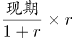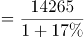，与A项最为接近。

故正确答案为A。

**考点**：增长量计算、文字资料

**来源**：2015年深圳市公务员录用考试《行测》题第86题

### 第 87 题

2006年城镇居民人均可支配收入中工资性收入与经营性收入之和为（ ）元。

A. 11014.8

B. 11001.6

C. 11003.7

D. 11041.5

第 87 题 · 答案与解析

**参考答案（粉笔题库参考内容）**

C

**解析**

材料已知时间为2007年，求“2006年······工资性收入与经营性收入之和”，可知本题为基期和差问题。定位文字资料第2段：“其中，工资性收入11814元，增长13.1%；经营性收入730元，增长30.8%”，可得，2006年城镇居民人均可支配收入中工资性收入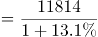，2006年城镇居民人均可支配收入中经营性收入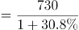，故2006年城镇居民人均可支配收入中工资性收入与经营性收入之和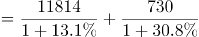，与C项最为接近。

故正确答案为C。

**考点**：文字资料、基期和差

**来源**：2015年深圳市公务员录用考试《行测》题第87题

### 第 88 题

2006年食品支出占城镇居民人均消费性支出的比重为：

A. 32.9%

B. 39.0%

C. 37.5%

D. 32.0%

第 88 题 · 答案与解析

**参考答案（粉笔题库参考内容）**

D

**解析**

根据题干 “2006年······占······的比重”，结合材料时间2007年，可判定本题为基期比重问题。定位文字资料第二段：“城镇居民人均消费性支出为9667元，增长14.1%。其中，食品支出3181元，增长17.3%”，根据基期比重公式可得，2006年食品支出占城镇居民人均消费性支出的比重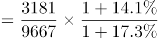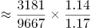，与D项最为接近。

故正确答案为D。

**考点**：文字资料、基期比重

**来源**：2015年深圳市公务员录用考试《行测》题第88题

### 第 89 题

2007年，以下增长幅度从小到大排列正确的是：

A. 亿元GDP生产安全事故死亡人数、城镇居民人均食品支出、城镇居民人均可支配经营性收入、城镇在岗职工年平均工资

B. 亿元GDP生产安全事故死亡人数、城镇居民人均食品支出、城镇在岗职工年平均工资、城镇居民人均可支配经营性收入

C. 亿元GDP生产安全事故死亡人数、城镇在岗职工年平均工资、城镇居民人均食品支出、城镇居民人均可支配经营性收入

D. 城镇居民人均食品支出、亿元GDP生产安全事故死亡人数、城镇在岗职工年平均工资、城镇居民人均可支配经营性收入

第 89 题 · 答案与解析

**参考答案（粉笔题库参考内容）**

B

**解析**

定位文字资料第三段：“亿元GDP生产安全事故死亡人数下降25.0%”；定位文字资料第二段：“城镇居民人均可支配经营性收入增长30.8%；城镇居民人均食品支出增长17.3%；城镇在岗职工年平均工资增长18.1%”。则以增长幅度从小到大排列，亿元GDP生产安全事故死亡人数＜城镇居民人均食品支出＜城镇在岗职工年平均工资＜城镇居民人均可支配经营性收入，B项符合。

故正确答案为B。

**考点**：文字资料、排序类

**来源**：2015年深圳市公务员录用考试《行测》题第89题

### 第 90 题

根据上述材料，以下说法正确的是：

A. 2007年全省人口自然增长率为5.0%

B. 2007年城镇居民恩格尔系数提高了0.9%

C. 2007年城镇居民人均可支配收入实际增长17.0%

D. 2007年城镇居民人均工资性收入增长额高于人均消费性支出增长额

第 90 题 · 答案与解析

**参考答案（粉笔题库参考内容）**

D

**解析**

A项：定位文字资料第一段，“2007年全省人口自然增长率为5.0‰”，非5.0%，错误；

B项：定位文字资料第二段，“城镇居民恩格尔系数为32.9%，提高0.9个百分点”，该项表述为提高了0.9%，错误；

C项：定位文字资料第二段，“城镇居民人均可支配收入为14265元，扣除物价上涨因素后，实际增长12.1%”，错误；

D项：定位文字资料第二段，“工资性收入11814元，增长13.1%；城镇居民人均消费性支出为9667元，增长14.1%”，则2007年城镇居民人均工资性收入增长额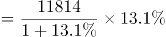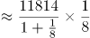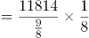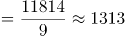，人均消费性支出增长额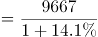×14.1%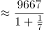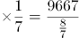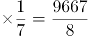≈1208，故人均工资性收入增长额＞人均消费性支出增长额，正确。

故正确答案为D。

**考点**：文字资料、综合分析

**来源**：2015年深圳市公务员录用考试《行测》题第90题

## 材料 3

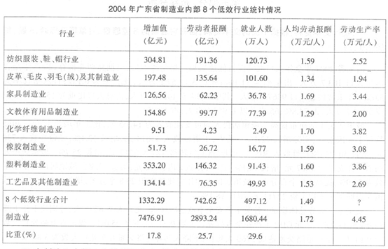

### 第 91 题

在制造业内部8个低效行业中，就业人数最少的是：

A. 家具制造业

B. 工艺品及其他制造业

C. 塑料制造业

D. 化学纤维制造业

第 91 题 · 答案与解析

**参考答案（粉笔题库参考内容）**

D

**解析**

定位统计表，就业人数最少的为2.49万人，对应行业为化学纤维制造业，D项符合。

故正确答案为D。

**考点**：统计表、直接找数

**来源**：2015年深圳市公务员录用考试《行测》题第91题

### 第 92 题

在制造业内部8个低效行业中，人均劳动报酬超过制造业人均劳动报酬行业个数为：

A. 0个

B. 1个

C. 3个

D. 4个

第 92 题 · 答案与解析

**参考答案（粉笔题库参考内容）**

A

**解析**

定位统计表：“制造业人均劳动报酬为1.72万元/人”，在制造业内部8个低效行业中，人均劳动报酬均没有超过1.72万元/人，故在制造业内部8个低效行业中，人均劳动报酬超过制造业人均劳动报酬行业个数为0个，A项符合。

故正确答案为A。

**考点**：统计表、直接找数

**来源**：2015年深圳市公务员录用考试《行测》题第92题

### 第 93 题

制造业内部8个低效行业中，增加值与劳动者报酬之和比较高的行业是：

A. 家具制造业

B. 塑料制造业

C. 橡胶制造业

D. 化学纤维制造业

第 93 题 · 答案与解析

**参考答案（粉笔题库参考内容）**

B

**解析**

结合选项，定位统计表，可得：家具制造业增加值为126.56亿元，劳动者报酬为62.23亿元，两者之和为126.56+62.23=188.79亿元；塑料制造业增加值为353.20亿元，劳动者报酬为146.32亿元，两者之和为353.20+146.32=499.52亿元；橡胶制造业增加值为51.73亿元，劳动者报酬为26.72亿元，两者之和为51.73+26.72=78.45亿元；化学纤维制造业增加值为9.51亿元，劳动者报酬为4.23亿元，两者之和为9.51+4.23=13.74亿元，故制造业内部8个低效行业中，增加值与劳动者报酬之和比较高的行业是塑料制造业，B项符合。

故正确答案为B。

**考点**：统计表、简单加减计算

**来源**：2015年深圳市公务员录用考试《行测》题第93题

### 第 94 题

表中“？”等于：

A. 1.94

B. 7.02

C. 4.12

D. 2.68

第 94 题 · 答案与解析

**参考答案（粉笔题库参考内容）**

D

**解析**

根据题干“？”结合统计表材料，“？”表示为8个低效行业合计的劳动生产率，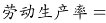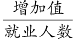，可判定本题为比值计算问题。定位统计表：“8个低效行业合计增加值为1332.29亿元，就业人数为497.12万人”，则8个低效行业合计的劳动生产率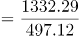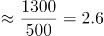亿元/万人=2.6万元/人，与D项最为接近。

故正确答案为D。

**考点**：比值计算、统计表

**来源**：2015年深圳市公务员录用考试《行测》题第94题

### 第 95 题

下列关于制造业内部8个低效行业中，说法错误的是：

A. 增加值在平均增加值以上的行业为3个

B. 家具制造业的劳动者报酬是橡胶制造业的劳动者报酬的两倍还多

C. 劳动者生产率越高，人均劳动报酬越高

D. 就业人数最多的行业是纺织服装、鞋、帽行业

第 95 题 · 答案与解析

**参考答案（粉笔题库参考内容）**

C

**解析**

A项：定位统计表，亿元，超过该平均增加值的有纺织服装、鞋、帽行业，皮革、毛皮、羽毛（绒）及其制造业，塑料制造业共计3个，正确；

B项：定位统计表，“家具制造业的劳动者报酬为62.23亿元，橡胶制造业的劳动者报酬为26.72亿元”，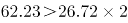，正确；

C项：定位统计表最后两列，家具制造业人均劳动报酬超过塑料制造业，但其劳动生产率低于塑料制造业，错误；

D项：定位统计表，就业人数最多的为120.73万人，对应行业为纺织服装、鞋、帽行业，正确。

本题为选非题，故正确答案为C。

**考点**：综合分析、统计表

**来源**：2015年深圳市公务员录用考试《行测》题第95题

## 材料 4

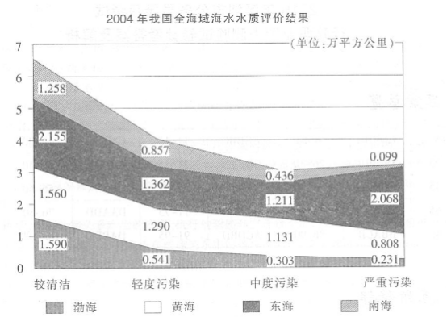

### 第 96 题

从图中可以看出海域面积最大的海水水质等级是：

A. 较清洁

B. 轻度污染

C. 中度污染

D. 严重污染

第 96 题 · 答案与解析

**参考答案（粉笔题库参考内容）**

A

**解析**

定位统计图，图中横轴为水质等级，纵轴为水质等级对应的数据。四个水质等级中第一列数据之和明显最大，则海域面积最大的海水水质等级为较清洁。

故正确答案为A。

**考点**：统计图、直接找数

**来源**：2015年深圳市公务员录用考试《行测》题第96题

### 第 97 题

渤海中较清洁海域面积占的比重约为：

A. 55.4%

B. 59.7%

C. 63.2%

D. 67.4%

第 97 题 · 答案与解析

**参考答案（粉笔题库参考内容）**

B

**解析**

根据题干“······占······的比重”，结合材料数据，可判定本题为现期比重问题。定位统计图可知，渤海中较清洁海域面积为1.590万平方公里，渤海海域面积=1.590+0.541+0.303+0.231=2.665万平方公里，故渤海中较清洁海域面积占的比重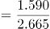×100%≈1.59/2.67×100%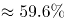，与B项最为接近。

故正确答案为B。

**考点**：现期比重、统计图

**来源**：2015年深圳市公务员录用考试《行测》题第97题

### 第 98 题

下列海域面积占比中，最大的是：

A. 轻度污染海域中黄海面积占比

B. 中度污染海域中东海面积占比

C. 南海中较清洁海域面积占比

D. 渤海中严重污染海域面积占比

第 98 题 · 答案与解析

**参考答案（粉笔题库参考内容）**

C

**解析**

根据题干“占比最大的是······”，结合材料数据，可判定本题为现期比重比较问题。结合选项，定位统计图，可得：

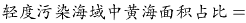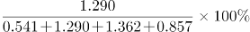≈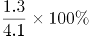；

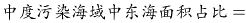≈40%；

；

，故南海中较清洁海域面积占比最大。

故正确答案为C。

**考点**：现期比重、统计图

**来源**：2015年深圳市公务员录用考试《行测》题第98题

### 第 99 题

我国海域中，严重污染海域所占比例约为：

A. 19.0%

B. 22.4%

C. 26.7%

D. 30.4%

第 99 题 · 答案与解析

**参考答案（粉笔题库参考内容）**

A

**解析**

根据题干 “······所占比例”，结合材料数据，可判定本题为现期比重问题，结合第98题计算结果，可知轻度污染海域面积约为4.1万平方公里，中度污染海域面积约为3.1万平方公里；定位统计图，可得：

；

；

我国海域总面积约为4.1+3.1+3.2+6.6=17万平方公里，

故我国海域中，≈19%，与A项最为接近。

故正确答案为A。

**考点**：现期比重、统计图

**来源**：2015年深圳市公务员录用考试《行测》题第99题

### 第 100 题

下列说法正确的是：

A. 我国较清洁海域占全海域面积的比重约为45.4%

B. 渤海约为我国海域面积的19.4%

C. 如果以受污染海域面积占比来衡量水质，我国海域中，海水质量最差的海域为东海

D. 在受污染的海域中，比重最大的是严重污染海域

第 100 题 · 答案与解析

**参考答案（粉笔题库参考内容）**

C

**解析**

A项：结合第99题可知我国较清洁海域面积约为6.6万平方公里，全海域面积约为17万平方公里，则我国较清洁海域<40%，错误；

B项：结合第98、99题可知我国渤海面积约为2.7万平方公里，全海域面积约为17万平方公里，则我国渤海面积占全海域面积的比重≈16%，错误；

C项：结合第98题，定位统计图，可得，

渤海受污染海域；

黄海受污染海域；

东海受污染海域；

南海受污染海域，

东海受污染海域面积占比最大，正确；

D项：受污染海域面积一定，比重最大的即受污染面积最大的海域，结合第99题计算结果可知，轻度污染海域面积约为4.1万平方公里，中度污染海域面积约为3.1万平方公里，严重污染海域面积约为3.2万平方公里，故在受污染的海域中，比重最大的是轻度污染海域，错误。

故正确答案为C。

**考点**：综合分析、统计图

**来源**：2015年深圳市公务员录用考试《行测》题第100题

