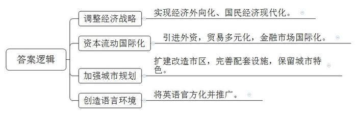
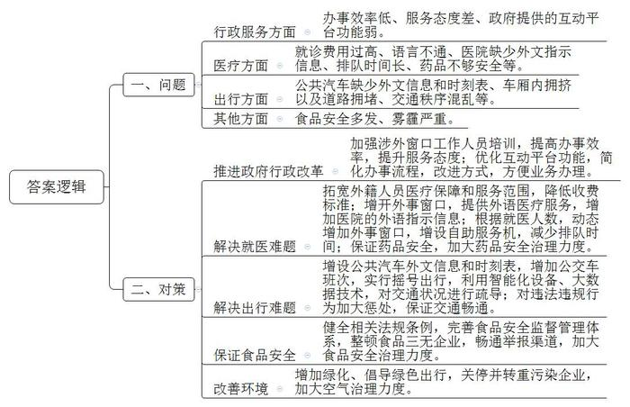
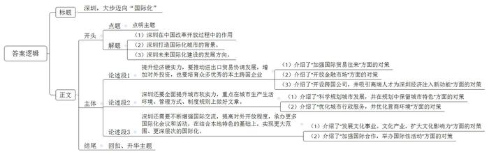

# 2016年深圳市公务员考试《申论》题（A卷）

<!-- gwy:overview:start -->
> **深圳 · 2016 · 申论 · A类** ｜ 3 题 · 图片 3 处 · 答案随题折叠

导航：[题目](#题目) · [材料 1](#材料-1)
<!-- gwy:overview:end -->

> 候选采集稿。参考答案及解析来自粉笔页面，不代表官方答案或真实高分答卷；来源使用许可与原卷对应关系仍需人工核实。

## 给定材料

### 材料 1

新加坡是世界公认的综合性国际化城市，多次被评为全球化程度最高的国家。新加坡有“总部经济”美誉，有7000多家来自各行各业的跨国企业，其中逾60%在新加坡设立全球或区域总部，在新加坡的就业者中，每3人中就有1人是国际人才，大约共有76万外国员工，新加坡在国际化进程中的主要做法有以下四个方面：

1、20世纪60年代以前，转口贸易是新加坡赖以生存的最主要经济手段，但过于单一，经济受外界因素影响波动很大。20世纪60年代中后期，随着国际化目标的确立，新加坡适时调整了经济发展战略，首先实施进口替代工业化战略和出口主导型工业化战略，实现了经济外向化。1979年，新加坡提出向技术与知识密集型工业的转移，并实现交通、电讯、金融、商业等部门的自动化和电脑化，最大限度地利用最新科技成果，提高劳动生产率和工作效率、从而实现国民经济现代化。

2、新加坡实行资本流动的国际化，注重引进外资，对外资的投资方式不作硬性规定，不特别制定外资法令，实行经济贸易的国际化。采取贸易多元化政策，不断扩大与其他国家和地区的贸易关系，并通过广泛建立贸易伙伴关系形成一个庞大的贸易网，为外贸活动开辟广阔的市场；推动金融市场的国际化，积极、谨慎地开放本国金融市场，利用其作为国际贸易港的有利条件加速发展金融市场，提供税赋和管理上的种种优惠，直至最后完全解除外汇管制。

3、1971年，新加坡编制了第一个概念规划，作为中心市区的发展指南，规划对新加坡国际化进程有较好的促进作用，加大中心市区的扩建和改造，建设了一系列现代化交通、通讯、旅游设施，增强了城市对国际客商的吸引力，在城市建设中，注意发展独特的、具有新加坡历史文化特色的城市风貌，努力保留多元种族的色彩和原有的种族居住区风貌特色，注意保持热带岛屿的自然风光，大大增加了城市的魅力。

4、新加坡是一个多语言国家，为了引进外国资本创造良好的语言环境，激励各民族共同学习和掌握国外先进技术，更好地与国际接轨，将英语列为官方语言之一，在全国推广，这大大便利了新加坡与国外的交流，使外国投资、贸易及游客观光消除了语言障碍。

### 材料 2

国内一项调查发现，在华外籍人员对部分城市行政服务的满意度还不是很高，主要表现在办事效率、服务态度和政府提供的互动平台等方面，如办理签证（居留）手续较为繁琐。同时，在医疗方面，不少外籍人员身体不适时，会选择使用自带药品或去外国人医院（诊所）就诊，但很少去当地医院，这主要与其就医时遇到的困难有关，如就诊费用过高、语言不通、医院缺少外文指示信息、排队时间长、担心药品安全等。在出行方面，多数外籍人员会选择地铁或者出租车，较少人选择公共汽车，主要是因为公共汽车缺少外文信息和时刻表、车厢内拥挤以及道路拥堵等，此外，外籍人员对食品安全、交通秩序、雾霾等方面的抱怨较多。

### 材料 3

经过30多年改革开放，深圳现代化建设水平日益提高，国际化程度显著提高，2015年6月，深圳市第六次党代会提出“努力建成更具有竞争力的国际化城市”，坚持依托内地、服务全国、面向世界，更加善于统筹国际国内‘两个大局’，成为代表国家参与全球竞争合作的先行区，成为若干领域在亚太乃至全球具有重要影响力的国际化城市，到2020年，外贸进出口总额和对外投资总额继续保持全国领先水平，培育形成一批新的本土跨国企业，本土企业进入世界500强量达8-10家，城市生产生活环境、管理方式、制度规则与国际接轨程度显著提高，引进国际组织实现重大突破，国际交流活动更趋频繁。

## 题目

### 第 1 题

**根据“材料**13**”，提炼概括新加坡在国际化进程中四个方面的做法。****（20分）**

关联材料：材料 1

作答要求：

要求：

（1）概括准确，文字精炼，用词恰当，条理清晰；

（2）总字数不超过100字。

第 1 题 · 答案与解析

**参考答案（粉笔题库参考内容）**

1.调整经济战略。实现经济外向化、国民经济现代化。

2.资本流动国际化。引进外资，贸易多元化，金融市场国际化。

3.加强城市规划。扩建改造市区，完善配套设施，保留城市特色。

4.创造语言环境。将英语官方化并推广。

**解析**

**参考答案说明**：本参考答案从“调整经济战略”“资本流动国际化”“加强城市规划”“创造语言环境”四个方面展开，各条答案要点之间在内容上相互并列，没有交叉。

**考点**：考点概括措施类

**来源**：来源2016年深圳市公务员考试《申论》题（A卷）

### 第 2 题

**根据“材料**11**”，梳理外籍人员遇到的问题并提出对策。（30分）**

关联材料：材料 2

作答要求：

要求：

（1）梳理全面，对策可行，条理清晰；

（2）总字数不超过500字。

第 2 题 · 答案与解析

**参考答案（粉笔题库参考内容）**

一、问题：1.行政服务方面：办事效率低、服务态度差、政府提供的互动平台功能弱。2.医疗方面：就诊费用过高、语言不通、医院缺少外文指示信息、排队时间长、药品不够安全等；3.出行方面：公共汽车缺少外文信息和时刻表、车厢内拥挤以及道路拥堵、交通秩序混乱等；4.其他方面：食品安全问题多发、雾霾严重。

二、对策：1.推进政府行政改革。加强涉外窗口工作人员培训，提高办事效率，提升服务态度；优化互动平台功能，简化办事流程，改进方式，方便业务办理。2.解决就医难题。拓宽外籍人员医疗保障和服务范围，降低收费标准；增开外事窗口，提供外语医疗服务，增加医院的外语指示信息；根据就医人数，动态增加外事窗口，增设自助服务机，减少排队时间；保证药品安全，加大药品安全治理力度。3.解决出行难题。增设公共汽车外文信息和时刻表，增加公交车班次，实行摇号出行，利用智能化设备、大数据技术，对交通状况进行疏导；对违法违规行为加大惩处，保证交通畅通。4.保证食品安全。健全相关法规条例，完善食品安全监督管理体系，整顿食品三无企业，畅通举报渠道，加大食品安全治理力度。5.改善环境。增加绿化、倡导绿色出行，关停并转重污染企业，加大空气治理力度。

**解析**

**参考答案说明：**答案分别从问题和对策两个部分作答。“问题部分”和“对策部分”均分别从“行政服务”“医疗”“出行”“食品安全”“环境”等5个方面进行了分条撰写。各条要点之间在内容上是并列关系，没有交叉。

**考点**：考点提出对策类

**来源**：来源2016年深圳市公务员考试《申论》题（A卷）

### 第 3 题

**根据给定材料，围绕“把深圳建成更具有竞争力影响力的国际化城市”这个主题，自拟标题。写一篇对策性议论文。（50分）**

关联材料：材料 3

作答要求：

要求：

（1）紧扣主题，观点鲜明，论述充分；

（2）结构严谨，条理清晰，语言流畅；

（3）结合“给定材料”，但不拘泥于“给定材料”；

（4）字数1000字左右。

第 3 题 · 答案与解析

**参考答案（粉笔题库参考内容）**

**深圳，大步迈向****“国际化”**

36年前，深圳蛇口工业区炸响的“开山第一炮”，如春雷唤醒了沉睡的大地，掀开了中国改革开放的新篇章；而今，中国面临全面构建开放型经济体，深圳作为改革开放的排头兵，努力建成更具竞争力影响力的国际化城市，探索一条既具有“深圳特色”又可引领全国城市对外开放合作的新路，是这座年轻城市发展的必然选择，更是全面深化改革开放的新希望。

**让深圳成为有竞争力影响力的国际化城市，需进一步提升经济硬实力，要推动进出口贸易协调发展，增加对外投资，也要培育众多优秀的本土跨国企业。**深圳要跻身国际一流城市，就要不断加强国际贸易往来，畅通国际国内“两个市场”大通道，不断开展跨境合作，增强贸易内生动力；同时开放金融市场，增加资本流动，吸引外资，打造“国际金融中心”。另外，继续大力支持跨国公司在深圳“安营扎寨”，设立总部企业，并通过“孔雀计划”等人才政策，吸引各行各业的国际化高端人才，打造“全球跨国公司总部集聚地”，从而为深圳经济高质量发展注入新动能，增添新活力！

**除了经济硬实力，深圳还要全面提升城市软实力，重点在城市生产生活环境、管理方式、制度规则上做好文章。**一方面，要科学规划城市发展，未来城市的建设不仅要致力于现代化生产生活设施的打造，为生产提供高效便捷的路径，为资源分布提供科学合理的配置；还要保留深圳独特的城市基因，融合创新、开放、高效等城市特色，增强城市吸引力。另一方面，要优化城市行政服务，以人为本，推进政府行政改革，让城市居民享受更加均等化、便利化、全面化的公共服务；也要持续优化营商环境，打造更多企业创新的“高地”，让更多市场主体轻装前行、加速发展。同时，做好制度兜底，完善“顶层设计”，在相关法律政策的制定上要善于借鉴经验，结合本土实际，进行法律制度的革新与升级，营造出具有国际化气息的法律环境。

**软硬兼施，着重修好内功，是走出去的前提和底气，要成为一座现代化国际化的大都市，深圳还需要不断增强国际交流，提高对外开放程度，承办更多国际化会议和活动，在结合本地特色的基础上，实现更大范围、更深层次的国际化。**

一方面，深圳要大力发展文化事业、文化产业，增加对外交流，扩大文化影响力。与时俱进丰富文化内涵，通过承接国家文化部对外的交流活动，传递中国精神、中国梦想，同时坚守文化特色，打造深圳文化品牌，彰显深圳魅力。另一方面，与国际组织加强合作，举办国际性活动，促进不同国家和地区进行多方面交流。积极承办大型体育赛事，增强地区知名度；开办国际论坛峰会，打造国际会议展览城市，为各国分享经验、加强合作等提供广阔契机。当国际交流有了更加深层次的推进，深圳在“走出去”时便可以更加从容、自信！

深圳，作为中国改革开放先锋城市，正乘风而起，开启万里鹏程，沿着国际化大道，稳步向前。

**解析**

**文章分析**

**深圳，大步迈向****“国际化”**

【**标题的优点：**一方面，范文的标题“深圳，大步迈向‘国际化’”突出了“把深圳建设成为更具有竞争力影响力的国际化城市”这一主题。另一方面，它在文字表达上采用拟人修辞手法，使标题更加形象、有力。】

36年前，（1）深圳蛇口工业区炸响的“开山第一炮”，如春雷唤醒了沉睡的大地，掀开了中国改革开放的新篇章；（2）而今，中国面临全面构建开放型经济体，（3）深圳作为改革开放的排头兵，努力建成更具竞争力影响力的国际化城市，探索一条既具有“深圳特色”又可引领全国城市对外开放合作的新路，是这座年轻城市发展的必然选择，更是全面深化改革开放的新希望。

【**开头的优点：****★内容方面：**范文的开头是紧扣题目给定的“把深圳建设成为更具有竞争力影响力的国际化城市”这一主题展开的。首先，开头开门见山点出主题，做到了主题明确。其次，对“把深圳建设成为更具有竞争力影响力的国际化城市”这一主题进行了分析阐述，指出了（1）深圳在中国改革开放过程中的作用。（2）深圳打造国际化城市的背景。（3）深圳未来国际化建设的发展方向。**★文字表达方面：**使用了“即……又”“是……更是”等关联词，使语言表达有逻辑性。此外，使用了拟人等修辞手法，使文字表达更加形象、有力。】

**让深圳成为有竞争力影响力的国际化城市，需进一步提升经济硬实力，要推动进出口贸易协调发展，增加对外投资，也要培育众多优秀的本土跨国企业。**（1）深圳要跻身国际一流城市，就要不断加强国际贸易往来，畅通国际国内“两个市场”大通道，不断开展跨境合作，增强贸易内生动力；（2）同时开放金融市场，增加资本流动，吸引外资，打造“国际金融中心”。（3）另外，继续大力支持跨国公司在深圳“安营扎寨”，设立总部企业，并通过“孔雀计划”等人才政策，吸引各行各业的国际化高端人才，打造“全球跨国公司总部集聚地”，从而为深圳经济高质量发展注入新动能，增添新活力！

【**论述段****1****的优点：****★观点句：**范文的观点句是紧扣“把深圳建设成为更具有竞争力影响力的国际化城市”这一文章主题提出的。形式上，它在段首处直接写出，位置突出，容易发现。内容上，关键词突出，内容要点明确，可以明显看出它是从“提升经济硬实力”这一领域入手，指出了“经济硬实力的提升能让深圳成为有竞争力有影响力的国际化城市”。**★论述内容：**（1）介绍了“加强国际贸易往来”方面的对策；（2）介绍了“开放金融市场”方面的对策；（3）介绍了“开设跨国公司，并吸引高端人才为深圳经济注入新动能”方面的对策。以上三个方面的内容都是紧扣“让深圳成为有竞争力影响力的国际化城市，需进一步提升经济硬实力，要推动进出口贸易协调发展，增加对外投资，也要培育众多优秀的本土跨国企业”这个观点句进行分析论述的，论述的针对性强，内容层次丰富。最后，在论述方法上主要采取了讲道理与举例子的方式，具有一定说服力。】

**除了经济硬实力，深圳还要全面提升城市软实力，重点在城市生产生活环境、管理方式、制度规则上做好文章。**（1）一方面，要科学规划城市发展，未来城市的建设不仅要致力于现代化生产生活设施的打造，为生产提供高效便捷的路径，为资源分布提供科学合理的配置；还要保留深圳独特的城市基因，融合创新、开放、高效等城市特色，增强城市吸引力。（2）另一方面，要优化城市行政服务，以人为本，推进政府行政改革，让城市居民享受更加均等化、便利化、全面化的公共服务；也要持续优化营商环境，打造更多企业创新的“高地”，让更多市场主体轻装前行、加速发展。（3）同时，做好制度兜底，完善“顶层设计”，在相关法律政策的制定上要善于借鉴经验，结合本土实际，进行法律制度的革新与升级，营造出具有国际化气息的法律环境。

【**论述段****2****的优点：****★观点句：**范文的观点句是紧扣“把深圳建设成为更具有竞争力影响力的国际化城市”这一文章主题提出的。形式上，它在段首处直接写出，位置突出，容易发现。内容上，关键词突出，内容要点明确，可以明显看出它是从“提升城市软实力”这一领域入手，指出了“软实力的提升能让深圳成为有竞争力有影响力的国际化城市”。**★论述内容：**（1）介绍了“科学规划城市发展，并在规划中保留城市特色”方面的对策；（2）介绍了“优化城市行政服务，并优化营商环境”方面的对策。以上两个方面的内容都是紧扣“深圳还要全面提升城市软实力，重点在城市生产生活环境、管理方式、制度规则上做好文章”这个观点句进行分析论述的，论述的针对性强，内容层次丰富。最后，在论述方法上主要采取了讲道理与举例子的方式，具有一定说服力。】

**软硬兼施，着重修好内功，是走出去的前提和底气，要成为一座现代化国际化的大都市，深圳还需要不断增强国际交流，提高对外开放程度，承办更多国际化会议和活动，在结合本地特色的基础上，实现更大范围、更深层次的国际化。**

（1）一方面，深圳要大力发展文化事业、文化产业，增加对外交流，扩大文化影响力。与时俱进丰富文化内涵，通过承接国家文化部对外的交流活动，传递中国精神、中国梦想，同时坚守文化特色，打造深圳文化品牌，彰显深圳魅力。（2）另一方面，与国际组织加强合作，举办国际性活动，促进不同国家和地区进行多方面交流。积极承办大型体育赛事，增强地区知名度；开办国际论坛峰会，打造国际会议展览城市，为各国分享经验、加强合作等提供广阔契机。当国际交流有了更加深层次的推进，深圳在“走出去”时便可以更加从容、自信！

【**论述段****3****的优点：****★观点句：**范文的观点句是紧扣“把深圳建设成为更具有竞争力影响力的国际化城市”这一文章主题提出的。形式上，它在段首处直接写出，位置突出，容易发现。内容上，关键词突出，内容要点明确，可以明显看出它是从“增强国际交流”这一领域入手，指出了“国际交流是加快深圳建设成为更具有竞争力影响力的国际化城市的关键”。**★论述内容：**（1）介绍了“发展文化事业。文化产业，扩大文化影响力”方面的对策；（2）介绍了“加强国际合作，举办国际性活动”方面的对策。以上两个方面的内容都是紧扣“深圳国际化，交流是关键。增强交流，是扩大深圳的国际知名度、影响力和竞争力的有力途径”这个观点句进行分析论述的，论述的针对性强，内容层次丰富。最后，在论述方法上主要采取了举例子的方式，具有一定说服力。】

【**论述段之间的关系：****★内容的内在逻辑：**范文的论述段之间是依照“并列”的逻辑展开的。论述段1先写了“深圳要发展经济硬实力”，述段2再写了“深圳要发展软实力”，论述段3最后写了“深圳要加强国际化交流”。】

（1）深圳，作为中国改革开放先锋城市，正乘风而起，开启万里鹏程，沿着国际化大道，（2）稳步向前。

【**结尾的优点：**范文的结尾回扣了“把深圳建设成为更具有竞争力影响力的国际化城市”这一主题。（1）再次提到了“把深圳建设成为更具有竞争力影响力的国际化城市”这一主题；（2）提出了展望。】

**考点**：考点文章写作题

**来源**：来源2016年深圳市公务员考试《申论》题（A卷）

