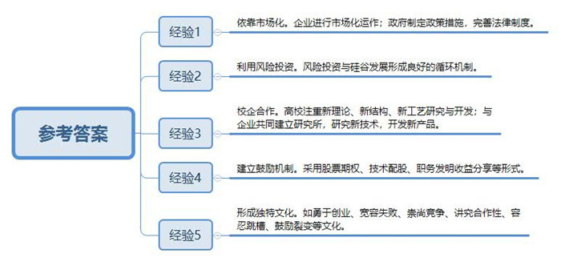
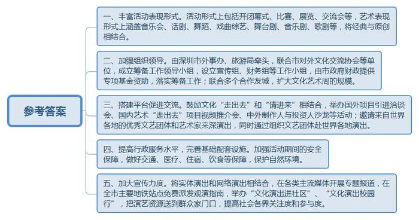
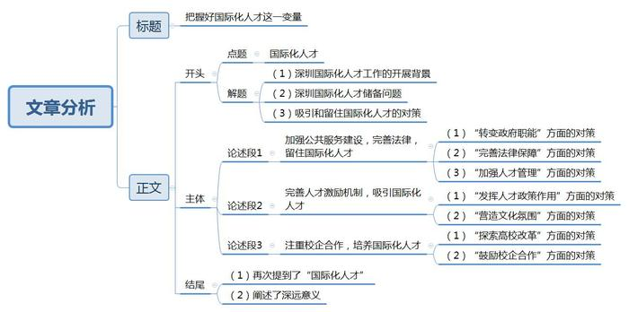

# 2016年深圳市公务员考试《申论》题（B卷）

<!-- gwy:overview:start -->
> **深圳 · 2016 · 申论 · B类** ｜ 3 题 · 图片 3 处 · 答案随题折叠

导航：[题目](#题目) · [材料 1](#材料-1)
<!-- gwy:overview:end -->

> 候选采集稿。参考答案及解析来自粉笔页面，不代表官方答案或真实高分答卷；来源使用许可与原卷对应关系仍需人工核实。

## 给定材料

### 材料 1

美国硅谷是世界上第一个高新技术产业区，也是世界上最具创新能力和活力的高科技园区。硅谷的主要做法包括以下五方面：

1、硅谷的形成和发展是市场化的产物，企业通过市场化运作实现自主创新的高技术成果产业化，政府很少直接介入，而是通过制定各种适当有效的政策措施和完善法律制度来推动硅谷企业的成长，如为新成立的企业免费（或只收少量租金）提供临时工作场所，为企业家免费提供培训，允许大学、研究机构、非盈利机构和小企业拥有联邦资助发明的知识产权等。

2、美国风险投资规模已占世界风险投资的一半以上，而硅谷吸引了全美约35%的风险资本，美国大约50%的风险投资基金都设在硅谷，风险投资和硅谷的发展形成了一种相互促进的良好循环机制，风险投资对硅谷高技术产业的发展起到重要的推动作用，英特尔公司、谷歌公司、苹果公司等都是靠风险投资发展起来的。

3、硅谷拥有斯坦福大学、加州大学伯克利分校等著名大学和多所专科学校、技工学校100多所私立专业学校。这些学校特别注重新理论、新结构、新工艺的研究与开发，而且与企业共同建立研究所，共同研究新技术，开发新产品，彼此之间的联系非常紧密，它们之间的合作，不仅有助于科研成果的迅速转化，而且也有利于为企业培训技术和管理人才，这是双赢的结果，更为重要的是，许多大学和科研机构人员直接投资兴办企业。

4、在硅谷，众多高技术公司都采用股票期权的形式即员工有权在一定时期内（如两年或三年）用事先约定的价格购买公司一定数量的新股，而期末股价高低变化所体现的员工利益及风险与员工在这段时间内的创新努力是紧密结合起来的。此外，硅谷还有技术配股、职务发明收益分享等鼓励机制。

5、硅谷在高科技产业发展的特殊环境中逐步形成了独特的文化，对高科技产业的进一步发展壮大产生巨大影响：勇于创业，宽容失败激发了员工大胆尝试、勇于探索的创新热情；崇尚竞争使人们既着力于自身能力和水平的不断提高、又注重在竞争中向对手学习；讲究合作性使硅谷形成一种“拿”与“给”的双向知识交谈氛围；容忍跳槽、鼓励裂变则有益于技术扩散和培养经验丰富的企业家。

### 材料 2

经过30多年改革开放，深圳现代化建设水平日益提高国际化程度显著提高，2015年6月，深圳市第六次党代会提出“努力建成更具有竞争力的国际化城市，坚持依托内地、服务全国”、面向世界，更加善于统筹国际国内‘两个大局’，成为代表国家参与全球竞争合作的先行区，成为若干领域在亚太乃至全球具有重要影响力的国际化城市。到2020年，外贸进出口总额和对外投资总额继续保持全国领先水平，培育形成一批新的本土跨国企业，本土企业进入世界500强量达8-10家，城市生产生活环境、管理方式、制度规则与国际接轨程度显著提高，引进国际组织实现重大突破，国际交流活动更趋频繁。

## 题目

### 第 1 题

**根据材料4，归纳硅谷的成功经验。（20分）**

关联材料：材料 1

作答要求：

要求：

（1）概括准确、文字精炼、用语恰当、条理清晰；

（2）总字数不超过200字。

第 1 题 · 答案与解析

**参考答案（粉笔题库参考内容）**

一、依靠市场化。企业进行市场化运作；政府制定政策措施，完善法律制度。

二、利用风险投资。风险投资与硅谷发展形成良好的循环机制。

三、校企合作。高校注重新理论、新结构、新工艺研究与开发；与企业共同建立研究所，研究新技术，开发新产品。

四、建立鼓励机制。采用股票期权、技术配股、职务发明收益分享等形式。

五、形成独特文化。如勇于创业、宽容失败、崇尚竞争、讲究合作性、容忍跳槽、鼓励裂变等文化。

**解析**

**参考答案说明**：答案从“市场化”“风险投资”“校企合作”“鼓励机制”“企业文化”等不同话题进行了分条撰写。各要点之间在内容上是并列关系，没有交叉。

**考点**：经验启示类

**来源**：2016年深圳市公务员考试《申论》题（B卷）

### 第 2 题

**“第五届深圳国际文化艺术周”已顺利结束（材料8），假如深圳正筹备下一届文化艺术周，要求内容丰富，形式多样，更加体现国际化城市氛围，请你提出具体建议。（30分）**

关联材料：材料 2

作答要求：

要求：

（1）思路开阔，建议可行，创意新颖，条理清晰；

（2）总字数500字。

第 2 题 · 答案与解析

**参考答案（粉笔题库参考内容）**

一、丰富活动表现形式。活动形式上包括开闭幕式、比赛、展览、交流会等，艺术表现形式上涵盖音乐会、话剧、舞蹈、戏曲综艺、舞台剧、音乐剧、歌剧等，将经典与原创相结合。

二、加强组织领导。由深圳市外事办、旅游局牵头，联合市对外文化交流协会等单位，成立筹备工作领导小组，设立宣传组、财务组等工作小组，由市政府财政提供专项基金资助，落实筹备工作；联合多个合作友城，扩大文化艺术周的规模。

三、搭建平台促进交流。鼓励文化“走出去”和“请进来”相结合，举办国外项目引进洽谈会、国内艺术“走出去”项目视频推介会、中外制作人与投资人沙龙等活动；邀请来自世界各地的优秀文艺团体和艺术家来深演出，同时通过组织文艺团体赴世界各地演出。

四、提高行政服务水平，完善基础配套设施。加强活动期间的安全保障，做好交通、医疗、住宿、饮食等保障，保护自然环境。

五、加大宣传力度。将实体演出和网络演出相结合，在各类主流媒体开展专题报道，在全市主要地铁站点免费派发观演指南，举办“文化演出进社区”、“文化演出校园行”，把演艺资源送到群众家门口，提高社会各界关注度和参与度。

**解析**

**参考答案说明：**本参考答案从“丰富活动表现形式”“加强组织领导”“搭建平台促进交流”“提高行政服务水平”“加大宣传力度”等五个方面进行了分条撰写。各条要点之间在内容上相互并列，没有交叉。

**考点**：提出对策类

**来源**：2016年深圳市公务员考试《申论》题（B卷）

### 第 3 题

**推进城市国际化需要大量人才，请就“深圳如何创造条件吸引和留住国际化人才”，自拟标题，写一篇对策性议论文。（50分）**

关联材料：材料 2

作答要求：

要求：

（1）紧扣主题，观点鲜明，论述充分；

（2）结构严谨，条理清晰，语言流畅；

（3）结合“给定资料”，但不拘泥于“给定资料”；

（4）字数1000字左右。

第 3 题 · 答案与解析

**参考答案（粉笔题库参考内容）**

**把握好国际化人才这一变量**

深圳建设国际化城市的过程，实际上就是不断集聚、培养和开发国际化人才的过程。改革开放30多年来，深圳凭借其体制、政策、区位和投资环境等优势，吸引、集聚了大批国际化人才资源，为经济社会持续快速健康发展奠定了坚实基础。然而，目前深圳的国际化人才储备依然难以满足深圳建设国际化城市不断增长的需要。要吸引和留住国际化人才，进一步推进深圳国际化建设，必须多措并举、齐抓共进。

**首先，加强公共服务建设，完善法律，留住国际化人才。**一方面要继续推动政府职能转变，提高行政服务效率，简化国际化人才办理签证（居留）、就业、购房等方面的手续，完善城市公共设施如外文指示牌，构建完备的城市公共交通网络，为其提供更便利的生活发展条件；另一方面，政府应提供相应的政策和法律保障，完善专利许可和技术转让政策，保障人才的合法权益；此外，还要加强国际化人才的管理。要加强信息库建设，搜集世界各地、各行各业学术、管理等方面的顶尖人才信息，加强各类国际化人才服务如国际猎头、国际化职业资格认证机构等中介组织建设，为国际化人才提供广阔的平台。

**其次，完善人才激励机制，吸引国际化人才。**要继续发挥“孔雀计划”等人才政策的作用，对国际化人才给予优惠待遇，对引进的世界一流团队给予专项资助，健全吸引国际化人才的相关机制，完善国际化人才需求分析和预测系统，采取团队引进、核心人才引进、高新技术项目引进等方式引进优秀海外人才，建立海外人才引进评估体系，加大对回国留学人员专项资助经费力度，同时营造鼓励创业、宽容失败的创新文化氛围，完善股票期权分配、技术配股、职务发明收益等激励机制，实行一流人才、一流业绩、一流报酬。

**最后，还要注重校企合作，培养国际化人才。**与北京、上海等相比，深圳高校教育资源相对薄弱，要补足“教育短板”，积极探索高校改革，建立“教育特区”，通过中外名校来深设立分校、与深圳高校和科研机构合办国际学校和研究所等方式，借鉴国际先进的教育理念和教学经验，引进国际先进的办学模式、课程体系和教材，提高深圳教育质量和管理水平，加强深圳本土的国际化人才培养；此外也要注重发挥深圳“创新特区”的优势，鼓励高校和知名企业强强联合，探索人才培养体系和模式，共同研发新技术、新产品，促进企业完善技术标准体系，进一步推动高校科研成果转化和国际化人才培养。

中华民族历来具有尚贤爱才的优良传统，而在融入国际化的浪期中，现在的深圳比历史上的任何时期都更需要广开进贤之路广纳天下英才。唯有不断强化基础建设，提高人才待遇、注重人才培养，才能更好地集聚、培养、开发国际化人才，才能让国际化人才各得其所、各展所长、各尽其才，有效推动深圳国际化城市建设。

**解析**

**文章分析**

**把握好国际化人才这一变量**

【**标题的优点：**首先，范文的标题“把握好国际化人才这一变量”突出了“国际化人才”这一主题词。其次，形式上，文字简洁明快，不拖沓。】

**（1）深圳建设国际化城市**的过程，实际上就是不断集聚、培养和开发国际化人才的过程。改革开放30多年来，深圳凭借其体制、政策、区位和投资环境等优势，吸引、集聚了大批国际化人才资源，为经济社会持续快速健康发展奠定了坚实基础。然而，目前深圳的（2）国际化人才储备依然难以满足深圳建设国际化城市不断增长的需要。要吸引和留住国际化人才，进一步（3）推进深圳国际化建设，必须多措并举、齐抓共进。

【**开头的优点：★内容方面。**范文的开头是紧扣题目给定的“国际化人才”这一主题展开的。首先，开头在段首处点出主题，做到了主题明确。其次，对“国际化人才”这一主题进行了分析阐述，指出了（1）深圳国际化人才工作的开展背景；（2）深圳国际化人才储备问题；（3）吸引和留住国际化人才的对策。**★文字表达方面：**使用了“然而……”等关联词，使语言表达有逻辑性。】

首先，**加强公共服务建设，完善法律，留住国际化人才**。一方面要继续（1）推动政府职能转变，提高行政服务效率，简化国际化人才办理签证（居留）、就业、购房等方面的手续，完善城市公共设施如外文指示牌，构建完备的城市公共交通网络，为其提供更便利的生活发展条件；另一方面，政府应（2）提供相应的政策和法律保障，完善专利许可和技术转让政策，保障人才的合法权益；此外，还要（3）加强国际化人才的管理。要加强信息库建设，搜集世界各地、各行各业学术、管理等方面的顶尖人才信息，加强各类国际化人才服务如国际猎头、国际化职业资格认证机构等中介组织建设，为国际化人才提供广阔的平台。

【**论述段1的优点：★观点句：**范文的观点句是紧扣“国际化人才”这一文章主题提出的。形式上，它在段首处直接写出，位置突出，容易发现。内容上，关键词突出，内容要点明确，可以明显看出它是从“加强公共服务建设”和“完善法律”入手，指出了留住国际化人才的对策。**★论述内容：**（1）介绍了“转变政府职能”方面的对策；（2）介绍了“完善法律保障”方面的对策；（3）介绍了“加强人才管理”方面的对策。以上三个方面的内容都是紧扣“加强公共服务建设，完善法律，留住国际化人才”这个观点句进行分析论述的，论述的针对性强，内容层次丰富。最后，在论述方法上主要采取了讲道理和举例子相结合，做到了丰富多样。】

其次**，完善人才激励机制，吸引国际化人才**。要继续（1）发挥“孔雀计划”等人才政策的作用，对国际化人才给予优惠待遇，对引进的世界一流团队给予专项资助，健全吸引国际化人才的相关机制，完善国际化人才需求分析和预测系统，采取团队引进、核心人才引进、高新技术项目引进等方式引进优秀海外人才，建立海外人才引进评估体系，加大对回国留学人员专项资助经费力度，同时（2）营造鼓励创业、宽容失败的创新文化氛围，完善股票期权分配、技术配股、职务发明收益等激励机制，实行一流人才、一流业绩、一流报酬。

【**论述段2的优点：★观点句：**范文的观点句是紧扣“国际化人才”这一文章主题提出的。形式上，它在段首处直接写出，位置突出，容易发现。内容上，关键词突出，内容要点明确，可以明显看出它是从“完善人才激励机制”入手，指出了吸引国际化人才的对策。**★论述内容：**（1）介绍了“发挥人才政策作用”方面的对策；（2）介绍了“营造文化氛围”方面的对策。以上两个方面的内容都是紧扣“完善人才激励机制，吸引国际化人才”这个观点句进行分析论述的，论述的针对性强，内容层次丰富。最后，在论述方法上采取了讲道理和举例子相结合的方式，做到了丰富多样。】

最后，还要**注重校企合作，培养国际化人才**。与北京、上海等相比，深圳高校教育资源相对薄弱，要补足“教育短板”，积极（1）探索高校改革，建立“教育特区”，通过中外名校来深设立分校、与深圳高校和科研机构合办国际学校和研究所等方式，借鉴国际先进的教育理念和教学经验，引进国际先进的办学模式、课程体系和教材，提高深圳教育质量和管理水平，加强深圳本土的国际化人才培养；此外也要注重（2）发挥深圳“创新特区”的优势，鼓励高校和知名企业强强联合，探索人才培养体系和模式，共同研发新技术、新产品，促进企业完善技术标准体系，进一步推动高校科研成果转化和国际化人才培养。

【**论述段3的优点：★观点句：**范文的观点句是紧扣“国际化人才”这一文章主题提出的。形式上，它在段首处直接写出，位置突出，容易发现。内容上，关键词突出，内容要点明确，可以明显看出它是从“注重校企合作”入手，指出了培养国际化人才的对策。**★论述内容：**（1）介绍了“探索高校改革”方面的对策；（2）介绍了“鼓励校企合作”方面的对策。以上两个方面的内容都是紧扣“要注重校企合作，培养国际化人才”这个观点句进行分析论述的，论述的针对性强，内容层次丰富。最后，在论述方法上采取了讲道理和举例子相结合的方式，做到了丰富多样。】

【**论述段之间的关系：★内容的内在逻辑：**范文有两层逻辑。第一层，整体上是从“背景-问题-对策”的逻辑展开的。第二层，论述段1、2、3均从“对策”出发，论述段1先写了“公共服务”方面的对策，论述段2再写了“激励机制”方面的对策，论述段3又写了“校企合作”方面的对策。**★段与段的外在衔接：**论述段1、2、3用“首先”“其次”“最后”连接，文章承接性较好，逻辑性较强。】

中华民族历来具有尚贤爱才的优良传统，而在融入国际化的浪期中，现在的深圳比历史上的任何时期都更需要广开进贤之路广纳天下英才。唯有不断强化基础建设，提高人才待遇、注重人才培养，才能更好地集聚、培养、开发（1）**国际化人才**，才能（2）让国际化人才各得其所、各展所长、各尽其才，有效推动深圳国际化城市建设。

【**结尾的优点：**范文的结尾回扣了“国际化人才”这一主题。（1）再次提到了“国际化人才”；（2）阐述了深远意义。】

**参考范文二**

**把握好国际化人才这一变量**

深圳建设国际化城市的过程，实际上就是不断集聚、培养和开发国际化人才的过程。不得不承认深圳凭借其体制、政策、区位和投资环境等优势，为经济和社会的持续快速健康发展奠定了坚实的基础。然而目前深圳的国际化人才数量少、流失严重，难以满足深圳建设国际化城市不断增长的需要。要吸引和留住国际化人才，进一步推进深圳国际化建设，还需从外籍人才的需求入手，多措并举、齐抓共进。

当前外籍人员来深圳可能面临诸多生活上的不便利：行政服务效率低，态度差，手续繁琐；就医困难，费用高，语言不通，缺少外文指示，排队时间长、担心药品安全；出行不便，公共汽车缺少外文信息和时刻表、车厢内拥挤以及道路拥堵。加之，生活环境不理想，存在食品安全、交通秩序差、雾霾等问题。另外，高等院校少，专业人才培养不足，导致了国际化人才的严重流失。

基于以上现象，**首先要创造岗位，满足国际化人才发展需求。**要继续发挥“孔雀计划”等人才政策的作用，对国际化人才给予优惠待遇，满足工作就业需求，为个人发展创造条件，用优恵的政策和完善的激励机制吸引国际人才。另外，还可以采取团队引进、核心人才引进、高新技术项目引进等方式引进优秀海外人才，建立海外人才引进评估体系。同时，硅谷的做法值得借鉴，比如营造鼓励创业、宽容失败的创新文化氛围，完善股票期权分配、技术配股、职务发明收益等激励机制，实行一流人才、一流业绩、一流报酬。

**其次，要营造稳定安全的居住环境。**食品安全部门应该加大市场监管，从源头上保证食品安全性；交通主管部门要加大交通秩序的维护，环保部门需严控环境污染，加强治理空气污染。还需建设现代化交通通讯、旅游设施，给外籍人才创造现代化的，便捷的生活环境，新加坡城市的合理规划就是典型的例子，既推动了国际化进程，也增强了城市对国际商客的吸引力。

**再次，要加强公共服务建设，为外籍人员在深圳的生活提供便利**，留住国际化人才要继续推动政府职能转变，提高行政服务效率，改善服务态度，简化国际化人才办理签证（居留）、就业、购房等方面的手续；解决就医难题，在医院等公共场所设置外文指示牌，构建完备的城市公共交通网络，为其出行提供更便利的条件。

**最后，要补足“教育短板”，培养足够理想的人才。**政府方面，加大对教育的财政倾斜力度，支持高等院校办学和科研机构的科研项目，培养更多本土的具有国际化实力人才，让更多的人才配合高端人才工作，或独立完成高端项目。学校要与国际学校合作，借鉴国际先进的人才培养经验，引进国际先进的办学模式，注重金融等专业的高端人才培养，提高深圳教育水平。

中华民族历来具有尚贤爱才的优良传统，而在融入国际化的浪潮中，现在的深圳比历史上的任何时期都更需要广开进贤之路广纳天下英才。唯有不断强化基础建设提高人才待遇、注重人才培养，方能更好的集聚、培养、开发国际化人才，吸引和留住国际化人才参与深圳国际化城市的建设，让各类人才各得其所，让各路高贤大展其长，为深圳建设添砖加瓦。

**考点**：文章写作题

**来源**：2016年深圳市公务员考试《申论》题（B卷）

