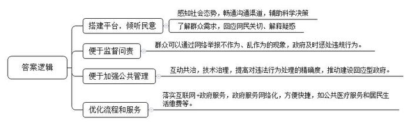
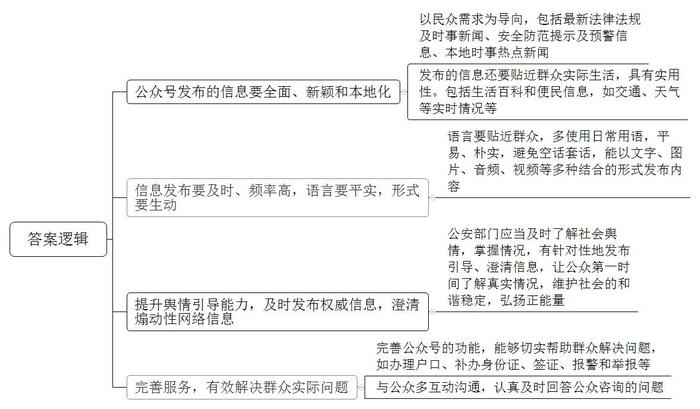
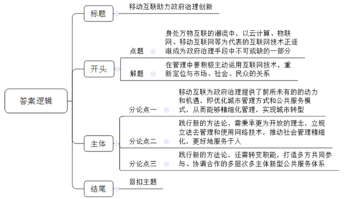

# 2017年深圳市公务员考试《申论》题（A卷）

> 候选采集稿。参考答案及解析来自粉笔页面，不代表官方答案或真实高分答卷；来源使用许可与原卷对应关系仍需人工核实。

## 给定材料

### 材料 material-bcc8baef86abc0ea

2016年，习近平总书记在网络安全和信息化工作座谈会上指出。要以信息化推进国家治理体系和治理能力现代化，统筹发展电子政务，构建一体化在线服务平台，分级分类推进新型智慧城市建设，打通信息壁垒，构建全国信息资源共享体系，更好用信息化手段感知社会态势，畅通沟通渠道，辅助科学决策。

习近平还指出，网民来自老百姓，老百姓上了网，民意也就上了网。各级党政机关和领导干部要学会通过网络走群众路线，经常上网看看，潜潜水，聊聊天，发发声。了解群众所思所愿，收集好想法好建议，积极回应网民关切、解疑释惑。善于运用网络了解民意、开展工作，是新形势下领导干部做好工作的基本功。各级干部特别是领导干部一定要不断提高这项本领。

### 材料 material-f81a294fd4c9e85f

N市公安系统近期就其微信公众号关注使用情况与满意度进行了问卷调查，结果如下：

（1）有89%的受访者认为公安系统微信公众号有利于政务公开、方便百姓生活，方便更好地服务群众，有利于提高相关单位的工作效率及能力、有利于保障城市安全及百姓安宁。

（2）有21%的受访者希望看到最新法律法规及时事新闻；有42%的受访者希望看到安全防范提示及预警信息；有8%的受访者希望看到本地时事热点新闻；有18%的受访者希望看到便民信息，如交通，天气等实时情况；有11%的受访者希望看到生活百科。

（3）有83%的受访者会因为想要反映问题或想要寻求帮助而与N市公安系统微信公众号互动。

（4）对有情绪煽动性的网络信息，100%的受访者支持澄清。

（5）有19%的受访者认为信息发布不够及时；有20%的受访者认为信息发布内容匮乏；有53%的受访者认为与公众互动沟通不够；有26%的受访者认为舆情引导能力不足；有22%的受访者认为语言不够贴近公众；有8%的受访者认为存在其他方面问题。

（6）有91%的受访者希望N市公安系统微信公众号能以文字、图片、音频、视频等多种结合的形式发布内容。

（7）有86%的受访者对已关注的N市公安系统微信公众号整体满意。

### 材料 material-484ab9cbe87998f6

《中国互联网发展状况统计报告2016》指出，十年间，中国的互联网市场发生巨变，移动应用快速增长，在社交、视频、新闻、工具和购物等领域，移动应用已超过50%，在团购，旅游和零售业，移动端收入规模已经超越PC端，中国互联网用户数据接近7亿，在人口中的渗透率从10%上升至50%，手机网民超过6亿，在人口中的渗透率从1%上升至45%。

以互联网为代表的信息技术的快速发展和广泛应用，深刻改变着经济模式和行为，社会互动交往，人们的工作和生活方式，也改变着人们的思维模式和思想观念，传统的政府治理模式已难以适应网络化时代的要求。政府必须充分认识到这种趋势给政府治理带来的严峻挑战，必须积极适应这种变化，主动应用移动互联网、大数据、云计算机等互联网新技术创新政府治理理念，重新定位政府角色以及政府与市场、社会、民众的关系，实现政府治理模式的转变，另一方面，新的信息技术发展与应用也为推进政府治理现代化提供了动力和机遇。

## 题目

### 第 1 题

**根据【材料**2**】到【材料**9**】，提炼概括互联网对政府治理的促进作用。（25分）**

关联材料：材料 material-bcc8baef86abc0ea

作答要求：

要求：

（1）概括准确，文字精炼用词恰当，条理清晰；

（2）总字数不超过200字。

### 第 2 题

**根据【材料**14**】，请就N市公安系统微信公众号存在的问题提出完善建议。（25分）**

关联材料：材料 material-f81a294fd4c9e85f

作答要求：

要求：

（1）建议可行，条理清晰；

（2）总字数不超500字。

### 第 3 题

**请围绕“移动互联与政府治理创新”这个主题，自拟标题，写一篇议论文。（50分）**

关联材料：材料 material-484ab9cbe87998f6

作答要求：

要求：

（1）紧扣主题，观点鲜明，论述充分；

（2）结构严谨，条理清晰，语言流畅；

（3）参考“给定材料”，但可不拘泥于“给定材料”；

（4）字数1000字左右。

## 答案与解析

第 1 题

**参考答案（粉笔题库参考内容）**

一、搭建平台，倾听民意。感知社会态势，畅通沟通渠道，辅助科学决策；了解群众需求，回应网民关切、解疑释惑。

二、便于监督问责。群众可以通过网络举报不作为、乱作为的现象，政府及时惩处违规行为。

三、便于加强公共管理。互动共治，技术治理，提高对违法行为处理的精确度，推动建设回应型政府。

四、优化流程和服务。落实互联网+政府服务，政府服务网络化，方便快捷，如公共医疗服务和居民生活缴费等。

**解析**

**参考答案说明：**本参考答案从“搭建平台，倾听民意”“便于监督问责”“便于加强公共管理”“优化流程和服务”等不同的话题进行了分条撰写。各条要点之间在内容上相互并列，没有交叉。

**考点**：考点影响类

**来源**：来源2017年深圳市公务员考试《申论》题（A卷）

粉笔申论页面对本题只提供「解析视频」入口，该入口是会员推广位，页面无视频地址与文字解析。

第 2 题

**参考答案（粉笔题库参考内容）**

一、公众号发布的信息要全面、新颖和本地化。以民众需求为导向，包括最新法律法规及时事新闻、安全防范提示及预警信息、本地时事热点新闻；发布的信息还要贴近群众实际生活，具有实用性。包括生活百科和便民信息，如交通、天气等实时情况。

二、信息发布要及时、频率高，语言要平实，形式要生动。语言要贴近群众，多使用日常用语，平易、朴实，避免空话套话，能以文字、图片、音频、视频等多种结合的形式发布内容。

三、提升舆情引导能力，及时发布权威信息，澄清煽动性网络信息。公安部门应当及时了解社会舆情，掌握情况，有针对性地发布引导、澄清信息，让公众第一时间了解真实情况，维护社会的和谐稳定，弘扬正能量。

四、完善服务，有效解决群众实际问题。完善公众号的功能，能够切实帮助群众解决问题，如办理户口、补办身份证、签证、报警和举报等。与公众多互动沟通，认真及时回答公众咨询的问题。

**解析**

**参考答案说明：**参考答案从“公众号发布的信息要全面、新颖和本地化”“信息发布要及时、频率高，语言要平实，形式要生动”“提升舆情引导能力，及时发布权威信息，澄清煽动性网络信息”“完善服务，有效解决群众实际问题”等不同方面进行了分条撰写。各条要点之间在内容上是并列关系，没有交叉。

**考点**：考点提出对策类

**来源**：来源2017年深圳市公务员考试《申论》题（A卷）

粉笔申论页面对本题只提供「解析视频」入口，该入口是会员推广位，页面无视频地址与文字解析。

第 3 题

**参考答案（粉笔题库参考内容）**

**移动互联助力政府治理创新**

身处万物互联的潮流中，以云计算、物联网、移动互联网等为代表的互联网技术正逐渐成为政府治理手段中不可或缺的一部分，如电子政务、微博问政、智能行人过街系统等。在这样的历史进程中，作为掌舵者的政府更要高屋建瓴，审时度势，**在管理中要积极主动运用互联网技术，重新定位与市场、社会、民众的关系，以期政府职能往好的方向发展**。

**移动互联为政府治理提供了前所未有的动力和机遇**，**即优化城市管理方式和公共服务模式**，**从而能够精细化管理，实现城市转型。**过去群众办事“跑断腿”，各部门“各自为政”的现象屡见不鲜，如今“最多跑一次”的理念被越来越多的执政者接受，“智慧交通”解决越来越多城市的“通勤难”问题，正是得益于互联网技术的广泛使用。深圳是全国科技信息产业的主要集聚地之一，是华为、腾讯等众多知名公司的总部，善于利用这一优势进行大数据建模，着力打造智慧城市。

“互联网+”不仅是一个技术问题，它是手段，更是一个方法论问题。这方法论是一种世事纷繁，应对有力的态度；是一种察势者明，趋势者智的智慧；是一种积极应变，主动求变精神。

**践行新的方法论，需秉承更为开放的理念，立规立法去管理和使用网络技术，推动社会管理精细化，更好地服务于人。**“互联网+”不仅是一个技术问题，它可能更是一个方法论问题。这实际是考验政府管理者以什么样的心态看待互联网。目前80%的信息资源仍掌握在政府手里，毋庸置疑，政府是信息的绝对主导者。基于此，能否让信息有效的利用，实现资源的最大化，取决于管理者是否拥有更加开放包容的心态。同时，电子商务、共享经济、移动支付等新产业、新业态如雨后春笋般的涌现，面对这些新事物，政府更应该采取“包容审慎”的态度，一方面要加强约束，通过立规立法等手段合理规范，另一方面加强信息精细化管理，共享资源，让更多的群众享受到互联网时代的红利。

**践行新的方法论，还需转变职能，打造多方共同参与、协调合作的多层次多主体新型公共服务体系。**过去，一方面由于交通和通讯设施的落后，群众缺少信息沟通和传递的渠道，这就造成普通民众的信息闭塞。另一方面由于受传统思想的影响，部分群众政治参与意识不高，对国家大事漠不关心。如今这一切，在互联网时代被完全打破了：网络超越了时间和空间的局限，让普通民众也能够获取到海量的信息；通过网络问政、政府官方网络平台等形式，群众不仅能够及时了解政府动态，更能够和政府实现良性互动，参与决策的过程。利用网络征集的民意、舆情，也已为越来越多的政府部门所运用。

凡益之道，与时偕行。我们相信借助互联网的东风，保持开放的心态，多方协助探索创新管理和服务的新形态，一定能真正满足群众需求，让群众充分享受政务数据共享的红利。

**解析**

**文章分析**

**移动互联助力政府治理创新**

【**标题的优点：**首先，范文的标题“移动互联助力政府治理创新”突出了“移动互联与政府治理创新”这一主题。其次，形式上，文字简洁明快。】

身处万物互联的潮流中，（1）以云计算、物联网、移动互联网等为代表的互联网技术正逐渐成为政府治理手段中不可或缺的一部分，如电子政务、微博问政、智能行人过街系统等。（2）在这样的历史进程中，作为掌舵者的政府更要高屋建瓴，审时度势，**在管理中要积极主动运用互联网技术****，****重新定位与市场****、****社会****、****民众的关系****，****以期政府职能往好的方向发展**。

【**开头的优点：**★内容方面。范文的开头是紧扣题目给定的“移动互联与政府治理创新”这一主题展开的。首先，**开头第一句话点出主题，做到了主题明确**。其次，**对“**移动互联与政府治理创新**”这一主题进行了分析阐述，指出了（****1****）“**移动互联与政府治理创新**”的含义。（****2****）“政府在移动互联时代”的应对之策。**注意以上两个方面的阐述在逻辑上有先后顺序：先写“含义”，再写“对策”。★文字表达方面：使用了代词“这样”、递进关联词“更要”，使语言表达有逻辑性。】

**移动互联为政府治理提供了前所未有的动力和机遇，即优化城市管理方式和公共服务模式，从而能够精细化管理，实现城市转型**。（1）过去群众办事“跑断腿”，各部门“各自为政”的现象屡见不鲜，（2）如今“最多跑一次”的理念被越来越多的执政者接受，“智慧交通”解决越来越多城市的“通勤难”问题，正是得益于互联网技术的广泛使用。（3）深圳是全国科技信息产业的主要集聚地之一，是华为、腾讯等众多知名公司的总部，善于利用这一优势进行大数据建模，着力打造智慧城市。

【**论述段****1****的优点：**★观点句：范文的观点句是紧扣“移动互联与政府治理创新”这一文章主题提出的。形式上，它在段首处直接写出，位置突出，容易发现。内容上，关键词突出，内容要点明确，可以明显看出它是从“优化城市管理方式和公共服务模式”入手，指出了“移动互联为政府治理提供了动力和机遇”。★论述内容：（1）“传统政府治理模式”存在的问题；（2）举例介绍了“现在运用互联网治理”的好处；（3）介绍了深圳的科技优势。注意：以上几个方面的内容都是紧扣“移动互联为政府治理提供了前所未有的动力和机遇，即优化城市管理方式和公共服务模式，从而能够精细化管理，实现城市转型”这个观点句进行分析论述的，论述的针对性强，内容层次丰富。最后，在论述方法和论据的选取上做到了讲道理和举例子相结合，做到了丰富多样。】

“互联网+”不仅是一个技术问题，它是手段，更是一个方法论问题。这方法论是一种世事纷繁，应对有力的态度；是一种察势者明，趋势者智的智慧；是一种积极应变，主动求变精神。

【**过渡段的优点：**范文过渡段分析了“移动互联与政府治理创新”这一主题中“互联网+”的本质和意义等**方面的内容**，此外，还要注意过渡段中的“‘互联网+’不仅是一个技术问题，它是手段，更是一个方法论问题”是用来引起下文的过渡句。】

**践行新的方法论，需秉承更为开放的理念，立规立法去管理和使用网络技术，推动社会管理精细化，更好地服务于人。**（1）“互联网+”不仅是一个技术问题，它可能更是一个方法论问题。这实际是考验政府管理者以什么样的心态看待互联网。目前80%的信息资源仍掌握在政府手里，毋庸置疑，政府是信息的绝对主导者。（2）基于此，能否让信息有效的利用，实现资源的最大化，取决于管理者是否拥有更加开放包容的心态。（3）同时，电子商务、共享经济、移动支付等新产业、新业态如雨后春笋般的涌现，面对这些新事物，政府更应该采取“包容审慎”的态度，一方面要加强约束，通过立规立法等手段合理规范，另一方面加强信息精细化管理，共享资源，让更多的群众享受到互联网时代的红利。

【**论述段****2****的优点：**★观点句：范文的观点句是紧扣“移动互联与政府治理创新”这一文章主题提出的。形式上，它在段首处直接写出，位置突出，容易发现。内容上，关键词突出，内容要点明确，可以明显看出它是从“开放理念、立法立规”入手，指出了“政府的做法”。★论述内容：（1）介绍了“政府是信息的绝对主导者”；（2）介绍了“管理者是否拥有包容的心态”；（3）介绍了“政府‘包容审慎’”的做法。注意：以上几个方面的内容都是紧扣“践行新的方法论，需秉承更为开放的理念，立规立法去管理和使用网络技术，推动社会管理精细化，更好地服务于人”这个观点句进行分析论述的，论述的针对性强，内容层次丰富。最后，在论述方法和论据的选取上做到了讲道理和举例子相结合，做到了丰富多样。】

**践行新的方法论，还需转变职能，打造多方共同参与、协调合作的多层次多主体新型公共服务体系。**（1）过去，一方面由于交通和通讯设施的落后，群众缺少信息沟通和传递的渠道，这就造成普通民众的信息闭塞。（2）另一方面由于受传统思想的影响，部分群众政治参与意识不高，对国家大事漠不关心。（3）如今这一切，在互联网时代被完全打破了：网络超越了时间和空间的局限，让普通民众也能够获取到海量的信息；通过网络问政、政府官方网络平台等形式，群众不仅能够及时了解政府动态，更能够和政府实现良性互动，参与决策的过程。利用网络征集的民意、舆情，也已为越来越多的政府部门所运用。

【**论述段****3****的优点：**★观点句：范文的观点句是紧扣“移动互联与政府治理创新”这一文章主题提出的。形式上，它在段首处直接写出，位置突出，容易发现。内容上，关键词突出，内容要点明确，可以明显看出它是从“转变职能，打造多层次多主体新型公共服务体系”入手，指出了“政府的做法”。★论述内容：（1）介绍了民众信息闭塞的原因；（2）介绍了民众政治参与度不高的原因；（3）介绍了“互联网+政务”的影响。注意：以上几个方面的内容都是紧扣“践行新的方法论，还需转变职能，打造多方共同参与、协调合作的多层次多主体新型公共服务体系”这个观点句进行分析论述的，论述的针对性强，内容层次丰富。最后，在论述方法和论据的选取上做到了讲道理和举例子相结合，做到了丰富多样。】

【**论述段之间的关系**：★内容的内在逻辑：范文的论述段之间有两层逻辑。第一层，整体上是从“意义”到“对策”的逻辑展开的。第二层，论述段2和论述段3又是从“对策”出发，论述段2先写了“践行新的方法论，需秉承更为开放的理念，立规立法去管理和使用网络技术，推动社会管理精细化，更好地服务于人”，论述段3再写了“践行新的方法论，还需转变职能，打造多方共同参与、协调合作的多层次多主体新型公共服务体系”。★段与段的外在衔接：过渡段中“‘互联网+’不仅是一个技术问题，它是手段，更是一个方法论问题”，起到了承接论述段1、引出了论述段2、3的作用。】

凡益之道，与时偕行。（1）我们相信借助互联网的东风，保持开放的心态，多方协助探索创新管理和服务的新形态，（2）一定能真正满足群众需求，让群众充分享受政务数据共享的红利。

【**结尾的优点**：范文的结尾回扣了“移动互联与政府治理创新”这一主题。（1）再次提到了“移动互联助力政府治理创新”这一主题。（2）发出了号召希望，展望未来。】

**考点**：考点文章写作题

**来源**：来源2017年深圳市公务员考试《申论》题（A卷）

粉笔申论页面对本题只提供「解析视频」入口，该入口是会员推广位，页面无视频地址与文字解析。

