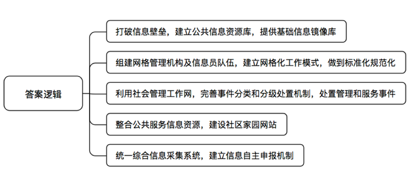
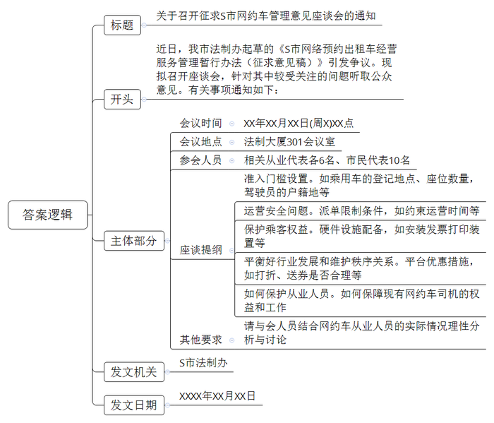
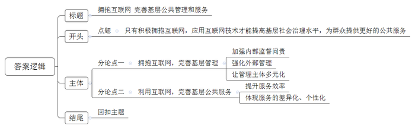

# 2017年深圳市公务员考试《申论》题（B卷）

<!-- gwy:overview:start -->
> **深圳 · 2017 · 申论 · B类** ｜ 3 题 · 图片 3 处 · 答案随题折叠

导航：[题目](#题目) · [材料 1](#材料-1)
<!-- gwy:overview:end -->

> 候选采集稿。参考答案及解析来自粉笔页面，不代表官方答案或真实高分答卷；来源使用许可与原卷对应关系仍需人工核实。

## 给定材料

### 材料 1

信息惠民公共服务平台是Z市精细化治理社会，精细化服务市民的一个创新性模式。其主要做法如下：

一是打破“信息壁垒”，强力推动各区、各部门通过市政务信息共享交换平台实现横向联通和纵向贯通，建立全市公共信息资源库，并为各区提供经过数据关联比对后的基础信息镜像库，确保全市基础信息“一数一源，权威发布”，为各级政府信息资源共享，特别是办理行政审批和服务事项共享协同奠定基础。

二是统一组建网格管理机构和成立一支统一管理、统一考核、统一采集的网络信息员队伍，建立“一格一员、定格定责、采办分离、无缝对接、全面覆盖”的网格化工作模式。通过综合信息采集系统实现信息采集标准化、规范化，实现数据一次采集多方共享，减少反复扰民和信息不准确问题。

三是按照“及时发现、联动化解、限时办结、反馈评价、监督考核”的要求，发挥社会管理工作网作为全市矛盾纠纷和问题隐患事件受理、分流、调处、整治、指挥、监督、考核的业务系统作用，进一步完善事件分类和分级处置机制，规范各级各部门之间矛盾纠纷和问题隐患处理的联动和协作；基于市公共基础信息资源库，实现纵向、横向联通，全方位掌握群众反映的矛盾纠纷和问题隐患信息，及时发现和处置各类管理和服务事件。

四是按照“政府主导，社会运作，统一规划，体现个性，贴近居民，实用方便”的要求，在统一管理平台的基础上，整合政府各类公共服务信息资源，为全市社区开发建设内容丰富、特点鲜明、贴近居民生活的社区家园网站，社区居民可以通过社区家园网参与社区事务，办理个人事项，享受公共服务，将社区家园网打造成居民信得过、日常生活离不开的得力助手。

五是按照“统一采集，集中分发”的原则，在全市部署统一的综合信息采集系统，规范信息采集内容，统一信息采集路径，明确将采集的数据直接上传到市里再分发到各业务系统和各区，从源头上确保数据的真实性、完整性、及时性。同时，通过建立信息自主申报机制，逐步实现以单位和居民自主申报为主，网格信息员上门核实登记为辅的信息采集模式。

### 材料 2

近日，《S市网络预约出租车经营服务管理暂行办法（征求意见稿)》引起坊间不少争议。S市法制办将拟于近期邀请相关从业代表各6名、市民代表10名召开座谈会。针对较受关注的问题听取公众意见。

据悉，“征求意见稿”拟要求网约车辆必须是在S市登记注册的5座以上7座以下的乘用车：对于网约车驾驶员，则拟要求具有S市户籍或者持有有效的S市居民证。参加网约车驾驶员从业资格考试合格。有网民评论，鉴于网约车是单班驾驶，对运行时间长达10小时的车辆应停止向其派单，且停止时间，至少为10个小时，以避免疲劳驾驶，引发事故。一定要强制网约车辆安装发票打印装置，发票的信息要尽量全面，因为一旦有了纠纷，发票可以作为重要的维权凭证，让乘客维权有据。也有出租车司机评论，网约车平台使用打折、送券等方式培养用户使用习惯，扰乱了正常的市场秩序。现有网约车司机表示，如果按照“征求意见稿”，可能会淘汰掉70%左右现有网约车，希望妥善考虑现有从业人员的实际情况。

### 材料 3

《中国互联网发展状况统计报告2016》指出，十年间，中国的互联网市场发生巨变，移动应用快速增长，在社交、视频、新闻、工具和购物等领域，移动应用已超过50%，在团购，旅游和零售业，移动端收入规模已经超越PC端，中国互联网用户数据接近7亿，在人口中的渗透率从10%上升至50%，手机网民超过6亿，在人口中的渗透率从1%上升至45%。

以互联网为代表的信息技术的快速发展和广泛应用，深刻改变着经济模式和行为，社会互动交往，人们的工作和生活方式，也改变着人们的思维模式和思想观念，传统的政府治理模式已难以适应网络化时代的要求。政府必须充分认识到这种趋势给政府治理带来的严峻挑战，必须积极适应这种变化，主动应用移动互联网、大数据、云计算机等互联网新技术创新政府治理理念，重新定位政府角色以及政府与市场、社会、民众的关系，实现政府治理模式的转变，另一方面，新的信息技术发展与应用也为推进政府治理现代化提供了动力和机遇。

## 题目

### 第 1 题

**根据【材料**13**】，请概括Z市建设信息惠民公共服务平台的五点主要做法。（20分）**

关联材料：材料 1

作答要求：

要求：

（1）概括准确，文字精炼，用词恰当，条理清晰；

（2）总字数不超过150字。

第 1 题 · 答案与解析

**参考答案（粉笔题库参考内容）**

一、打破信息壁垒，建立公共信息资源库，提供基础信息镜像库。

二、组建网格管理机构及信息员队伍，建立网格化工作模式，做到标准化规范化。

三、利用社会管理工作网，完善事件分类和分级处置机制，处置管理和服务事件。

四、整合公共服务信息资源，建设社区家园网站。

五、统一综合信息采集系统，建立信息自主申报机制。

**解析**

**参考答案说明：**答案从“打破信息壁垒”“组建网格管理机构及信息员队伍”“利用社会管理工作网”“整合公共服务信息资源”“统一综合信息采集系统”等不同方面的对策进行了分条撰写。各条要点之间在内容上是并列关系，没有交叉。

**考点**：概括措施类

**来源**：2017年深圳市公务员考试《申论》题（B卷）

粉笔申论页面对本题只提供「解析视频」入口，该入口是会员推广位，页面无视频地址与文字解析。

### 第 2 题

**S市法制办拟于近期在法制大厦301会议室就《S市网络预约出租车经营服务管理暂行办法（征求意见稿）》举行座谈会征求意见。假设你负责筹备该座谈会，需通知相关人员参会，请根据【材料**10**】草拟一份会议通知书。（30分）**

关联材料：材料 2

作答要求：

要求：

（1）格式完整正确；

（2）详列座谈提纲；

（3）总字数400字左右。

第 2 题 · 答案与解析

**参考答案（粉笔题库参考内容）**

关于召开征求S市网约车管理意见座谈会的通知

各位从业代表、市民代表：

近日，我市法制办起草的《S市网络预约出租车经营服务管理暂行办法（征求意见稿）》引发争议。现拟召开座谈会，针对其中较受关注的问题听取公众意见。有关事项通知如下：

一、会议时间：XX年XX月XX日（周X）XX点

二、会议地点：法制大厦301会议室

三、参会人员：相关从业代表各6名、市民代表10名

四、座谈提纲：1.准入门槛设置。如乘用车的登记地点、座位数量，驾驶员的户籍地等；2.运营安全问题。派单限制条件，如约束运营时间等；3.保护乘客权益。硬件设施配备，如安装发票打印装置等；4.平衡好行业发展和维护秩序关系。平台优惠措施，如打折、送券是否合理等；5.如何保护从业人员。如何保障现有网约车司机的权益和工作。

五、其他要求：请与会人员结合网约车从业人员的实际情况理性分析与讨论。

S市法制办

XXXX年XX月XX日

**解析**

**参考答案说明：**（1）本答案的正文分别按照开头（主要写到了征求S市网约车管理意见座谈会的背景）、主体（主要写到了会议的“时间、地点、人物”以及“会议主要内容、要求”）、结尾（省略）的结构展开。（2）为了体现公文题的逻辑性，还加上了“通知如下”等词承接上下文并标注序号分条罗列。

**考点**：其他类

**来源**：2017年深圳市公务员考试《申论》题（B卷）

粉笔申论页面对本题只提供「解析视频」入口，该入口是会员推广位，页面无视频地址与文字解析。

### 第 3 题

**阅读所给的材料，基层政府服务于人民群众。请就基层政府如何利用互联网改善政府管理与公共服务，题目自拟，写一篇对策性议论文。（50分）**

关联材料：材料 3

作答要求：

要求：

（1）紧扣主题，观点鲜明，论述充分；

（2）结构严谨，条理清晰，语言流畅；

（3）结合“给定资料”，但可不拘泥于“给定资料”；

（4）字数1000字左右。

第 3 题 · 答案与解析

**参考答案（粉笔题库参考内容）**

**拥抱互联网 完善基层公共管理与服务**

当前，以互联网为代表的信息技术已经渗透到政治、经济、文化、社会等多个领域，深刻改变着社会治理模式和人们生活方式。在这种背景下，政府是积极拥抱互联网，还是抱着抵触心理墨守成规，将新技术拒之门外？答案是肯定的！新时期**，只有积极拥抱互联网，应用互联网技术才能提高基层社会治理水平，为群众提供更好的公共服务。**

**拥抱互联网，完善基层管理，既要在管理手段上加强内部监督问责，强化外部管理，还要让管理主体多元化。**

要统筹发展电子政务，构建一体化在线服务平台，推进新型智慧城市建设，打通信息壁垒，构建信息资源共享体系，更好用信息化手段感知社会态势，畅通沟通渠道，辅助科学决策。还要了解群众所思所愿，收集好想法好建议，积极回应网民关切、解疑释惑。并要管理主体多元化，做好政务舆情回应，建设回应型政府，与社会合作，与媒体互动，对公共事务进行“共治”，比如开通书记信箱解决群众问题和接受网民举报，监督问责国家工作人员等。更要通过技术创新社会治理模式，整治“中国式过马路”等顽疾，及时对网络新事物进行管理。总而言之，我们要做到互联网+基层治理，必须秉承更为开放的理念，依法依规去管理和使用。

政府管理社会的目的是为了给群众提供一个良好的社会环境，归根结底是为了更好地服务人民，因此，除了利用互联网完善基层治理，我们更要利用互联网做好公共服务。

**利用互联网，完善基层公共服务，既要致力于提升服务效率，还要体现服务的差异化、个性化。**首先提升政府的服务效率，推进政府服务网络化，市民可以通过移动终端获取政府相关信息和相应服务，完成出入境、社保、户籍、营业执照等事项办理，随时随地获得违章查询、缴交罚款、预约挂号、缴纳社保等政府线上服务，方便群众办事。还要打造信息惠民公共服务平台，提供精细化服务。其次提高各项社会公共服务的效率，利用网络技术提升医疗服务水平，打造医疗服务平台，实现方便、省时、高速就医，利用技术实现即时通讯工具缴纳各项生活费用，足不出户解决问题。总之，利用互联网，实现多元主体互动、参与和合作，必将催生一个多方参与、协调合作的多层次多主体新型公共服务体系。

凡益之道，与时偕行。借助互联网的东风，保持开放的心态，不断探索创新基层管理和公共服务的新形态，就一定能真正满足群众需求，让群众充分享受政务数据共享的红利。

**解析**

**文章分析：**

**拥抱互联网 完善基层公共管理与服务**

【**标题的优点：**首先，范文的标题突出了“基层政府利用互联网改善政府管理与公共服务”这一主题。其次，此标题前半句点出对策，后半句点出了意义，使标题更加完整、饱满。】

（1）当前，以互联网为代表的信息技术已经渗透到政治、经济、文化、社会等多个领域，深刻改变着社会治理模式和人们生活方式。（2）在这种背景下，政府是积极拥抱互联网，还是抱着抵触心理墨守成规，将新技术拒之门外？答案是肯定的！新时期，**只有积极拥抱互联网，应用互联网技术才能提高基层社会治理水平，为群众提供更好的公共服务。**

【**开头的优点：**★内容方面：范文的开头是紧扣题目给定的“基层政府利用互联网改善政府管理与公共服务”这一主题展开的。首先，**开头第一句话点出主题，做到了主题明确**。其次，**对“基层政府如何利用互联网改善政府管理与公共服务”这一主题进行了分析阐述，指出了（****1****）“基层政府如何利用互联网改善政府管理与公共服务”的背景。（****2****）基层政府对待互联网的态度。**注意以上两个方面的阐述在逻辑上有先后顺序：先写“背景”，后写“态度”。★文字表达方面：使用了“只有……才”等关联词，使语言表达有逻辑性。】

**拥抱互联网，****完善基层管理****，既要在管理手段上****加强内部监督问责****，****强化外部管理****，还要让****管理主体多元化****。**

（1）要统筹发展电子政务，构建一体化在线服务平台，推进新型智慧城市建设，打通信息壁垒，构建信息资源共享体系，更好用信息化手段感知社会态势，畅通沟通渠道，辅助科学决策。（2）还要了解群众所思所愿，收集好想法好建议，积极回应网民关切、解疑释惑。（3）并要管理主体多元化，做好政务舆情回应，建设回应型政府，与社会合作，与媒体互动，对公共事务进行“共治”，比如开通书记信箱解决群众问题和接受网民举报，监督问责国家工作人员等。（4）更要通过技术创新社会治理模式，整治“中国式过马路”等顽疾，及时对网络新事物进行管理。总而言之，我们要做到互联网+基层治理，必须秉承更为开放的理念，依法依规去管理和使用。

【**论述段****1****的优点：**★观点句：范文的观点句是紧扣“基层政府利用互联网改善政府管理与公共服务”这一文章主题提出的。形式上，它在段首处直接写出，位置突出，容易发现。内容上，关键词突出，内容要点明确，可以明显看出它是从“完善基层管理”入手，指出了“既要在管理手段上加强内部监督问责，强化外部管理，还要让管理主体多元化”。★论述内容：（1）介绍了“统筹发展电子政务”的对策；（2）介绍了“关切网民所思所愿”的对策；（3）介绍了“要让管理主体多元化”的对策；（4）介绍了“要通过技术创新社会治理模式”的对策。注意：以上几个方面的内容都是紧扣“拥抱互联网，完善基层管理，既要在管理手段上加强内部监督问责，强化外部管理，还要让管理主体多元化”这个观点句进行分析论述的，论述的针对性强，内容层次丰富。★论述方法：采取了举例子、讲道理相结合，做到了丰富多样。】

政府管理社会的目的是为了给群众提供一个良好的社会环境，归根结底是为了更好地服务人民，因此，除了利用互联网完善基层治理，我们更要利用互联网做好公共服务。

【**过渡段的优点：**过渡段承接了论述段1的内容，引出了论述段2关于“利用互联网做好公共服务”的内容。】

**利用互联网，****完善基层公共服务****，既要致力于****提升服务效率****，还要****体现服务的差异化、个性化****。**（1）首先提升政府的服务效率，推进政府服务网络化，市民可以通过移动终端获取政府相关信息和相应服务，完成出入境、社保、户籍、营业执照等事项办理，随时随地获得违章查询、缴交罚款、预约挂号、缴纳社保等政府线上服务，方便群众办事。还要打造信息惠民公共服务平台，提供精细化服务。（2）其次提高各项社会公共服务的效率，利用网络技术提升医疗服务水平，打造医疗服务平台，实现方便、省时、高速就医，利用技术实现即时通讯工具缴纳各项生活费用，足不出户解决问题。总之，利用互联网，实现多元主体互动、参与和合作，必将催生一个多方参与、协调合作的多层次多主体新型公共服务体系。

【**论述段****2****的优点：**★观点句：范文的观点句是紧扣“基层政府利用互联网改善政府管理与公共服务”这一文章主题提出的。形式上，它在段首处直接写出，位置突出，容易发现。内容上，关键词突出，内容要点明确，可以明显看出它是从“完善基层公共服务”入手，指出了“既要在致力于提升服务效率，还要体现服务的差异化、个性化”。★论述内容：（1）从“推进政府服务网络化”的角度提出了“提升政府服务效率”的对策；（2）从“医疗、即时通讯”等领域提出了“差异化、个性化服务”的对策。注意：以上几个方面的内容都是紧扣“利用互联网，完善基层公共服务，既要致力于提升服务效率，还要体现服务的差异化、个性化”这个观点句进行分析论述的，论述的针对性强，内容层次丰富。★论述方法：采取了讲道理、举例子相结合，做到了丰富多样。】

【**论述段之间的关系**：★内容的内在逻辑：从“完善基层管理”和“完善基层公共服务”两个并列的逻辑展开。★段与段的外在衔接：过渡段“政府管理社会……归根结底是为了更好地服务人民，因此，除了……我们更要……”起到了承接论述段1，引出论述段2的作用。】

凡益之道，与时偕行。借助互联网的东风，保持开放的心态，（1）不断探索创新基层管理和公共服务的新形态，（2）就一定能真正满足群众需求，让群众充分享受政务数据共享的红利。

【**结尾的优点**：范文的结尾回扣了“基层政府利用互联网改善政府管理与公共服务”这一主题。（1）再次提到了“基层管理和服务”“互联网”等主题词。（2）进行了展望。】

**考点**：文章写作题

**来源**：2017年深圳市公务员考试《申论》题（B卷）

粉笔申论页面对本题只提供「解析视频」入口，该入口是会员推广位，页面无视频地址与文字解析。

