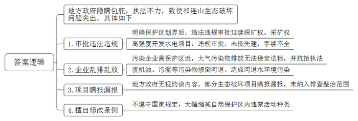
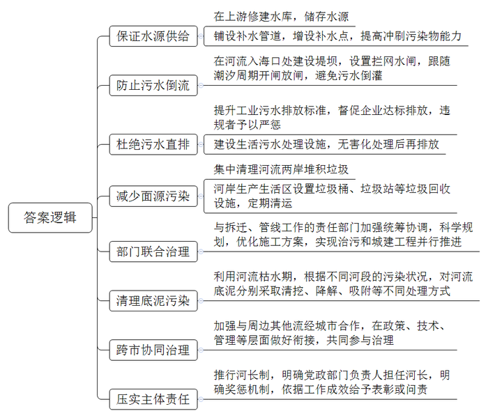
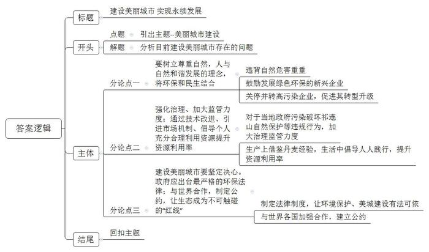

# 2018年深圳市公务员考试《申论》题（B卷）

<!-- gwy:overview:start -->
> **深圳 · 2018 · 申论 · B类** ｜ 3 题 · 图片 3 处 · 答案随题折叠

导航：[题目](#题目) · [材料 1](#材料-1)
<!-- gwy:overview:end -->

> 候选采集稿。参考答案及解析来自粉笔页面，不代表官方答案或真实高分答卷；来源使用许可与原卷对应关系仍需人工核实。

## 给定材料

### 材料 1

国家1988年批准设立了甘肃祁连山国家级自然保护区。长期以来，祁连山局部生态破坏问题十分突出。2017年2月，中央督查组就此问题开展专项督查。督查中发现，保护区设置的144宗探矿权、采矿权中，有14宗是在2014年国务院明确保护区划界后违法违规审批延续的。当地在祁连山区域河流高强度开发水电项目，存在违规审批、未批先建、手续不全等问题。某铁合金公司毗邻保护区，大气污染物排放长期无法稳定达标，当地环保部门多次对其执法，但均未得到执行。某水电站将废机油、污泥等污染物倾倒河道，造成河道水环境污染。在2015年环境保护部等部门对省直有关单位和保护区所在市进行公开约谈后，仍有31个生态破坏项目瞒报漏报，没有纳入排查整治范围。《甘肃祁连山国家级自然保护区管理条例》将国家规定的“禁止在自然保护区内进行砍伐、放牧、狩猎、捕捞、采药、开垦、烧荒、开矿、采石、挖沙”等10类活动，缩减为3类活动。2017年7月20日，中共中央办公厅、国务院办公厅对外发布通报，对甘肃省包括三名副省级领导在内的相关责任人和单位进行了严肃问责。

### 材料 2

2017年9月，《南方日报》推出“走读河流”系列报道，首期即聚焦S市M河治理。在走访当中，即将迎接“年底大考”的M河，从桥上看下去水体依旧呈黑色，水面漂浮着油层，一阵风吹过，可以明显闻到水体散发出来的臭味。

M河属于雨源型河流，上游无足够水源补充，主要靠雨水增加容量，对污染物的冲刷能力不足，不下雨时径流基本上由生产生活污水组成；作为入海河流，M河流域内感潮河段占总河长约50%，流至下游的污水常常被潮水“顶回”河道；河两岸电镀厂、五金厂、塑胶厂、养鸡场、养猪场等众多企业集聚，生活污水、工业废水直排入河；河道两岸垃圾随意堆放，由此产生的面源污染加剧着水体恶化程度；M河沿岸是重要的管线走廊，征地拆迁和管线迁改体量大、难度大、周期长，整治工程推进缓慢；底泥污染严重，逐年沉积形成顽固的污染内源；河流部分流域属于周边城市管辖范围，治理难度较大。

2017年，我国全面推行河长制，由各级党政部门负责人担任河长，负责组织领导相应河流的管理和保护工作，越来越多的河流有了健康守护责任人。

### 材料 3

1934年，美国发生了一场人类历史上空前未有的黑色风暴，形成一个东西长2400公里、南北宽1440公里、高3400米的巨大风暴带。风暴所经之处，溪水断流，田地龟裂，庄稼枯萎，牲畜渴死，千万人流离失所。调查发现，引发黑色风暴的直接原因竟然是人类无度的开垦和砍伐森林所造成的土地荒漠化。

古希腊悲剧大师埃斯库罗斯说：“非但不能强制自然，还要顺从自然。”中国古代也有“天人合一”的思想。到了近代，黑格尔说：“当人类欢呼对自然的胜利之时，也就是自然对人类惩罚的开始。”恩格斯更明确地指出：“我们不要过分陶醉于我们对自然界的胜利。对于每一次这样的胜利，自然界都报复了我们。”

## 题目

### 第 1 题

**根据【资料**4**】，请归纳出祁连山生态保护方面存在的主要问题。（20分）**

关联材料：材料 1

作答要求：

要求：

（1）概括全面，文字精炼，条理清晰；

（2）总字数不超过250字。

第 1 题 · 答案与解析

**参考答案（粉笔题库参考内容）**

地方政府隐瞒包庇，执法不力，致使祁连山生态破坏问题突出，具体如下：

1.审批违法违规。明确保护区划界后，违法违规审批延续探矿权、采矿权；高强度开发水电项目，违规审批，未批先建，手续不全。

2.企业乱排乱放。污染企业离保护区近，大气污染物排放无法稳定达标，并抗拒执法；废机油、污泥等污染物倾倒河道，造成河道水环境污染。

3.项目瞒报漏报。地方政府无视约谈内容，部分生态破坏项目瞒报漏报，未纳入排查整治范围。

4.擅自修改条例。不遵守国家规定，大幅缩减自然保护区内违禁活动种类。

**解析**

**参考答案说明：**本参考答案从“审批违法违规”“企业乱排乱放”“项目瞒报漏报”“擅自修改条例”等不同的方面对祁连山生态保护方面存在的问题进行了分条撰写。各条要点之间在内容上是并列关系，没有交叉。

**考点**：问题类

**来源**：2018年深圳市公务员考试《申论》题（B卷）

### 第 2 题

**根据【材料**7**】，请就M河存在的问题提出治理举措。（30分）**

关联材料：材料 2

作答要求：

要求：

（1）考虑全面，条理清晰，措施可行；

（2）总字数不超过500字。

第 2 题 · 答案与解析

**参考答案（粉笔题库参考内容）**

1.保证水源供给。在上游修建水库，储存水源；铺设补水管道，增设补水点，提高冲刷污染物能力。

2.防止污水倒流。在河流入海口处建设堤坝，设置拦网水闸，跟随潮汐周期开闸放闸，避免污水倒灌。

3.杜绝污水直排。提升工业污水排放标准，督促企业达标排放，违规者予以严惩；建设生活污水处理设施，无害化处理后再排放。

4.减少面源污染。集中清理河流两岸堆积垃圾；河岸生产生活区设置垃圾桶、垃圾站等垃圾回收设施，定期清运。

5.部门联合治理。与拆迁、管线工作的责任部门加强统筹协调，科学规划，优化施工方案，实现治污和城建工程并行推进。

6.清理底泥污染。利用河流枯水期，根据不同河段的污染状况，对河流底泥分别采取清挖、降解、吸附等不同处理方式。

7.跨市协同治理。加强与周边其他流经城市合作，在政策、技术、管理等层面做好衔接，共同参与治理。

8.压实主体责任。推行河长制，明确党政部门负责人担任河长，明确奖惩机制，依据工作成效给予表彰或问责。

**解析**

**参考答案说明：**本参考答案分别从“保证水源供给”“防止污水倒流”“杜绝污水直排”“减少面源污染”“部门联合治理”“清理底泥污染”“跨市协同治理”“压实主体责任”八个方面展开，各条答案要点之间在内容上相互并列，没有交叉。

**考点**：提出对策类

**来源**：2018年深圳市公务员考试《申论》题（B卷）

### 第 3 题

**假如A市正在开展建设“美丽A市”意见征集活动，你准备给市委市政府建言献策，请结合给定材料，写一篇文章。（50分）**

关联材料：材料 3

作答要求：

要求：

（1）紧扣主题，建议合理，论述全面；

（2）结构严谨，条理清晰，语言流畅；

（3）字数1000字左右。

第 3 题 · 答案与解析

**参考答案（粉笔题库参考内容）**

**建设美丽城市** **实现永续发展**

打开美丽城市的卷轴，映入眼帘的是一幅人与自然和谐共存的画面，这里绿树成荫，鸟语花香，静谧惬意。美丽城市兼顾生态、经济、社会、文化效益，坚持走生产发展、生活富裕、生态良好的文明发展的道路。建设美丽城市，不仅能够在当前为人民群众创造良好的生产生活环境，还关系着未来中华民族的永续发展。

十八大以来，美丽中国、生态文明建设的理念日渐深入人心，各地也竞相打造美丽城市。然而令人遗憾的是，过度追求经济高速发展的理念，导致一部分城市在建设的过程中忽略了环境因素，不知晓、不顺从、不尊重自然规律，置“天人合一”思想于不顾。对此，必须拿出踏石留印的决心、抓铁有痕的魄力，以及科学智慧的规划与设计，共同建设你我同在的美丽城市。

**首先，****要树立尊重自然****，****人与自然和谐发展的理念****，****将环保和民生结合****。**从洛杉矶的光化学污染到日本的水俣病，从太湖的赤潮到大西北严重的沙化，无数事实证明违背自然发展规律，必将受到惩罚，不仅影响经济社会长远发展，甚至危害民众的身体健康和正常生活。古人早有告诫：斧斤以时入山林。今天深圳建设美丽城市也应该顺应自然，尊重自然规律，统筹经济建设、社会民生与环境保护三方平衡发展。一方面搭乘互联网技术和双创政策的东风，推动创业创新，鼓励发展绿色环保的新兴产业。另一方面，对于已经存在的高污染高能耗企业，实行关停并转，督促并扶持企业转型升级。

**还需要付诸行动。强化治理、加大监管力度；通过技术改进、引进市场机制、倡导个人充分合理利用资源提升资源利用率。**当地政府罔顾祁连山国家自然保护区以保护为主的政策方针，违规审批、未批先建、手续不全，大气污染物长期无法稳定达标，废机油、污泥等污染物倾倒河道，造成河道水环境污染。对于类似违规行为，应该加大监管治理力度，加大处罚，强化问责。基于我国能源资源分布不均，面临紧缺甚至枯竭的现状，应该借鉴丹麦卡伦堡工业园的先进技术和管理理念，促进资源的循环利用。同时通过宣传教育，引导民众在日常生活中践行绿色低碳的生活理念。

**建设美丽城市要坚定决心。政府应出台最严格的环保法律；与世界合作，制定公约，让生态成为不可触碰的****“红线”。**过去生态治理有章可循，却无法可依，执法不严，效力不强，“睁只眼，闭只眼”，不敢动真碰硬。现如今，出台史上最严环保法、建立河长制、把环保当政绩来抓，让生态建设不容小觑。不仅如此，环境治理不是某个地区、某个国家的事，而是全世界共同关注、共同努力的方向，各地与各国相互借鉴、共同商议、联合治理也必不可少。

绿水青山就是金山银山。城市建设并不是经济发展的独角戏，唯有绿地、青山、碧水、蓝天交相辉映，一座城市才能够真正走上高品质、有价值、可持续发展之路！

**解析**

**文章分析：**

**建设美丽城市** **实现永续发展**

【**标题的优点：**一方面，范文的标题“建设美丽城市，实现永续发展”突出了“建设美丽城市”这一主题。另一方面，它在形式上采用对称式结构，前半句点出主题，后半句点出了意义，使标题更加完整、饱满。】

打开美丽城市的卷轴，映入眼帘的是一幅人与自然和谐共存的画面，这里绿树成荫，鸟语花香，静谧惬意。（1）美丽城市兼顾生态、经济、社会、文化效益，坚持走生产发展、生活富裕、生态良好的文明发展的道路。（2）建设美丽城市，不仅能够在当前为人民群众创造良好的生产生活环境，还关系着未来中华民族的永续发展。

【**开头的优点：**★内容方面。范文的开头是紧扣题目给定的“建设美丽城市”这一主题展开的。首先，开头第一句话点出主题，做到了主题明确。其次，对“建设美丽城市”这一主题进行了分析阐述，指出了（1）“美丽城市”的含义。（2）“建设美丽城市”的重要性。注意以上两个方面的阐述在逻辑上有先后顺序：先写“含义”，再写“重要性”。★文字表达方面：使用了“不仅……还”这一递进关联词，使语言表达有逻辑性，此外也使用了比喻、排比等修辞手法，使文字表达更加形象、有力。】

十八大以来，美丽中国、生态文明建设的理念日渐深入人心，各地也竞相打造美丽城市。然而令人遗憾的是，过度追求经济高速发展的理念，导致一部分城市在建设的过程中忽略了环境因素，不知晓、不顺从、不尊重自然规律，置“天人合一”思想于不顾。对此，必须拿出踏石留印的决心、抓铁有痕的魄力，以及科学智慧的规划与设计，共同建设你我同在的美丽城市。

【**过渡段的优点：**范文过渡段分析了“建设美丽城市”的过程中存在的问题，此外，还要注意过渡段末尾的“对此，必须拿出踏石留印的决心、抓铁有痕的魄力，以及科学智慧的规划与设计，共同建设你我同在的美丽城市”是用来引起下文的过渡句。】

**首先，****要树立尊重自然****，****人与自然和谐发展的理念****，****将环保和民生结合****。**（1）从洛杉矶的光化学污染到日本的水俣病，从太湖的赤潮到大西北严重的沙化，无数事实证明违背自然发展规律，必将受到惩罚，不仅影响经济社会长远发展，甚至危害民众的身体健康和正常生活。古人早有告诫：斧斤以时入山林。今天深圳建设美丽城市也应该顺应自然，尊重自然规律，统筹经济建设、社会民生与环境保护三方平衡发展。（2）一方面搭乘互联网技术和双创政策的东风，推动创业创新，鼓励发展绿色环保的新兴产业。另一方面，（3）对于已经存在的高污染高能耗企业，实行关停并转，督促并扶持企业转型升级。

【**论述段****1的优点：**★观点句：范文的观点句是紧扣“建设美丽城市”这一文章主题提出的。形式上，它在段首处直接写出，位置突出，容易发现。内容上，关键词突出，内容要点明确，可以明显看出它是从“尊重自然”这一方面入手，指出了“如何建设美丽城市”。★论述内容：（1）介绍了“违背自然规律”的危害；（2）介绍了“鼓励发展绿色环保的新兴产业”；（3）介绍了“关停并转高污染企业，促进其转型升级”。注意：以上几个方面的内容都是紧扣“要树立尊重自然，人与自然和谐发展的理念，将环保和民生结合”这个观点句进行分析论述的，论述的针对性强，内容层次丰富。并且这几个方面的论述是有内在逻辑顺序的，先讲过去的问题，然后讲现今的措施。最后，在论述方法和论据的选取上做到了讲道理、举例子相结合，做到了丰富多样。】

**还需要付诸行动。强化治理、加大监管力度；通过技术改进、引进市场机制、倡导个人充分合理利用资源提升资源利用率。**（1）当地政府罔顾祁连山国家自然保护区以保护为主的政策方针，违规审批、未批先建、手续不全，大气污染物长期无法稳定达标，废机油、污泥等污染物倾倒河道，造成河道水环境污染。对于类似违规行为，应该加大监管治理力度，加大处罚，强化问责。基于我国能源资源分布不均，面临紧缺甚至枯竭的现状，（2）应该借鉴丹麦卡伦堡工业园的先进技术和管理理念，促进资源的循环利用。同时通过宣传教育，引导民众在日常生活中践行绿色低碳的生活理念。

【**论述段****2的优点：**★观点句：范文的观点句是紧扣“建设美丽城市”这一文章主题提出的。形式上，它在段首处直接写出，位置突出，容易发现。内容上，关键词突出，内容要点明确，可以明显看出它是从“加强治理”这一方面入手，指出了“如何建设美丽城市”。★论述内容：（1）介绍了“加大监管治理力度，保护自然环境”；（2）介绍了“借鉴丹麦经验，促进资源循环、绿色低碳”。注意：以上几个方面的内容都是紧扣“强化治理、加大监管力度；通过技术改进、引进市场机制、倡导个人充分合理利用资源提升资源利用率”这个观点句进行分析论述的，论述的针对性强，内容层次丰富。最后，在论述方法和论据的选取上做到了讲道理、打比方、举例子相结合，做到了丰富多样。】

**建设美丽城市要坚定决心。政府应出台最严格的环保法律；与世界合作，制定公约，让生态成为不可触碰的****“红线”。**（1）过去生态治理有章可循，却无法可依，执法不严，效力不强，“睁只眼，闭只眼”，不敢动真碰硬。现如今，（2）出台史上最严环保法、建立河长制、把环保当政绩来抓，让生态建设不容小觑。不仅如此，（3）环境治理不是某个地区、某个国家的事，而是全世界共同关注、共同努力的方向，各地与各国相互借鉴、共同商议、联合治理也必不可少。

【**论述段****3的优点：**★观点句：范文的观点句是紧扣“建设美丽城市”这一文章主题提出的。形式上，它在段首处直接写出，位置突出，容易发现。内容上，关键词突出，内容要点明确，可以明显看出它是从“强化制度”入手，指出了“如何建设美丽城市”。★论述内容：（1）介绍了“过去环保执法不严的问题”；（2）介绍了“制定最严环保法律”；（3）介绍了“加强世界合作，联合治理”。注意：以上几个方面的内容都是紧扣“政府应出台最严格的环保法律；与世界合作，制定公约，让生态成为不可触碰的‘红线’”这个观点句进行分析论述的，论述的针对性强，内容层次丰富。最后，在论述方法和论据的选取上做到了讲道理、打比方、举例子相结合，做到了丰富多样。】

【**论述段之间的关系：**★内容的内在逻辑：范文的论述段之间是依照“提出对策”的逻辑展开的。论述段1先写了“尊重自然”，论述段2再写了“加强治理”，论述段3接着写了“强化制度”。★段与段的外在衔接：论述段1、论述段2的段首句分别是以“首先”“还要”引导，可以看出来段落之间呈现出明显的“并列关系”。】

绿水青山就是金山银山。（1）**城市建设**并不是经济发展的独角戏，唯有绿地、青山、碧水、蓝天交相辉映，（2）一座城市才能够真正走上高品质、有价值、可持续发展之路！

【**结尾的优点：**范文的结尾回扣了“建设美丽城市”这一主题。（1）再次提到了“建设美丽城市”；（2）发出了号召希望，阐述了深远意义。】

**考点**：文章写作题

**来源**：2018年深圳市公务员考试《申论》题（B卷）

粉笔申论页面对本题只提供「解析视频」入口，该入口是会员推广位，页面无视频地址与文字解析。

