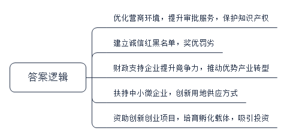
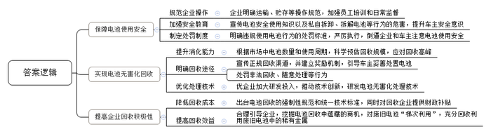
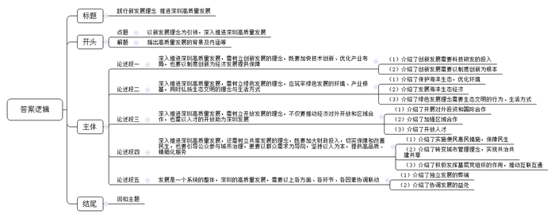

# 2019年深圳市公务员考试《申论》题（一卷）

<!-- gwy:overview:start -->
> **深圳 · 2019 · 申论 · 一卷** ｜ 3 题 · 图片 3 处 · 答案随题折叠

导航：[题目](#题目) · [材料 1](#材料-1)
<!-- gwy:overview:end -->

> 候选采集稿。参考答案及解析来自粉笔页面，不代表官方答案或真实高分答卷；来源使用许可与原卷对应关系仍需人工核实。

## 给定材料

### 材料 1

近年来，深圳采取了一系列措施促进实体经济健康发展，包括：出台“营商环境改革20条”，发布“不见面审批”服务事项清单，出台“深圳90”改革措施将原来审批时限压缩三分之二，实行商事登记“三十证合一”，推动企业投资项目备案等服务事项实现“秒批”，颁布实施《深圳经济特区知识产权保护条例》；建立诚信“红名单”和失信“黑名单”制度，对列入“红名单”的主体实行政府服务“绿色通道”和“容缺受理”，对列入“黑名单”的主体予以重点监管，加大行政性约束和惩戒力度；通过财政资金支持，引导企业充分利用新技术、新工艺、新装备、新材料等提升市场竞争力，并推动珠宝、钟表、眼镜等传统优势产业实现从传统加工业向时尚产业转变；加大面向中小微企业的担保增信、风险补偿、贷款贴息等政策支持，同时大力推行“长期租赁”和“先租后让、租让结合”的产业用地供应方式；投入资金对创新创业项目予以资助，培育创客服务平台和创业孵化载体，并通过举办创业大赛吸引社会资本投资创新项目。

### 材料 2

绿色低碳是电动汽车的突出优势。2017年深圳就已实现专营公交车辆的全部纯电动化，2018年又新增新能源汽车7万辆，累计投放21万辆，投放纯电动出租车2.15万辆，基本实现出租车纯电动化。2018年度深圳市环境状况公报显示，深圳PM2.5平均浓度为15年来最低，这个结果有电动汽车的一份功劳。然而在电动汽车的逐步推广使用中，存在的电池问题不容忽视。近年来，因电动汽车电池使用、运输、贮存不当及车主私自拆卸、拆解电池而发生的爆炸事故时有发生，电池安全问题亟需重视。另外，有专家指出，我国电动汽车电池已经进入规模化“退役”期，预计到2020年累计退役量将超过20万吨。大量的废旧电池如果不能得到妥善的回收和技术处理，不但会引发安全问题，还会严重污染环境。同时，由于缺乏强制性规范和统一的技术标准，废旧电池回收利用的成本居高不下，加之很多车主随意处置废旧电池，严重影响了相关企业回收的积极性和效率。专家认为，如果引导得当，电池回收利用其实蕴藏着巨大商机，以锂电池为例，由于电池内含有多种稀有金属，完全可以“梯次利用”，故被喻为“城市矿产”。有研究报告预测，2023年电动汽车电池回收利用市场规模将达到150亿元。

### 材料 3

党的十九大报告指出：“我国经济已由高速增长阶段转向高质量发展阶段”。2018年12月26日，习近平总书记对深圳工作作出重要批示，其中要求深圳践行高质量发展要求。

## 题目

### 第 1 题

**根据【材料5】，概括深圳促进实体经济健康发展的5条措施。（20分）**

关联材料：材料 1

作答要求：

要求：

（1）概括全面，用词准确，条理清晰；

（2）总字数不超过100字。

第 1 题 · 答案与解析

**参考答案（粉笔题库参考内容）**

1.优化营商环境，提升审批服务，保护知识产权。

2.建立诚信红黑名单，奖优罚劣。

3.财政支持企业提升竞争力，推动优势产业转型。

4.扶持中小微企业，创新用地供应方式。

5.资助创新创业项目，培育孵化载体，吸引投资。

**解析**

**参考答案说明**：本参考答案从“优化营商环境”“建立诚信名单”“财政支持”“扶持中小微企业”“资助创新创业项目”五个方面进行了分条撰写。各条答案要点之间在内容上相互并列，没有交叉。

**考点**：概括措施类

**来源**：2019年深圳市公务员考试《申论》题（一卷）

粉笔申论页面对本题只提供「解析视频」入口，该入口是会员推广位，页面无视频地址与文字解析。

### 第 2 题

**针对【材料10】反映的电动汽车电池问题提出对策。（30分）**

关联材料：材料 2

作答要求：

要求：

（1）考虑全面，对策合理，条理清晰；

（2）总字数不超过400字。

第 2 题 · 答案与解析

**参考答案（粉笔题库参考内容）**

一、保障电池使用安全。1.规范企业操作。企业明确运输、贮存等操作规范，加强员工培训和日常监督。2.加强安全教育。宣传电池安全使用知识以及私自拆卸、拆解电池等行为的危害，提升车主安全意识。3.制定处罚制度。明确违规使用电池行为的处罚标准，严厉执行，倒逼企业和车主注意电池使用安全。

二、实现电池无害化回收。1.提升消化能力。根据市场中电池数量和使用周期，科学预估回收规模，应对回收高峰。2.明确回收途径。宣传正规回收渠道，并建立奖励机制，引导车主妥善处置电池；处罚非法回收、随意处理等行为。3.优化处理技术。企业加大研发投入，推动技术创新，研发电池无害化处理技术。

三、提高企业回收积极性。1.降低回收成本。出台电池回收的强制性规范和统一技术标准，同时对回收企业提供财政补贴。2.提高回收效益。合理引导企业，挖掘电池回收中蕴藏的商机，对废旧电池“梯次利用”，充分回收利用废旧电池中的稀有金属。

**解析**

**参考答案说明：**本参考答案从“保障电池使用安全”“实现电池无害化回收”“提高企业回收积极性”这三个方面进行了分条撰写。各条要点之间在内容上相互并列，没有交叉。

**考点**：提出对策类

**来源**：2019年深圳市公务员考试《申论》题（一卷）

粉笔申论页面对本题只提供「解析视频」入口，该入口是会员推广位，页面无视频地址与文字解析。

### 第 3 题

**根据给定材料，围绕“以新发展理念为引领，深入推进深圳高质量发展”这个主题，自拟题目，写一篇对策性议论文。（50分）**

关联材料：材料 3

作答要求：

要求：

（1）紧扣主题，紧密联系材料；

（2）论述充分，对策合理；

（3）结构严谨，条理清晰，语言流畅；

（4）字数1200字左右。

第 3 题 · 答案与解析

**参考答案（粉笔题库参考内容）**

**践行新发展理念** **推进深圳高质量发展**

2017年，十九大报告明确提出“我国经济已由高速增长阶段转向高质量发展阶段”，在2018年，习近平总书记对深圳未来的发展也提出了“高质量发展”的要求。所谓高质量发展，是指通过践行创新、协调、绿色、开放、共享五大理念所推动的发展。深圳应践行新发展理念，推进构建新的发展格局。

**深入推进深圳高质量发展，需树立创新发展的理念，既要加快技术创新、优化产业布局，也要以制度创新为经济发展提供保障。**一方面，深圳要加大全社会科技研发投入，补齐基础研究和源头创新的短板，培育具有国际竞争力的创新型龙头企业和高成长性的创新型企业，助力关键核心技术突破。在此基础上以点带面，优化产业布局，发挥战略性新兴产业的集聚效应，助力深圳经济转向“质量时代”。另一方面，产业的高质量发展需以制度创新为根本保障。因此，深圳需不断增强政府的服务效能，优化企业营商环境与办事流程，为企业发展提供财政资金支持和资源保障；进而探索新型城市化建设模式，高标准建设产业新城，为全国的区域协调发展提供可借鉴的深圳模式。

**深入推进深圳高质量发展，需树立绿色发展的理念，应筑牢绿色发展的环境、产业根基，同时弘扬生态文明的理念与生活方式。**深圳在发展中需不断加强污染治理与生态修复，重点保护海洋生态，优化环境；在此基础上，大力发展以海洋产业为代表的生态经济，推出绿色产品，坚持绿色标准，建设资源节约型产业。当然，绿色发展的理念离不开每一位市民的亲身实践，深圳也需倡导绿色、低碳的生活方式，激励民众的绿色文明行为，同时引导全社会增强生态意识、树立生态理念、践行绿色生产、享受低碳生活。

**深入推进深圳高质量发展，需树立开放发展的理念，不仅要推动经济对外开放和区域合作，也需以人才的开放助力深圳发展。**深圳作为我国开放的先行城市，在未来的发展中，需进一步践行开放发展的理念，一方面要推动企业积极走出去，开展对外投资和国际合作；另一方面要加强区域合作，以开放的姿态实现资源共享与优势互补，加强区域之间在文化、经济等全方面的交流与合作。不仅如此，深圳的开放还在于人才的开放，应进一步打造开放、包容和创新、创业的城市氛围，充分吸引人才；同时，也为人才提供优惠政策、全方位的服务和广阔的发展平台，让人才在深圳来得了、留得下。

**深入推进深圳高质量发展，还需树立共享发展的理念，既要加大财政投入，切实保障和改善民生，也要引导公众参与城市治理，更要以群众需求为导向，坚持以人为本，提供高品质、精细化服务**。深圳需要在提升居民幸福指数方面苦下功夫，在教育、医疗、交通等领域给予大量人财物的支持，进一步推进实施便民惠民措施。除此之外，需转变城市管理工作理念，建立监督举报机制，畅通反馈渠道，激发市民参与城市治理的热情，实现共治共建共享。最后，还要积极发挥基层党组织作用，统筹各类社会资源开展工作，推动辖区组织共促共融、互联互通，探索“大党建”模式。多措并举，共享发展，提升居民幸福感，增强城市凝聚力。

**发展是一个系统的整体，深圳的高质量发展，需要以上各方面、各环节、各因素协调联动。**独立作战，各自为营，最终的结果可能是发展失衡，相互制约，存在短板。以创新发展为动力，以共享发展为根本，坚守绿色发展的底线，走开放发展之路，相互协调，相互促进。唯有如此，才能增强发展的平衡性、包容性与可持续性，实现统筹兼顾、综合平衡。

深圳是希望之城，它正用创新发展、协调发展、绿色发展、开放发展、共享发展的全新发展理念，谋求更高层次发展，成为傲立在中国东方的丰碑。

**解析**

**文章分析**

**践行新发展理念** **推进深圳高质量发展**

【**标题的优点：**范文的标题“践行新发展理念 推进深圳高质量发展”突出了“高质量发展”“新发展理念”等主题词。】

（1）2017年，十九大报告明确提出“我国经济已由高速增长阶段转向高质量发展阶段”，在2018年，习近平总书记对深圳未来的发展也提出了“高质量发展”的要求。（2）所谓高质量发展，是指通过践行创新、协调、绿色、开放、共享五大理念所推动的发展。深圳应践行新发展理念，推进构建新的发展格局。

【**开头的优点：★内容方面：**范文的开头是紧扣“以新发展理念为引领，深入推进深圳高质量发展”这一主题展开的。首先，开头在段首处点出主题，做到了主题明确。其次，对“以新发展理念为引领，深入推进深圳高质量发展”这一主题进行了分析阐述，指出了（1）深圳践行高质量发展要求的背景；（2）高质量发展的内涵。**★文字表达方面：**将高质量发展和新发展理念的内涵整合为一句话，使行文更加紧凑、流畅、简洁、规范。】

**深入推进深圳高质量发展，需树立创新发展的理念，既要加快技术创新、优化产业布局，也要以制度创新为经济发展提供保障。**（1）一方面，深圳要加大全社会科技研发投入，补齐基础研究和源头创新的短板，培育具有国际竞争力的创新型龙头企业和高成长性的创新型企业，助力关键核心技术突破。在此基础上以点带面，优化产业布局，发挥战略性新兴产业的集聚效应，助力深圳经济转向“质量时代”。（2）另一方面，产业的高质量发展需以制度创新为根本保障。因此，深圳需不断增强政府的服务效能，优化企业营商环境与办事流程，为企业发展提供财政资金支持和资源保障；进而探索新型城市化建设模式，高标准建设产业新城，为全国的区域协调发展提供可借鉴的深圳模式。

【**论述段1的优点：★观点句：**范文的观点句是紧扣“以新发展理念为引领，深入推进深圳高质量发展”这一文章主题提出的。形式上，它在段首处直接写出，位置突出，容易发现。内容上，关键词突出，内容要点明确，可以明显看出它是从“树立创新发展的理念”入手，推进深圳高质量发展。**★论述内容：**（1）介绍了创新发展需要科技研发的投入；（2）介绍了创新发展需要以制度创新为根本。以上几个方面的内容都是紧扣“深入推进深圳高质量发展，需树立创新发展的理念，既要加快技术创新、优化产业布局，也要以制度创新为经济发展提供保障”这个观点进行分析论述的，论述的针对性强，内容层次丰富。最后，在论述方法上采取了讲道理的方式进行展开，做到了论述有力。】

**深入推进深圳高质量发展，需树立绿色发展的理念，应筑牢绿色发展的环境、产业根基，同时弘扬生态文明的理念与生活方式。**（1）深圳在发展中需不断加强污染治理与生态修复，重点保护海洋生态，优化环境；（2）在此基础上，大力发展以海洋产业为代表的生态经济，推出绿色产品，坚持绿色标准，建设资源节约型产业。（3）当然，绿色发展的理念离不开每一位市民的亲身实践，深圳也需倡导绿色、低碳的生活方式，激励民众的绿色文明行为，同时引导全社会增强生态意识、树立生态理念、践行绿色生产、享受低碳生活。

【**论述段2的优点：★观点句：**范文的观点句是紧扣“以新发展理念为引领，深入推进深圳高质量发展”这一文章主题提出的。形式上，它在段首处直接写出，位置突出，容易发现。内容上，关键词突出，内容要点明确，可以明显看出它是从“树立绿色发展的理念”入手，推进深圳高质量发展。**★论述内容：**（1）介绍了保护海洋生态，优化环境；（2）介绍了发展海洋生态经济；（3）介绍了绿色发展理念需要生态文明的行为、生活方式。以上三个方面的内容都是紧扣“深入推进深圳高质量发展，需树立绿色发展的理念，应筑牢绿色发展的环境、产业根基，同时弘扬生态文明的理念与生活方式”这个观点进行分析论述的，论述的针对性强，内容层次丰富。最后，在论述方法上主要采取了讲道理和举例子相结合，做到了丰富多样。】

**深入推进深圳高质量发展，需树立开放发展的理念，不仅要推动经济对外开放和区域合作，也需以人才的开放助力深圳发展。**深圳作为我国开放的先行城市，在未来的发展中，需进一步践行开放发展的理念，（1）一方面要推动企业积极走出去，开展对外投资和国际合作；（2）另一方面要加强区域合作，以开放的姿态实现资源共享与优势互补，加强区域之间在文化、经济等全方面的交流与合作。（3）不仅如此，深圳的开放还在于人才的开放，应进一步打造开放、包容和创新、创业的城市氛围，充分吸引人才；同时，也为人才提供优惠政策、全方位的服务和广阔的发展平台，让人才在深圳来得了、留得下。

【**论述段3的优点：★观点句：**范文的观点句是紧扣“以新发展理念为引领，深入推进深圳高质量发展”这一文章主题提出的。形式上，它在段首处直接写出，位置突出，容易发现。内容上，关键词突出，内容要点明确，可以明显看出它是从“树立开放发展的理念”入手，推进深圳高质量发展。**★论述内容：**（1）介绍了开展对外投资和国际合作；（2）介绍了加强区域合作；（3）介绍了开放人才。以上三个方面的内容都是紧扣“深入推进深圳高质量发展，需树立开放发展的理念，不仅要推动经济对外开放和区域合作，也需以人才的开放助力深圳发展”这个观点进行分析论述的，论述的针对性强，内容层次丰富。最后，在论述方法上主要采取了讲道理和举例子相结合，做到了丰富多样。】

**深入推进深圳高质量发展，还需树立共享发展的理念，既要加大财政投入，切实保障和改善民生，也要引导公众参与城市治理，更要以群众需求为导向，坚持以人为本，提供高品质、精细化服务。**（1）深圳需要在提升居民幸福指数方面苦下功夫，在教育、医疗、交通等领域给予大量人财物的支持，进一步推进实施便民惠民措施。（2）除此之外，需转变城市管理工作理念，建立监督举报机制，畅通反馈渠道，激发市民参与城市治理的热情，实现共治共建共享。（3）最后，还要积极发挥基层党组织作用，统筹各类社会资源开展工作，推动辖区组织共促共融、互联互通，探索“大党建”模式。多措并举，共享发展，提升居民幸福感，增强城市凝聚力。

【**论述段4的优点：★观点句：**范文的观点句是紧扣“以新发展理念为引领，深入推进深圳高质量发展”这一文章主题提出的。形式上，它在段首处直接写出，位置突出，容易发现。内容上，关键词突出，内容要点明确，可以明显看出它是从“树立共享发展的理念”入手，推进深圳高质量发展。**★论述内容：**（1）介绍了实施便民惠民措施，保障民生；（2）介绍了转变城市管理理念，实现共治共建共享；（3）介绍了积极发挥基层党组织的作用，推动互联互通。以上三个方面的内容都是紧扣“深入推进深圳高质量发展，还需树立共享发展的理念，既要加大财政投入，切实保障和改善民生，也要引导公众参与城市治理，更要以群众需求为导向，坚持以人为本，提供高品质、精细化服务”这个观点进行分析论述的，论述的针对性强，内容层次丰富。最后，在论述方法上采取了讲道理的方式进行展开，做到了论述有力。】

**发展是一个系统的整体，深圳的高质量发展，需要以上各方面、各环节、各因素协调联动。**（1）独立作战，各自为营，最终的结果可能是发展失衡，相互制约，存在短板。（2）以创新发展为动力，以共享发展为根本，坚守绿色发展的底线，走开放发展之路，相互协调，相互促进。唯有如此，才能增强发展的平衡性、包容性与可持续性，实现统筹兼顾、综合平衡。

【**论述段5的优点：★观点句：**范文的观点句是紧扣“以新发展理念为引领，深入推进深圳高质量发展”这一文章主题提出的。形式上，它在段首处直接写出，位置突出，容易发现。内容上，关键词突出，内容要点明确，可以明显看出它是从“各方面、各环节、各因素协调联动”入手，推进深圳高质量发展。**★论述内容：**（1）介绍了独立发展的弊端；（2）介绍了协调发展的益处。以上两个方面的内容都是紧扣“发展是一个系统的整体，深圳的高质量发展，需要以上各方面、各环节、各因素协调联动”这个观点进行分析论述的，论述的针对性强，内容层次丰富。最后，在论述方法上采取了讲道理的方式进行展开，做到了论述有力。】

【**论述段之间的关系：★内容的内在逻辑：**范文的论述段之间是依照并列逻辑展开的。论述段1先写了高质量发展需创新发展，论述段2又写了高质量发展需绿色发展，论述段3还写了高质量发展需开放发展，论述段4再写了高质量发展需共享发展，论述段5最后写了高质量发展需协调发展。五个论述段是围绕创新、协调、绿色、开放、共享五个发展理念展开的。**★段与段的外在衔接：**前4个论述段句式结构相似，使读者能够迅速看懂论述段的并列关系，论述段5是对论述段1-4的总结。】

深圳是希望之城，（1）它正用创新发展、协调发展、绿色发展、开放发展、共享发展的全新发展理念，谋求更高层次发展，（2）成为傲立在中国东方的丰碑。

【**结尾的优点：**范文的结尾回扣了“以新发展理念为引领，深入推进深圳高质量发展”这一主题。（1）再次提到“新发展理念”“高质量发展”等主题词；（2）阐述了深刻意义。】

**考点**：文章写作题

**来源**：2019年深圳市公务员考试《申论》题（一卷）

粉笔申论页面对本题只提供「解析视频」入口，该入口是会员推广位，页面无视频地址与文字解析。

