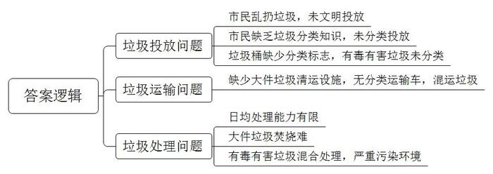
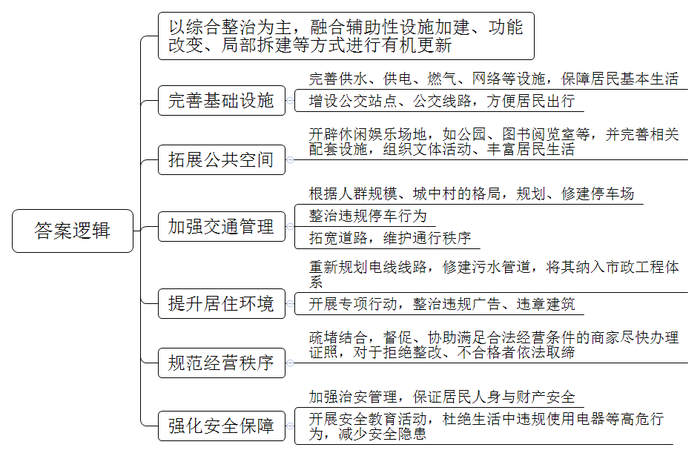

# 2019年深圳市公务员考试《申论》题（二卷）

<!-- gwy:overview:start -->
> **深圳 · 2019 · 申论 · 二卷** ｜ 3 题 · 图片 3 处 · 答案随题折叠

导航：[题目](#题目) · [材料 1](#材料-1)
<!-- gwy:overview:end -->

> 候选采集稿。参考答案及解析来自粉笔页面，不代表官方答案或真实高分答卷；来源使用许可与原卷对应关系仍需人工核实。

## 给定材料

### 材料 1

最近，由S市发起的“十大不文明行为”市民投票评选中，“乱扔垃圾”位居市民最反感的不文明行为第一名。S市每天产生垃圾超过2万吨，而垃圾最大处理能力只有1.7万吨/天。此外，在S市每天产生的垃圾中，大件垃圾超过500吨，这些垃圾若由垃圾车清运，不容易装下，即使运到焚烧场也不容易投进焚烧炉。经调查，S市近七成市民有垃圾分类投放的意识，但是其中有很多市民因为不知道如何分类，或者多数垃圾桶没有分类标志而没有进行垃圾分类投放。另外，S市目前没有垃圾分类运输车，即使已做分类的垃圾在装运上车后又重新混在一起，并没有起到应有的分类作用。对于废旧电池、灯管、油漆桶、过期药品等有毒有害垃圾并没有分类，与其他垃圾混合收集后，直接被填埋或焚烧，从而对环境造成严重污染。

### 材料 2

目前，深圳有1000多个城中村，超过1000万流动人口居于其间，提供了全市60%的住房供应。城中村由于房租低、生活便利，成为很多“深漂”的第一站。然而，不少城中村基础设施比较简陋，公共活动空间不足，停车、行车难，电线外露、污水横流、乱贴广告、私搭乱建，无照、无证经营情况突出，存在较多安全隐患。正因为城中村问题较多，且深圳土地资源利用趋于饱和，城中村改造一向是深圳的重点工作。以往为了追求城市美观和效率，对城中村改造大多采用拆迁方式。对此，有专家指出，城中村承载着深圳移民文化，以往大规模拆除重建模式不仅挤压了低成本居住空间，也带走了许多人的城市记忆，而且是一场耗资巨大的投入。近期，《深圳市城中村（旧村）综合整治总体规划（2019-2025）》正式发布。由“拆”到“治”的转变，是该规划的一个焦点。该规划提出，以综合整治为主，融合辅助性设施加建、功能改变、局部拆建等方式进行城中村有机更新。

### 材料 3

党的十九大报告指出：“我国经济已由高速增长阶段转向高质量发展阶段”，2018年12月26日，习近平总书记对深圳工作作出重要批示，其中要求深圳践行高质量发展要求。

## 题目

### 第 1 题

**根据【材料**15**】，对S市存在的垃圾问题进行概括。（20分）**

关联材料：材料 1

作答要求：

要求：

（1）概括全面，用词准确，条理清晰；

（2）总字数不超过150字。

第 1 题 · 答案与解析

**参考答案（粉笔题库参考内容）**

1.垃圾投放问题。市民乱扔垃圾，未文明投放；市民缺乏垃圾分类知识，未分类投放；垃圾桶缺少分类标志，有毒有害垃圾未分类。2.垃圾运输问题。缺少大件垃圾清运设施，无分类运输车，混运垃圾。3.垃圾处理问题。日均处理能力有限；大件垃圾焚烧难；有毒有害垃圾混合处理，严重污染环境。

**解析**

**参考答案说明：**本参考答案从“垃圾投放”“垃圾运输”“垃圾处理”这三个方面进行了分条撰写。各条答案要点之间在内容上相互并列，没有交叉。

**考点**：考点问题类

**来源**：来源2019年深圳市公务员考试《申论》题（二卷）

粉笔申论页面对本题只提供「解析视频」入口，该入口是会员推广位，页面无视频地址与文字解析。

### 第 2 题

**根据【材料**16**】，就如何解决城中村存在的问题提出对策。（30分）**

关联材料：材料 2

作答要求：

要求：

（1）考虑全面，对策合理，条理清晰；

（2）总字数不超过400字。

第 2 题 · 答案与解析

**参考答案（粉笔题库参考内容）**

以综合整治为主，融合辅助性设施加建、功能改变、局部拆建等方式进行有机更新。

一、完善基础设施。1.完善供水、供电、燃气、网络等设施，保障居民基本生活；2.增设公交站点、公交线路，方便居民出行。

二、拓展公共空间。开辟休闲娱乐场地，如公园、图书阅览室等，并完善相关配套设施，组织文体活动、丰富居民生活。

三、加强交通管理。1.根据人群规模、城中村的格局，规划、修建停车场；2.整治违规停车行为；3.拓宽道路，维护通行秩序。

四、提升居住环境。1.重新规划电线线路，修建污水管道，将其纳入市政工程体系；2.开展专项行动，整治违规广告、违章建筑。

五、规范经营秩序。疏堵结合，督促、协助满足合法经营条件的商家尽快办理证照，对于拒绝整改、不合格者依法取缔。

六、强化安全保障。1.加强治安管理，保证居民人身与财产安全；2.开展安全教育活动，杜绝生活中违规使用电器等高危行为，减少安全隐患。

**解析**

**参考答案说明**：本参考答案先给出了总体性对策，接着从“完善基础设施”“拓展公共空间”“加强交通管理”“提升居住环境”“规范经营秩序”“强化安全保障”六个方面进行了具体展开，并做到了分类、分条撰写，各条要点之间在内容上是并列关系，没有交叉。

**考点**：考点提出对策类

**来源**：来源2019年深圳市公务员考试《申论》题（二卷）

粉笔申论页面对本题只提供「解析视频」入口，该入口是会员推广位，页面无视频地址与文字解析。

### 第 3 题

**根据给定材料，围绕“以新发展理念为引领，深入推进深圳高质量发展”这个主题，自拟题目，写一篇对策性议论文。（50分）**

关联材料：材料 3

作答要求：

要求：

（1）紧扣主题，紧密联系材料；

（2）论述充分，对策合理；

（3）结构严谨，条理清晰，语言流畅；

（4）字数1200字左右。

第 3 题 · 答案与解析

**参考答案（粉笔题库参考内容）**

**践行新发展理念** **推进深圳高质量发展**

2017年，十九大报告明确提出“我国经济已由高速增长阶段转向高质量发展阶段”，在2018年，习近平总书记对深圳未来的发展也提出了“高质量发展”的要求。所谓高质量发展，是指通过践行创新、协调、绿色、开放、共享五大理念所推动的发展。深圳应践行新发展理念，推进构建新的发展格局。

**深入推进深圳高质量发展，需树立创新发展的理念，既要加快技术创新、优化产业布局，也要以制度创新为经济发展提供保障。**一方面，深圳要加大全社会科技研发投入，补齐基础研究和源头创新的短板，培育具有国际竞争力的创新型龙头企业和高成长性的创新型企业，助力关键核心技术突破。在此基础上以点带面，优化产业布局，发挥战略性新兴产业的集聚效应，助力深圳经济转向“质量时代”。另一方面，产业的高质量发展需以制度创新为根本保障。因此，深圳需不断增强政府的服务效能，优化企业营商环境与办事流程，为企业发展提供财政资金支持和资源保障；进而探索新型城市化建设模式，高标准建设产业新城，为全国的区域协调发展提供可借鉴的深圳模式。

**深入推进深圳高质量发展，需树立绿色发展的理念，应筑牢绿色发展的环境、产业根基，同时弘扬生态文明的理念与生活方式。**深圳在发展中需不断加强污染治理与生态修复，重点保护海洋生态，优化环境；在此基础上，大力发展以海洋产业为代表的生态经济，推出绿色产品，坚持绿色标准，建设资源节约型产业。当然，绿色发展的理念离不开每一位市民的亲身实践，深圳也需倡导绿色、低碳的生活方式，激励民众的绿色文明行为，同时引导全社会增强生态意识、树立生态理念、践行绿色生产、享受低碳生活。

**深入推进深圳高质量发展，需树立开放发展的理念，不仅要推动经济对外开放和区域合作，也需以人才的开放助力深圳发展。**深圳作为我国开放的先行城市，在未来的发展中，需进一步践行开放发展的理念，一方面要推动企业积极走出去，开展对外投资和国际合作；另一方面要加强区域合作，以开放的姿态实现资源共享与优势互补，加强区域之间在文化、经济等全方面的交流与合作。不仅如此，深圳的开放还在于人才的开放，应进一步打造开放、包容和创新、创业的城市氛围，充分吸引人才；同时，也为人才提供优惠政策、全方位的服务和广阔的发展平台，让人才在深圳来得了、留得下。

**深入推进深圳高质量发展，还需树立共享发展的理念，既要加大财政投入，切实保障和改善民生，也要引导公众参与城市治理，更要以群众需求为导向，坚持以人为本，提供高品质、精细化服务**。深圳需要在提升居民幸福指数方面苦下功夫，在教育、医疗、交通等领域给予大量人财物的支持，进一步推进实施便民惠民措施。除此之外，需转变城市管理工作理念，建立监督举报机制，畅通反馈渠道，激发市民参与城市治理的热情，实现共治共建共享。最后，还要积极发挥基层党组织作用，统筹各类社会资源开展工作，推动辖区组织共促共融、互联互通，探索“大党建”模式。多措并举，共享发展，提升居民幸福感，增强城市凝聚力。

**发展是一个系统的整体，深圳的高质量发展，需要以上各方面、各环节、各因素协调联动。**独立作战，各自为营，最终的结果可能是发展失衡，相互制约，存在短板。以创新发展为动力，以共享发展为根本，坚守绿色发展的底线，走开放发展之路，相互协调，相互促进。唯有如此，才能增强发展的平衡性、包容性与可持续性，实现统筹兼顾、综合平衡。

深圳是希望之城，它正用创新发展、协调发展、绿色发展、开放发展、共享发展的全新发展理念，谋求更高层次发展，成为傲立在中国东方的丰碑。

**解析**

**文章分析**

**践行新发展理念** **推进深圳高质量发展**

【**标题的优点：**范文的标题“践行新发展理念 推进深圳高质量发展”突出了“高质量发展”“新发展理念”等主题词。】

（1）2017年，十九大报告明确提出“我国经济已由高速增长阶段转向高质量发展阶段”，在2018年，习近平总书记对深圳未来的发展也提出了“高质量发展”的要求。（2）所谓高质量发展，是指通过践行创新、协调、绿色、开放、共享五大理念所推动的发展。深圳应践行新发展理念，推进构建新的发展格局。

【**开头的优点：****★内容方面****：**范文的开头是紧扣“以新发展理念为引领，深入推进深圳高质量发展”这一主题展开的。首先，开头在段首处点出主题，做到了主题明确。其次，对“以新发展理念为引领，深入推进深圳高质量发展”这一主题进行了分析阐述，指出了（1）深圳践行高质量发展要求的背景；（2）高质量发展的内涵。**★文字表达方面：**将高质量发展和新发展理念的内涵整合为一句话，使行文更加紧凑、流畅、简洁、规范。】

**深入推进深圳高质量发展，需树立创新发展的理念，既要加快技术创新、优化产业布局，也要以制度创新为经济发展提供保障。**（1）一方面，深圳要加大全社会科技研发投入，补齐基础研究和源头创新的短板，培育具有国际竞争力的创新型龙头企业和高成长性的创新型企业，助力关键核心技术突破。在此基础上以点带面，优化产业布局，发挥战略性新兴产业的集聚效应，助力深圳经济转向“质量时代”。（2）另一方面，产业的高质量发展需以制度创新为根本保障。因此，深圳需不断增强政府的服务效能，优化企业营商环境与办事流程，为企业发展提供财政资金支持和资源保障；进而探索新型城市化建设模式，高标准建设产业新城，为全国的区域协调发展提供可借鉴的深圳模式。

【**论述段****1的优点：★观点句：**范文的观点句是紧扣“以新发展理念为引领，深入推进深圳高质量发展”这一文章主题提出的。形式上，它在段首处直接写出，位置突出，容易发现。内容上，关键词突出，内容要点明确，可以明显看出它是从“树立创新发展的理念”入手，推进深圳高质量发展。**★论述内容：**（1）介绍了创新发展需要科技研发的投入；（2）介绍了创新发展需要以制度创新为根本。以上几个方面的内容都是紧扣“深入推进深圳高质量发展，需树立创新发展的理念，既要加快技术创新、优化产业布局，也要以制度创新为经济发展提供保障”这个观点进行分析论述的，论述的针对性强，内容层次丰富。最后，在论述方法上采取了讲道理的方式进行展开，做到了论述有力。】

**深入推进深圳高质量发展，需树立绿色发展的理念，应筑牢绿色发展的环境、产业根基，同时弘扬生态文明的理念与生活方式。**（1）深圳在发展中需不断加强污染治理与生态修复，重点保护海洋生态，优化环境；（2）在此基础上，大力发展以海洋产业为代表的生态经济，推出绿色产品，坚持绿色标准，建设资源节约型产业。（3）当然，绿色发展的理念离不开每一位市民的亲身实践，深圳也需倡导绿色、低碳的生活方式，激励民众的绿色文明行为，同时引导全社会增强生态意识、树立生态理念、践行绿色生产、享受低碳生活。

【**论述段****2的优点：★观点句：**范文的观点句是紧扣“以新发展理念为引领，深入推进深圳高质量发展”这一文章主题提出的。形式上，它在段首处直接写出，位置突出，容易发现。内容上，关键词突出，内容要点明确，可以明显看出它是从“树立绿色发展的理念”入手，推进深圳高质量发展。**★论述内容：**（1）介绍了保护海洋生态，优化环境；（2）介绍了发展海洋生态经济；（3）介绍了绿色发展理念需要生态文明的行为、生活方式。以上三个方面的内容都是紧扣“深入推进深圳高质量发展，需树立绿色发展的理念，应筑牢绿色发展的环境、产业根基，同时弘扬生态文明的理念与生活方式”这个观点进行分析论述的，论述的针对性强，内容层次丰富。最后，在论述方法上主要采取了讲道理和举例子相结合，做到了丰富多样。】

**深入推进深圳高质量发展，需树立开放发展的理念，不仅要推动经济对外开放和区域合作，也需以人才的开放助力深圳发展。**深圳作为我国开放的先行城市，在未来的发展中，需进一步践行开放发展的理念，（1）一方面要推动企业积极走出去，开展对外投资和国际合作；（2）另一方面要加强区域合作，以开放的姿态实现资源共享与优势互补，加强区域之间在文化、经济等全方面的交流与合作。（3）不仅如此，深圳的开放还在于人才的开放，应进一步打造开放、包容和创新、创业的城市氛围，充分吸引人才；同时，也为人才提供优惠政策、全方位的服务和广阔的发展平台，让人才在深圳来得了、留得下。

【**论述段****3的优点：★观点句：**范文的观点句是紧扣“以新发展理念为引领，深入推进深圳高质量发展”这一文章主题提出的。形式上，它在段首处直接写出，位置突出，容易发现。内容上，关键词突出，内容要点明确，可以明显看出它是从“树立开放发展的理念”入手，推进深圳高质量发展。**★论述内容：**（1）介绍了开展对外投资和国际合作；（2）介绍了加强区域合作；（3）介绍了开放人才。以上三个方面的内容都是紧扣“深入推进深圳高质量发展，需树立开放发展的理念，不仅要推动经济对外开放和区域合作，也需以人才的开放助力深圳发展”这个观点进行分析论述的，论述的针对性强，内容层次丰富。最后，在论述方法上主要采取了讲道理和举例子相结合，做到了丰富多样。】

**深入推进深圳高质量发展，还需树立共享发展的理念，既要加大财政投入，切实保障和改善民生，也要引导公众参与城市治理，更要以群众需求为导向，坚持以人为本，提供高品质、精细化服务。**（1）深圳需要在提升居民幸福指数方面苦下功夫，在教育、医疗、交通等领域给予大量人财物的支持，进一步推进实施便民惠民措施。（2）除此之外，需转变城市管理工作理念，建立监督举报机制，畅通反馈渠道，激发市民参与城市治理的热情，实现共治共建共享。（3）最后，还要积极发挥基层党组织作用，统筹各类社会资源开展工作，推动辖区组织共促共融、互联互通，探索“大党建”模式。多措并举，共享发展，提升居民幸福感，增强城市凝聚力。

【**论述段****4的优点：★观点句：**范文的观点句是紧扣“以新发展理念为引领，深入推进深圳高质量发展”这一文章主题提出的。形式上，它在段首处直接写出，位置突出，容易发现。内容上，关键词突出，内容要点明确，可以明显看出它是从“树立共享发展的理念”入手，推进深圳高质量发展。**★论述内容：**（1）介绍了实施便民惠民措施，保障民生；（2）介绍了转变城市管理理念，实现共治共建共享；（3）介绍了积极发挥基层党组织的作用，推动互联互通。以上三个方面的内容都是紧扣“深入推进深圳高质量发展，还需树立共享发展的理念，既要加大财政投入，切实保障和改善民生，也要引导公众参与城市治理，更要以群众需求为导向，坚持以人为本，提供高品质、精细化服务”这个观点进行分析论述的，论述的针对性强，内容层次丰富。最后，在论述方法上采取了讲道理的方式进行展开，做到了论述有力。】

**发展是一个系统的整体，深圳的高质量发展，需要以上各方面、各环节、各因素协调联动。**（1）独立作战，各自为营，最终的结果可能是发展失衡，相互制约，存在短板。（2）以创新发展为动力，以共享发展为根本，坚守绿色发展的底线，走开放发展之路，相互协调，相互促进。唯有如此，才能增强发展的平衡性、包容性与可持续性，实现统筹兼顾、综合平衡。

【**论述段****5****的优点：****★观点句：**范文的观点句是紧扣“以新发展理念为引领，深入推进深圳高质量发展”这一文章主题提出的。形式上，它在段首处直接写出，位置突出，容易发现。内容上，关键词突出，内容要点明确，可以明显看出它是从“各方面、各环节、各因素协调联动”入手，推进深圳高质量发展。**★论述内容：**（1）介绍了独立发展的弊端；（2）介绍了协调发展的益处。以上两个方面的内容都是紧扣“发展是一个系统的整体，深圳的高质量发展，需要以上各方面、各环节、各因素协调联动”这个观点进行分析论述的，论述的针对性强，内容层次丰富。最后，在论述方法上采取了讲道理的方式进行展开，做到了论述有力。】

【**论述段之间的关系：****★内容的内在逻辑：**范文的论述段之间是依照并列逻辑展开的。论述段1先写了高质量发展需创新发展，论述段2又写了高质量发展需绿色发展，论述段3还写了高质量发展需开放发展，论述段4再写了高质量发展需共享发展，论述段5最后写了高质量发展需协调发展。五个论述段是围绕创新、协调、绿色、开放、共享五个发展理念展开的。**★段与段的外在衔接：**前4个论述段句式结构相似，使读者能够迅速看懂论述段的并列关系，论述段5是对论述段1-4的总结。】

深圳是希望之城，（1）它正用创新发展、协调发展、绿色发展、开放发展、共享发展的全新发展理念，谋求更高层次发展，（2）成为傲立在中国东方的丰碑。

【**结尾的优点：**范文的结尾回扣了“以新发展理念为引领，深入推进深圳高质量发展”这一主题。（1）再次提到“新发展理念”“高质量发展”等主题词；（2）阐述了深刻意义。】

**考点**：考点文章写作题

**来源**：来源2019年深圳市公务员考试《申论》题（二卷）

粉笔申论页面对本题只提供「解析视频」入口，该入口是会员推广位，页面无视频地址与文字解析。

