# 2019深圳市公务员录用考试《行测》题（网友回忆版）

> 候选采集稿。参考答案及解析来自粉笔页面，不代表官方答案或真实高分答卷；来源使用许可与原卷对应关系仍需人工核实。

## 题型与作答说明

常识判断

（20题）

每题的备选答案中，只有一个最符合题意。

判断推理

（20题）

本部分包括图形推理、事件排序、演绎推理三种类型的试题，在四个选项中选出一个最恰当的答案。

数量关系

（15题）

在这部分试题中，每道题呈现一段表述数字关系的文字，要求你迅速、准确地计算出答案。

言语理解与表达

（30题）

本部分包括表达与理解两方面的内容。请根据题目要求，在四个选项中选出一个最恰当的答案。

资料分析

（15题）

所给出的图、表、文字或综合性资料均有若干个问题要你回答。你应根据资料提供的信息进行分析、比较、计算和判断处理。

## 给定材料

### 材料 dom-material-064f4d1e605c163e

2018年1-9月汽车行业统计数据如下：

乘用车累计产销分别完成1735.1万辆和1726.0万辆，同比分别增长0.1%和0.6%。其中，轿车产销分别完成841.3万辆和842.6万辆，同比分别增长0.2%和1.3%；SUV产销分别完成737.1万辆和723.5万辆，同比分别增长4.2%和3.9%；MPV产销分别完成124.4万辆和126.2万辆，同比分别下降15.2%和13.1%；交叉型乘用车产销分别完成32.2万辆和33.7万辆，同比分别下降18.2%和19.6%。中国品牌乘用车累计销售724.2万辆，同比下降1.5%。

商用车累计产销分别完成314.1万辆和323.1万辆，同比分别增长5.2%和6.3%。分车型情况看，客车产销分别完成33.9万辆和33.3万辆，同比分别下降2.7%和3.8%；货车产销分别完成280.1万辆和289.8万辆，同比分别增长6.2%和7.6%。

新能源汽车中，纯电动汽车产销分别完成55.5万辆和54.1万辆，同比分别增长58.9%和66.2%；插电式混合动力汽车产销分别完成18.0万辆和18.1万辆，同比分别增长138.0%和146.9%。

汽车整车出口81.4万辆，同比增长30.9%。分车型情况看，乘用车出口60.1万辆，同比增长38.2%；商用车出口21.3万辆，同比增长13.8%。

### 材料 dom-material-08efc9b2149e10ff

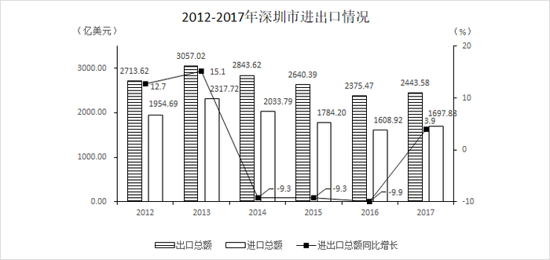

### 材料 dom-material-3e31e0f8f55f9863

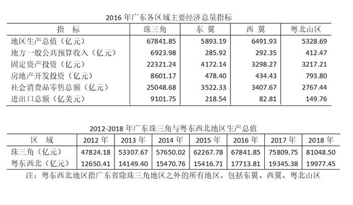

## 题目

### 第 1 题

关于党政机关公文中请示的抄送范围，下列说法正确的是（ ）。

A. 受双重领导的机关向一个上级机关行文，原则上应抄送另一个上级机关

B. 特殊情况需越级行文的，不必抄送被越过的机关

C. 根据需要可抄送下级机关

D. 根据需要可抄送相关上级机关和同级机关

### 第 2 题

两个单位联合行文需要会签，以（ ）为成文日期。

A. 第一个签发机关负责人签发的日期

B. 第二个签发机关负责人签发的日期

C. 会议通过的日期

D. 会议送印的日期

### 第 3 题

下列人事处理不属于公务员申诉范围的是（ ）。

A. 取消录用

B. 诫勉

C. 免职

D. 申请提前退休未予批准

### 第 4 题

古诗《社日》写道：“鹅湖山下稻粱肥，豚栅鸡栖半掩扉。桑柘影斜春社散，家家扶得醉人归。”立春后第五个戊日即社日，又称春社，它是我国古代劳动人民祭祀（ ）的节日。

A. 灶神

B. 龙王

C. 山神

D. 土地神

### 第 5 题

有清代学者在讨论唐诗时写道：“唐人作诗，惟适己意，不索人知其意。”在讨论宋诗时写道：“宋人作诗，欲人人知其意，故多直达。”下列诗句为唐朝人所作的是（ ）。

A. 独怜幽草涧边生，上有黄鹂深树鸣。春潮带雨晚来急，野渡无人舟自横

B. 莫言下岭便无难，赚得行人空喜欢。正入万山圈子里，一山放过一山拦

C. 半亩方塘一鉴开，天光云影共徘徊。问渠那得清如许，为有源头活水来

D. 飞来山上千寻塔，闻说鸡鸣见日升。不畏浮云遮望眼，自缘身在最高层

### 第 6 题

关于现代前沿科学技术，下列说法错误的是（ ）。

A. AI即人工智能，可用于需要人类智力才能解决的复杂问题，如医疗诊断、管理决策、语言理解等

B. 5G网络的通信速度可达现有4G网络的数百倍，几乎不会发生通信延迟

C. QR码三个角上的“回”字图形的作用是帮助解码软件确定码的位置、大小、倾斜角度

D. AR是一种虚拟现实技术，它由计算机生成交互式三维动态场景，给用户带来沉浸式体验

### 第 7 题

德国哲学家黑格尔认为，斯巴达的道德风习影响其宪法，而宪法也影响道德风习，但两者都是社会制度的产物。他又认为社会制度取决于时代精神或民族精神，而时代精神或民族精神又是绝对精神发展的一个环节。这反映的哲学自然观是（ ）。

A. 机械唯物主义

B. 辩证唯物主义

C. 主观唯心主义

D. 辩证唯心主义

### 第 8 题

《宪法》第五十一条规定：“中华人民共和国公民在行使自由和权利的时候，不得损害国家的、社会的、集体的利益和其他公民的合法的自由和权利。”关于该条文，下列说法正确的是（ ）。

A. 表达的是授权性规则

B. 表达的是禁止性规则

C. 表达的是程序性原则

D. 表达了法律规则中的法律后果

### 第 9 题

第十三届全国人大一次会议表决通过了《中华人民共和国宪法修正案》，将宪法序言中的“健全社会主义（ ）”修改为“健全社会主义（ ）”。

A. 法制、法治

B. 法律、法制

C. 法治、法制

D. 法律、法治

### 第 10 题

摄影师甲拍摄了一组深圳街景作品，并上传于社交媒体群中。乙在社交媒体群中看到后，擅自将该组照片上传于某营利性商业图库网站，获得报酬若干。乙的行为（ ）。

A. 仅侵犯了甲的著作权中的财产权

B. 侵犯了甲的保护作品完整权

C. 侵犯了甲的信息网络传播权

D. 不构成侵权

### 第 11 题

根据《深圳市聘任制公务员聘任合同管理办法（试行）》，聘任制公务员有下列情形的，除（ ）外，用人机关应当解除与聘任制公务员的聘任合同。

A. 未经用人机关同意，在其他单位兼职的

B. 因所在机关撤销需要调整工作，本人拒绝合理安排的

C. 发生责任事故造成严重后果的

D. 被依法追究刑事责任的

### 第 12 题

自2018年开始实施的国务院机构改革，强调要着眼于转变政府职能，关于改革后国务院部门的工作职责，下列说法错误的是（ ）。

A. 军官转业安置由退役军人事务部负责

B. 水旱灾害防治由水利部负责

C. 森林、湿地等资源调查和确权登记管理由自然资源部负责

D. 流域水环境保护由生态环境部负责

### 第 13 题

习近平总书记在党的十九大报告中指出，中华民族伟大复兴，绝不是轻轻松松、敲锣打鼓就能实现的。为了实现伟大梦想，全党必须准备付出更为艰巨、更为艰苦的努力，其中不包括（ ）。

A. 必须进行伟大斗争

B. 必须建设伟大工程

C. 必须付出伟大牺牲

D. 必须推进伟大事业

### 第 14 题

2019年2月，中共中央、国务院印发《粤港澳大湾区发展规划纲要》，提出以香港、澳门、广州、深圳四大中心城市作为区域发展的核心引擎。以下属于该纲要对深圳提出的要求的是（ ）。

A. 建设亚太区国际法律及争议解决服务中心

B. 打造以中华文化为主流、多元文化共存的交流合作基地

C. 全面增强国际商贸中心、综合交通枢纽功能

D. 努力成为具有世界影响力的创新创意之都

### 第 15 题

2018年是改革开放40周年，是深圳改革发展史上具有重要意义的一年。下列关于2018年深圳发展情况的说法，错误的是（ ）。

A. 港口集成箱吞吐量连续九年居世界第一

B. 经济总量居亚洲城市前五，居粤港澳大湾区首位

C. 光明行政区获国务院批复设立，北部中心建设进入新阶段

D. 跻身世界一线城市行列

### 第 16 题

2019年3月5日，李克强总理代表国务院在十三届全国人大二次会议上作《政府工作报告》时提出，要实施更大规模的减税，普惠性减税与结构性减税并举，重点降低（ ）税收负担。

A. 制造业和小微企业

B. 服务业和中小企业

C. 建筑业和民营企业

D. 农业和个体工商户

### 第 17 题

2019年3月，第四届联合国环境大会中国代表团和联合国环境规划署在肯尼亚首都内罗毕共同发布声明宣布，中国将主办2019年世界环境日活动，聚焦（ ）主题。

A. “可持续消费与生产”

B. “塑战塑决”

C. “空气污染”

D. “绿色经济”

### 第 18 题

为刺激经济发展，政府通常采取扩张性财政政策。下列政府财政措施不属于扩张性财政政策的是（ ）。

A. 加大基础设施建设投资规模

B. 增发国债

C. 减少重复征税，将营业税改为增值税

D. 节约非生产性开支

### 第 19 题

根据《党政领导干部选拔任用工作条例》，选拔任用党政领导干部，必须把（ ）放在首位。

A. 道德品行

B. 专业素养

C. 政治标准

D. 工作实绩

### 第 20 题

根据2019年2月中共中央印发的《中国共产党重大事项请示报告条例》，党组织应向上级党组织请示的事项不包括（ ）。

A. 重大违纪违法和复杂敏感案件处理

B. 领导班子成员分工

C. 重大活动、重要政策的宣传报道口径

D. 属于自身职权范围内但事关重大或者特殊敏感的事项

### 第 21 题

A. A

B. B

C. C

D. D

### 第 22 题

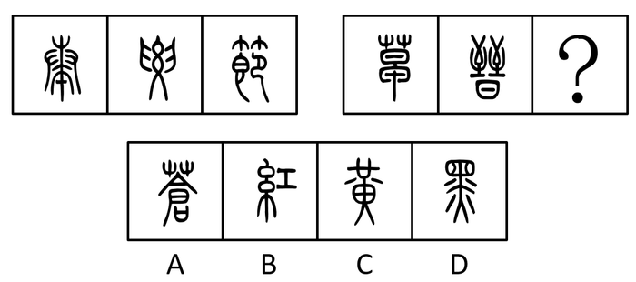

A. A

B. B

C. C

D. D

### 第 23 题

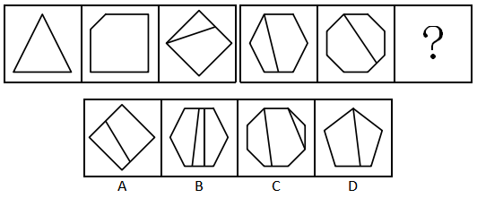

A. A

B. B

C. C

D. D

### 第 24 题

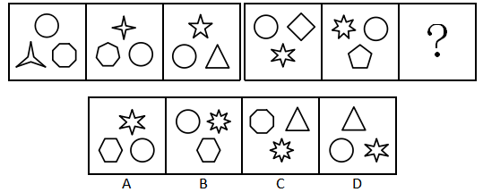

A. A

B. B

C. C

D. D

### 第 25 题

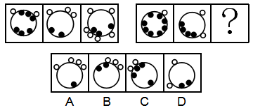

A. A

B. B

C. C

D. D

### 第 26 题

（1）金星 （2）火星

（3）木星 （4）水星

（5）土星

A. 3-2-5-4-1

B. 4-2-1-5-3

C. 4-1-2-3-5

D. 2-1-5-3-4

### 第 27 题

（1）吞竞争者 （2）失用户心 （3）涨服务费 （4）打补贴战 （5）成独角兽

A. 4-2-1-5-3

B. 4-5-1-2-3

C. 5-4-2-1-3

D. 4-1-5-3-2

### 第 28 题

（1）不幸死亡 （2）劣质针剂 （3）流通各地 （4）缺乏监管 （5）接种疫苗

A. 3-4-5-1-2

B. 3-1-2-5-4

C. 2-3-5-4-1

D. 4-2-3-5-1

### 第 29 题

（1）电影发行 （2）剪辑配乐 （3）创作剧本 （4）演员表演 （5）选取场景

A. 3-4-2-1-5

B. 4-3-5-2-1

C. 5-4-2-3-1

D. 3-5-4-2-1

### 第 30 题

（1）长安 （2）罗马 （3）大宛 （4）敦煌 （5）安息

A. 2-5-4-3-1

B. 1-4-3-5-2

C. 3-2-1-5-4

D. 1-4-5-3-2

### 第 31 题

在某大学文学院的课程改革研讨会上，负责语言学教学的朱老师说，在现代语言学中，文学的思维和知识毫无用武之地，这样就不必要求语言学专业的学生对文学基础有深刻的理解，因此，在语言学专业未来的教学体系中，文学基础课程就应该用其它重要的语言学类基础课程替代。

下列说法如果为真，能质疑朱老师的上述观点的是（ ）。

（1）语言学类基础课程难度较大，会导致学生的平均成绩降低。

（2）语言学研究对象之一的文学语言具有与众不同的特点，运用文学思维解读其特点最为贴切。

（3）该学院语言学专业的学生大多研究修辞学方向，而修辞学研究需要语言学和文学相结合。

A. （2）

B. （3）

C. （1）（3）

D. （2）（3）

### 第 32 题

一个学者要在学术研究上取得突破，一定要热爱研究，并且耐得住寂寞。有些学者虽然耐得住寂寞，但内心并不热爱研究，因此，不是所有的学者都能在学术研究上取得突破。

下列选项的逻辑结构与上文逻辑结构最类似的是（ ）。

A. 某奢侈品店规定，要买到该店最新款，必须网上实名预约，并且完成全款预付。有些买到该店最新款的人并没有网上实名预约，因此该奢侈品店的规定很有可能是自我炒作

B. 不重视自我充电的职员往往几年后得不到升职加薪的机会。有的职员几年后升职加薪，因此有些职员重视自我充电

C. 要成为一个受欢迎的人，必须既懂幽默，又会适度打扮自己。有些人会适度打扮自己但并不懂幽默，因此有些人不能成为受欢迎的人

D. 电视剧要想收视率高，必须既有流量明星参演，又经广泛宣传。有些收视率低的电视剧有流量明星参演，且宣传广泛，因此有流量明星参演不是电视剧收视率高的主要原因

### 第 33 题

过年期间，学校后勤处计划为所有留校学生提供免费餐饭并安排文艺活动，一方面是想为留校学生缓解过年期间的孤独感，另一方面是想为这些学生减轻生活上的经济压力。

下列选项如果为真，最不能质疑后勤处此项计划的是（ ）。

A. 留校学生大都买不起回家的车票

B. 绝大多数学生过年留校都是因为科研活动十分繁忙

C. 人手不足，文艺活动难以开展

D. 绝大多数学生都认为学校提供的餐饭很难吃，宁愿在校外就餐

### 第 34 题

某部门有五名员工，分别是小赵、小钱、小孙、小李、小周。关于五人的政治面貌，有如下事实：

如果小赵是党员，则小李是党员；如果小钱是党员，则小李和小孙都是党员；要么小赵是党员，要么小周是党员；如果小孙不是党员，则小周是党员。

则下列说法错误的是（ ）。

A. 如果小周不是党员，则小钱是党员

B. 如果小周不是党员，则五人中至少有三人是党员

C. 如果小钱和小周都是党员，则五人中有四人是党员

D. 如果小李和小孙都不是党员，则五人中只有一个是党员

### 第 35 题

为了解某地人民对建设创新社会的认识情况，当地知识产权局发放了调查问卷。问卷回收后发现，60%的被调查者对建设创新社会的意义有正确的认识，30%的被调查者能理解国家对创新社会的建设所作的投入。该地知识产权局由此得出结论，目前当地人民对于建设创新社会是能够认识并理解的。

下列选项如果为真，最能削弱以上结论的是（ ）。

A. 能理解国家对创新社会的建设所作投入的被调查者均对建设创新社会的意义有正确的认识

B. 正确认识与理解创新社会的建设离积极投入创新社会的建设还有相当的距离

C. 并非全国人民都接受了调查问卷，所以结论的可信度还值得怀疑

D. 这批问卷的被调查者主要来自该地知识产权局及其相关单位

### 第 36 题

世界近代三大数学猜想是费马猜想、四色猜想和哥德巴赫猜想。费马猜想的证明于1994年由英国数学家安德鲁·怀尔斯完成，且得到了数学界的认可；四色猜想的证明于1976年由美国数学家阿佩尔与哈肯借助计算机完成，但1981年数学家施密特发现了其中的错误；哥德巴赫猜想尚未解决，目前最好的成果——陈氏定理，乃1966年由中国数学家陈景润取得。

由此可知（ ）。

A. 哥德巴赫猜想比费马猜想和四色猜想更难证明

B. 中国数学家在世界近代三大数学猜想的证明工作中成就最高

C. 哥德巴赫猜想和四色猜想尚待严格证明

D. 世界近代三大数学猜想的证明一定都能完成，只是时间问题

### 第 37 题

在一项大型招标项目中，只有一家公司中标，虽然参选的9家公司都已知道结果，但在正式公布结果之前，各公司对外界的回复不尽相同。具体如下：

（1）甲公司：“是庚公司中标了。”

（2）乙公司：“应该是庚公司中标了。”

（3）丙公司：“是我公司中标了。”

（4）丁公司：“丙公司没有中标。”

（5）戊公司：“庚公司说的是真的。”

（6）己公司：“是壬公司中标了。”

（7）庚公司：“我公司没有中标，壬公司也没有中标。”

（8）辛公司：“我公司中标了。”

（9）壬公司：“我公司破格中标了。”

已知9家公司中只有4家公司说的是实话，则中标的公司是（ ）。

A. 丙公司

B. 己公司

C. 庚公司

D. 辛公司

### 第 38 题

研究显示，对偶尔食用一定量皮蛋的儿童而言，大多数品牌的皮蛋的含铅量并不会导致智力发育低下。因此，研究人员认为，儿童可以放心食用皮蛋而无需担心其影响身体健康。

下列选项如果为真，最能削弱上述论证的是（ ）。

A. 喜欢吃皮蛋的儿童往往也喜欢食用其它对智力发育有害的食品

B. 所有品牌的皮蛋或多或少都含有对人体有害的物质

C. 儿童的智力发育正常不等于身体健康

D. 大量食用皮蛋会导致儿童腹泻

### 第 39 题

某股市专家说：“从收益率来看，股市高手可能在某一时间超过其他所有股民，也可能一直超过某些股民，但不可能一直超过其他所有股民。”

如果该股市专家的上述说法为真，则下列推断为假的有（ ）个。

（1）股市专家的收益率可能在某一时间超过某些股民。

（2）不存在某一时间股市高手的收益率必然不超过其他所有股民。

（3）不存在某一时间股市高手的收益率可能不超过其他所有股民。

A. 3

B. 2

C. 1

D. 0

### 第 40 题

老陈和小吴比赛下象棋。根据规则，比赛共三场，每场胜者积2分，败者扣1分，平局则双方积分不变化，三场比赛结束后，老陈的积分为3分，小吴的积分为0分。

由此可知（ ）。

A. 没有平局

B. 老陈三场均获胜

C. 小吴最多败一场

D. 老陈至少败两场

### 第 41 题

1，1，5，13，41，（ ）

A. 53

B. 79

C. 95

D. 121

### 第 42 题

1，3，-1，-5，11，（ ）

A. \-49

B. \-1

C. \-61

D. 0

### 第 43 题

35，5，（ ），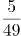，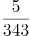

A. 

B. 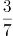

C. 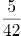

D. 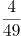

### 第 44 题

0，2，7，4，26，6，63，8，（ ）

A. 124

B. 9

C. 71

D. 99

### 第 45 题

3，10，29，84，（ ）

A. 166

B. 247

C. 275

D. 280

### 第 46 题

某工厂生产冶金模具，去年按定价的80%出售，获得了20%的利润率；今年由于工厂迁址，使得成本下降，按原定价的75%出售，可获得25%的利润率。去年成本与今年成本之比为（ ）。

A. 4：3

B. 10：9

C. 16：9

D. 75：64

### 第 47 题

某公司每月成本比上月增加10万元，收入比上月增加20%。已知该公司今年1月份亏损10万元，2月份亏损8万元，则该公司在今年（ ）月份可以第一次实现盈利。

A. 3

B. 4

C. 5

D. 6

### 第 48 题

某市在工作日对本地机动车实行尾号限行，规则为：周一限行“1”“9”，周二限行“2”“8”，周三限行“3”“7”，周四限行“4”“6”，周五限行“5”“0”。已知某年7月份尾号“1”“9”和“5”“0”的限行天数一样多，则该年的7月1日是（ ）。

A. 周六

B. 周日

C. 周一

D. 周二

### 第 49 题

王某出资10万元投资甲、乙、丙三只股票，且投资乙股、丙股的金额相同。他在甲股上涨300%、乙股上涨50%，丙股下跌50%时将全部股票抛出，共获利12万元（不考虑其他费用）。那么，王某投资甲、乙两只股票的金额比例是（ ）。

A. 8：1

B. 3：1

C. 4：3

D. 6：1

### 第 50 题

某次运动会需组织长宽相等的方阵。组织方安排了一个鲜花方阵和一个彩旗方阵，两个方阵分别入场完毕后又合成一个方阵，鲜花方阵的人恰好组成新方阵的最外圈。已知彩旗方阵比鲜花方阵多28人，则新方阵的总人数为（ ）。

A. 100

B. 144

C. 196

D. 256

### 第 51 题

小孟驾驶汽车沿一条笔直公路匀速行驶。某一时刻，小孟先看到路边的第一个里程碑，上面刻的公里数X为两位数。半小时后，他又看到第二个里程碑，上面刻的公里数Y恰好由X的十位数和个位数交换位置所成。又过了半小时，他看到第三个里程碑，上面刻的公里数Z恰好由X的两位数中间添一个0所成。再过一小时，小孟自看到第一个里程碑起共驾驶了（ ）公里。

A. 120

B. 150

C. 180

D. 200

### 第 52 题

某类商品按质量分为8个档次，最低档次商品每件可获利8元，每提高一个档次，则每件商品的利润增加2元。最低档次商品每天可产出60件，每提高一个档次，则日产量减少5件。若只生产其中某一档次的商品，则每天能获得的最大利润是（ ）元。

A. 620

B. 630

C. 640

D. 650

### 第 53 题

某自驾游车队由6辆车组成，车队的行车顺序有如下要求：甲车不能排在第一位，乙车必须排在最后一位，丙车必须排在前两位，且任一车辆均不得超车或并行。该车队的行车顺序共有（ ）种可能。

A. 36

B. 42

C. 48

D. 54

### 第 54 题

某公司组织所有员工分乘一批大巴去旅游，要求每辆大巴乘坐员工人数不超过35人。若每车坐28人，则有1人坐不上车；若开走1辆空车，则所有员工恰好可平均分乘到各车。该公司共有员工（ ）人。

A. 281

B. 589

C. 841

D. 981

### 第 55 题

某家庭有爸爸、妈妈、女儿3人，今年每2人的平均年龄加上余下1人的年龄之和，分别为39、52、53，则3人中最大年龄与最小年龄之差为（ ）。

A. 22

B. 24

C. 26

D. 28

### 第 56 题

以垃圾转运站为代表的垃圾收运环节，因其连接上下游，成为城市垃圾处理的      。

A. 中枢

B. 枢要

C. 中心

D. 中坚

### 第 57 题

在蜡像馆出口处和网站上往往有调查问卷，其中最重要的问题是“下一次来蜡像馆，你最想看到谁？”基于观众的需求，蜡像馆再根据候选名人的社会影响力、大众口碑进行综合评估，以此确保馆内的名人蜡像能      不同年龄、背景的游客。

A. 契合

B. 迎合

C. 符合

D. 吻合

### 第 58 题

将下列选项中的词语依次填入句子横线处，最恰当的一组是：

那些没有在城内定居下来的人，也逐渐养成了靠城吃城的习惯，做起生意来，一点也不亚于城里的人。按照无奸不商的古训，      入了生意门，      不应该将此生意人和彼生意人区别对待，在日常的历史中不管是礼遇，还是非礼遇，彼此都应该平起平坐。事实上      不能，这些亦农亦商的人，天生比只会坐店堂的城里人更吃苦耐劳，      生意大小、路途远近，      有赚的就一定肯做。

A. 既然、就、却、不管、只要

B. 如果、就、竟、虽然、但是

C. 即使、也、可、无论、都是

D. 尽管、但、并、哪怕，然而

### 第 59 题

将下列选项中的词语依次填入句子横线处，最恰当的一组是：

性格直爽，动不动就对记者      的她，却成为中国体坛标志性的人物。她      ，似乎很难被归类，她脾气火爆，不是乖乖女。但她在球场上的坚韧以及所取得的成就，在为中国体育赢得世界      的同时，足以传递关于力与美的正能量。

A. 反唇相讥、特立独行、瞩目

B. 针锋相对、特立独行、瞩目

C. 反唇相讥、独断专行、注目

D. 针锋相对、独断专行、注目

### 第 60 题

将下列选项中的词语依次填入各句横线处，最恰当的一组是：

（1）对于西方汉学家来说，若想解读《红楼梦》，不仅要了解作者的生平，还要迈过好几道难关，才能                ，领悟其独特的艺术魅力。

（2）文艺复兴时期的绝世天才达·芬奇，既是一位艺术家和哲学家，同时又是工程师、物理学家和生物学家，他在上述每个领域，都达到了他那个时代                的成就。

A. 登高望远、登坛拜将

B. 登堂入室、登坛拜将

C. 登堂入室、登峰造极

D. 登高望远、登峰造极

### 第 61 题

将下列选项中的词语依次填入各句横线处，最恰当的一组是：

（1）一个人完全没有指望了，但仍旧企图得到某种支持，人家就说他在            ，一点用处也没有。

（2）一家报社推出了世界杯赛专版，对赛果进行预测，不过这些猜测不是对各队命运的严肃分析，都是一些                的笑料拼盘。

A. 捞稻草、天花乱坠

B. 捞稻草、天马行空

C. 泡蘑菇、天马行空

D. 泡蘑菇、天花乱坠

### 第 62 题

将下列选项中的词语依次填入各句横线处，最恰当的一组是：

（1）古希腊哲学经受了中世纪宗教和近现代科学的考验，其传达的很多道理依然                ，有着旺盛的生命力。

（2）轻工业主要生产日用消费品，与广大人民群众生活                ，直接关系国计民生。

A. 牢不可破、休戚相关

B. 牢不可破、息息相关

C. 颠扑不破、休戚相关

D. 颠扑不破、息息相关

### 第 63 题

将下列选项中的词语依次填入句子横线处，最恰当的一组是：

中华文明作为世界四大文明之一，创造了辉煌灿烂的华夏文化，        五千年从未间断，这种以汉字和农耕为核心的文明形态影响遍及东亚，以“四大发明”为代表的中国智慧更是                ，为人类社会的发展、交流和进步做出了巨大的贡献。

A. 连绵、名声在外

B. 延绵、声名远播

C. 连绵、声名远播

D. 延绵、名声在外

### 第 64 题

将下列选项中的词语依次填入各句横线处，最恰当的一组是：

（1）                ，如今的大学里，似乎已经很少有这种因为一台电脑而生发出的虚荣与苦涩了。

（2）在各级部门都简化行政审批的当下，当地的一小撮办事员却还                ，让群众开具“奇葩”证明，这样的做法显然需要反思。

（3）回望光伏行业发展历程，可以发现，一些在国内甚至全球领先的光伏巨头企业在经历了                的风光后，纷纷跌下“神坛”。

A. 物换星移、抱残守缺、白驹过隙

B. 物换星移、独辟蹊径、昙花一现

C. 时过境迁、独辟蹊径、白驹过隙

D. 时过境迁、抱残守缺、昙花一现

### 第 65 题

将下列选项中的词语依次填入句子横线处，最恰当的一组是：

苏武执节出域，面对威逼        不屈，身处绝境        面对，青丝熬成白发，十九年后终归故国，是因为他回家的信念始终未曾动摇。生活中的情况往往是，我们不是看到希望再坚持，而是坚持了才能看到希望。山穷水尽、柳暗花明，两种景色的        转换是因为你多走了几步。

A. 浑然、怡然、迥然

B. 凛然、坦然、迥然

C. 浑然、坦然、恍然

D. 凛然、怡然、恍然

### 第 66 题

下列各句中，没有语病的一句是：

A. 一辆被称为“陆地巡洋舰”的越野吉普在蜿蜒曲折的山路上像离弦的箭一样奔驰。

B. 该大学的管理学院利用丰富的智力和社会资源，努力开拓教学方式和科研成果，促进“产学合一”。

C. 他心里很清楚，这次投资假若一旦失败，他大半生的心血就会付之东流。

D. 在抗击“非典”中，白衣天使们前仆后继，其壮举真可谓惊天地泣鬼神。

### 第 67 题

下列各句中，有语病的一句是：

A. 这次采访中一半以上的被采访者曾多年担任电商平台的客服，有极为丰富的人际沟通经验。

B. 我舅舅是分子人类学家，许多人以为我进入这个看似古怪的领域是受我舅舅的影响，其实不是这样的。

C. 在话剧演出过程中与他的灵魂有过碰撞的人都清楚，所谓的“现实”中的他不像在舞台上那样，是个踌躇满志、激昂慷慨的人。

D. 近年来，物流行业的迅猛发展和物流价格的持续上涨，引起了有关部门的高度重视。

### 第 68 题

下列各句中，没有语病的一句是：

A. 依据车队的纪律处罚办法，队长决定给予该违纪队员停止参加今年余下所有对外比赛资格。

B. 美国的“页岩气革命”无论是从制度上还是技术上都给很多国家提供了可借鉴的经验，全球许多国家准备在页岩气领域大干一番，这其中就包括中国。

C. 喜爱歌唱类节目的观众越来越多，把社会各类人群的心给俘获了。

D. 观摩了成年狮群的这次猎捕活动以后，对它们这些小狮子的猎捕水平有了很大的提高。

### 第 69 题

下列各句中，没有语病的一句是：

A. 办案交警告诉记者，目前他们正在调查这起事故的原因是什么造成的，但依旧会尽可能保障该路段的正常通行。

B. 在劳动者提供正常劳动的情况下，用人单位应支付给劳动者在剔除中班、夜班、高温、低温等特殊工作环境、条件下的津贴后，不得低于当地最低工资标准。

C. 写论文不容易，发表论文也不容易，许多研究生的主要精力就用在这一方面。

D. 科研工作者用半精制和实用饲料进行淡水鱼养殖的实验都表明，牛脂和鲱鱼油是饲料中优质的脂类来源。

### 第 70 题

下列各句中，没有语病的一句是：

A. 我还见到一位从国内出来的年轻人，他有一个法国妻子，但他说几年后学业结束仍要回国。

B. 这个我知道，不过我并不害怕，我的这次出行就是要挑战这些既高大又巍峨的高山。

C. 我的工作室里非常热乎乎的，夜间十一点我坐在写字桌前还在流汗。

D. 我没有给那些人中间任何一个写过一封信，可是我并非没有忘记他们。

### 第 71 题

下列各句中，有语病的一句是：

A. 中方敦促日方切实正视和深刻反省侵略历史，同军国主义划清界限，以实际行动取信于亚洲邻国。

B. 到2022年，北京城将充斥着冬奥会徽章、吉祥物图案、迎奥运的各种标语和冬奥会五彩缤纷的广告牌。

C. 在网络安全问题上，我国扮演了多重角色，是网络安全的坚定维护者，也是黑客攻击的受害国。

D. 当代社会中，婚姻已经不是生活中的“必需品”，很多人甚至更加享受单身生活的状态。

### 第 72 题

下列各句中，没有语病的一句是：

A. 随着电子商务向农村发展，许多网络诈骗分子开始瞄准防范意识较弱的农村消费群体，设置重重陷阱，利用假客服、假链接等网络诈骗手段层出不穷。

B. 元坝气田一线工作者克服了常人难以想象的困难，为成千上万的家庭点燃蓝色火焰做出了贡献。

C. 衡量教育的成功，可以看它能否把孩子从“没有问题”教育得“有问题”，如果孩子能善于提出问题，那就算非常成功。

D. 狗被人类从狼中驯化出来，已形成很多品种，一条好狗的毛色必须光亮油润、聪明可爱、善解人意。

### 第 73 题

位于印尼极西地带的锡纳朋火山大规模喷发，冲上数千英尺的高空，多个村庄被炙热的火山灰吞噬，遇难人数不断增加，灾情极为严重。

以上句子的语病类型是（ ）。

A. 成分赘余

B. 语序不当

C. 动宾搭配不当

D. 成分残缺

### 第 74 题

下列各句中，没有语病的一句是：

A. 二十几年前我们在游击队里跟这个地区建立起来的血肉感情，现在依然是炽热的。

B. 虽然在跑步比赛中远远落后于其他选手，但还是毫不放弃坚持跑完。

C. 《三只狼》写了一个农民在路上遇见了三只狼，刚开始想给狼扔几块肉以甩掉它们，但后来发觉狼贪得无厌，终于下决心将狼打死了。

D. 如何预防“鼠标手”？关键是要尽量避免减少上肢长时间处于机械而频繁的工作状态之中。

### 第 75 题

把下面几个句子组成语意连贯的一段文字，排序正确的一项是：

（1）最早的哲学家出于好奇心，对眼前的一些现象，如日月星辰等，感到诧异，然后一点点地推进，提出关于万物本源的哲学问题。

（2）因为每一个人在本性上都想求知。

（3）这就决定了哲学是最自由的学问。

（4）哲学的思辨最初表现为“诧异”，诧异就是好奇心。

（5）而出于本性的求知是为知而知、为智慧而求智慧的思辨活动，不服从任何物质利益和外在目的。

A. 1-2-5-3-4

B. 4-1-2-5-3

C. 4-1-3-2-5

D. 2-5-3-4-1

### 第 76 题

换个角度看问题，往往可以化难为易、化繁为简。一次，爱迪生让助手帮助自己测量一个梨形灯泡的容积，助手接过后，立即开始了工作，他一会儿拿游标卡尺测量，一会儿在稿纸上计算，后来甚至还动用了一些复杂的数学公式。可几个小时过去了，他忙得满头大汗，还是没有算出结果。就在助手搬出大学里学过的知识，准备再一次尝试计算灯泡的容积时，爱迪生进来了。爱迪生看到助手面前摆满的各种工具书和身旁的那一堆稿纸，立刻就明白了是怎么回事。于是，他拿起灯泡，朝里面倒满水，递给助手说：“你去把灯泡里的水倒进量杯里，就会得出我们所需要的答案。”这时，忙得满头大汗的助手才恍然大悟：自己想得太复杂了。看来，学会变通，善于让自己的思维转身是很重要的。

这段话主要支持了这样一种论点，即（ ）。

A. 发明家区别于常人的重要品质是善于变通

B. 学会变通，往往可以化难为易，化繁为简

C. 做科研的方法过于单一，往往事倍功半

D. 复杂的理论和公式的实用性比不上日常的生活经验

### 第 77 题

长信宫灯的设计极为科学，全器由宫女的头部、身躯、手臂以及灯罩、灯盘、灯座六部分分别铸造后装配而成，构成一个有机的整体。同时又可以拆卸，便于移动和清洗。灯盘可以转动，灯罩可以开合，能够根据需要随意调节照射方向和照明亮度。宫女体内中空，左手执灯，右衣袖似在挡风，实为吸收烟炱（由烟凝集成的黑灰）的虹管。点灯后，烟炱通过其右臂形成的虹管进入体腔内，可以保持室内环境的清洁。长信宫灯充分体现我国古代劳动人民高超的智慧和精湛的工艺，堪称“中华第一灯”。

下列对材料的理解，错误的是（ ）。

A. 长信宫灯设计的科学性体现在全器是一个由六部分分别铸造后装配而成的有机整体

B. 长信宫灯被称为“中华第一灯”，因为它充分体现了我国古代劳动人民高超的智慧和精湛的工艺

C. 长信宫灯的宫女衣袖可以吸收烟炱，兼具美观与实用的设计体现了设计者的人性化构思

D. 长信宫灯的照射方向和照明亮度可通过转动灯盘或开合灯罩来进行调节

### 第 78 题

有时我甚至还看到蝈蝈非常勇敢地纵身追捕蝉，而蝉则惊慌失措地飞起逃窜，就像鹰在天空中追捕云雀一样。但是这种以劫掠为生的鸟比昆虫低劣，它是进攻比它弱的东西，而蝈蝈则相反，它进攻比自己大得多、强壮有力得多的庞然大物，而这种身材大小悬殊的肉搏，**其结果是毫无疑问的**，蝈蝈有着有力的大颚、锐利的钳子，不能把它的俘虏开膛破肚的情况极少出现。因为蝉没有武器，只能哀鸣踢蹬。

上文“其结果是毫无疑问的”一句中的“结果”，具体是指（ ）。

A. 蝈蝈战胜了比它强壮的蝉

B. 强壮的蝈蝈战胜了弱小的蝉

C. 鹰追捕到了柔弱的云雀

D. 身材大的战胜身材小的

### 第 79 题

从现代考古发现来看，中国至少在夏商周的“三代”时期就有城市了，但和现代功能较为接近的城市，到春秋战国时期才出现，如齐国的首都临淄，据《战国策·齐策》记载，当时有7万户，仅以一户3口的标准来算，总人口也达到了21万。城市大了，人口多了，治安、卫生、交通等一系列问题也就多了。在这种情况下，古代城管应运而生。古代城管除负责环卫、拆违章建筑、禁止占道经营外，还得“防火缉盗”。有的还有管理市场物价，维持公平交易和社会治安的义务，是真正的“综合执法”，权力也比现代城管大。

下列说法与原文意思相符的是（ ）。

A. 中国古代城市最早出现在夏商周的“三代”时期

B. 春秋战国时期齐国的首都临淄是中国历史上首座设置城管的城市

C. 规模较小的城市即使没有专门的城管人员来管理，也不会出现治安、卫生、交通等问题

D. 古代城管的职能综合了现代城管、市场监管、公安等机关的部分职能

### 第 80 题

80后的新生代家长是高等教育扩招后成长起来的一代人，他们对孩子教育的重视程度达到了空前的高度。他们有一套自己的教育理念和方法，而且希望将其付诸实践，期待学校和老师按照自己的想法教学。家长群体的日益强势使得家长和老师势均力敌，较量便成了常态，于是纠纷频发，带来许多误会和矛盾。

下列说法不符合原文意思的是（ ）。

A. 80后新生代家长十分重视孩子的教育

B. 80后新生代家长有自己的教育理念和方法

C. 80后新生代家长希望参与教学

D. 80后新生代家长与老师之间常发生误会和矛盾

### 第 81 题

静，就是潜下心来，保持安静。有些年轻人缺乏安静的耐心，一味追求高频率、快节奏的生活，一静下来就不习惯，觉得无聊。譬如酒和茶，他们更爱酒的热烈刺激，较少去品茶中滋味。他们遇事急躁，做事浮躁，还没想好要干什么，怎么干好，就急吼吼做方案、拿计划，一旦遭遇挫折，又不知如何是好。

这段话主要支持了这样一种论点，即（ ）。

A. 年轻人遭遇挫折是难免的

B. 年轻人追求高效率、快节奏，无法安静下来

C. 做事应当潜下心来，保持安静

D. 保持安静才能做出有效的方案

### 第 82 题

目前禽流感疫情在非洲以及印度的家禽中已经蔓延开来，而且在尼日利亚，虽然政府已全力以赴，但疫情仍在不断地扩散。阿富汗发生疫情暴发流行似乎也在所难免。人们对此应予以高度重视。也许可以这么说，相比疫情进入欧洲（同样不可避免）而言，这些更至关紧要。贫穷国家农村人口多，无论是通过控制还是阻止周边地区内动物的流动，其对家禽中暴发的禽流感疫情的处置和扑灭能力，都远远弱于欧洲国家。在非洲和印度，人们的院子里来回走动的鸡、鸭随处可见，它们与人群、其他家畜以及野生动物密切接触后，疫情遂得以传播。而在欧洲，大多数家禽都养殖在管控严格的经济农场中。

下列说法与原文意思不一致的是（ ）。

A. 禽流感疫情的传播与家禽间的密切接触有关，但与人群间的接触无关

B. 在非洲和印度，由于缺乏严格的管控，禽流感疫情会比欧洲更加严重

C. 控制和阻止周边地区内动物的流动对于遏制禽流感疫情扩散有一定作用

D. 禽流感疫情进入欧洲虽较非洲以及印度要晚，但疫情进入欧洲实际上无可避免

### 第 83 题

苏大夫本名苏金散，民国初年在小白楼一带，开所行医，正骨拿踝，天津卫挂头牌，连洋人赛马，折胳膊断腿，也来求他。逢到有人伤筋断骨找他来，他呢？手指一触，隔皮截肉，里头怎么回事，立时心明眼亮。忽然双手赛一对白鸟，上下翻飞，疾如闪电，只听“咔嚓咔嚓”，不等病人觉疼，断骨头就接上了。贴块膏药，上了夹板，病人回去自好。倘若再来，一准是鞠大躬谢大恩送大匾来了。

下列对材料的理解，错误的是（ ）。

A. “连洋人赛马，折胳膊断腿，也来求他”，这是正面表现苏金散对生命一视同仁的高尚医德

B. “手指一触”“上下翻飞，疾如闪电”等动作细节生动地表现了苏金散正骨拿踝的娴熟技法

C. “不等病人觉疼，断骨头就接上了”，这是从病人的角度侧面表现苏金散的高超医术

D. “一准是鞠大躬谢大恩送大匾来了”，这是以病人的感谢来表现苏金散的高超医术

### 第 84 题

众所周知，文化是民族自身的烙印，在形成一个民族的诸多因素中，地缘、血缘因素都不如文化来得重要。这个观点虽然是现代西方的社会学家和民族学家提出来的，但事实上，中华民族的先贤早就有所认识。火是人类最早掌握的自然力。古希腊人认为火种是普罗米修斯从天庭盗来馈赠给人类的，而中华民族的先民则认为取火方法是他们中的一员——燧人氏发明的。这反映了中华传统文化与西方传统文化的精神差异：西方人把崇拜的目光投向天庭，中国人则对自身的力量充满了自信。人的道德准则并非来自神的诫命，而是源于人的本性；人的智慧也并非来自神的启示，而是源于人的内心。先秦的诸子百家议论蜂起，他们都以人为思考的主要对象，其智慧大都是关于人生的智慧。这种思维方式为中华传统文化打下了深刻的民族烙印，那就是以人为本的精神。由此导致的结果是：当其他民族对各路神灵的至高权威顶礼膜拜时，中华民族的先民则把人间的圣贤当作崇敬和效仿的对象；当其他民族从宗教感情中寻求灵魂的净化或愉悦时，中华民族的先民则从日常人伦中追求仁爱心和幸福感。

下列对材料的理解，错误的是（ ）。

A. 现代西方的社会学家和民族学家以及中华民族的先贤们都提出地缘、血缘是形成民族的重要因素

B. 古希腊人认为火种本属于神灵，中华民族的先民则认为取火方法是人类自身的发明

C. 与西方人不同的是，中国人认为道德准则源于人的本性，智慧源于人的内心

D. 先秦的诸子百家以人为思考的主要对象，大都得出关于人生的智慧，这就是以人为本的思维方式

### 第 85 题

从某种程度上讲，所有的天气事件都或多或少地受到了全球变暖的影响。卫星资料显示，不断上升的二氧化碳水平使得地球变得更绿，特别是在干旱地区。但由此带来的结果是复杂的，并不总是好事。例如，在澳大利亚，有些植物消耗了更多的水分，从而使得河流流量减少了三分之一左右。这种改变可能会造成不可预见的长期后果。由于人类活动导致的气候变化都叠加在同期观测到的气候自然变化之上，这使得我们很难判断出气候变化的真正原因。也就是说，难以区分这些变化中哪些是自然的，哪些是人为造成的。但是，长期的研究结果是不容置疑的：随着气温的不断上升，持续变化着的状态是一个“新常态”。

下列对材料的理解，错误的是（ ）。

A. 不断上升的二氧化碳水平能使地球变得更绿，这种变化可能会造成不可预见的长期后果

B. 二氧化碳水平上升导致植物过分生长，而植物的生长使得河流流量减少，可见不断上升的二氧化碳水平带来的都是不利的结果

C. 导致气候变化的原因有自然形成的，也有人为造成的，二者叠加在同期观测到的气候变化之上

D. 随着气温的不断上升，持续变化着的状态是一个“新常态”，这是长期研究得出的不容置疑的结果

### 第 86 题

对2018年1-9月商用车销量增长贡献最大的是（ ）。

关联材料：dom-material-064f4d1e605c163e

A. 轿车销量

B. MPV销量

C. 客车销量

D. 货车销量

### 第 87 题

2018年1-9月，产销率最高的乘用车车型是（ ）。

关联材料：dom-material-064f4d1e605c163e

A. 轿车

B. SUV

C. MPV

D. 交叉型乘用车

### 第 88 题

2017年1-9月，中国品牌乘用车销量占乘用车销量的比重是（ ）。

关联材料：dom-material-064f4d1e605c163e

A. 41.9%

B. 42.9%

C. 44.1%

D. 46.2%

### 第 89 题

2017年1-9月，乘用车的四类车型按销量从高至低排列，依次为（ ）。

关联材料：dom-material-064f4d1e605c163e

A. 轿车＞SUV＞交叉型乘用车＞MPV

B. SUV＞轿车＞交叉型乘用车＞MPV

C. 轿车＞SUV＞MPV＞交叉型乘用车

D. SUV＞轿车＞MPV＞交叉型乘用车

### 第 90 题

根据上文，以下说法一定正确的是（ ）。

关联材料：dom-material-064f4d1e605c163e

A. 2017年1-9月，纯电动汽车和插电式混合动力汽车的产量均高于自身销量

B. 2017年1-9月，货车销量是客车销量的9.7倍

C. 2018年1-9月，非中国品牌乘用车销量同比下降

D. 2018年1-9月，乘用车与商用车的整车出口量差距同比进一步扩大

### 第 91 题

2011年，深圳市进出口总额为（ ）亿美元。

关联材料：dom-material-08efc9b2149e10ff

A. 4877.41

B. 4668.31

C. 4142.24

D. 3984.39

### 第 92 题

2012-2017年，深圳市进出口贸易顺差最大的年份是（ ）年。

关联材料：dom-material-08efc9b2149e10ff

A. 2012

B. 2014

C. 2015

D. 2017

### 第 93 题

2012-2017年，深圳市进出口总额同比增幅最大的年份和同比减幅最大的年份相比，其进口总额相差（ ）亿美元。

关联材料：dom-material-08efc9b2149e10ff

A. 1390.35

B. 982.01

C. 708.80

D. 681.55

### 第 94 题

2012-2017年，深圳市进口总额的年均增长率约为（ ）。

关联材料：dom-material-08efc9b2149e10ff

A. \-2.8%

B. \-6.3%

C. \-10.0%

D. \-13.2%

### 第 95 题

根据上图，下列说法正确的是（ ）。

关联材料：dom-material-08efc9b2149e10ff

A. 2013-2017年，深圳市进出口总额呈先升后降的趋势

B. 2013年深圳市出口总额是2017年进口总额的2倍多

C. 2013-2017年，深圳市进出口总额的同比增速均高于本年出口总额的同比增速

D. 2017年，深圳市进出口总额同比增加157.07亿美元

### 第 96 题

2018年，广东省生产总值同比增长（ ）。

关联材料：dom-material-3e31e0f8f55f9863

A. 6.2%

B. 6.8%

C. 7.2%

D. 7.7%

### 第 97 题

2016年，珠三角地区下列经济指标占全省总额的比重，与珠三角地区生产总值占全省生产总值的比重最接近的是（ ）。

关联材料：dom-material-3e31e0f8f55f9863

A. 固定资产投资

B. 房地产开发投资

C. 社会消费品零售总额

D. 进出口总额

### 第 98 题

2013-2018年，粤东西北地区生产总值同比增速最快的年份是（ ）年。

关联材料：dom-material-3e31e0f8f55f9863

A. 2013

B. 2014

C. 2017

D. 2018

### 第 99 题

2016年，广东各区域按社会消费品零售总额与地区生产总值的比值由大到小排列，依次为（ ）。

关联材料：dom-material-3e31e0f8f55f9863

A. 珠三角＞粤北山区＞东翼＞西翼

B. 珠三角＞粤北山区＞西翼＞东翼

C. 东翼＞西翼＞珠三角＞粤北山区

D. 东翼＞西翼＞粤北山区＞珠三角

### 第 100 题

根据上表，下列说法正确的是（ ）。

关联材料：dom-material-3e31e0f8f55f9863

A. 2016年，珠三角地方一般公共预算收入比粤东西北地区多7.0倍

B. 2012-2018年，珠三角与粤东西北地区生产总值的差距逐年缩小

C. 按2018年珠三角地区生产总值的同比增速，预计2020年珠三角地区生产总值将突破9万亿元

D. 2016年，广东省固定资产投资30008.86亿元

## 答案与解析

第 1 题

**答案状态：unknown（来源未提供）**

**解析状态：unknown（来源未提供）**

第 2 题

**答案状态：unknown（来源未提供）**

**解析状态：unknown（来源未提供）**

第 3 题

**答案状态：unknown（来源未提供）**

**解析状态：unknown（来源未提供）**

第 4 题

**答案状态：unknown（来源未提供）**

**解析状态：unknown（来源未提供）**

第 5 题

**答案状态：unknown（来源未提供）**

**解析状态：unknown（来源未提供）**

第 6 题

**答案状态：unknown（来源未提供）**

**解析状态：unknown（来源未提供）**

第 7 题

**答案状态：unknown（来源未提供）**

**解析状态：unknown（来源未提供）**

第 8 题

**答案状态：unknown（来源未提供）**

**解析状态：unknown（来源未提供）**

第 9 题

**答案状态：unknown（来源未提供）**

**解析状态：unknown（来源未提供）**

第 10 题

**答案状态：unknown（来源未提供）**

**解析状态：unknown（来源未提供）**

第 11 题

**答案状态：unknown（来源未提供）**

**解析状态：unknown（来源未提供）**

第 12 题

**答案状态：unknown（来源未提供）**

**解析状态：unknown（来源未提供）**

第 13 题

**答案状态：unknown（来源未提供）**

**解析状态：unknown（来源未提供）**

第 14 题

**答案状态：unknown（来源未提供）**

**解析状态：unknown（来源未提供）**

第 15 题

**答案状态：unknown（来源未提供）**

**解析状态：unknown（来源未提供）**

第 16 题

**答案状态：unknown（来源未提供）**

**解析状态：unknown（来源未提供）**

第 17 题

**答案状态：unknown（来源未提供）**

**解析状态：unknown（来源未提供）**

第 18 题

**答案状态：unknown（来源未提供）**

**解析状态：unknown（来源未提供）**

第 19 题

**答案状态：unknown（来源未提供）**

**解析状态：unknown（来源未提供）**

第 20 题

**答案状态：unknown（来源未提供）**

**解析状态：unknown（来源未提供）**

第 21 题

**答案状态：unknown（来源未提供）**

**解析状态：unknown（来源未提供）**

第 22 题

**答案状态：unknown（来源未提供）**

**解析状态：unknown（来源未提供）**

第 23 题

**答案状态：unknown（来源未提供）**

**解析状态：unknown（来源未提供）**

第 24 题

**答案状态：unknown（来源未提供）**

**解析状态：unknown（来源未提供）**

第 25 题

**答案状态：unknown（来源未提供）**

**解析状态：unknown（来源未提供）**

第 26 题

**答案状态：unknown（来源未提供）**

**解析状态：unknown（来源未提供）**

第 27 题

**答案状态：unknown（来源未提供）**

**解析状态：unknown（来源未提供）**

第 28 题

**答案状态：unknown（来源未提供）**

**解析状态：unknown（来源未提供）**

第 29 题

**答案状态：unknown（来源未提供）**

**解析状态：unknown（来源未提供）**

第 30 题

**答案状态：unknown（来源未提供）**

**解析状态：unknown（来源未提供）**

第 31 题

**答案状态：unknown（来源未提供）**

**解析状态：unknown（来源未提供）**

第 32 题

**答案状态：unknown（来源未提供）**

**解析状态：unknown（来源未提供）**

第 33 题

**答案状态：unknown（来源未提供）**

**解析状态：unknown（来源未提供）**

第 34 题

**答案状态：unknown（来源未提供）**

**解析状态：unknown（来源未提供）**

第 35 题

**答案状态：unknown（来源未提供）**

**解析状态：unknown（来源未提供）**

第 36 题

**答案状态：unknown（来源未提供）**

**解析状态：unknown（来源未提供）**

第 37 题

**答案状态：unknown（来源未提供）**

**解析状态：unknown（来源未提供）**

第 38 题

**答案状态：unknown（来源未提供）**

**解析状态：unknown（来源未提供）**

第 39 题

**答案状态：unknown（来源未提供）**

**解析状态：unknown（来源未提供）**

第 40 题

**答案状态：unknown（来源未提供）**

**解析状态：unknown（来源未提供）**

第 41 题

**答案状态：unknown（来源未提供）**

**解析状态：unknown（来源未提供）**

第 42 题

**答案状态：unknown（来源未提供）**

**解析状态：unknown（来源未提供）**

第 43 题

**答案状态：unknown（来源未提供）**

**解析状态：unknown（来源未提供）**

第 44 题

**答案状态：unknown（来源未提供）**

**解析状态：unknown（来源未提供）**

第 45 题

**答案状态：unknown（来源未提供）**

**解析状态：unknown（来源未提供）**

第 46 题

**答案状态：unknown（来源未提供）**

**解析状态：unknown（来源未提供）**

第 47 题

**答案状态：unknown（来源未提供）**

**解析状态：unknown（来源未提供）**

第 48 题

**答案状态：unknown（来源未提供）**

**解析状态：unknown（来源未提供）**

第 49 题

**答案状态：unknown（来源未提供）**

**解析状态：unknown（来源未提供）**

第 50 题

**答案状态：unknown（来源未提供）**

**解析状态：unknown（来源未提供）**

第 51 题

**答案状态：unknown（来源未提供）**

**解析状态：unknown（来源未提供）**

第 52 题

**答案状态：unknown（来源未提供）**

**解析状态：unknown（来源未提供）**

第 53 题

**答案状态：unknown（来源未提供）**

**解析状态：unknown（来源未提供）**

第 54 题

**答案状态：unknown（来源未提供）**

**解析状态：unknown（来源未提供）**

第 55 题

**答案状态：unknown（来源未提供）**

**解析状态：unknown（来源未提供）**

第 56 题

**答案状态：unknown（来源未提供）**

**解析状态：unknown（来源未提供）**

第 57 题

**答案状态：unknown（来源未提供）**

**解析状态：unknown（来源未提供）**

第 58 题

**答案状态：unknown（来源未提供）**

**解析状态：unknown（来源未提供）**

第 59 题

**答案状态：unknown（来源未提供）**

**解析状态：unknown（来源未提供）**

第 60 题

**答案状态：unknown（来源未提供）**

**解析状态：unknown（来源未提供）**

第 61 题

**答案状态：unknown（来源未提供）**

**解析状态：unknown（来源未提供）**

第 62 题

**答案状态：unknown（来源未提供）**

**解析状态：unknown（来源未提供）**

第 63 题

**答案状态：unknown（来源未提供）**

**解析状态：unknown（来源未提供）**

第 64 题

**答案状态：unknown（来源未提供）**

**解析状态：unknown（来源未提供）**

第 65 题

**答案状态：unknown（来源未提供）**

**解析状态：unknown（来源未提供）**

第 66 题

**答案状态：unknown（来源未提供）**

**解析状态：unknown（来源未提供）**

第 67 题

**答案状态：unknown（来源未提供）**

**解析状态：unknown（来源未提供）**

第 68 题

**答案状态：unknown（来源未提供）**

**解析状态：unknown（来源未提供）**

第 69 题

**答案状态：unknown（来源未提供）**

**解析状态：unknown（来源未提供）**

第 70 题

**答案状态：unknown（来源未提供）**

**解析状态：unknown（来源未提供）**

第 71 题

**答案状态：unknown（来源未提供）**

**解析状态：unknown（来源未提供）**

第 72 题

**答案状态：unknown（来源未提供）**

**解析状态：unknown（来源未提供）**

第 73 题

**答案状态：unknown（来源未提供）**

**解析状态：unknown（来源未提供）**

第 74 题

**答案状态：unknown（来源未提供）**

**解析状态：unknown（来源未提供）**

第 75 题

**答案状态：unknown（来源未提供）**

**解析状态：unknown（来源未提供）**

第 76 题

**答案状态：unknown（来源未提供）**

**解析状态：unknown（来源未提供）**

第 77 题

**答案状态：unknown（来源未提供）**

**解析状态：unknown（来源未提供）**

第 78 题

**答案状态：unknown（来源未提供）**

**解析状态：unknown（来源未提供）**

第 79 题

**答案状态：unknown（来源未提供）**

**解析状态：unknown（来源未提供）**

第 80 题

**答案状态：unknown（来源未提供）**

**解析状态：unknown（来源未提供）**

第 81 题

**答案状态：unknown（来源未提供）**

**解析状态：unknown（来源未提供）**

第 82 题

**答案状态：unknown（来源未提供）**

**解析状态：unknown（来源未提供）**

第 83 题

**答案状态：unknown（来源未提供）**

**解析状态：unknown（来源未提供）**

第 84 题

**答案状态：unknown（来源未提供）**

**解析状态：unknown（来源未提供）**

第 85 题

**答案状态：unknown（来源未提供）**

**解析状态：unknown（来源未提供）**

第 86 题

**答案状态：unknown（来源未提供）**

**解析状态：unknown（来源未提供）**

第 87 题

**答案状态：unknown（来源未提供）**

**解析状态：unknown（来源未提供）**

第 88 题

**答案状态：unknown（来源未提供）**

**解析状态：unknown（来源未提供）**

第 89 题

**答案状态：unknown（来源未提供）**

**解析状态：unknown（来源未提供）**

第 90 题

**答案状态：unknown（来源未提供）**

**解析状态：unknown（来源未提供）**

第 91 题

**答案状态：unknown（来源未提供）**

**解析状态：unknown（来源未提供）**

第 92 题

**答案状态：unknown（来源未提供）**

**解析状态：unknown（来源未提供）**

第 93 题

**答案状态：unknown（来源未提供）**

**解析状态：unknown（来源未提供）**

第 94 题

**答案状态：unknown（来源未提供）**

**解析状态：unknown（来源未提供）**

第 95 题

**答案状态：unknown（来源未提供）**

**解析状态：unknown（来源未提供）**

第 96 题

**答案状态：unknown（来源未提供）**

**解析状态：unknown（来源未提供）**

第 97 题

**答案状态：unknown（来源未提供）**

**解析状态：unknown（来源未提供）**

第 98 题

**答案状态：unknown（来源未提供）**

**解析状态：unknown（来源未提供）**

第 99 题

**答案状态：unknown（来源未提供）**

**解析状态：unknown（来源未提供）**

第 100 题

**答案状态：unknown（来源未提供）**

**解析状态：unknown（来源未提供）**

