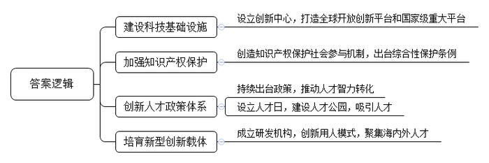
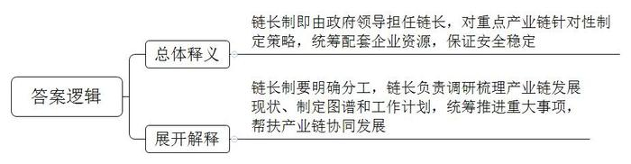
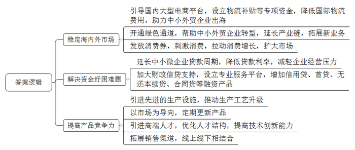

# 2020年深圳市公务员考试《申论》题（一卷）

> 候选采集稿。参考答案及解析来自粉笔页面，不代表官方答案或真实高分答卷；来源使用许可与原卷对应关系仍需人工核实。

## 给定材料

### 材料 material-a5d1313e08068dc8

最近，国家高性能医疗器械创新中心正式落地深圳，该中心将打造创新、创业、产业融合的全球开放创新平台。深圳还谋划了光明科学城、深港科技创新合作区、西丽湖国际科教城等系列国家级重大平台。“事业因人才而兴，人才因事业而聚”，这些重大科技基础设施的建成，将为人才施展才华提供广阔空间。

知识产权保护对引进创新人才至关重要。深圳不断创新知识产权保护举措，2016年首创知识产权保护社会参与机制，2019年3月出台全国首部综合类的知识产权保护条例——《深圳经济特区知识产权保护条例》。人才政策体系方面的不断优化和创新也让企业和各类人才持续受益，近年来相继推出“促进人才优先发展81条”“鹏城英才计划”等一系列政策，大力推动人才智力转化为创新成果。2017年，深圳发布实施《深圳经济特区人才工作条例》，在全国率先立法设立深圳人才日（11月1日）。此外，还在深圳湾畔黄金地段拿出1156亩土地建成全国首个人才主题公园，诠释表达“深爱人才，圳等您来”的理念。

### 材料 material-f60009f490cf8d9b

“链长制”是近两年的一个热词，它的诞生是应对国际大环境变化和中国自身经济发展的共同需求。传统的地方经济发展模式倚重的粗放式招商引资，基于劳动、土地等要素成本优势的分工格局正面临越来越大的制约。随着中国经济带来的比较优势演进，中国特定产业和企业在产业链上的地位攀升，已经触及发达国家控制的高附加值、垄断性产业链环节，而单一点位断裂就会给整个产业链和地方经济发展带来倾覆性风险。为此，近年来国内多地出台“链长制”相关政策。比如，在深圳，集成电路、5G、智能网联汽车、超高清显示(8K)、生物医药、人工智能等重点产业链，每条产业链都有一位市领导担任链长，市委书记担任总链长，实施“一链一图、一链一制、一链一策”，重点保障产业链的安全稳定。浙江推动开发区产业链的“链长制”建设，统筹区内外产业链配套企业资源，保障企业生产过程的完整性，为产业链、供应链稳定保驾护航。一些地方公布了“链长”分工。如产业链链长要调研梳理产业链发展现状，全面掌握产业链重点企业、重点项目、重点平台、关键共性技术、制约瓶颈等情况；研究制定产业链图、技术路线图、应用领域图、区域分布图；研究制定做大做优做强产业链工作计划，统筹推进产业链企业发展、招商引资、项目建设、人才引进、技术创新等重大事项；精准帮扶产业链协同发展，协调解决发展中的重大困难问题；建立产业链发展日常调度通报机制，加强工作协调，细化工作举措，形成工作合力等。

### 材料 material-4f190a7b828b84e5

新冠肺炎疫情期间，为缓解中小企业燃眉之急，各地纷纷出台房租减免、复工复产帮扶等惠企政策。当前，在国内疫情得到有效控制、境外疫情依然严峻的背景下，中小企业持续发展仍面临多重困难：境外的消费需求大幅削减，我国中小企业出口业务遭受巨大冲击；订单不足导致部分企业出现复工复产后再停工的苗头；部分企业由于上下游供需不足，企业资金回笼周期延长，现金流困难；部分中小企业生产工艺落后，产品更新换代缓慢，销售渠道单一，技术创新能力差，市场竞争力薄弱；受社会经济环境、市场状况和金融服务等因素影响，中小企业融资依旧困难重重。有专家认为，随着国内疫情防控转向常态化，对中小企业的支持也应从短期性的纾困救急转向长效化的保障促进。

### 材料 material-5a7d3c5a218df173

2020年10月14日，深圳经济特区建立40周年庆祝大会在广东省深圳市隆重举行。中共中央总书记、国家主席、中央军委主席习近平在会上发表重要讲话强调，要高举中国特色社会主义伟大旗帜，统筹推进“五位一体”总体布局，协调推进“四个全面”战略布局，从我国进入新发展阶段大局出发，落实新发展理念，紧扣推动高质量发展、构建新发展格局，以一往无前的奋斗姿态、风雨无阻的精神状态，改革不停顿、开放不止步，在更高起点上推进改革开放，推动经济特区工作开创新局面，为全面建设社会主义现代化国家、实现第二个百年奋斗目标作出新的更大的贡献。

## 题目

### 第 1 题

**根据材料**5**和材料**6**，概括深圳营造良好人才生态的做法。（****20****分）**

关联材料：material-a5d1313e08068dc8

作答要求：

要求：

（1）概括全面，用词准确，条理清晰；

（2）总字数不超过150字。

### 第 2 题

**阅读材料**9**，提炼出****“****链长制****”****的内涵。（****10****分）**

关联材料：material-f60009f490cf8d9b

作答要求：

要求：

（1）全面准确，文字精炼；

（2）总字数不超过100字。

### 第 3 题

**针对材料**10**反映的困难，提出疫情防控常态化下政府可采取的长效化中小企业扶持措施。（****25****分）**

关联材料：material-4f190a7b828b84e5

作答要求：

要求：

（1）考虑周全，对策合理，条理清晰；

（2）总字数不超过300字。

### 第 4 题

**当前，深圳全市上下都在深入学习贯彻习近平总书记出席深圳经济特区建立****40****周年庆祝大会和视察广东重要讲话、重要指示精神。深圳市公务员主管部门计划向全市公务员发出倡议，号召全市公务员永葆****“****闯****”****的精神、****“****创****”****的劲头、****“****干****”****的作风，勇于担当，积极作为，服务****“****双区****”****建设。请你草拟这份倡议书。（****45****分）**

关联材料：material-5a7d3c5a218df173

作答要求：

要求：

（1）自拟标题，紧扣主题，结合材料；

（2）结构严谨，条理清晰；

（3）语言流畅，感染力强；

（4）总字数1000~1200字。

## 答案与解析

第 1 题

**参考答案（粉笔题库参考内容）**

1.建设科技基础设施。设立创新中心，打造全球开放创新平台和国家级重大平台。

2.加强知识产权保护。创造知识产权保护社会参与机制，出台综合性保护条例。

3.创新人才政策体系。持续出台政策，推动人才智力转化；设立人才日，建设人才公园，吸引人才。

4.培育新型创新载体。成立研发机构，创新用人模式，聚集海内外人才。

**解析**

**参考答案说明：**本参考答案从“建设科技基础设施”“加强知识产权保护”“创新人才政策体系”“培育新型创新载体”这四个方面展开，各条答案要点之间在内容上相互并列，没有交叉。

**考点**：考点概括措施类

**来源**：来源2020年深圳市公务员考试《申论》题（一卷）

粉笔申论页面对本题只提供「解析视频」入口，该入口是会员推广位，页面无视频地址与文字解析。

第 2 题

**参考答案（粉笔题库参考内容）**

链长制即由政府领导担任链长，对重点产业链针对性制定策略，统筹配套企业资源，保证安全稳定。链长制要明确分工，链长负责调研梳理产业链发展现状、制定图谱和工作计划，统筹推进重大事项，帮扶产业链协同发展。

**解析**

**参考答案说明：**思路方面，本参考答案按照词句解释题“总体释义+展开解释+总结”的一般答题思路展开。内容方面，本参考答案先对“链长制”的含义进行了解释；然后展开解释了“链长”的工作内容；由于材料中没有总结性、对策性信息，因此总结部分省略。

**考点**：考点词句解释类

**来源**：来源2020年深圳市公务员考试《申论》题（一卷）

粉笔申论页面对本题只提供「解析视频」入口，该入口是会员推广位，页面无视频地址与文字解析。

第 3 题

**参考答案（粉笔题库参考内容）**

1.稳定海内外市场。引导国内大型电商平台，设立物流补贴等专项资金，降低国际物流费用，助力中小外贸企业出海；开通绿色通道，帮助中小外贸企业转型，延长产业链，拓展新业务；发放消费券，刺激消费，拉动消费增长，扩大市场。

2.解决资金纾困难题。延长中小微企业贷款周期，降低贷款利率，减轻企业经营压力；加大财政信贷支持，设立专业服务平台，增加信用贷、首贷、无还本续贷、合同贷等融资产品。

3.提高产品竞争力。引进先进的生产设施，推动生产工艺升级；以市场为导向，定期更新产品；引进高端人才，优化人才结构，提高技术创新能力；拓展销售渠道，线上线下相结合。

**解析**

**参考答案说明**：本参考答案从“稳定海内外市场”“解决资金纾困难题”“提高产品竞争力”这三个方面进行了分条撰写。各条要点之间在内容上相互并列，没有交叉。

  

**考点**：考点提出对策类

**来源**：来源2020年深圳市公务员考试《申论》题（一卷）

粉笔申论页面对本题只提供「解析视频」入口，该入口是会员推广位，页面无视频地址与文字解析。

第 4 题

**参考答案（粉笔题库参考内容）**

**敢闯敢试 实干兴邦**

深圳市全体公务员：

2020年10月14日，深圳经济特区建立40周年庆祝大会隆重举行，习近平总书记发表重要讲话，要以一往无前的奋斗姿态、风雨无阻的精神状态，改革不停顿、开放不止步，在更高起点上推进改革开放，推动经济特区工作开创新局面。作为推动双区建设的战略城市，深圳在“双区”利好政策的驱动下，迎来了重大历史机遇。对此，我市公务员主管部门向全市公务员发出倡议，深入学习贯彻习近平总书记重要讲话、重要指示精神，勇于担当，积极作为，服务“双区”建设。

**敢为人先，永葆“闯”的精神。**深圳这座带有改革基因的城市向来敢闯敢试，从新中国土地拍卖“第一槌”到在全国首次实行住房商品化改革，深圳首创1000多项改革举措，经济社会各领域探索从这里起步。无数个“第一”，化作深圳这座城市成长的坐标，而今，站在历史新起点的深圳，也面临着来自经济发展、科技创新和城市治理多方面的压力，从“先行先试”到“先行示范”，深圳的发展阶段踏上了新征程，“雄关漫道真如铁，而今迈步从头越”，深圳要坚持用“闯”的精神搏出一番新天地。

**创新加速，坚持“创”的劲头。**40年来，深圳实现了由一座边陲小镇到具有全球影响力的国际化大都市的历史性跨越，堪称世界发展史上的奇迹。从创造“三天一层楼”的建设速度，到如今跑出“三天一项制度”“一天51件发明专利”的创新加速度，在深圳的发展历程中，“创”的劲头一以贯之。不仅如此，深圳还把优化营商环境列为“一号改革工程”，积极推动制度、管理及文化创新，加快打造创新创业高地；建设全球开放创新平台，培育鹏城实验室等新型创新载体，打造“深港创新圈”“深港青年梦工厂”，为人才施展才华提供广阔空间，深圳用创新托举起新时代的重任。

**实干兴邦，秉持“干”的作风。**“空谈误国，实干兴邦”。深圳的发展奇迹，是坚持实干的胜利果实。深圳充分发挥“双区”叠加的优势，努力打造“一带一路”重要支撑区，建设现代化国际化一体化的综合交通运输体系。同时，深圳积极响应习近平总书记着力优化社会治理的要求，以党群服务中心建设为纽带，打造党群服务中心联盟；把精神文明建设工作作为“一把手”工程，为先行示范区建设提供坚实精神支撑和强大的道德力量。“大道至简，实干为要”，是实干成就了今天的深圳。

40年春风化雨，40年春华秋实。回首深圳40年非凡历程，敢闯敢试、敢为人先、埋头苦干，始终是深圳等经济特区不变的精神气质，也始终是深圳等经济特区不断创造发展奇迹的重要支撑。

深圳市公务员主管部门

XXXX年XX月XX日

**解析**

**文章分析**

**敢闯敢试** **实干兴邦**

【**标题的优点：**倡议书的标题简洁明快，主题突出。】

深圳市全体公务员：

【**称谓的优点：**倡议书的称谓定位准确、格式正确。本倡议书倡议的对象是深圳市全市公务员，因此称谓可写为：深圳市全体公务员。】

（1）2020年10月14日，深圳经济特区建立40周年庆祝大会隆重举行，习近平总书记发表重要讲话，要以一往无前的奋斗姿态、风雨无阻的精神状态，改革不停顿、开放不止步，在更高起点上推进改革开放，推动经济特区工作开创新局面。作为推动双区建设的战略城市，深圳在“双区”利好政策的驱动下，迎来了重大历史机遇。对此，（2）我市公务员主管部门向全市公务员发出倡议，深入学习贯彻习近平总书记重要讲话、重要指示精神，勇于担当，积极作为，服务“双区”建设。

【**开头的优点：**倡议书的开头介绍了倡议的背景，并讲明了倡议的目的。（1）介绍倡议的背景：习总书记的讲话。（2）指出了倡议的目的：学习领导讲话精神，服务“双区”建设。】

**敢为人先****，永葆****“闯”的精神。**（1）深圳这座带有改革基因的城市向来敢闯敢试，从新中国土地拍卖“第一槌”到在全国首次实行住房商品化改革，深圳首创1000多项改革举措，经济社会各领域探索从这里起步。无数个“第一”，化作深圳这座城市成长的坐标，而今，（2）站在历史新起点的深圳，也面临着来自经济发展、科技创新和城市治理多方面的压力，（3）从“先行先试”到“先行示范”，深圳的发展阶段踏上了新征程，“雄关漫道真如铁，而今迈步从头越”，深圳要坚持用“闯”的精神搏出一番新天地。

【**主体部分****1的优点：**★核心句：倡议书的核心句是紧扣“永葆‘闯’的精神、‘创’的劲头、‘干’的作风”这一主题提出的。形式上，它在段首处直接写出，位置突出，容易发现。内容上，关键词突出，内容要点明确，可以明显看出它是从“‘闯’的精神”这一方面入手，介绍了“‘闯’的精神的体现和做法”。★具体展开：（1）先介绍了“深圳40年来在各领域的大胆探索”；（2）接着介绍了“深圳发展面临的压力”；（3）最后介绍了“当今‘闯’的精神依然重要”。注意：以上三个方面的内容都是紧扣“敢为人先，永葆‘闯’的精神”这个核心句进行分析论述的，具体展开的内容针对性强，层次丰富。在具体内容的展开上采用了讲道理、举例子相结合，做到了丰富多样。】

**创新****加速，****坚持****“创”的劲头。**（1）40年来，深圳实现了由一座边陲小镇到具有全球影响力的国际化大都市的历史性跨越，堪称世界发展史上的奇迹。从创造“三天一层楼”的建设速度，到如今跑出“三天一项制度”“一天51件发明专利”的创新加速度，在深圳的发展历程中，“创”的劲头一以贯之。不仅如此，（2）深圳还把优化营商环境列为“一号改革工程”，积极推动制度、管理及文化创新，加快打造创新创业高地；建设全球开放创新平台，培育鹏城实验室等新型创新载体，打造“深港创新圈”“深港青年梦工厂”，为人才施展才华提供广阔空间，深圳用创新托举起新时代的重任。

【**主体部分****2****的优点：**★核心句：倡议书的核心句是紧扣“永葆‘闯’的精神、‘创’的劲头、‘干’的作风”这一主题提出的。形式上，它在段首处直接写出，位置突出，容易发现。内容上，关键词突出，内容要点明确，可以明显看出它是从“‘创’的劲头”这一方面入手，介绍了“‘创’的劲头的体现和做法”。★具体展开：（1）先介绍了“深圳的历史性跨越，创新加速度”；（2）接着介绍了“深圳优化营商环境，搭建创新平台，支持人才创新创业”。注意：以上两个方面的内容都是紧扣“创新加速，坚持‘创’的劲头”这个核心句进行分析论述的，具体展开的内容针对性强，层次丰富。在具体内容的展开上采用了讲道理、举例子相结合，做到了丰富多样。】

**实干****兴邦****，****秉持****“干”的作风。**（1）“空谈误国，实干兴邦”。深圳的发展奇迹，是坚持实干的胜利果实。（2）深圳充分发挥“双区”叠加的优势，努力打造“一带一路”重要支撑区，建设现代化国际化一体化的综合交通运输体系。同时，（3）深圳积极响应习近平总书记着力优化社会治理的要求，以党群服务中心建设为纽带，打造党群服务中心联盟；把精神文明建设工作作为“一把手”工程，为先行示范区建设提供坚实精神支撑和强大的道德力量。“大道至简，实干为要”，是实干成就了今天的深圳。

【**主体部分****3****的优点：**★核心句：倡议书的核心句是紧扣“永葆‘闯’的精神、‘创’的劲头、‘干’的作风”这一主题提出的。形式上，它在段首处直接写出，位置突出，容易发现。内容上，关键词突出，内容要点明确，可以明显看出它是从“‘干’的作风”这一方面入手，介绍了“‘干’的作风的体现和做法”。★具体展开：（1）先介绍了“深圳的发展奇迹是实干出来的”；（2）接着介绍了“深圳发挥‘双区’叠加的优势，支撑‘一带一路’”；（3）最后介绍了“加强党群服务，优化社会治理，提供精神和道德支撑”。注意：以上三个方面的内容都是紧扣“实干兴邦，秉持‘干’的作风”这个核心句进行分析论述的，具体展开的内容针对性强，层次丰富。在具体内容的展开上采用了讲道理、举例子相结合，做到了丰富多样。】

40年春风化雨，40年春华秋实。回首深圳40年非凡历程，敢闯敢试、敢为人先、埋头苦干，始终是深圳等经济特区不变的精神气质，也始终是深圳等经济特区不断创造发展奇迹的重要支撑。

【**结尾的优点**：倡议书的结尾回扣了“永葆‘闯’的精神、‘创’的劲头、‘干’的作风”这一主题。总结了全文，做到了观点突出，结构完整。】

深圳市公务员主管部门

XXXX年XX月XX日

【**落款的优点：**倡议书的落款定位准确、格式正确。本倡议书的发出者是深圳市公务员主管部门，因此发文机关可写为：深圳市公务员主管部门；再加上发文日期：XXXX年XX月XX日。】

  
  

**考点**：考点宣传类

**来源**：来源2020年深圳市公务员考试《申论》题（一卷）

粉笔申论页面对本题只提供「解析视频」入口，该入口是会员推广位，页面无视频地址与文字解析。

