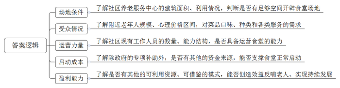
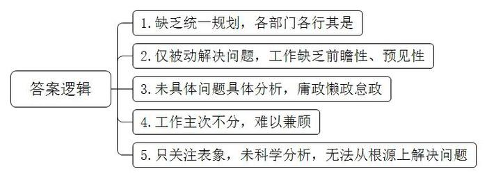
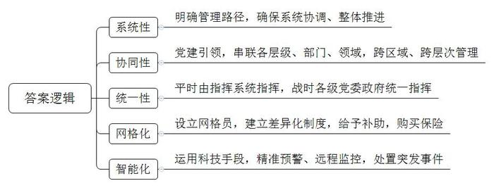
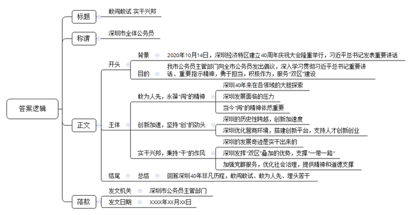

# 2020年深圳市公务员考试《申论》题（二卷）

<!-- gwy:overview:start -->
> **深圳 · 2020 · 申论 · 二卷** ｜ 4 题 · 图片 4 处 · 答案随题折叠

导航：[题目](#题目) · [材料 1](#材料-1)
<!-- gwy:overview:end -->

> 候选采集稿。参考答案及解析来自粉笔页面，不代表官方答案或真实高分答卷；来源使用许可与原卷对应关系仍需人工核实。

## 给定材料

### 材料 1

J市市民赵先生今年70多岁了，他来到街道办反映，特别希望能引入S街道做法，在小区附近开设社区长者食堂。原来，S街道两年前借鉴外地经验在全市率先试行“社区长者食堂”政策，试点社区在原有养老服务中心基础上开辟专门场地建设了食堂，附近老人都可以到这个食堂享受低价餐。该食堂菜价比外面的快餐店便宜两三成，每天提供10多个菜品，5种面食，免费汤粥，还提供送餐服务。

S街道的做法曾得到媒体关注，据报道，随着居家养老不断发展，社区成为养老新“阵地”。社区长者食堂采用政府购买服务的方式，由社会、社工和社区共同参与，社区负责具体运营。经过申请、审批合格后的社区长者食堂，将会获得每家10万元的一次性专项补助，但即便如此，这类惠民项目在实施中还是会遇到资金紧、场地缺等难题。“这本身就是公益项目，我们也正在尝试扩大资源利用范围，利用多种方式创造效益反哺对老人的优待。”社区民政局相关人员说。

社区长者食堂是一项群众关心、社会关注的民生实事。上海、广州、深圳、合肥、廊坊等很多城市都进行了积极探索。从实践看，各地情况存在差异，运作模式不尽相同，但多数都作为公益项目由政府出资设立，聘请社会专业服务机构负责具体运营。

### 材料 2

近年来，我国城市治理取得了一定的成效和经验，但一些城市的治理还存在不少问题，有专家将之形象地比喻为以下几点：一是“各吹各的号，各唱各的调”；二是扮演“救火队”角色，治已病而非治未病；三是“一刀切”“齐步走”；四是“眉毛胡子一把抓”“按下葫芦浮起瓢”；五是“头痛医头、脚痛医脚”。

习近平总书记高度重视城市治理工作，他指出，要着力完善城市治理体系和城乡基层治理体系。树立全周期管理意识，努力探索超大城市现代化治理新路子。有学者分析认为，“全周期管理”作为一种科学的管理思维，是指治理体系应形成一个前期预警决策、中期应对执行、后期总结学习的管理闭环，在这样一个闭环中，前中后三个环节紧密相扣，各部门要做到权责明晰、科学配合，保障信息流通顺畅。在城市基层治理过程中引入“全周期管理”思维，这体现了目标导向和问题导向的辩证统一，其所聚焦的是目前城市治理中的短板与弱项。

### 材料 3

为完善城市治理体系，G市今年印发了构建全周期城市治理体系实施意见，主要针对此次新冠肺炎疫情暴露出来的短板和不足，总结近年来的经验做法，破解城市治理中存在的一系列难题，其全周期管理举措包括: （1）按照问题研判、资源动员、行动处置、监督反馈、总结提升的管理路径，确保管理内容、主体、层次的系统协调、整体推进；（2）通过党建引领作“绣针”，将各个层级，各个部门，各个领域串连起来，一级抓一级，层层抓落实，实现跨区域、跨层次协同管理；（3）明确平时整个体系的指挥系统，同时对战时应急作出规定，按照属地管理原则各级党委政府统一指挥，确保统一行动、步调一致、落实有力；（4）在社区和工业园区建立网格，设立网格员，结合实际建立差异化管理制度，同时对网格员按照一定标准给予补助，并为其购买人身意外保险；（5）深化运用大数据分析，人工智能等科技手段，打造基层治理数据库，实现治理风险精准预警、社区秩序远程监控、突发事件联合处置。

### 材料 4

2020年10月14日，深圳经济特区建立40周年庆祝大会在广东省深圳市隆重举行。中共中央总书记、国家主席、中央军委主席习近平在会上发表重要讲话强调，要高举中国特色社会主义伟大旗帜，统筹推进“五位一体”总体布局，协调推进“四个全面”战略布局，从我国进入新发展阶段大局出发，落实新发展理念，紧扣推动高质量发展、构建新发展格局，以一往无前的奋斗姿态、风雨无阻的精神状态，改革不停顿、开放不止步，在更高起点上推进改革开放，推动经济特区工作开创新局面，为全面建设社会主义现代化国家，实现第二个百年奋斗目标作出新的更大的贡献。

## 题目

### 第 1 题

**阅读材料8，针对市民赵先生的诉求，街道办决定开展调查研究，为是否设立长者食堂提供决策参考，请就本次调研需要了解的情况拟出提纲。（25分）**

关联材料：材料 1

作答要求：

（1）考虑周全，简明扼要，条理清晰；

（2）总字数不超过250字。

第 1 题 · 答案与解析

**参考答案（粉笔题库参考内容）**

1.场地条件：了解社区养老服务中心的建筑面积、利用情况，判断是否有足够空间开辟食堂场地。

2.受众情况：了解附近老年人规模、心理价格区间，对菜品口味、种类和各类服务的需求。

3.运营力量：了解社区现有工作人员的数量、能力结构，是否具备运营食堂的能力。

4.启动成本：了解除政府的专项补助外，是否有其他的资金来源，能否支撑食堂正常启动。

5.盈利能力：了解是否有其他的可利用资源、可借鉴的模式，能否创造效益反哺老人、实现持续发展。

**解析**

**参考答案说明：**本参考答案从“场地条件”“受众情况”“运营力量”“启动成本”“盈利能力”五个方面展开，对设立长者食堂前调研需要了解的情况进行了分条撰写。各条答案要点之间在内容上相互并列，没有交叉。

**考点**：总结类

**来源**：2020年深圳市公务员考试《申论》题（二卷）

粉笔申论页面对本题只提供「解析视频」入口，该入口是会员推广位，页面无视频地址与文字解析。

### 第 2 题

**准确理解材料11第一段中的比喻，列出其中隐含的城市治理问题。（10分）**

关联材料：材料 2

作答要求：

（1）用词准确，条理清晰；

（2）总字数不超过100字。

第 2 题 · 答案与解析

**参考答案（粉笔题库参考内容）**

1.缺乏统一规划，各部门各行其是。

2.仅被动解决问题，工作缺乏前瞻性、预见性。

3.未具体问题具体分析，庸政懒政怠政。

4.工作主次不分，难以兼顾。

5.只关注表象，未科学分析，无法从根源上解决问题。

**解析**

**参考答案说明**：本参考答案从“缺乏统筹”“缺乏前瞻性”“未对症下药”“不分轻重”“缺乏深入分析”五个方面展开，各条答案要点之间在内容上相互并列，没有交叉。

**考点**：问题类

**来源**：2020年深圳市公务员考试《申论》题（二卷）

粉笔申论页面对本题只提供「解析视频」入口，该入口是会员推广位，页面无视频地址与文字解析。

### 第 3 题

**根据材料12，概括G市城市治理中全周期管理举措的特点。（20分）**

关联材料：材料 3

作答要求：

（1）概括全面，用词准确，条理清晰；

（2）总字数不超过150字。

第 3 题 · 答案与解析

**参考答案（粉笔题库参考内容）**

一、系统性。明确管理路径，确保系统协调、整体推进。

二、协同性。党建引领，串联各层级、部门、领域，跨区域、跨层次管理。

三、统一性。平时由指挥系统指挥，战时各级党委政府统一指挥。

四、网格化。设立网格员，建立差异化制度，给予补助，购买保险。

五、智能化。运用科技手段，精准预警、远程监控，处置突发事件。

**解析**

**参考答案说明**：本参考答案从“系统性”“协同性”“统一性”“网格化”“智能化”五个方面展开，各条答案要点之间在内容上相互并列，没有交叉。

**考点**：特点类

**来源**：2020年深圳市公务员考试《申论》题（二卷）

粉笔申论页面对本题只提供「解析视频」入口，该入口是会员推广位，页面无视频地址与文字解析。

### 第 4 题

**当前，深圳全市上下都在深入学习贯彻习近平总书记出席深圳经济特区建立40周年庆祝大会和视察广东重要讲话、重要指示精神，深圳市公务员主管部门计划向全市公务员发出倡议，号召全市公务员永葆“闯”的精神、“创”的劲头、“干”的作风，勇于担当，积极作为，服务“双区”建设。请你草拟这份倡议书。（45分）**

关联材料：材料 4

作答要求：

（1）自拟标题，紧扣主题，结合材料；

（2）结构严谨，条理清晰；

（3）语言流畅，感染力强；

（4）总字数1000-1200字。

第 4 题 · 答案与解析

**参考答案（粉笔题库参考内容）**

**敢闯敢试 实干兴邦**

深圳市全体公务员：

2020年10月14日，深圳经济特区建立40周年庆祝大会隆重举行，习近平总书记发表重要讲话，要以一往无前的奋斗姿态、风雨无阻的精神状态，改革不停顿、开放不止步，在更高起点上推进改革开放，推动经济特区工作开创新局面。作为推动双区建设的战略城市，深圳在“双区”利好政策的驱动下，迎来了重大历史机遇。对此，我市公务员主管部门向全市公务员发出倡议，深入学习贯彻习近平总书记重要讲话、重要指示精神，勇于担当，积极作为，服务“双区”建设。

**敢为人先，永葆“闯”的精神。**深圳这座带有改革基因的城市向来敢闯敢试，从新中国土地拍卖“第一槌”到在全国首次实行住房商品化改革，深圳首创1000多项改革举措，经济社会各领域探索从这里起步。无数个“第一”，化作深圳这座城市成长的坐标，而今，站在历史新起点的深圳，也面临着来自经济发展、科技创新和城市治理多方面的压力，从“先行先试”到“先行示范”，深圳的发展阶段踏上了新征程，“雄关漫道真如铁，而今迈步从头越”，深圳要坚持用“闯”的精神搏出一番新天地。

**创新加速，坚持“创”的劲头。**40年来，深圳实现了由一座边陲小镇到具有全球影响力的国际化大都市的历史性跨越，堪称世界发展史上的奇迹。从创造“三天一层楼”的建设速度，到如今跑出“三天一项制度”“一天51件发明专利”的创新加速度，在深圳的发展历程中，“创”的劲头一以贯之。不仅如此，深圳还把优化营商环境列为“一号改革工程”，积极推动制度、管理及文化创新，加快打造创新创业高地；建设全球开放创新平台，培育鹏城实验室等新型创新载体，打造“深港创新圈”“深港青年梦工厂”，为人才施展才华提供广阔空间，深圳用创新托举起新时代的重任。

**实干兴邦，秉持“干”的作风。**“空谈误国，实干兴邦”。深圳的发展奇迹，是坚持实干的胜利果实。深圳充分发挥“双区”叠加的优势，努力打造“一带一路”重要支撑区，建设现代化国际化一体化的综合交通运输体系。同时，深圳积极响应习近平总书记着力优化社会治理的要求，以党群服务中心建设为纽带，打造党群服务中心联盟；把精神文明建设工作作为“一把手”工程，为先行示范区建设提供坚实精神支撑和强大的道德力量。“大道至简，实干为要”，是实干成就了今天的深圳。

40年春风化雨，40年春华秋实。回首深圳40年非凡历程，敢闯敢试、敢为人先、埋头苦干，始终是深圳等经济特区不变的精神气质，也始终是深圳等经济特区不断创造发展奇迹的重要支撑。

深圳市公务员主管部门

XXXX年XX月XX日

**解析**

**文章分析**

**敢闯敢试** **实干兴邦**

【**标题的优点：**倡议书的标题简洁明快，主题突出。】

深圳市全体公务员：

【**称谓的优点：**倡议书的称谓定位准确、格式正确。本倡议书倡议的对象是深圳市全市公务员，因此称谓可写为：深圳市全体公务员。】

（1）2020年10月14日，深圳经济特区建立40周年庆祝大会隆重举行，习近平总书记发表重要讲话，要以一往无前的奋斗姿态、风雨无阻的精神状态，改革不停顿、开放不止步，在更高起点上推进改革开放，推动经济特区工作开创新局面。作为推动双区建设的战略城市，深圳在“双区”利好政策的驱动下，迎来了重大历史机遇。对此，（2）我市公务员主管部门向全市公务员发出倡议，深入学习贯彻习近平总书记重要讲话、重要指示精神，勇于担当，积极作为，服务“双区”建设。

【**开头的优点：**倡议书的开头介绍了倡议的背景，并讲明了倡议的目的。（1）介绍倡议的背景：习总书记的讲话。（2）指出了倡议的目的：学习领导讲话精神，服务“双区”建设。】

**敢为人先，永葆“闯”的精神。**（1）深圳这座带有改革基因的城市向来敢闯敢试，从新中国土地拍卖“第一槌”到在全国首次实行住房商品化改革，深圳首创1000多项改革举措，经济社会各领域探索从这里起步。无数个“第一”，化作深圳这座城市成长的坐标，而今，（2）站在历史新起点的深圳，也面临着来自经济发展、科技创新和城市治理多方面的压力，（3）从“先行先试”到“先行示范”，深圳的发展阶段踏上了新征程，“雄关漫道真如铁，而今迈步从头越”，深圳要坚持用“闯”的精神搏出一番新天地。

【**主体部分1的优点：**★核心句：倡议书的核心句是紧扣“永葆‘闯’的精神、‘创’的劲头、‘干’的作风”这一主题提出的。形式上，它在段首处直接写出，位置突出，容易发现。内容上，关键词突出，内容要点明确，可以明显看出它是从“‘闯’的精神”这一方面入手，介绍了“‘闯’的精神的体现和做法”。★具体展开：（1）先介绍了“深圳40年来在各领域的大胆探索”；（2）接着介绍了“深圳发展面临的压力”；（3）最后介绍了“当今‘闯’的精神依然重要”。注意：以上三个方面的内容都是紧扣“敢为人先，永葆‘闯’的精神”这个核心句进行分析论述的，具体展开的内容针对性强，层次丰富。在具体内容的展开上采用了讲道理、举例子相结合，做到了丰富多样。】

**创新加速，坚持“创”的劲头。**（1）40年来，深圳实现了由一座边陲小镇到具有全球影响力的国际化大都市的历史性跨越，堪称世界发展史上的奇迹。从创造“三天一层楼”的建设速度，到如今跑出“三天一项制度”“一天51件发明专利”的创新加速度，在深圳的发展历程中，“创”的劲头一以贯之。不仅如此，（2）深圳还把优化营商环境列为“一号改革工程”，积极推动制度、管理及文化创新，加快打造创新创业高地；建设全球开放创新平台，培育鹏城实验室等新型创新载体，打造“深港创新圈”“深港青年梦工厂”，为人才施展才华提供广阔空间，深圳用创新托举起新时代的重任。

【**主体部分2的优点：**★核心句：倡议书的核心句是紧扣“永葆‘闯’的精神、‘创’的劲头、‘干’的作风”这一主题提出的。形式上，它在段首处直接写出，位置突出，容易发现。内容上，关键词突出，内容要点明确，可以明显看出它是从“‘创’的劲头”这一方面入手，介绍了“‘创’的劲头的体现和做法”。★具体展开：（1）先介绍了“深圳的历史性跨越，创新加速度”；（2）接着介绍了“深圳优化营商环境，搭建创新平台，支持人才创新创业”。注意：以上两个方面的内容都是紧扣“创新加速，坚持‘创’的劲头”这个核心句进行分析论述的，具体展开的内容针对性强，层次丰富。在具体内容的展开上采用了讲道理、举例子相结合，做到了丰富多样。】

**实干兴邦，秉持“干”的作风。**（1）“空谈误国，实干兴邦”。深圳的发展奇迹，是坚持实干的胜利果实。（2）深圳充分发挥“双区”叠加的优势，努力打造“一带一路”重要支撑区，建设现代化国际化一体化的综合交通运输体系。同时，（3）深圳积极响应习近平总书记着力优化社会治理的要求，以党群服务中心建设为纽带，打造党群服务中心联盟；把精神文明建设工作作为“一把手”工程，为先行示范区建设提供坚实精神支撑和强大的道德力量。“大道至简，实干为要”，是实干成就了今天的深圳。

【**主体部分3的优点：**★核心句：倡议书的核心句是紧扣“永葆‘闯’的精神、‘创’的劲头、‘干’的作风”这一主题提出的。形式上，它在段首处直接写出，位置突出，容易发现。内容上，关键词突出，内容要点明确，可以明显看出它是从“‘干’的作风”这一方面入手，介绍了“‘干’的作风的体现和做法”。★具体展开：（1）先介绍了“深圳的发展奇迹是实干出来的”；（2）接着介绍了“深圳发挥‘双区’叠加的优势，支撑‘一带一路’”；（3）最后介绍了“加强党群服务，优化社会治理，提供精神和道德支撑”。注意：以上三个方面的内容都是紧扣“实干兴邦，秉持‘干’的作风”这个核心句进行分析论述的，具体展开的内容针对性强，层次丰富。在具体内容的展开上采用了讲道理、举例子相结合，做到了丰富多样。】

40年春风化雨，40年春华秋实。回首深圳40年非凡历程，敢闯敢试、敢为人先、埋头苦干，始终是深圳等经济特区不变的精神气质，也始终是深圳等经济特区不断创造发展奇迹的重要支撑。

【**结尾的优点**：倡议书的结尾回扣了“永葆‘闯’的精神、‘创’的劲头、‘干’的作风”这一主题。总结了全文，做到了观点突出，结构完整。】

深圳市公务员主管部门

XXXX年XX月XX日

【**落款的优点：**倡议书的落款定位准确、格式正确。本倡议书的发出者是深圳市公务员主管部门，因此发文机关可写为：深圳市公务员主管部门；再加上发文日期：XXXX年XX月XX日。】

**考点**：宣传类

**来源**：2020年深圳市公务员考试《申论》题（二卷）

粉笔申论页面对本题只提供「解析视频」入口，该入口是会员推广位，页面无视频地址与文字解析。

