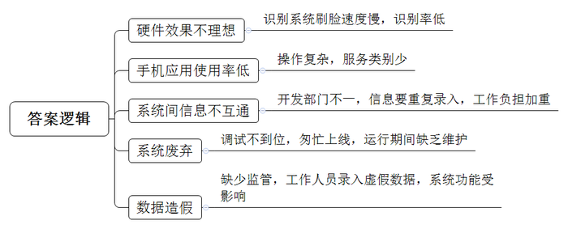
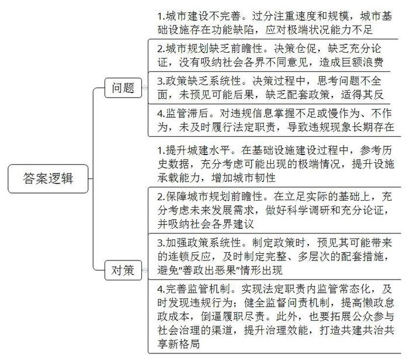
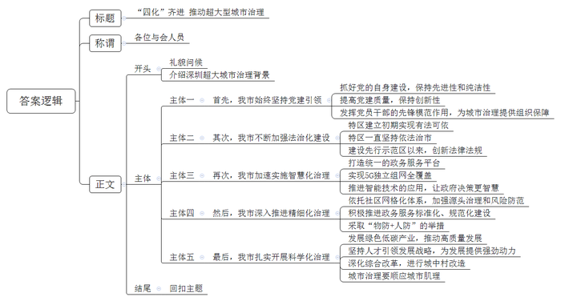

# 2022年深圳市公务员考试《申论》题（一卷）

<!-- gwy:overview:start -->
> **深圳 · 2022 · 申论 · 一卷** ｜ 3 题 · 图片 3 处 · 答案随题折叠

导航：[题目](#题目) · [材料 1](#材料-1)
<!-- gwy:overview:end -->

> 候选采集稿。参考答案及解析来自粉笔页面，不代表官方答案或真实高分答卷；来源使用许可与原卷对应关系仍需人工核实。

## 给定材料

### 材料 1

2020年3月29日至4月1日，习近平总书记在浙江考察时指出，推进国家治理体系和治理能力现代化，必须抓好城市治理体系和治理能力现代化。2020年10月14日，习近平总书记在深圳经济特区建立40周年庆祝大会上的重要讲话指出，要强化依法治理，善于运用法治思维和法治方式解决城市治理顽症难题，让法治成为社会共识和基本准则。要注重在科学化、精细化、智能化上下功夫，发挥深圳信息产业发展优势，推动城市管理手段、管理模式、管理理念创新，让城市运转更聪明、更智慧。

党的十九届六中全会审议通过的《中共中央关于党的百年奋斗重大成就和历史经验的决议》，明确全面深化改革总目标是完善和发展中国特色社会主义制度，推进国家治理体系和治理能力现代化。

《广东省国民经济和社会发展第十四个五年规划和2035年远景目标纲要》提出，支持广州、深圳、珠海等有条件的城市构建数字孪生城市，实现实体城市向数字空间的全息投影，增强城市治理灵敏感知、快速分析、迅捷处置能力，打造全国领先的新型智慧型城市标杆。

深圳第七次党代会报告提出，未来五年，深圳城市治理体系和治理能力现代化基本实现，城市治理的法治化、科学化、精细化、智能化水平大幅提升，稳定公平透明、可预期的国际一流法治化营商环境基本形成，城市更宜居、更韧性、更智能，努力成为超大型城市现代化治理的典范。

### 材料 2

特区的事业不停顿，党的建设不停顿。从深圳第一次党代会提出“把马克思主义同深圳的实际结合起来，继承党的优良传统和开拓创新结合起来，切实抓好党的自身建设，进一步提高特区党员队伍素质,增强党的战斗力和凝聚力”，到第七次党代会提出“坚定不移全面从严治党，增强‘四个意识’，坚定‘四个自信’，做到‘两个维护’，打造向世界彰显中国共产党先进性、纯洁性的精彩样板，引领和保障深圳先行示范区建设行稳致远”。深圳始终坚持和加强党的领导，与时俱进、勇于创新,不断强化城市基层党建工作，努力提高党的建设质量，夯实党在城市的执政基础，为城市发展提供坚实的组织保证。有学者提出，当前深圳进入了粤港澳大湾区、深圳先行示范区“双区”驱动和深圳经济特区、深圳先行示范区“双区”叠加的黄金发展期，要加强党建引领，进一步加快城市现代化建设的脚步，努力成为国际一流的现代化智慧城市标杆。

### 材料 3

深圳法治建设始终与改革开放同频共振，经济特区建立初期，深圳在引进外资过程中逐渐认识到法治的重要性，积极通过国家和广东省立法机关制定了23项特区法规，初步形成了经济特区市场规则。1992年7月1日，深圳取得特区立法权后，短短几年时间基本实现了特区建设重要事项都有法可依。1994年3月，深圳率先进行依法治市试点，从“依法治市”到“打造一流法治城市”，再到“建设法治中国示范城市”，不断推进城市法治建设。建设先行示范区两年来，深圳用足用好经济特区立法权，出台了科技创新条例、个人破产条例、绿色金融条例、数据条例等一批全国首创性、引领性法规，大力推进人工智能、数字经济、细胞和基因、智能网联汽车等新产业新业态新商业模式立法，全面提升了法治建设水平，其中不少在全国都有改革示范作用。

### 材料 4

“i深圳”是深圳统一的政务服务平台，可实现“掌上政府、指尖服务、刷脸办事”，已汇聚融合全市8000多项服务数据，累计注册用户超过1400万。深圳在全国率先推出政务服务“秒批”改革，实现“网上办，马上办，就近办，一次办”。

深圳在全国首创无感申报的“秒报”模式，实现表单自动填充和材料自动推送，从而实现“免填免报”。深圳还加快推进智慧城市建设，如在智慧交通方面，着力打造灯控一张网，由过去的车看灯、读秒数通行，到现在的灯看车、读车数放行，大大提高了道路通行能力。

深圳在全球率先实现5G独立组网全覆盖。未来，深圳将以实现“主动、精准、整体式、智能化的政府管理和服务”为目标，进一步推进5G和AI技术应用，提升大数据分析水平，形成全程、全城、全要素的全面感知和指挥调度能力，充分释放“数据的赋能”，改善公共服务，创新政府决策模式，让城市更加温暖、更加智慧、更加高效、更加便捷。

### 材料 5

新冠肺炎疫情发生以来，全国各地纷纷加快推进智慧社区建设，大大提升了社区服务水平。但有记者走访发现，部分社区智慧建设还存在一些问题。有社区安装了识别系统，用于居民出入小区刷脸登记，但刷脸速度慢，有时甚至识别不了，最后还是用回原来人工检查登记的老办法。有的社区智慧系统，通过手机APP提供社区购物、维修、缴纳物业费等服务，但多位业主反映，基本没有用过这个APP，原因是系统操作复杂，能用的服务也不多；有的社区要通过多个系统录入人员信息，而这些系统由不同部门各自开发，同一信息要重复录入，社区有几千人，录一次就要半个多月，工作负担反而加重；有的社区的智慧系统还没调试好就匆匆上线，运行期间又缺乏维护，不久就沦为僵尸系统；还有的社区花大力气建成的系统，却因录入数据不准确，功能大打折扣。有录入人员直言:“入户走访，可能一天只入户7次，但为了让考核好看一些，我就在系统上填报15次，反正也没人来管。”

### 材料 6

近日，派出所社区民警走访时发现，辖区内居民梁某与多次上门索要孩子抚养费的唐某发生冲突，唐某领着3岁的女儿和80岁的祖母滞留梁某家，并扬言要报复梁某。依托联调机制，社区民警联系到街道综治中心、司法所、社区工作人员对该起纠纷及时调解，促使双方对孩子抚养费支付事宜达成协议，问题得以圆满解决。为把各类矛盾纠纷化解在基层，消灭在萌芽，派出所将社区警务融入“网格化管理”，强化源头治理、筑牢基层风险防范体系，派出所采取警力下沉、警务前移和警民参与等方式，依托社区网格化体系，加强对人、地、事、物、组织等治安要素的规范管理，夯实基层基础工作，提升基础工作服务打防管控的能力和水平。

### 材料 7

近年来，Z街道积极推进政务服务标准化、规范化建设，为企业和群众提供更优质的服务，具体做法包括以下五个方面：

一、辖区居民不分户籍地和居住地，均可就近到任一社区服务大厅办理民政、人社、卫生等各类公共服务事项；调整各社区服务大厅布局，增设导询台、等候休息区和志愿服务站，营造温馨便民氛围。

二、以科技为手段，实现电脑屏、手机屏、宣传屏、政务服务自助终端屏联动，确保政务信息公开及时；将网站和微信公众号打造为政务公开主阵地，通过电子宣传屏滚动播放民生信息，并在社区内设置政务服务自助终端，提供50多项服务查询。

三、在各社区窗口设置资料架，在服务大厅内悬挂办事流程、服务事项，提供政府公报、办事指南、便民服务手册等政务资料，为办事企业和群众提供清晰的指引。

四、统一梳理61项街道级和43项社区级便民服务事项目录清单，进一步提升便民服务标准化水平，切实为企业和群众就近办事提供规范、透明、便捷服务，有效实现“小事不出社区、大事不出街道”。

五、社区服务大厅配备业务精通的工作人员，负责定期更新各类政务资料，并提供办事咨询答复服务；严格落实首问负责制、限时办结制、一次性告知及服务承诺制，不断改进和提升社区政务服务水平。

### 材料 8

当前，国内新冠肺炎疫情呈现零星散发、局部时有爆发的态势，疫情防控形势依然十分严峻，疫情防控这根弦必须时刻绷紧，绝不能前功尽弃。有专家指出，常态化疫情防控措施要精细再精细、精准再精准，把疫情防控网扎严收紧，一方面，需要更先进的“物防”，借助大数据等信息手段，精准锁定重点区域重点人群，建立风险人员信息库，实现分级分类精准管控；另一方面，需要更加高效的“人防”，依托高效严密的组织体系，压实属地、部门、单位和个人的责任，堵住所有可能的漏洞，使防控措施能够通畅地传导至城市的“末梢神经”。

### 材料 9

近年来，暴雨淹城的情况时有发生，有网友戏称，可以“在城里看海”“坐地铁赏水帘洞景”，城市大街小巷随着暴雨降临而“积水成河”，暴露出城市建设的“软肋”。有网友疾呼：“城市建设不能光有一日千里的热情，更应具备‘一管千年’的思维。”

J县一文化景观以2.3亿元建成，两年后却悄然拆除，拆建总费用保守估计近3亿元，引发社会热议。据悉，该项目建设伊始就有不同声音，但仍然仓促上马开工建设，当地政府后来也承认当时城市规划建设缺乏前瞻性。

H市为管理电动自行车乱象，暂停了电动自行车上牌业务，牌不给上了，车仍然可以正常买卖，上牌系统关闭后，路面新增了近10万辆无牌电动自行车，更难管了。

T市对一些违章建筑进行依法拆除时，有周边居民感到惊讶，“这房子原来是违章搭建的啊。”不少违章建筑存在了多年，几乎与周边建筑融为一体。有居民质疑道：“为什么这么多年来这些违建都没有被拆除？

B市市民李先生最近有了个新身份——市容环境提升义务宣传员，如今，他只要有时间都会劝阻占道经营、乱扔垃圾、车辆乱停乱放等行为。市里开展市容环境提升活动以来，各街道社区的党组织邀请辖区居民、社会团体、行业组织、志愿者、媒体记者等走进街巷，引导动员群众理解治理、参与治理、主动治理。

著名建筑学家梁思成曾说：“城市是一门科学，它像人体一样有经络、脉搏、肌理，如果你不科学地对待它，它会生病的。”有专家指出，要破解城市治理难题，应该由经验判断型向数据分析型转变、由被动处置型向主动发现型转变，努力使城市治理从“经验治理”向“科学治理”转变。

### 材料 10

我国提出二氧化碳排放力争于2030年前达到峰值，努力争取2060年前实现碳中和。近年来，深圳坚定不移走生态优先、绿色低碳的高质量发展道路，通过优化产业结构和能源结构，控制温室气体排放。2020年，全市战略性新兴产业占比达到37%，高技术制造业和先进制造业增加值占规模以上工业增加值的比重分别达到66%和72%，每平方公里产出GDP占全国大城市首位；核电、气电等清洁电源装机容量占全市总装机容量的77%，高出全国平均水平约25个百分点。深圳还将通过新技术、新材料等应用，通过绿色低碳发展，推广超低能耗建筑、零碳建筑，努力在有限的土地上承载更多的人口、产业和经济总量。

### 材料 11

有研究报告指出，在抗震方面,我国部分城市暴露出监测预警机制不健全，建筑、通信、交通道路等基础设施防震能力薄弱等问题。电力系统存在主网架较薄弱，变电站布点少，配电网线路设计不合理、联络率低、故障转电能力不足、缺乏后备电力等问题。在防御暴雨和洪涝灾害方面，部分城市存在着排水设施不完善、规划不合理、过度硬化、排水防涝设施建设标准不高等问题。此次新冠肺炎疫情也暴露出医疗基础设施薄弱，医院、公卫、基层等分工协作机制不健全的问题。报告还指出，在当前自然灾害频发、疫情防控形势依然严峻的背景下，打造韧性城市是实现可持续发展的必由之路。

### 材料 12

深圳市坚持人才引领发展的战略地位，聚天下英才而用之，为城市发展提供了强劲的动力支撑。从《深圳经济特区人才工作条例》颁布实施，到30万套人才住房的建设安排，深圳将“爱才惜才重才”纳入城市治理体系、写入城市法规和规划，并以土地等城市最稀缺的资源予以强力支撑。深圳还对人才政策进行系统性优化升级，打出人才政策“组合拳”，不断完善人才服务体系。但近年来，我国多个城市相继出台引才新政，人才争夺日益激烈，深圳对人才吸引力的比较优势也面临新的挑战。有学者建议，深圳要借力城市治理，努力打造高水平人才高地，形成人才集聚效应，促进城市治理及其他各项事业高质量发展。

### 材料 13

2021年9月1日，深圳市街道综合行政执法改革正式实施，街道将以自身名义实施执法，承担综合行政执法主体责任。街道综合执法改革以“五化”建设为重点纵深递进：一是职责法定化，提升责任意识；二是队伍正规化，提升整体素质；三是执法规范化，提升执法水平；四是手段智能化，提升执法效能；五是参与社会化，提升社会认同。

深圳市S街道坚持以党建促队建、以制度促规范、以科技提效率、以联合促联动，“五化”建设取得积极成效，执法队的整体面貌和综合素质得到明显提升。

目前，街道承接的18类职责，475项执法事项已经明确。执法范围扩大后，为适应执法工作新形势、新变化、新要求，更好地服务企业，该街道计划近期召开企业面对面座谈会，作为党史学习教育“我为群众办实事”实践活动的内容。

### 材料 14

城中村是高速城市化过程中出现的一种特殊现象，也是城市治理绕不开的一个问题。近年来，深圳坚持分类施策，统筹推进城中村综合整治和拆除重建，消除安全隐患，优化居住环境和配套服务，着力把城中村改造为现代化城市社区。比如福田区开展了城中村环境综合整治提升工程，同时推进实施了“新城中村”改造计划，对15个城中村进行环境综合整治。罗湖区“二线插花地”棚改，因地质灾害和安全隐患多发、改造体量巨大、人员结构错综复杂等因素，曾被称为“中国棚改第一难”，面对这“第一难”，深圳市政府通过“强区放权”改革，激发基层的积极性与创造性，同时按照“谋、控、谈、签、拆、法”六字诀坚定推进，发挥基层党组织战斗堡垒作用和党员先锋模范作用，以硬作风、硬功夫，完成硬任务。现在，“二线插花地”已然“蝶变重生”。

### 材料 15

2020年10月，中共中央办公厅、国务院办公厅印发《深圳建设中国特色社会主义先行示范区综合改革试点实施方案（2020-2025年）》，推出一批重大改革措施，以清单批量授权方式支持深圳实施综合改革试点。清单共40条授权事项涵盖要素市场化配置、营商环境、科技创新体制、对外开放、公共服务体制、生态环境和城市空间治理等6个方面。2021年9月，中共中央、国务院印发《全面深化前海深港现代服务业合作区改革开放方案》。深圳全力推进落实该方案，提出12个方面，44条举措，将前海方案细化分解成71项重点任务，203项重点推进事项。深圳将抓住前海“扩区”和“改革开放”两个重点，举全市之力推进前海大开发、大开放、大发展。有学者指出，深圳经过多年高速发展，城市空间结构、运行机制等发生了深刻变革，城市治理面临着承压明显、发展空间不足等诸多挑战，城市治理难度大。面对深圳综合改革试点、全面深化前海合作区改革开放“双改”示范的新机遇、新赛道，深圳应充分发挥优势，补足短板，以城市治理模式创新推动率先实现社会主义现代化，努力走出一条符合超大城市特点和规律的治理新路子。

## 题目

### 第 1 题

**请分析材料5中反映的智慧社区建设存在的问题。（20分）**

关联材料：材料 5

作答要求：

（1）考虑全面，分析合理，条理清晰；

（2）总字数150字以内。

第 1 题 · 答案与解析

**参考答案（粉笔题库参考内容）**

1.硬件效果不理想。识别系统刷脸速度慢，识别率低。

2.手机应用使用率低。操作复杂，服务类别少。

3.系统间信息不互通。开发部门不一，信息要重复录入，工作负担加重。

4.系统废弃。调试不到位，匆忙上线，运行期间缺乏维护。

5.数据造假。缺少监管，工作人员录入虚假数据，系统功能受影响。

**解析**

**参考答案说明：**本参考答案从“硬件效果不理想”“手机应用使用率低”“系统间信息不互通”“系统废弃”“数据造假”五个方面展开，各条答案要点之间在内容上相互并列，没有交叉。

**考点**：问题类

**来源**：2022年深圳市公务员考试《申论》题（一卷）

粉笔申论页面对本题只提供「解析视频」入口，该入口是会员推广位，页面无视频地址与文字解析。

### 第 2 题

**请根据材料9，梳理城市治理存在的问题，并就如何实现“科学治理”提出工作建议。（30分）**

关联材料：材料 9

作答要求：

（1）梳理得当，建议可行，条理清晰；

（2）总字数500字以内。

第 2 题 · 答案与解析

**参考答案（粉笔题库参考内容）**

问题：

1.城市建设不完善。过分注重速度和规模，城市基础设施存在功能缺陷，应对极端状况能力不足。2.城市规划缺乏前瞻性。决策仓促，缺乏充分论证，没有吸纳社会各界不同意见，造成巨额浪费。3.政策缺乏系统性。决策过程中，思考问题不全面，未预见可能后果，缺乏配套政策，适得其反。4.监管滞后。对违规信息掌握不足或慢作为、不作为，未及时履行法定职责，导致违规现象长期存在。

对策：

1.提升城建水平。在基础设施建设过程中，参考历史数据，充分考虑可能出现的极端情况，提升设施承载能力，增加城市韧性。2.保障城市规划前瞻性。在立足实际的基础上，充分考虑未来发展需求，做好科学调研和充分论证，并吸纳社会各界建议。3.加强政策系统性。制定政策时，预见其可能带来的连锁反应，及时制定完整、多层次的配套措施，避免“善政出恶果”情形出现。4.完善监管机制。实现法定职责内监管常态化，及时发现违规行为；健全监督问责机制，提高懒政怠政成本，倒逼履职尽责。此外，也要拓展公众参与社会治理的渠道，提升治理效能，打造共建共治共享新格局。

**解析**

**参考答案说明**：（1）答案从“城市建设不完善”“城市规划缺乏前瞻性”“政策缺乏系统性”“监管滞后”这四个方面问题进行了分条撰写，针对四个方面问题从“提升城建水平”“保障城市规划前瞻性”“加强政策系统性”“完善监管机制”给出对策。（2）对每条要点提炼出了总括词并前置。每条要点之间内容上没有交叉。

**考点**：提出对策类

**来源**：2022年深圳市公务员考试《申论》题（一卷）

粉笔申论页面对本题只提供「解析视频」入口，该入口是会员推广位，页面无视频地址与文字解析。

### 第 3 题

**围绕“新时代超大城市治理”为主题，某知名研究机构计划在深圳举办高端论坛，将邀请深圳市政府相关领导做主题演讲。请结合给定材料，起草一份演讲稿。（50分）**

关联材料：材料 1、材料 2、材料 3、材料 4、材料 5、材料 6、材料 7、材料 8、材料 9、材料 10、材料 11、材料 12、材料 13、材料 14、材料 15

作答要求：

（1）主题明确，内容丰富；

（2）条理清晰，感染力强；

（3）总字数1200字左右。

第 3 题 · 答案与解析

**参考答案（粉笔题库参考内容）**

**“四化”齐进 推动超大型城市治理**

各位与会人员：

大家好！习总书记曾强调，要抓好城市治理体系和治理能力现代化。近年来，我市牢记嘱托，始终以党建引领为抓手，注重在法治化、智能化、精细化、科学化上下功夫，积极打造超大型城市现代化治理新范例。在治理过程中，我市形成了自己的路径，具体经验如下：

**首先，我市始终坚持党建引领。**在特区事业建设和城市国际化、现代化发展中，我市继承和发扬党的优良传统，抓好党的自身建设，打造彰显党的先进性和纯洁性的精彩样板；与此同时，坚持结合实际，不断根据新情况进行开拓创新，保持与时俱进，提高党建质量；此外，面对治理新难题，坚持发挥基层党员干部队伍“敢啃硬骨头，敢于涉险滩”的先锋模范作用，为城市治理提供组织保障。

**其次，我市不断加强法治化建设。**在特区建立初期，我市积极通过国家制定多项特区法规，在取得立法权后，短期内便实现了让重要事项都有法可依；同时，我市一直坚持依法治市，落实严格执法，打造法治城市建设标杆；建设先行示范区以来，我市在法治上更是不断创新，出台了一系列首创性法律法规，大力推进新产业新业态新商业模式立法，在全国法治改革中发挥了示范、引领作用。

**再次，我市加速实施智慧化治理。**为实现业务高效、快捷办理，我市打造了统一的政务服务平台“i深圳”，整合多项服务数据，借助互联网技术提高服务水平；我市还加快推进智慧城市建设，率先实现5G独立组网全覆盖，通过先进的网络设施，为智能化管理提供硬件支撑。此外，充分释放“数据”能量，不断推进智能技术的应用，提升城市的全面感知和指挥调度能力，让政府决策更智慧。

**然后，我市深入推进精细化治理。**一方面深入基层，依托社区网格化体系，采取警力下沉、警务前移、警民参与等多种治理方式，加强源头治理和风险防范；另一方面，面向群众和企业，积极推进政务服务标准化、规范化建设，为其提供更加优质的服务；同时，在面对重大风险时，尤其是疫情防控之际，采取“物防+人防”的举措，不仅落实了各主体的责任，也实现了分级分类精准管控。

**最后，我市扎实开展科学化治理。**我市坚持应用新技术、新材料，发展绿色、低碳产业，优化产业布局，推动高质量发展；同时，坚持人才引领发展战略，升级人才政策，形成人才集聚效应，为发展提供强劲动力；我市还深化综合改革，坚持分类施策，实施城中村环境整治和改造计划；在城市规划、建设和运作上顺应城市肌理，不断调整城市布局和功能分区，使城市治理向“科学治理”转变。

未来，我市仍会充分发挥优势，补足短板，努力走出一条符合超大型城市特点和规律的治理新路子！谢谢大家！

**解析**

**文章分析：**

**“四化”齐进 推动超大型城市治理**

【**标题的优点：**标题中含有主题词，使公文主题更突出、清晰。】

各位与会人员：

【**称谓的优点：**演讲稿的称谓定位准确、格式正确。称谓是指发文对象，由“某知名研究机构计划在深圳举办高端论坛”可知，此次演讲面向参与论坛的各位来宾，因此称谓可写为“各位与会人员”】

（1） 大家好！（2）习总书记曾强调，要抓好城市治理体系和治理能力现代化。近年来，我市牢记嘱托，始终以党建引领为抓手，注重在法治化、智能化、精细化、科学化上下功夫，积极打造超大型城市现代化治理新范例。在治理过程中，我市形成了自己的路径，具体经验如下：

【**开头的优点：**★内容方面。范文的开头是紧扣题目给定的“新时代超大城市治理”这一主题展开的。首先，遵守会场礼仪，礼貌问候来宾；其次，通过习总书记的讲话引出主题，阐释深圳超大城市治理的背景。★文字表达方面。长短句配合使用，使语言表达有节奏感。】

**首先，我市始终坚持党建引领**。（1）在特区事业建设和城市国际化、现代化发展中，我市继承和发扬党的优良传统，抓好党的自身建设，打造彰显党的先进性和纯洁性的精彩样板；（2）与此同时，坚持结合实际，不断根据新情况进行开拓创新，保持与时俱进，提高党建质量；（3）此外，面对治理新难题，坚持发挥基层党员干部队伍“敢啃硬骨头，敢于涉险滩”的先锋模范作用，为城市治理提供组织保障。

【**主体部分1的优点：**★核心句：范文的核心句是紧扣“新时代超大城市治理”这一公文主题提出的。形式上，它在段首处直接写出，位置突出，容易发现。内容上，要点明确，可以明显看出是从“党建引领”角度，论述新时代超大城市治理。★具体展开：（1）先指出抓好党的自身建设，保持先进性和纯洁性；（2）再指出提高党建质量，保持创新性；（3）最后阐述了要发挥党员干部的先锋模范作用，为城市治理提供组织保障。注意：以上三个方面的内容都是紧扣“我市始终坚持党建引领”这个核心句进行分析论述的，具体展开的针对性强，内容层次丰富。在具体展开方法上主要采用了讲道理的方式，论述清晰透彻。】

**其次，我市不断加强法治化建设**。（1）在特区建立初期，我市积极通过国家制定多项特区法规，在取得立法权后，短期内便实现了让重要事项都有法可依；（2）同时，我市一直坚持依法治市，落实严格执法，打造法治城市建设标杆；（3）建设先行示范区以来，我市在法治上更是不断创新，出台了一系列首创性法律法规，大力推进新产业新业态新商业模式立法，在全国法治改革中发挥了示范、引领作用。

【**主体部分2的优点：**★核心句：范文的核心句是紧扣“新时代超大城市治理”这一公文主题提出的。形式上，它在段首处直接写出，位置突出，容易发现。内容上，要点明确，可以明显看出是从“法治化建设”角度，论述新时代超大城市治理。★具体展开：（1）先指出特区建立初期实现有法可依；（2）再指出特区一直坚持依法治市；（3）最后阐述了建设先行示范区以来，创新法律法规。注意：以上三个方面的内容都是紧扣“我市不断加强法治化建设”这个核心句进行分析论述的，具体展开的针对性强，内容层次丰富。在具体展开方法上主要采用了讲道理的方式，论述清晰透彻。】

**再次，我市加速实施智慧化治理**。（1）为实现业务高效、快捷办理，我市打造了统一的政务服务平台“i深圳”，整合多项服务数据，借助互联网技术提高服务水平；（2）我市还加快推进智慧城市建设，率先实现5G独立组网全覆盖，通过先进的网络设施，为智能化管理提供硬件支撑。（3）此外，充分释放“数据”能量，不断推进智能技术的应用，提升城市的全面感知和指挥调度能力，让政府决策更智慧。

【**主体部分3的优点：**★核心句：范文的核心句是紧扣“新时代超大城市治理”这一公文主题提出的。形式上，它在段首处直接写出，位置突出，容易发现。内容上，要点明确，可以明显看出是从“智慧化治理”角度，论述新时代超大城市治理。★具体展开：（1）先指出打造统一的政务服务平台；（2）再指出实现5G独立组网全覆盖；（3）最后阐述了推进智能技术的应用，让政府决策更智慧。注意：以上三个方面的内容都是紧扣“我市加速实施智慧化治理”这个核心句进行分析论述的，具体展开的针对性强，内容层次丰富。在具体展开方法上主要采用了讲道理和举例子相结合的方式，做到了丰富多样。】

**然后，我市深入推进精细化治理**。（1）一方面深入基层，依托社区网格化体系，采取警力下沉、警务前移、警民参与等多种治理方式，加强源头治理和风险防范；（2）另一方面，面向群众和企业，积极推进政务服务标准化、规范化建设，为其提供更加优质的服务；（3）同时，在面对重大风险时，尤其是疫情防控之际，采取“物防+人防”的举措，不仅落实了各主体的责任，也实现了分级分类精准管控。

【**主体部分4的优点：**★核心句：范文的核心句是紧扣“新时代超大城市治理”这一公文主题提出的。形式上，它在段首处直接写出，位置突出，容易发现。内容上，要点明确，可以明显看出是从“精细化治理”角度，论述新时代超大城市治理。★具体展开：（1）先指出依托社区网格化体系，加强源头治理和风险防范；（2）再指出积极推进政务服务标准化、规范化建设；（3）最后指出采取“物防+人防”的举措。注意：以上三个方面的内容都是紧扣“我市深入推进精细化治理”这个核心句进行分析论述的，具体展开的针对性强，内容层次丰富。在具体展开方法上主要采用了讲道理的方式，论述清晰透彻。】

**最后，我市扎实开展科学化治理**。（1）我市坚持应用新技术、新材料，发展绿色、低碳产业，优化产业布局，推动高质量发展；（2）同时，坚持人才引领发展战略，升级人才政策，形成人才集聚效应，为发展提供强劲动力；（3）我市还深化综合改革，坚持分类施策，实施城中村环境整治和改造计划；（4）在城市规划、建设和运作上顺应城市肌理，不断调整城市布局和功能分区，使城市治理向“科学治理”转变。

【**主体部分5的优点：**★核心句：范文的核心句是紧扣“新时代超大城市治理”这一公文主题提出的。形式上，它在段首处直接写出，位置突出，容易发现。内容上，要点明确，可以明显看出是从“科学化治理”角度，论述新时代超大城市治理。★具体展开：（1）先指出发展绿色低碳产业，推动高质量发展；（2）再指出坚持人才引领发展战略，为发展提供强劲动力；（3）然后指出深化综合改革，进行城中村改造；（4）最后指出城市治理要顺应城市肌理。注意：以上四个方面的内容都是紧扣“我市扎实开展科学化治理”这个核心句进行分析论述的，具体展开的针对性强，内容层次丰富。在具体展开方法上主要采用了讲道理的方式，论述清晰透彻。】

未来，我市仍会充分发挥优势，补足短板，努力走出一条符合超大型城市特点和规律的治理新路子！谢谢大家！

【**结尾的优点：**范文的结尾回扣了“新时代超大城市治理”这个主题，并且进行了总结展望。】

**考点**：宣传类

**来源**：2022年深圳市公务员考试《申论》题（一卷）

粉笔申论页面对本题只提供「解析视频」入口，该入口是会员推广位，页面无视频地址与文字解析。

