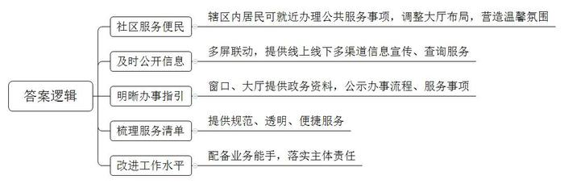
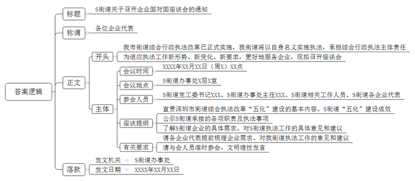

# 2022年深圳市公务员考试《申论》题（二卷）

<!-- gwy:overview:start -->
> **深圳 · 2022 · 申论 · 二卷** ｜ 3 题 · 图片 3 处 · 答案随题折叠

导航：[题目](#题目) · [材料 1](#材料-1)
<!-- gwy:overview:end -->

> 候选采集稿。参考答案及解析来自粉笔页面，不代表官方答案或真实高分答卷；来源使用许可与原卷对应关系仍需人工核实。

## 给定材料

### 材料 1

近年来，Z街道积极推进政务服务标准化、规范化建设，为企业和群众提供更优质的服务，具体做法包括以下五个方面：

一、辖区居民不分户籍地和居住地，均可就近到任一社区服务大厅办理民政、人社、卫生等各类公共服务事项；调整各社区服务大厅布局，增设导询台、等候休息区和志愿服务站，营造温馨便民氛围。

二、以科技为手段，实现电脑屏、手机屏、宣传屏、政务服务自助终端屏联动，确保政务信息公开及时；将网站和微信公众号打造为政务公开主阵地，通过电子宣传屏滚动播放民生信息，并在社区内设置政务服务自助终端，提供50多项服务查询。

三、在各社区窗口设置资料架，在服务大厅内悬挂办事流程、服务事项，提供政府公报、办事指南、便民服务手册等政务资料，为办事企业和群众提供清晰的指引。

四、统一梳理61项街道级和43项社区级便民服务事项目录清单，进一步提升便民服务标准化水平，切实为企业和群众就近办事提供规范、透明、便捷服务，有效实现“小事不出社区、大事不出街道”。

五、社区服务大厅配备业务精通的工作人员，负责定期更新各类政务资料，并提供办事咨询答复服务；严格落实首问负责制、限时办结制、一次性告知及服务承诺制，不断改进和提升社区政务服务水平。

### 材料 2

2021年9月1日，深圳市街道综合行政执法改革正式实施，街道将以自身名义实施执法，承担综合行政执法主体责任。街道综合执法改革以“五化”建设为重点纵深递进：一是职责法定化，提升责任意识；二是队伍正规化，提升整体素质；三是执法规范化，提升执法水平；四是手段智能化，提升执法效能；五是参与社会化，提升社会认同。

深圳市S街道坚持以党建促队建、以制度促规范、以科技提效率、以联合促联动，“五化”建设取得积极成效，执法队的整体面貌和综合素质得到明显提升。

目前，街道承接的18类职责，475项执法事项已经明确。执法范围扩大后，为适应执法工作新形势、新变化、新要求，更好地服务企业，该街道计划近期召开企业面对面座谈会，作为党史学习教育“我为群众办实事”实践活动的内容。

### 材料 3

2020年3月29日至4月1日，习近平总书记在浙江考察时指出，推进国家治理体系和治理能力现代化，必须抓好城市治理体系和治理能力现代化。2020年10月14日，习近平总书记在深圳经济特区建立40周年庆祝大会上的重要讲话指出，要强化依法治理，善于运用法治思维和法治方式解决城市治理顽症难题，让法治成为社会共识和基本准则。要注重在科学化、精细化、智能化上下功夫，发挥深圳信息产业发展优势，推动城市管理手段、管理模式、管理理念创新，让城市运转更聪明、更智慧。

党的十九届六中全会审议通过的《中共中央关于党的百年奋斗重大成就和历史经验的决议》，明确全面深化改革总目标是完善和发展中国特色社会主义制度，推进国家治理体系和治理能力现代化。

《广东省国民经济和社会发展第十四个五年规划和2035年远景目标纲要》提出，支持广州、深圳、珠海等有条件的城市构建数字孪生城市，实现实体城市向数字空间的全息投影，增强城市治理灵敏感知、快速分析、迅捷处置能力，打造全国领先的新型智慧城市标杆。

深圳第七次党代会报告提出，未来五年，深圳城市治理体系和治理能力现代化基本实现，城市治理的法治化、科学化、精细化、智能化水平大幅提升，稳定公平透明、可预期的国际一流法治化营商环境基本形成，城市更宜居、更韧性、更智能，努力成为超大型城市现代化治理的典范。

## 题目

### 第 1 题

**根据材料7，请提炼出Z街道在推进政务服务标准化、规范化建设方面的5条举措。（20分）**

关联材料：材料 1

作答要求：

（1）简明扼要，条理清晰；

（2）总字数150字以内。

第 1 题 · 答案与解析

**参考答案（粉笔题库参考内容）**

1.社区服务便民。辖区内居民可就近办理公共服务事项，调整大厅布局，营造温馨氛围。

2.及时公开信息。多屏联动，提供线上线下多渠道信息宣传、查询服务。

3.明晰办事指引。窗口、大厅提供政务资料，公示办事流程、服务事项。

4.梳理服务清单。提供规范、透明、便捷服务。

5.改进工作水平。配备业务能手，落实主体责任。

**解析**

**参考答案说明**：本参考答案从“社区服务便民”“及时公开信息”“明晰办事指引”“梳理服务清单”“改进工作水平”五个方面展开，各条答案要点之间在内容上相互并列，没有交叉。

**考点**：概括措施类

**来源**：2022年深圳市公务员考试《申论》题（二卷）

粉笔申论页面对本题只提供「解析视频」入口，该入口是会员推广位，页面无视频地址与文字解析。

### 第 2 题

**阅读材料13，该座谈会即将召开，需要通知相关企业参会，请代拟一份会议通知。（30分）**

关联材料：材料 2

作答要求：

（1）格式正确，要素完整；

（2）须详列座谈提纲；

（3）如出现人名，一律以“XXX”代替；

（4）总字数500字以内。

第 2 题 · 答案与解析

**参考答案（粉笔题库参考内容）**

S街道关于召开企业面对面座谈会的通知

各位企业代表：

我市街道综合行政执法改革已正式实施，我街道将以自身名义实施执法，承担综合行政执法主体责任。为适应执法工作新形势、新变化、新要求，更好地服务企业，现拟召开座谈会。有关事项如下：

一、会议时间：XXXX年XX月XX日（周X）XX点

二、会议地点：S街道办事处X层X室

三、参会人员：S街道党工委书记XXX、S街道办事处主任XXX、S街道相关工作人员、S街道各企业代表

四、座谈提纲：1.宣贯深圳市街道综合执法改革“五化”建设的基本内容、S街道“五化”建设成效。2.公示S街道承接的各项职责及执法事项。3.了解S街道企业的具体需求、对S街道执法工作的具体意见和建议。

五、有关要求：1.请各企业代表提前梳理企业需求、对我街道执法工作的意见和建议。2.请与会人员准时参会，文明理性发言。

S街道办事处

XXXX年XX月XX日

**解析**

**参考答案说明：**（1）格式方面，本参考答案写到了“标题”“称谓”“正文”“落款”四个部分。（2）正文部分，一方面从内容上来看，围绕“S街道企业面对面座谈会”这一主题，本参考答案的开头先写到了“座谈会召开的背景、目的”；主体部分从“会议时间”“会议地点”“参会人员”“座谈提纲”“有关要求”这五个方面介绍了座谈会的具体事项。另一方面，形式上，本参考答案做到了分段、分条撰写，同时，为了体现公文题的逻辑性，还加上了“有关事项如下”等词承接上下文，整体上条理较为清晰。

**考点**：其他类

**来源**：2022年深圳市公务员考试《申论》题（二卷）

粉笔申论页面对本题只提供「解析视频」入口，该入口是会员推广位，页面无视频地址与文字解析。

### 第 3 题

**围绕“新时代超大城市治理”为主题，某知名研究机构计划在深圳举办高端论坛，将邀请深圳市政府相关领导做主题演讲。请结合给定材料，起草一份演讲稿。（50分）**

关联材料：材料 3

作答要求：

（1）主题明确，内容丰富；

（2）条理清晰，感染力强；

（3）总字数1200字左右。

第 3 题 · 答案与解析

**参考答案（粉笔题库参考内容）**

**“四化”齐进 推动超大型城市治理**

各位与会人员：

大家好！习总书记曾强调，要抓好城市治理体系和治理能力现代化。近年来，我市牢记嘱托，始终以党建引领为抓手，注重在法治化、智能化、精细化、科学化上下功夫，积极打造超大型城市现代化治理新范例。在治理过程中，我市形成了自己的路径，具体经验如下：

**首先，我市始终坚持党建引领。**在特区事业建设和城市国际化、现代化发展中，我市继承和发扬党的优良传统，抓好党的自身建设，打造彰显党的先进性和纯洁性的精彩样板；与此同时，坚持结合实际，不断根据新情况进行开拓创新，保持与时俱进，提高党建质量；此外，面对治理新难题，坚持发挥基层党员干部队伍“敢啃硬骨头，敢于涉险滩”的先锋模范作用，为城市治理提供组织保障。

**其次，我市不断加强法治化建设。**在特区建立初期，我市积极通过国家制定多项特区法规，在取得立法权后，短期内便实现了让重要事项都有法可依；同时，我市一直坚持依法治市，落实严格执法，打造法治城市建设标杆；建设先行示范区以来，我市在法治上更是不断创新，出台了一系列首创性法律法规，大力推进新产业新业态新商业模式立法，在全国法治改革中发挥了示范、引领作用。

**再次，我市加速实施智慧化治理。**为实现业务高效、快捷办理，我市打造了统一的政务服务平台“i深圳”，整合多项服务数据，借助互联网技术提高服务水平；我市还加快推进智慧城市建设，率先实现5G独立组网全覆盖，通过先进的网络设施，为智能化管理提供硬件支撑。此外，充分释放“数据”能量，不断推进智能技术的应用，提升城市的全面感知和指挥调度能力，让政府决策更智慧。

**然后，我市深入推进精细化治理。**一方面深入基层，依托社区网格化体系，采取警力下沉、警务前移、警民参与等多种治理方式，加强源头治理和风险防范；另一方面，面向群众和企业，积极推进政务服务标准化、规范化建设，为其提供更加优质的服务；同时，在面对重大风险时，尤其是疫情防控之际，采取“物防+人防”的举措，不仅落实了各主体的责任，也实现了分级分类精准管控。

**最后，我市扎实开展科学化治理。**我市坚持应用新技术、新材料，发展绿色、低碳产业，优化产业布局，推动高质量发展；同时，坚持人才引领发展战略，升级人才政策，形成人才集聚效应，为发展提供强劲动力；我市还深化综合改革，坚持分类施策，实施城中村环境整治和改造计划；在城市规划、建设和运作上顺应城市肌理，不断调整城市布局和功能分区，使城市治理向“科学治理”转变。

未来，我市仍会充分发挥优势，补足短板，努力走出一条符合超大型城市特点和规律的治理新路子！谢谢大家！

**解析**

**文章分析**

**“四化”齐进 推动超大型城市治理**

【**标题的优点：**标题中含有主题词，使公文主题更突出、清晰。】

各位与会人员：

【**称谓的优点：**演讲稿的称谓定位准确、格式正确。称谓是指发文对象，由“某知名研究机构计划在深圳举办高端论坛”可知，此次演讲面向参与论坛的各位来宾，因此称谓可写为“各位与会人员”】

（1）大家好！（2）习总书记曾强调，要抓好城市治理体系和治理能力现代化。近年来，我市牢记嘱托，始终以党建引领为抓手，注重在法治化、智能化、精细化、科学化上下功夫，积极打造超大型城市现代化治理新范例。在治理过程中，我市形成了自己的路径，具体经验如下：

【**开头的优点：**★内容方面。范文的开头是紧扣题目给定的“新时代超大城市治理”这一主题展开的。首先，遵守会场礼仪，礼貌问候来宾；其次，通过习总书记的讲话引出主题，阐释深圳超大城市治理的背景。★文字表达方面。长短句配合使用，使语言表达有节奏感。】

**首先，我市始终坚持党建引领**。（1）在特区事业建设和城市国际化、现代化发展中，我市继承和发扬党的优良传统，抓好党的自身建设，打造彰显党的先进性和纯洁性的精彩样板；（2）与此同时，坚持结合实际，不断根据新情况进行开拓创新，保持与时俱进，提高党建质量；（3）此外，面对治理新难题，坚持发挥基层党员干部队伍“敢啃硬骨头，敢于涉险滩”的先锋模范作用，为城市治理提供组织保障。

【**主体部分1的优点：**★核心句：范文的核心句是紧扣“新时代超大城市治理”这一公文主题提出的。形式上，它在段首处直接写出，位置突出，容易发现。内容上，要点明确，可以明显看出是从“党建引领”角度，论述新时代超大城市治理。★具体展开：（1）先指出抓好党的自身建设，保持先进性和纯洁性；（2）再指出提高党建质量，保持创新性；（3）最后阐述了要发挥党员干部的先锋模范作用，为城市治理提供组织保障。注意：以上三个方面的内容都是紧扣“我市始终坚持党建引领”这个核心句进行分析论述的，具体展开的针对性强，内容层次丰富。在具体展开方法上主要采用了讲道理的方式，论述清晰透彻。】

**其次，我市不断加强法治化建设**。（1）在特区建立初期，我市积极通过国家制定多项特区法规，在取得立法权后，短期内便实现了让重要事项都有法可依；（2）同时，我市一直坚持依法治市，落实严格执法，打造法治城市建设标杆；（3）建设先行示范区以来，我市在法治上更是不断创新，出台了一系列首创性法律法规，大力推进新产业新业态新商业模式立法，在全国法治改革中发挥了示范、引领作用。

【**主体部分2的优点：**★核心句：范文的核心句是紧扣“新时代超大城市治理”这一公文主题提出的。形式上，它在段首处直接写出，位置突出，容易发现。内容上，要点明确，可以明显看出是从“法治化建设”角度，论述新时代超大城市治理。★具体展开：（1）先指出特区建立初期实现有法可依；（2）再指出特区一直坚持依法治市；（3）最后阐述了建设先行示范区以来，创新法律法规。注意：以上三个方面的内容都是紧扣“我市不断加强法治化建设”这个核心句进行分析论述的，具体展开的针对性强，内容层次丰富。在具体展开方法上主要采用了讲道理的方式，论述清晰透彻。】

**再次，我市加速实施智慧化治理**。（1）为实现业务高效、快捷办理，我市打造了统一的政务服务平台“i深圳”，整合多项服务数据，借助互联网技术提高服务水平；（2）我市还加快推进智慧城市建设，率先实现5G独立组网全覆盖，通过先进的网络设施，为智能化管理提供硬件支撑。（3）此外，充分释放“数据”能量，不断推进智能技术的应用，提升城市的全面感知和指挥调度能力，让政府决策更智慧。

【**主体部分3的优点：**★核心句：范文的核心句是紧扣“新时代超大城市治理”这一公文主题提出的。形式上，它在段首处直接写出，位置突出，容易发现。内容上，要点明确，可以明显看出是从“智慧化治理”角度，论述新时代超大城市治理。★具体展开：（1）先指出打造统一的政务服务平台；（2）再指出实现5G独立组网全覆盖；（3）最后阐述了推进智能技术的应用，让政府决策更智慧。注意：以上三个方面的内容都是紧扣“我市加速实施智慧化治理”这个核心句进行分析论述的，具体展开的针对性强，内容层次丰富。在具体展开方法上主要采用了讲道理和举例子相结合的方式，做到了丰富多样。】

**然后，我市深入推进精细化治理**。（1）一方面深入基层，依托社区网格化体系，采取警力下沉、警务前移、警民参与等多种治理方式，加强源头治理和风险防范；（2）另一方面，面向群众和企业，积极推进政务服务标准化、规范化建设，为其提供更加优质的服务；（3）同时，在面对重大风险时，尤其是疫情防控之际，采取“物防+人防”的举措，不仅落实了各主体的责任，也实现了分级分类精准管控。

【**主体部分4的优点：**★核心句：范文的核心句是紧扣“新时代超大城市治理”这一公文主题提出的。形式上，它在段首处直接写出，位置突出，容易发现。内容上，要点明确，可以明显看出是从“精细化治理”角度，论述新时代超大城市治理。★具体展开：（1）先指出依托社区网格化体系，加强源头治理和风险防范；（2）再指出积极推进政务服务标准化、规范化建设；（3）最后指出采取“物防+人防”的举措。注意：以上三个方面的内容都是紧扣“我市深入推进精细化治理”这个核心句进行分析论述的，具体展开的针对性强，内容层次丰富。在具体展开方法上主要采用了讲道理的方式，论述清晰透彻。】

**最后，我市扎实开展科学化治理**。（1）我市坚持应用新技术、新材料，发展绿色、低碳产业，优化产业布局，推动高质量发展；（2）同时，坚持人才引领发展战略，升级人才政策，形成人才集聚效应，为发展提供强劲动力；（3）我市还深化综合改革，坚持分类施策，实施城中村环境整治和改造计划；（4）在城市规划、建设和运作上顺应城市肌理，不断调整城市布局和功能分区，使城市治理向“科学治理”转变。

【**主体部分5的优点：**★核心句：范文的核心句是紧扣“新时代超大城市治理”这一公文主题提出的。形式上，它在段首处直接写出，位置突出，容易发现。内容上，要点明确，可以明显看出是从“科学化治理”角度，论述新时代超大城市治理。★具体展开：（1）先指出发展绿色低碳产业，推动高质量发展；（2）再指出坚持人才引领发展战略，为发展提供强劲动力；（3）然后指出深化综合改革，进行城中村改造；（4）最后指出城市治理要顺应城市肌理。注意：以上四个方面的内容都是紧扣“我市扎实开展科学化治理”这个核心句进行分析论述的，具体展开的针对性强，内容层次丰富。在具体展开方法上主要采用了讲道理的方式，论述清晰透彻。】

未来，我市仍会充分发挥优势，补足短板，努力走出一条符合超大型城市特点和规律的治理新路子！谢谢大家！

【**结尾的优点：**范文的结尾回扣了“新时代超大城市治理”这个主题，并且进行了总结展望。】

**考点**：宣传类

**来源**：2022年深圳市公务员考试《申论》题（二卷）

粉笔申论页面对本题只提供「解析视频」入口，该入口是会员推广位，页面无视频地址与文字解析。

