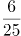
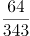
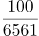
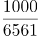
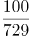
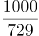
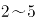
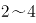

# 2022年深圳市考公务员录用考试《行测》试题（网友回忆版）

> 候选采集稿。参考答案及解析来自粉笔页面，不代表官方答案或真实高分答卷；来源使用许可与原卷对应关系仍需人工核实。

## 题型与作答说明

常识判断

（25题）

每题的备选答案中，只有一个最符合题意。

判断推理

（20题）

本部分包括图形推理、事件排序、演绎推理三种类型的试题，在四个选项中选出一个最恰当的答案。

数量关系

（15题）

在这部分试题中，每道题呈现一段表述数字关系的文字，要求你迅速、准确地计算出答案。

言语理解与表达

（25题）

本部分包括表达与理解两方面的内容。请根据题目要求，在四个选项中选出一个最恰当的答案。

资料分析

（15题）

所给出的图、表、文字或综合性资料均有若干个问题要你回答。你应根据资料提供的信息进行分析、比较、计算和判断处理。

## 给定材料

### 材料 dom-material-9fafc1ac6e6a6413

H市统计公报显示，2019年末全市各级各类学校总数达2642所，比上年增加91所；毕业生51.49万人，招生63.97万人，在校学生232.24万人，分别增长2.9%、0.5%和5.1%。年末全市有幼儿园1836所，增加65所；在园幼儿54.50万人，增长4.0%；有小学340所，减少4所；在校学生106.90万人，增长4.0%。普通中学417所，增加27所；在校学生47.74万人，增长6.6%。普通高等学校13所，与上年持平，在校学生数增长9.0%。全年全市普通高等学校本专科招生3.00万人，在校生9.22万人，毕业生2.13万人；普通高等学校研究生教育招生0.81万人，在校生2.10万人，毕业生0.47万人。

2019年末，全市各类专业技术人员183.50万人，比上年增长10.1%，其中具有中级及以上技术职称的专业技术人员54.69万人，增长7.4%。年末全市各级创新载体2258个，其中，国家级重点实验室、工程实验室和技术中心等创新载体116个，部级创新载体604个，市级创新载体1537个。全年专利申请量与授权量分别为26.15万件和16.66万件，分别增长14.4%和18.8%。其中，发明专利申请量与授权量分别为8.29万件和2.61万件，分别增长18.4%和22.3%；PCT国际专利申请量1.75万件，减少3.4%。

### 材料 dom-material-175d10575f7bc878

### 材料 dom-material-784fbf17513941c0

## 题目

### 第 1 题

2021年是中国共产党百年华诞，回首百年前，1921年7月23日，中国共产党第一次全国代表大会开幕，关于中共一大，下列说法不正确的是：

A. 召开地点为上海、嘉兴

B. 通过了党的第一个纲领

C. 成立中央局，并选举陈独秀任书记

D. 与会代表13人，包括陈独秀、李大钊、毛泽东

### 第 2 题

习近平在党的十九大报告中指出，坚持反腐败无禁区、全覆盖、零容忍、坚定不移“打虎”、“拍蝇”、“猎狐”，其中“猎狐”是指：

A. 惩治关键岗位腐败行为

B. 辨别并清除“两面人”

C. 国际追逃追赃

D. 严查小官巨腐

### 第 3 题

贸易战虽然会产生一定的负面影响，但我国经济韧性好，潜力足，回旋空间大，可以把压力转化为倒逼转型升级的动力，关键是要保持战略定力，贯彻新发展理念。这主要体现的马克思主义原理是：

A. 内因和外因的辩证关系原理

B. 量变和质变的辩证关系原理

C. 事物的普遍联系原理

D. 矛盾的普遍性和特殊性的辩证原理

### 第 4 题

我国人大代表选举制度的基本原则不包括：

A. 普遍性原则

B. 平等性原则

C. 秘密投票原则

D. 间接选举原则

### 第 5 题

完善社会主义市场经济体制，既要更加尊重市场经济一般规律，充分发挥市场在资源配置中的作用，又要更好发挥政府作用，有效弥补市场失灵，下列事例属于市场失灵的是：

A. 采摘季节遇上台风，导致荔枝减产，价格高企

B. 航空公司在出行淡季推出打折机票

C. 某印刷厂趁雨夜向河道输送污水

D. 某市增加小汽车增量指标后，车牌竞拍价格环比大幅下降

### 第 6 题

行政主体是指依法享有行政职权，能以自己的名义行使国家行政职权，并能独立承担因此产生法律责任的组织，下列不属于行政主体的是：

A. 深圳市福田区信访局

B. 深圳市福田区建筑工务署

C. 深圳市福田区福田街道办事处

D. 深圳市公安局福田分局福田派出所

### 第 7 题

根据《民法典》，下列婚姻不属于无效婚姻的是：

A. 小陈和小宋的婚姻，二人共于1999年出生，于2019年结婚

B. 25岁的小刘和45岁的老赵的婚姻

C. 阿红和堂哥阿雷的婚姻

D. 王二和已与妻子李四分居多年的张三的婚姻

### 第 8 题

习近平在深圳经济特区建立40周年庆祝大会上发表重要讲话，强调要弘扬以爱国主义为核心的民族精神和以改革创新为核心的时代精神，继续发扬（ ）的特区精神，激励干部群众勇当新时代的“拓荒牛”。

A. 只争朝夕、奋发有为、务实高效

B. 海纳百川、追求卓越、大气谦和

C. 不畏艰险、开拓创新、自立自强

D. 敢闯敢试、敢为人先、埋头苦干

### 第 9 题

关于深圳经济特区的发展历程，下列说法错误的是（ ）。

A. 深圳经济特区成立时，地域涵盖今福田、罗湖、南山、盐田4个行政区

B. 深圳经济特区建立20周年时，经中央批准，特区范围扩大到全市

C. 深汕特别合作区位于汕尾市，是全国首个特别合作区

D. 深圳前海蛇口自贸区于2015年挂牌成立，被称为“特区中的特区”

### 第 10 题

党员林某出国学习研究超过5年仍未返回，保留其组织关系的党组织一般应予以：

A. 停止党籍

B. 党内除名

C. 开除党籍

D. 严重警告

### 第 11 题

电影《长津湖》以抗美援朝战争第二次战役中的长津湖战役为背景，生动诠释了伟大的抗美援朝精神，赢得广泛好评。关于中国人民志愿军抗美援朝出国作战，下列说法错误的是：

A. 是新中国成立后第一次出国作战

B. 其本质是以正义之师行正义之举

C. 上甘岭战役也发生于抗美援朝期间

D. 2021年是中国人民志愿军抗美援朝出国作战70周年

### 第 12 题

党的十九届六中全会指出，社会主义革命和建设时期，党面临的主要任务是，实现从新民主主义到社会主义的转变，进行社会主义革命，推进社会主义建设，为实现中华民族伟大复兴：

A. 创造根本社会条件

B. 奠定根本政治前提和制度基础

C. 提供充满新的活力的体制保证

D. 提供快速发展的物质条件

### 第 13 题

习近平指出：“人民对美好生活的向往，就是我们的奋斗目标。”公共预算作为重要的财政管理活动，是实现这一目标的手段之一。关于公共预算，下列说法正确的是：

A. 公共预算实行总额控制，即公共预算一旦确定，政府支出就不能再行增加

B. 公共预算具有计划、管理、控制三大基本功能

C. 公共预算要确保资金运作效率，即在既定时间内，迅速完成可支配资金的支出

D. 财政问责是公共预算管理的重要手段，而非最终目标

### 第 14 题

以下公文处理做法正确的是：

A. 任职于内蒙古自治区的小刘，并用汉字和蒙古文字草拟公文

B. 任职于某区委的小高向市委报送请示，同时抄送请示事项相关的街道办

C. 因时间紧急，虽然涉及其他部门职权范围内的事务未协商一致，小李仍向下级单位印发了通知

D. 小何在向上级机关报送报告时，在报告中就相关事项请示上级机关

### 第 15 题

做好二氧化碳的资源化利用是构建低碳社会的一个重要方面，关于二氧化碳的性质和应用，下列说法错误的是：

A. 二氧化碳可控制亲氧微生物的生存和繁殖，用于果蔬保鲜

B. 二氧化碳凝华吸热且不可燃，可用作干冰灭火剂

C. 二氧化碳可与氨合成尿素，用于农业化肥

D. 液态二氧化碳对污垢有溶解作用，可用作干洗溶剂

### 第 16 题

以下为现代诗选段：

我知晓，旷野上我尚属大地的一条细流

是当隔的一片“黄竹酒”诞生了我汨汨生命

我自牛尾岭、虎跃头，穿越沙湾臂，莲峰屿，汇上水河，后溯溪流

逶迤百里西出春江米堵，再入后海湾、内伶仃

当你翻阅历史的时候，便掀开了我的奔流履历

该段诗歌描写的河流最可能是：

A. 龙岗河

B. 坪山河

C. 深圳河

D. 盐田河

### 第 17 题

2021年2月20日，习近平在党史学习教育大会上指出，这次党史学习教育要同解决实际问题结合起来，开展好“（ ）”实践活动。

A. 我为群众办实事

B. 我为群众解难题

C. 初心使命大家谈

D. 为民务实清廉

### 第 18 题

“衙斋卧听萧萧竹，疑是民间疾苦声；些小吾曹州县吏，一枝一叶总关情。”习近平在讲话和文章中多次引用这首诗，以此说明群众利益无小事、民生问题大于天。这首诗的作者是：

A. 范仲淹

B. 龚自珍

C. 郑板桥

D. 王安石

### 第 19 题

经济学上，根据是否具有竞争性和排他性，可将物品分为四类，私人物品、公有资源、自然垄断物和公共物品，根据该分类方法，以下说法正确的是：

A. 冰淇淋属于私人物品

B. 海洋中的鱼类属于自然垄断物

C. 国防属于公有资源

D. 拥挤的不收费道路属于公共物品

### 第 20 题

2021年深圳市人民政府工作报告指出，未来五年，我们要强化“双城联动，比翼双飞”，促进珠江口东西两岸融合互动，携手打造国际一流湾区和世界级城市群。这里的“双城”是指深圳和：

A. 香港

B. 广州

C. 珠海

D. 东莞

### 第 21 题

习近平强调，“青年兴则国家兴，青年强则国家强。青年一代（ ），国家就有前途，民族就有希望。”

A. 有信念、有本事、有品德

B. 有灵魂、有本领、有作为

C. 有理想、有本领、有担当

D. 有信仰、有作为、有奉献

### 第 22 题

2021年5月11日，第七次全国人口普查结果公布，全国人口约为（ ）亿人。

A. 13.9

B. 14.1

C. 14.3

D. 14.7

### 第 23 题

在中国共产党的历史上，以“决议”命名的文件很少。党的十九届六中全会审议通过了党的第三个历史决议，同党的两个历史决议既一脉相承又与时俱进。下列不属于党的三个历史决议的是：

A. 《关于目前政治形势与党的任务的决议》

B. 《关于建国以来党的若干历史问题的决议》

C. 《关于若干历史问题的决议》

D. 《关于党的百年奋斗重大成就和历史经验的决议》

### 第 24 题

为隆重表彰在抗击新冠肺炎疫情斗争中作出杰出贡献的功勋模范人物，弘扬他们忠诚、担当、奉献的崇高品质，根据全国人大常委会的决定，授予钟南山“共和国勋章”，授予张伯礼、张定宇、陈薇“人民英雄”国家荣誉称号。该事项应采用的公文文种是：

A. 通报

B. 命令（令）

C. 公告

D. 通知

### 第 25 题

下列关于公务员任职与交流的说法错误的是：

A. 小李与其配偶都是公务员，他们不得在同一机关双方直接隶属于同一领导人员的职位工作

B. 公务员小张的配偶经营了一家诊所，小张不得在主管该诊所的卫生行政部门拟任领导成员

C. 公务员小彭可以在公务员队伍内部交流，但不得与国有企业中的人员交流

D. 公务员小宋到其他单位挂职，挂职期间，其与原机关的人事关系不改变

### 第 26 题

①选取洋葱外表皮

②吸水纸反复引滤

③滴加蔗糖溶液

④制成临时装片

⑤发生质壁分离

A. ①-④-③-②-⑤

B. ①-③-④-②-⑤

C. ③-①-④-②-⑤

D. ⑤-②-③-④-①

### 第 27 题

①船只倾斜搁浅

②货轮体量空前

③航道双向堵塞

④紧急脱浅救援

⑤国际贸易受阻

A. ②-①-③-⑤-④

B. ③-②-①-⑤-④

C. ①-④-②-③-⑤

D. ③-①-②-④-⑤

### 第 28 题

（1）百花齐放，百家争鸣

（2）星星之火，可以燎原

（3）惩前毖后，治病救人

（4）打扫干净屋子再请客

（5）枪杆子里出政权

A. 5-2-3-4-1

B. 2-5-4-3-1

C. 2-5-4-1-3

D. 5-2-4-1-3

### 第 29 题

（1）就读职校技能突出

（2）昼夜苦练专业技能

（3）展现大国工匠风采

（4）取得世界大赛资格

（5）入选国家集训队伍

A. 2-1-3-5-4

B. 2-1-5-3-4

C. 1-5-2-4-3

D. 1-5-4-2-3

### 第 30 题

（1）听信诱导，投入巨资

（2）血本无归，债台高筑

（3）扫码入群，牛刀小试

（4）获得收益，心中窃喜

（5）网上冲浪，惊现商机

A. 5-4-3-1-2

B. 5-3-4-1-2

C. 3-1-2-5-4

D. 3-4-5-1-2

### 第 31 题

从所给的四个选项中，选择最合适的一个填入问号处，使之呈现一定的规律性：

A. A

B. B

C. C

D. D

### 第 32 题

从所给的四个选项中，选择最合适的一个填入问号处，使之呈现一定的规律性：

A. A

B. B

C. C

D. D

### 第 33 题

从所给的四个选项中，选择最合适的一个填入问号处，使之呈现一定的规律性：

A. A

B. B

C. C

D. D

### 第 34 题

从所给的四个选项中，选择最合适的一个填入问号处，使之呈现一定的规律性：

A. A

B. B

C. C

D. D

### 第 35 题

请从所给的四个选项中，选出最恰当的一项填入问号处，使之呈现一定的规律性。

A. A

B. B

C. C

D. D

### 第 36 题

一组人参加游戏，要求第一个人任意报数，接下来每个人都根据前一个人的报数按照既定规则继续报数。第一个人报：“1，1”；第二个人报：“2，1”；第三个人报：“1，1，1，2”；第四个人报：“1，2，3，1”；第五个人报：“1，2，1，3，2，1”；第六个人报：“1，3，2，2，3，1”。

则第七个人应报（ ）。

A. 1，2，2，3，2，1

B. 2，1，2，2，2，3

C. 3，2，2，2，1，1

D. 1，2，1，3，3，1

### 第 37 题

某赛事的参赛者信息如下：

（1）3人是围棋选手；

（2）4人来自广东；

（3）2人来自深圳；

（4）5人是女生；

（5）来自深圳的参赛者都是男生。

若以上信息涉及了所有参赛者，则该赛事的参赛者（ ）。

A. 最多14人，最少8人

B. 最多14人，最少7人

C. 最多12人，最少7人

D. 最多12人，最少8人

### 第 38 题

三孩政策引发民众热议。有人认为，三孩政策将加剧性别不公，影响女性的职业发展，加重家庭经济负担，因此夫妻应当合休产假，男女共担育儿义务，这一建议如果被采纳实施，将有效降低生育对女性职业发展的负面影响，提高女性生育意愿，推动三孩政策落实。

以下选项如果为真，最能支持上述结论的是：

A. 某集团的人力资源负责人表示，考虑到产假因素，业内招聘普遍倾向于录用男性

B. 已有国家正在实行类似的夫妻合休全薪产假政策，受到该国国民的大力支持

C. 夫妻合休产假可以优化家庭教育结构，有利于儿童身心健康成长

D. 调查显示，不考虑生育三孩的女性中，大多数对生育三孩将影响其职业发展有较大顾虑

### 第 39 题

与老一辈相比，年轻一代的青春痘问题更为严重。有人认为，老一辈的生活条件艰苦，饮食清淡，而当代年轻人喜爱吃油炸食品和蛋糕、巧克力等甜食。因此，油炸食品和甜食是导致年轻一代青春痘问题更为严重的原因。

以下选项如果为真，最能质疑上述观点的是：

A. 青春痘是皮脂腺油脂分泌过多进而堵塞的结果

B. 油炸食品和甜食易使人堆积脂肪的部位是腰腹部，而非面部

C. 即使饮食清淡，少油少糖，也有可能长青春痘

D. 情绪压力也易引发青春痘，当代年轻人压力高于历代

### 第 40 题

一对热恋期情侣之间的对话如下：

女生问：“我是不是世界上最漂亮的女生？”

男生答：“这个问题我回答不了，我得看完世界上所有女生后才能回答！”

要使以上对话中男生的论证基本成立，最需要假设的前提是（ ）。

A. 男生用情专一，不会见异思迁

B. 世界上所有女生在“漂亮”上是可以比较的

C. “漂亮”是一种客观属性且有评判标准

D. 男生可以在有生之年看完世界上所有女生

### 第 41 题

在中国生产智能手机的成本比美国低50%。即使算上运输费用和关税，从中国进口智能手机到美国，仍比在美国生产智能手机便宜。

如果以上论述为真，最能支持该论断的是（ ）。

A. 中国的劳动力成本比美国低50%

B. 从中国进口智能手机到美国，将减少美国智能手机制造业50%的就业机会

C. 从中国进口智能手机到美国的运输费用和关税少于在美国生产智能手机的成本的50%

D. 为获得更大收益，美国智能手机企业将生产线转移至中国

### 第 42 题

上级视察小康村，了解到以下实情：如果宅基地没有管理良好，那么村民活动中心不会建成；除非乡村道路铺设完成，否则生态旅游产业无法发展；村民活动中心建成或者乡村道路没有铺设完成。

由此可推知：

A. 宅基地没有建设良好且生态旅游无法发展

B. 宅基地管理良好且乡村道路铺设完成

C. 宅基地没有管理良好或者生态旅游产业发展

D. 宅基地管理良好或者生态旅游产业无法发展

### 第 43 题

某分公司组织员工前往总部参加年终晚会，所有员工要么选择乘高铁，要么选择乘飞机，经统计，乘高铁的员工多于乘飞机的员工，女员工人数多于男员工人数，则下列断定一定为真的是（ ）。

（1）乘飞机的女员工多于乘飞机的男员工

（2）乘高铁的男员工多于乘飞机的男员工

（3）乘高铁的女员工多于乘飞机的男员工

A. （1）（2）

B. 只有（3）

C. （2）（3）

D. 一个都没有

### 第 44 题

“小T小T，请帮我开灯，小T小T，我心情不好，给我讲个笑话吧。小T小T，请在月底提醒我，妈妈的生日快到了······”如今，各式各样的智能机器人层出不穷，人工智能通过语音识别和机器学习来模拟人的行为，给人们提供工作和生活上的便利。多位专家预测，面向家庭日常使用的人工智能机器人，将超过服务于传统制造业和物流业的机器人，成为下一个爆发式增长的市场。

以下选项如果为真，最能质疑专家预测的是（ ）。

A. 人工智能机器人的研发制造工序繁杂，生产周期较长，很难实现大规模量产

B. 人工智能机器人虽然层出不穷，但各品牌机器人的质量参差不齐，家庭用户评价褒贬不一

C. 面向家庭的人工智能机器人看上去高端，但与实际需求落差大，若要“更像人类”，则成本过高

D. 人工智能和社会伦理是否会产生冲突，能否大批量投入居家使用，尚待时间检验

### 第 45 题

有蓝蓝、豆豆、毛毛三个男生，他们各自有一个妹妹。已知：三个妹妹分别是花花、贝贝、妞妞；花花的哥哥是豆豆的好朋友，并且在三个男生中年纪最小；毛毛的年纪比妞妞的哥哥大。

由此可推知，三对兄妹分别是（ ）。

A. 蓝蓝和花花，豆豆和贝贝，毛毛和妞妞

B. 蓝蓝和妞妞，豆豆和花花，毛毛和贝贝

C. 蓝蓝和贝贝，豆豆和妞妞，毛毛和花花

D. 蓝蓝和花花，豆豆和妞妞，毛毛和贝贝

### 第 46 题

\-8，10，-7，12，-5，（ ）

A. 18

B. 16

C. 14

D. 11

### 第 47 题

1427，2739，4559，3248，5678，（ ）

A. 9376

B. 7469

C. 2045

D. 3718

### 第 48 题

1，2，2，5，4，11，8，（ ）

A. 18

B. 21

C. 23

D. 24

### 第 49 题

0，1，2，6，16，44，（ ）

A. 58

B. 66

C. 120

D. 132

### 第 50 题

，，，，（ ）

A. 

B. 

C. 

D. 

### 第 51 题

某学校有三队冬奥会志愿者，每队30人，已知第一队的男生数和第二队的女生数相同，第三队的男生数占全部男生数的，则女生共有（ ）名。

A. 30

B. 40

C. 45

D. 50

### 第 52 题

一批传统手工匠人需在预定时间内完成一笔糖人订单，他们捏糖人的速度都相同，有两种工期安排方案供其选择。方案一：若干名匠人先开工，经过三分之一的预定时间，将人数加倍，在预定时间刚好完成；方案二：10名匠人同时开工，在预定时间也刚好完成，则方案一前期应安排（ ）名匠人。

A. 6

B. 7

C. 8

D. 9

### 第 53 题

某商城停车场实行按时长阶梯式收费，收费规则如下：不超出某一基础时长的，按5元/小时收费。超出该基础时长的，超出的部分每小时收费增加3元；停车时长达基础时长3倍以上时，则超出基础时长3倍的部分，每小时收费再增加3元。若甲某次停车离场时超出基础时长11小时，共交费116元，则基础时长为（ ）小时。（该基础时长为整数，停车时长不满1小时的按1小时计）

A. 6

B. 5

C. 4

D. 3

### 第 54 题

实验室有甲、乙、丙3瓶盐酸溶液，浓度分别为10%、40%、60%，实验员将3瓶溶液全部倒入一瓶中，得到浓度为52%的盐酸溶液。已知乙溶液重量为甲溶液的1.5倍，则丙溶液重量为甲溶液的（ ）倍。

A. 4.5

B. 5.5

C. 6.5

D. 7.5

### 第 55 题

小王从图书馆借了一本书，书共204页，阅读时，他发现书的前半部分有连续的4个页码被墨水污染，将其余200个页码加总，其和刚好可以被85整除，则被污染的4个页码中最小的数是：

A. 100

B. 95

C. 75

D. 41

### 第 56 题

某公司举行爱心捐赠活动，经初步统计，平均每人捐款92.35元，复核时发现，因笔误将某人捐款100元误写成10元，实际平均每人捐款96.85元，则该公司共有（ ）人捐款。

A. 18

B. 20

C. 25

D. 30

### 第 57 题

小花猫和大黄狗从一周长为210米的环形花园的同一起点同时出发，沿着花园同向奔跑，已知小花猫和大黄狗的初始速度分别为20米/分，160米/分，每当大黄狗追上小花猫一次，大黄狗就减速，小花猫则提速。那么，当小花猫和大黄狗速度刚好相等时，他们共跑了（ ）米。

A. 1250

B. 940

C. 750

D. 1310

### 第 58 题

某公司共有60人参加行业考试，考试共设5道必答题，满分为100分，每题答对得20分，答错不扣分，总分60分即为及格。经统计，第1至5题分别有52人、56人、48人、42人、30人答对，则该公司至少有（ ）人及格。

A. 30

B. 36

C. 38

D. 40

### 第 59 题

小新18岁生日时，收到父母赠送的一只精美手表作为成年礼。手表每一分钟的刻度线上都装饰水晶。晚上7点29分53秒时，手表时针与分针的夹角内共有（ ）颗水晶。

A. 7

B. 8

C. 9

D. 10

### 第 60 题

假定一对初生雌雄旅鼠一个月后能够成年，再过一个月便能再生下一对雌雄旅鼠，并且继续以此速度生育，若不考虑其他因素，2021年1月末将一对初生雌雄旅鼠放在屋内，到2021年7月末屋内共有（ ）对雌雄旅鼠？

A. 8

B. 13

C. 21

D. 36

### 第 61 题

将下列选项中的词语依次填入句子横线处，最恰当的一组是：

党的十九大以来，党中央全面分析国际科技创新竞争        ，深入研判国内外发展形势，针对我国科技事业面临的突出问题和挑战，坚持把科技创新摆在国家发展全局的核心位置，全面        科技创新工作。

A. 态势 谋划

B. 大势 谋划

C. 态势 策划

D. 大势 策划

### 第 62 题

将下列选项中的词语填入句子横线处，最恰当的一组是：

这次疫情是对全球卫生治理体系的一次集中        。我们要加强和发挥联合国和世界卫生组织作用，完善全球疾病预防控制体系，更好预防和应对今后的疫情。

A. 检验

B. 考验

C. 锻炼

D. 磨炼

### 第 63 题

将下列选项中的词语依次填入句子横线处，最恰当的一组是：

个人信息保护是数字经济和社会治理的底线，个人信息保护法的一大使命就是划出行为边界，引导并        政府和市场主体，使个人信息的收集、存储、使用、加工、传输、提供、公开等            ，令侵害个人信息的行为能够得到法律惩处，为个人信息保护创造稳定可预期的常态化局面。

A. 约束 有章可循

B. 约束 有据可查

C. 制约 有章可循

D. 制约 有据可查

### 第 64 题

将下列选项中的词语依次填入句子横线处，最恰当的一组是：

身居“唐宋八大家”之列的欧阳修，        文章冠绝一时，其为政措施        颇具创新意识。        欧阳修一生仕途坎坷，为官几十年竟遭三次贬谪，但他始终宠辱不惊，晚年        是旷达潇洒。

A. 不但 还 不过 更

B. 不仅 也 尽管 也

C. 不仅 也 不过 更

D. 不但 还 尽管 也

### 第 65 题

将下列选项中的词语依次填入句子横线处，最恰当的一组是：

择业观是价值观和人生观的        ，也是社会发展变化的          ，就业观念的变化，折射出当代青年身上的朝气与锐气，也折射出时代的发展在当代青年身上留下的印记。

A. 掠影 指南针

B. 缩影 指南针

C. 掠影 风向标

D. 缩影 风向标

### 第 66 题

将下列选项中的词语依次填入句子横线处，最恰当的一组是：

在很多外地人看来，把江西人称为“老表”，似乎是一种贬义，因为“老表”这两个字很下里巴人。江西人却以有这样一个称呼而感到非常自豪，无论海角天涯，无论是否            ，相互之间只要听到“我是老表”，马上就像            的亲戚一样。

A. 萍水相逢 不期而遇

B. 素昧平生 久别重逢

C. 素昧平生 不期而遇

D. 萍水相逢 久别重逢

### 第 67 题

将下列选项中的词语依次填入句子横线处，最恰当的一组是：

他深知沦落江湖的艺人的        和痛苦，他是带着深厚的挚爱和同情来        这两个受着生活重压的小人物的。

A. 心酸 刻画

B. 心酸 描绘

C. 辛酸 刻画

D. 辛酸 描绘

### 第 68 题

将下列选项中的词语依次填入各句横线处，最恰当的一组是：

（1）如果仅凭蜻蜓点水式的观感，作出以偏概全的判断，就容易盲人摸象、            ，就难以读懂真实而鲜活的农村，甚至陷入悲观悲情的泥潭。

（2）在中华民族近代史上，贫困如影随形：多灾多难、饿殍遍地的记录            。

A. 目无全牛 俯拾皆是

B. 一叶障目 俯拾皆是

C. 目无全牛 不胜枚举

D. 一叶障目 不胜枚举

### 第 69 题

将下列选项中的词语依次填入句子横线处，最恰当的一组是：

当时，军管组动辄干预并批判他们的技术工作，技术讨论会上甚至不允许使用外文字母作符号。很多技术人员自叹如倾巢之卵，            ，即使慎重、委婉地表达看法，也仍常遭批判。但每次讨论会上，他仍坚持讲真话，明确地讲出自己对技术问题的看法，绝不            。

A. 守口如瓶 随声附和

B. 噤若寒蝉 广谋从众

C. 守口如瓶 广谋从众

D. 噤若寒蝉 随声附和

### 第 70 题

将下列选项中的词语依次填入句子横线处，最恰当的一组是：

在博物馆展厅中心，一件19世纪的婚纱头纱美得令人            。这件平铺面积达7平方米的头纱耗时数十年制作，将所有阿朗松针织花边技艺融为一体，仿佛一本花边“百科全书”。人们观赏它，是在探寻时光的        ，也是        时间打磨后的精湛技艺。

A. 心旷神怡 绚烂 品味

B. 心旷神怡 瑰丽 领会

C. 屏息凝神 瑰丽 感受

D. 屏息凝神 绚烂 研习

### 第 71 题

下列各项中，没有语病的一项是：

A. 月饼创新的落脚点，不仅是要在包装上花样翻新，而是要在口味上与时俱进。

B. 社交媒体上的“家长群”是把双刃剑，它拉近了学校和家庭的距离，降低了老师和家长沟通的成本，同时也会产生很多矛盾。

C. 家暴不是“家务事”，反家庭暴力是家庭、国家和社会的共同责任。

D. 理想的平台不是一对一的众声喧哗，也不应该成为一些人攀比、逞能、谋求私利或推卸责任的“角斗场”。

### 第 72 题

下列各项中，有语病的一项是：

A. 作家是一个敏感的群体，对他们而言，花园是一个庇护所，一个让幻想飞翔的地方。

B. 由于心理压力较大，他决定通过占卜的方式给自己信心。

C. 海阔、湖清、河畅、水净、景美，深圳的冬天着实是一个好地方。

D. 近年来，校外培训在资本助力下迅速扩张，加重了学生课业负担和家长经济负担，减损了人民群众的获得感。

### 第 73 题

下列选项中，没有语病的一项是：

A. 20世纪60年代，西班牙语美洲叙事文学领域的“文学爆炸”，使拉丁美洲文学推向了世界。

B. 傍晚，我们登上回龙山最高处，映入眼帘的是莽莽青山、灼灼晚霞和阵阵凉爽的清风。

C. 现编新教材里的很多课文，对一线经验丰富的教师是再熟悉不过了。

D. 创新不是一蹴而就的，特别是基础科学领域的创新，往往需要“板凳坐得十年冷”的耐心和定力。

### 第 74 题

下列选项中，有语病的一项是：

A. “枪声就是命令。”驻扎在附近的八路军115师老四团八连听到枪声后，立即赶来营救朱村百姓，有24名官兵牺牲在这里。

B. 珍珠苑种植专业合作社是由朱村党支部领办的，完成葡萄、香菇特色农产品的绿色认证，注册“珠村”“七岌山”商标，打造了“朱村味道”电商品牌。

C. 沂蒙山区腹地，沂河水畔，曹庄镇朱村，越来越热闹了。一拨又一拨游客来到这里，听红色故事，悟革命传统，品特色文化。

D. 这些年，朱村的变化翻天覆地：建起朱村大桥，开通滨河大道，水泥大道户户通······从偏居一隅变得四通八达。

### 第 75 题

①强盛的罗马帝国灭亡于野蛮的汪达尔人入侵，光芒四射的希腊诸城邦亡于马其顿人等等，均属游牧、半游牧文明战胜农耕文明的典型例证

②尽管受到前朝志士顽强的抵制和反抗，但当尘埃落定，河山重整，世人别无选择，只能像杜牧慨叹的那样“折戟沉沙铁未销，自将磨洗认前朝”了

③在中国，宋、明两个王朝也都是被北方经济文化落后的少数民族灭亡的。偏安王朝因没落而退出历史舞台，九服之外的族群因雄起改变正统走向

④可以说，不论西方文明史还是东方文明史，都是血与火书写的，都是征服与被征服的历史

⑤值得注意的是，野蛮部落灭掉了文明族群，虎狼之国吞并了礼仪之邦，在人类社会发展中并非个案

将以上5个句子重新排列，语序恰当的一项是：

A. ⑤①③④②

B. ⑤④①③②

C. ④⑤①③②

D. ④⑤③①②

### 第 76 题

对旅游业而言，风景固然很重要，游客口碑更关键。游客都是乘兴而来，希望赏美景、享美食、获得良好服务、留下美好回忆。游客如愿以偿，一传十，十传百，是最生动的“广告”。同时，出门在外，人生地不熟，谁都不愿遇到“欺生”，更怕权益受损、投诉遇冷、败兴而归，那岂不是花钱找罪受？“宰客”事件频发，公然忽悠蒙骗，地方处置不力，自然会令有关地区的旅游形象大打折扣，一些热门旅游地“转冷”殷鉴不远。

下列对上文的理解有误的是：

A. 旅游业管理者不仅要重视打造美景，更要重视打造口碑

B. 唯有游客尽兴而归，才能维护旅游地的游客口碑

C. 地方对“宰客”等旅游问题要处置得力才能暖人心

D. 一些热门旅游地或因“宰客”事件频发而遭遇冷落

### 第 77 题

面对新时代教育的变革与重塑，教师作为教育实践环节的直接执行者，必须以先行者的姿态投身于这场历史洪流之中，而完成这一蜕变的关键就在于，让教师重新构建起以学习科学素养为核心的知识能力体系。对于新时代高水平教师队伍建设来说，学习科学素养不仅仅是对学习科学知识技能的进一步学习与拓展，更重要的是，它从实践应用和意识形态这两个层次，对教师在一线教学中深入理解和综合应用学习科学提出了更高的要求。教师需要从真实学习的基础机制出发，结合真实学科教学的有效设计与学习的有效评价，逐步完成自身学习科学素养的学习与构建。这一综合素养的形成，不仅需要教师自身付出艰巨的努力，同时也需要外界提供强有力的支持。

下列说法与原文意思不相符的是：

A. 教师必须重新构建起以学习科学素养为核心的知识能力体系，否则将难以适应新时代教育的变革与重塑

B. 教师应该从实践应用和意识形态这两个层次，进一步学习与拓展学习科学知识技能

C. 真实学习的基础机制，真实学科教学的有效设计与学习的有效评价是教师学习科学素养建构不可或缺的要素

D. 教师依靠自身，无法形成以学习科学素养为核心的综合素养

### 第 78 题

科学技术可以改善耕地条件，进而扩大某些粮食作物种植区域，还可以提高粮食生产过程中有限资源的利用率。例如在实施塑料薄膜覆盖后，土壤一般可增温，覆盖期内地表积温增加，从而使作物适宜耕作区的纬度向北推移，海拔提高1000～2000m。该技术可应用的作物范围广，一般增产幅度可达30％～50％。农机装备技术的进步也至关重要。深松机、无人驾驶联合耕播作业机等机械设备逐渐被推广使用，很多新技术也在其中得到应用。如遥感技术可应用于农业资源调查、动态监测、生物产量估计与农业灾害预报等领域。

下列说法与原文意思相符的是：

A. 科技可使农作物的种植范围不受海拔限制

B. 提高有限资源的利用率可使粮食产量增加

C. 覆盖塑料薄膜可以使土壤增温

D. 遥感技术既能改善农业资源，又能预报农业灾害

### 第 79 题

火星在40亿年前是一个湿润、温暖，且拥有浓厚大气层的星球。其岩石圈、水和大气之间的相互作用在地表形成了河流、湖泊和地表沉积物。随着火星内部热活动的快速减弱和大气层的逐渐消失，其地表的液态水也随之消失，气候变得干冷，水动力过程对地表结构塑造的主导地位逐渐被风动力所取代。这种由温湿转变到干冷的气候变化大约持续了数亿年的时间，火星的表面逐渐演变成为一个不再宜居的环境。

下列说法与原文意思相符的是：

A. 40亿年前的火星曾有生命且环境宜居

B. 如今的火星气候干冷，液态水已不复存在

C. 火星表面曾存在与水活动相关的地貌

D. 如今不再宜居的环境已经几乎排除了火星上存在生命的可能

### 第 80 题

秦中央集权的确立，还离不开文书行政体制。文书行政，是依靠公文来传递政务信息的政务运行机制。由于文书能保证信息的一致性，不会因层层下达而走样，所以是非常有效的统治工具。秦很重视文书行政。1975年出土的睡虎地秦墓竹简，抄有大量秦律令，其中一条讲：“有事请也，必以书，毋口请，毋羁请（有事情必须请示时，一定要以文书的形式，不要口头请示，也不要让人代为请示）。”它明确要求必须用文书来处理政务。秦律还有《行书律》，专门对文书的收发、传送作严格规定。律文规定，邮传机构接到皇帝的诏书必须立即发送，如有稽留，必受惩罚。通过文书行政，秦王朝确保了中央与地方政务信息的一体化。

下列说法与原文意思相符的是：

A. 文书行政体制是秦中央集权下的特有政务运行机制

B. 在秦王朝以口头形式处理政务会受到惩罚

C. 睡虎地秦墓竹简专门记载了秦王朝的政务处理程序规定

D. 文书行政是秦王朝实现中央与地方政务信息一体化的统治工具

### 第 81 题

景观就是具有观赏价值的风景，文学景观则是指那些与文学密切相关的景观。文学景观比普通的景观多了一层文学色彩和内涵，是地理环境与文学互相作用的结果，是文学的一种地理呈现。当人们到了文学名篇诞生地时，必然会产生“江山留胜迹，我辈复登临”的渴望，哪怕这座楼是重建的，也可以满足人们欣赏文学景观，触发情感共鸣的需求，名楼的魅力除了来源于楼本身，更多是来源于文学经典，                    。

填入上文横线处的句子，最恰当的是：

A. 如果没有文学和名人加持，楼就很难成为名楼

B. 只要有文学和名人加持，楼就能成为名楼

C. 只有文学和名人的加持，才能使楼成为名楼

D. 当然，即使有了文学和名人加持，楼也未必能成为名楼

### 第 82 题

在古代，许多诗人的作品是通过个人题壁、歌女吟唱的方式传之四方。在现代，传统文化不仅可以通过图书、报刊、音像、影视等形式进行传播，还可以通过日常生活中的用具进行传播。作为文房清玩的笺纸，由于和知识分子的生活密不可分，因此扮演了传承传统文化的角色。笺纸中不仅有图画，而且有书法，有篆刻，有诗词，有掌故，通过笺纸，人们可以重温诗词歌赋的名句，可以品味传统文化的精神。比如，林纾的宋人词意笺，陈师曾的杜甫诗意笺，都在很大程度上普及了唐诗宋词。

上文表达的主要观点是：

A. 传统文化的现代传播途径以笺纸为主

B. 唐诗宋词的普及与诗词意笺密不可分

C. 诗词作品的传播形式古今有异

D. 笺纸发挥了传承传统文化的重要作用

### 第 83 题

没有安全的国家环境，人们怎么能一心脱贫攻坚并取得历史性成就？没有国家安全、社会稳定，推动创新发展、协调发展、绿色发展、开放发展、共享发展，经济社会发展怎么会有源源不断的活力和动力？没有维护国家安全的能力和信心，面对来势汹汹的新冠肺炎疫情，怎么能以众志成城之力抵挡住病毒的侵袭？国家安全、社会安定、人心安稳，不是从天上掉下来的，而是在发展实践中用行动维护而来的、捍卫而得的、奋战而赢的。

上文表达的主要观点是：

A. 创新发展、协调发展、绿色发展、开放发展、共享发展是当前经济社会发展的实践指南

B. 社会发展的活力和动力是战胜疫情、维护国家安全和社会安定的基本保障

C. 事实告诉我们，没有安全和稳定，一切都无从谈起

D. 在发展实践中，我们要用切实的行动来维护国家安全、社会安定和人心安稳

### 第 84 题

笔墨大咖，顾名思义，是指在笔墨功夫上有追求、有造就、有作为的人。文学作品、中国书画等等，所倾注的正是淋漓酣畅的笔墨意韵。一个人若是总能做到意在笔先，又何愁不能泼洒出意韵生动的笔墨图景？这样的人，成为笔墨大咖是迟早的事。

上文“这样的人”是指：

A. 能做到意在笔先的人

B. 能泼洒出意韵生动的笔墨图景的人

C. 能倾注淋漓酣畅的笔墨意韵的人

D. 在笔墨功夫上有追求、有造就、有作为的人

### 第 85 题

日前，四川博物院展出了反映古人分餐制的食具——“清河食官”铜染器，引发了人们的思考：“分餐制”是古已有之的吗？中国社会科学院考古研究所研究员给出的解释是，分餐制可上溯到史前时代。两汉时期，分餐制得到了很好的传承。当时人们没有坐具，分餐进食时，面前摆着一张低矮小食案，一人一案，案上放着食具。考古发现的汉墓壁画及画像石砖等实物和绘画资料，都可以证明这一点。五朝十六国时期，高足坐具的流行，导致传统席地而坐逐渐被更轻松的垂足坐姿取代，也进而影响分餐向会餐的转变。

根据上文，下列对中国古代分餐制理解正确的是：

A. 古人分餐进食的主要食具为铜染器

B. 分餐制在两汉时期得到了全国推广和普及

C. 考古资料证实，古人围案而坐，各有餐具，分餐进食

D. 历史上分餐制到会餐制的演变与古人坐姿变化有关

### 第 86 题

2019年末，H市各级各类学校中，学校数量同比增加最快的是（ ）。

关联材料：dom-material-9fafc1ac6e6a6413

A. 幼儿园

B. 小学

C. 普通中学

D. 普通高等学校

### 第 87 题

若全市每所幼儿园平均在园幼儿数保持2019年同比增量不变，则到（ ），幼儿园平均在园幼儿数可超过300名。

关联材料：dom-material-9fafc1ac6e6a6413

A. 2020年

B. 2021年

C. 2022年

D. 2023年

### 第 88 题

2019年末，H市普通高等学校研究生在校生数同比增长（ ）。

关联材料：dom-material-9fafc1ac6e6a6413

A. 7.6%

B. 19.3%

C. 26.1%

D. 无法判断

### 第 89 题

关于H市2019年专利申请量与授权量，下列说法不正确的是（ ）。

关联材料：dom-material-9fafc1ac6e6a6413

A. 发明专利在全年专利申请量与授权量中的占比均同比上升

B. 发明专利申请量同比增速较PCT国际专利申请量同比增速高21.8%

C. 全年专利申请量同比增量大于全年专利授权量同比增量

D. PCT国际专利申请量同比减少约0.06万件

### 第 90 题

根据上文，下列说法不正确的是（ ）。

关联材料：dom-material-9fafc1ac6e6a6413

A. 2018年末，H市小学在校学生数在各级各类学校在校学生总数中占比不足一半

B. 2018年末，H市各类专业技术人员中，具有中级及以上技术职称的人员占比不足三成

C. 2019年末，H市普通高等学校毕业生中，本专科毕业生数占比超过八成

D. 2019年末，H市部级及以上创新载体在全市各级创新载体中占比超过三成

### 第 91 题

交通潮汐现象是指早晨进城方向交通流量大，而晚上出城方向交通流量大的现象。以下关口断面交通潮汐现象最明显的是：

关联材料：dom-material-175d10575f7bc878

A. 布吉关

B. 清平关

C. 南头关

D. 福龙关

### 第 92 题

西部二线关中，断面早晚高峰进关交通量之和位列第三位的关口是：

关联材料：dom-material-175d10575f7bc878

A. 南头关

B. 南光关

C. 同乐关

D. 新城关

### 第 93 题

与东部二线关口相比，中部二线关口断面早高峰进关交通量之和大（ ）。

关联材料：dom-material-175d10575f7bc878

A. 48.8%

B. 67.8%

C. 1.61万pcu/h

D. 0.54万pcu/h

### 第 94 题

若城市道路的设计通行能力为1500pcu/h，则晚高峰进出关交通量均超设计值的关口有（ ）个。

关联材料：dom-material-175d10575f7bc878

A. 7

B. 8

C. 9

D. 10

### 第 95 题

根据上图，下列说法正确的有（ ）个。

（1）原二线关口中，梅林关断面早晚高峰出关交通量均最大；

（2）东部二线关口的断面早高峰进关交通量均大于出关交通量；

（3）西部二线关口断面早高峰出关交通量之和与晚高峰相等。

关联材料：dom-material-175d10575f7bc878

A. 0

B. 1

C. 2

D. 3

### 第 96 题

若2017年全球医疗器械销售总额同比提高4.6%，IVD医疗器械销售额在全球医疗器械销售总额中占比同比提高3个百分点，则2016年IVD医疗器械的销售额约为（ ）亿美元。

关联材料：dom-material-784fbf17513941c0

A. 354

B. 387

C. 407

D. 421

### 第 97 题

2017年，除其他类外，在全球医疗器械销售总额中占比超过5%的细分市场有（ ）个。

关联材料：dom-material-784fbf17513941c0

A. 4

B. 5

C. 6

D. 7

### 第 98 题

2019年，除其他类外，排名前五的细分市场销售额之和约占全球医疗器械销售总额的：

关联材料：dom-material-784fbf17513941c0

A. 35.5%

B. 40.0%

C. 45.6%

D. 50.2%

### 第 99 题

与2017年相比，除其他类外，2019年全球医疗器械销售额增幅最小的细分市场是：

关联材料：dom-material-784fbf17513941c0

A. 肾病

B. 心血管

C. 骨科

D. 医疗软件

### 第 100 题

根据上表，下列说法正确的是：

关联材料：dom-material-784fbf17513941c0

A. 2017—2019年，全球医疗器械销售总额年均增长率大于6%

B. 2019年，牙科医疗器械销售额在全球医疗器械销售总额中的占比较耳鼻喉科高2.1个百分点

C. 与2017年相比，2019年糖尿病医疗器械销售额在全球医疗器械销售总额中的占比有所上升

D. 与2017年相比，2019年医疗器械销售额增长超过50亿美元的细分市场有4个

## 答案与解析

第 1 题

**答案状态：unknown（来源未提供）**

**解析状态：unknown（来源未提供）**

第 2 题

**答案状态：unknown（来源未提供）**

**解析状态：unknown（来源未提供）**

第 3 题

**答案状态：unknown（来源未提供）**

**解析状态：unknown（来源未提供）**

第 4 题

**答案状态：unknown（来源未提供）**

**解析状态：unknown（来源未提供）**

第 5 题

**答案状态：unknown（来源未提供）**

**解析状态：unknown（来源未提供）**

第 6 题

**答案状态：unknown（来源未提供）**

**解析状态：unknown（来源未提供）**

第 7 题

**答案状态：unknown（来源未提供）**

**解析状态：unknown（来源未提供）**

第 8 题

**答案状态：unknown（来源未提供）**

**解析状态：unknown（来源未提供）**

第 9 题

**答案状态：unknown（来源未提供）**

**解析状态：unknown（来源未提供）**

第 10 题

**答案状态：unknown（来源未提供）**

**解析状态：unknown（来源未提供）**

第 11 题

**答案状态：unknown（来源未提供）**

**解析状态：unknown（来源未提供）**

第 12 题

**答案状态：unknown（来源未提供）**

**解析状态：unknown（来源未提供）**

第 13 题

**答案状态：unknown（来源未提供）**

**解析状态：unknown（来源未提供）**

第 14 题

**答案状态：unknown（来源未提供）**

**解析状态：unknown（来源未提供）**

第 15 题

**答案状态：unknown（来源未提供）**

**解析状态：unknown（来源未提供）**

第 16 题

**答案状态：unknown（来源未提供）**

**解析状态：unknown（来源未提供）**

第 17 题

**答案状态：unknown（来源未提供）**

**解析状态：unknown（来源未提供）**

第 18 题

**答案状态：unknown（来源未提供）**

**解析状态：unknown（来源未提供）**

第 19 题

**答案状态：unknown（来源未提供）**

**解析状态：unknown（来源未提供）**

第 20 题

**答案状态：unknown（来源未提供）**

**解析状态：unknown（来源未提供）**

第 21 题

**答案状态：unknown（来源未提供）**

**解析状态：unknown（来源未提供）**

第 22 题

**答案状态：unknown（来源未提供）**

**解析状态：unknown（来源未提供）**

第 23 题

**答案状态：unknown（来源未提供）**

**解析状态：unknown（来源未提供）**

第 24 题

**答案状态：unknown（来源未提供）**

**解析状态：unknown（来源未提供）**

第 25 题

**答案状态：unknown（来源未提供）**

**解析状态：unknown（来源未提供）**

第 26 题

**答案状态：unknown（来源未提供）**

**解析状态：unknown（来源未提供）**

第 27 题

**答案状态：unknown（来源未提供）**

**解析状态：unknown（来源未提供）**

第 28 题

**答案状态：unknown（来源未提供）**

**解析状态：unknown（来源未提供）**

第 29 题

**答案状态：unknown（来源未提供）**

**解析状态：unknown（来源未提供）**

第 30 题

**答案状态：unknown（来源未提供）**

**解析状态：unknown（来源未提供）**

第 31 题

**答案状态：unknown（来源未提供）**

**解析状态：unknown（来源未提供）**

第 32 题

**答案状态：unknown（来源未提供）**

**解析状态：unknown（来源未提供）**

第 33 题

**答案状态：unknown（来源未提供）**

**解析状态：unknown（来源未提供）**

第 34 题

**答案状态：unknown（来源未提供）**

**解析状态：unknown（来源未提供）**

第 35 题

**答案状态：unknown（来源未提供）**

**解析状态：unknown（来源未提供）**

第 36 题

**答案状态：unknown（来源未提供）**

**解析状态：unknown（来源未提供）**

第 37 题

**答案状态：unknown（来源未提供）**

**解析状态：unknown（来源未提供）**

第 38 题

**答案状态：unknown（来源未提供）**

**解析状态：unknown（来源未提供）**

第 39 题

**答案状态：unknown（来源未提供）**

**解析状态：unknown（来源未提供）**

第 40 题

**答案状态：unknown（来源未提供）**

**解析状态：unknown（来源未提供）**

第 41 题

**答案状态：unknown（来源未提供）**

**解析状态：unknown（来源未提供）**

第 42 题

**答案状态：unknown（来源未提供）**

**解析状态：unknown（来源未提供）**

第 43 题

**答案状态：unknown（来源未提供）**

**解析状态：unknown（来源未提供）**

第 44 题

**答案状态：unknown（来源未提供）**

**解析状态：unknown（来源未提供）**

第 45 题

**答案状态：unknown（来源未提供）**

**解析状态：unknown（来源未提供）**

第 46 题

**答案状态：unknown（来源未提供）**

**解析状态：unknown（来源未提供）**

第 47 题

**答案状态：unknown（来源未提供）**

**解析状态：unknown（来源未提供）**

第 48 题

**答案状态：unknown（来源未提供）**

**解析状态：unknown（来源未提供）**

第 49 题

**答案状态：unknown（来源未提供）**

**解析状态：unknown（来源未提供）**

第 50 题

**答案状态：unknown（来源未提供）**

**解析状态：unknown（来源未提供）**

第 51 题

**答案状态：unknown（来源未提供）**

**解析状态：unknown（来源未提供）**

第 52 题

**答案状态：unknown（来源未提供）**

**解析状态：unknown（来源未提供）**

第 53 题

**答案状态：unknown（来源未提供）**

**解析状态：unknown（来源未提供）**

第 54 题

**答案状态：unknown（来源未提供）**

**解析状态：unknown（来源未提供）**

第 55 题

**答案状态：unknown（来源未提供）**

**解析状态：unknown（来源未提供）**

第 56 题

**答案状态：unknown（来源未提供）**

**解析状态：unknown（来源未提供）**

第 57 题

**答案状态：unknown（来源未提供）**

**解析状态：unknown（来源未提供）**

第 58 题

**答案状态：unknown（来源未提供）**

**解析状态：unknown（来源未提供）**

第 59 题

**答案状态：unknown（来源未提供）**

**解析状态：unknown（来源未提供）**

第 60 题

**答案状态：unknown（来源未提供）**

**解析状态：unknown（来源未提供）**

第 61 题

**答案状态：unknown（来源未提供）**

**解析状态：unknown（来源未提供）**

第 62 题

**答案状态：unknown（来源未提供）**

**解析状态：unknown（来源未提供）**

第 63 题

**答案状态：unknown（来源未提供）**

**解析状态：unknown（来源未提供）**

第 64 题

**答案状态：unknown（来源未提供）**

**解析状态：unknown（来源未提供）**

第 65 题

**答案状态：unknown（来源未提供）**

**解析状态：unknown（来源未提供）**

第 66 题

**答案状态：unknown（来源未提供）**

**解析状态：unknown（来源未提供）**

第 67 题

**答案状态：unknown（来源未提供）**

**解析状态：unknown（来源未提供）**

第 68 题

**答案状态：unknown（来源未提供）**

**解析状态：unknown（来源未提供）**

第 69 题

**答案状态：unknown（来源未提供）**

**解析状态：unknown（来源未提供）**

第 70 题

**答案状态：unknown（来源未提供）**

**解析状态：unknown（来源未提供）**

第 71 题

**答案状态：unknown（来源未提供）**

**解析状态：unknown（来源未提供）**

第 72 题

**答案状态：unknown（来源未提供）**

**解析状态：unknown（来源未提供）**

第 73 题

**答案状态：unknown（来源未提供）**

**解析状态：unknown（来源未提供）**

第 74 题

**答案状态：unknown（来源未提供）**

**解析状态：unknown（来源未提供）**

第 75 题

**答案状态：unknown（来源未提供）**

**解析状态：unknown（来源未提供）**

第 76 题

**答案状态：unknown（来源未提供）**

**解析状态：unknown（来源未提供）**

第 77 题

**答案状态：unknown（来源未提供）**

**解析状态：unknown（来源未提供）**

第 78 题

**答案状态：unknown（来源未提供）**

**解析状态：unknown（来源未提供）**

第 79 题

**答案状态：unknown（来源未提供）**

**解析状态：unknown（来源未提供）**

第 80 题

**答案状态：unknown（来源未提供）**

**解析状态：unknown（来源未提供）**

第 81 题

**答案状态：unknown（来源未提供）**

**解析状态：unknown（来源未提供）**

第 82 题

**答案状态：unknown（来源未提供）**

**解析状态：unknown（来源未提供）**

第 83 题

**答案状态：unknown（来源未提供）**

**解析状态：unknown（来源未提供）**

第 84 题

**答案状态：unknown（来源未提供）**

**解析状态：unknown（来源未提供）**

第 85 题

**答案状态：unknown（来源未提供）**

**解析状态：unknown（来源未提供）**

第 86 题

**答案状态：unknown（来源未提供）**

**解析状态：unknown（来源未提供）**

第 87 题

**答案状态：unknown（来源未提供）**

**解析状态：unknown（来源未提供）**

第 88 题

**答案状态：unknown（来源未提供）**

**解析状态：unknown（来源未提供）**

第 89 题

**答案状态：unknown（来源未提供）**

**解析状态：unknown（来源未提供）**

第 90 题

**答案状态：unknown（来源未提供）**

**解析状态：unknown（来源未提供）**

第 91 题

**答案状态：unknown（来源未提供）**

**解析状态：unknown（来源未提供）**

第 92 题

**答案状态：unknown（来源未提供）**

**解析状态：unknown（来源未提供）**

第 93 题

**答案状态：unknown（来源未提供）**

**解析状态：unknown（来源未提供）**

第 94 题

**答案状态：unknown（来源未提供）**

**解析状态：unknown（来源未提供）**

第 95 题

**答案状态：unknown（来源未提供）**

**解析状态：unknown（来源未提供）**

第 96 题

**答案状态：unknown（来源未提供）**

**解析状态：unknown（来源未提供）**

第 97 题

**答案状态：unknown（来源未提供）**

**解析状态：unknown（来源未提供）**

第 98 题

**答案状态：unknown（来源未提供）**

**解析状态：unknown（来源未提供）**

第 99 题

**答案状态：unknown（来源未提供）**

**解析状态：unknown（来源未提供）**

第 100 题

**答案状态：unknown（来源未提供）**

**解析状态：unknown（来源未提供）**

