# 2022年深圳市考公务员录用考试《行测》试题（网友回忆版）

<!-- gwy:overview:start -->
> **深圳 · 2022 · 行测 · 统考** ｜ 100 题 · 图片 82 处 · 答案随题折叠

| 题型模块 | 题量 | 题号 |
| --- | ---: | ---: |
| 常识判断 | 25 | 1–25 |
| 判断推理 | 20 | 26–45 |
| 数量关系 | 15 | 46–60 |
| 言语理解与表达 | 25 | 61–85 |
| 资料分析 | 15 | 86–100 |
| **合计** | **100** | |

导航：[题型与作答说明](#题型与作答说明) · [题目](#题目) · [材料 1](#材料-1)
<!-- gwy:overview:end -->

> 候选采集稿。参考答案及解析来自粉笔页面，不代表官方答案或真实高分答卷；来源使用许可与原卷对应关系仍需人工核实。

## 题型与作答说明

常识判断

（25题）

每题的备选答案中，只有一个最符合题意。

判断推理

（20题）

本部分包括图形推理、事件排序、演绎推理三种类型的试题，在四个选项中选出一个最恰当的答案。

数量关系

（15题）

在这部分试题中，每道题呈现一段表述数字关系的文字，要求你迅速、准确地计算出答案。

言语理解与表达

（25题）

本部分包括表达与理解两方面的内容。请根据题目要求，在四个选项中选出一个最恰当的答案。

资料分析

（15题）

所给出的图、表、文字或综合性资料均有若干个问题要你回答。你应根据资料提供的信息进行分析、比较、计算和判断处理。

## 题目

### 第 1 题

2021年是中国共产党百年华诞，回首百年前，1921年7月23日，中国共产党第一次全国代表大会开幕，关于中共一大，下列说法不正确的是：

A. 召开地点为上海、嘉兴

B. 通过了党的第一个纲领

C. 成立中央局，并选举陈独秀任书记

D. 与会代表13人，包括陈独秀、李大钊、毛泽东

第 1 题 · 答案与解析

**参考答案（粉笔题库参考内容）**

D

**解析**

本题考查毛中特。

A、B、C三项正确，D项错误，中国共产党第一次全国代表大会于1921年7月23日至8月初在上海法租界望志路106号（现兴业路76号）和浙江嘉兴召开。上海的李达、李汉俊，北京的张国焘、刘仁静，武汉的董必武、陈潭秋，长沙的毛泽东、何叔衡，广州的陈公博，济南的王尽美、邓恩铭，旅日的周佛海，以及由陈独秀指定的代表包惠僧出席会议，代表全国50多名党员。共产国际代表马林和尼克尔斯基也出席了大会。党的一大通过了中国共产党的第一个纲领，确定党的名称为“中国共产党”。鉴于当时党员人数少、地方组织尚不健全，决定暂不成立中央委员会，先建立三人组成的中央局，并选举陈独秀任书记，张国焘为组织主任，李达为宣传主任。党的第一个中央机关由此产生。

本题为选非题，故正确答案为D。

**考点**：党的历史

**来源**：2022年深圳市考公务员录用考试《行测》试题（网友回忆版）第1题

### 第 2 题

习近平在党的十九大报告中指出，坚持反腐败无禁区、全覆盖、零容忍、坚定不移“打虎”、“拍蝇”、“猎狐”，其中“猎狐”是指：

A. 惩治关键岗位腐败行为

B. 辨别并清除“两面人”

C. 国际追逃追赃

D. 严查小官巨腐

第 2 题 · 答案与解析

**参考答案（粉笔题库参考内容）**

C

**解析**

本题考查政治常识。

C项正确，A、B、D三项错误，“打虎”、“拍蝇”、“猎狐”是十八大后，我们党全面从严治党、加强反腐败斗争的基本措施和手段。“打虎”，强调的是惩治领导干部尤其是高级干部的腐败行为；“拍蝇”，突出的是解决群众身边的不正之风和腐败问题；“猎狐”重点对象是在逃境外经济犯罪嫌疑人、在逃境外党员和国家工作人员、涉腐案件在逃境外人员。

故正确答案为C。

**考点**：重要会议讲话、其他建设

**来源**：2022年深圳市考公务员录用考试《行测》试题（网友回忆版）第2题

### 第 3 题

贸易战虽然会产生一定的负面影响，但我国经济韧性好，潜力足，回旋空间大，可以把压力转化为倒逼转型升级的动力，关键是要保持战略定力，贯彻新发展理念。这主要体现的马克思主义原理是：

A. 内因和外因的辩证关系原理

B. 量变和质变的辩证关系原理

C. 事物的普遍联系原理

D. 矛盾的普遍性和特殊性的辩证原理

第 3 题 · 答案与解析

**参考答案（粉笔题库参考内容）**

A

**解析**

本题考查政治常识。

A项正确，内因是事物变化的根据，它规定着事物发展的方向，是事物发展的根本原因。外因是事物变化的条件，它能够加速或延缓甚至暂时改变事物发展的进程，但它必须通过内因而起作用。题干中我国之所以能够把压力转化为动力，是因为我国自身的经济状态“韧性好，潜力足，回旋空间大”，体现了内因决定事物的变化和发展。

B项错误，量变是事物数量的增减和组成要素排列次序的变动，是保持事物的质的相对稳定性的不显著变化，体现了事物发展渐进过程的连续性；质变是事物性质的根本变化，是事物由一种质态向另一种质态的飞跃，体现了事物发展渐进过程和连续性的中断。量变是质变的必要准备，质变是量变的必然结果，量变和质变是相互渗透、相互依存、相互贯通的。此原理与题干无关。

C项错误，联系是指事物内部诸要素之间以及事物之间的相互影响、相互作用和相互制约。世界上没有孤立存在的事物，每一种事物都是在与其他事物的联系之中存在的，事物的联系是事物本身所固有的，不是主观臆想的。此原理与题干无关。

D项错误，矛盾的普遍性指矛盾存在于一切事物中，存在于一切事物发展过程的始终，旧的矛盾解决了，新的矛盾又产生，事物始终在矛盾中运动。矛盾的特殊性是指各个具体事物的矛盾、每一个矛盾的各个方面在发展的不同阶段上各有其特点。矛盾的普遍性与特殊性的关系是共性和个性、一般和个别的关系，一方面，普遍性寓于特殊性之中，并通过特殊性表现出来，没有特殊性就没有普遍性；另一方面，特殊性也离不开普遍性，不包含普遍性的事物是没有的。此原理与题干无关。

故正确答案为A。

**考点**：唯物辩证法

**来源**：2022年深圳市考公务员录用考试《行测》试题（网友回忆版）第3题

### 第 4 题

我国人大代表选举制度的基本原则不包括：

A. 普遍性原则

B. 平等性原则

C. 秘密投票原则

D. 间接选举原则

第 4 题 · 答案与解析

**参考答案（粉笔题库参考内容）**

D

**解析**

本题考查法律常识。

A、B、C三项正确，D项错误，我国人大代表的选举制度包括普遍、平等、差额、直接选举与间接选举相结合、无记名投票的选举原则。普遍性原则，是指享有选举权和被选举权的公民具有广泛性、普遍性，凡是达到法定年龄的公民都享有选举权和被选举权。因依法被剥夺政治权利而没有选举权和被选举权的人是极少数。平等性原则，是指公民在选举中的地位平等，享有同等的选举权。具体来说，就是每一选民在一次选举中都有一个投票权，并且每一张选票的效力相同。直接选举与间接选举相结合的原则，直接选举是指将代表名额分配到选区，由选区选民直接投票选举产生代表；间接选举是指将代表名额分配到选举单位，由选举单位召开选举会议选举产生代表。我国县乡两级人大代表由直接选举产生，全国、省级、设区的市级的人大代表由间接选举产生。差额选举原则，是指代表候选人的人数多于应选代表的名额。无记名投票原则，又称秘密选举原则，即选票上不署投票人的姓名，投票人对代表候选人按照规定的符号表示赞成、反对、弃权，或者另选他人。

本题为选非题，故正确答案为D。

**考点**：宪法

**来源**：2022年深圳市考公务员录用考试《行测》试题（网友回忆版）第4题

### 第 5 题

完善社会主义市场经济体制，既要更加尊重市场经济一般规律，充分发挥市场在资源配置中的作用，又要更好发挥政府作用，有效弥补市场失灵，下列事例属于市场失灵的是：

A. 采摘季节遇上台风，导致荔枝减产，价格高企

B. 航空公司在出行淡季推出打折机票

C. 某印刷厂趁雨夜向河道输送污水

D. 某市增加小汽车增量指标后，车牌竞拍价格环比大幅下降

第 5 题 · 答案与解析

**参考答案（粉笔题库参考内容）**

C

**解析**

本题考查经济常识。

市场失灵是指由于市场机制不能充分发挥作用而导致的资源配置缺乏效率或者资源配置失当的情况。一般导致市场失灵的因素有：公共物品、垄断、外部性、非对称信息。

A项错误，采摘季节由于台风的影响，导致荔枝减产，从而引起的供小于求现象会使荔枝的价格高涨，这属于市场供求关系所引起的正常现象。

B项错误，航空公司在出行淡季推出打折机票，是由淡季供大于求，价格下降所引起的，这属于市场供求关系所引起的正常现象。

C项正确，某印刷厂向河道输送污水，指的是一方或者组织的行为对其他人或者组织产生不利影响，这属于外部性中的负外部性导致的市场失灵现象。

D项错误，小汽车增量指标是指在现有的小汽车基础上增加的小汽车量。增加小汽车增量指标后，会导致汽车供给增加，此时供大于求，汽车价格会下降，随着小汽车量的增加，车牌的发放量也会同比增加，大家获得车牌的机会大幅增加，因此前往竞拍的人会变少，此时竞拍场供大于求，价格大幅下降，这属于市场供求关系所引起的正常现象。

故正确答案为C。

**考点**：微观经济

**来源**：2022年深圳市考公务员录用考试《行测》试题（网友回忆版）第5题

### 第 6 题

行政主体是指依法享有行政职权，能以自己的名义行使国家行政职权，并能独立承担因此产生法律责任的组织，下列不属于行政主体的是：

A. 深圳市福田区信访局

B. 深圳市福田区建筑工务署

C. 深圳市福田区福田街道办事处

D. 深圳市公安局福田分局福田派出所

第 6 题 · 答案与解析

**参考答案（粉笔题库参考内容）**

B

**解析**

本题考查法律常识。

行政主体是指享有国家行政权力，能以自己的名义从事行政管理活动并独立承担由此产生的法律责任的组织。行政主体不仅仅是行政机关，还包括法律法规授权的组织。

A项正确，信访局是县级以上人民政府信访工作机构是本级人民政府负责信访工作的行政机构，属于行政主体。

B项错误，根据《印发深圳市建筑工务署职能配置内设机构和人员编制的规定》、《关于调整市建筑工务署体制的通知》规定以及深圳市福田区人民政府官方网站公开信息显示，深圳市福田区建筑工务署为事业单位。不属于行政主体。

C项正确，我国的行政机关包括政府及职能部门、派出机关和派出机构，街道办事处是派出机关，属于行政主体。

D项正确，行政主体包括行政机关和法律、法规授权组织，其中行政机关包括政府及职能部门、派出机关和派出机构，派出所属于派出机构，属于行政主体。

本题为选非题，故正确答案为B。

**考点**：行政法

**来源**：2022年深圳市考公务员录用考试《行测》试题（网友回忆版）第6题

### 第 7 题

根据《民法典》，下列婚姻不属于无效婚姻的是：

A. 小陈和小宋的婚姻，二人共于1999年出生，于2019年结婚

B. 25岁的小刘和45岁的老赵的婚姻

C. 阿红和堂哥阿雷的婚姻

D. 王二和已与妻子李四分居多年的张三的婚姻

第 7 题 · 答案与解析

**参考答案（粉笔题库参考内容）**

B

**解析**

本题考查法律常识。

根据《民法典》第一千零五十一条规定：“有下列情形之一的，婚姻无效：（一）重婚；（二）有禁止结婚的亲属关系；（三）未到法定婚龄。”

A项属于，《民法典》第一千零四十七条规定：“结婚年龄，男不得早于二十二周岁，女不得早于二十周岁。”题中，2019年小陈和小宋中的男方只有二十周岁，该婚姻无效。

B项不属于，小刘和老赵结婚不属于婚姻无效的情形。

C项属于，《民法典》第一千零四十八条规定：“直系血亲或者三代以内的旁系血亲禁止结婚。”题中，阿红和堂哥阿雷是三代以内的旁系血亲，该婚姻无效。

D项属于，张三虽然和李四分居多年，但二人仍具有婚姻关系，王二和张三结婚构成重婚，该婚姻无效。

故正确答案为B。

**考点**：民法典

**来源**：2022年深圳市考公务员录用考试《行测》试题（网友回忆版）第7题

### 第 8 题

习近平在深圳经济特区建立40周年庆祝大会上发表重要讲话，强调要弘扬以爱国主义为核心的民族精神和以改革创新为核心的时代精神，继续发扬（ ）的特区精神，激励干部群众勇当新时代的“拓荒牛”。

A. 只争朝夕、奋发有为、务实高效

B. 海纳百川、追求卓越、大气谦和

C. 不畏艰险、开拓创新、自立自强

D. 敢闯敢试、敢为人先、埋头苦干

第 8 题 · 答案与解析

**参考答案（粉笔题库参考内容）**

D

**解析**

本题考查政治常识。

D项正确，A、B、C三项错误，2020年10月14日，习近平总书记在深圳经济特区建立40周年庆祝大会上指出：“要加强理想信念教育，培育和践行社会主义核心价值观，弘扬以爱国主义为核心的民族精神和以改革创新为核心的时代精神，继续发扬敢闯敢试、敢为人先、埋头苦干的特区精神，教育引导广大干部群众特别是青少年坚定中国特色社会主义道路自信、理论自信、制度自信、文化自信。”

故正确答案为D。

**考点**：经济建设

**来源**：2022年深圳市考公务员录用考试《行测》试题（网友回忆版）第8题

### 第 9 题

关于深圳经济特区的发展历程，下列说法错误的是（ ）。

A. 深圳经济特区成立时，地域涵盖今福田、罗湖、南山、盐田4个行政区

B. 深圳经济特区建立20周年时，经中央批准，特区范围扩大到全市

C. 深汕特别合作区位于汕尾市，是全国首个特别合作区

D. 深圳前海蛇口自贸区于2015年挂牌成立，被称为“特区中的特区”

第 9 题 · 答案与解析

**参考答案（粉笔题库参考内容）**

B

**解析**

本题考查政治常识。

A项正确，1980年8月全国人大常委会颁布了《广东省经济特区条例》，深圳经济特区正式成立，地域包括今罗湖、福田、南山、盐田4个区。

B项错误，2010年5月31日，深圳经济特区建立30周年时中央批准了深圳扩大特区版图的申请。深圳特区范围延伸至全市，总面积将由395平方公里扩容为1948平方公里，接近香港面积的两倍，并于2010年7月1日起执行。地域包括今罗湖、福田、南山、盐田、龙岗、宝安、龙华区，坪山区，光明新区，大鹏新区。

C项正确，深汕特别合作区隶属广东省汕尾市海丰县，是全国首个特别合作区。

D项正确，2015年4月27日，深圳前海蛇口自贸区挂牌成立，被称为“特区中的特区”，被誉为深圳下一个城市中心。

本题为选非题，故正确答案为B。

**考点**：经济建设

**来源**：2022年深圳市考公务员录用考试《行测》试题（网友回忆版）第9题

### 第 10 题

党员林某出国学习研究超过5年仍未返回，保留其组织关系的党组织一般应予以：

A. 停止党籍

B. 党内除名

C. 开除党籍

D. 严重警告

第 10 题 · 答案与解析

**参考答案（粉笔题库参考内容）**

A

**解析**

本题考查法律常识。

A项正确，B、C、D三项错误，根据《中国共产党党员教育管理工作条例》第二十四条第二款规定：“对因私出国并在国外长期定居的党员，出国学习研究超过5年仍未返回的党员，一般予以停止党籍。停止党籍的决定由保留其组织关系的党组织按照有关规定作出。”

故正确答案为A。

**考点**：其他法律法规

**来源**：2022年深圳市考公务员录用考试《行测》试题（网友回忆版）第10题

### 第 11 题

电影《长津湖》以抗美援朝战争第二次战役中的长津湖战役为背景，生动诠释了伟大的抗美援朝精神，赢得广泛好评。关于中国人民志愿军抗美援朝出国作战，下列说法错误的是：

A. 是新中国成立后第一次出国作战

B. 其本质是以正义之师行正义之举

C. 上甘岭战役也发生于抗美援朝期间

D. 2021年是中国人民志愿军抗美援朝出国作战70周年

第 11 题 · 答案与解析

**参考答案（粉笔题库参考内容）**

D

**解析**

本题考查毛中特。

A项正确，抗美援朝战争发生于1950年10月—1953年7月，是新中国成立后第一次出国作战。伟大的抗美援朝战争，抵御了帝国主义的侵略扩张，捍卫了新中国的安全，保卫了中国人民的和平生活。

B项正确，2020年10月23日，习主席在纪念中国人民志愿军抗美援朝出国作战70周年大会上的讲话中指出：“值此危急关头，应朝鲜党和政府请求，中国党和政府以非凡气魄和胆略作出抗美援朝、保家卫国的历史性决策。1950年10月19日，中国人民志愿军在彭德怀司令员兼政治委员率领下进入朝鲜战场。这是以正义之师行正义之举。”

C项正确，上甘岭战役，是1952年10月14日至11月25日中国人民志愿军与“联合国军”在上甘岭及其附近地区展开的一场著名战役。发生于抗美援朝期间。

D项错误，1950年10月，中国人民志愿军赴朝作战，拉开了抗美援朝战争的序幕。因此2020年是中国人民志愿军抗美援朝出国作战70周年。

本题为选非题，故正确答案为D。

**考点**：党的历史

**来源**：2022年深圳市考公务员录用考试《行测》试题（网友回忆版）第11题

### 第 12 题

党的十九届六中全会指出，社会主义革命和建设时期，党面临的主要任务是，实现从新民主主义到社会主义的转变，进行社会主义革命，推进社会主义建设，为实现中华民族伟大复兴：

A. 创造根本社会条件

B. 奠定根本政治前提和制度基础

C. 提供充满新的活力的体制保证

D. 提供快速发展的物质条件

第 12 题 · 答案与解析

**参考答案（粉笔题库参考内容）**

B

**解析**

本题考查政治常识。

B项正确，A、C、D三项错误，中国共产党第十九届中央委员会第六次全体会议，于2021年11月8日至11日在北京举行。全会提出，社会主义革命和建设时期，党面临的主要任务是，实现从新民主主义到社会主义的转变，进行社会主义革命，推进社会主义建设，为实现中华民族伟大复兴奠定根本政治前提和制度基础。

故正确答案为B。

**考点**：重要会议讲话、其他建设

**来源**：2022年深圳市考公务员录用考试《行测》试题（网友回忆版）第12题

### 第 13 题

习近平指出：“人民对美好生活的向往，就是我们的奋斗目标。”公共预算作为重要的财政管理活动，是实现这一目标的手段之一。关于公共预算，下列说法正确的是：

A. 公共预算实行总额控制，即公共预算一旦确定，政府支出就不能再行增加

B. 公共预算具有计划、管理、控制三大基本功能

C. 公共预算要确保资金运作效率，即在既定时间内，迅速完成可支配资金的支出

D. 财政问责是公共预算管理的重要手段，而非最终目标

第 13 题 · 答案与解析

**参考答案（粉笔题库参考内容）**

B

**解析**

本题考查经济常识。

公共预算是指经法定程序批准的政府年度财政收支计划，以及政府的资金筹集、使用计划及相关的一系列制度等。它是存在于市场经济中并且与公共财政相适应的国家预算类型。

A项错误，公共预算实行总额控制是指对收支总额的控制，确保日常财政能平稳运行、财政在长期中有可持续性和财政健康。总额控制意味着预算参与者不能随意增加收入和追加支出的限额，并不是确定后，不能增加。

B项正确，预算研究者艾伦·希克把公共预算的职能划分为三种：计划、管理、控制。

C项错误，资金运作效率是指在预算执行过程中通过有效率地组织和管理财政交易，防止资金被贪污、挪用和浪费，确保立法机构通过的预算能严格而有效地执行，提高收入和支出管理的效率。既定时间内，迅速完成可支配资金的支出指的是配置效率。

D项错误，公共预算的最终目标是财政问责。它是公共预算应承担的受托责任，是指政府的财政活动应履行其对公民和社会的承诺，真正做到“取之于民，用之于民”。

故正确答案为B。

**考点**：宏观经济与调控政策

**来源**：2022年深圳市考公务员录用考试《行测》试题（网友回忆版）第13题

### 第 14 题

以下公文处理做法正确的是：

A. 任职于内蒙古自治区的小刘，并用汉字和蒙古文字草拟公文

B. 任职于某区委的小高向市委报送请示，同时抄送请示事项相关的街道办

C. 因时间紧急，虽然涉及其他部门职权范围内的事务未协商一致，小李仍向下级单位印发了通知

D. 小何在向上级机关报送报告时，在报告中就相关事项请示上级机关

第 14 题 · 答案与解析

**参考答案（粉笔题库参考内容）**

A

**解析**

本题考查公文写作与处理。

A项正确，《党政机关公文处理工作条例》规定：“民族自治地方的公文，可以并用汉字和当地通用的少数民族文字。"故任职于内蒙古自治区的小刘可以并用汉字和蒙古文字草拟公文。

B项错误，街道办一般指街道办事处。市辖区、不设区的市的人民政府，经上一级人民政府批准，可以设立若干街道办事处，作为政府派出机关。区委是区中共中央党办委员会，属于党的机关。《党政机关公文处理工作条例》规定：“向上级机关行文，原则上主送一个上级机关，根据需要同时抄送相关上级机关和同级机关。”区委向上级市委直接报送请示，请求批准相关事项，可以抄送给党系统相关的上级和同级机关，街道办属于政府派出机关，无需抄送给街道办。

C项错误，《党政机关公文处理工作条例》规定：“涉及多个部门职权范围内的事务，部门之间未协商一致的，不得向下行文。”涉及其他部门职权范围内的事务未协商一致，小李仍向下级单位印发通知，违背行文规则。

D项错误，《党政机关公文处理工作条例》规定：“请示应当一文一事。不得在报告等非请示性公文中夹带请示事项。”小何在向上级机关报送报告时，在报告中就相关事项请示上级机关，违背行文规则。

故正确答案为A。

**来源**：2022年深圳市考公务员录用考试《行测》试题（网友回忆版）第14题

### 第 15 题

做好二氧化碳的资源化利用是构建低碳社会的一个重要方面，关于二氧化碳的性质和应用，下列说法错误的是：

A. 二氧化碳可控制亲氧微生物的生存和繁殖，用于果蔬保鲜

B. 二氧化碳凝华吸热且不可燃，可用作干冰灭火剂

C. 二氧化碳可与氨合成尿素，用于农业化肥

D. 液态二氧化碳对污垢有溶解作用，可用作干洗溶剂

第 15 题 · 答案与解析

**参考答案（粉笔题库参考内容）**

B

**解析**

本题考查科技常识。

A项正确，气调储藏是一种安全可靠的果蔬保鲜手段。所谓气调储藏就是在冷藏的基础上增加气体成分调节手段，主要是降氧增碳，即降低氧气的浓度，提高二氧化碳的浓度，必要时可加氮气，以达到更好的储藏效果。污染果蔬产品的微生物大多为亲氧性的，因此二氧化碳可以抑制亲氧微生物的生存和繁殖。而且，在低氧条件下（如含氧1%-5%），适当增大二氧化碳浓度还可抑制果蔬的呼吸，从而提高果蔬品质和延长保存期。

B项错误，凝华是指物质跳过液态直接从气态变为固态的现象，凝华过程物质要放热。升华指物质从固态不经过液态直接变成气态的过程，升华过程要吸收热量。固态二氧化碳即干冰，升华吸热且不可燃，可用作灭火剂。

C项正确，工业上用氨和二氧化碳反应合成尿素，其反应是：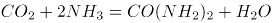。尿素作为一种中性肥料，尿素适用于各种土壤和植物。它易保存，使用方便，对土壤的破坏作用小，是使用量较大的一种化学氮肥，也是含氮量最高的氮肥。

D项正确，液态二氧化碳是一种新型、无污染的衣物干洗清洁剂，基本原理是：二氧化碳在高压下变为液态，清洗过程中能将污物溶解，清洗完后含有污物的液态二氧化碳排放至分离槽，减除压力后，成为气态的二氧化碳与污物分离，分离后的二氧化碳气体经冷凝器处理可循环使用。

本题为选非题，故正确答案为B。

**考点**：化学常识

**来源**：2022年深圳市考公务员录用考试《行测》试题（网友回忆版）第15题

### 第 16 题

以下为现代诗选段：

我知晓，旷野上我尚属大地的一条细流

是当隔的一片“黄竹酒”诞生了我汨汨生命

我自牛尾岭、虎跃头，穿越沙湾臂，莲峰屿，汇上水河，后溯溪流

逶迤百里西出春江米堵，再入后海湾、内伶仃

当你翻阅历史的时候，便掀开了我的奔流履历

该段诗歌描写的河流最可能是：

A. 龙岗河

B. 坪山河

C. 深圳河

D. 盐田河

第 16 题 · 答案与解析

**参考答案（粉笔题库参考内容）**

C

**解析**

本题考查地理常识。

A项错误，龙岗河发源于广东省深圳市梧桐山，是东江二级支流淡水河的干流，其上游流经横岗街道的梧桐山河、大康河、简龙河以及何茂盛河；而后流经龙岗街道、坪地街道、坑梓街道后入惠阳境内。上游为低山丘陵区，中下游为陵地带，地形比较复杂。

B项错误，坪山河发源于深圳市三洲田梅沙尖，流经坪山，在兔岗岭进入惠阳境内，在淡水寮湖汇入淡水河，属淡水河一级支流。

C项正确，深圳河正源为沙湾河，发源于广东省深圳市牛尾岭，上游支流莲塘河发源于梧桐山，属于珠江三角洲水系，深圳河干流流经深圳与香港，自东北向西南流入深圳湾（也被称为后海湾），出伶仃洋，是深圳与香港的界河。主要支流有深圳一侧的布吉河、福田河、皇岗河、新洲河及香港一侧的梧桐河和平原河。根据题干中“牛尾岭”、“沙湾臂”、“后海湾”、“内伶仃”等关键词可知，题中所指的河为深圳河。

D项错误，盐田河是盐田辖区最长河流，属山溪性河流，发源于三洲田，在盐田南汇入大鹏湾海域。

故正确答案为C。

**考点**：中国地理

**来源**：2022年深圳市考公务员录用考试《行测》试题（网友回忆版）第16题

### 第 17 题

2021年2月20日，习近平在党史学习教育大会上指出，这次党史学习教育要同解决实际问题结合起来，开展好“（ ）”实践活动。

A. 我为群众办实事

B. 我为群众解难题

C. 初心使命大家谈

D. 为民务实清廉

第 17 题 · 答案与解析

**参考答案（粉笔题库参考内容）**

A

**解析**

本题考查政治常识。

A项正确，B、C、D三项错误，2021年2月20日，习近平在党史学习教育动员大会上发表讲话，讲话的“三、在全党开展党史学习教育要务求实效”中的“三是要切实为群众办实事解难题”部分指出：“要把学习党史同总结经验、观照现实、推动工作结合起来，把学习成效转化为工作动力和成效，防止学习和工作‘两张皮’。这次党史学习教育要同解决实际问题结合起来，开展好‘我为群众办实事’实践活动。要强化公仆意识和为民情怀，首先是立足本职岗位为人民服务，发挥好共产党员先锋模范作用，还要从最困难的群众入手、从最突出的问题抓起、从最现实的利益出发，切实解决基层的困难事、群众的烦心事。”

故正确答案为A。

**考点**：重要会议讲话、其他建设

**来源**：2022年深圳市考公务员录用考试《行测》试题（网友回忆版）第17题

### 第 18 题

“衙斋卧听萧萧竹，疑是民间疾苦声；些小吾曹州县吏，一枝一叶总关情。”习近平在讲话和文章中多次引用这首诗，以此说明群众利益无小事、民生问题大于天。这首诗的作者是：

A. 范仲淹

B. 龚自珍

C. 郑板桥

D. 王安石

第 18 题 · 答案与解析

**参考答案（粉笔题库参考内容）**

C

**解析**

本题考查人文常识。

诗句出自清代郑板桥的《潍县署中画竹呈年伯包大中丞括》。这首诗是郑板桥于乾隆十一、二年（1746年—1747年）间任山东潍县知县时所作。诗句意思是：在书斋躺着休息，听见风吹竹叶发出萧萧之声，立即联想是百姓啼饥号寒的怨声。虽然我们只是些小小的州县官吏，但是老百姓的一举一动都牵动着我们的感情。

故正确答案为C。

**考点**：文学常识

**来源**：2022年深圳市考公务员录用考试《行测》试题（网友回忆版）第18题

### 第 19 题

经济学上，根据是否具有竞争性和排他性，可将物品分为四类，私人物品、公有资源、自然垄断物和公共物品，根据该分类方法，以下说法正确的是：

A. 冰淇淋属于私人物品

B. 海洋中的鱼类属于自然垄断物

C. 国防属于公有资源

D. 拥挤的不收费道路属于公共物品

第 19 题 · 答案与解析

**参考答案（粉笔题库参考内容）**

A

**解析**

本题考查经济常识。

竞争性指的是某个人消费了某种产品后，其他人再也不能消费该产品；排他性指的是排除那些没有付费的人消费该产品的能力。

A项正确，私人物品指的是具有竞争性和排他性的物品，冰淇淋属于私人物品，某人消费后，其他人不能购买该冰淇淋，并且不能使用该冰淇淋。

B项错误，自然垄断物品指的是具有排他性而无竞争性的产品，因此又被称为可排他非竞争性准公共物品，多指自来水、电力、燃气以及铁路服务等。海洋中的鱼类属于公有资源。

C项错误，公有资源指的是可供具有一定能力且有兴趣的单位和个人共同使用和消费的资源，没有排他性但具有竞争性。国防不是公有资源，属于公共物品。

D项错误，公共物品指的是能够被所有的人消费的物品，一般具有非竞争性和非排他性。公共物品又可分为纯公共物品和准公共物品。拥挤的不收费的道路属于公有资源。

故正确答案为A。

**考点**：微观经济

**来源**：2022年深圳市考公务员录用考试《行测》试题（网友回忆版）第19题

### 第 20 题

2021年深圳市人民政府工作报告指出，未来五年，我们要强化“双城联动，比翼双飞”，促进珠江口东西两岸融合互动，携手打造国际一流湾区和世界级城市群。这里的“双城”是指深圳和：

A. 香港

B. 广州

C. 珠海

D. 东莞

第 20 题 · 答案与解析

**参考答案（粉笔题库参考内容）**

B

**解析**

本题考查政治常识。

2021年深圳市人民政府工作报告在“二、‘十四五’时期发展目标和重点任务”部分指出：“未来五年，我们要······强化广深‘双城联动、比翼双飞’，促进珠江口东西两岸融合互动，携手打造国际一流湾区和世界级城市群。”因此双城指的是广州和深圳。

故正确答案为B。

**考点**：经济建设

**来源**：2022年深圳市考公务员录用考试《行测》试题（网友回忆版）第20题

### 第 21 题

习近平强调，“青年兴则国家兴，青年强则国家强。青年一代（ ），国家就有前途，民族就有希望。”

A. 有信念、有本事、有品德

B. 有灵魂、有本领、有作为

C. 有理想、有本领、有担当

D. 有信仰、有作为、有奉献

第 21 题 · 答案与解析

**参考答案（粉笔题库参考内容）**

C

**解析**

本题考查政治常识。

C项正确，A、B、D三项错误，习近平总书记勉励新时代广大青年：青年兴则国家兴，青年强则国家强。青年一代有理想、有本领、有担当，国家就有前途，民族就有希望。中国梦是历史的、现实的，也是未来的；是我们这一代的，更是青年一代的。中华民族伟大复兴的中国梦终将在一代代青年的接力奋斗中变为现实。

故正确答案为C。

**考点**：重要会议讲话、社会建设

**来源**：2022年深圳市考公务员录用考试《行测》试题（网友回忆版）第21题

### 第 22 题

2021年5月11日，第七次全国人口普查结果公布，全国人口约为（ ）亿人。

A. 13.9

B. 14.1

C. 14.3

D. 14.7

第 22 题 · 答案与解析

**参考答案（粉笔题库参考内容）**

B

**解析**

本题考查政治常识。

B项正确，A、C、D三项错误，2021年5月11日，第七次全国人口普查结果公布，全国人口共141178万人，与2010年的133972万人相比，增加了7206万人，增长5.38%；年平均增长率为0.53%，比2000年到2010年的年平均增长率0.57%下降0.04个百分点。数据表明，我国人口10年来继续保持低速增长态势。

故正确答案为B。

**考点**：重要文件、社会建设

**来源**：2022年深圳市考公务员录用考试《行测》试题（网友回忆版）第22题

### 第 23 题

在中国共产党的历史上，以“决议”命名的文件很少。党的十九届六中全会审议通过了党的第三个历史决议，同党的两个历史决议既一脉相承又与时俱进。下列不属于党的三个历史决议的是：

A. 《关于目前政治形势与党的任务的决议》

B. 《关于建国以来党的若干历史问题的决议》

C. 《关于若干历史问题的决议》

D. 《关于党的百年奋斗重大成就和历史经验的决议》

第 23 题 · 答案与解析

**参考答案（粉笔题库参考内容）**

A

**解析**

本题考查政治常识。

A项错误，B、C、D三项正确，在我们党的一百年历史上，先后在1945年制定了《关于若干历史问题的决议》，在1981年制定了《关于建国以来党的若干历史问题的决议》，在2021年制定了《中共中央关于党的百年奋斗重大成就和历史经验的决议》。这三个决议都在我们党的历史上对推进和引领党的事业发展起了重要作用。

本题为选非题，故正确答案为A。

**考点**：其他建设、重要文件

**来源**：2022年深圳市考公务员录用考试《行测》试题（网友回忆版）第23题

### 第 24 题

为隆重表彰在抗击新冠肺炎疫情斗争中作出杰出贡献的功勋模范人物，弘扬他们忠诚、担当、奉献的崇高品质，根据全国人大常委会的决定，授予钟南山“共和国勋章”，授予张伯礼、张定宇、陈薇“人民英雄”国家荣誉称号。该事项应采用的公文文种是：

A. 通报

B. 命令（令）

C. 公告

D. 通知

第 24 题 · 答案与解析

**参考答案（粉笔题库参考内容）**

B

**解析**

本题考查公文写作与处理。

A项错误，《党政机关公文处理工作条例》规定：通报适用于表彰先进、批评错误、传达重要精神和告知重要情况。通报可以用于表彰，但通报的奖励规格较低，发文机关通常是被表彰对象的直接上级，侧重于起到教育说理的作用，不符合题意。

B项正确，《党政机关公文处理工作条例》规定：命令（令）适用于公布行政法规和规章、宣布施行重大强制性措施、批准授予和晋升衔级、嘉奖有关单位和人员。命令可以用于奖励，奖励规格非常高，侧重于奖励在“急难险重”的工作表现突出，影响重大的人物，并且通常会授予荣誉称号，符合题意。

C项错误，《党政机关公文处理工作条例》规定：公告适用于向国内外宣布重要事项或者法定事项。公告不可用于奖励，不符合题意。

D项错误，《党政机关公文处理工作条例》规定：通知适用于发布、传达要求下级机关执行和有关单位周知或者执行的事项，批转、转发公文。通知不可用于奖励，不符合题意。

故正确答案为B。

**来源**：2022年深圳市考公务员录用考试《行测》试题（网友回忆版）第24题

### 第 25 题

下列关于公务员任职与交流的说法错误的是：

A. 小李与其配偶都是公务员，他们不得在同一机关双方直接隶属于同一领导人员的职位工作

B. 公务员小张的配偶经营了一家诊所，小张不得在主管该诊所的卫生行政部门拟任领导成员

C. 公务员小彭可以在公务员队伍内部交流，但不得与国有企业中的人员交流

D. 公务员小宋到其他单位挂职，挂职期间，其与原机关的人事关系不改变

第 25 题 · 答案与解析

**参考答案（粉笔题库参考内容）**

C

**解析**

本题考查法律常识。

A、B两项正确，根据《公务员法》第七十四条规定：“公务员之间有夫妻关系、直系血亲关系、三代以内旁系血亲关系以及近姻亲关系的，不得在同一机关双方直接隶属于同一领导人员的职位或者有直接上下级领导关系的职位工作，也不得在其中一方担任领导职务的机关从事组织、人事、纪检、监察、审计和财务工作。公务员不得在其配偶、子女及其配偶经营的企业、营利性组织的行业监管或者主管部门担任领导成员。因地域或者工作性质特殊，需要变通执行任职回避的，由省级以上公务员主管部门规定。”

C项错误，根据《公务员法》第六十九条规定：“国家实行公务员交流制度。公务员可以在公务员和参照本法管理的工作人员队伍内部交流，也可以与国有企业和不参照本法管理的事业单位中从事公务的人员交流。交流的方式包括调任、转任。”

D项正确，根据《公务员法》第七十二条规定：“根据工作需要，机关可以采取挂职方式选派公务员承担重大工程、重大项目、重点任务或者其他专项工作。公务员在挂职期间，不改变与原机关的人事关系。”

本题为选非题，故正确答案为C。

**考点**：行政法

**来源**：2022年深圳市考公务员录用考试《行测》试题（网友回忆版）第25题

### 第 26 题

①选取洋葱外表皮

②吸水纸反复引滤

③滴加蔗糖溶液

④制成临时装片

⑤发生质壁分离

A. ①-④-③-②-⑤

B. ①-③-④-②-⑤

C. ③-①-④-②-⑤

D. ⑤-②-③-④-①

第 26 题 · 答案与解析

**参考答案（粉笔题库参考内容）**

A

**解析**

第一步：先确定逻辑关系最为明显的逻辑顺序。

题干是在做“质壁分离”实验，所以第一步是选材最后一步是发生质壁分离，可以得到“选取洋葱外表皮”是第一步，“发生质壁分离”是最后一步，可以排除C、D两项。

第二步：逐一对照选项并判断正确答案。

根据第一步的结果可以判断只有A、B两项符合，A、B两项的区别是“滴加蔗糖溶液”与“制成临时装片”顺序不同，根据第四步肯定是“吸水纸反复引滤”可以得到前面紧跟着的是“滴加蔗糖溶液”，由此排除B项。

故正确答案为A。

**来源**：2022年深圳市考公务员录用考试《行测》试题（网友回忆版）第26题

### 第 27 题

①船只倾斜搁浅

②货轮体量空前

③航道双向堵塞

④紧急脱浅救援

⑤国际贸易受阻

A. ②-①-③-⑤-④

B. ③-②-①-⑤-④

C. ①-④-②-③-⑤

D. ③-①-②-④-⑤

第 27 题 · 答案与解析

**参考答案（粉笔题库参考内容）**

A

**解析**

第一步：先确定逻辑关系最为明显的逻辑顺序。

观察题干，五个事件主要是围绕着“船只搁浅堵塞航道”开展的。逻辑关系的先后顺序比较明显的事件是事件①和事件③，船只要先搁浅，才能导致航道堵塞，事件①应该在事件③前面，排除B、D两项。

第二步：逐一对照选项并判断正确答案。

根据第一步的结果可以判断只有A、C两项符合，引发船只搁浅的原因是船只的重量空前超额，进而导致船只发生倾斜，这里“货轮体量空前”是造成船只搁浅的原因，因此事件②应该在事件①前面，排除C项。

故正确答案为A。

**来源**：2022年深圳市考公务员录用考试《行测》试题（网友回忆版）第27题

### 第 28 题

（1）百花齐放，百家争鸣

（2）星星之火，可以燎原

（3）惩前毖后，治病救人

（4）打扫干净屋子再请客

（5）枪杆子里出政权

A. 5-2-3-4-1

B. 2-5-4-3-1

C. 2-5-4-1-3

D. 5-2-4-1-3

第 28 题 · 答案与解析

**参考答案（粉笔题库参考内容）**

A

**解析**

第一步：先确定逻辑关系最为明显的逻辑顺序。

观察题干，五个事件主要是围绕着我国不同时期提出的党政方针开展的。“百花齐放，百家争鸣”是在1956年提出的，“星星之火，可以燎原”是在1930年提出的，“惩前毖后，治病救人”是在1942年提出的，“打扫干净屋子再请客”是在1949年提出的，“枪杆子里出政权”是在1927年提出的。根据时间先后排序应该是（5）-（2）-（3）-（4）-（1）。

第二步：逐一对照选项并判断正确答案。

根据上述判断，只有A项符合题意，当选。

故正确答案为A。

**来源**：2022年深圳市考公务员录用考试《行测》试题（网友回忆版）第28题

### 第 29 题

（1）就读职校技能突出

（2）昼夜苦练专业技能

（3）展现大国工匠风采

（4）取得世界大赛资格

（5）入选国家集训队伍

A. 2-1-3-5-4

B. 2-1-5-3-4

C. 1-5-2-4-3

D. 1-5-4-2-3

第 29 题 · 答案与解析

**参考答案（粉笔题库参考内容）**

C

**解析**

第一步：先确定逻辑关系最为明显的逻辑顺序。

观察题干，五个事件主要围绕“个人学习成长过程”开展的。逻辑关系的先后顺序比较明显的是事件（3）和事件（4），只有先“取得世界大赛资格”，才能“展现大国工匠风采”，因此事件（4）排在事件（3）前面，且事件（3）是一个结果表述，应该排在最后，排除A、B项。

第二步：逐一对照选项并判断正确答案。

根据第一步得到的结果可以判断只有C、D两项符合，通过分析事件（2）、（4），先“昼夜苦练专业技能”，才能“取得世界大赛资格”，因此事件（2）排在事件（4）前面，排除D项。

故正确答案为C。

**来源**：2022年深圳市考公务员录用考试《行测》试题（网友回忆版）第29题

### 第 30 题

（1）听信诱导，投入巨资

（2）血本无归，债台高筑

（3）扫码入群，牛刀小试

（4）获得收益，心中窃喜

（5）网上冲浪，惊现商机

A. 5-4-3-1-2

B. 5-3-4-1-2

C. 3-1-2-5-4

D. 3-4-5-1-2

第 30 题 · 答案与解析

**参考答案（粉笔题库参考内容）**

B

**解析**

第一步：先确定逻辑关系最为明显的事件顺序。

观察题干，五个事件主要围绕“电信诈骗”的过程开展的。逻辑关系的先后顺序比较明显的是事件（3）和事件（5），先网上冲浪，发现商机后，才会扫码入群，牛刀小试，因此事件（5）应该在事件（3）前面，故事件（5）为首句，排除C、D两项。

第二步：逐一对照选项并判断正确答案。

根据第一步得到的结果可以判断只有A、B两项符合，通过分析事件（3）、（4）可知，先牛刀小试，投入资金后，才能获得收益，因此事件（3）应该在事件（4）前面，排除A项。

故正确答案为B。

**来源**：2022年深圳市考公务员录用考试《行测》试题（网友回忆版）第30题

### 第 31 题

从所给的四个选项中，选择最合适的一个填入问号处，使之呈现一定的规律性：

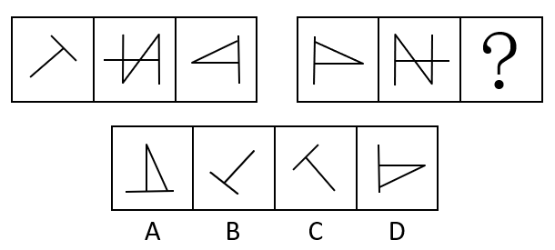

A. A

B. B

C. C

D. D

第 31 题 · 答案与解析

**参考答案（粉笔题库参考内容）**

C

**解析**

元素组成相同，优先考虑位置规律。观察发现，第一组图二、图三分别与第二组图二、图一相同，但经过了左右翻转，因此第二组图是由第一组图整体左右翻转得到的，则？处图形应由第一组图一左右翻转得到，对应C项。

故正确答案为C。

**考点**：位置规律-翻转

**来源**：2022年深圳市考公务员录用考试《行测》试题（网友回忆版）第31题

### 第 32 题

从所给的四个选项中，选择最合适的一个填入问号处，使之呈现一定的规律性：

A. A

B. B

C. C

D. D

第 32 题 · 答案与解析

**参考答案（粉笔题库参考内容）**

A

**解析**

解题思路一：图形元素组成不同，且无明显属性规律。观察发现，题干图形都存在曲线，且有单一曲线出现，优先考虑数曲线；第一组图形的曲线数依次为1、2、3，曲线数依次递增；第二组图的曲线数依次为5、4、？，曲线数依次递减，故？处应选择曲线数为3的图形，只有A项符合规律。

故正确答案为A。

解题思路二：图形元素组成不同，优先考虑属性规律。观察发现，第一组图形图1为不对称图形、图2为中心对称图形、图3为轴+中心对称图形，第二组图形图1为中心对称图形，图2为不对称图形，故？处应选择轴+中心对称的图形，只有D项符合规律。

故正确答案为D。

注：思路一和思路二均可以选出唯一答案，但首先，从整体图形特征来看，题干和选项的每幅图都有曲线，考查曲线的概率更大，而题干并不是所有图形都具备对称性，对称考法不是很严谨。其次，思路二考虑对称时，两组图不同对称性出现的顺序是乱的，而看曲线数时，两组图都是依次变化，依次递增、依次递减，思路一相比思路二更为严谨，因此粉笔更倾向于选A。

**考点**：数量规律-线

**来源**：2022年深圳市考公务员录用考试《行测》试题（网友回忆版）第32题

### 第 33 题

从所给的四个选项中，选择最合适的一个填入问号处，使之呈现一定的规律性：

A. A

B. B

C. C

D. D

第 33 题 · 答案与解析

**参考答案（粉笔题库参考内容）**

B

**解析**

两组图形优先观察第一组，均为同一个六面体，图1整体沿水平方向顺时针旋转90°得到图2，图2整体沿水平方向顺时针旋转90°得到图3。第二组图形应用此规律，验证图1到图2，满足此规律，因此“？”处图形应由图2整体沿水平方向顺时针旋转90°得到，即顶面为田字面，左面为斜线面。

故正确答案为B。

**考点**：位置规律-旋转

**来源**：2022年深圳市考公务员录用考试《行测》试题（网友回忆版）第33题

### 第 34 题

从所给的四个选项中，选择最合适的一个填入问号处，使之呈现一定的规律性：

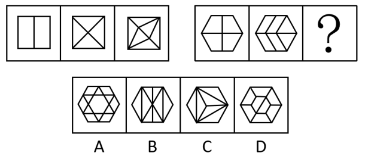

A. A

B. B

C. C

D. D

第 34 题 · 答案与解析

**参考答案（粉笔题库参考内容）**

D

**解析**

图形元素组成不同，且无明显属性规律，优先考虑数量规律。题干图形均为多边形内部被分割，窟窿比较明显，考虑面数量。第一组图形的面数量依次为2、4、6，呈现依次递增的规律。第二组图形的面数量依次为4、6、？，故？处应选择有8个面的图形，排除A、C两项。整体数面选不出唯一答案，考虑面的细化考点，观察发现，题干图形均被分割成了面积相同的几个面，只有D项所有面的面积均相同，当选。

故正确答案为D。

**考点**：数量规律-面

**来源**：2022年深圳市考公务员录用考试《行测》试题（网友回忆版）第34题

### 第 35 题

请从所给的四个选项中，选出最恰当的一项填入问号处，使之呈现一定的规律性。

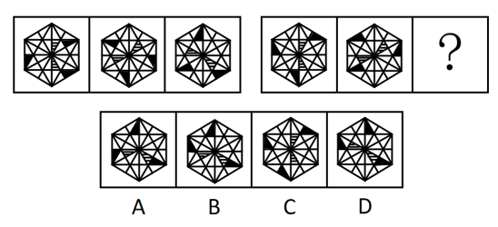

A. A

B. B

C. C

D. D

第 35 题 · 答案与解析

**参考答案（粉笔题库参考内容）**

D

**解析**

图形元素组成相同，优先考虑位置规律。观察发现，第一组图形中，两个阴影部分沿内圈进行移动，阴影部分1、2均依次沿内圈逆时针移动4格，黑色三角形均依次沿外圈顺时针移动3格，第二组图形应遵循此规律，对应D项。

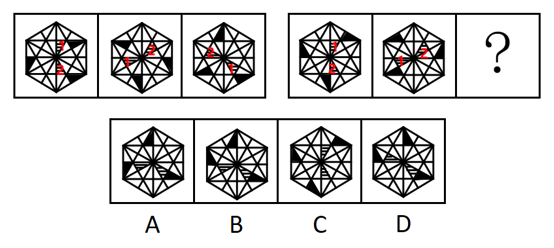

故正确答案为D。

**考点**：位置规律-平移

**来源**：2022年深圳市考公务员录用考试《行测》试题（网友回忆版）第35题

### 第 36 题

一组人参加游戏，要求第一个人任意报数，接下来每个人都根据前一个人的报数按照既定规则继续报数。第一个人报：“1，1”；第二个人报：“2，1”；第三个人报：“1，1，1，2”；第四个人报：“1，2，3，1”；第五个人报：“1，2，1，3，2，1”；第六个人报：“1，3，2，2，3，1”。

则第七个人应报（ ）。

A. 1，2，2，3，2，1

B. 2，1，2，2，2，3

C. 3，2，2，2，1，1

D. 1，2，1，3，3，1

第 36 题 · 答案与解析

**参考答案（粉笔题库参考内容）**

B

**解析**

从题干入手进行推理。已知第一个人报数为“1，1”，第二个人报数为“2，1”，此时第二个人报数的含义为：前一个人报了“2个1”，代入第三个人进行验证，已知第三个人报数为“1，1，1，2”，所代表的含义为：前一个人报了“1个1，1个2”，代入后三个人进行验证均满足此规律，即题干的既定规则为：后一个人报数要描述前一个人报了哪些数字（按数字从小到大的顺序）和该数字的数量（数量放在数字前）。按此规则，第七个人所报数字表示的含义应为：前一个人报了“2个1，2个2，2个3”，即“2，1，2，2，2，3”，只有B项符合。

故正确答案为B。

**考点**：组合排列-单题-其他

**来源**：2022年深圳市考公务员录用考试《行测》试题（网友回忆版）第36题

### 第 37 题

某赛事的参赛者信息如下：

（1）3人是围棋选手；

（2）4人来自广东；

（3）2人来自深圳；

（4）5人是女生；

（5）来自深圳的参赛者都是男生。

若以上信息涉及了所有参赛者，则该赛事的参赛者（ ）。

A. 最多14人，最少8人

B. 最多14人，最少7人

C. 最多12人，最少7人

D. 最多12人，最少8人

第 37 题 · 答案与解析

**参考答案（粉笔题库参考内容）**

C

**解析**

第一步：分析题干条件。

（1）3人是围棋选手；

（2）4人来自广东；

（3）2人来自深圳；

（4）5人是女生；

（5）来自深圳的参赛者都是男生。

第二步：根据题干条件进行推理。

已知题干信息涉及了所有参赛者，且来自广东的4人当中包括来自深圳的2人。当条件（1）、（2）、（4）涉及的参赛者互不重复时，参赛人数最多，此时有3+4+5共计12位参赛者； 结合条件（3）、（5）可知，来自深圳的2人是男生，再结合条件（4）可知，至少有2+5共计7人参赛，此时条件（1）、（2）和条件（3）、（4）、（5）涉及的参赛者恰好重复（例如某参赛者可以既是女生又是围棋选手），参赛人数最少。

故正确答案为C。

**考点**：框架题

**来源**：2022年深圳市考公务员录用考试《行测》试题（网友回忆版）第37题

### 第 38 题

三孩政策引发民众热议。有人认为，三孩政策将加剧性别不公，影响女性的职业发展，加重家庭经济负担，因此夫妻应当合休产假，男女共担育儿义务，这一建议如果被采纳实施，将有效降低生育对女性职业发展的负面影响，提高女性生育意愿，推动三孩政策落实。

以下选项如果为真，最能支持上述结论的是：

A. 某集团的人力资源负责人表示，考虑到产假因素，业内招聘普遍倾向于录用男性

B. 已有国家正在实行类似的夫妻合休全薪产假政策，受到该国国民的大力支持

C. 夫妻合休产假可以优化家庭教育结构，有利于儿童身心健康成长

D. 调查显示，不考虑生育三孩的女性中，大多数对生育三孩将影响其职业发展有较大顾虑

第 38 题 · 答案与解析

**参考答案（粉笔题库参考内容）**

D

**解析**

第一步：找出论点和论据。

论点：夫妻合休产假的建议如果被采纳实施，将有效降低生育对女性职业发展的负面影响，提高女性生育意愿，推动三孩政策落实。

论据：三孩政策将加剧性别不公，影响女性的职业发展，加重家庭经济负担。

本题论点讨论的是实施合休产假后三孩政策不会影响女性职业发展，论据讨论的是三孩政策对女性职业发展的影响，论点论据话题一致。所以加强可以优先考虑补充论据，可以举例子，也可以解释原因。

第二步：逐一分析选项。

A项：指出目前女性产假是影响女性录用情况的因素，而论点讨论的是夫妻合休产假这一政策与女性职业发展以及三孩政策落实间的关系，话题不一致，无法加强，排除；

B项：指出其他国家实行夫妻合休全薪产假政策后受到了国民的支持，而论点讨论的是该政策在我国实施可能会带来的积极影响，主体不一致，无法加强，排除；

C项：指出夫妻合休产假政策有利于儿童身心健康成长，而论点讨论的是该政策与女性职业发展以及三孩政策落实间的关系，话题不一致，无法加强，排除；

D项：指出有些女性因生育三孩确实会影响其职业发展而选择不生三孩，而该政策的实施可以降低生育为女性职业发展带来的负面影响，因此该项解释了这项政策如何降低女性职业发展负面影响，进而推动三孩政策落实，可以加强，当选。

故正确答案为D。

**考点**：补充论据

**来源**：2022年深圳市考公务员录用考试《行测》试题（网友回忆版）第38题

### 第 39 题

与老一辈相比，年轻一代的青春痘问题更为严重。有人认为，老一辈的生活条件艰苦，饮食清淡，而当代年轻人喜爱吃油炸食品和蛋糕、巧克力等甜食。因此，油炸食品和甜食是导致年轻一代青春痘问题更为严重的原因。

以下选项如果为真，最能质疑上述观点的是：

A. 青春痘是皮脂腺油脂分泌过多进而堵塞的结果

B. 油炸食品和甜食易使人堆积脂肪的部位是腰腹部，而非面部

C. 即使饮食清淡，少油少糖，也有可能长青春痘

D. 情绪压力也易引发青春痘，当代年轻人压力高于历代

第 39 题 · 答案与解析

**参考答案（粉笔题库参考内容）**

D

**解析**

第一步：找出论点和论据。

论点：油炸食品和甜食是导致年轻一代青春痘问题更为严重的原因。

论据：与老一辈相比，年轻一代的青春痘问题更为严重。老一辈的生活条件艰苦，饮食清淡，而当代年轻人喜爱吃油炸食品和蛋糕、巧克力等甜食。

本题论点、论据讨论的都是油炸食品和甜食与年轻一代青春痘问题的关系，话题一致，且论点中存在因果关系，削弱优先考虑因果倒置和他因削弱。

第二步：逐一分析选项。

A项：该项说明青春痘是油脂分泌过多导致的，但未提及油脂与油炸食品和甜食的关系，为不明确项，无法削弱，排除；

B项：该项说明油炸食品和甜食容易使腰腹部的脂肪增加，而题干讨论的是油炸食品和甜食与青春痘的关系，话题不一致，无法削弱，排除；

C项：该项说明饮食清淡、少油少糖可能会长青春痘，而题干讨论的是油炸食品和甜食与青春痘的关系，话题不一致，无法削弱，排除；

D项：该项说明情绪压力也易引发青春痘，并且当代年轻人压力高于历代，这意味着情绪压力大也是年轻一代青春痘问题更严重的原因，提出了其他导致年轻一代青春痘问题的原因，他因削弱，当选。

故正确答案为D。

**考点**：他因削弱

**来源**：2022年深圳市考公务员录用考试《行测》试题（网友回忆版）第39题

### 第 40 题

一对热恋期情侣之间的对话如下：

女生问：“我是不是世界上最漂亮的女生？”

男生答：“这个问题我回答不了，我得看完世界上所有女生后才能回答！”

要使以上对话中男生的论证基本成立，最需要假设的前提是（ ）。

A. 男生用情专一，不会见异思迁

B. 世界上所有女生在“漂亮”上是可以比较的

C. “漂亮”是一种客观属性且有评判标准

D. 男生可以在有生之年看完世界上所有女生

第 40 题 · 答案与解析

**参考答案（粉笔题库参考内容）**

B

**解析**

第一步：找出论点和论据。

论点：回答不了女朋友是否为世界上最漂亮的女生的问题。

论据：男生要看完世界上所有女生后才能回答。

本题论点说的是回答不了女朋友是否为世界上最漂亮的女生，论据说的是男生要看完世界上所有女生后才能回答，论点和论据说的都是女朋友是否为世界上最漂亮的女生的话题，二者话题一致，且提问方式为“最需要假设的前提”，加强优先考虑必要条件。

第二步：逐一分析选项。

A项：该项说的是男生用情专一，不会见异思迁，而论点说的的是回答不了女朋友是否为世界上最漂亮的女生的问题，话题不一致，不是论证成立的前提，排除；

B项：该项说的是世界上所有女生在“漂亮”上是可以比较的，假如该项不成立，即世界上所有女生在“漂亮”上是不可以比较的，那么男生就没有必要等到看完世界上所有女生后才能回答女朋友是否是世界上最漂亮的女生的问题，故当该项不成立时，题干的论证过程也不成立，因此该项是论证成立的前提，保留；

C项：该项说的是“漂亮”是一种客观属性且有评判标准，假如选项不成立，即“漂亮”不是客观属性或者没有评判标准。若“漂亮”不是客观属性，即也可以是男生主观上的认知，而男生主观上对于“漂亮”的认知并不影响男生评判世界上最漂亮的女生，故“漂亮”是一种客观属性不是论证成立的必要条件，若漂亮”没有评判标准，则男生即使看完世界上所有的女生也无法评判出女朋友是否是世界上最漂亮的女生，故漂亮有评判标准是论证成立的必要条件，该项保留；

D项：该项说的是男生可以在有生之年看完世界上所有女生，侧重于表述是否能看完所有的女生，而论证讨论的侧重点是男生看完之后能否回答女朋友是否是世界上最漂亮的女生，话题不一致，因不是论证成立的前提，排除。

比较B、C两项，C项表述中“‘漂亮’是一种客观属性”并不能成为论证成立的前提，只是局部的必要条件，而B项说的是女生在“漂亮”上是可以比较的，这句话是最贴近男生说出该论证的前提，更加贴近题干的表述，故依据对比择优的原则，B项力度更强，当选。

故正确答案为B。

**考点**：必要条件

**来源**：2022年深圳市考公务员录用考试《行测》试题（网友回忆版）第40题

### 第 41 题

在中国生产智能手机的成本比美国低50%。即使算上运输费用和关税，从中国进口智能手机到美国，仍比在美国生产智能手机便宜。

如果以上论述为真，最能支持该论断的是（ ）。

A. 中国的劳动力成本比美国低50%

B. 从中国进口智能手机到美国，将减少美国智能手机制造业50%的就业机会

C. 从中国进口智能手机到美国的运输费用和关税少于在美国生产智能手机的成本的50%

D. 为获得更大收益，美国智能手机企业将生产线转移至中国

第 41 题 · 答案与解析

**参考答案（粉笔题库参考内容）**

C

**解析**

第一步：找出论点和论据。

论点：在中国生产智能手机的成本比美国低50%。即使算上运输费用和关税，从中国进口智能手机到美国，仍比在美国生产智能手机便宜。

本题只有论点，无明显论据，加强优先考虑补充论据，即证明“在中国生产智能手机的成本+运输费用+关税＜在美国生产智能手机的成本”。

第二步：逐一分析选项。

A项：该项举例说明了中国的劳动力成本比美国低，因此在中国生产智能手机的成本可能比美国低，举例加强，补充论据，保留；

B项：论点说的是算上运输费用和关税后，从中国进口智能手机到美国依然便宜，该项说的是从中国进口智能手机到美国对就业的影响，话题不一致，无法加强，排除；

C项：题干论点指出中国生产成本=50%美国生产成本，且中国生产成本+关税+运费<美国生产成本，选项指出关税+运费<50%美国生产成本，解释了论点逻辑成立的原因，补充论据，保留；

D项：论点说的是算上运输费用和关税后，中国生产的智能手机卖到美国依然便宜，即中国生产的智能手机性价比高，但美国企业到中国来生产智能手机是否可以延续高性价比，其中不确定成本太多，没有C项直接，排除；

对比A、C两项，A项是从成本的其中一个方面举例加强，C项直接对于论点话题中的“运输费用和关税”来解释论点原因，C项更贴近论点表述，C项当选。

故正确答案为C。

**考点**：补充论据

**来源**：2022年深圳市考公务员录用考试《行测》试题（网友回忆版）第41题

### 第 42 题

上级视察小康村，了解到以下实情：如果宅基地没有管理良好，那么村民活动中心不会建成；除非乡村道路铺设完成，否则生态旅游产业无法发展；村民活动中心建成或者乡村道路没有铺设完成。

由此可推知：

A. 宅基地没有建设良好且生态旅游无法发展

B. 宅基地管理良好且乡村道路铺设完成

C. 宅基地没有管理良好或者生态旅游产业发展

D. 宅基地管理良好或者生态旅游产业无法发展

第 42 题 · 答案与解析

**参考答案（粉笔题库参考内容）**

D

**解析**

第一步：翻译题干。

（1）-宅基地管理良好→-村民活动中心建成；

（2）生态旅游产业发展→乡村道路铺设完成；

（3）村民活动中心建成 或 -乡村道路铺设完成。

第二步：判断选项词语间逻辑关系。

条件（3）是相对比较确定的信息，可以从条件（3）入手。

条件（3）表明“村民活动中心建成”和“-乡村道路铺设完成”至少有一项为真。当“村民活动中心建成”为真时，根据条件（1）否后推出否前可知，“宅基地管理良好”为真；当“-乡村道路铺设完成”为真时，根据条件（2）否后推出否前可知，“-生态旅游产业发展”为真。由于“村民活动中心建成”和“-乡村道路铺设完成”至少有一项为真，因此“宅基地管理良好”和“-生态旅游产业发展”至少一项为真，即“宅基地管理良好” 或 “-生态旅游产业发展”，即为D项。

故正确答案为D。

**考点**：常规翻译

**来源**：2022年深圳市考公务员录用考试《行测》试题（网友回忆版）第42题

### 第 43 题

某分公司组织员工前往总部参加年终晚会，所有员工要么选择乘高铁，要么选择乘飞机，经统计，乘高铁的员工多于乘飞机的员工，女员工人数多于男员工人数，则下列断定一定为真的是（ ）。

（1）乘飞机的女员工多于乘飞机的男员工

（2）乘高铁的男员工多于乘飞机的男员工

（3）乘高铁的女员工多于乘飞机的男员工

A. （1）（2）

B. 只有（3）

C. （2）（3）

D. 一个都没有

第 43 题 · 答案与解析

**参考答案（粉笔题库参考内容）**

B

**解析**

第一步：整理题干信息。

（1）所有员工要么选择乘高铁，要么选择乘飞机；

（2）乘高铁的员工多于乘飞机的员工；

（3）女员工人数多于男员工人数。

第二步：根据信息整合。

将题干中提到的情况列出来，分别有两类情况，第一类：女性员工和男性员工，第二类：乘高铁和乘飞机，这两类中的两种情况非此即彼，接下来我们可以根据题中已知的条件列出2个算式：

1.乘高铁（男+女）＞乘飞机（男+女），即乘高铁女+乘高铁男＞乘飞机男+乘飞机女；

2.女（乘高铁+乘飞机）＞男（乘高铁+乘飞机），即乘高铁女+乘飞机女＞乘高铁男+乘飞机男。

那么将1和2相加，根据大大则大的原则得到：

乘高铁女+乘高铁男+乘高铁女+乘飞机女＞乘飞机男+乘飞机女+乘高铁男+乘飞机男。

算式两边相互抵消得到：

乘高铁女＞乘飞机男，则一定能推出的只有（3），（1）（2）不确定，B项当选。

故正确答案为B。

**考点**：框架题

**来源**：2022年深圳市考公务员录用考试《行测》试题（网友回忆版）第43题

### 第 44 题

“小T小T，请帮我开灯，小T小T，我心情不好，给我讲个笑话吧。小T小T，请在月底提醒我，妈妈的生日快到了······”如今，各式各样的智能机器人层出不穷，人工智能通过语音识别和机器学习来模拟人的行为，给人们提供工作和生活上的便利。多位专家预测，面向家庭日常使用的人工智能机器人，将超过服务于传统制造业和物流业的机器人，成为下一个爆发式增长的市场。

以下选项如果为真，最能质疑专家预测的是（ ）。

A. 人工智能机器人的研发制造工序繁杂，生产周期较长，很难实现大规模量产

B. 人工智能机器人虽然层出不穷，但各品牌机器人的质量参差不齐，家庭用户评价褒贬不一

C. 面向家庭的人工智能机器人看上去高端，但与实际需求落差大，若要“更像人类”，则成本过高

D. 人工智能和社会伦理是否会产生冲突，能否大批量投入居家使用，尚待时间检验

第 44 题 · 答案与解析

**参考答案（粉笔题库参考内容）**

C

**解析**

第一步：找出论点和论据。

论点：面向家庭日常使用的人工智能机器人，将超过服务于传统制造业和物流业的机器人，成为下一个爆发式增长的市场。

论据：各式各样的智能机器人层出不穷，人工智能通过语音识别和机器学习来模拟人的行为，给人们提供工作和生活上的便利。

论点和论据讨论的都是面向家庭日常使用的人工智能机器人能够满足人们的需求，大受欢迎，话题一致，削弱优先考虑否定论点。

第二步：逐一分析选项。

A项：该项说的是人工智能机器人的研发制造工序繁杂，生产周期长，很难实现大规模量产，论点说的是面向家庭日常使用的人工智能机器人是否会成为下一个爆发式增长的市场，话题不一致，无法削弱，排除；

B项：该项说的是人工智能机器人，论点说的是面向家庭日常使用的人工智能机器人，主体不一致，无法削弱，排除；

C项：该项说的是面向家庭的人工智能机器人与实际需求落差大，生产成本高，否定其成为下一个爆发式增长的市场的前提，即成本太高难以投入市场，且需求量小，因此无法成为下一个爆发式增长的市场，否定论点，可以削弱，当选；

D项：该项说的是人工智能，论点说的是面向家庭日常使用的人工智能机器人，主体不一致，无法削弱，排除。

故正确答案为C。

**考点**：削弱论点

**来源**：2022年深圳市考公务员录用考试《行测》试题（网友回忆版）第44题

### 第 45 题

有蓝蓝、豆豆、毛毛三个男生，他们各自有一个妹妹。已知：三个妹妹分别是花花、贝贝、妞妞；花花的哥哥是豆豆的好朋友，并且在三个男生中年纪最小；毛毛的年纪比妞妞的哥哥大。

由此可推知，三对兄妹分别是（ ）。

A. 蓝蓝和花花，豆豆和贝贝，毛毛和妞妞

B. 蓝蓝和妞妞，豆豆和花花，毛毛和贝贝

C. 蓝蓝和贝贝，豆豆和妞妞，毛毛和花花

D. 蓝蓝和花花，豆豆和妞妞，毛毛和贝贝

第 45 题 · 答案与解析

**参考答案（粉笔题库参考内容）**

D

**解析**

第一步：分析题干条件。

（1）花花的哥哥是豆豆的好朋友；

（2）花花的哥哥在三个男生中年纪最小；

（3）毛毛的年纪比妞妞的哥哥大。

第二步：根据题干条件进行推理。

题干信息确定，选项信息充分，优先考虑排除法。

根据条件（1）可知花花的哥哥不是豆豆，排除B项；

根据条件（3）可知妞妞的哥哥不是毛毛，排除A项；

结合条件（2）、（3）可知花花的哥哥不是毛毛，排除C项。

故正确答案为D。

**考点**：排除法

**来源**：2022年深圳市考公务员录用考试《行测》试题（网友回忆版）第45题

### 第 46 题

\-8，10，-7，12，-5，（ ）

A. 18

B. 16

C. 14

D. 11

第 46 题 · 答案与解析

**参考答案（粉笔题库参考内容）**

B

**解析**

数列无明显倍数关系，且作差无规律，考虑作和。观察发现，相邻两项之和构成的新数列为：2，3，5，7，（ ），即质数数列。故新数列下一项为11，则原数列所求项为11-（-5）=16。

故正确答案为B。

**考点**：多级数列、作和作积数列

**来源**：2022年深圳市考公务员录用考试《行测》试题（网友回忆版）第46题

### 第 47 题

1427，2739，4559，3248，5678，（ ）

A. 9376

B. 7469

C. 2045

D. 3718

第 47 题 · 答案与解析

**参考答案（粉笔题库参考内容）**

C

**解析**

数列起伏较大，且缺少敏感数字，考虑机械划分。将原数列数位分解为三部分，14|2|7，27|3|9，45|5|9，32|4|8，56|7|8，观察可得：14=2×7，27=3×9，45=5×9，32=4×8，56=7×8，即第一部分=第二部分×第三部分。选项中只有C项：20=4×5，满足规律。

故正确答案为C。

**考点**：机械划分

**来源**：2022年深圳市考公务员录用考试《行测》试题（网友回忆版）第47题

### 第 48 题

1，2，2，5，4，11，8，（ ）

A. 18

B. 21

C. 23

D. 24

第 48 题 · 答案与解析

**参考答案（粉笔题库参考内容）**

C

**解析**

方法一：数列项数较多，考虑多重数列，优先交叉找规律。奇数项数列：1，2，4，8，是公比为2的等比数列；偶数项数列：2，5，11，（ ），相邻两项作差可得新数列：3，6，（ ），猜测新数列是公比为2的等比数列，即下一项为12。则原数列所求项为11+12=23，与C项吻合，证实猜测的规律合理。

方法二：偶数项数列2，5，11，（ ），观察发现相邻两项均为2倍多，且5=2×2+1，11=5×2+1，即第一项×2+1=第二项，则原数列所求项为11×2+1=23。

故正确答案为C。

**考点**：多重数列

**来源**：2022年深圳市考公务员录用考试《行测》试题（网友回忆版）第48题

### 第 49 题

0，1，2，6，16，44，（ ）

A. 58

B. 66

C. 120

D. 132

第 49 题 · 答案与解析

**参考答案（粉笔题库参考内容）**

C

**解析**

数列无明显特征，作差作和无明显规律，考虑递推。观察发现：（0+1）×2=2，（1+2）×2=6，（2+6）×2=16，（6+16）×2=44，即规律为：（第一项＋第二项）×2＝第三项。则所求项=（16+44）×2=120。

故正确答案为C。

**考点**：递推数列

**来源**：2022年深圳市考公务员录用考试《行测》试题（网友回忆版）第49题

### 第 50 题

1/2，1/3，6/25，64/343，（ ）

A. 100/6561

B. 1000/6561

C. 100/729

D. 1000/729

第 50 题 · 答案与解析

**参考答案（粉笔题库参考内容）**

B

**解析**

数列均为分数，考虑分数数列。原数列可以转化为：1/(2/1)，1/3，6/25，64/343，（ ）。分母可以转化为：1^0，3^1，5^2，7^3，（ ），即分母是底数为连续奇数、指数为连续整数的幂次数列，则所求项的分母为；分子可以转化为：2^-1，4^0，6^1，8^2，（ ），即分子是底数为连续偶数、指数为连续整数的幂次数列，则所求项的分子为。故所求项=1000/6561。

故正确答案为B。

**考点**：分数数列

**来源**：2022年深圳市考公务员录用考试《行测》试题（网友回忆版）第50题

### 第 51 题

某学校有三队冬奥会志愿者，每队30人，已知第一队的男生数和第二队的女生数相同，第三队的男生数占全部男生数的2/5，则女生共有（ ）名。

A. 30

B. 40

C. 45

D. 50

第 51 题 · 答案与解析

**参考答案（粉笔题库参考内容）**

B

**解析**

由题意可知，共有三队志愿者，每队30人，则共有30×3=90名志愿者，设第一队的男生数为x人，第三队的男生数为y人，则具体情况如下表所示：

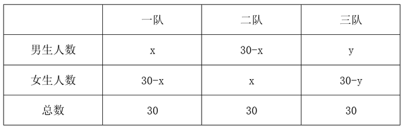

根据“第三队的男生数占全部男生数的2/5”，可得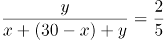，解得y=20，则女生总人数为（30-x）+x+（30-y）=60-y=40人。

故正确答案为B。

**考点**：和差倍比问题

**来源**：2022年深圳市考公务员录用考试《行测》试题（网友回忆版）第51题

### 第 52 题

一批传统手工匠人需在预定时间内完成一笔糖人订单，他们捏糖人的速度都相同，有两种工期安排方案供其选择。方案一：若干名匠人先开工，经过三分之一的预定时间，将人数加倍，在预定时间刚好完成；方案二：10名匠人同时开工，在预定时间也刚好完成，则方案一前期应安排（ ）名匠人。

A. 6

B. 7

C. 8

D. 9

第 52 题 · 答案与解析

**参考答案（粉笔题库参考内容）**

A

**解析**

根据题意，设方案一前期应安排x名匠人，则人数加倍后为2x名匠人。若总时间为3t，则先开工时间为t，人数加倍后时间为2t。因为手工匠人捏糖人速度相同，设每个人效率均为1，根据工作总量相同可得：x∙t+2x×2t=10×3t，解得x=6，则方案一前期应安排6名匠人。

故正确答案为A。

**考点**：给效率比例型

**来源**：2022年深圳市考公务员录用考试《行测》试题（网友回忆版）第52题

### 第 53 题

某商城停车场实行按时长阶梯式收费，收费规则如下：不超出某一基础时长的，按5元/小时收费。超出该基础时长的，超出的部分每小时收费增加3元；停车时长达基础时长3倍以上时，则超出基础时长3倍的部分，每小时收费再增加3元。若甲某次停车离场时超出基础时长11小时，共交费116元，则基础时长为（ ）小时。（该基础时长为整数，停车时长不满1小时的按1小时计）

A. 6

B. 5

C. 4

D. 3

第 53 题 · 答案与解析

**参考答案（粉笔题库参考内容）**

B

**解析**

设基础时长为x小时。若停车时长没有超过基础时长3倍，则根据题意可列方程：5x+11×（5+3）=116，解得x=5.6，为非整数，故停车时长超过基础时长的3倍。由题意可列方程：5x+2x×（5+3）+（11-2x）×（5+3+3）=116，解得x=5。

故正确答案为B。

**考点**：分段计算问题

**来源**：2022年深圳市考公务员录用考试《行测》试题（网友回忆版）第53题

### 第 54 题

实验室有甲、乙、丙3瓶盐酸溶液，浓度分别为10%、40%、60%，实验员将3瓶溶液全部倒入一瓶中，得到浓度为52%的盐酸溶液。已知乙溶液重量为甲溶液的1.5倍，则丙溶液重量为甲溶液的（ ）倍。

A. 4.5

B. 5.5

C. 6.5

D. 7.5

第 54 题 · 答案与解析

**参考答案（粉笔题库参考内容）**

D

**解析**

赋值甲溶液的重量为20，则乙溶液的重量为30。设丙溶液的重量为a。根据公式：浓度=溶质/溶液，则，解得a=150，丙溶液重量为甲溶液的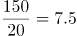倍。

故正确答案为D。

**考点**：多溶液混合

**来源**：2022年深圳市考公务员录用考试《行测》试题（网友回忆版）第54题

### 第 55 题

小王从图书馆借了一本书，书共204页，阅读时，他发现书的前半部分有连续的4个页码被墨水污染，将其余200个页码加总，其和刚好可以被85整除，则被污染的4个页码中最小的数是：

A. 100

B. 95

C. 75

D. 41

第 55 题 · 答案与解析

**参考答案（粉笔题库参考内容）**

D

**解析**

方法一：由题意得，书的页码数构成公差为1的等差数列，根据等差数列求和公式：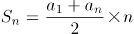，可得该书共有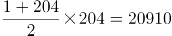页。正面求解复杂，问最小考虑从小到大代入排除。

代入D项，若被污染的4个页码中最小的数是41，则其余200个页码加和=20910-（41+42+43+44）=20740页，20740÷85=244，能够被85整除，可知D项满足题干所有条件，无需继续验证其它选项。

方法二：由题意得，其余200个页码加和=总页码数-被污染的页码数之和=85的倍数，85是5的整数倍；又因总页码数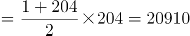，20910是5的整数倍，根据倍数特性，可知被污染的页码数之和一定为5的整数倍。正面求解复杂，问最小考虑从小到大代入排除。

代入D项：被污染的页码数之和=41+42+43+44=170，为5的倍数，满足；

代入C项：被污染的页码数之和=75+76+77+78=306，非5的倍数，排除；

代入B项：被污染的页码数之和=95+96+97+98=386，非5的倍数，排除；

代入A项：被污染的页码数之和=100+101+102+103=406，非5的倍数，排除。

综上可知只有D项满足条件。

故正确答案为D。

**考点**：数列问题

**来源**：2022年深圳市考公务员录用考试《行测》试题（网友回忆版）第55题

### 第 56 题

某公司举行爱心捐赠活动，经初步统计，平均每人捐款92.35元，复核时发现，因笔误将某人捐款100元误写成10元，实际平均每人捐款96.85元，则该公司共有（ ）人捐款。

A. 18

B. 20

C. 25

D. 30

第 56 题 · 答案与解析

**参考答案（粉笔题库参考内容）**

B

**解析**

设该公司共有x人捐款，根据题意可列方程：92.35x+（100-10）=96.85x，解得x=20，即该公司共有20人捐款。

故正确答案为B。

**考点**：和差倍比问题、平均数问题

**来源**：2022年深圳市考公务员录用考试《行测》试题（网友回忆版）第56题

### 第 57 题

小花猫和大黄狗从一周长为210米的环形花园的同一起点同时出发，沿着花园同向奔跑，已知小花猫和大黄狗的初始速度分别为20米/分，160米/分，每当大黄狗追上小花猫一次，大黄狗就减速1/3，小花猫则提速1/3。那么，当小花猫和大黄狗速度刚好相等时，他们共跑了（ ）米。

A. 1250

B. 940

C. 750

D. 1310

第 57 题 · 答案与解析

**参考答案（粉笔题库参考内容）**

A

**解析**

根据在环形道路上同时同地同向出发，大黄狗每追上小花猫一次则多跑一圈，则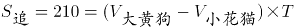，大黄狗每次追上小花猫时的速度变化、所用时间、共跑的路程如下表：

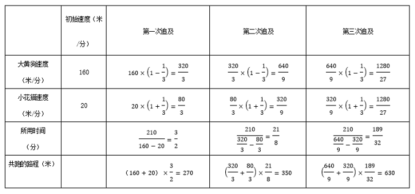

根据上表可知大黄狗在第三次追上小花猫时速度变为相等，此时他们共跑了270+350+630=1250米。

故正确答案为A。

**考点**：相遇追及

**来源**：2022年深圳市考公务员录用考试《行测》试题（网友回忆版）第57题

### 第 58 题

某公司共有60人参加行业考试，考试共设5道必答题，满分为100分，每题答对得20分，答错不扣分，总分60分即为及格。经统计，第1至5题分别有52人、56人、48人、42人、30人答对，则该公司至少有（ ）人及格。

A. 30

B. 36

C. 38

D. 40

第 58 题 · 答案与解析

**参考答案（粉笔题库参考内容）**

B

**解析**

要及格的人数少，则不及格的人数应尽可能多。根据题意，总分低于60分为不及格，即答错60÷20=3题及以上不及格。第1题答错60-52=8人，第2题答错60-56=4人，第3题答错60-48=12人，第4题答错60-42=18人，第5题答错60-30=30人。要让不及格人数尽可能多，则每个不及格的人的错题数尽可能少，即错3道。根据选项推测不及格的人数在20-30人之间，所以每个不及格的人一定都错了第5题，则不及格的人在前四个题中还需错2个。在1-4题中，总的答错题数为8+4+12+18=42道，最多有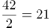人，即不及格的人最多为21人，所以该公司至少有60-21=39人及格。本题无正确答案。

备注：根据选项分析，本题的考查思路可能是：要让不及格人数尽可能多，则每个不及格的人的错题数尽可能少，即错3道，总的答错题数为8+4+12+18+30=72道，不及格人数最多为72÷3=24人，所以该公司至少有60-24=36人及格。

**考点**：非典型最值问题

**来源**：2022年深圳市考公务员录用考试《行测》试题（网友回忆版）第58题

### 第 59 题

小新18岁生日时，收到父母赠送的一只精美手表作为成年礼。手表每一分钟的刻度线上都装饰水晶。晚上7点29分53秒时，手表时针与分针的夹角内共有（ ）颗水晶。

A. 7

B. 8

C. 9

D. 10

第 59 题 · 答案与解析

**参考答案（粉笔题库参考内容）**

B

**解析**

由题意得，每个刻度线上都有一个装饰水晶，则水晶颗数即为时针与分针夹角内刻度线的个数。如图所示，7点29分53秒时，再过7秒恰好7点30分，可知分针此时所在位置为29分与30分之间。时针此时所在位置约为7-8点正中间，按分针刻度计算，为37分与38分之间。故时针与分针夹角内的刻度线包括30分-37分，共8个，即水晶颗数为8颗。

故正确答案为B。

**考点**：钟表问题

**来源**：2022年深圳市考公务员录用考试《行测》试题（网友回忆版）第59题

### 第 60 题

假定一对初生雌雄旅鼠一个月后能够成年，再过一个月便能再生下一对雌雄旅鼠，并且继续以此速度生育，若不考虑其他因素，2021年1月末将一对初生雌雄旅鼠放在屋内，到2021年7月末屋内共有（ ）对雌雄旅鼠？

A. 8

B. 13

C. 21

D. 36

第 60 题 · 答案与解析

**参考答案（粉笔题库参考内容）**

B

**解析**

根据题意，每一对雌雄旅鼠均在第一个月出生，在第二个月待生育，从第三个月开始每个月生育一对雌雄旅鼠，则2021年1月末至7月末的雌雄旅鼠对数如下表：

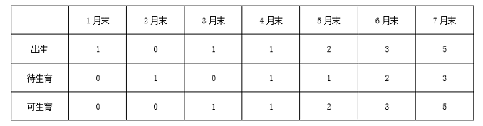

2021年7月末屋内共有5+3+5=13对雌雄旅鼠。

故正确答案为B。

**考点**：计数模型-其他

**来源**：2022年深圳市考公务员录用考试《行测》试题（网友回忆版）第60题

### 第 61 题

将下列选项中的词语依次填入句子横线处，最恰当的一组是：

党的十九大以来，党中央全面分析国际科技创新竞争        ，深入研判国内外发展形势，针对我国科技事业面临的突出问题和挑战，坚持把科技创新摆在国家发展全局的核心位置，全面        科技创新工作。

A. 态势 谋划

B. 大势 谋划

C. 态势 策划

D. 大势 策划

第 61 题 · 答案与解析

**参考答案（粉笔题库参考内容）**

A

**解析**

第一空，根据“全面分析······深入研判······”可知，此处为相同句式构成的近义并列，因此横线处所填词语需与“形势”并列。“形势”指事物发展的状况，A、C两项“态势”指事物发展的形势及状态，与“形势”语义相近，符合文意，保留。B、D两项“大势”指事物发展的趋势，体现为事物发展的动向、倾向，与文意不符，排除。

第二空，搭配“科技创新工作”及“全面”，根据文意可知，横线处应表达如何开展多角度思考宏观的科技创新工作之意。A项“谋划”指计划、想办法，符合文意，且“全面谋划”为常用搭配，当选。C项“策划”指积极主动地想办法，定计划，常用于表达具体事情的计划，不符合文意，且一般不与“全面”搭配使用，排除。

故正确答案为A。

【文段出处】《实现高水平科技自立自强》

**考点**：词的辨析-搭配对象、实词填空、关联关系-并列关系

**来源**：2022年深圳市考公务员录用考试《行测》试题（网友回忆版）第61题

### 第 62 题

将下列选项中的词语填入句子横线处，最恰当的一组是：

这次疫情是对全球卫生治理体系的一次集中        。我们要加强和发挥联合国和世界卫生组织作用，完善全球疾病预防控制体系，更好预防和应对今后的疫情。

A. 检验

B. 考验

C. 锻炼

D. 磨炼

第 62 题 · 答案与解析

**参考答案（粉笔题库参考内容）**

A

**解析**

横线处所填词语形容“疫情”与“全球卫生治理体系”的关系，A项“检验”指检查验看，检查验证，侧重表示对本身应该具备的能力进行验证，全球卫生治理体系理应可以应对疫情，故用“检验”可形容两者关系，表达通过疫情验证全球卫生治理体系是否合格之意，当选。B项“考验”指通过具体事件、行动或困难环境来检验，侧重考察被考验者的水平等，不一定表示对本身应该具备的能力进行验证，排除；C项“锻炼”比喻通过实践，提高人的工作能力和思想水平，D项“磨炼”指人在艰苦困难的环境中经受锻炼，均与“全球卫生治理体系”搭配不当，排除。

故正确答案为A。

【文段出处】《习近平在全球健康峰会上的讲话》

**考点**：词的辨析-词义侧重、词的辨析-搭配对象、实词填空

**来源**：2022年深圳市考公务员录用考试《行测》试题（网友回忆版）第62题

### 第 63 题

将下列选项中的词语依次填入句子横线处，最恰当的一组是：

个人信息保护是数字经济和社会治理的底线，个人信息保护法的一大使命就是划出行为边界，引导并        政府和市场主体，使个人信息的收集、存储、使用、加工、传输、提供、公开等            ，令侵害个人信息的行为能够得到法律惩处，为个人信息保护创造稳定可预期的常态化局面。

A. 约束 有章可循

B. 约束 有据可查

C. 制约 有章可循

D. 制约 有据可查

第 63 题 · 答案与解析

**参考答案（粉笔题库参考内容）**

A

**解析**

第一空，由“个人信息保护法的一大使命就是划出行为边界”可知，横线处应体现出“个人信息保护法”规定了“政府和市场主体”的行为，即法律的规范作用。A、B两项“约束”指按照约定（特定）条件限制，管束，多与“法律、协议、道德”等搭配，置于此处可体现出法律对政府和市场主体的规范作用，符合文意，保留。C、D两项“制约”指一事物的存在、变化是另一事物存在、变化的先决条件，则前者制约后者，侧重限制，并非法律的规范作用，排除。

第二空，形容“个人信息保护法”所带来的效果，即让“个人信息的收集”等行为有法可依，A项“有章可循”指有章法可以遵循，符合文意，当选。B项“有据可查”意思是有依据可以查到，指的是在办事工作过程中，要注意保留依据，与文意不符，排除。

故正确答案为A。

【文段出处】《社论｜个人信息保护亟待进入常态化》

**考点**：词的辨析-词义侧重、混搭填空

**来源**：2022年深圳市考公务员录用考试《行测》试题（网友回忆版）第63题

### 第 64 题

将下列选项中的词语依次填入句子横线处，最恰当的一组是：

身居“唐宋八大家”之列的欧阳修，        文章冠绝一时，其为政措施        颇具创新意识。        欧阳修一生仕途坎坷，为官几十年竟遭三次贬谪，但他始终宠辱不惊，晚年        是旷达潇洒。

A. 不但 还 不过 更

B. 不仅 也 尽管 也

C. 不仅 也 不过 更

D. 不但 还 尽管 也

第 64 题 · 答案与解析

**参考答案（粉笔题库参考内容）**

B

**解析**

本题可从前两空入手，根据“文章冠绝一时”“为政措施······颇具创新意识”可知，文段意在说明欧阳修的文章和为政措施均十分优秀。B、C两项“不仅······也······”可引导并列关系，符合文段逻辑，保留。A、D两项“不但······还······”表示递进关系，强调后者，而文段并未强调欧阳修的政治能力更加突出，与文段逻辑不符，排除。

第三空，根据文意可知，横线处所填词语与“但”连用构成转折关系。B项“尽管”表示姑且承认某种事实，关联词搭配恰当，保留。C项“不过”表示转折关系，与后文“但”无法衔接，排除。

第四空，代入验证。“宠辱不惊”“旷达潇洒”均体现欧阳修面对坎坷时的豁达，B项“也”表示并列关系，置于此处逻辑恰当，当选。

故正确答案为B。

**考点**：对应关系-前后呼应、关联关系-并列关系

**来源**：2022年深圳市考公务员录用考试《行测》试题（网友回忆版）第64题

### 第 65 题

将下列选项中的词语依次填入句子横线处，最恰当的一组是：

择业观是价值观和人生观的        ，也是社会发展变化的          ，就业观念的变化，折射出当代青年身上的朝气与锐气，也折射出时代的发展在当代青年身上留下的印记。

A. 掠影 指南针

B. 缩影 指南针

C. 掠影 风向标

D. 缩影 风向标

第 65 题 · 答案与解析

**参考答案（粉笔题库参考内容）**

D

**解析**

第一空，根据“择业观是价值观和人生观”以及后文可知，横线处需表达“择业观”是“价值观和人生观”的集中体现，B、D两项“缩影”比喻能代表同一类型特征的具体而微的人或事物，与文意相符，保留。A、C两项“掠影”指某些场面的大致情况，与文意不符，排除。

第二空，根据文意可知，横线处需表达通过“择业观”可以知道社会的发展变化，D项“风向标”本意为一种测定风来向的设备，引申为某种事物的发展趋势和方向，置于此处可以体现从“择业观”可知社会的发展变化，符合文意，当选。B项“指南针”比喻辨别正确方向的依据或指导行动的准则，文段并未体现依据或准则，与文意不符，排除。

故正确答案为D。

【文段出处】《让每个选择都有光芒》

**考点**：实词填空、对应关系-前后呼应

**来源**：2022年深圳市考公务员录用考试《行测》试题（网友回忆版）第65题

### 第 66 题

将下列选项中的词语依次填入句子横线处，最恰当的一组是：

在很多外地人看来，把江西人称为“老表”，似乎是一种贬义，因为“老表”这两个字很下里巴人。江西人却以有这样一个称呼而感到非常自豪，无论海角天涯，无论是否            ，相互之间只要听到“我是老表”，马上就像            的亲戚一样。

A. 萍水相逢 不期而遇

B. 素昧平生 久别重逢

C. 素昧平生 不期而遇

D. 萍水相逢 久别重逢

第 66 题 · 答案与解析

**参考答案（粉笔题库参考内容）**

B

**解析**

第一空，根据“无论海角天涯······只要听到‘我是老表’，马上就像······的亲戚一样”可知，对江西人来说，不管在哪，不管面对什么样的人，“老表”这一称呼可迅速且极大地拉近人与人之间的关系，故横线处应体现一开始关系非常陌生之意。B、C两项“素昧平生”意为一向不相识，能体现关系非常陌生之意，与文意相符，保留。A、D两项“萍水相逢”比喻向来不认识的人偶然相遇，强调相遇，与文意不符，且与“素昧平生”相比，程度较轻，排除。

第二空，根据“亲戚”可知，横线处应体现关系亲密、亲切之感。B项“久别重逢”意为长久分别后再次相逢，能体现关系亲密、亲切之感，当选。C项“不期而遇”意为没有约定而意外地相遇，强调偶然相遇，无法体现亲密、亲切之感，排除。

故正确答案为B。

【文段出处】《江西老表》

**考点**：词的辨析-程度轻重、对应关系-前后呼应、成语填空

**来源**：2022年深圳市考公务员录用考试《行测》试题（网友回忆版）第66题

### 第 67 题

将下列选项中的词语依次填入句子横线处，最恰当的一组是：

他深知沦落江湖的艺人的        和痛苦，他是带着深厚的挚爱和同情来        这两个受着生活重压的小人物的。

A. 心酸 刻画

B. 心酸 描绘

C. 辛酸 刻画

D. 辛酸 描绘

第 67 题 · 答案与解析

**参考答案（粉笔题库参考内容）**

C

**解析**

第一空，横线处所填词语形容“沦落江湖的艺人”，体现出他们漂泊、流离的悲惨生活，C、D两项“辛酸”比喻痛苦悲伤，侧重于对生活状态以及经历某种历程的一种描写，可以与艺人“沦落江湖”的经历形成对应，符合语境，保留。A、B两项“心酸”指心中悲痛，侧重于表达内心伤心难过的一种感受，文段并非强调伤心难过的感受，不符合语境，排除。

第二空，根据文意可知，他是带着深厚的挚爱和同情来塑造这两个受着生活重压的小人物的，C项“刻画”指用文字描写或用其他艺术手段表现（人物的形象、性格等），更侧重于深刻而细致地描写，符合语境，当选。D项“描绘”指画，也指用语言文字来描写，侧重于生动形象地描写，文段并非强调“生动形象”，不符合语境，排除。

故正确答案为C。

【文段出处】《悲剧与赞歌——关于卓别林的<舞台生涯>》

**考点**：词的辨析-词义侧重、实词填空

**来源**：2022年深圳市考公务员录用考试《行测》试题（网友回忆版）第67题

### 第 68 题

将下列选项中的词语依次填入各句横线处，最恰当的一组是：

（1）如果仅凭蜻蜓点水式的观感，作出以偏概全的判断，就容易盲人摸象、            ，就难以读懂真实而鲜活的农村，甚至陷入悲观悲情的泥潭。

（2）在中华民族近代史上，贫困如影随形：多灾多难、饿殍遍地的记录            。

A. 目无全牛 俯拾皆是

B. 一叶障目 俯拾皆是

C. 目无全牛 不胜枚举

D. 一叶障目 不胜枚举

第 68 题 · 答案与解析

**参考答案（粉笔题库参考内容）**

D

**解析**

第一空，根据顿号可知，横线处所填成语与“盲人摸象”构成近义并列，含义相近，表示看问题不全面，以偏概全之意，B、D两项“一叶障目”比喻被局部的或暂时的现象所迷惑，不能认清事物的全貌或问题的本质，符合文意，保留。A、C两项“目无全牛”形容人的技艺高超，得心应手，已经到达非常纯熟的地步，不符合文意，排除。

第二空，搭配“记录”，且根据前文“贫困如影随形”可知，横线处所填成语表示“饿殍遍地的记录”非常多，D项“不胜枚举”指无法一一全举出来，形容数量极多，符合文意，当选。B项“俯拾皆是”意思是只要低下头来捡取，到处都是，形容多而易得，虽然能体现多的含义，但与“记录”搭配不当，排除。

故正确答案为D。

【文段出处】《心怀农村沃土 激扬梦想力量》《中国反贫困斗争的伟大决战》

**考点**：词的辨析-搭配对象、成语填空、关联关系-并列关系

**来源**：2022年深圳市考公务员录用考试《行测》试题（网友回忆版）第68题

### 第 69 题

将下列选项中的词语依次填入句子横线处，最恰当的一组是：

当时，军管组动辄干预并批判他们的技术工作，技术讨论会上甚至不允许使用外文字母作符号。很多技术人员自叹如倾巢之卵，            ，即使慎重、委婉地表达看法，也仍常遭批判。但每次讨论会上，他仍坚持讲真话，明确地讲出自己对技术问题的看法，绝不            。

A. 守口如瓶 随声附和

B. 噤若寒蝉 广谋从众

C. 守口如瓶 广谋从众

D. 噤若寒蝉 随声附和

第 69 题 · 答案与解析

**参考答案（粉笔题库参考内容）**

D

**解析**

第一空，横线处与“倾巢之卵”构成近义并列，且根据横线前后文可知，横线处成语应体现技术人员因为害怕而不敢说话之意，B、D两项“噤若寒蝉”形容受到压制不敢作声，符合文意，保留。A、C两项“守口如瓶”形容说话谨慎，严守秘密，侧重于强调保守秘密，但文段并没有体现出需要保守秘密，与文意不符，排除。

第二空，根据横线前“他仍坚持讲真话，明确地讲出自己对技术问题的看法”可知，他是有自己主见的，横线前出现否定词“绝不”，故横线处成语应体现没有主见的意思，D项“随声附和”指自己没有主见，别人说什么，自己跟着说什么，符合文意，当选。B项“广谋从众”指集思广益，听从多数人的意见，与文意不符，排除。

故正确答案为D。

【文段出处】新华网《国家最高科技奖获得者于敏：愿将一生献宏谋》

**考点**：成语填空、对应关系-形象表达、关联关系-并列关系

**来源**：2022年深圳市考公务员录用考试《行测》试题（网友回忆版）第69题

### 第 70 题

将下列选项中的词语依次填入句子横线处，最恰当的一组是：

在博物馆展厅中心，一件19世纪的婚纱头纱美得令人            。这件平铺面积达7平方米的头纱耗时数十年制作，将所有阿朗松针织花边技艺融为一体，仿佛一本花边“百科全书”。人们观赏它，是在探寻时光的        ，也是        时间打磨后的精湛技艺。

A. 心旷神怡 绚烂 品味

B. 心旷神怡 瑰丽 领会

C. 屏息凝神 瑰丽 感受

D. 屏息凝神 绚烂 研习

第 70 题 · 答案与解析

**参考答案（粉笔题库参考内容）**

C

**解析**

第一空，根据前文“婚纱头纱美得令人”及后文“耗时数十年制作”“所有”可知，横线处成语形容头纱之美带给人的强烈感受，C、D两项“屏息凝神”指全神贯注地看，连呼吸都不敢呼吸一下，符合文意，保留。A、B两项“心旷神怡”指心情舒畅，精神愉快，与“屏息凝神”相比，程度较轻，排除。

第二空，搭配“时光”，C项“瑰丽”、D项“绚烂”均符合文意，保留。

第三空，搭配“技艺”，且根据前文“人们观赏它”可知，通过对头纱的观赏人们能够体会到当年技艺的精湛，C项“感受”符合文意，当选。D项“研习”指研究学习，并非是人们通过“观赏”就能够实现的，排除。

故正确答案为C。

【文段出处】《一针一线编织时光倩影（多彩非遗）》

**考点**：词的辨析-搭配对象、词的辨析-程度轻重、对应关系-前后呼应、混搭填空

**来源**：2022年深圳市考公务员录用考试《行测》试题（网友回忆版）第70题

### 第 71 题

下列各项中，没有语病的一项是：

A. 月饼创新的落脚点，不仅是要在包装上花样翻新，而是要在口味上与时俱进。

B. 社交媒体上的“家长群”是把双刃剑，它拉近了学校和家庭的距离，降低了老师和家长沟通的成本，同时也会产生很多矛盾。

C. 家暴不是“家务事”，反家庭暴力是家庭、国家和社会的共同责任。

D. 理想的平台不是一对一的众声喧哗，也不应该成为一些人攀比、逞能、谋求私利或推卸责任的“角斗场”。

第 71 题 · 答案与解析

**参考答案（粉笔题库参考内容）**

B

**解析**

本题为病句辨析题。

A项，“不仅是······而是······”关联词搭配不当，应改为“不是······而是”，排除；

B项，没有语病，表意明确，当选；

C项，“家庭、国家和社会”排列顺序不当，应由大到小排列，改为“国家、社会和家庭”，排除；

D项，“理想的平台不是一对一的众声喧哗”成分残缺，应改为“理想的平台不是一对一的众声喧哗之所”，排除。

故正确答案为B。

**来源**：2022年深圳市考公务员录用考试《行测》试题（网友回忆版）第71题

### 第 72 题

下列各项中，有语病的一项是：

A. 作家是一个敏感的群体，对他们而言，花园是一个庇护所，一个让幻想飞翔的地方。

B. 由于心理压力较大，他决定通过占卜的方式给自己信心。

C. 海阔、湖清、河畅、水净、景美，深圳的冬天着实是一个好地方。

D. 近年来，校外培训在资本助力下迅速扩张，加重了学生课业负担和家长经济负担，减损了人民群众的获得感。

第 72 题 · 答案与解析

**参考答案（粉笔题库参考内容）**

C

**解析**

本题为病句辨析题。

C项，“深圳的冬天着实是一个好地方”主宾搭配不当，应改为“冬天的深圳着实是一个好地方”，当选；

A、B、D三项均没有病句，表意明确，排除。

故正确答案为C。

**来源**：2022年深圳市考公务员录用考试《行测》试题（网友回忆版）第72题

### 第 73 题

下列选项中，没有语病的一项是：

A. 20世纪60年代，西班牙语美洲叙事文学领域的“文学爆炸”，使拉丁美洲文学推向了世界。

B. 傍晚，我们登上回龙山最高处，映入眼帘的是莽莽青山、灼灼晚霞和阵阵凉爽的清风。

C. 现编新教材里的很多课文，对一线经验丰富的教师是再熟悉不过了。

D. 创新不是一蹴而就的，特别是基础科学领域的创新，往往需要“板凳坐得十年冷”的耐心和定力。

第 73 题 · 答案与解析

**参考答案（粉笔题库参考内容）**

D

**解析**

A项，“使······推向了······”搭配不当，可将“使”改为“将”，排除；

B项，“映入眼帘”与“阵阵凉爽的清风”搭配不当，排除；

C项，语序不当，可改为“一线经验丰富的教师对现编新教材里的很多课文再熟悉不过了”，排除；

D项，句子没有语病，句意明确，当选。

故正确答案为D。

【文段出处】《从马尔克斯到略萨：回溯“文学爆炸”》《书写科技强军新篇章》

**来源**：2022年深圳市考公务员录用考试《行测》试题（网友回忆版）第73题

### 第 74 题

下列选项中，有语病的一项是：

A. “枪声就是命令。”驻扎在附近的八路军115师老四团八连听到枪声后，立即赶来营救朱村百姓，有24名官兵牺牲在这里。

B. 珍珠苑种植专业合作社是由朱村党支部领办的，完成葡萄、香菇特色农产品的绿色认证，注册“珠村”“七岌山”商标，打造了“朱村味道”电商品牌。

C. 沂蒙山区腹地，沂河水畔，曹庄镇朱村，越来越热闹了。一拨又一拨游客来到这里，听红色故事，悟革命传统，品特色文化。

D. 这些年，朱村的变化翻天覆地：建起朱村大桥，开通滨河大道，水泥大道户户通······从偏居一隅变得四通八达。

第 74 题 · 答案与解析

**参考答案（粉笔题库参考内容）**

B

**解析**

B项，“完成葡萄、香菇特色农产品的绿色认证”缺少主语，成分残缺，应改为“朱村党支部领办的珍珠苑种植专业合作社，完成葡萄、香菇特色农产品的绿色认证······”，故存在语病，当选。

A、C、D三项均表述恰当，没有语病，排除。

故正确答案为B。

【文段出处】《朱村的日子红火起来》

**来源**：2022年深圳市考公务员录用考试《行测》试题（网友回忆版）第74题

### 第 75 题

①强盛的罗马帝国灭亡于野蛮的汪达尔人入侵，光芒四射的希腊诸城邦亡于马其顿人等等，均属游牧、半游牧文明战胜农耕文明的典型例证

②尽管受到前朝志士顽强的抵制和反抗，但当尘埃落定，河山重整，世人别无选择，只能像杜牧慨叹的那样“折戟沉沙铁未销，自将磨洗认前朝”了

③在中国，宋、明两个王朝也都是被北方经济文化落后的少数民族灭亡的。偏安王朝因没落而退出历史舞台，九服之外的族群因雄起改变正统走向

④可以说，不论西方文明史还是东方文明史，都是血与火书写的，都是征服与被征服的历史

⑤值得注意的是，野蛮部落灭掉了文明族群，虎狼之国吞并了礼仪之邦，在人类社会发展中并非个案

将以上5个句子重新排列，语序恰当的一项是：

A. ⑤①③④②

B. ⑤④①③②

C. ④⑤①③②

D. ④⑤③①②

第 75 题 · 答案与解析

**参考答案（粉笔题库参考内容）**

C

**解析**

对比选项，确定首句。④句指出东西方文明史的共同点，⑤句介绍了部落间的吞并，从内容上难以判断首句。

继续观察发现，⑤句提到“虎狼之国吞并了礼仪之邦，在人类社会发展中并非个案”，按照逻辑顺序，接下来应论述具体情况，⑤句后分别衔接①③④三句，①句论述游牧、半游牧文明战胜农耕文明的典型例证，③句介绍宋、明两个王朝的衰亡，⑤句后衔接①③两句均可，保留A、C、D三项。④句指出东西方文明史的共同点，与⑤句话题不一致，排除B项。

接下来继续观察，②句论述“前朝志士”，③句论述“宋、明两个王朝”，论述的内容均与“王朝”相关，故③②两句构成共同信息捆绑，排除A、D两项，保留C项。

验证C项，文段先指出在西方文明史和东方文明史中都有征服与被征服的历史，然后具体介绍有关事例，符合逻辑，当选。

故正确答案为C。

【文段出处】《文明与野蛮的较量——古代战争的基本逻辑》

**考点**：确定捆绑、确定顺序

**来源**：2022年深圳市考公务员录用考试《行测》试题（网友回忆版）第75题

### 第 76 题

对旅游业而言，风景固然很重要，游客口碑更关键。游客都是乘兴而来，希望赏美景、享美食、获得良好服务、留下美好回忆。游客如愿以偿，一传十，十传百，是最生动的“广告”。同时，出门在外，人生地不熟，谁都不愿遇到“欺生”，更怕权益受损、投诉遇冷、败兴而归，那岂不是花钱找罪受？“宰客”事件频发，公然忽悠蒙骗，地方处置不力，自然会令有关地区的旅游形象大打折扣，一些热门旅游地“转冷”殷鉴不远。

下列对上文的理解有误的是：

A. 旅游业管理者不仅要重视打造美景，更要重视打造口碑

B. 唯有游客尽兴而归，才能维护旅游地的游客口碑

C. 地方对“宰客”等旅游问题要处置得力才能暖人心

D. 一些热门旅游地或因“宰客”事件频发而遭遇冷落

第 76 题 · 答案与解析

**参考答案（粉笔题库参考内容）**

B

**解析**

A项，根据“对旅游业而言，风景固然很重要，游客口碑更关键”可知，表述正确，排除；

B项，根据“游客都是乘兴而来······游客如愿以偿，一传十，十传百，是最生动的‘广告’”可知，“唯有······才······”表述过于绝对，当选；

C、D两项，根据“‘宰客’事件频发，公然忽悠蒙骗，地方处置不力，自然会令有关地区的旅游形象大打折扣，一些热门旅游地‘转冷’殷鉴不远”可知，均表述正确，排除。

本题为选非题，故正确答案为B。

【文段出处】《大理昆明被通报，旅游乱象须整治》

**考点**：细节判断题

**来源**：2022年深圳市考公务员录用考试《行测》试题（网友回忆版）第76题

### 第 77 题

面对新时代教育的变革与重塑，教师作为教育实践环节的直接执行者，必须以先行者的姿态投身于这场历史洪流之中，而完成这一蜕变的关键就在于，让教师重新构建起以学习科学素养为核心的知识能力体系。对于新时代高水平教师队伍建设来说，学习科学素养不仅仅是对学习科学知识技能的进一步学习与拓展，更重要的是，它从实践应用和意识形态这两个层次，对教师在一线教学中深入理解和综合应用学习科学提出了更高的要求。教师需要从真实学习的基础机制出发，结合真实学科教学的有效设计与学习的有效评价，逐步完成自身学习科学素养的学习与构建。这一综合素养的形成，不仅需要教师自身付出艰巨的努力，同时也需要外界提供强有力的支持。

下列说法与原文意思不相符的是：

A. 教师必须重新构建起以学习科学素养为核心的知识能力体系，否则将难以适应新时代教育的变革与重塑

B. 教师应该从实践应用和意识形态这两个层次，进一步学习与拓展学习科学知识技能

C. 真实学习的基础机制，真实学科教学的有效设计与学习的有效评价是教师学习科学素养建构不可或缺的要素

D. 教师依靠自身，无法形成以学习科学素养为核心的综合素养

第 77 题 · 答案与解析

**参考答案（粉笔题库参考内容）**

B

**解析**

A项，由“面对新时代教育的变革与重塑······知识能力体系”可知，表述正确，排除；

B项，由“学习科学素养不仅仅······提出了更高的要求”可知，“学习与拓展学习科学知识技能”与“从实践应用和意识形态这两个层次，对教师提出了更高的要求”为“学习科学素养”的两部分内容，表述错误，当选；

C项，由“教师需要从真实学习的基础机制出发······科学素养的学习与构建”可知，表述正确，排除；

D项，由“这一综合素养的形成······同时也需要外界提供强有力的支持”可知，表述正确，排除。

本题为选非题，故正确答案为B。

【文段出处】《高水平教师需养成学习科学素养》

**考点**：细节判断题

**来源**：2022年深圳市考公务员录用考试《行测》试题（网友回忆版）第77题

### 第 78 题

科学技术可以改善耕地条件，进而扩大某些粮食作物种植区域，还可以提高粮食生产过程中有限资源的利用率。例如在实施塑料薄膜覆盖后，土壤一般可增温2~5°C，覆盖期内地表积温增加°C，从而使作物适宜耕作区的纬度向北推移2~4°，海拔提高1000～2000m。该技术可应用的作物范围广，一般增产幅度可达30％～50％。农机装备技术的进步也至关重要。深松机、无人驾驶联合耕播作业机等机械设备逐渐被推广使用，很多新技术也在其中得到应用。如遥感技术可应用于农业资源调查、动态监测、生物产量估计与农业灾害预报等领域。

下列说法与原文意思相符的是：

A. 科技可使农作物的种植范围不受海拔限制

B. 提高有限资源的利用率可使粮食产量增加

C. 覆盖塑料薄膜可以使土壤增温°C

D. 遥感技术既能改善农业资源，又能预报农业灾害

第 78 题 · 答案与解析

**参考答案（粉笔题库参考内容）**

B

**解析**

A项，根据“从而使······海拔提高1000～2000m”可知，文段仅论述农作物在实施塑料薄膜覆盖后，可以使作物适宜耕作区的海拔在一定范围内提高，“种植范围不受海拔限制”表述过于绝对，排除；

B项，根据“科学技术······可以提高粮食生产过程中有限资源的利用率”及“该技术可应用的作物范围广，一般增产幅度可达30％～50％”可知，文段指出科学技术可以提升有限资源的利用率进而实现增产，表述正确，当选；

C项，根据“例如在实施塑料薄膜覆盖后，土壤一般可增温2~5°C，覆盖期内地表积温增加°C”可知，文段论述的是地表积温增加°C，而非“土壤增温°C”，偷换概念，排除；

D项，根据“如遥感技术可应用于农业资源调查、动态监测、生物产量估计与农业灾害预报等领域”可知，“遥感技术能改善农业资源”文段并未提及，无中生有，排除。

故正确答案为B。

【文段出处】《2021年高考语文第一次综合模拟评估卷（三）》

**考点**：细节判断题

**来源**：2022年深圳市考公务员录用考试《行测》试题（网友回忆版）第78题

### 第 79 题

火星在40亿年前是一个湿润、温暖，且拥有浓厚大气层的星球。其岩石圈、水和大气之间的相互作用在地表形成了河流、湖泊和地表沉积物。随着火星内部热活动的快速减弱和大气层的逐渐消失，其地表的液态水也随之消失，气候变得干冷，水动力过程对地表结构塑造的主导地位逐渐被风动力所取代。这种由温湿转变到干冷的气候变化大约持续了数亿年的时间，火星的表面逐渐演变成为一个不再宜居的环境。

下列说法与原文意思相符的是：

A. 40亿年前的火星曾有生命且环境宜居

B. 如今的火星气候干冷，液态水已不复存在

C. 火星表面曾存在与水活动相关的地貌

D. 如今不再宜居的环境已经几乎排除了火星上存在生命的可能

第 79 题 · 答案与解析

**参考答案（粉笔题库参考内容）**

C

**解析**

A项，根据文意可知，文段未提及“火星曾有生命”，无中生有，排除；

B项，根据“随着火星内部热活动······其地表的液态水也随之消失，气候变得干冷”可知，仅火星地表的液态水消失，故“液态水已不复存在”范围扩大，排除；

C项，根据“其岩石圈、水和大气之间的相互作用在地表形成了河流、湖泊和地表沉积物”“水动力过程对地表结构塑造的主导地位逐渐被风动力所取代”可知，表述正确，当选；

D项，根据“火星的表面逐渐演变成为一个不再宜居的环境”可知，火星表面不再宜居，而火星上其他地方的情况并未提及，无法排除火星上存在生命的可能，表述绝对，排除。

故正确答案为C。

【文段出处】《火星PK柴达木盆地 火星上是否有生命似可在柴达木盆地找到线索》

**考点**：细节判断题

**来源**：2022年深圳市考公务员录用考试《行测》试题（网友回忆版）第79题

### 第 80 题

秦中央集权的确立，还离不开文书行政体制。文书行政，是依靠公文来传递政务信息的政务运行机制。由于文书能保证信息的一致性，不会因层层下达而走样，所以是非常有效的统治工具。秦很重视文书行政。1975年出土的睡虎地秦墓竹简，抄有大量秦律令，其中一条讲：“有事请也，必以书，毋口请，毋羁请（有事情必须请示时，一定要以文书的形式，不要口头请示，也不要让人代为请示）。”它明确要求必须用文书来处理政务。秦律还有《行书律》，专门对文书的收发、传送作严格规定。律文规定，邮传机构接到皇帝的诏书必须立即发送，如有稽留，必受惩罚。通过文书行政，秦王朝确保了中央与地方政务信息的一体化。

下列说法与原文意思相符的是：

A. 文书行政体制是秦中央集权下的特有政务运行机制

B. 在秦王朝以口头形式处理政务会受到惩罚

C. 睡虎地秦墓竹简专门记载了秦王朝的政务处理程序规定

D. 文书行政是秦王朝实现中央与地方政务信息一体化的统治工具

第 80 题 · 答案与解析

**参考答案（粉笔题库参考内容）**

D

**解析**

A项，根据文意可知，文段未提及“特有政务运行机制”，无中生有，排除；

B项，根据“有事情必须请示时，一定要以文书的形式，不要口头请示，也不要让人代为请示”可知，文段未提及“口头形式处理政务会受到惩罚”，无中生有，排除；

C项，根据“1975年出土的睡虎地秦墓竹简······明确要求必须用文书来处理政务”可知，“睡虎地秦墓竹简”只提到用文书处理政务，并未提及处理程序，故“处理程序”无中生有，排除；

D项，根据“通过文书行政，秦王朝确保了中央与地方政务信息的一体化”可知，表述正确，当选。

故正确答案为D。

【文段出处】《公元前220年秦的统一》

**考点**：细节判断题

**来源**：2022年深圳市考公务员录用考试《行测》试题（网友回忆版）第80题

### 第 81 题

景观就是具有观赏价值的风景，文学景观则是指那些与文学密切相关的景观。文学景观比普通的景观多了一层文学色彩和内涵，是地理环境与文学互相作用的结果，是文学的一种地理呈现。当人们到了文学名篇诞生地时，必然会产生“江山留胜迹，我辈复登临”的渴望，哪怕这座楼是重建的，也可以满足人们欣赏文学景观，触发情感共鸣的需求，名楼的魅力除了来源于楼本身，更多是来源于文学经典，                    。

填入上文横线处的句子，最恰当的是：

A. 如果没有文学和名人加持，楼就很难成为名楼

B. 只要有文学和名人加持，楼就能成为名楼

C. 只有文学和名人的加持，才能使楼成为名楼

D. 当然，即使有了文学和名人加持，楼也未必能成为名楼

第 81 题 · 答案与解析

**参考答案（粉笔题库参考内容）**

A

**解析**

本题为语句填空题，横线在结尾。文段开篇表明景观与文学景观的含义，并指出文学景观与普通景观的区别，即多了一层文学色彩和内涵，紧接着强调人们之所以到“名楼”，除了“楼”本身，更因为其来源于“文学经典”。横线处与尾句衔接紧密，故应强调文学与名人对于“名楼”的重要性。

A项，“如果没有······楼就很难成为名楼”为反面论证的表述，再次强调文学与名人对于“名楼”的重要性，与上文衔接得当，且“很难成为”表述较为温和，当选；

B项，“只要······就······”表述过于绝对，文段仅强调其很重要，并未强调二者之间存在必然的联系，排除；

C项，“只有······才······”为必要条件关联词，相较文段而言表述程度过重，排除；

D项，“未必能成为名楼”说明文学与名人对于“名楼”并没有那么重要，与文意相悖，排除。

故正确答案为A。

【文段出处】《“丝绸之路”上的文学景观》

**考点**：横线在结尾

**来源**：2022年深圳市考公务员录用考试《行测》试题（网友回忆版）第81题

### 第 82 题

在古代，许多诗人的作品是通过个人题壁、歌女吟唱的方式传之四方。在现代，传统文化不仅可以通过图书、报刊、音像、影视等形式进行传播，还可以通过日常生活中的用具进行传播。作为文房清玩的笺纸，由于和知识分子的生活密不可分，因此扮演了传承传统文化的角色。笺纸中不仅有图画，而且有书法，有篆刻，有诗词，有掌故，通过笺纸，人们可以重温诗词歌赋的名句，可以品味传统文化的精神。比如，林纾的宋人词意笺，陈师曾的杜甫诗意笺，都在很大程度上普及了唐诗宋词。

上文表达的主要观点是：

A. 传统文化的现代传播途径以笺纸为主

B. 唐诗宋词的普及与诗词意笺密不可分

C. 诗词作品的传播形式古今有异

D. 笺纸发挥了传承传统文化的重要作用

第 82 题 · 答案与解析

**参考答案（粉笔题库参考内容）**

D

**解析**

文段开篇介绍在古代，许多诗人的作品是通过个人题壁、歌女吟唱的方式传播，接着论述在现代，传统文化可以通过多种形式进行传播。随后引出“笺纸”这个话题，紧接着通过结论词“因此”进行总结，指出“笺纸”扮演了传承传统文化的角色，文段结尾对笺纸传承传统文化进行了举例说明。故文段重点为中间的结论，强调“笺纸”对传承传统文化有重要作用，对应D项。

A项，“现代传播途径以笺纸为主”文段未提及，无中生有，排除；

B项，“唐诗宋词”对应“比如”之后举例说明的内容，非重点，排除；

C项，缺少文段主题词“笺纸”，且“传播形式”对应“因此”之前的内容，非重点，排除。

故正确答案为D。

【文段出处】《中国笺纸：微型国画的人文情怀》

**考点**：主题词

**来源**：2022年深圳市考公务员录用考试《行测》试题（网友回忆版）第82题

### 第 83 题

没有安全的国家环境，人们怎么能一心脱贫攻坚并取得历史性成就？没有国家安全、社会稳定，推动创新发展、协调发展、绿色发展、开放发展、共享发展，经济社会发展怎么会有源源不断的活力和动力？没有维护国家安全的能力和信心，面对来势汹汹的新冠肺炎疫情，怎么能以众志成城之力抵挡住病毒的侵袭？国家安全、社会安定、人心安稳，不是从天上掉下来的，而是在发展实践中用行动维护而来的、捍卫而得的、奋战而赢的。

上文表达的主要观点是：

A. 创新发展、协调发展、绿色发展、开放发展、共享发展是当前经济社会发展的实践指南

B. 社会发展的活力和动力是战胜疫情、维护国家安全和社会安定的基本保障

C. 事实告诉我们，没有安全和稳定，一切都无从谈起

D. 在发展实践中，我们要用切实的行动来维护国家安全、社会安定和人心安稳

第 83 题 · 答案与解析

**参考答案（粉笔题库参考内容）**

C

**解析**

语段通过一连串反问句强调了国家安全和稳定的重要性，主要谈的是“安全和稳定”的重要性，因此C项正确。而A、B项则为某一论据的语段外延展，或强行进行因果关联；D项虽与末句意思相同，但并非语段主旨。

故正确答案为C。

【文段出处】《人民网评：守护国家安全，人人有份有责》

**考点**：分述句特征-多角度论述、关联词-转折

**来源**：2022年深圳市考公务员录用考试《行测》试题（网友回忆版）第83题

### 第 84 题

笔墨大咖，顾名思义，是指在笔墨功夫上有追求、有造就、有作为的人。文学作品、中国书画等等，所倾注的正是淋漓酣畅的笔墨意韵。一个人若是总能做到意在笔先，又何愁不能泼洒出意韵生动的笔墨图景？这样的人，成为笔墨大咖是迟早的事。

上文“这样的人”是指：

A. 能做到意在笔先的人

B. 能泼洒出意韵生动的笔墨图景的人

C. 能倾注淋漓酣畅的笔墨意韵的人

D. 在笔墨功夫上有追求、有造就、有作为的人

第 84 题 · 答案与解析

**参考答案（粉笔题库参考内容）**

A

**解析**

本题为代词指代题，首先定位“这样的人”出现在文段尾句，重点关注其之前的内容，前文通过反问句，着重强调“做到意在笔先”的人不愁泼洒出意韵生动的笔墨图景，故“这样的人”即“总能做到意在笔先”的人，对应A项。

B项，“能泼洒出意韵生动的笔墨图景”是“做到意在笔先”之后带来的意义，并非前一句话中的重点内容，排除；

C项“能倾注淋漓酣畅的笔墨意韵”和D项“在笔墨功夫上有追求、有造就、有作为”对应文段前两句话的内容，并非代词指代的内容，均排除。

故正确答案为A。

【文段出处】《笔墨大咖》

**考点**：代词

**来源**：2022年深圳市考公务员录用考试《行测》试题（网友回忆版）第84题

### 第 85 题

日前，四川博物院展出了反映古人分餐制的食具——“清河食官”铜染器，引发了人们的思考：“分餐制”是古已有之的吗？中国社会科学院考古研究所研究员给出的解释是，分餐制可上溯到史前时代。两汉时期，分餐制得到了很好的传承。当时人们没有坐具，分餐进食时，面前摆着一张低矮小食案，一人一案，案上放着食具。考古发现的汉墓壁画及画像石砖等实物和绘画资料，都可以证明这一点。五朝十六国时期，高足坐具的流行，导致传统席地而坐逐渐被更轻松的垂足坐姿取代，也进而影响分餐向会餐的转变。

根据上文，下列对中国古代分餐制理解正确的是：

A. 古人分餐进食的主要食具为铜染器

B. 分餐制在两汉时期得到了全国推广和普及

C. 考古资料证实，古人围案而坐，各有餐具，分餐进食

D. 历史上分餐制到会餐制的演变与古人坐姿变化有关

第 85 题 · 答案与解析

**参考答案（粉笔题库参考内容）**

D

**解析**

A项，根据“四川博物院展出了反映古人分餐制的食具——‘清河食官’铜染器”可知，铜染器虽是分餐制的食具，但是否为“主要食具”文段未提及，无中生有，排除；

B项，根据“两汉时期，分餐制得到了很好的传承”可知，分餐制是否“得到了全国推广和普及”文段未提及，无中生有，排除；

C项，根据“分餐进食时，面前摆着一张低矮小食案，一人一案，案上放着食具”可知，分餐制下古人一人一案、分餐进食，而非“围案而坐”，表述错误，排除；

D项，根据“高足坐具的流行，导致传统席地而坐逐渐被更轻松的垂足坐姿取代，也进而影响分餐向会餐的转变”可知，表述正确，当选。

故正确答案为D。

【文段出处】《古代人也吃“火锅”？分餐制原来古已有之》

**考点**：细节判断题

**来源**：2022年深圳市考公务员录用考试《行测》试题（网友回忆版）第85题

## 材料 1

H市统计公报显示，2019年末全市各级各类学校总数达2642所，比上年增加91所；毕业生51.49万人，招生63.97万人，在校学生232.24万人，分别增长2.9%、0.5%和5.1%。年末全市有幼儿园1836所，增加65所；在园幼儿54.50万人，增长4.0%；有小学340所，减少4所；在校学生106.90万人，增长4.0%。普通中学417所，增加27所；在校学生47.74万人，增长6.6%。普通高等学校13所，与上年持平，在校学生数增长9.0%。全年全市普通高等学校本专科招生3.00万人，在校生9.22万人，毕业生2.13万人；普通高等学校研究生教育招生0.81万人，在校生2.10万人，毕业生0.47万人。

2019年末，全市各类专业技术人员183.50万人，比上年增长10.1%，其中具有中级及以上技术职称的专业技术人员54.69万人，增长7.4%。年末全市各级创新载体2258个，其中，国家级重点实验室、工程实验室和技术中心等创新载体116个，部级创新载体604个，市级创新载体1537个。全年专利申请量与授权量分别为26.15万件和16.66万件，分别增长14.4%和18.8%。其中，发明专利申请量与授权量分别为8.29万件和2.61万件，分别增长18.4%和22.3%；PCT国际专利申请量1.75万件，减少3.4%。

### 第 86 题

2019年末，H市各级各类学校中，学校数量同比增加最快的是（ ）。

A. 幼儿园

B. 小学

C. 普通中学

D. 普通高等学校

第 86 题 · 答案与解析

**参考答案（粉笔题库参考内容）**

C

**解析**

根据题干“······同比增加最快的是”，可判定本题为一般增长率问题。定位文字材料第一段可得：2019年末全市有幼儿园1836所，增加65所；有小学340所，减少4所；普通中学417所，增加27所；普通高等学校13所，与上年持平。观察数据发现，小学学校的增长量为负数，则增长率为负值；普通高等学校数量与上年持平，即增长率为0，结合其他类学校增长量都为正增长，排除B、D两项。根据公式：增长率，可得2019年末，H市幼儿园和普通中学学校数量增长率分别为：幼儿园：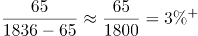；普通中学：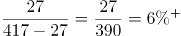。

综上所述，2019年末，H市各级各类学校中，学校数量同比增加最快的是普通中学。

故正确答案为C。

**考点**：文字资料、一般增长率

**来源**：2022年深圳市考公务员录用考试《行测》试题（网友回忆版）第86题

### 第 87 题

若全市每所幼儿园平均在园幼儿数保持2019年同比增量不变，则到（ ），幼儿园平均在园幼儿数可超过300名。

A. 2020年

B. 2021年

C. 2022年

D. 2023年

第 87 题 · 答案与解析

**参考答案（粉笔题库参考内容）**

D

**解析**

根据题干“······保持······同比增量不变，则到（ ）······可超过300名”，可判定本题为现期追赶问题。定位文字材料第一段可得：2019年末全市有幼儿园1836所，增加65所；在园幼儿54.50万人，增长4.0%，则2019年全市每所幼儿园平均在园幼儿数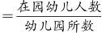人/所。根据公式：基期量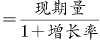，则2018年全市在园幼儿为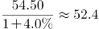万人；根据公式：基期量＝现期量-增长量，则2018年全市有幼儿园1836-65＝1771所。故2018年全市每所幼儿园平均在园幼儿数人/所。则2019年全市每所幼儿园平均在园幼儿数同比增量为296.8-295.8＝1人/所。根据公式：现期量＝基期量＋增长量×n，则296.8＋1×n＞300，解得n＞3，则n至少为4，故需要到2019＋4＝2023年，幼儿园平均在园幼儿数可超过300名。

故正确答案为D。

**考点**：文字资料、现期计算

**来源**：2022年深圳市考公务员录用考试《行测》试题（网友回忆版）第87题

### 第 88 题

2019年末，H市普通高等学校研究生在校生数同比增长（ ）。

A. 7.6%

B. 19.3%

C. 26.1%

D. 无法判断

第 88 题 · 答案与解析

**参考答案（粉笔题库参考内容）**

B

**解析**

根据题干“2019年末，·······同比增长”，结合选项为百分数，可判定本题为一般增长率问题。定位文字材料第一段可得：2019年全年普通高等学校研究生教育招生0.81万人，在校生2.10万人，毕业生0.47万人。根据公式：今年在校人数=去年在校人数-毕业人数+招生人数，可得：今年在校人数-去年在校人数=招生人数-毕业人数=今年在校人数同比增长量=2019年招生人数-2019年毕业人数=0.81万-0.47万=0.34万人。根据公式：增长率，可得：2019年末，H市普通高等学校研究生在校生数同比增长率为：。

故正确答案为B。

**考点**：文字资料、一般增长率

**来源**：2022年深圳市考公务员录用考试《行测》试题（网友回忆版）第88题

### 第 89 题

关于H市2019年专利申请量与授权量，下列说法不正确的是（ ）。

A. 发明专利在全年专利申请量与授权量中的占比均同比上升

B. 发明专利申请量同比增速较PCT国际专利申请量同比增速高21.8%

C. 全年专利申请量同比增量大于全年专利授权量同比增量

D. PCT国际专利申请量同比减少约0.06万件

第 89 题 · 答案与解析

**参考答案（粉笔题库参考内容）**

B

**解析**

A项：定位文字材料第二段，可知2019年全年专利申请量与授权量······分别增长14.4%（b_1）和18.8%（b_2）。其中，发明专利申请量与授权量······分别增长18.4%（a_1）和22.3%（a_2）。根据两期比重比较结论：a_1>b_1，则发明专利在全年专利申请量中的占比同比上升；a_2>b_2，则发明专利在全年专利授权量中的占比同比上升。故发明专利在全年专利申请量与授权量中的占比均同比上升，正确；

B项：定位文字材料第二段，可知2019年全年发明专利申请量增长18.4%，PCT国际专利申请量减少3.4%，则发明专利申请量同比增速较PCT国际专利申请量同比增速高18.4%-（-3.4%）=21.8个百分点，而不是21.8%，错误；

C项：定位文字材料第二段，可知2019年全年专利申请量与授权量分别为26.15万件和16.66万件，分别增长14.4%和18.8%。根据公式：增长量，可得：全年专利申请量同比增量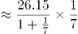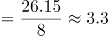万件，全年专利授权量同比增量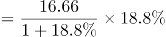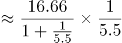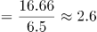万件，故全年专利申请量同比增量大于全年专利授权量同比增量，正确；

D项：定位文字材料第二段，可知PCT国际专利申请量1.75万件，减少3.4%。根据公式：增长量，可得：PCT国际专利申请量同比增量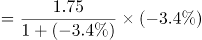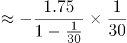万件，即减少约0.06万件，正确。

本题为选非题，故正确答案为B。

**考点**：文字资料、综合分析

**来源**：2022年深圳市考公务员录用考试《行测》试题（网友回忆版）第89题

### 第 90 题

根据上文，下列说法不正确的是（ ）。

A. 2018年末，H市小学在校学生数在各级各类学校在校学生总数中占比不足一半

B. 2018年末，H市各类专业技术人员中，具有中级及以上技术职称的人员占比不足三成

C. 2019年末，H市普通高等学校毕业生中，本专科毕业生数占比超过八成

D. 2019年末，H市部级及以上创新载体在全市各级创新载体中占比超过三成

第 90 题 · 答案与解析

**参考答案（粉笔题库参考内容）**

B

**解析**

A项：定位文字材料第一段可知，2019年末全市各级各类学校在校学生232.24万人，增长5.1%，小学在校学生106.90万人，增长4.0%。根据基期比重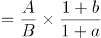，可得所求比重为：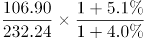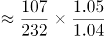，正确；

B项：定位文字材料第二段可知，2019年末全市各类专业技术人员183.50万人，比上年增长10.1%，其中具有中级及以上技术职称的专业技术人员54.69万人，增长7.4%。根据基期比重，可得所求比重为：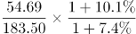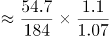，错误；

C项：定位文字材料第一段可知，2019年全年全市普通高等学校本专科毕业生2.13万人，普通高等学校研究生教育毕业生0.47万人。根据比重=部分/总体，可得所求比重为：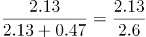，正确；

D项：定位文字材料第二段可知，2019年末全市各级创新载体2258个，其中，国家级重点实验室、工程实验室和技术中心等创新载体116个，部级创新载体604个。根据比重=部分/总体，可得所求比重为：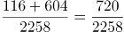，正确。

本题为选非题，故正确答案为B。

**考点**：文字资料、综合分析

**来源**：2022年深圳市考公务员录用考试《行测》试题（网友回忆版）第90题

## 材料 2

### 第 91 题

交通潮汐现象是指早晨进城方向交通流量大，而晚上出城方向交通流量大的现象。以下关口断面交通潮汐现象最明显的是：

A. 布吉关

B. 清平关

C. 南头关

D. 福龙关

第 91 题 · 答案与解析

**参考答案（粉笔题库参考内容）**

A

**解析**

定位图1可得：布吉关、清平关、南头关、福龙关早晨进城方向交通流量（早高峰进关交通量）分别为0.47、0.32、0.59、0.51万pcu/h；定位图2可得：布吉关、清平关、南头关、福龙关晚上出城方向交通流量（晚高峰出关交通量）分别为0.57、0.37、0.13、0.50万pcu/h。则布吉关、清平关、南头关、福龙关断面交通潮汐现象分别为0.47+0.57=1.04万pcu/h、0.32+0.37=0.69万pcu/h、0.59+0.13=0.72万pcu/h、0.51+0.50=1.01万pcu/h，比较可知，布吉关断面交通潮汐现象最明显。

故正确答案为A。

**考点**：统计图、简单加减计算

**来源**：2022年深圳市考公务员录用考试《行测》试题（网友回忆版）第91题

### 第 92 题

西部二线关中，断面早晚高峰进关交通量之和位列第三位的关口是：

A. 南头关

B. 南光关

C. 同乐关

D. 新城关

第 92 题 · 答案与解析

**参考答案（粉笔题库参考内容）**

D

**解析**

定位图1可得：新城关、南头关、同乐关、南光关、白芒关早高峰进关交通量分别为0.48、0.59、0.36、0.49、0.17万pcu/h；定位图2可得：新城关、南头关、同乐关、南光关、白芒关晚高峰进关交通量分别为0.33、0.79、0.38、0.46、0.15万pcu/h。则新城关、南头关、同乐关、南光关、白芒关断面早晚高峰进关交通量之和分别为0.48+0.33=0.81万pcu/h、0.59+0.79=1.38万pcu/h、0.36+0.38=0.74万pcu/h、0.49+0.46=0.95万pcu/h、0.17+0.15=0.32万pcu/h。比较可知，断面早晚高峰进关交通量之和为南头关＞南光关＞新城关＞同乐关＞白芒关，则新城关位列第三位。

故正确答案为D。

**考点**：统计图、简单加减计算

**来源**：2022年深圳市考公务员录用考试《行测》试题（网友回忆版）第92题

### 第 93 题

与东部二线关口相比，中部二线关口断面早高峰进关交通量之和大（ ）。

A. 48.8%

B. 67.8%

C. 1.61万pcu/h

D. 0.54万pcu/h

第 93 题 · 答案与解析

**参考答案（粉笔题库参考内容）**

A

**解析**

根据题干“与东部二线关口相比，中部二线关口·······大”，可判定本题为一般增长率问题。定位图1可得：2018年中部二线各关口断面早高峰进关交通量分别为0.51、0.27、0.58、0.50万pcu/h；东部二线各关口断面早高峰进关交通量分别为0.32、0.12、0.47、0.25、0.09万pcu/h。则中部二线关口断面早高峰进关交通量之和为0.51+0.27+0.58+0.50=1.86万pcu/h；东部二线关口之和为0.32+0.12+0.47+0.25+0.09=1.25万pcu/h，故所求差值为1.86-1.25=0.61万pcu/h，排除C、D两项。根据公式：增长率，可得中部比东部大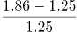=0.61/1.25<50%，排除B项。

故正确答案为A。

**考点**：一般增长率、统计图

**来源**：2022年深圳市考公务员录用考试《行测》试题（网友回忆版）第93题

### 第 94 题

若城市道路的设计通行能力为1500pcu/h，则晚高峰进出关交通量均超设计值的关口有（ ）个。

A. 7

B. 8

C. 9

D. 10

第 94 题 · 答案与解析

**参考答案（粉笔题库参考内容）**

B

**解析**

定位图2可得：2018年原二线关口断面晚高峰进出关交通量，由题干可知城市道路的设计通行能力为1500pcu/h=0.15万pcu/h，比较可得进出关交通量均超过0.15万pcu/h的有：新城关（0.33、0.44万pcu/h）、同乐关（0.38、0.34万pcu/h）、福龙关（0.49、0.50万pcu/h）、梅林关（0.71、0.73万pcu/h）、南坪关（0.58、0.53万pcu/h）、清平关（0.24、0.37万pcu/h）、布吉关（0.31、0.57万pcu/h）、丹平关（0.31、0.21万pcu/h），共8个关口。

故正确答案为B。

**考点**：统计图、直接找数

**来源**：2022年深圳市考公务员录用考试《行测》试题（网友回忆版）第94题

### 第 95 题

根据上图，下列说法正确的有（ ）个。

（1）原二线关口中，梅林关断面早晚高峰出关交通量均最大；

（2）东部二线关口的断面早高峰进关交通量均大于出关交通量；

（3）西部二线关口断面早高峰出关交通量之和与晚高峰相等。

A. 0

B. 1

C. 2

D. 3

第 95 题 · 答案与解析

**参考答案（粉笔题库参考内容）**

D

**解析**

（1）定位图1、图2可知，原二线各关口断面早晚高峰的出关交通量。观察可知，原二线关口中，早晚高峰出关交通量最大的均是梅林关断面，交通量分别为0.77万pcu/h、0.73万pcu/h，正确；

（2）定位图1可知东部二线各关口断面早高峰的进关与出关交通量。观察可知，东部二线5个关口的断面早高峰进关交通量均大于出关交通量，正确；

（3）定位图1、图2可知西部二线各关口断面早晚高峰的出关交通量，则西部二线关口断面早高峰出关交通量之和＝0.27＋0.37＋0.30＋0.12＋0.12＝1.18万pcu/h，晚高峰出关交通量之和＝0.44＋0.13＋0.34＋0.13＋0.14＝1.18万pcu/h，故早高峰出关交通量之和与晚高峰相等，正确。

综上，说法正确的有3个。

故正确答案为D。

**考点**：综合分析、统计图

**来源**：2022年深圳市考公务员录用考试《行测》试题（网友回忆版）第95题

## 材料 3

### 第 96 题

若2017年全球医疗器械销售总额同比提高4.6%，IVD医疗器械销售额在全球医疗器械销售总额中占比同比提高3个百分点，则2016年IVD医疗器械的销售额约为（ ）亿美元。

A. 354

B. 387

C. 407

D. 421

第 96 题 · 答案与解析

**参考答案（粉笔题库参考内容）**

B

**解析**

根据题干“······则2016年······的销售额约为······亿美元”，结合材料时间为2017年，可判定本题为基期计算问题。定位表格材料可知，2017年全球医疗器械销售总额为4050亿美元，IVD医疗器械销售额为526亿元。2017年全球医疗器械销售总额同比提高4.6%，根据基期量，则2016年全球医疗器械销售总额为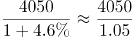≈3857亿美元。2017年IVD医疗器械销售额在全球医疗器械销售总额中占比为，同比提高3个百分点，则2016年IVD医疗器械销售额在全球医疗器械销售总额中占比为13%-3%=10%。根据部分量=整体量×比重，则2016年IVD医疗器械的销售额约为3857×10%=385.7亿美元，与B项最接近。

故正确答案为B。

**考点**：统计表、基期计算

**来源**：2022年深圳市考公务员录用考试《行测》试题（网友回忆版）第96题

### 第 97 题

2017年，除其他类外，在全球医疗器械销售总额中占比超过5%的细分市场有（ ）个。

A. 4

B. 5

C. 6

D. 7

第 97 题 · 答案与解析

**参考答案（粉笔题库参考内容）**

C

**解析**

定位表格材料可知，2017年全球医疗器械销售总额为4050亿美元，则其5%为4050×5%=202.5亿美元。通过查找统计表发现，2017年，除其他类外，在全球医疗器械销售总额中占比超过5%的细分市场有：骨科、IVD、心血管、眼科、影像、整形，共6个。

故正确答案为C。

**考点**：统计表、直接找数

**来源**：2022年深圳市考公务员录用考试《行测》试题（网友回忆版）第97题

### 第 98 题

2019年，除其他类外，排名前五的细分市场销售额之和约占全球医疗器械销售总额的：

A. 35.5%

B. 40.0%

C. 45.6%

D. 50.2%

第 98 题 · 答案与解析

**参考答案（粉笔题库参考内容）**

D

**解析**

根据题干“2019年······占······”，结合材料给出了2019年的数据，可以判定本题为现期比重问题。定位表格材料可得，2019年除其他类外，排名前五的细分市场其销售额分别为IVD588亿美元，心血管524亿美元，影像442亿美元，骨科408亿美元，眼科310亿美元，全球医疗器械销售总额为4529亿美元。根据比重=部分/总体，故所求为，与D项最接近。

故正确答案为D。

**考点**：现期比重、统计表

**来源**：2022年深圳市考公务员录用考试《行测》试题（网友回忆版）第98题

### 第 99 题

与2017年相比，除其他类外，2019年全球医疗器械销售额增幅最小的细分市场是：

A. 肾病

B. 心血管

C. 骨科

D. 医疗软件

第 99 题 · 答案与解析

**参考答案（粉笔题库参考内容）**

A

**解析**

根据题干“与2017年相比······2019年······增幅最小······”，可判定本题为一般增长率问题。定位表格材料可得，2017年与2019年全球医疗器械各细分市场销售额。根据公式：增长率，则肾病医疗器械销售额的增长率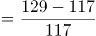=12/117≈10%，心血管医疗器械销售额的增长率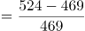=55/469≈12%，骨科医疗器械销售额的增长率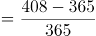=43/365≈12%，医疗软件销售额的增长率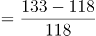=15/118≈13%，故选项中，增幅最小的是肾病医疗器械销售额。

故正确答案为A。

**考点**：一般增长率、统计表

**来源**：2022年深圳市考公务员录用考试《行测》试题（网友回忆版）第99题

### 第 100 题

根据上表，下列说法正确的是：

A. 2017—2019年，全球医疗器械销售总额年均增长率大于6%

B. 2019年，牙科医疗器械销售额在全球医疗器械销售总额中的占比较耳鼻喉科高2.1个百分点

C. 与2017年相比，2019年糖尿病医疗器械销售额在全球医疗器械销售总额中的占比有所上升

D. 与2017年相比，2019年医疗器械销售额增长超过50亿美元的细分市场有4个

第 100 题 · 答案与解析

**参考答案（粉笔题库参考内容）**

C

**解析**

A项：定位表格材料可得，2017年全球医疗器械销售总额为4050亿美元，按照年均增长率为6%测算，2019年全球医疗器械销售总额应为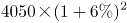亿美元，超过实际数值4529亿美元，则年均增长率应小于6%，错误；

B项：定位表格材料可得，2019年牙科、耳鼻喉科医疗器械销售额分别为155亿美元、100亿美元，2019年全球医疗器械销售总额为4529亿美元，比重差为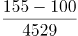≈55/4530<2%，即前者比后者高不到2个百分点，错误；

C项：定位表格材料可得，2017年糖尿病医疗器械销售额和当年全球医疗器械销售总额分别为117亿美元、4050亿美元，占比为；2019年糖尿病医疗器械销售额和当年全球医疗器械销售总额分别为132亿美元、4529亿美元，占比为，占比有所上升，正确；

D项：定位表格材料可得，与2017年相比，2019年医疗器械销售额增长超过50亿美元的细分市场分别为：IVD（588-526=62亿美元）、心血管（524-469=55亿美元）、其他（706-631=75亿美元），共有3个，错误。

（注：因其他类无法确定细分市场具体数量，因而无法判定增长超过50亿美元的细分市场数量，学员也可根据此点排除D项。）

故正确答案为C。

**考点**：综合分析、统计表

**来源**：2022年深圳市考公务员录用考试《行测》试题（网友回忆版）第100题

