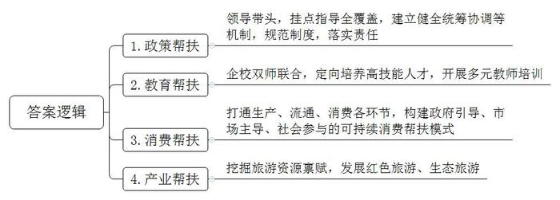
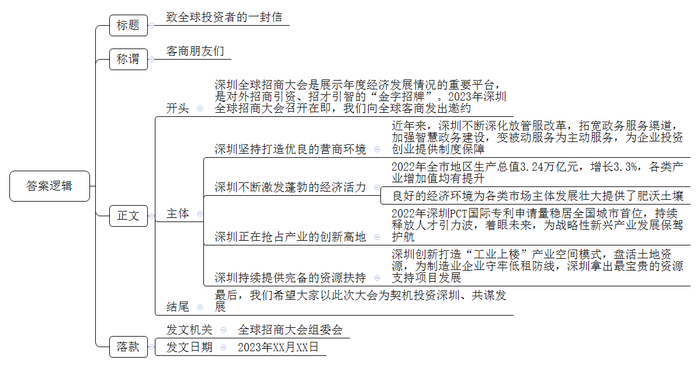
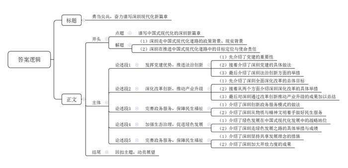

# 2023年深圳市公务员考试《申论》题（一卷）

<!-- gwy:overview:start -->
> **深圳 · 2023 · 申论 · 一卷** ｜ 3 题 · 图片 3 处 · 答案随题折叠

导航：[题目](#题目) · [材料 1](#材料-1)
<!-- gwy:overview:end -->

> 候选采集稿。参考答案及解析来自粉笔页面，不代表官方答案或真实高分答卷；来源使用许可与原卷对应关系仍需人工核实。

## 给定材料

### 材料 1

深圳牢牢坚持“先富带动后富”，始终不忘感恩改革开放、回报全国人民。在脱贫攻坚期间，深圳对口帮扶地区涉及9省份54县；进入全面实施乡村振兴战略以来，深圳对口地区涉及9省份97县，覆盖面积30.6万平方公里，约为深圳面积的153倍。30年来，深圳累计投入各类帮扶资金超过1200亿元，实施帮扶项目4万余个，选派干部人才8500多人，助推42个国家级贫困县摘帽、340余万贫困人口脱贫。

在多年工作实践中，深圳探索出很多成功经验。

市领导带头出战督战，实现对口地区挂点指导全覆盖。建立健全统筹协调、社会参与、市场运作、帮扶保障等机制，覆盖全过程、全链条，形成广泛参与、合力攻坚的帮扶格局。从制度层面对帮扶工作再规范、对帮扶力量再汇集、对帮扶责任再压实。

实施定向培养高技能人才计划，实行“招生即招工、入学即就业、企校双师联合培养”新模式。结对帮扶、支教送教，开展深圳名师送教、院校专业师资培训、中小学校骨干教师跟岗培训等项目，提升当地师资教学水平、增强教育发展活力。

打通生产、流通、消费各环节，构建政府引导、市场主导、社会参与的可持续消费帮扶模式，引导企业签订消费帮扶等协议，发放消费券，定向采购产品。建立一批特色产业基地，打造一批知名产品，推动“圳品”认证。通过“圳帮扶”“电商联盟”等线上平台，共同推动社会各界参与消费帮扶。

深入挖掘当地旅游资源禀赋，创新产业帮扶模式。系统挖掘当地红色资源，发展红色旅游；依托当地绿色资源，发展生态旅游，打造旅游帮扶新风尚。

### 材料 2

习近平总书记在党的二十大报告中强调：“从现在起，中国共产党的中心任务就是团结带领全国各族人民全面建成社会主义现代化强国、实现第二个百年奋斗目标，以中国式现代化全面推进中华民族伟大复兴。”

2022年12月8日，中国共产党广东省第十三届委员会第二次全体会议召开。全会提出，党的二十大为新时代新征程改革发展各项事业作出了顶层设计和战略规划，必须结合习近平总书记赋予的使命任务和广东实际，形成推进现代化建设的具体行动方案和施工图，积极探索中国式现代化的广东路径。

2022年12月26日，中国共产党深圳市第七届委员会第六次全体会议召开。会议指出，要按照党的二十大指引的方向，坚定扛起习近平总书记、党中央赋予深圳的新时代历史使命，深刻认识深圳在推进中国式现代化道路上的使命责任、目标定位，以强烈历史自觉在新征程上再出发，在推进中国式现代化道路上走在前列、勇当尖兵。

## 题目

### 第 1 题

**请根据材料6，提炼出深圳在帮扶工作实践中的经验做法。（20分）**

关联材料：材料 1

作答要求：

（1）考虑全面，简明扼要，条理清晰；

（2）总字数150字以内。

第 1 题 · 答案与解析

**参考答案（粉笔题库参考内容）**

1.政策帮扶。领导带头，挂点指导全覆盖，建立健全统筹协调等机制，规范制度，落实责任。

2.教育帮扶。企校双师联合，定向培养高技能人才，开展多元教师培训。

3.消费帮扶。打通生产、流通、消费各环节，构建政府引导、市场主导、社会参与的可持续消费帮扶模式。

4.产业帮扶。挖掘旅游资源禀赋，发展红色旅游、生态旅游。

**解析**

**参考答案说明**：本参考答案从“政策帮扶”“教育帮扶”“消费帮扶”“产业帮扶”四个方面展开，各条答案要点之间在内容上相互并列，没有交叉。

**考点**：经验启示类

**来源**：2023年深圳市公务员考试《申论》题（一卷）

粉笔申论页面对本题只提供「解析视频」入口，该入口是会员推广位，页面无视频地址与文字解析。

### 第 2 题

**假如深圳召开新一届全球招商大会，请结合材料10，代大会组委会草拟“致全球投资者的一封信”，向全球投资者发出邀约。（30分）**

关联材料：材料 2

作答要求：

（1）要素完整，条理清晰，语言流畅，感染力强；

（2）可不拘泥于材料；

（3）如出现人名，一律以“XXX”代替；

（4）总字数500字以内。

第 2 题 · 答案与解析

**参考答案（粉笔题库参考内容）**

致全球投资者的一封信

客商朋友们：

深圳全球招商大会是展示年度经济发展情况的重要平台，是对外招商引资、招才引智的“金字招牌”。2023年深圳全球招商大会召开在即，我们向全球客商发出邀约。

深圳坚持打造优良的营商环境。近年来，深圳不断深化放管服改革，拓宽政务服务渠道，加强智慧政务建设，变被动服务为主动服务，为企业投资创业提供制度保障。

深圳不断激发蓬勃的经济活力。2022年全市地区生产总值3.24万亿元，增长3.3%，各类产业增加值均有提升。良好的经济环境为各类市场主体发展壮大提供了肥沃土壤。

深圳正在抢占产业的创新高地。2022年深圳PCT国际专利申请量稳居全国城市首位，持续释放人才引力波，着眼未来，为战略性新兴产业发展保驾护航。

深圳持续提供完备的资源扶持。深圳创新打造“工业上楼”产业空间模式，盘活土地资源，为制造业企业守牢低租防线，深圳拿出最宝贵的资源支持项目发展。最后，我们希望大家以此次大会为契机投资深圳、共谋发展。

全球招商大会组委会

XXXX年XX月XX日

**解析**

**参考答案说明**：（1）格式方面，本参考答案写到了“标题”“称谓”“落款”。（2）正文部分，一方面从内容上来看，围绕“深圳全球招商大会”这一主题，本参考答案的开头先写到了深圳全球招商大会的背景；主体部分从“深圳坚持打造优良的营商环境”“深圳不断激发蓬勃的经济活力”“深圳正在抢占产业的创新高地”“深圳持续提供完备的资源扶持”等四个方面给出了深圳招商的优势。另一方面，形式上，本参考答案做到了分段、分条撰写，整体上条理较为清晰。

**考点**：宣传类

**来源**：2023年深圳市公务员考试《申论》题（一卷）

粉笔申论页面对本题只提供「解析视频」入口，该入口是会员推广位，页面无视频地址与文字解析。

### 第 3 题

**请结合给定材料，围绕“谱写中国式现代化的深圳新篇章”主题，自拟标题，写一篇议论文。（50分）**

关联材料：材料 2

作答要求：

（1）紧扣主题，观点鲜明，论述充分；

（2）结构严谨，条理清晰，语言流畅；

（3）总字数1200字左右。

第 3 题 · 答案与解析

**参考答案（粉笔题库参考内容）**

**勇当尖兵，奋力谱写深圳现代化新篇章**

习近平总书记在党的二十大报告中强调：当下中国共产党的中心任务就是团结带领全国各族人民全面建成社会主义现代化强国、实现第二个百年奋斗目标，以中国式现代化全面推进中华民族伟大复兴。作为改革开放的探路者和新时代的示范区，深圳在推进中国式现代化道路上具有重要的使命责任和明确的目标定位，需要以强烈历史自觉在新征程上奋勇前行，在南海之滨续写更多春天的故事。

**发挥党建优势，推进法治创新。**党建强则发展强，发挥党的领导优势是经济社会高质量发展坚强的组织保证。深圳先行先试，将党组织建在产业链上，成立全国首个无人机产业链党委，实现组织链、服务链、产业链的协同升级，将党建实效转化为推动产业发展的动力。在社会治理方面，深圳把党建引领基层治理延伸到最末端，依托基层党组织，推进社会多元主体共治。同时充分发挥先行立法优势，建立基层立法联系点，完善社区公共法律服务网络，为经济发展和社区治理描绘鲜明的法治底色。

**深化改革创新，推动产业升级。**深圳坚持全面深化改革，加强改革系统集成、协同高效，努力为全国制度建设作出重要示范，为产业发展和创新资源集聚提供制度保障。一方面，以开放的人才政策和环境吸引一批顶尖创新人才，提升源头创新能力。另一方面，持续增加研发投入，打造创新平台，推动战略性新兴产业集群和未来产业高速高质发展。前海累计75项制度创新成果在全国复制推广，制度创新指数位居全国自贸区第一。深圳坚持以创新带动产业和经济发展，跑出了深圳加速度、干出了深圳高质量。

**完善政务服务，保障民生福祉。**从幼有所教到病有所养，从前沿城市设计到推进文化发展……深圳始终坚持解决群众最关心的问题，以便企利民为导向，推进政务服务模式创新，变“最后一公里”为“最好一公里”。民生一子落，发展满盘活。深圳将民生工作放在重要位置，不断攀登物质文明高峰的同时，也在不断刷新精神文明建设的高度，中国式现代化的美好图景正在深圳缓缓展开。

**加强生态治理，促进绿色发展。**绿色发展是当前中国式现代化发展的重要一环，深圳在发展道路上坚持新发展理念，在保障经济发展的同时加强环境的治理和保护。如今高楼大厦与草青花红交相辉映，钢筋水泥与鸟语虫鸣和谐共生，共同织就深圳“生物多样性魅力城市”的头衔，更为经济和生态协调发展书写了一份深圳答卷，为绿色发展理念的践行提供了深圳示范。

**坚持共享理念，加大开放力度。**四十年栉风沐雨，四十年风华正茂。深圳牢记改革开放的任务和要求，在脱贫攻坚和乡村振兴的过程中，压实帮扶责任，加大人才投入，推动产业和消费帮扶，让更多群众共享发展红利。同时，在百舸争流、千帆竞发的新格局下，深圳不断加大对外开放力度，“鹏友”遍布世界，让中国式现代化既发展自身又造福世界。

击鼓催征再出发，奋楫扬帆新征程。深圳坚定扛起习近平总书记、党中央赋予的新时代历史使命，在推进中国式现代化道路上走在前列、勇当尖兵，把党的二十大描绘的宏伟蓝图在深圳变为美好现实，奋力谱写中国式现代化的深圳篇章！

**解析**

**文章分析**

**勇当尖兵，奋力谱写深圳现代化新篇章**

【**标题的优点：**标题中含有主题词，使文章主题突出、清晰，起到了“文眼”的作用。】

（1）习近平总书记在党的二十大报告中强调：当下中国共产党的中心任务就是团结带领全国各族人民全面建成社会主义现代化强国、实现第二个百年奋斗目标，以中国式现代化全面推进中华民族伟大复兴。（2）作为改革开放的探路者和新时代的示范区，深圳在推进中国式现代化道路上具有重要的使命责任和明确的目标定位，需要以强烈历史自觉在新征程上奋勇前行，在南海之滨续写更多春天的故事。

【**开头的优点：**★内容方面。范文的开头是紧扣题目给定“谱写中国式现代化的深圳新篇章”这一主题展开的。（1）一方面，指出了深圳中国式现代化道路的政策背景、现实背景。（2）另一方面，指出了深圳在推进中国式现代化道路中的目标定位与使命责任。★文字表达方面。表述简洁流畅，措词准确到位，长短句结合，节奏感颇好。】

**发挥党建优势，推进法治创新。**（1）党建强则发展强，发挥党的领导优势是经济社会高质量发展坚强的组织保证。（2）深圳先行先试，将党组织建在产业链上，成立全国首个无人机产业链党委，实现组织链、服务链、产业链的协同升级，将党建实效转化为推动产业发展的动力。在社会治理方面，深圳把党建引领基层治理延伸到最末端，依托基层党组织，推进社会多元主体共治。（3）同时充分发挥先行立法优势，建立基层立法联系点，完善社区公共法律服务网络，为经济发展和社区治理描绘鲜明的法治底色。

【**论述段1的优点：**★观点句：范文的观点句是紧扣“谱写中国式现代化的深圳新篇章”这一主题提出的。形式上，它在段首处直接写出，位置突出，容易发现。内容上，关键词突出，内容要点明确，可以明显看出主要论述“党建优势，法治创新”。★论述内容：（1）先介绍了党建的重要性；（2）接着介绍了深圳党建的具体做法；（3）最后介绍了深圳法治创新方面的举措。注意：以上几个方面的内容都是紧扣“发挥党建优势，推进法治创新”这个观点句进行分析论述的，论述的针对性强，内容层次丰富。在论述方法上主要采用了讲道理、举例子相结合的方式。】

**深化改革创新，推动产业升级。**（1）深圳坚持全面深化改革，加强改革系统集成、协同高效，努力为全国制度建设作出重要示范，为产业发展和创新资源集聚提供制度保障。（2）一方面，以开放的人才政策和环境吸引一批顶尖创新人才，提升源头创新能力。另一方面，持续增加研发投入，打造创新平台，推动战略性新兴产业集群和未来产业高速高质发展。前海累计75项制度创新成果在全国复制推广，制度创新指数位居全国自贸区第一。（3）深圳坚持以创新带动产业和经济发展，跑出了深圳加速度、干出了深圳高质量。

【**论述段2的优点：**★观点句：范文的观点句是紧扣“谱写中国式现代化的深圳新篇章”这一主题提出的。形式上，它在段首处直接写出，位置突出，容易发现。内容上，关键词突出，内容要点明确，可以明显看出主要论述“改革创新，产业升级”。★论述内容：（1）先介绍了深圳全面深化改革的总体目标；（2）接着从两个方面介绍深圳深化改革的具体举措；（3）最后对深圳通过改革创新推动产业升级的成果加以总结。注意：以上几个方面的内容都是紧扣“深化改革创新，推动产业升级”这个观点句进行分析论述的，论述的针对性强，内容层次丰富。在论述方法上主要采用了讲道理、举例子相结合的方式。】

**完善政务服务，保障民生福祉。**（1）从幼有所教到病有所养，从前沿城市设计到推进文化发展……深圳始终坚持解决群众最关心的问题，以便企利民为导向，推进政务服务模式创新，变“最后一公里”为“最好一公里”。（2）民生一子落，发展满盘活。深圳将民生工作放在重要位置，不断攀登物质文明高峰的同时，也在不断刷新精神文明建设的高度，中国式现代化的美好图景正在深圳缓缓展开。

【**论述段3的优点：**★观点句：范文的观点句是紧扣“谱写中国式现代化的深圳新篇章”这一主题提出的。形式上，它在段首处直接写出，位置突出，容易发现。内容上，关键词突出，内容要点明确，可以明显看出主要论述“政务服务，民生福祉”。★论述内容：（1）一方面，介绍了深圳创新政务服务模式；（2）另一方面，介绍了深圳从物质与精神文明着手做好民生服务。注意：以上两个方面的内容都是紧扣“完善政务服务，保障民生福祉”这个观点句进行分析论述的，论述的针对性强，内容层次丰富。在论述方法上主要采用了讲道理、举例子相结合的方式。】

**加强生态治理，促进绿色发展。**（1）绿色发展是当前中国式现代化发展的重要一环，（2）深圳在发展道路上坚持新发展理念，在保障经济发展的同时加强环境的治理和保护。如今高楼大厦与草青花红交相辉映，钢筋水泥与鸟语虫鸣和谐共生，共同织就深圳“生物多样性魅力城市”的头衔，更为经济和生态协调发展书写了一份深圳答卷，为绿色发展理念的践行提供了深圳示范。

【**论述段4的优点：**★观点句：范文的观点句是紧扣“谱写中国式现代化的深圳新篇章”这一主题提出的。形式上，它在段首处直接写出，位置突出，容易发现。内容上，关键词突出，内容要点明确，可以明显看出主要论述“生态治理，绿色发展”。★论述内容：（1）一方面，介绍了绿色发展在中国式现代化发展中的战略地位；（2）另一方面，介绍了深圳走绿色发展之路的具体举措与成绩。注意：以上两个方面的内容都是紧扣“加强生态治理，促进绿色发展”这个观点句进行分析论述的，论述的针对性强，内容层次丰富。在论述方法上主要采用了讲道理、举例子相结合的方式。】

**坚持共享理念，加大开放力度。**四十年栉风沐雨，四十年风华正茂。（1）深圳牢记改革开放的任务和要求，在脱贫攻坚和乡村振兴的过程中，压实帮扶责任，加大人才投入，推动产业和消费帮扶，让更多群众共享发展红利。（2）同时，在百舸争流、千帆竞发的新格局下，深圳不断加大对外开放力度，“鹏友”遍布世界，让中国式现代化既发展自身又造福世界。

【**论述段5的优点：**★观点句：范文的观点句是紧扣“谱写中国式现代化的深圳新篇章”这一主题提出的。形式上，它在段首处直接写出，位置突出，容易发现。内容上，关键词突出，内容要点明确，可以明显看出主要论述“共享理念，开放力度”。★论述内容：（1）一方面，介绍了深圳坚持共享发展理念的措施；（2）另一方面，介绍了深圳加大开放力度的成果。注意：以上两个方面的内容都是紧扣“坚持共享理念，加大开放力度”这个观点句进行分析论述的，论述的针对性强，内容层次丰富。在论述方法上主要采用了讲道理、举例子相结合的方式。】

击鼓催征再出发，奋楫扬帆新征程。深圳坚定扛起习近平总书记、党中央赋予的新时代历史使命，在推进中国式现代化道路上走在前列、勇当尖兵，把党的二十大描绘的宏伟蓝图在深圳变为美好现实，奋力谱写中国式现代化的深圳篇章！

【**结尾的优点：**范文的结尾回扣了“谱写中国式现代化的深圳新篇章”这个主题，并且进行了展望，发出了号召。】

**考点**：文章写作题

**来源**：2023年深圳市公务员考试《申论》题（一卷）

粉笔申论页面对本题只提供「解析视频」入口，该入口是会员推广位，页面无视频地址与文字解析。

