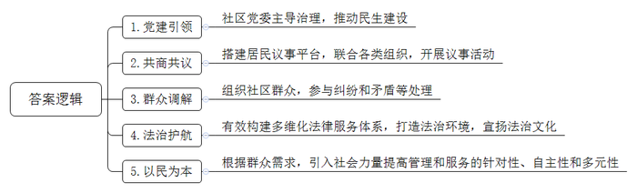
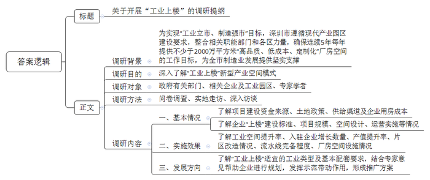
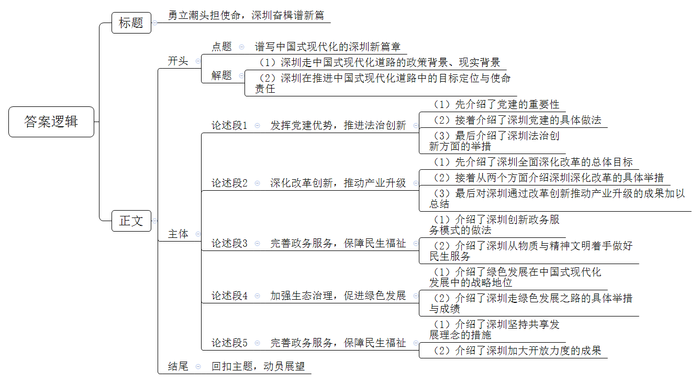

# 2023年深圳市公务员考试《申论》题（二卷）

<!-- gwy:overview:start -->
> **深圳 · 2023 · 申论 · 二卷** ｜ 3 题 · 图片 3 处 · 答案随题折叠

导航：[题目](#题目) · [材料 1](#材料-1)
<!-- gwy:overview:end -->

> 候选采集稿。参考答案及解析来自粉笔页面，不代表官方答案或真实高分答卷；来源使用许可与原卷对应关系仍需人工核实。

## 给定材料

### 材料 1

深圳3个社区获评第九批“全国民主法治示范社区”，这些社区有何工作亮点？

社区党委始终担当社区治理“主心骨”，把党建引领基层治理延伸到最末端，激发党建引领基层治理的蓬勃生机，推动辖区内民生项目建设。

搭建居民议事平台，依托人大立法联系点、党群议事会、金点子交流会，组织社区法律顾问、工作站、派出所、党建联席成员单位等共商共议社区事，开展多层次、多类型的议事活动，广泛听取多方意见建议。

组织社区有时间有能力有热情的教师、律师、老干部、老专家等深入辖区，耐心帮助居民解决困难、邻里纠纷和矛盾等，充分发挥人民调解“第一道防线”作用。

完善社区公共法律服务网络，延伸普法触角，形成法治元素随处可见、法治理念深入人心、法律服务触手可及、矛盾纠纷有序化解的社区法治环境，打造青少年法治教育实践基地，拓宽社区法治文化版图。

根据群众需求，吸引社会资金、智慧及力量共同参与社区事务管理和服务，实现社区服务由“政府配菜”向“百姓点菜”转变，社区事务由“为民作主”向“由民作主”转变，社区治理由“单一供给”向“多元参与”转变。

### 材料 2

《深圳市人民政府关于印发深圳市“工业上楼”项目审批实施方案的通知》提出，坚持“工业立市、制造强市”，遵循生产、生活、生态“三生融合”，创新、创业、创投“三创结合”，投入与产出、运营与财务、社会与经济效益“三个平衡”的现代产业园区要求，进一步整合相关职能部门和各区力量，细化职责分工，加快推进项目审批工作，确保连续5年每年提供不少于2000万平方米“高品质、低成本、定制化”厂房空间的工作目标，为全市制造业发展提供坚实支撑。

“工业上楼”是一种将生产设备和生产过程迁移到高层厂房的新型产业空间模式，“工业上楼”既提高土地容积率，挖掘土地利用潜力，又让产业链、供应链更加牢固和紧密。当然，并非所有的工业都适合“上楼”，还需考虑诸多因素。

深圳充分利用市场化、公益化两类路径，发挥国有企业的使命担当，支持各类资本入场，弥补项目建设资金缺口，通过多种土地政策创新，实现多渠道供给及土地盘活双赢。在降低企业用房成本方面，深圳将“工业上楼”项目优质厂房月租控制在平均不超过35元/平方米，年涨幅不超过5%，为制造业守牢低租防线。

深圳宝安全至科技创新园是国内首个“工业上楼”项目，按照“厂房+写字楼”的复合标准建设了23层的摩天工厂，有效提升工业空间3倍、入驻企业数量提升3倍、产值提升30倍；宝安新桥东先进制造产业园是首个平方公里级的“工业上楼”项目，将彻底改变原片区建筑质量差、配套不足、产出率低的面貌；南山红花岭基地项目通过灵活设计满足不同业态企业的生产需求，层面布局“可拆可合”，尽可能保障流水线长度；龙岗宝龙智造园实行“预招商+定制化”模式，精准定制交付高标准厂房空间，可使企业做到“拎机投产”。

### 材料 3

习近平总书记在党的二十大报告中强调：“从现在起，中国共产党的中心任务就是团结带领全国各族人民全面建成社会主义现代化强国、实现第二个百年奋斗目标，以中国式现代化全面推进中华民族伟大复兴。”

2022年12月8日，中国共产党广东省第十三届委员会第二次全体会议召开。全会提出，党的二十大为新时代新征程改革发展各项事业作出了顶层设计和战略规划，必须结合习近平总书记赋予的使命任务和广东实际，形成推进现代化建设的具体行动方案和施工图，积极探索中国式现代化的广东路径。

2022年12月26日，中国共产党深圳市第七届委员会第六次全体会议召开。会议指出，要按照党的二十大指引的方向，坚定扛起习近平总书记、党中央赋予深圳的新时代历史使命，深刻认识深圳在推进中国式现代化道路上的使命责任、目标定位，以强烈历史自觉在新征程上再出发，在推进中国式现代化道路上走在前列、勇当尖兵。

## 题目

### 第 1 题

**请提炼材料**8**中所述3个社区的工作亮点。（20分）**

关联材料：材料 1

作答要求：

要求：

（1）简明扼要，条理清晰；

（2）总字数150字以内。

第 1 题 · 答案与解析

**参考答案（粉笔题库参考内容）**

1.党建引领。社区党委主导治理，推动民生建设。

2.共商共议。搭建居民议事平台，联合各类组织，开展议事活动。

3.群众调解。组织社区群众，参与纠纷和矛盾等处理。

4.法治护航。有效构建多维化法律服务体系，打造法治环境，宣扬法治文化。

5.以民为本。根据群众需求，引入社会力量提高管理和服务的针对性、自主性和多元性。

**解析**

**参考答案说明**：本参考答案从“党建引领”“共商共议”“群众调解”“法治护航”“以民为本”五个方面展开，各条答案要点之间在内容上相互并列，没有交叉。

**考点**：特点类

**来源**：2023年深圳市公务员考试《申论》题（二卷）

粉笔申论页面对本题只提供「解析视频」入口，该入口是会员推广位，页面无视频地址与文字解析。

### 第 2 题

**某研究机构准备围绕****“工业上楼”开展深入调研。你作为调研组成员，请结合材料**11**，撰写一份调研提纲。(30分)**

关联材料：材料 2

作答要求：

要求：

（1）考虑全面，条理清晰；

（2）详列内容，针对性强；

（3）总字数500字以内。

第 2 题 · 答案与解析

**参考答案（粉笔题库参考内容）**

关于开展“工业上楼”的调研提纲

调研背景：为实现“工业立市、制造强市”目标，深圳市遵循现代产业园区建设要求，整合相关职能部门和各区力量，确保连续5年每年提供不少于2000万平方米“高品质、低成本、定制化”厂房空间的工作目标，为全市制造业发展提供坚实支撑。

调研目的：深入了解“工业上楼”新型产业空间模式。

调研对象：政府有关部门、相关企业及工业园区、专家学者。

调研方法：问卷调查、实地走访、深入访谈。

调研内容：一、基本情况。了解项目建设资金来源、土地政策、供给渠道及企业用房成本；了解企业“上楼”建设标准、项目规模、空间设计、运营实施等情况。二、实施效果。了解工业空间提升率、入驻企业增长数量、产值提升率、片区改造情况、流水线完备程度、厂房空间设施情况。三、发展方向。了解“工业上楼”适宜的工业类型及基本配套要求，结合专家意见帮助企业进行规划，发挥示范带动作用，形成推广方案。

**解析**

**参考答案说明**：一方面从内容上来看，围绕“工业上楼”这一主题，本参考答案介绍了调研背景、调研目的、调研对象、调研方法及调研内容。另一方面，形式上，本参考答案做到了分段、分条撰写，整体上条理较为清晰。

**考点**：总结类

**来源**：2023年深圳市公务员考试《申论》题（二卷）

粉笔申论页面对本题只提供「解析视频」入口，该入口是会员推广位，页面无视频地址与文字解析。

### 第 3 题

**请结合给定材料，围绕****“谱写中国式现代化的深圳新篇章”主题，自拟标题，写一篇议论文。（50分）**

关联材料：材料 3

作答要求：

要求：

（1）紧扣主题，观点鲜明，论述充分；

（2）结构严谨，条理清晰，语言流畅；

（3）总字数1200字左右。

第 3 题 · 答案与解析

**参考答案（粉笔题库参考内容）**

**勇立潮头担使命，深圳奋楫谱新篇**

习近平总书记在党的二十大报告中强调：当下中国共产党的中心任务就是团结带领全国各族人民全面建成社会主义现代化强国、实现第二个百年奋斗目标，以中国式现代化全面推进中华民族伟大复兴。作为改革开放的探路者和新时代的示范区，深圳在推进中国式现代化道路上具有重要的使命责任和明确的目标定位，需要以强烈历史自觉在新征程上奋勇前行，在南海之滨续写更多春天的故事。

**发挥党建优势，推进法治创新。**党建强则发展强，发挥党的领导优势是经济社会高质量发展坚强的组织保证。深圳先行先试，将党组织建在产业链上，成立全国首个无人机产业链党委，实现组织链、服务链、产业链的协同升级，将党建实效转化为推动产业发展的动力。在社会治理方面，深圳把党建引领基层治理延伸到最末端，依托基层党组织，推进社会多元主体共治。同时充分发挥先行立法优势，频饮“头啖汤”，建立基层立法联系点，完善社区公共法律服务网络，为经济发展和社区治理描绘鲜明的法治底色。

**深化改革创新，推动产业升级。**深圳坚持全面深化改革，加强改革系统集成、协同高效，努力为全国制度建设作出重要示范，为产业发展和创新资源集聚提供制度保障。一方面，以开放的人才政策和环境吸引一批科学大师和顶尖创新人才，提升源头创新能力。另一方面，持续增加研发投入，打造创新平台，推动战略性新兴产业集群和未来产业高速高质发展。前海累计75项制度创新成果在全国复制推广，制度创新指数位居全国自贸区第一。深圳坚持以创新带动产业和经济发展，跑出了深圳加速度、干出了深圳高质量。

**完善政务服务，保障民生福祉。**从幼有所教到病有所养，从前沿城市设计到推进文化发展……深圳始终坚持解决群众最关心的问题，以便企利民为导向，推进政务服务模式创新，变“最后一公里”为“最好一公里”。民生一子落，发展满盘活。深圳将民生工作放在重要位置，不断攀登物质文明高峰的同时，也在不断刷新精神文明建设的高度，中国式现代化的美好图景正在深圳缓缓展开。

**加强生态治理，促进绿色发展。**绿色发展是当前中国式现代化发展的重要一环，深圳在发展道路上坚持新发展理念，在保障经济发展的同时加强环境的治理和保护。如今高楼大厦与草青花红交相辉映，钢筋水泥与鸟语虫鸣和谐共生，共同织就深圳“生物多样性魅力城市”的头衔，更为经济和生态协调发展书写了一份深圳答卷，为绿色发展理念的践行提供了深圳示范。

**坚持共享理念，加大开放力度。**四十年栉风沐雨，四十年风华正茂。深圳牢记改革开放的任务和要求，在脱贫攻坚和乡村振兴的过程中，压实帮扶责任，加大人才投入，推动产业和消费帮扶，让更多群众共享发展红利。同时，在百舸争流、千帆竞发的新格局下，深圳不断加大对外开放力度，“鹏友”遍布世界，让中国式现代化既发展自身又造福世界。

击鼓催征再出发，奋楫扬帆新征程。深圳坚定扛起习近平总书记、党中央赋予的新时代历史使命，在推进中国式现代化道路上走在前列、勇当尖兵，把党的二十大描绘的宏伟蓝图在深圳变为美好现实，奋力谱写中国式现代化的深圳篇章。

**解析**

**文章分析：**

**勇立潮头担使命，深圳奋楫谱新篇**

【**标题的优点：**标题中含有主题词，使文章主题突出、清晰，起到了“文眼”的作用。】

（1）习近平总书记在党的二十大报告中强调：当下中国共产党的中心任务就是团结带领全国各族人民全面建成社会主义现代化强国、实现第二个百年奋斗目标，以中国式现代化全面推进中华民族伟大复兴。（2）作为改革开放的探路者和新时代的示范区，深圳在推进中国式现代化道路上具有重要的使命责任和明确的目标定位，需要以强烈历史自觉在新征程上奋勇前行，在南海之滨续写更多春天的故事。

【**开头的优点：**★内容方面。范文的开头是紧扣题目给定“谱写中国式现代化的深圳新篇章”这一主题展开的。（1）一方面，指出了深圳中国式现代化道路的政策背景、现实背景。（2）另一方面，指出了深圳在推进中国式现代化道路中的目标定位与使命责任。★文字表达方面。表述简洁流畅，措词准确到位，长短句结合，节奏感颇好。】

**发挥党建优势，推进法治创新。**（1）党建强则发展强，发挥党的领导优势是经济社会高质量发展坚强的组织保证。（2）深圳先行先试，将党组织建在产业链上，成立全国首个无人机产业链党委，实现组织链、服务链、产业链的协同升级，将党建实效转化为推动产业发展的动力。在社会治理方面，深圳把党建引领基层治理延伸到最末端，依托基层党组织，推进社会多元主体共治。（3）同时充分发挥先行立法优势，频饮“头啖汤”，建立基层立法联系点，完善社区公共法律服务网络，为经济发展和社区治理描绘鲜明的法治底色。

【**论述段****1的优点：**★观点句：范文的观点句是紧扣“谱写中国式现代化的深圳新篇章”这一主题提出的。形式上，它在段首处直接写出，位置突出，容易发现。内容上，关键词突出，内容要点明确，可以明显看出主要论述“党建优势，法治创新”。★论述内容：（1）先介绍了党建的重要性；（2）接着介绍了深圳党建的具体做法；（3）最后介绍了深圳法治创新方面的举措。注意：以上几个方面的内容都是紧扣“发挥党建优势，推进法治创新”这个观点句进行分析论述的，论述的针对性强，内容层次丰富。在论述方法上主要采用了讲道理、举例子相结合的方式。】

**深化改革创新，推动产业升级。**（1）深圳坚持全面深化改革，加强改革系统集成、协同高效，努力为全国制度建设作出重要示范，为产业发展和创新资源集聚提供制度保障。（2）一方面，以开放的人才政策和环境吸引一批科学大师和顶尖创新人才，提升源头创新能力。另一方面，持续增加研发投入，打造创新平台，推动战略性新兴产业集群和未来产业高速高质发展。前海累计75项制度创新成果在全国复制推广，制度创新指数位居全国自贸区第一。（3）深圳坚持以创新带动产业和经济发展，跑出了深圳加速度、干出了深圳高质量。

【**论述段****2****的优点：**★观点句：范文的观点句是紧扣“谱写中国式现代化的深圳新篇章”这一主题提出的。形式上，它在段首处直接写出，位置突出，容易发现。内容上，关键词突出，内容要点明确，可以明显看出主要论述“改革创新，产业升级”。★论述内容：（1）先介绍了深圳全面深化改革的总体目标；（2）接着从两个方面介绍深圳深化改革的具体举措；（3）最后对深圳通过改革创新推动产业升级的成果加以总结。注意：以上几个方面的内容都是紧扣“深化改革创新，推动产业升级”这个观点句进行分析论述的，论述的针对性强，内容层次丰富。在论述方法上主要采用了讲道理、举例子相结合的方式。】

**完善政务服务，保障民生福祉。**（1）从幼有所教到病有所养，从前沿城市设计到推进文化发展……深圳始终坚持解决群众最关心的问题，以便企利民为导向，推进政务服务模式创新，变“最后一公里”为“最好一公里”。（2）民生一子落，发展满盘活。深圳将民生工作放在重要位置，不断攀登物质文明高峰的同时，也在不断刷新精神文明建设的高度，中国式现代化的美好图景正在深圳缓缓展开。

【**论述段****3****的优点：**★观点句：范文的观点句是紧扣“谱写中国式现代化的深圳新篇章”这一主题提出的。形式上，它在段首处直接写出，位置突出，容易发现。内容上，关键词突出，内容要点明确，可以明显看出主要论述“政务服务，民生福祉”。★论述内容：（1）一方面，介绍了深圳创新政务服务模式；（2）另一方面，介绍了深圳从物质与精神文明着手做好民生服务。注意：以上两个方面的内容都是紧扣“完善政务服务，保障民生福祉”这个观点句进行分析论述的，论述的针对性强，内容层次丰富。在论述方法上主要采用了讲道理、举例子相结合的方式。】

**加强生态治理，促进绿色发展。**（1）绿色发展是当前中国式现代化发展的重要一环，（2）深圳在发展道路上坚持新发展理念，在保障经济发展的同时加强环境的治理和保护。如今高楼大厦与草青花红交相辉映，钢筋水泥与鸟语虫鸣和谐共生，共同织就深圳“生物多样性魅力城市”的头衔，更为经济和生态协调发展书写了一份深圳答卷，为绿色发展理念的践行提供了深圳示范。

【**论述段****4****的优点：**★观点句：范文的观点句是紧扣“谱写中国式现代化的深圳新篇章”这一主题提出的。形式上，它在段首处直接写出，位置突出，容易发现。内容上，关键词突出，内容要点明确，可以明显看出主要论述“生态治理，绿色发展”。★论述内容：（1）一方面，介绍了绿色发展在中国式现代化发展中的战略地位；（2）另一方面，介绍了深圳走绿色发展之路的具体举措与成绩。注意：以上两个方面的内容都是紧扣“加强生态治理，促进绿色发展”这个观点句进行分析论述的，论述的针对性强，内容层次丰富。在论述方法上主要采用了讲道理、举例子相结合的方式。】

**坚持共享理念，加大开放力度。**四十年栉风沐雨，四十年风华正茂。（1）深圳牢记改革开放的任务和要求，在脱贫攻坚和乡村振兴的过程中，压实帮扶责任，加大人才投入，推动产业和消费帮扶，让更多群众共享发展红利。（2）同时，在百舸争流、千帆竞发的新格局下，深圳不断加大对外开放力度，“鹏友”遍布世界，让中国式现代化既发展自身又造福世界。

【**论述段****5****的优点：**★观点句：范文的观点句是紧扣“谱写中国式现代化的深圳新篇章”这一主题提出的。形式上，它在段首处直接写出，位置突出，容易发现。内容上，关键词突出，内容要点明确，可以明显看出主要论述“共享理念，开放力度”。★论述内容：（1）一方面，介绍了深圳坚持共享发展理念的措施；（2）另一方面，介绍了深圳加大开放力度的成果。注意：以上两个方面的内容都是紧扣“坚持共享理念，加大开放力度”这个观点句进行分析论述的，论述的针对性强，内容层次丰富。在论述方法上主要采用了讲道理、举例子相结合的方式。】

击鼓催征再出发，奋楫扬帆新征程。深圳坚定扛起习近平总书记、党中央赋予的新时代历史使命，在推进中国式现代化道路上走在前列、勇当尖兵，把党的二十大描绘的宏伟蓝图在深圳变为美好现实，奋力谱写中国式现代化的深圳篇章！

【**结尾的优点：**范文的结尾回扣了“谱写中国式现代化的深圳新篇章”这个主题，并且进行了展望，发出了号召。】

**考点**：文章写作题

**来源**：2023年深圳市公务员考试《申论》题（二卷）

粉笔申论页面对本题只提供「解析视频」入口，该入口是会员推广位，页面无视频地址与文字解析。

