# 2023年深圳市考公务员录用考试《行测》试题（网友回忆版）

<!-- gwy:overview:start -->
> **深圳 · 2023 · 行测 · 统考** ｜ 100 题 · 图片 164 处 · 答案随题折叠

| 题型模块 | 题量 | 题号 |
| --- | ---: | ---: |
| 常识判断 | 25 | 1–25 |
| 判断推理 | 20 | 26–45 |
| 数量关系 | 15 | 46–60 |
| 言语理解与表达 | 25 | 61–85 |
| 资料分析 | 15 | 86–100 |
| **合计** | **100** | |

导航：[题型与作答说明](#题型与作答说明) · [题目](#题目) · [材料 1](#材料-1)
<!-- gwy:overview:end -->

> 候选采集稿。参考答案及解析来自粉笔页面，不代表官方答案或真实高分答卷；来源使用许可与原卷对应关系仍需人工核实。

## 题型与作答说明

常识判断

（25题）

每题的备选答案中，只有一个最符合题意。

判断推理

（20题）

本部分包括图形推理、事件排序、演绎推理三种类型的试题，在四个选项中选出一个最恰当的答案。

数量关系

（15题）

在这部分试题中，每道题呈现一段表述数字关系的文字，要求你迅速、准确地计算出答案。

言语理解与表达

（25题）

本部分包括表达与理解两方面的内容。请根据题目要求，在四个选项中选出一个最恰当的答案。

资料分析

（15题）

所给出的图、表、文字或综合性资料均有若干个问题要你回答。你应根据资料提供的信息进行分析、比较、计算和判断处理。

## 题目

### 第 1 题

人民民主是社会主义的生命，是全面建设社会主义现代化国家的应有之义。（ ）是社会主义民主政治的本质属性，是最广泛、最真实、最管用的民主。

A. 全覆盖人民民主

B. 全方位人民民主

C. 全过程人民民主

D. 全流程人民民主

第 1 题 · 答案与解析

**参考答案（粉笔题库参考内容）**

C

**解析**

本题考查政治常识。

C项正确，A、B、D三项错误，党的二十大报告中“六、发展全过程人民民主，保障人民当家作主”部分指出：“我国是工人阶级领导的、以工农联盟为基础的人民民主专政的社会主义国家，国家一切权力属于人民。人民民主是社会主义的生命，是全面建设社会主义现代化国家的应有之义。全过程人民民主是社会主义民主政治的本质属性，是最广泛、最真实、最管用的民主。必须坚定不移走中国特色社会主义政治发展道路，坚持党的领导、人民当家作主、依法治国有机统一，坚持人民主体地位，充分体现人民意志、保障人民权益、激发人民创造活力。”

故正确答案为C。

### 第 2 题

下列关于药物使用的生活常识，说法不正确的是（ ）。

A. 服用布洛芬期间长时间在太阳下暴晒可能会诱发光敏性药疹加重病情

B. 降血脂的他汀类药物不宜与西柚同食，可能造成横纹肌溶解

C. 头孢与酒精会产生双硫仑样反应，故服用头孢后一段时间内不得喝酒

D. 服用蒙脱石散后，不宜多吃菠菜等含草酸的蔬菜，易形成内脏结石

第 2 题 · 答案与解析

**参考答案（粉笔题库参考内容）**

D

**解析**

本题考查科技常识。

A项正确，光敏性药疹是服用某些药物后，再经受日光（主要是紫外线）照射诱发的，在临床上主要表现为皮肤发疹，有时还伴有发热、头痛等症状。可引起光敏性药疹反应的药物有很多，如非甾体类抗炎药阿司匹林、双氯芬酸钠、布洛芬、氯诺昔康、萘普生、吡罗昔康等。

B项正确，他汀类药物属于降血脂类药，主要用血脂高的心血管疾病，如高脂血症、高血压、动脉粥样硬化性心脏病等。西柚含有丰富的蛋白质和微量元素，且酸甜可口，日常生活中许多人都喜欢吃西柚或者喝西柚汁，但西柚汁并不适合正在服用他汀类药物的患者食用。因为他汀类药物在人体内主要通过CYP3A4酶代谢，而西柚汁里含有多种能够抑制该酶活性的成分，使他汀类药物的代谢受到抑制，血药浓度增加，从而增加引发横纹肌溶解症和严重肝损害的风险。

C项正确，双硫仑样反应，又称戒酒硫样反应，是由于服用药物（头孢类）后饮用含有酒精的饮品导致体内“乙醛蓄积”的中毒反应。因此，服用头孢后一段时间内不得喝酒。

D项错误，菠菜中含有大量草酸，因此不能与含有较多的钙离子的食物或者药品同食。蒙脱石散的主要成分是蒙脱石，蒙脱石是由颗粒极细的含水铝硅酸盐构成的层状矿物，与菠菜同食不会产生结石。

本题为选非题，故正确答案为D。

### 第 3 题

党的二十大报告指出，经过不懈努力，党找到了（ ）这一跳出治乱兴衰历史周期率的第二个答案。

A. 民主监督

B. 自我革命

C. 守正创新

D. 从严治党

第 3 题 · 答案与解析

**参考答案（粉笔题库参考内容）**

B

**解析**

本题考查政治常识。

B项正确，A、C、D三项错误，党的二十大报告中“一、过去五年的工作和新时代十年的伟大变革”部分指出：“经过不懈努力，党找到了自我革命这一跳出治乱兴衰历史周期率的第二个答案，自我净化、自我完善、自我革新、自我提高能力显著增强，管党治党宽松软状况得到根本扭转，风清气正的党内政治生态不断形成和发展，确保党永远不变质、不变色、不变味。”

故正确答案为B。

### 第 4 题

旧时我国北方民间将农历正月二十五定为“填仓节”，每逢这天，人们都要张灯结彩，焚烧祭拜仓神，相传这位“仓神”是一位知名历史人物，他曾任仓官，并在两军对垒中“明修栈道，暗度陈仓”以迷惑敌人，这位“仓神”是（ ）。

A. 韩信

B. 姜尚

C. 邓艾

D. 萧何

第 4 题 · 答案与解析

**参考答案（粉笔题库参考内容）**

A

**解析**

本题考查人文常识。

A项正确，B、C、D三项错误，清韶公的《燕京旧俗志》云：“相传仓神为西汉开国元勋韩信，俗称之曰韩王爷。”韩信的第一任官职就是仓官，并曾明修栈道，暗度陈仓，后来被民间奉为仓神，将韩信定为粮仓的祖师爷。

故正确答案为A。

### 第 5 题

下列与深圳发展密切相关的重要文件，按照发布时间先后排序正确的是（ ）。（1）《全面深化前海深港现代服务业合作区改革开放方案》（2）《中国（广东）自由贸易试验区总体方案》（3）《国务院关于扩大深圳经济特区范围的批复》（4）《广东省经济特区条例》（5）《粤港澳大湾区发展规划纲要》

A. 4-3-2-5-1

B. 1-4-2-3-5

C. 4-3-1-5-2

D. 4-2-3-5-1

第 5 题 · 答案与解析

**参考答案（粉笔题库参考内容）**

A

**解析**

本题考查政治常识。

（1）2021年9月6日，中共中央、国务院印发了《全面深化前海深港现代服务业合作区改革开放方案》。开发建设前海深港现代服务业合作区是支持香港经济社会发展、提升粤港澳合作水平、构建对外开放新格局的重要举措，对推进粤港澳大湾区建设、支持深圳建设中国特色社会主义先行示范区、增强香港同胞对祖国的向心力具有重要意义。

（2）2015年4月8日，国务院发布通知批准《中国（广东）自由贸易试验区总体方案》，并予印发。建立中国（广东）自由贸易试验区，是党中央、国务院作出的重大决策，是在新形势下推进改革开放和促进内地与港澳深度合作的重要举措，对加快政府职能转变、积极探索管理模式创新、促进贸易和投资便利化，为全面深化改革和扩大开放探索新途径、积累新经验，具有重要意义。

（3）2010年5月，国务院发布了《关于扩大深圳经济特区范围的批复》，为进一步提高深圳经济特区改革创新和科学发展能力，扎实推进深圳市综合配套改革试验，尽快解决特区内外发展不平衡、特区发展空间局限和“一市两法”等问题，同意将深圳经济特区范围扩大到深圳全市，将宝安、龙岗两区纳入特区范围。

（4）1980年8月26日，第五届全国人大常委会第十五次会议批准《广东省经济特区条例》。《广东省经济特区条例》的批准颁布，标志着广东经济特区正式成立并拉开建设帷幕。

（5）2019年2月18日，中共中央、国务院印发了《粤港澳大湾区发展规划纲要》（以下简称《规划纲要》），并发出通知，要求各地区各部门结合实际认真贯彻落实。《规划纲要》指出，粤港澳大湾区包括香港特别行政区、澳门特别行政区和广东省广州市、深圳市、珠海市、佛山市、惠州市、东莞市、中山市、江门市、肇庆市，总面积5.6万平方公里，2017年末总人口约7000万人，是我国开放程度最高、经济活力最强的区域之一，在国家发展大局中具有重要战略地位。

故正确排序为（4）-（3）-（2）-（5）-（1）。

故正确答案为A。

### 第 6 题

根据《中国共产党组织工作条例》，关于党的组织体系建设，下列说法不正确的是（ ）。

A. 应当坚持马克思主义建党原则

B. 党小组是党的基础组织，是党组织开展工作的基本单元

C. 为执行某项任务临时组建的机构，可以按照有关规定成立临时党组织

D. 党员教育应当把学习贯彻习近平新时代中国特色社会主义思想作为首要政治任务

第 6 题 · 答案与解析

**参考答案（粉笔题库参考内容）**

B

**解析**

本题考查政治常识。

A项正确，根据《中国共产党组织工作条例》第九条规定：“坚持马克思主义建党原则，健全维护党的集中统一的组织制度，完善上下贯通、执行有力的组织体系，实现党的组织和党的工作全覆盖，不断增强党的政治领导力、思想引领力、群众组织力、社会号召力。”

B项错误，根据《中国共产党组织工作条例》第十三条第二款规定：“党支部是党的基础组织，是党组织开展工作的基本单元······”可知，党支部是党的基础组织，是党组织开展工作的基本单元，而非党小组。

C项正确，根据《中国共产党组织工作条例》第十条第二款规定：“适应形势任务的发展变化，及时调整和优化党组织设置。为执行某项任务临时组建的机构，可以按照有关规定成立临时党组织······”

D项正确，根据《中国共产党组织工作条例》第十五条第三款规定：“党员教育应当把学习贯彻习近平新时代中国特色社会主义思想作为首要政治任务，组织开展党内集中教育和党员经常性教育，坚持组织培训和个人自学相结合，引导党员不忘初心、牢记使命、不懈奋斗。”

本题为选非题，故正确答案为B。

### 第 7 题

数字入诗具有特定的审美价值，历代文人赋诗时，常因妙用数字使诗文增色，下列诗句所含数字均确指实数的是（ ）。

A. 秦塞重关一百二，汉家离宫三十六

B. 三十功名尘与土，八千里路云和月

C. 彼采萧兮，一日不见，如三秋兮

D. 城阙辅三秦，风烟望五津

第 7 题 · 答案与解析

**参考答案（粉笔题库参考内容）**

D

**解析**

本题考查人文常识。

诗词中的数字，有些是实指，但更常见的是“虚指”，是运用夸张、对比等手法，具有一定的艺术效果。

A项错误，“秦塞重关一百二，汉家离宫三十六”出自唐代骆宾王的《帝京篇》，“秦塞重关”是指秦地的要塞险关，“离宫”是指正宫之外供帝王出巡时居住的宫室。意思是秦地关塞有一百二十重，汉家离宫有三十六座，这句诗从宏观角度展示了长安的庞大壮丽，这里的“一百二”和“三十六”都是约计之词，极言其多，为虚指。

B项错误，“三十功名尘与土，八千里路云和月”出自南宋岳飞的《满江红·写怀》，意思是三十多年来虽已建立一些功名，但如同尘土微不足道，南北转战长途奔驰，经过多少风云人生。八千里路：形容南征北战、路途遥远。故“三十年”和“八千里”均为虚指。

C项错误，“彼采萧兮，一日不见，如三秋兮”出自先秦《诗经》的《王风·采葛》，意思是你去采萧，一日不见你就好像隔了三个秋天。“三秋”指三个季度，即九个月。后来三秋，泛指三年，形容漫长岁月。故这里的“一日”和“三秋”都是虚指，前者指比较短的时间，后者指比较长的时间。

D项正确，“城阙辅三秦，风烟望五津”出自唐代王勃的《送杜少府之任蜀州》，意思是三秦之地护卫着巍巍长安，透过那风云烟雾遥望着蜀川。“三秦”指长安城附近的关中之地，即今陕西省潼关以西一带。“五津”指岷江的五个渡口，即白华津、万里津、江首津、涉头津、江南津，这里泛指蜀川。故“三秦”和“五津”都是实指。

故正确答案为D。

### 第 8 题

2023年第三期《求是》杂志发表习近平总书记的重要文章指出，一百年来，党外靠（ ），内靠全面从严治党、推进自我革命，勇于坚持真理、修正错误，勇于刀刃向内、刮骨疗毒，保证了党长盛不衰、不断发展壮大。

A. 发展人民民主，接受人民监督

B. 维护社会公平，保障人民平等

C. 坚持依法治国，维护宪法权威

D. 密切联系群众，凝聚广大力量

第 8 题 · 答案与解析

**参考答案（粉笔题库参考内容）**

A

**解析**

本题考查政治常识。

A项正确，B、C、D三项错误，2月1日出版的2023年第3期《求是》杂志刊发习近平总书记重要文章《全面从严治党探索出依靠党的自我革命跳出历史周期率的成功路径》。这是习近平总书记2022年1月18日在十九届中央纪委六次全会上讲话的一部分。文章指出，一百年来，党外靠发展人民民主、接受人民监督，内靠全面从严治党、推进自我革命，勇于坚持真理、修正错误，勇于刀刃向内、刮骨疗毒，保证了党长盛不衰、不断发展壮大。

故正确答案为A。

### 第 9 题

下列关于“请示”说法正确的是（ ）。

A. 若两个请示项关联紧密，且其中一事项的申请以另一事项是否获批为基础，则该两事项同一“请示”

B. 某区街道办事处向该市教育局行文应当用“请示”

C. 受双重领导的机关向上一机关请示事项，根据需要同时抄送给另外一个上级机关

D. “请示”可用“特此报告，请批示”作结语

第 9 题 · 答案与解析

**参考答案（粉笔题库参考内容）**

C

**解析**

本题考查公文写作与处理。

A项错误，《党政机关公文处理工作条例》中“第四章 行文规则”的“第十五条”规定：“向上级机关行文，应当遵循以下规则：······（四）请示应当一文一事。不得在报告等非请示性公文中夹带请示事项······”故两事项应分别提交请示。

B项错误，《党政机关公文处理工作条例》中“第二章 公文种类”的“第八条”规定：“公文种类主要有：······（十一）请示。适用于向上级机关请求指示、批准······”街道办事处是我国乡级行政区街道的管理机构，其上级机关是区政府。而该市教育局不是区街道办事处的上级机关，所以区街道办事处向该市教育局行文不能使用上行文，应当使用函。

C项正确，《党政机关公文处理工作条例》中“第四章 行文规则”的“第十五条”规定：“······（六）受双重领导的机关向一个上级机关行文，必要时抄送另一个上级机关。”故根据现实工作需要，在必要时抄送另一个上级机关即可。

D项错误，请示的结语通常有较为固定的写法，由“征询语+期复语”组成。“征询语”有：妥否、当否、如无不妥等，“期复语”有：请指示、请批准、请批复、请批示等。而“特此报告”是报告的结语。

故正确答案为C。

### 第 10 题

杠杆作用在人体的关节中无处不在，以下不属于费力杠杆作用的是（ ）。

A. 单手投篮时的手臂

B. 踮脚走路时的脚

C. 打弹珠时的手指

D. 踢球时的腿

第 10 题 · 答案与解析

**参考答案（粉笔题库参考内容）**

B

**解析**

本题考查科技常识。

A、C、D三项正确，杠杆平衡条件为动力乘动力臂等于阻力乘阻力臂，那么在杠杆平衡的条件下，动力（）大于阻力（），动力臂（）小于阻力臂（）时，杠杆为费力杠杆。人的手臂绕肘关节活动，可以看成是由肌肉和手臂骨骼组成的杠杆在转动。肘关节是支点，肱二头肌肉所用的力是动力，投篮向上的推力是阻力。由于动力臂小于阻力臂，前臂是一种费力杠杆。人的手臂，手指、腿以及咬合系统等都是费力杠杆。

B项错误，踮脚时，人的前脚掌是支点，人的重力是阻力，腿肚的肌肉和跟腱是动力。这时动力臂大于阻力臂，因此踮脚走路时的脚是省力杠杆。

本题为选非题，故正确答案为B。

### 第 11 题

下列成语中的动物不属于变温动物的是（ ）。

A. 杯弓蛇影

B. 趋之若鹜

C. 井底之蛙

D. 如鱼得水

第 11 题 · 答案与解析

**参考答案（粉笔题库参考内容）**

B

**解析**

本题考查科技常识。

A、C、D三项正确，变温动物又称“冷血动物”，是指体温随环境温度的改变而变化的动物，如爬行类、两栖类和鱼类等动物，故鱼属于变温动物。蛇属于爬行类动物，青蛙属于两栖类动物，故蛇和蛙属于变温动物。

B项错误，恒温动物是指鸟类和哺乳类动物，因为体温调节机制比较完善，能在环境温度变化的情况下保持体温的相对稳定。鹜是野鸭，是水鸟的典型代表，属于鸟类，故鹜不属于变温动物。

本题为选非题，故正确答案为B。

### 第 12 题

2023年是毛泽东等老一辈革命家为雷锋同志题词60周年。60年来，学雷锋活动在全国持续开展，雷锋的名字家喻户晓，雷锋的事迹深入人心，雷锋精神滋养着一代代中华儿女的心灵。实践证明，无论时代如何变迁，雷锋精神永不过时。下列语录体现“雷锋精神”的有（ ）个。

①我愿永远做一颗永不生锈的螺丝钉；

②我要把有限的生命，投入到无限的“为人民服务”之中去；

③身体有病并不可怕，可以吃药，可以治疗，可怕的是思想上有了病。

A. 3

B. 2

C. 1

D. 0

第 12 题 · 答案与解析

**参考答案（粉笔题库参考内容）**

B

**解析**

本题考查人文常识。

①正确，“螺丝钉虽小，其作用是不可估量的。我愿永远做一个螺丝钉”出自雷锋日记，体现了坚守岗位、默默奉献的雷锋精神。

②正确，“人的生命是有限的，可是，为人民服务是无限的，我要把有限的生命，投入到无限的‘为人民服务’之中去”出自雷锋日记，体现了全心全意为人民服务的雷锋精神。

③错误，“不要紧，身体有病不可怕，可以吃药，可以治疗；可怕的是思想上有了病，思想上有病，就是健康的身体也会垮下去的”出自焦裕禄，体现的是焦裕禄精神。

综上所述，体现“雷锋精神”的有①②，共2个。

故正确答案为B。

### 第 13 题

百年党史，英雄辈出，灿如星辰。下列革命先烈及先进事迹对应错误的是（ ）。

A. 曾生——华南抗日根据地的创建者

B. 向警予——中国共产党唯一的女创始人

C. 董存瑞——中国人民志愿军特级战斗英雄

D. 钱壮飞——打入国民党内部的共产党员

第 13 题 · 答案与解析

**参考答案（粉笔题库参考内容）**

C

**解析**

本题考查人文常识。

A项正确，曾生，原名曾振声（另说曾振华），著名的东江纵队司令员。抗日战争中，他为创建华南抗日根据地、发展壮大华南抗日武装作出了卓著贡献。

B项正确，向警予，女，原名向俊贤，1895年生于湖南溆浦县。土家族，中国共产党创始人及早期领导人之一，杰出的共产主义战士，忠诚的无产阶级革命家，中国妇女运动的先驱和领袖。1936年毛泽东评价她是中国共产党“唯一的一个女创始人”。

C项错误，董存瑞，河北省张家口市怀来县人，中国共产党党员。1948年5月，在中国人民解放军攻打隆化城的战斗中，董存瑞用自己的身体充当支架——手托炸药包，舍身炸碉堡。他牺牲时，未满19岁。

D项正确，钱壮飞，原名壮秋，又名钱潮，浙江湖州人，中共隐蔽战线的“龙潭三杰”之一。1929年底，他打入国民党中央组织部党务调查科，任调查科主任徐恩曾的机要秘书。

本题为选非题，故正确答案为C。

### 第 14 题

“六廊六路多国多港”是共建“一带一路”的主体框架，为各国参与“一带一路”提供了清晰的导向，其中，“六廊”是指六大国际经济合作走廊，下列不属于“六廊”之一的是（ ）。

A. 新亚欧大陆桥经济走廊

B. 中日韩经济走廊

C. 中巴经济走廊

D. 孟中印缅经济走廊

第 14 题 · 答案与解析

**参考答案（粉笔题库参考内容）**

B

**解析**

本题考查政治常识。

A、C、D三项正确，B项错误，“六廊六路多国多港”是共建“一带一路”的主体框架。其中，“六廊”是指新亚欧大陆桥、中蒙俄、中国—中亚—西亚、中国—中南半岛、中巴和孟中印缅等六大国际经济合作走廊。“六路”是指铁路、公路、航运、航空、管道和空间综合信息网络。“多国”是指一批先期合作国家。“多港”是指若干保障海上运输大通道安全畅通的合作港口。2019年4月，习近平主席在第二届“一带一路”国际合作高峰论坛开幕式上指出：“在各方共同努力下，‘六廊六路多国多港’的互联互通架构已基本形成”。

本题为选非题，故正确答案为B。

### 第 15 题

我国发展国民经济第一个五年计划于（ ）开始执行。

A. 1950年

B. 1951年

C. 1952年

D. 1953年

第 15 题 · 答案与解析

**参考答案（粉笔题库参考内容）**

D

**解析**

本题考查人文常识。

D项正确，A、B、C三项错误，第一个五年计划，简称“一五”计划，是指从1953年至1957年，新中国仿照苏联工业化模式实施的，第一个为期五年的国民经济发展计划。1957年，“一五”计划超额完成了规定的任务，实现了国民经济的快速增长，并为我国的工业化奠定了初步基础。

故正确答案为D。

### 第 16 题

某一家三口因使用不合规的热水器导致集体一氧化碳中毒死亡，其中，丈夫的父母健在，妻子亦有妹妹作为继承人，女儿无继承人，现难以确定女儿的死亡先后时间，根据《民法典》，应推定（ ）。

A. 年长的丈夫先死亡

B. 丈夫和妻子同时死亡

C. 女儿先死亡

D. 三人同时死亡

第 16 题 · 答案与解析

**参考答案（粉笔题库参考内容）**

C

**解析**

本题考查法律常识。

A、B、D三项错误，C项正确，根据《中华人民共和国民法典》第一千一百二十一条第二款规定：“相互有继承关系的数人在同一事件中死亡，难以确定死亡时间的，推定没有其他继承人的人先死亡。都有其他继承人，辈份不同的，推定长辈先死亡；辈份相同的，推定同时死亡，相互不发生继承。”由于丈夫和妻子都有继承人，只有女儿无其他继承人，因此应推定女儿先死亡。

故正确答案为C。

### 第 17 题

某街道办事处新入职的科员小肖，为宣传自2022年12月1日起施行的《反电信网络诈骗法》，拟写了数条标语，准备在各社区的党群服务中心、学校、住宅小区等公共场所进行张贴，以下是部分标语，其中拟写失当的是（ ）。

A. 转账之前要思量，银行可不帮你追

B. 境外诈骗莫张狂，跨境抓捕法网张

C. 非法租售银行账户，依法记入信用记录

D. 遇到诈骗别生气，举报有效给奖励

第 17 题 · 答案与解析

**参考答案（粉笔题库参考内容）**

A

**解析**

本题考查法律常识。

A项错误，根据《中华人民共和国反电信网络诈骗法》第三十四条规定：“公安机关应当会同金融、电信、网信部门组织银行业金融机构、非银行支付机构、电信业务经营者、互联网服务提供者等建立预警劝阻系统，对预警发现的潜在被害人，根据情况及时采取相应劝阻措施。对电信网络诈骗案件应当加强追赃挽损，完善涉案资金处置制度，及时返还被害人的合法财产······”因此银行可不帮你追，拟写失当。

B项正确，根据《中华人民共和国反电信网络诈骗法》第三条第二款规定：“境外的组织、个人针对中华人民共和国境内实施电信网络诈骗活动的，或者为他人针对境内实施电信网络诈骗活动提供产品、服务等帮助的，依照本法有关规定处理和追究责任。”又根据《中华人民共和国反电信网络诈骗法》第三十七条规定：“国务院公安部门等会同外交部门加强国际执法司法合作，与有关国家、地区、国际组织建立有效合作机制，通过开展国际警务合作等方式，提升在信息交流、调查取证、侦查抓捕、追赃挽损等方面的合作水平，有效打击遏制跨境电信网络诈骗活动。”

C项正确，根据《中华人民共和国反电信网络诈骗法》第三十一条规定：“任何单位和个人不得非法买卖、出租、出借电话卡、物联网卡、电信线路、短信端口、银行账户、支付账户、互联网账号等，不得提供实名核验帮助；不得假冒他人身份或者虚构代理关系开立上述卡、账户、账号等。对经设区的市级以上公安机关认定的实施前款行为的单位、个人和相关组织者，以及因从事电信网络诈骗活动或者关联犯罪受过刑事处罚的人员，可以按照国家有关规定记入信用记录，采取限制其有关卡、账户、账号等功能和停止非柜面业务、暂停新业务、限制入网等措施······”

D项正确，根据《中华人民共和国反电信网络诈骗法》第三十条第三款规定：“任何单位和个人有权举报电信网络诈骗活动，有关部门应当依法及时处理，对提供有效信息的举报人依照规定给予奖励和保护。”

本题为选非题，故正确答案为A。

### 第 18 题

下列对于经济学领域相关名词的理解，正确的是（ ）。

A. “灯塔”常用作公共物品的代名词，“灯塔问题”一般用于解决政府的经济功能问题

B. 如果一个企业是其产品唯一的卖者且其产品没有相近的替代品，则该企业为寡头

C. 在“完全信息假设下”，每一个市场参与者都对有关的商品拥有完全的信息

D. “囚徒困境”是博弈论中的例子，用以说明只要团体的每个人都做出最有利于自己的选择，团体就能得到最佳选择

第 18 题 · 答案与解析

**参考答案（粉笔题库参考内容）**

C

**解析**

本题考查经济常识。

A项错误，灯塔出现在经济学家的著作中，是因为它可能有助于理解政府的经济功能问题。它常被作为必须由政府提供而不是由私人企业提供的物品的一个例子。经济学家们通常似乎认为，由于不可能向受益于灯塔的船只的所有者收取可靠的费用，任何私人或企业建造和维修灯塔就不可能遍及赢利。故是有助于理解政府的经济功能问题，而不是用于解决政府的经济功能问题。

B项错误，寡头垄断指仅有少数几个卖者和许多买者的市场结构。在卖方寡头市场中，由于寡头占据了较大的市场份额，寡头之间在做出经济决策时必须考虑竞争对手的反应。卖方寡头市场中的垄断程度介于垄断竞争和完全垄断之间。“如果一个企业是其产品唯一的卖者且其产品没有相近的替代品”则该企业属于完全垄断。

C项正确，完全信息假设是对现实的一种高度抽象，它意味着市场交易的每一个参与者对商品的所有信息都了如指掌，即信息是完全的。在完全信息假设下，信息可以无成本地获得，并且信息都集中反映在价格上，即价格机制体现了“看不见的手”的作用。

D项错误，囚徒困境是博弈论的非零和博弈中具有代表性的例子，它假定每个参与者（即“囚徒”）都是利己的，即都寻求最大自身利益，而不关心另一参与者的利益。囚徒困境反映了个人最佳选择，并非团体最佳选择。

故正确答案为C。

### 第 19 题

党的二十大报告指出，从现在起，中国共产党的中心任务就是团结带领全国各族人民全面建成社会主义现代化强国、实现第二个百年奋斗目标，以（ ）全面推进中华民族伟大复兴。

A. 中国特色社会主义道路

B. 中国特色社会主义理论

C. 中国式现代化

D. 中国式共同富裕

第 19 题 · 答案与解析

**参考答案（粉笔题库参考内容）**

C

**解析**

本题考查政治常识。

C项正确，A、B、D项错误，党的二十大报告指出：“从现在起，中国共产党的中心任务就是团结带领全国各族人民全面建成社会主义现代化强国、实现第二个百年奋斗目标，以中国式现代化全面推进中华民族伟大复兴。”

故正确答案为C。

### 第 20 题

2022年是中国重要农业文化遗产倡议提出20周年。我国3处传统农业系统正式被联合国粮农组织认定为全球重要农业文化遗产。至此，我国全球重要农业文化遗产增至18项，居世界首位。下列不属于我国全球重要农业文化遗产的是（ ）。

A. 内蒙古阿鲁科尔沁草原游牧系统

B. 福建安溪铁观音茶文化系统

C. 河北涉县旱作石堰梯田系统

D. 广东潮安凤凰单丛茶文化系统

第 20 题 · 答案与解析

**参考答案（粉笔题库参考内容）**

D

**解析**

本题考查政治常识。

A、B、C三项正确，D项错误，2022年5月，联合国粮农组织通过线上方式完成考察，正式认定我国3个传统农业系统为全球重要农业文化遗产，分别是福建安溪铁观音茶文化系统、内蒙古阿鲁科尔沁草原游牧系统和河北涉县旱作石堰梯田系统。

本题为选非题，故正确答案为D。

### 第 21 题

全面实施预算绩效管理是政府治理方式的深刻改革，其目的不包括（ ）。

A. 提高财政资源配置效率和使用效益

B. 提高预算管理水平和政策实施效果

C. 改变预算资金分配的固化格局

D. 确保预算赤字规模保持在高位水平

第 21 题 · 答案与解析

**参考答案（粉笔题库参考内容）**

D

**解析**

本题考查管理常识。

A、B、C三项正确，《中共中央 国务院关于全面实施预算绩效管理的意见》的“二、总体要求”中指出：“（一）指导思想。······力争用3-5年时间基本建成全方位、全过程、全覆盖的预算绩效管理体系，实现预算和绩效管理一体化，着力提高财政资源配置效率和使用效益，改变预算资金分配的固化格局，提高预算管理水平和政策实施效果，为经济社会发展提供有力保障。”

D项错误，全面实施预算绩效管理有利于预算赤字规模保持在合理水平，而不是保持在高位水平。

本题为选非题，故正确答案为D。

### 第 22 题

国家公务员局选派中央机关的干部到华南地区各级政府中央交流任职，为期2年。这种干部交流方式属于（ ）。

A. 调任

B. 转任

C. 录用

D. 挂职

第 22 题 · 答案与解析

**参考答案（粉笔题库参考内容）**

B

**解析**

本题考查法律常识。

A项错误，根据《中华人民共和国公务员法》第七十条第一款规定：“国有企业、高等院校和科研院所以及其他不参照本法管理的事业单位中从事公务的人员，可以调入机关担任领导职务或者四级调研员以上及其他相当层次的职级。”

B项正确，根据《中华人民共和国公务员法》第七十一条第一款规定：“公务员在不同职位之间转任应当具备拟任职位所要求的资格条件，在规定的编制限额和职数内进行。”转任是在国家行政机关内部进行交流的方式，不涉及到公务员身份的变化，因此国家公务员局选派中央机关的干部到华南地区各级政府中央交流任职，属于转任的交流方式。

C、D两项错误，根据《中华人民共和国公务员法》第六十九条第三款规定：“交流的方式包括调任、转任。”录用和挂职不属于公务员的交流方式。

故正确答案为B。

### 第 23 题

2022年11月5日，《湿地公约》 第十四届缔约方大会在湖北武汉开幕，习近平主席以视频方式出席并发表致辞，提出在（ ）建立（ ），支持举办全球滨海论坛会议。

A. 武汉，“国际水杉中心”

B. 文昌，“国际海桑中心”

C. 深圳，“国际红树林中心”

D. 上海，“国际海滨木槿中心”

第 23 题 · 答案与解析

**参考答案（粉笔题库参考内容）**

C

**解析**

本题考查政治常识。

C项正确，A、B、D三项错误，2022年11月5日，习近平主席以视频方式出席在湖北武汉举行的《湿地公约》第十四届缔约方大会开幕式并发表致辞。习近平主席在致辞中指出，中国将推动国际交流合作，保护4条途经中国的候鸟迁飞通道，在深圳建立“国际红树林中心”，支持举办全球滨海论坛会议。

故正确答案为C。

### 第 24 题

2022年， 深圳坚决贯彻落实“疫情要防住、经济要稳住、发展要安全”的重要要求，有力有效应对超预期因素冲击，大力推动经济社会高质量发展，以强有力的“双统筹”奋力夺取“双胜利”，在诸多经济社会发展领域夺得头筹，下列说法不正确的是（ ）。

A. 高新区综合排名全国第一

B. 出口总量居内地城市首位

C. 轨道交通线网密度居全国首位

D. 规模以上工业总产值、增加值实现全国城市“双第一”

第 24 题 · 答案与解析

**参考答案（粉笔题库参考内容）**

A

**解析**

本题考查政治常识。

A项错误，2023年深圳市政府工作报告在“一、2022年工作回顾”中指出：“创新动能稳步增强。全社会研发投入占地区生产总值比重5.49%，基础研究投入占全社会研发投入比重7.25%，企业研发投入占全社会研发投入比重94.0%。新增国家高新技术企业2043家，总量2.3万家。深圳高新区综合排名全国第二。PCT国际专利申请量稳居全国城市首位。深-港-穗科技集群连续3年排名全球第二。”

B项正确，2023年深圳市政府工作报告在“一、2022年工作回顾”中指出：“经济发展稳中求进。全市地区生产总值3.24万亿元，增长3.3%。地方一般公共预算收入4012亿元，同口径下降0.6%。固定资产投资约9000亿元，增长8.4%。社会消费品零售总额9708亿元，增长2.2%。进出口总额3.7万亿元、增长3.7%，其中：出口增长13.9%，总量连续30年居内地城市首位。”

C项正确，2023年深圳市政府工作报告在“一、2022年工作回顾”中指出：“城市品质不断提升。习近平总书记亲自宣布在深圳建立国际红树林中心。深圳入选联合国生物多样性魅力城市。PM2.5年平均浓度降至16微克/立方米。地表水水质按国控断面计算优良比例提升至91.7%。东部海域水质长期保持一类。轨道交通运营里程达559公里，线网密度居全国首位。建成投用桂庙路快速化改造一期等高快速路。”

D项正确，2023年深圳市政府工作报告在“一、2022年工作回顾”中指出：“产业结构持续优化。规上工业总产值4.55万亿元、增长7.0%，规上工业增加值1.04万亿元、增长4.8%，工业增加值占地区生产总值比重提高到35.1%，工业总产值、工业增加值实现全国城市‘双第一’。战略性新兴产业增加值1.33万亿元，占地区生产总值比重提高到41.1%。现代服务业增加值1.52万亿元，占服务业增加值比重提高到76.3%。”

本题为选非题，故正确答案为A。

### 第 25 题

唐诗《小松》有云：“自小刺头深草里，而今渐觉出蓬蒿。时人不识凌云木，直待凌云始道高。” 下列蕴含的哲理相似的是（ ）。

A. 静者静动，非不动也

B. 寄言持重者，微物莫全轻

C. 天下之难持者莫如心，天下之易染者莫如欲

D. 多见者博，多闻者知，距谏者塞，专己者孤

第 25 题 · 答案与解析

**参考答案（粉笔题库参考内容）**

B

**解析**

本题考查政治常识。

诗句意思是长满松针的小松树长在深草丛中看不出来，现在才发现已经长得比蓬蒿高出了许多。世上的人不认识这是将来可以高入云霄的树木，一直要等到它已经高入云霄了，才承认它的伟岸。量变是事物数量上的增减，质变是事物根本性质的变化，量变是质变的必要准备，质变是量变的必然结果。诗句体现的哲学原理是质量互变规律。

A项错误，“静者静动，非不动也”的意思是静止是运动的一种特殊状态，是相对的。体现的哲学原理是绝对运动与相对静止。与题干哲学原理不符。

B项正确，“寄言持重者，微物莫全轻”的意思是告诫把持重物者，微小的东西不要全都轻视。因为量变达到一定程度会引起质变。与题干哲学原理相符。

C项错误，“天下之难持者莫如心，天下之易染者莫如欲”的意思是天下最难以把持的是人的内心，而天下最容易受到沾染的是人的欲望。马哲的唯物论强调意识对物质具有能动的反作用，正确的意识促进事物的发展，错误的意识阻碍事物的发展。因此，“天下之难持者莫如心，天下之易染者莫如欲”中的“心”“欲”都体现了意识对物质具有能动的反作用。与题干哲学原理不符。

D项错误，“多见者博，多闻者知，距谏者塞，专己者孤”的意思是见得多的人学识广博，听得多的人头脑智慧，拒绝接受别人意见的人视听闭塞，独断专行的人遭到孤立。体现的哲学原理有实践是认识的来源，以及外因的重要作用。与题干哲学原理不符。

故正确答案为B。

### 第 26 题

从所给的四个选项中，选择最合适的一个填入问号处，使之呈现一定规律性。

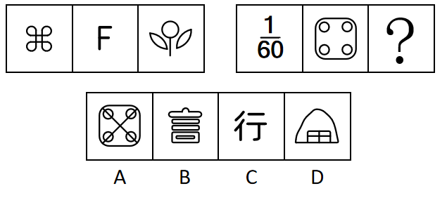

A. A

B. B

C. C

D. D

第 26 题 · 答案与解析

**参考答案（粉笔题库参考内容）**

C

**解析**

元素组成不同，且无明显属性规律，考虑数量规律。第一组图2和图3中出现多端点，考虑笔画数。第一组图形的笔画数依次为1、2、3，第二组图形中前两幅图的笔画数依次为4、5，故“？”处应为笔画数为6的图形。只有C项符合。

故正确答案为C。

### 第 27 题

从所给的四个选项中，选择最合适的一个填入问号处，使之呈现一定的规律性。

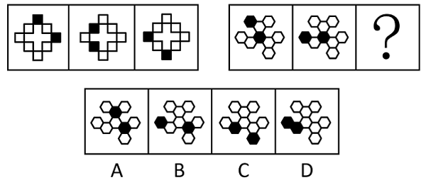

A. A

B. B

C. C

D. D

第 27 题 · 答案与解析

**参考答案（粉笔题库参考内容）**

A

**解析**

元素组成相同，但无明显位置规律。观察发现，题干前组图和后组图均出现两个黑块，且两个黑块之间均间隔一个白块，故问号处应遵循此规律，只有A项符合。

故正确答案为A。

### 第 28 题

从所给的四个选项中，选择最合适的一个填入问号处，使之呈现一定的规律。

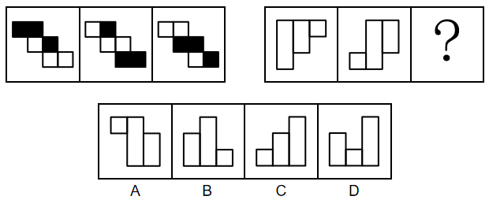

A. A

B. B

C. C

D. D

第 28 题 · 答案与解析

**参考答案（粉笔题库参考内容）**

D

**解析**

图形元素组成相同，优先考虑位置规律。第一组图形，图形中每行元素沿“Z”字型依次向上平移一行（循环走）；第二组图形运用此规律，图形中每列元素依次向右平移一列，只有D项符合。

故正确答案为D。

### 第 29 题

从所给的四个选项中，选择最合适的一个填入问号处，使之呈现一定规律性。

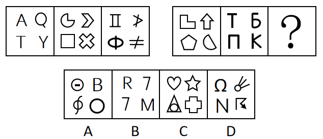

A. A

B. B

C. C

D. D

第 29 题 · 答案与解析

**参考答案（粉笔题库参考内容）**

B

**解析**

元素组成不同，优先考虑属性规律。观察发现，第一组图中每幅图均由3个全直线的小图形和1个既有曲线也有直线的小图形组成，第二组图中前两幅图也都是由3个全直线的小图形和1个既有曲线也有直线的小图形组成，故“？”处图形也应该由3个全直线的小图形和1个既有曲线也有直线的小图形组成，只有B项符合。

故正确答案为B。

### 第 30 题

从所给四个选项中，选择最合适的一个填入问号处，使之呈现一定规律性。

A. A

B. B

C. C

D. D

第 30 题 · 答案与解析

**参考答案（粉笔题库参考内容）**

A

**解析**

元素组成不同，且无明显属性规律，考虑数量规律。观察发现，题干图形交叉明显，且有明显切点，考虑切点数。第一组图形切点数依次为：0、1、2，第二组图形切点数依次为：2、3、？，故？处图形切点数应为4，只有A项符合。

故正确答案为A。

### 第 31 题

（1）不惑

（2）耳顺

（3）期颐

（4）知天命

（5）杖朝

A. 1-4-2-5-3

B. 2-1-3-5-4

C. 1-4-2-3-5

D. 1-2-4-5-3

第 31 题 · 答案与解析

**参考答案（粉笔题库参考内容）**

A

**解析**

观察题干，五个事件主要围绕“年龄代称”的时间先后顺序展开。

（1）“不惑”代指四十岁；

（2）“耳顺”代指六十岁；

（3）“期颐”指一百岁老人；

（4）“知天命”代指五十岁；

（5）“杖朝”代指八十岁。

按照时间先后排序为1-4-2-5-3，对应A项。

故正确答案为A。

### 第 32 题

（1）红旗引领，人民壮志

（2）人工天河，创造奇迹

（3）劈山架槽，挖渠千里

（4）伟大精神，历久弥新

（5）千年旱魔，世代抗争

A. 5-1-3-2-4

B. 5-2-3-4-1

C. 5-3-2-1-4

D. 1-3-2-5-4

第 32 题 · 答案与解析

**参考答案（粉笔题库参考内容）**

A

**解析**

第一步：先确定逻辑关系最为明显的逻辑顺序。

观察题干，五个事件主要围绕“抗旱挖渠造河”开展的。逻辑关系的先后顺序比较明显的是事件（5）和事件（4），要先“世代抗争旱魔”，才能彰显“伟大精神，历久弥新”，因此事件（5）是抗旱行为的起因，事件（4）是对抗旱行为的总结，故事件（5）应排在首位，事件（4）应排在最后，排除B、D两项。

第二步：逐一对照选项并判断正确答案。

根据第一步得到的结果可以判断只有A、C两项符合，通过分析事件（1）和事件（3）可得，先“红旗引领，人民壮志”，才能“劈山架槽，挖渠千里”，因此事件（1）排在事件（3）前面，排除C项。

故正确答案为A。

### 第 33 题

（1）深入调查

（2）直播炫富

（3）定罪判刑

（4）舆论哗然

（5）网友举报

A. 5-2-1-3-4

B. 2-5-1-4-3

C. 2-5-4-1-3

D. 5-2-4-3-1

第 33 题 · 答案与解析

**参考答案（粉笔题库参考内容）**

C

**解析**

第一步：先确定逻辑关系最为明显的逻辑顺序。

题干主要围绕着“直播炫富事件”展开，逻辑关系的先后顺序比较明显的是事件（1）和事件（4），事件引发舆论轰动后才会展开深入调查，因此事件（4）应该在事件（1）前面，排除A、B两项。

第二步：逐一对照选项并判断正确答案。

根据第一步的结果可以判断只有C、D两项符合，只有深入调查之后才能根据调查内容定罪判刑，因此事件（1）应该在事件（3）前面，排除D项。

故正确答案为C。

### 第 34 题

（1）庆祝中国共产党成立100周年

（2）献礼中华人民共和国70周年华诞

（3）审核通过党的第三个历史决议

（4）宣告脱贫攻坚取得了全面胜利

（5）隆重集会回顾改革开放40年的光辉历程

A. 5-2-1-4-3

B. 4-2-1-5-3

C. 5-2-4-1-3

D. 2-5-4-3-1

第 34 题 · 答案与解析

**参考答案（粉笔题库参考内容）**

C

**解析**

观察题干，五个事件主要是围绕着我国具有重要历史意义的事件开展的。“庆祝中国共产党成立100周年”发生在2021年7月，“献礼中华人民共和国70周年华诞”发生在2019年10月，“审核通过党的第三个历史决议”发生在2021年11月，“宣告脱贫攻坚取得了全面胜利”发生在2021年2月，“隆重集会回顾改革开放40年的光辉历程”发生在2018年12月。

根据时间先后排序应该是5-2-4-1-3，对应C项。

故正确答案为C。

### 第 35 题

（1）遥感收集信息

（2）发布天气预报

（3）信号传回地面

（4）发射气象卫星

（5）绘制气象图片

A. 1-5-4-2-3

B. 4-1-3-5-2

C. 4-3-1-5-2

D. 1-3-4-2-5

第 35 题 · 答案与解析

**参考答案（粉笔题库参考内容）**

B

**解析**

第一步：先确定逻辑关系最为明显的逻辑顺序。

观察题干，五个事件主要是围绕着“气象信息的收集和发布”开展的。逻辑关系的先后顺序比较明显的事件是事件（1）和事件（4），先“发射气象卫星”，然后才能“遥感收集信息”，事件（4）应该在事件（1）前面，排除A、D两项。

第二步：逐一对照选项并判断正确答案。

根据第一步的结果可以判断只有B、C两项符合，通过分析事件（1）和事件（3）可知，应先“遥感收集信息”，再将收集到的信息通过“信号传回地面”，因此事件（1）应该在事件（3）前面，排除C项。

故正确答案为B。

### 第 36 题

疫情迫使人们保持社交距离，心理咨询师的工作方式从而也发生了改变，即由面对面疗法转为通过视频和患者见面。有人认为，疫情期间为了保证安全，心理咨询师应尽可能地采用线上远程咨询的方式为患者提供服务。

如果下列陈述为真，最能支持上述论证的是（ ）。

A. 研究发现，不管是通过面对面还是线上远程，认知行为疗法对于抑郁、焦虑障碍具有同等疗效

B. 对某些心理障碍患者而言，如不及时满足其心理咨询需求，将极有可能产生过激行为

C. 如果心理咨询师无法适应线上远程咨询的诊疗方式，将难以满足患者的心理咨询需求

D. 调查显示，在疫情期间，民众心理咨询需求量暴涨

第 36 题 · 答案与解析

**参考答案（粉笔题库参考内容）**

A

**解析**

第一步：找出论点和论据。

论点：疫情期间为了保证安全，心理咨询师应尽可能地采用线上远程咨询的方式为患者提供服务。

论据：无。

本题论点讨论的是心理咨询师应尽可能通过线上远程咨询的方式为患者提供服务，没有论据，加强优先考虑必要条件。

第二步：逐一分析选项。

A项：线上远程的认知行为疗法对抑郁、焦虑障碍有效，说明线上远程咨询可以治疗患者，如果该项不成立，那么心理咨询师就没必要通过线上远程咨询的方式为患者提供服务，论点就无法成立，因此该项是论点成立的必要条件，可以加强，保留；

B项：某些心理障碍患者可能因心理咨询需求得不到满足而产生过激行为，说明心理咨询需求得不到满足的可能负面影响，解释了为什么心理咨询师应通过线上远程咨询的方式为患者提供服务，补充论据，可以加强，保留；

C项：心理咨询师若无法适应线上远程咨询的诊疗方式将难以满足患者的咨询需求，解释了为什么心理咨询师应通过线上远程咨询的方式为患者提供服务，补充论据，可以加强，保留；

D项：疫情期间，民众心理咨询需求量暴涨，解释了为什么心理咨询师应通过线上远程咨询的方式为患者提供服务，补充论据，可以加强，保留。

对比A、B、C、D四项，加强力度上，必要条件＞补充论据，因此优选A项。

故正确答案为A。

### 第 37 题

每年的夏秋之际，大草原上的牛羚都会成群结队向北方迁徙，形成非常壮观的画面。研究表明，生物运动受生存和繁殖驱动，而牛羚并非是出于繁衍的目的进行大规模迁徙，因为迁徙途中危险重重，不是被狮子猎豹追击，就是被鳄鱼埋伏，幼小牛羚往往是第一目标，非洲大草原干湿季分明，促成了特别显著的草类生长的季节性分布，显然，追逐肥美的草木和丰富的水源才是牛羚一年一度迁徙活动的推动力。

上述论证采用的论证方法是（ ）。

A. 论证一个普遍规律，并用来说明某一种特殊情况

B. 通过反例推翻一个一般性结论

C. 在对某种现象的两种可供选择的解释中，通过排除其中的一种，来确定另一种

D. 通过对发生机制的适当描述，支持关于某个可能发生现象的假说

第 37 题 · 答案与解析

**参考答案（粉笔题库参考内容）**

C

**解析**

第一步：分析题干论证过程。

题干先是指出了牛羚迁徙的现象，提出了“生物运动受生存和繁殖驱动”的理论，其中有两个因素。紧接着又论述“牛羚并非是出于繁衍的目的进行大规模迁徙”，并解释了为什么不是出于繁衍的目的，最后得出“追逐肥美的草木和丰富的水源才是牛羚一年一度迁徙活动的推动力”，即牛羚迁徙是受生存驱动。

第二步：逐一分析选项。

A项：题干给的普遍规律是“生物运动受生存和繁殖驱动”，但题干并没有去论证这个规律，而是直接默认它是正确的，与题干论证结构不一致，排除；

B项：题干并没有举反例，与题干论证结构不一致，排除；

C项：由第一步的分析可知，题干采用的论证方法是，在对某种现象的两种可供选择的解释（生存和繁殖）中，通过排除其中的一种（繁殖），来确定另一种（生存），与题干论证结构一致，当选；

D项：题干并不是一个可能发生的现象，牛羚迁徙是实际发生的现象，与题干论证结构不一致，排除。

故正确答案为C。

### 第 38 题

小鲍有5双鞋，分别是篮球鞋、滑板鞋、牛津鞋、凉鞋和拖鞋，他这周（周一至周日）每天早出晚归，出门时都会从中选择1双穿着，已知：

（1）小鲍本周穿了两次篮球鞋，穿着时间相隔3天；

（2）本周穿了一次牛津鞋，时间在第一次穿篮球鞋的前一天或后一天；

（3）本周穿了一次滑板鞋，时间在第二次穿篮球鞋之前；

（4）穿凉鞋的时间与本周第一次穿篮球鞋相隔4天；

（5）第一次穿篮球鞋之前穿过拖鞋

根据以上陈述，可以推出的结论是（ ）。

A. 小鲍周一穿篮球鞋

B. 小鲍周三穿牛津鞋

C. 小鲍周四穿拖鞋

D. 小鲍周五穿滑板鞋

第 38 题 · 答案与解析

**参考答案（粉笔题库参考内容）**

B

**解析**

第一步：分析题干条件。

（1）小鲍本周穿了两次篮球鞋，穿着时间间隔3天；

（2）本周穿了一次牛津鞋，时间在第一次穿篮球鞋的前一天或后一天；

（3）本周穿了一次滑板鞋，时间在第二次穿篮球鞋之前；

（4）穿凉鞋的时间与本周第一次穿篮球鞋相隔4天；

（5）第一次穿篮球鞋之前穿过拖鞋。

第二步：根据题干条件进行推理。

根据条件（1）（5）可知，周二或周三第一次穿篮球鞋。当周三第一次穿篮球鞋时，不满足条件（4）穿凉鞋的时间与本周第一次穿篮球鞋相隔4天，该假设不成立；当周二第一次穿篮球鞋时，根据条件（1）可知周六第二次穿篮球鞋，根据条件（5）可知周一穿拖鞋，根据条件（2）可知周三穿牛津鞋，根据条件（4）可知周日穿凉鞋，根据条件（3）可知周四或周五穿滑板鞋，满足题干条件，该假设成立。

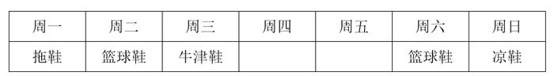

故正确答案为B。

### 第 39 题

新一届中国科幻小说大赛“星座奖”结果发布，来自广东、上海、四川的甲、乙、丙三人位列三甲，已知：

（1）乙不来自四川；

（2）乙不是第三名；

（3）丙不是第一名；

（4）来自广东的作者不是第二名；

（5）来自四川的作者夺得第一名。

由此可推知（ ）。

A. 甲不是第一名

B. 乙获得第一名

C. 丙来自四川

D. 乙来自上海

第 39 题 · 答案与解析

**参考答案（粉笔题库参考内容）**

D

**解析**

第一步：分析题干条件。

（1）乙：-四川；

（2）乙：-第三名；

（3）丙：-第一名；

（4）来自广东的作者不是第二名；

（5）来自四川的作者夺得第一名。

第二步：根据题干条件进行推理。

题干条件中“乙”和“四川”被提及的次数最多，考虑优先从此处入手开始推理。根据条件（1）和条件（5）可知，乙不是第一名；又根据条件（2）可知，乙不是第三名，则乙是第二名；再结合条件（1）和条件（4）可知，乙不来自四川，也不来自广东，则乙来自上海，对应D项。

故正确答案为D。

### 第 40 题

所谓曲解，是指听话者对说话者所说的话进行故意歪曲原意的解释，包括曲解概念和曲解解释。

下列选项中，最有可能不属于曲解的是（ ）。

A. 王同学把班级群聊记录中“小明发的信息可能是假的”转发给另一群组，并改为“小明发的信息是假的”

B. 课上，老师让郑同学回答证据的定义，而郑同学因为不知道，所以只回答了法律证据的定义

C. 小李说，小杨散了一个多小时步，小张得知后转告小杨爸爸：“小杨离开了一个多小时”

D. 班长在传达班主任的话时，把其中警告的语气有所加重

第 40 题 · 答案与解析

**参考答案（粉笔题库参考内容）**

D

**解析**

第一步：找出定义关键词。

“听话者对说话者所说的话进行故意歪曲原意的解释”。

第二步：逐一分析选项。

A项：把“信息可能是假的”转发改为“信息是假的”，存在故意歪曲原意的可能，符合“听话者对说话者所说的话进行故意歪曲原意的解释”，符合定义，排除；

B项：因为不知道证据的定义，只回答了法律证据的定义，说明郑同学故意曲解了老师问的概念，符合“听话者对说话者所说的话进行故意歪曲原意的解释”，符合定义，排除；

C项：把“小杨散了一个多小时步”转告为“小杨离开了一个多小时”，存在故意歪曲原意的可能，符合“听话者对说话者所说的话进行故意歪曲原意的解释”，符合定义，排除；

D项：在传达班主任的话时，把其中警告的语气有所加重，只是重复原意，不符合“听话者对说话者所说的话进行故意歪曲原意的解释”，不符合定义，当选。

本题为选非题，故正确答案为D。

### 第 41 题

小方说：“我这个月如果去春游，就要去梧桐山和仙湖植物园，否则就不去；只有和小雪一起出门，我才会去梧桐山或七娘山；如果要和小雪一起出门，那么我一定要和她做好约定；如果要和她做好约定，她一定有时间，但因为怀念家乡，小雪休假回北方看望家人，为期一个月。”

由此可推知，小方这个月（ ）。

A. 没去春游

B. 去了七娘山

C. 去了仙湖植物园

D. 和小雪一起出门

第 41 题 · 答案与解析

**参考答案（粉笔题库参考内容）**

A

**解析**

第一步：翻译题干。

①小方去春游梧桐山 且 仙湖植物园；

②-（梧桐山 且 仙湖植物园）小方去春游；

③梧桐山 或 七娘山小方和小雪一起；

④小方和小雪一起做好约定；

⑤做好约定小雪有时间；

⑥-小雪有时间。

第二步：根据题干条件进行推理。

从确定信息条件⑥入手，“-小雪有时间”是对条件⑤的否后，否后必否前，可以得出“-做好约定”，是对条件④的否后，可以得出“-小方和小雪一起”，排除D项；“-小方和小雪一起”是对条件③的否后，可以得出“-（梧桐山 或 七娘山）”，即“-梧桐山 且 -七娘山”，排除B项；否定且关系中的一项，即为对整体的否定，因此“-梧桐山 且 -七娘山”是对条件①的否后，可以得出“-小方去春游”，对应A项。

故正确答案为A。

### 第 42 题

有人认为，人们购买电动汽车的目的是为了省钱，因为给车辆充电的成本低于加燃油的成本。然而，考虑到电动汽车使用多年后必须更换电池，以及为了安装家用充电桩而必须购买固定停车位，实际上的总支出成本要远高于传统燃油汽车，因此，人们购买电动汽车的目的并非是为了省钱。

如果下列陈述为真，最能削弱上述推论的是（ ）。

A. 如今多数电动汽车车主使用公共充电桩充电，并没有购买固定停车位

B. 更换电池的价格比购置一辆新电动汽车要便宜很多

C. 电动汽车更符合节能环保的现代生活理念

D. 国际油价已经见顶，国内油价开始持续下降

第 42 题 · 答案与解析

**参考答案（粉笔题库参考内容）**

A

**解析**

第一步：找出论点和论据。

论点：人们购买电动汽车的目的并非是为了省钱。

论据：考虑到电动汽车使用多年后必须更换电池，以及为了安装家用充电桩而必须购买固定停车位，实际上的总支出成本要远高于传统燃油汽车。

论据和论点都说的是电动汽车并不省钱，论点论据话题一致，削弱可以考虑否定论点或者否定论据。

第二步：逐一分析选项。

A项：该项指出多数电动汽车车主使用公共充电桩充电，并没有购买固定停车位，否定论据，可以削弱，当选；

B项：该项指出更换电池的价格比购置一辆新电动汽车要便宜很多，是拿更换电池与购买新电动汽车进行价格对比，而题干讨论的是使用电动汽车与传统燃油汽车谁的成本更高，与论点话题不一致，无法削弱，排除；

C项：该项指出电动汽车更符合节能环保的现代生活理念，给出的是电动汽车的环保特性，但没提到电动汽车是否省钱，与论点话题不一致，无法削弱，排除；

D项：该项指出国内油价开始持续下降，但并没有说明电动汽车和传统燃油汽车谁更省钱，与论点话题不一致，无法削弱，排除。

故正确答案为A。

### 第 43 题

启动某实验室装置须同时接通甲、乙、丙三个电源开关，甲、乙、丙开关只能通过按压切换“开/关”状态，但都没有“开/关”状态标识，某天，实验员小朱首先按压甲开关，装置没有启动；然后按压乙开关，装置还是没有启动；接着按压丙开关，装置仍然没有启动。

接下来，下列操作不可能启动装置的是（ ）。

A. 按压甲开关

B. 按压乙开关

C. 同时按压甲、乙开关

D. 同时按压乙、丙开关

第 43 题 · 答案与解析

**参考答案（粉笔题库参考内容）**

D

**解析**

第一步：分析题干条件。

（1）启动装置须同时接通甲、乙、丙三个电源开关；

（2）首先按压甲开关，装置没有启动；

（3）然后按压乙开关，装置没有启动；

（4）最后按压丙开关，装置没有启动。

第二步：根据题干条件进行推理。

根据条件（1）和条件（2）可知，无论是否按压甲开关，装置均没有启动，说明在初始状态中，乙和丙没有同时处于“开”状态，即乙和丙的初始状态为一开一关或两关。假设乙和丙的初始状态为“一开一关”，那么接下来实验员同时按压乙和丙开关，依旧会有电源处于“关”状态，不能启动装置；假设乙和丙的初始状态为“两关”，根据条件（3）和条件（4）可知，此时甲的初始状态一定处于“开”状态，在按压甲开关后，甲处于“关”状态，接下来无论如何按压乙和丙开关，也不能启动装置，因此接下来不可能同时按压乙、丙开关来启动装置，对应D项。

本题为选非题，故正确答案为D。

### 第 44 题

所谓“鳄鱼法则”是指：假设一只鳄鱼咬住你的脚，这时你用手试图掰开鳄鱼的嘴，鳄鱼便会同时咬住你的脚与手；你越挣扎，就被咬住得越多，甚至丧命。所以，假如鳄鱼咬住你的脚，你唯一的快速自救方法就是牺牲一只脚。

下列选项中的人物运用了鳄鱼法则用来解决问题的是（ ）。

A. 张三辗转反侧，入睡困难，便索性起床一个人练习投篮，没想到投了一会就困了

B. 李巧决定这个月每天坚持跑步，然而今天整天下雨，他只得在家里原地跑

C. 王玉考试时在最后一道选择题上耗时很久仍没有头绪，考试快结束时，只好在答题卡上涂了C

D. 赵六在野外探险时不慎陷入沼泽，他试图自救并用力挣扎但却越陷越深，最后决定放弃自救转向大声呼救

第 44 题 · 答案与解析

**参考答案（粉笔题库参考内容）**

A

**解析**

第一步：找出定义关键词。

“鳄鱼咬住脚，越挣扎，咬住越多”、“唯一的快速自救方法就是牺牲一只脚”。

第二步：逐一分析选项。

A项：张三辗转反侧，入睡困难，符合“鳄鱼咬住脚”，并且“辗转反侧”也体现了“越挣扎，越睡不着”，直接不睡了，起床练习投篮，符合“唯一的快速自救方法就是先牺牲睡眠”，是在用鳄鱼法则解决问题，并且最后也成功困了，符合定义，当选；

B项：外面下雨影响了跑步，选择在家跑，只是遇到问题灵活变通，没有体现“越挣扎，咬住得越多”，不符合定义，排除；

C项：“考试时”在最后一道选择题上耗时很久仍没有头绪，符合“鳄鱼咬住脚，越挣扎，咬住越多”，但是一直纠结到“考试快结束”，实在没办法了才选答案，如果C项运用了鳄鱼法则用来解决问题，应该是在确定不会的时候，赶紧选一个答案，而不是“耗时很久”、“考试结束了没办法才选”，不符合定义，排除；

D项：陷入沼泽后试图自救并用力挣扎但却越陷越深，符合“鳄鱼咬住脚，越挣扎，咬住越多”，但题干关键词中强调唯一的“快速”自救方法就是牺牲一只脚，相比A项“索性”起床练习投篮，D项与C项同理，都是实在走投无路了，才换了个方法，没有A项更能体现“快速”自救，不符合定义，排除。

故正确答案为A。

### 第 45 题

近年来，我国人口出生率持续降低。有人认为，这是因为与过去相比，越来越多的女性走出家庭追求个人事业，生育和抚养子女对她们来说成为追求持续发展的桎梏。因此，想要提高人口出生率，应当鼓励女性回归家庭。

如果下列陈述为真，最有助于反驳上述推论的是（ ）。

A. 在很多国家，女性婚后做全职主妇的比例很高，但这些国家的人口出生率不升反降

B. 女性回归家庭会导致家庭收入锐减，无法给子女提供良好的生活环境

C. 现代社会提倡男女平等，追求个人事业的男性也应当回归家庭共担照顾子女的责任

D. 数据显示，近年来我国结婚率逐年下降，所以人口出生率降低是正常现象

第 45 题 · 答案与解析

**参考答案（粉笔题库参考内容）**

D

**解析**

第一步：找出论点和论据。

论点：想要提高人口出生率，应当鼓励女性回归家庭。

论据：我国人口出生率持续降低，是因为与过去相比，越来越多的女性走出家庭追求个人事业，生育和抚养子女对她们来说成为追求持续发展的桎梏。

本题论点和论据都在讨论“人口出生率”和“女性走出家庭”之间的关系，论点论据话题一致，削弱优先考虑否定论点。

第二步：逐一分析选项。

A项：该项说的是其他国家的情况，而题干明确讨论的是我国的情况，主体不一致，无法削弱，排除；

B项：该项说的是女性回归家庭会导致家庭收入锐减，但没有明确说明无法给予子女良好的生活环境是否就不生孩子了，不明确项，无法削弱，排除；

C项：该项说的是男性也应当回归家庭，但论点讨论的是提高人口出生率是否应当鼓励“女性”回归家庭，主体不一致，无法削弱，排除；

D项:该项说的是结婚率逐年下降是人口出生率降低的原因,那么即使鼓励已婚女性回归家庭，但由于结婚率低，人口还是会一直低，说明想通过鼓励已婚女性回归家庭来提高生育率是不可行的，否定论点，当选。

故正确答案为D。

### 第 46 题

1，1，，，，（ ）

A. 

B. 

C. 

D. 

第 46 题 · 答案与解析

**参考答案（粉笔题库参考内容）**

D

**解析**

数列大部分为分数，反约分后无规律，考虑递推。圈三数，找规律，1+1=2，，，观察发现该数列规律为：。则，故所求项。

故正确答案为D。

### 第 47 题

2，13，25，39，56，（ ）

A. 66

B. 77

C. 78

D. 89

第 47 题 · 答案与解析

**参考答案（粉笔题库参考内容）**

B

**解析**

数列无明显特征，优先考虑多级数列。后项减前项得到新数列：11，12，14，17，（ ），无明显特征，再次作差，后项减前项得到数列：1，2，3，（ ），是公差为1的等差数列，下一项为3+1=4，则新数列下一项为17+4=21。故所求项=56+21=77。

故正确答案为B。

### 第 48 题

5，6，9，13，15，18，19，（ ）

A. 27

B. 26

C. 25

D. 24

第 48 题 · 答案与解析

**参考答案（粉笔题库参考内容）**

C

**解析**

题干数列项数较多，优先考虑多重数列。交叉后无规律，考虑分组。原数列两两分组后为：（5，6）（9，13）（15，18）（19，？），组内加和后的数列为：11，22，33，是公差为11的等差数列，下一项应为33+11=44，故所求项为44-19=25。

故正确答案为C。

### 第 49 题

110，121，275，297，（ ）

A. 321

B. 375

C. 423

D. 462

第 49 题 · 答案与解析

**参考答案（粉笔题库参考内容）**

D

**解析**

题干数列各项均为三位数，考虑机械划分。将原数列中的每一项拆成三个数字去看，观察发现中间的数字均为前后两个数字之和，1+0=1，1+1=2，2+5=7，2+7=9，故所求项也应满足此条件。观察选项，只有D项满足，4+2=6。

故正确答案为D。

### 第 50 题

24，14，26，33，46，（ ）

A. 56

B. 62.5

C. 66

D. 71.5

第 50 题 · 答案与解析

**参考答案（粉笔题库参考内容）**

B

**解析**

数列无明显特征，且作差作和后均无规律，考虑递推数列。观察发现，，，，即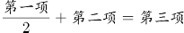，故所求项为。

故正确答案为B。

### 第 51 题

有一个圆柱体花瓶，装有5cm深的水，花瓶的内底面直径为12cm，现在往花瓶中放入一个玻璃球，当球掉入水底时，水面恰好与玻璃球相切，则玻璃球的半径为（ ）cm。

A. 3

B. 4

C. 5

D. 6

第 51 题 · 答案与解析

**参考答案（粉笔题库参考内容）**

A

**解析**

由水面恰好与玻璃球相切可知，玻璃球放入花瓶后完全浸入水中。设玻璃球的半径为r，浸入水中后水面的高度为2r，根据原来花瓶中水的体积+玻璃球体积=现在花瓶中水的体积与玻璃球的总体积，可列式：，化简为，解得r=3cm。

故正确答案为A。

### 第 52 题

小孟有58枚硬币，其中1枚为假，目前已知道真币重量相同，假币重量偏轻。如果小孟手中只有一个天平，则至少称（ ）次一定能找出假币。

A. 4

B. 5

C. 6

D. 7

第 52 题 · 答案与解析

**参考答案（粉笔题库参考内容）**

A

**解析**

根据天平问题结论：使用n次天平最多可以判定枚硬币，即使用2次天平可以判定最多9枚硬币，使用3次天平可以判定最多27枚硬币，使用4次天平可以判定最多81枚硬币。本题共58枚硬币，则至少要称4次一定能找出假币。

故正确答案为A。

### 第 53 题

黑脸琵鹭飞行速度较快，为55公里/小时，白琵鹭飞行速度为45公里/小时，黑、白两群琵鹭从距离深圳湾湿地3120公里的黑龙江出发南飞越冬，若不考虑途中停歇，白琵鹭先到达湿地需比黑脸琵鹭至少早起飞（ ）小时。

A. 11

B. 12

C. 13

D. 14

第 53 题 · 答案与解析

**参考答案（粉笔题库参考内容）**

C

**解析**

根据公式：时间，可得黑脸琵鹭到达湿地的时间小时，白琵鹭到达湿地时间小时，则白琵鹭先到达湿地需比黑脸琵鹭早起飞69.3-56.7=12.6小时，求最少，应向上取整，为13小时。

故正确答案为C。

### 第 54 题

某书的页码是从1开始的连续自然数，1，2，3，4，······莎莎将该书页码全部相加时，不小心将其中某页码多加了1次，结果和为2003，则被多加的页码为（ ）。

A. 45

B. 50

C. 56

D. 62

第 54 题 · 答案与解析

**参考答案（粉笔题库参考内容）**

B

**解析**

根据题意可知，全部页码数之和+某页页码数=2003，则全部页码数之和小于2003。设该书共有n页，根据等差数列求和公式：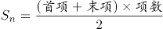，当n=62时，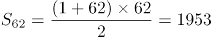，最接近且小于2003，此时多加1次的页码数=2003-1953=50。

故正确答案为B。

### 第 55 题

有甲、乙两种咖啡豆，按照质量比a：b相混合制成一种拼配豆，已知甲咖啡豆每公斤60元，乙咖啡豆每公斤80元，现因产量变化，甲咖啡豆单价上涨15%，乙咖啡豆单价下降15%，以致该拼配咖啡豆的成本上调了5%，则a：b为（ ）。

A. 1：1

B. 5：3

C. 8：3

D. 2：1

第 55 题 · 答案与解析

**参考答案（粉笔题库参考内容）**

C

**解析**

方法一：根据公式：每公斤成本，可得原拼配豆每公斤的成本元，产量变化后拼配豆每公斤的成本元。根据“该拼配咖啡豆的成本上调了5%”可列式：，解得a：b=8：3。

方法二：由于甲咖啡豆单价上涨15%，乙咖啡豆单价下降15%，拼配咖啡豆成本上调5%，根据线段法：量和距离成反比，可知甲咖啡豆总成本：乙咖啡豆总成本=\[5%-(-15%)\]：(15%-5%)=2：1。根据重量，可得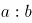。

故正确答案为C。

### 第 56 题

在一个即时战略电子游戏中，电子士兵以每分钟一米的速度沿一条固定路线行军，任意两名士兵相遇后，都会掉头行进；行至路线的起点或终点时，便停止前进并对此地的基地进行无差别攻击。玩家阿坤的基地距离魔王城堡基地9米。游戏开始，他立即派出一名士兵，此后每隔1分钟派出1名士兵，共计7名。一名士兵出发半分钟后，魔王也从城堡基地每隔1分钟派出1名士兵，共计8名。若之后双方均未继续派兵，则游戏开始多少分钟后，所有士兵均已开始攻击？

A. 16.5

B. 17

C. 17.5

D. 18

第 56 题 · 答案与解析

**参考答案（粉笔题库参考内容）**

A

**解析**

根据题干中电子士兵的行军规则，任意两名电子士兵相遇时会掉头行进，下图为甲、乙两名士兵的行进路线：

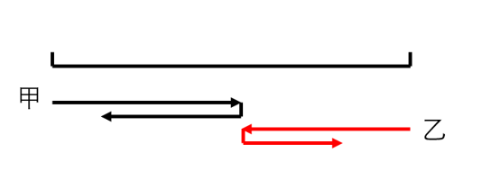

但由于每个电子士兵的速度一致，可等价认为这两名士兵在相遇时，只互换身份，仍旧继续向前行进，如下图：

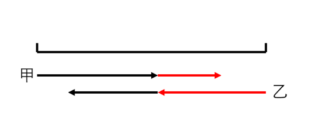

以每名士兵来看，从起点出发，每次与其他人相遇，无需掉头，而是代替对方继续向前直至行进至终点，每名士兵行进整个全程所用时间为分钟。由于魔王晚半分钟派兵且比阿坤多一名士兵，所以魔王最后一名士兵在起点等待0.5+7=7.5分钟，最终到达终点的时间为7.5+9=16.5分钟。所以游戏开始16.5分钟后，所有士兵均已开始攻击。

故正确答案为A。

### 第 57 题

小明对甲、乙、丙三种手机软件的安装情况进行街头调查。随机选取的一批调查对象中，手机安装了甲、乙、丙三种软件的人数分别是40，36，35，只安装了其中一种软件的人数分别占其中的25%、25%、20%，同时安装了甲、乙两种软件而未安装丙软件的有4人，同时安装了甲、丙两种软件而未安装乙软件的人数比同时安装乙、丙两种软件而未安装甲软件的人数多3人，有（ ）人同时安装了甲、乙、丙三种软件。

A. 15

B. 21

C. 27

D. 33

第 57 题 · 答案与解析

**参考答案（粉笔题库参考内容）**

B

**解析**

如图所示，根据题意，只安装甲软件的人数为40×25%=10人，只安装乙软件的人数为36×25%=9人，只安装丙软件的人数为35×20%=7人。设有x人同时安装了甲、乙、丙三种软件，则同时安装了甲、丙两种软件而未安装乙软件的人数为40-10-4-x=（26-x）人，同时安装乙、丙两种软件而未安装甲软件的人数为26-x-3=（23-x）人。安装丙软件的人数为（26-x）+x+（23-x）+7=35，解得：x=21，即有21人同时安装了甲、乙、丙三种软件。

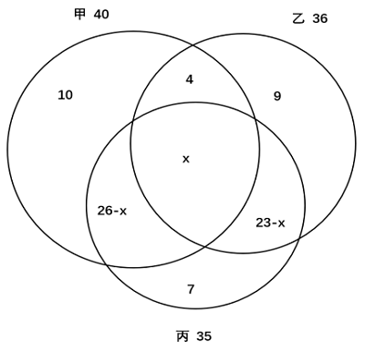

故正确答案为B。

### 第 58 题

作曲人阿伟不久前创作了一首歌，甲、乙两个音乐平台均获得其使用权，甲平台根据该歌曲播放数乘以0.01元给予收益；乙平台除给予10万元基础收益外，另计每次播放收益0.006元，现从甲平台获得的收益比乙平台多10000元，且此时该歌曲在甲平台的播放量比在乙平台高500万次，那么该歌曲在甲平台的播放量为（ ）万次。

A. 1800

B. 2000

C. 2200

D. 2400

第 58 题 · 答案与解析

**参考答案（粉笔题库参考内容）**

B

**解析**

设该歌曲在甲平台的播放量为x万次，在乙平台的播放量为（x-500）万次。根据“从甲平台获得的收益比乙平台多10000元”，可得0.01×x=10+0.006×(x-500)+1，解得x=2000。

故正确答案为B。

### 第 59 题

博物馆员工周二至周六上班，周日、周一休息。某月有31天，员工小王工作了22天，则该月的4号是周几？

A. 周一

B. 周二

C. 周一或周四

D. 周四或周日

第 59 题 · 答案与解析

**参考答案（粉笔题库参考内容）**

C

**解析**

该月共有31天，小王工作了22天，则休息了31-22=9天。31天可看成前3天+后28天。后28天为4个整周期，共休息4×2=8天。则前3天休息1天，说明该月的第一天（1号）是周一或者第三天（3号）是周日，若1号是周一，则4号是周四；若3号是周日，则4号是周一。

故正确答案为C。

### 第 60 题

老杨、老朱和小张三人开展社区巡防工作，巡防路线固定，三人同时同向出发，老杨开车，老朱骑自行车，小张走路。已知老杨每20分钟追上小张一次，每40分钟追上老朱一次，则老朱每（ ）分钟追上小张一次。

A. 30

B. 40

C. 50

D. 60

第 60 题 · 答案与解析

**参考答案（粉笔题库参考内容）**

B

**解析**

起点相同的环形追及，同时同向出发，每次追上的两人路程差即为整个巡防路线周长。根据环形追及公式：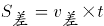，可得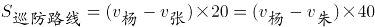，整理得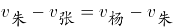，故老朱每次追及小张的时间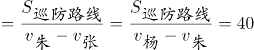分钟。

故正确答案为B。

### 第 61 题

将下列选项中的成语填入横线处。最恰当的一项是（ ）。

十年来，面对严峻复杂的国际形势和接踵而至的巨大风险和挑战，党中央运筹帷幄，            ，作出一系列重大科学判断，提出一系列重大战略策略，推动一系列重大工作，始终掌握新时代新征程党和国家事业发展的历史主动。

A. 处之泰然

B. 指挥若定

C. 稳操胜券

D. 应付裕如

第 61 题 · 答案与解析

**参考答案（粉笔题库参考内容）**

B

**解析**

根据“党中央运筹帷幄”“作出一系列重大科学判断，提出一系列重大战略策略，推动一系列重大工作”可知，横线处应体现在面对风险和挑战时，党中央有条不紊地制定了一系列的决策之意。B项“指挥若定”形容态度冷静，考虑周全，指挥起来就像一切都事先规定好了似的，符合文意，当选。A项“处之泰然”指对待发生的紧急情况或困难，安然自得，毫不在乎，侧重强调态度十分淡定，无法体现出制定决策之意，排除；C项“稳操胜券”指有胜利的把握，文段并未体现出一定会取得胜利，程度过重，且无法体现出制定决策之意，排除；D项“应付裕如”指从容应对、毫不费力，文段并未体现毫不费力之意，排除。

故正确答案为B。

【文段出处】《掌握历史主动 凝聚奋进伟力》

### 第 62 题

将下列选项中的词语依次填入各句横线处，最恰当的一组是（ ）。

（1）当前，我国经济社会发展各项任务较为繁重艰巨，只有稳住农业基本盘、守好“三农"基础，才能夯实应变局、开新局的“          "，把发展主动权牢牢掌握在自己手中。

（2）“种草带货"不是一锤子买卖，莫让“带货"变“带祸”，还得抓住平台这个”          ”。

A. 压舱石 牛鼻子

B. 压舱石 桥头堡

C. 航船舵 牛鼻子

D. 航船舵 桥头堡

第 62 题 · 答案与解析

**参考答案（粉笔题库参考内容）**

A

**解析**

第一空，根据“只有稳住农业基本盘、守好‘三农’基础”可知，农业对于“应变局、开新局”起到稳定全局的基础性作用。A、B两项“压舱石”原意指在空船上，船的整体重心在水面以上，极易翻船，为此空船航行时都备有“压舱石”，以免翻船，故用来比喻稳定全局的基础性作用，均符合文意，保留。C、D两项“航船舵”指船只驾驶时用来掌握前进方向的装置，侧重“掌握方向”，均与文意不符，排除。

第二空，根据文意可知，横线处应体现要整治“种草带货”的不良现象，抓住平台是关键。A项“牛鼻子”比喻事物的主要矛盾或者影响全局的关键，符合文意，当选。B项“桥头堡”指为扼守和保护重要桥梁、渡口，在其附近地区构筑的碉堡、地堡或阵地，与文意不符，排除。

故正确答案为A。

【文段出处】《人民网评：守住"两条底线"，推动乡村振兴取得新进展》

《人民网三评“种草笔记”之三：要杜绝带货变“带祸”》

### 第 63 题

将下列选项中的词语依次填入各句横线处。最恰当的一组是：

（1）一切爱好和平的人民都渴望用现代的科学技术成就来使人类的物质和精神生活进一步        。

（2）我记起了那些艰难的岁月，山区人民为了民族的生存和        ，为了自己的解放和幸福的未来，同我们党的同志一起，出生入死、同甘共苦。

（3）布吉街道位于深圳市中部，距香港新界8公里，距深圳宝安机场35公里，广深铁路、京九铁路、广深高速公路穿境而过，交通十分        。

A. 繁荣 兴旺 发达

B. 繁荣 发达 兴旺

C. 兴旺 繁荣 发达

D. 发达 兴旺 繁荣

第 63 题 · 答案与解析

**参考答案（粉笔题库参考内容）**

A

**解析**

第一空，搭配“物质生活和精神生活”。A、B两项“繁荣”指蓬勃发展，与“物质和精神生活”搭配恰当，均保留。C项“兴旺”指兴盛，旺盛，通常搭配“生意”“国家”“事业”等，D项“发达”指（事物）已有充分发展，（事业）兴盛，通常搭配“经济”“科技”“交通”等，均与“物质和精神生活”搭配不当，排除。

第二空，搭配“民族”。A项“兴旺”与“民族”搭配恰当，保留。B项“发达”与“民族”搭配不当，排除。

第三空，代入验证。A项“发达”与“交通”搭配恰当，当选。

故正确答案为A。

【文段出处】《深圳市的名字由来》

### 第 64 题

将下列选项中的词语依次填入各句横线处，最恰当的一项是（ ) 。

（1）全市一百多家巿属工厂，已有百分之八十以上的工厂在搞第二代、第三代新产品，百分之五十的工厂正在        或研究试制新产品。

（2）该海域主要        梭子蟹、皮皮虾等海货品种，眼下休渔期正式结束，正是捕掠的最佳季节。

（3）对于大多数艺术衍生品消费群体来说，艺术衍生品一方面具有一定的美学价值，不是地摊        的粗制滥造，俗不可耐；另一方面，相比原作来说价格更实惠。

A. 生产 出产 出品

B. 生产 生产 出品

C. 出品 出产 生产

D. 出产 生产 出产

第 64 题 · 答案与解析

**参考答案（粉笔题库参考内容）**

A

**解析**

本题可从第二空入手，横线处搭配“该海域”，A、C两项“出产”指天然生长或人工生产，与“该海域”搭配恰当，均保留。B、D两项“生产”指人们使用工具来创造各种生产资料和生活资料，搭配主语多具有主观能动性，与“该海域”搭配不当，均排除。

再看第三空，横线处搭配“地摊”，A项“出品”指制造出来的产品，与“地摊”搭配恰当，保留。C项“生产”指人们使用工具来创造各种生产资料和生活资料，地摊无法创造生产资料或生活资料，与“地摊”搭配不当，排除。

第一空，代入验证，横线处搭配“新产品”，A项“生产”与“新产品”搭配恰当，当选。

故正确答案为A。

【文段出处】（1）无

（2）河北省财政厅《渤海开海季 渔民秋捕忙》

（3）人民网《艺术衍生品让艺术飞入百姓家》

### 第 65 题

将下列选项中的成语依次填入各句横线处，最恰当的一项是（ ）。

（1）一边把那些态度不端、动机不纯的人淘汰出去，一边把那些具有正确认识、心怀理性期待的人吸收进来，公务员队伍就能            、生生不息，公务员职业就能回归行使公权、服务公众的本位。

（2）一些腐败分子由于存在侥幸心理，仍然会铤而走险。他们觉得只要做得“滴水不漏"，就不可能            ，也就不可能查到自己的头上。

A. 吐故纳新 原形毕露

B. 除旧布新 东窗事发

C. 除旧布新 原形毕露

D. 吐故纳新 东窗事发

第 65 题 · 答案与解析

**参考答案（粉笔题库参考内容）**

D

**解析**

第一空，根据“一边把那些态度不端、动机不纯的人淘汰出去，一边把那些具有正确认识、心怀理性期待的人吸收进来”可知，横线处所填成语应表示把不好的淘汰出去，把好的吸收进来，A、D两项“吐故纳新”比喻扬弃旧的，吸收新的，符合文意，均保留。B、C两项“除旧布新”意思是除去旧的，建立新的，题干仅强调把那些具有正确认识、心怀理性期待的人吸收进来，而非建立新的，与文意不符，均排除。

第二空，根据“一些腐败分子由于存在侥幸心理，仍然会铤而走险。他们觉得只要做得‘滴水不漏’”可知，横线处所填成语应体现一些腐败分子认为自己的腐败行为不会被发现，且感情色彩偏消极，D项“东窗事发”现泛指阴谋败露或秘密勾当被发觉，含贬义，符合文意，当选。A项“原形毕露”指本来面目完全暴露，伪装被彻底揭开，应用于形容“腐败分子”，而非“腐败的行为”，置于此处用法不当，排除。

故正确答案为D。

【文段出处】《公务员的“怨”与“愿”》

《【清风悟语】知行止 守规矩——观看警示教育片心得体会选登（八）》

### 第 66 题

将下列选项中的词语依次填入各句横线处，最恰当的一组是（ ）。

企业资源计划项目和传统的实施项目最大的不同是其中间结果的质量很难鉴定，而且中间结果和最终结果之间的联系不直接，        盖房子，从打地基起到盖完五层，人人都能看见和看懂它的进度，企业资源计划项目实施则不同，        调研阶段的结果就是一个几十页的Word文档，这些文段的优劣只有专家才能评价。

A. 譬如 比如

B. 例如 譬如

C. 犹如 例如

D. 比如 犹如

第 66 题 · 答案与解析

**参考答案（粉笔题库参考内容）**

A

**解析**

第一空，文段将“传统的实施项目”比作盖房子，故横线处所填词语应可引导打比方类比说明。A项“譬如”意思是比如，可以引导打比方类比说明，D项“比如”意思是譬如，均符合语境，保留。B项“例如”为举例用语，放在所举的例子前面，表示下面即前面所说事物的例子，且所举例子的内容必须是真实存在的，而“盖房子”并非真实的项目内容，排除；C项“犹如”指如同、好像，可引导比喻句，但前后句子结构应一致，若使用“犹如”，文段应为“传统的实施项目，犹如盖房子”，置于此处用法不当，排除。

第二空，“调研阶段的结果”是对前文“企业资源计划项目实施”的举例说明，故横线处所填词语应能够引导举例，A项“比如”符合语境，当选。D项“犹如”引导比喻句，“调研阶段的结果就是一个几十页的Word文档”是一种事实的举例，并非比喻，排除。

故正确答案为A。

【文段出处】《中小企业ERP系统的实施特点》

### 第 67 题

将下列选项中的词语依次填入各句横线处，最恰当的一组是（ ）。

晚上睡前靠在床头刷手机，        是许多人一天中最舒心惬意的时刻，        需要提醒的是，长期的睡前玩手机，        会造成入睡困难，降低睡眠质量，       可能诱发抑郁情绪。

A. 虽然 但 如果 就

B. 既然 也 不仅 还

C. 虽然 但 不仅 还

D. 既然 也 如果 就

第 67 题 · 答案与解析

**参考答案（粉笔题库参考内容）**

C

**解析**

第一空和第二空，根据文段“最舒心惬意的时刻”和“造成入睡困难，降低睡眠质量”可知，第一空和第二空前后构成转折关系，A、C两项“虽然······但”表示转折关系，符合文意，保留。B、D两项“既然······”表示引出前提，后面常给出结论，与文段逻辑关系不符，排除。

第三空和第四空，根据文段“造成入睡困难，降低睡眠质量”和“诱发抑郁情绪”可知，第三空和第四空并列论述长期的睡前玩手机的危害，C项“不仅······还”为并列关系，符合文意，当选。A项“如果······就”表示假设关系，与文段逻辑关系不符，排除。

故正确答案为C。

【文段出处】《睡前刷手机，睡不好易抑郁》

### 第 68 题

将下列选项中的词语依次填入各句横线处，最恰当的一组是（ ）。

有一些星系的合并犹如异乎寻常的宇宙芭蕾舞，相互扭曲、缠绕的星系卷起绵延一万光年的恒星浪潮，以            之势将数十亿天体扔往宇宙的各个角落，银河里可能就有数百亿个“外来落户”或者仅仅是路过的恒星，更不用说那些            的黑洞犹如怪兽一般坐镇在每个星系的中间。

A. 排山倒海 硕大无朋

B. 荡气回肠 大而无当

C. 排山倒海 大而无当

D. 荡气回肠 硕大无朋

第 68 题 · 答案与解析

**参考答案（粉笔题库参考内容）**

A

**解析**

第一空，搭配“星系”，且根据“相互扭曲、缠绕的星系卷起绵延一万光年的恒星浪潮”“将数十亿天体扔往宇宙的各个角落”可知，横线处要体现其声势的浩大，A、C两项“排山倒海”意为推开高山，翻倒大海，形容来势迅猛，力量强大，符合文意，保留。B、D两项“荡气回肠”意为使气荡漾，使肠回旋，形容乐曲、文辞等优美动人，与“星系”搭配不当，排除。

第二空，搭配“黑洞”，A项“硕大无朋”意为大得无与伦比，与“黑洞”搭配恰当，当选。C项“大而无当”形容言辞夸大，不着实际，也形容大而不切实用 ，与“黑洞”搭配不当，排除。

故正确答案为A。

【文段出处】新发现《流浪繁星》

### 第 69 题

将下列选项中的词语依次填入句子横线处，最恰当的一组是（ ）。

（1）试图与五四文学革命            的“学衡派”知识分子，是中国最早一批新人文主义的忠实信徒。

（2）任何一个时代的文艺，只有同国家和民族紧紧维系，休戚与共，才能发出            的声音。

A. 平分秋色 如雷贯耳

B. 分庭抗礼 振聋发聩

C. 平分秋色 振聋发聩

D. 分庭抗礼 如雷贯耳

第 69 题 · 答案与解析

**参考答案（粉笔题库参考内容）**

B

**解析**

第一空，根据“试图与五四文学革命”“‘学衡派’知识分子”与“新人文主义的忠实信徒”可知，横线处应体现出“学衡派”知识分子不认同五四文学革命，想要与五四文学革命抗争之意，B、D两项“分庭抗礼”指双方平起平坐，实力相当，可以抗衡，符合文意，保留。A、C两项“平分秋色”指双方各占一半，体现不出“抗争”之意，排除。

第二空，搭配“声音”，且应体现出只有同国家和民族紧密联系在一起的文艺，才能发出声音、被人们听到这一含义，B项“振聋发聩”指发出很大的声响，使耳聋的人也能听见，比喻用语言文字唤醒糊涂的人，与“声音”搭配恰当，且符合文意，当选。D项“如雷贯耳”指人的名声很大，与“声音”搭配不当，且不符合文意，排除。

故正确答案为B。

【文段出处】《新月派与新人文主义的起落》《中国经典作品国际传播的新时代使命》

### 第 70 题

将下列选项中的词语依次填入句子横线处，最恰当的一组是（ ）。

2012年至2022年，这段浓墨重彩的历史时间，充盈着伟大人民“力拔山兮气盖世”的            ，铺展着伟大国度“无边光景一时新”的            ，书写着伟大时代“此卷长留天地间”的            。新时代10年的伟大变革，在党史、新中国史、改革开放史、社会主义发展史、中华民族发展史上具有里程碑意义。

A. 英雄豪情 不朽诗篇 盛世景象

B. 不朽诗篇 盛世景象 英雄豪情

C. 英雄豪情 盛世景象 不朽诗篇

D. 盛世景象 英雄豪情 不朽诗篇

第 70 题 · 答案与解析

**参考答案（粉笔题库参考内容）**

C

**解析**

第一空，搭配“充盈”，根据“伟大人民‘力拔山兮气盖世’”可知，横线处应体现伟大人民有气壮山河、势吞万里之气象、豪情，A、C两项“英雄豪情”侧重强调豪迈的情感，符合文意，保留。B项“不朽诗篇”侧重强调永不磨灭的诗歌、作品等，D项“盛世景象”侧重强调兴盛的时代，经济、文化、科技等繁荣昌盛，均与“充盈”搭配不当，排除。

第二空，搭配“铺展”，根据“伟大国度‘无边光景一时新’”可知，横线处应体现伟大国度“焕然一新”的景象，C项“盛世景象”符合文意，且与“铺展”搭配恰当，保留。A项“不朽诗篇”多搭配创作、书写等，与“铺展”搭配不当，排除。

第三空，代入验证，搭配“书写”，根据“此卷长留天地间”可知，横线处应体现长久地流传下去之意，C项“不朽诗篇”符合文意，且与“书写”搭配恰当，当选。

故正确答案为C。

【文段出处】人民日报《掌握历史主动 凝聚奋进伟力》

### 第 71 题

下列各项中，有语病的一项是（ ）。

A. 不管人们意识到还是没意识到，受教育者个性素质的发展，都依赖于受教育者的自我建构和自我努力。

B. 在这滴水成冰的早晨，西北风一刮，人们恨不得捂上棉被，而红旗手们虽衣着单薄，却精神饱满。

C. 国旗是国家的象征和标志，事关国家的尊严和形象，人民群众要提高国旗意识和国家观念，切忌不可等闲视之。

D. 在工业革命后使用近代机器生产的社会里，国家应该而且必须对相关领域进行干预而不应放任。

第 71 题 · 答案与解析

**参考答案（粉笔题库参考内容）**

C

**解析**

本题为病句辨析题。

C项，“切忌不可等闲视之”中的“切忌”与“不可”均为否定词，双重否定表示肯定，“等闲视之”的意思是把这件事看成平常的事，不予重视，该项语句意在表达我们应该去重视这件事，所以应改为“切忌等闲视之”或“不可等闲视之”，存在语病，当选；

A、B、D三项，均没有语病，表意明确，排除。

故正确答案为C。

### 第 72 题

下列各项中，有语病的一项是（ ）。

A. 他进门唠起家常，接过从锅里刚蒸出、冒着热气的土豆，掰开一块放在嘴里津津有味地吃了起来。

B. 因为有了图画，她即便看不懂应用题里的英文，也能猜出题目里的大意。

C. 这份心理测评问卷经过在多家用人单位的400多个新入职员工中试用，80%反映可信度不高。

D. 新疆要求加强对楼兰古城的保护，国家专门紧急拨款100万元，用于对楼兰古城的抢救性保护。

第 72 题 · 答案与解析

**参考答案（粉笔题库参考内容）**

C

**解析**

本题为病句辨析题。

C项，“这份心理测评问卷经过在多家用人单位的400多个新入职员工中试用”存在介词滥用的情况，可以通过删除“经过”或“在······中”进行修改，存在语病，当选；

A、B、D三项，均没有语病，表意明确，排除。

故正确答案为C。

### 第 73 题

下列各项中，没有语病的一项是（ ）。

A. 改变导致颈椎病的不良习惯是困难还是容易呢？医生对此的答案是确定的。

B. 近日，随着气温升高，各地农民抢抓农时投入到农业劳作当中，田间地头一派忙碌的劳动景象。

C. 第七次全国人口普查数据显示，我国60岁及以上人口已达2.64亿，预计“十四五”时期这一数字将突破3亿多。

D. 专家组提出，如能将体重指数控制在正常范围内，便可防止人群中45%~50%的慢性病危险因素聚集，可防止10%~20%的冠心病、脑卒中免于发病。

第 73 题 · 答案与解析

**参考答案（粉笔题库参考内容）**

B

**解析**

A项，“对此”指代不明，且根据“困难还是容易”可知，“答案是确定的”属于一面对两面，排除；

B项，表意明确，没有语病，当选；

C项，“突破3亿多”成分赘余，应改为“突破3亿”，排除；

D项，“可防止10%～20%的冠心病、脑卒中免于发病”成分赘余，应改为“可防止10%～20%的冠心病、脑卒中发病”或“可使10%～20%的冠心病、脑卒中免于发病”，排除。

故正确答案为B。

【文段出处】A项，未找到；B项《外眼看山东·央媒一周图片撷英｜科技助春耕》；C项《事关2.64亿人！如何破解养老之难？》；D项《人怎样才算肥胖？我国提出中国成人肥胖标准》

### 第 74 题

下列各项中，没有语病的一项是（ ）。

A. 小杨是爱猫一族，对猫的热爱促使她经常购买一些有关猫的文创产品。

B. 能否实现“双碳”目标，降低煤炭发电所造成的二氧化碳释放是关键。

C. 由于爷爷是农场主，5岁起就在各种果园里玩耍。

D. 卖萌经济最早发源于日本，以从日本动漫等产业延伸出来的文化商品或服务作为表现形式。

第 74 题 · 答案与解析

**参考答案（粉笔题库参考内容）**

D

**解析**

A项，暗中偷换主语，“小杨是爱猫一族”的主语是“小杨”，而“对猫的热爱促使她经常购买一些有关猫的文创产品”的主语是“对猫的热爱”，排除；

B项，“能否实现······是关键”存在两面对一面的错误，应改为“要实现‘双碳’目标，降低煤炭发电所造成的二氧化碳释放是关键”，排除；

C项，成分残缺，缺少主语，应改为“由于爷爷是农场主，他5岁起就在各种果园里玩耍”，排除；

D项，表意明确，没有语病，当选。

故正确答案为D。

【文段出处】《摩擦摩擦，这位外籍院士告诉你纳米发电机如何让“海洋发电”》《卖萌经济、单身经济、社恐经济······年轻群体消费催生多少新经济？》

### 第 75 题

把下面几个句子组成语意连贯的一段文字，排序正确的一项是( )。

（1）北宋时隐居龙山的孔旼，据称有田数百亩。

（2）山林是一个隐秘的宝库，为隐士们供给了衣食住等诸方面的所需，以维持他们最基本的生活。

（3）但是大多隐士并没有这么幸运，特别是山林隐士，往往是清贫的，为了“讨生活”，他们还是需要从事一两种职业，以谋生计。

（4）还有一些隐士得到了官府的赏赐或官员赞助，也饶有资财。

（5）这些隐士，大抵可以过着超然世外的生活。

（6）陈抟就屡次被皇帝接见，受到赏赐，他隐居的华山云台观也为官府修建。

（7）但有时候，这并不足够。鲁迅先生在《且介亭杂文·隐士》里曾说:“凡是有名的隐士，他总是已经有了‘优哉游哉，聊以卒岁’的幸福的。”

A. 1-4-6-5-7-2-3

B. 1-6-5-4-3-2-7

C. 2-7-1-4-6-5-3

D. 2-3-1-4-6-7-5

第 75 题 · 答案与解析

**参考答案（粉笔题库参考内容）**

C

**解析**

对比选项，确定首句，首句分别为（1）句和（2）句，（1）句介绍孔旼有百亩田，（2）句介绍山林能为隐士们供给所需，维持他们最基本的生活，根据逻辑顺序，应先引出山林为隐士们供给所需的观点，再具体举例某个人来支持观点，故（2）句应在（1）句之前，排除A、B两项。

继续观察，发现（7）句出现转折词“但”，对比C、D两项，（7）句前分别是（2）句和（6）句，（7）句介绍不满足于这些，有名隐士还有更多的幸福要追求，（2）句介绍山林能为隐士们供给所需，维持他们最基本的生活，可与（7）句构成转折，故（2）（7）两句可以构成捆绑，C项当选。（6）句介绍陈抟受皇帝赏赐，与（7）句话题不一致，无法构成转折，（6）（7）两句无法构成捆绑，排除D项。

故正确答案为C。

【文段出处】《住在云山深处：隐士的衣食住行及其他》

### 第 76 题

快速射电暴是广袤宇宙中的一种射电波剧烈爆发的现象。它持续时间极短，通常只有几毫秒，但能量特别高，而快速射电暴的偏振性质，包含了快速射电暴本身的特性以及其形成环境等丰富信息，如果对快速射电暴的偏振性质进行精确测量，可以推进对快速射电暴周边环境及其起源的理解。如快速射电暴的年龄、来源地等，其周边环境的变化越复杂，就表示其越年轻、活跃程度越高。目前观测到的95%左右的快速射电暴都是出现一次便再无踪迹。但是，天文学家在观测中发现，有一些快速射电暴会重复爆发。依托中国天眼的高灵敏度优势以及美国绿岸望远镜，科研人员成功测量了5个重复快速射电暴样本，结果表明，这些重复快速射电暴都处于类似超新星遗迹的复杂环境中，为最终确定快速射电暴的起源提供了关键观测证据。

下列说法与原文意思不相符的是（ ）。

A. 大多数快速射电暴的爆发都具有偶然性，不会重复爆发

B. 快速射电暴的偏振性质包含了许多可供人们解读的信息

C. 活跃程度越高的快速射电暴，其周边环境的变化越难以测量

D. 关于快速射电暴的起源，天文学家至今未有充分的理解

第 76 题 · 答案与解析

**参考答案（粉笔题库参考内容）**

C

**解析**

A项，根据“目前观测到的95%左右的快速射电暴都是出现一次便再无踪迹”可知，表述正确，排除；

B项，根据“而快速射电暴的偏振性质，包含了快速射电暴本身的特性以及其形成环境等丰富信息，如果对快速射电暴的偏振性质进行精确测量，可以推进对快速射电暴周边环境及其起源的理解”可知，表述正确，排除；

C项，根据“其周边环境的变化越复杂，就表示其越年轻、活跃程度越高”可知，文段仅仅论述快速射电暴的活跃程度与其周边环境的变化程度成正相关，但并未提及“难以测量”，无中生有，当选；

D项，根据“为最终确定快速射电暴的起源提供了关键观测证据”可知，目前关于快速射电暴的起源尚未形成定论，表述正确，排除。

本题为选非题，故正确答案为C。

【文段出处】《中国天眼给力！重复快速射电暴“身份证”找到》

### 第 77 题

对古代埃及瘟疫现象较为明确的记载出自医学纸草文献，目前留存于世的此类文献大都发现于19世纪末至20世纪初，断代范围集中于公元前两千纪，部分纸草的底本可能产生于公元前三千纪甚至更早。有些文本虽然指明该文献是在古王国某国王在位时期即已存在，但有可能只是后世书吏为营造权威性而假托，这是诸多古代文明文献传统中常见的现象。医学纸草涉及古代埃及相当广泛的医学实践知识，可分为两类：一类是被早期埃及学家称为“科学”的医学知识，主要指对具体病症的检查、诊断、治疗和预后，记录了数百种药物处方；另一类是包含使用咒语治病的纸草，常被归类为魔法文献，有学者视其为古代埃及文明的糟粕。但今天的埃及学家已经意识到，必须综合使用这两类文献，以及如宗教、神话和书信等类型的文献，才能够更为全面和准确地理解古代埃及医学思想和实践的内在逻辑。

这段文字没有介绍（ ）。

A. 古代埃及医学纸草文献的发现时间

B. 古代埃及医学纸草文献的伪造形式

C. 古代埃及医学纸草主要记载的内容

D. 学者研究古代埃及魔法文献的意义

第 77 题 · 答案与解析

**参考答案（粉笔题库参考内容）**

B

**解析**

A项，根据“对古代埃及瘟疫现象较为明确的记载出自医学纸草文献，目前留存于世的此类文献大都发现于19世纪末至20世纪初”可知，表述正确，排除；

B项，“伪造形式”文段并未提及，无中生有，当选；

C项，根据“医学纸草涉及古代埃及相当广泛的医学实践知识，可分为两类······常被归类为魔法文献，有学者视其为古代埃及文明的糟粕”可知，表述正确，排除；

D项，根据“另一类是包含使用咒语治病的纸草，常被归类为魔法文献······才能够更为全面和准确地理解古代埃及医学思想和实践的内在逻辑”可知，表述正确，排除。

本题为选非题，故正确答案为B。

【文段出处】光明日报《古代埃及的瘟疫与瘟疫叙事》

### 第 78 题

习惯了油画技法的观众，会难以理解中国古人为什么能有如此奇妙的想象力。蓝色在油画里多被用于阴影色，在风景中，深蓝色常常和黑色、绿色配合起来作为暗色使用，浅蓝色才会用于天空或明亮水面上的波纹。但细腻的中国画师显然比油画家更了解自己的材料媒介，会将石青和花青截然区分对待，花青溶于水，它会和画面的底色融为一体，它才是用来表达阴影感的蓝色，而石青则是有覆盖性的，用了石青就如敷了一层蓝色的粉，对于讲究空白意境的水墨画来说，这么亮丽的颜色，只好用来表达凸出感了。从画家到收藏家，当然都知道这么深的蓝色顶在山巅上，既不真，也不像，但它却是这么铿锵有力，艳而不俗，令人过目不忘。

文中最后一句的“它”指的是（ ）。

A. 蓝色的粉

B. 表达阴影感的蓝色

C. 花青的蓝色

D. 石青的蓝色

第 78 题 · 答案与解析

**参考答案（粉笔题库参考内容）**

D

**解析**

本题为代词指代题，“它”位于文段尾句，可结合前文理解代词含义。文段开篇指出中国古人想象力很奇妙，接着介绍中国画师将“石青”和“花青”区分对待，花青用来表达阴影感，石青则用来表达凸出感，尾句“这么深的蓝色”和“它”均指代用来表达凸出感的蓝色，也就是石青的蓝色，对应D项。

A项，是对用了“石青”之后的状态的形容，并非代词指代的内容，排除；

B项“表达阴影感的蓝色”和C项“花青的蓝色”，均属于花青的蓝色，而非石青的蓝色，并非代词指代的内容，排除。

故正确答案为D。

【文段出处】《中西绘画中的青绿简史》

### 第 79 题

任何系统要想得以发展，都离不开正确的决策。影响决策的因素有很多，其中最重要的就是决策赖以做出的信息。无论对国家治理，还是对组织管理，信息质量往往决定决策质量的高低。问题是，如何才能获得正确决策所需的信息？最容易令人想到的是影响信息获取的外部原因，比如科技发展水平、事物的复杂性、突发事件的随机性等。而实际上，影响有效信息获取的，除了技术原因，还有内部的组织原因。

这段文字接下来最有可能谈论的内容是（ ）。

A. 技术原因和组织原因的区别

B. 组织原因的内涵和对决策的影响

C. 获取正确决策所需信息的途径

D. 作出正确决策所必需的内部条件

第 79 题 · 答案与解析

**参考答案（粉笔题库参考内容）**

B

**解析**

文段开篇指出系统发展离不开正确的决策，接着指出影响决策最重要的因素就是信息，后文指出人们最容易想到的影响信息获取的是外部原因，并列举了科技的例子，尾句在转折关联词“实际上”之后强调影响有效信息获取的除了外部技术原因，还有内部组织原因。故后文应围绕“内部组织原因”对“有效信息获取”即“决策”的作用展开论述，对应B项。

A项，未体现对于“决策”的作用，偏离文段最后谈论的核心话题“内部组织原因”，排除；

C、D两项，均偏离文段最后谈论的核心话题“内部组织原因”，排除。

故正确答案为B。

【文段出处】中国新闻周刊《用高质量信息保证高质量决策》

### 第 80 题

红树植物之“红”不在于树叶，而在于树干、枝杈，其断裂面露出的单宁物质非常容易氧化，从而呈现红色，这就是其名称的由来。红树生长在海边潮水涨落的污泥滩涂环境，必有高超的生存之道——其拒盐、泌盐的功能就是一种“妙招”。红树林组成树种之一——蜡烛果，又名桐花树。与大多数红树植物一样，蜡烛果的根系具有超级的“拒盐”本领，长期的海洋环境适应性演化使其发展出极具特色的“半透膜”构造，不仅可以将海水之中的盐质拒于体外，而且有能力从高盐海水中汲取生命活动所需要的淡水。俗话说“常在河边走，哪能不湿鞋”，蜡烛果等红树类植物的根系也难以完全阻止盐分入体，而其解决问题的方式是分泌盐分。分泌结构是植物（体表或体内）的一些特殊细胞或细胞群，可产生一些次生代谢物质并分泌出去。这些次生代谢物包括挥发油、生物碱、有机酸、树脂、杀菌素和蜜汁等。蜡烛果具有分泌无机盐的结构——盐腺。

根据这段文字，下列说法正确的是（ ）。

A. 红树植物得名于其树干、树杈的表面呈现红色，其树叶并不为红色

B. 海边潮水涨落的污泥滩涂环境属于高盐环境，不利于普通植物的生长

C. 红树植物通过“半透膜”构造，可以将海水完全过滤成其需要的淡水

D. 蜡烛果等红树植物区别于其他植物的特点在于具有产生次生代谢物质的分泌结构

第 80 题 · 答案与解析

**参考答案（粉笔题库参考内容）**

B

**解析**

A项，根据“而在于树干、枝杈，其断裂面露出的单宁物质非常容易氧化，从而呈现红色，这就是其名称的由来”可知，红树植物得名于树干、枝杈的断裂面呈现红色，并非表面呈现红色，表述错误，排除；

B项，根据“而且有能力从高盐海水中汲取生命活动所需要的淡水”可知，海边潮水涨落的污泥滩涂属于高盐环境，且根据“红树生长在海边潮水涨落的污泥滩涂环境，必有高超的生存之道——其拒盐、泌盐的功能就是一种‘妙招’”可知，在高盐环境中，普通植物如果不具备“妙招”，是不利于其生长的，表述正确，当选；

C项，根据“与大多数红树植物一样，蜡烛果的根系······具特色的‘半透膜’构造”可知，具有“半透膜”构造的是“蜡烛果”，并非所有的红树植物，概念扩大，排除；

D项，文段并未表述蜡烛果等红树植物与其他植物的区别特点，无中生有，排除。

故正确答案为B。

【文段出处】《树木中的科学——从红树林谈起》

### 第 81 题

地球上的各个角落都存在生命繁殖。云朵里也不例外。国外一研究团队发现，在其设计的一个名为“吸云器”的过滤装置里，微生物的密度为每毫升一万个至十万个不等，与自来水中一致。随后，某生物学教授证实，云朵里的藻类、菌类、细菌、病毒都非常活跃，大气就像微生物的栖息地，尽管这些微生物中的大部分对人体无害，但多位生物学家指出，它们仍可能会传播疾病，而且传播距离可达数千千米。

适合作为这段文字的标题的是（ ）。

A. “吸云器”的新发现

B. 走进云朵的神秘世界

C. 云朵——生命的起源地

D. 云朵之中充满生命

第 81 题 · 答案与解析

**参考答案（粉笔题库参考内容）**

D

**解析**

文段开篇指出地球上的各个角落包括云朵里均存在生命繁殖，紧接着通过一项研究表明云朵中微生物的密度与自来水中一致，随后又通过某生物学教授的证实进一步阐述云朵中存在藻类、菌类等微生物，并补充这些微生物可能会传播疾病。故文段意在强调云朵中存在大量的生命繁殖，对应D项。

A项，“‘吸云器’”对应研究涉及的内容，属于解释说明部分的内容，非重点，排除；

B项，缺少文段核心话题“生命繁殖”，并且“神秘世界”表述不明确，排除；

C项，“生命的起源地”文段并未提及，无中生有，排除。

故正确答案为D。

### 第 82 题

“梅瓶”一词，最早见于宋代，多是当时文人对瓶中插梅审美意象的吟咏，与今人习称的“梅瓶”无关。宿白先生指出，今人所称的宋代“梅瓶”，宋人称“经瓶”，并称这种长腹瓶为“经瓶”的原因，重在用“经”道出其深细长腹的特点。故宋人又称其为“长瓶”。明人并无“梅瓶”称谓，所谓明代“梅瓶”，实为明人流行的盛酒之具，明人多以酒樽、酒瓶名之。今人“梅瓶”之称谓，多援引清末许之衡《饮流斋说瓷》中“梅瓶······口径之小仅与梅之瘦骨相称，故名曰梅瓶也”的说法。不过，“梅瓶”插花在晚明已成风尚，而且，从文献来看，今人“梅瓶”之概念，至迟在清康熙年间已形成。

对这段文字理解正确的是（ ）。

A. 今人所称的“梅瓶”最早为宋代文人吟咏插梅之物

B. 宋人称“经瓶”为“长瓶”是据其深细长腹的特点

C. 明代多用于盛酒的“梅瓶”到清代始为插花的器皿

D. 清康熙以前“梅瓶”的外形和功用一直处于发展中

第 82 题 · 答案与解析

**参考答案（粉笔题库参考内容）**

B

**解析**

A项，根据“‘梅瓶’一词，最早见于宋代，多是当时文人对瓶中插梅审美意象的吟咏，与今人习称的‘梅瓶’无关”可知，表述错误，排除；

B项，根据“今人所称的宋代‘梅瓶’，宋人称‘经瓶’，并称这种长腹瓶为‘经瓶’的原因，重在用‘经’道出其深细长腹的特点”可知，表述正确，当选；

C项，根据“‘梅瓶’插花在晚明已成风尚”可知，“清代始为插花的器皿”表述错误，排除；

D项，“‘梅瓶’的外形和功用一直处于发展中”无中生有，文段并未介绍“梅瓶”的外形的发展，排除。

故正确答案为B。

【文段出处】深圳博物馆《大明·宫瓷丨玉壶春瓶、梅瓶、鸡心扁壶、杏圆扁壶······傻傻分不清楚？》

### 第 83 题

宋体起源于宋代雕版印刷业兴盛时通行的一种印刷字体，在现代印刷中主要用于书刊或报纸的正文部分。宋体字特别工整，笔画横平竖直，横细竖粗，棱角分明，字形方正，结构严谨，整齐均匀，有极强的规律性，从而易认易读，让人在阅读时有一种舒适醒目的感觉。宋体字虽然很美观，但它因为均匀统一，加之带有装饰性在里面，还具有雕版印刷及木板刀刻的韵味，人们徒手用毛笔难以书写出来，无法表现个人的情感，所以，它不属于书法艺术的范畴。

上文没有提及宋体字的（ ）。

A. 名称由来

B. 笔画特征

C. 应用范畴

D. 审美缺陷

第 83 题 · 答案与解析

**参考答案（粉笔题库参考内容）**

A

**解析**

A项，文段并未提及宋体字的“名称由来”，无中生有，当选；

B项，根据“宋体字特别工整，笔画横平竖直，横细竖粗，棱角分明，字形方正，结构严谨，整齐均匀，有极强的规律性，从而易认易读，让人在阅读时有一种舒适醒目的感觉”可知，文段提及了宋体字的“笔画特征”，排除；

C项，根据“宋体起源于宋代雕版印刷业兴盛时通行的一种印刷字体，在现代印刷中主要用于书刊或报纸的正文部分”可知，文段提及了宋体字的“应用范畴”，排除；

D项，根据“人们徒手用毛笔难以书写出来，无法表现个人的情感，所以，它不属于书法艺术的范畴”可知，文段提及了宋体字的“审美缺陷”，排除。

本题为选非题，故正确答案为A。

【文段出处】《宋体字的由来，为什么叫宋体？》《宋体字（中国宋朝发明的一种汉字印刷字体）》

### 第 84 题

山歌与号子不同，它不受劳动动作和劳动节奏的限制，所以节拍不规整、节奏自由而悠长。一方面，在陈述唱词的部分，音乐节奏接近自然语言的节奏，语言自然化；另一方面，在唱词词组或句读之后，即句间或句尾多出现自由延长音，自由延长音与曲首、曲尾的呼唤性衬词结合形成前腔或后腔，是山歌区别于其他民歌的独特之处。山歌的自由延长音使得节奏较密集的朗诵性曲调与抒咏性自由延长音相结合，这种悠长自由的节奏，使山歌的节奏节拍类型丰富多变，增强了山歌的抒情性。

上文主要介绍的是（ ）。

A. 山歌与号子的区别

B. 山歌与自然语言的区别

C. 山歌的节奏特征

D. 山歌抒情性的由来

第 84 题 · 答案与解析

**参考答案（粉笔题库参考内容）**

C

**解析**

文段开篇指出山歌不受劳动动作和劳动节奏的限制，并通过“所以”得出结论，强调山歌具有节拍不规整、节奏自由而悠长的特征，接着通过“一方面······另一方面”具体介绍了山歌节奏的特征是“接近自然语言的节奏”和“出现自由延长音”，后文进一步说明“山歌的自由延长音”对山歌节奏特征的塑造。故文段首句是重点，强调山歌的节奏特征，对应C项。

A项，“山歌与号子的区别”对应首句结论之前的内容，非重点，排除；

B项，根据“音乐节奏接近自然语言的节奏，语言自然化”可知，文段仅涉及山歌与自然语言的相似处，“山歌与自然语言的区别”无中生有，排除；

D项，“山歌抒情性的由来”对应文段尾句，非重点，排除。

故正确答案为C。

【文段出处】书籍《中国民族音乐概论（修订版）》

### 第 85 题

各国央行对发展数字货币动机存在异同。一方面，各国对数字货币及其背后金融科技技术可能引发金融变革感兴趣，并希望抢占数字货币尖端技术先机，避免货币主权旁落于缺乏必要约束的私营部门。另一方面，各国央行也存在差异，有的希望通过研究和利用数字货币技术提升金融交易效率；有的希望通过发展数字货币降低美元霸权对其经济的负面影响；而有的更倾向于实用主义，希望推动国际合作与跨境支付。

根据上文，发展数字货币的功用不包括（ ）。

A. 引领金融科技技术

B. 提升金融交易效率

C. 降低美元霸权影响

D. 推动国际合作与跨境支付

第 85 题 · 答案与解析

**参考答案（粉笔题库参考内容）**

A

**解析**

A项，根据“一方面，各国对数字货币及其背后金融科技技术可能引发金融变革感兴趣，并希望抢占数字货币尖端技术先机”可知，文中仅提及发展数字货币可能“引发金融变革”和“抢占数字货币尖端技术先机”，“引领金融科技技术”文段并未提及，当选；

B项，根据“有的希望通过研究和利用数字货币技术提升金融交易效率”可知，发展数字货币的功用包括“提升金融交易效率”，排除；

C项，根据“有的希望通过发展数字货币降低美元霸权对其经济的负面影响”可知，发展数字货币的功用包括“降低美元霸权影响”，排除；

D项，根据“而有的更倾向于实用主义，希望推动国际合作与跨境支付”可知，发展数字货币的功用包括“推动国际合作与跨境支付”，排除。

本题为选非题，故正确答案为A。

【文段出处】经济日报《为何要推出数字人民币》（2020年11月24日第7版）

## 材料 1

2021年1-2月，全国房地产开发投资13986亿元，同比增长3873亿元，房屋施工面积770629万平方米，同比增长11.0%。其中，住宅542503万平方米，增长11.2%；办公楼31802万平方米，增长7.3%；商业营业用房76346万平方米，增长2.5%；其他类型119978万平方米。房屋新开工面积17037万平方米，增长64.3%，其中，住宅12736万平方米，增长68.5%。商品房销售面积17363万平方米，同比增长1.05倍，比2019年1-2月增长23.3%，商品房销售额19151亿元，同比增长1.33倍，比2019年同期增长49.6%。

2月末，商品房待售面积比上年末增加2575万平方米，其中，住宅增加2314万平方米，办公楼和商业营业用房分别减少24万平方米和269万平方米。

2021年1-2月，分地区看，东部地区房地产开发投资8353亿元，同比增长32.4%；中部地区2640亿元，增长52.5%；西部地区2834亿元，增长45.1%；东北地区158亿元，增长28.6%。

东部地区商品房销售面积7565万平方米，同比增长113.9%；销售额11891亿元，增长148.1%，中部地区商品房销售面积4369万平方米，增长104.3%；销售额3280亿元，增长130.2%，西部地区商品房销售面积5004万平方米，增长95.1%；销售额3620亿元，增长103.6%，东北地区商品房销售面积425万平方米，增长82.0%；销售额359亿元，增长72.7%。

### 第 86 题

2020年1-2月，全国商品房销售面积同比增长（ ）。

A. \-40.0%

B. \-32.5%

C. 40.0%

D. 17.2%

第 86 题 · 答案与解析

**参考答案（粉笔题库参考内容）**

A

**解析**

根据题干“2020年1-2月······同比增长”，结合选项为百分数，且材料给出2021年1-2月全国商品房销售面积的同比增长率及比2019年1-2月的增长率，可判定本题为间隔增长率问题。定位文字材料第一段可得，2021年1-2月全国商品房销售面积同比增长1.05倍（即），比2019年1-2月增长23.3%（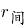）。代入间隔增长率公式：，则可得：，解得，与A项最接近。

故正确答案为A。

### 第 87 题

2021年1-2月，对房屋施工面积同比增长贡献率最低的房屋类型是（ ）。

A. 住宅

B. 办公楼

C. 商业营业用房

D. 其他类型

第 87 题 · 答案与解析

**参考答案（粉笔题库参考内容）**

C

**解析**

根据题干“2021年1-2月······同比增长贡献率最低······”，可知本题比较增长贡献率的大小，可判定本题为现期比重问题。根据公式：增长贡献率，因为整体的增长量相同，则只需要选择部分增长量最小的即可。定位文字材料第一段可得：2021年1-2月，全国房屋施工面积770629万平方米，同比增长11.0%。其中，住宅542503万平方米，增长11.2%；办公楼31802万平方米，增长7.3%；商业营业用房76346万平方米，增长2.5%。根据公式：增长量，则全国房屋施工面积同比增长量万平方米；住宅施工面积同比增长量万平方米；办公楼施工面积同比增长量万平方米；商业营业用房施工面积同比增长量万平方米；其他类型施工面积同比增长量＝全国房屋施工面积同比增长量-住宅施工面积同比增长量-办公楼施工面积同比增长量-商业营业用房施工面积同比增长量＝77062.9-54250.3-2120.1-1862.1=18830.4万平方米。

综上所述，商业营业用房施工面积同比增长量最小，则其对房屋施工面积同比增长贡献率最低。

故正确答案为C。

### 第 88 题

2021年1-2月，各地区按商品房销售额同比增量从大到小排列，正确的是（ ）。

A. 中部地区＞东部地区＞东北地区＞西部地区

B. 东部地区＞西部地区＞中部地区＞东北地区

C. 中部地区＞西部地区＞东北地区＞东部地区

D. 东部地区＞中部地区＞西部地区＞东北地区

第 88 题 · 答案与解析

**参考答案（粉笔题库参考内容）**

D

**解析**

根据题干“2021年1-2月······同比增量从大到小排列······”，可判定本题为增长量比较问题。定位文字材料第四段可得∶2021年1-2月，东部地区商品房销售额11891亿元，增长148.1%；中部地区商品房销售额3280亿元，增长130.2%；西部地区商品房销售额3620亿元，增长103.6%；东北地区商品房销售额359亿元，增长72.7%。根据增长量比较口诀“大大则大”，各地区中东部地区商品房销售额及其同比增速均为最大，则其同比增量也为最大，排除A、C两项。根据公式：增长量，可得中部地区商品房销售额同比增量亿元；西部地区商品房销售额同比增量亿元，故中部地区＞西部地区，只有D项符合。

故正确答案为D。

### 第 89 题

分地区看，2021年1-2月房地产开发投资占全国比重同比提高的地区有（ ）个。

A. 1

B. 2

C. 3

D. 4

第 89 题 · 答案与解析

**参考答案（粉笔题库参考内容）**

B

**解析**

根据题干“分地区看，2021年1-2月······占······比重同比提高的地区有······个”，可判定本题为两期比重问题。定位材料第一段可得：2021年1-2月，全国房地产开发投资13986亿元，同比增长3873亿元；定位材料第三段可得：2021年1-2月，分地区看，东部地区房地产开发投资同比增长32.4%；中部地区增长52.5%；西部地区增长45.1%；东北地区增长28.6%。根据公式：增长率，则2021年1-2月，全国房地产开发投资同比增长率。根据两期比重比较结论“若部分增长率大于整体增长率，则比重上升”，比较可知：分地区看，2021年1-2月房地产开发投资同比增长率只有中部地区（52.5%）和西部地区（45.1%）大于全国（38.3%），比重上升。因此，分地区看，2021年1-2月房地产开发投资占全国比重同比提高的地区有2个。

故正确答案为B。

### 第 90 题

根据上文，下列说法正确的是（ ）。

A. 2021年1-2月，全国房屋新开工面积同比增加超6800万平方米

B. 2021年2月末，商业营业用房待售面积同比减少量比办公楼多245万平方米

C. 2020年1-2月，房地产开发投资最低的地区，其投资额与最高的地区相差55倍

D. 2021年1-2月，分地区看，东北地区的商品房销售均价同比增长最小

第 90 题 · 答案与解析

**参考答案（粉笔题库参考内容）**

D

**解析**

A项：定位文字资料第一段可知，2021年1-2月，全国房屋新开工面积17037万平方米，增长64.3%。根据公式：增长量，则2021年1-2月，全国房屋新开工面积同比增量万平方米＜6800万平方米，错误；

B项：定位文字资料第二段可知，仅给出2021年2月末，商业营业用房和办公楼待售面积相比于2020年末的减少量，而未给出2021年2月末，商业营业用房和办公楼待售面积相比于2020年2月末的减少量，故无法推出同比减少量的差值，错误；

C项：定位文字资料第三段可知，2021年1-2月，各地区房地产开发投资额及其同比增速。根据公式：基期量，则2020年1-2月，各地区房地产开发投资额分别为：东部地区亿元；中部地区亿元；西部地区亿元；东北地区亿元，则投资最低的地区，其投资额与最高的地区相差倍＜55倍，错误；

D项：定位文字资料第四段可知，2021年1-2月，各地区商品房销售面积及其同比增速、销售额及其同比增速。根据公式：销售均价，平均数的增长量，则各地区商品房销售均价同比增量分别为：东部地区；中部地区；西部地区；东北地区。比较可知，东北地区的商品房销售均价同比增长最小，正确。

故正确答案为D。

## 材料 2

### 第 91 题

2019年，东部地区众创空间数量占全国比重是（ ）。

A. 59.4%

B. 58.5%

C. 57.7%

D. 55.6%

第 91 题 · 答案与解析

**参考答案（粉笔题库参考内容）**

C

**解析**

根据题干“2019年，东部地区众创空间数量占全国比重是”，可判定本题为现期比重问题。定位统计图可知：2019年东部地区、中部地区、西部地区和东北地区众创空间数量分别为4612家、1512家、1518家和358家。根据公式：比重，则东部地区众创空间数量占全国比重是。

故正确答案为C。

### 第 92 题

下图为表示2017~2019年某地区众创空间数量同比增长率变化的折线图，最有可能对应的地区是（ ）。

A. 东部地区

B. 中部地区

C. 西部地区

D. 东北地区

第 92 题 · 答案与解析

**参考答案（粉笔题库参考内容）**

C

**解析**

根据题干“······2017~2019年······同比增长率······”，可判定本题为一般增长率问题。定位统计图可知2016~2019年全国东部、中部、西部、东北地区众创空间数量。根据公式：增长率，可得2017~2019年各地区众创空间数量同比增长率分别为：

东部地区：2017年，；2018年，。第二个点应低于第一个点，与题干折线图不符，排除；

中部地区：2017年，；2018年，。第二个点应低于第一个点，与题干折线图不符，排除；

西部地区：2017年，；2018年，；2019年，。第二个点最高，第三个点最低，与题干折线图相符，当选；

东北地区：2017年，；2018年，。第二个点应低于第一个点，与题干折线图不符，排除。

综上，题干折线图最有可能对应的地区是西部地区。

故正确答案为C。

### 第 93 题

下列年份中，国家备案众创空间数量占全国众创空间数量的比重最高的是（ ）。

A. 2016年

B. 2017年

C. 2018年

D. 2019年

第 93 题 · 答案与解析

**参考答案（粉笔题库参考内容）**

B

**解析**

根据题干“下列年份中······占······比重最高的是”，可判定本题为现期比重问题。定位统计图可得：2016-2019年国家备案众创空间数量及对应年份的东部地区、中部地区、西部地区、东北地区众创空间数量。根据公式：比重，可得对应年份的国家备案众创空间数量占全国众创空间数量的比重如下：

2016年：；

2017年：；

2018年：；

2019年：。

比较可知，2017年国家备案众创空间数量占全国众创空间数量的比重最高。

故正确答案为B。

### 第 94 题

下列地区中，2019年众创空间数量同比增长率最高的是（ ）。

A. 东部地区

B. 中部地区

C. 西部地区

D. 东北地区

第 94 题 · 答案与解析

**参考答案（粉笔题库参考内容）**

B

**解析**

根据题干“······2019年······同比增长率最高的是”，可判定本题为一般增长率问题。定位统计图可得：2019年和2018年东部地区、中部地区、西部地区和东北地区众创空间的数量。根据公式：增长率，则2019年四个地区众创空间数量同比增长率分别为：

东部地区：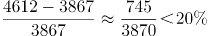；

中部地区：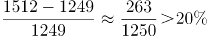；

西部地区：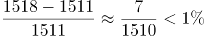；

东北地区：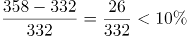。

比较可知，2019年众创空间数量同比增长率最高的是中部地区。

故正确答案为B。

### 第 95 题

根据上图，下列说法不正确的是（ ）。

A. 2016~2019年，东北地区众创空间数量占全国比重呈先升后降的趋势

B. 2019年国家备案众创空间数量是2016年的1.4倍多

C. 2017~2019年，全国众创空间数量同比增量逐年下降

D. 2017~2019年，东部地区众创空间数量同比增长最慢的年份是2018年

第 95 题 · 答案与解析

**参考答案（粉笔题库参考内容）**

A

**解析**

A项：定位统计图可知2016~2019年东北地区众创空间数量情况。根据公式：比重，则2016~2019年东北地区众创空间数量占全国比重分别为：2016年，；2017年，；2018年，；2019年，，比重呈持续下降趋势，错误；

B项：定位统计图可知，2016年、2019年国家备案众创空间数量分别为1337家、1888家。则2019年国家备案众创空间数量是2016年的倍，正确；

C项：根据A项计算结果可知2016~2019年全国众创空间数量：2016年4298家；2017年5739家；2018年6959家；2019年8000家。根据公式：增长量=现期量-基期量，则2017~2019年全国众创空间数量同比增量分别为：2017年，5739-4298=1441家；2018年， 6959-5739=1220家；2019年，8000-6959=1041家，比较可知，同比增量逐年下降，正确；

D项：定位统计图可知，2016~2019年东部地区众创空间数量分别为2491家、3353家、3867家、4612家。根据公式：增长率，则2017~2019年东部地区众创空间数量同比增长率分别为：2017年，；2018年，；2019年，，同比增长最慢的年份是2018年，正确。

本题为选非题，故正确答案为A。

## 材料 3

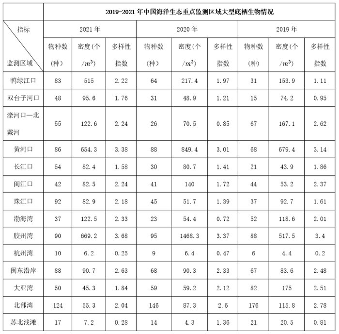

### 第 96 题

与2019年相比，2021年大型底栖生物物种数增加超出一倍的有（ ）个。

A. 8

B. 6

C. 4

D. 2

第 96 题 · 答案与解析

**参考答案（粉笔题库参考内容）**

C

**解析**

根据题干“与2019年相比，2021年······增加超出一倍的有······”，可判定本题为现期倍数问题。定位统计表可知，2019年、2021年各重点监测区域大型底栖生物物种数。与2019年相比，2021年······增加超出一倍即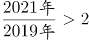，满足条件的有：

鸭绿江口，；

双台子河口，；

长江口，；

珠江口，。

综上可得，与2019年相比，2021年大型底栖生物物种数增加超出一倍的有4个。

故正确答案为C。

### 第 97 题

2020年，以下重点监测区域中，大型底栖生物密度同比增幅最大的是（ ）。

A. 鸭绿江口

B. 闽江口

C. 渤海湾

D. 胶州湾

第 97 题 · 答案与解析

**参考答案（粉笔题库参考内容）**

D

**解析**

根据题干“2020年······大型底栖生物密度同比增幅最大的是”，可判定本题为一般增长率比较问题。定位统计表可知，2020年及2019年鸭绿江口、闽江口、渤海湾、胶州湾大型底栖生物的密度。增长率，可直接比较。鸭绿江口：，闽江口：，渤海湾：，胶州湾：，即胶州湾2020年大型底栖生物密度同比增幅最大。

故正确答案为D。

### 第 98 题

2019-2021年，珠江口大型底栖生物多样性指数年均增长（ ）。

A. 16.4%

B. 17.7%

C. 18.1%

D. 35.3%

第 98 题 · 答案与解析

**参考答案（粉笔题库参考内容）**

A

**解析**

根据题干“2019-2021年，······年均增长”，可判定本题为年均增长率问题。定位统计表可得：2021、2019年珠江口大型底栖生物多样性指数分别为2.18、1.61。根据公式：，可得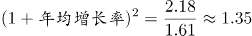。采用代入排除法，代入B项，，故年均增长率＜17.7%，仅有A项符合。

故正确答案为A。

### 第 99 题

2019年，大型底栖生物物种数达到中位数以上的重点监测区域中，其大型底栖生物密度最低的是（ ）。

A. 北部湾

B. 闽东沿岸

C. 渤海湾

D. 闽江口

第 99 题 · 答案与解析

**参考答案（粉笔题库参考内容）**

B

**解析**

定位统计表可知，2019年中国海洋生态重点监测区域共14个，各监测区域大型底栖生物物种数按从小到大排列，第7、8位分别为闽江口44种、渤海湾52种，则中位数为，闽江口物种数低于中位数，排除D项。北部湾、闽东沿岸、渤海湾大型底栖生物密度分别为115.8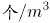、83.6、118.6，最低的是闽东沿岸。

故正确答案为B。

备注：中位数是指按顺序排列的一组数据中居于中间位置的数，若数据有偶数个，通常取最中间的两个数值的平均数作为中位数。

### 第 100 题

根据上表，下列说法错误的是（ ）。

A. 2020-2021年，大型底栖生物多样性指数连续两年同比下降的重点监测区域有2个

B. 2019-2021年，黄河口与长江口大型底栖生物多样性指数的差距逐年增大

C. 2019-2022年，杭州湾大型底栖生物物种数、密度、多样性指数均居末位

D. 2021年，大型底栖生物密度同比增加的重点监测区域有8个

第 100 题 · 答案与解析

**参考答案（粉笔题库参考内容）**

C

**解析**

A项：定位统计表可得，2020-2021年，大型底栖生物多样性指数连续两年同比下降（即2021年＜2020年＜2019年）的重点监测区域有：大亚湾（1.84＜2.12＜2.51）、北部湾（2.04＜2.6＜2.78），共2个，正确；

B项：定位统计表可得，2019-2021年黄河口大型底栖生物多样性指数分别为3.14、3.01、3.38；长江口大型底栖生物多样性指数分别为1.86、1.41、1.58。则两者2019年的差距为3.14-1.86=1.28，2020年的差距为3.01-1.41=1.6，2021的差距为3.38-1.58=1.8，差距逐年增大，正确；

C项：材料中没有给出2022年杭州湾大型底栖生物情况的相关数据，故无法推出，错误；

D项：定位统计表可得，2020年、2021年中国海洋各个生态重点监测区域大型底栖生物密度。观察可知，2021年大型底栖生物密度同比增加（即2021年＞2020年）的重点监测区域有：鸭绿江口（515＞217.4）、双台子河口（95.6＞48.9）、滦河口—北戴河（122.6＞70.5）、长江口（82.4＞80.7）、珠江口（82.9＞51.7）、渤海湾（122.5＞54.4）、闽东沿岸（90.7＞90.3）、苏北浅滩（7.2＞4.3），共8个，正确。

本题为选非题，故正确答案为C。

