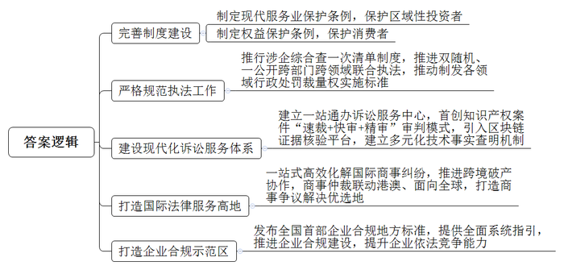
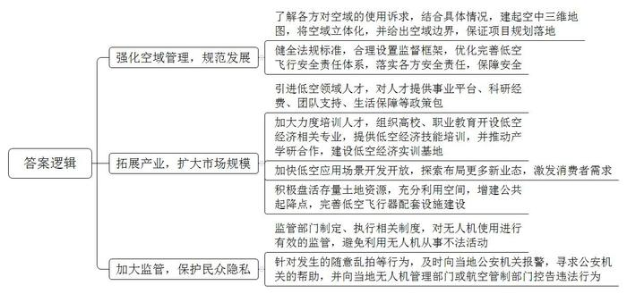
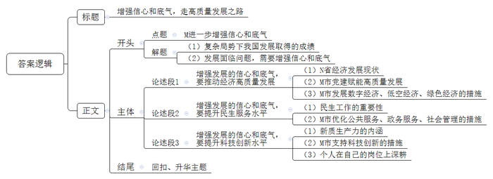

# 2024年深圳市公务员考试《申论》题（二卷）

> 候选采集稿。参考答案及解析来自粉笔页面，不代表官方答案或真实高分答卷；来源使用许可与原卷对应关系仍需人工核实。

## 给定材料

### 材料 material-8410994e820bd4ea

2023年12月，M市获评“全国营商环境最佳口碑城市”，这是M市连续4年获此殊荣。M市多年来持续加强市场化、法治化、国际化一流营商环境建设，不断激发市场活力，增强城市发展动力，推动经济高质量发展。

法治不仅是市场经济的内在要求，也是市场经济良性运转的重要保障。M市以市场需求为导向，多措并举，营造稳定、公平、透明、可预期的国际一流法治化营商环境。

2023年11月通过的《M经济特区前海深港现代服务业合作区投资者保护条例》，是全国首部区域性投资者保护立法；2023年11月通过的《M经济特区消费者权益保护条例》，旨在更好地保护消费者合法权益，促进市场经济健康发展。

M市大力推行涉企“综合查一次”清单制度，推进“双随机、一公开”跨部门跨领域联合执法，推动制发各领域行政处罚裁量权实施标准，促进行政执法严格规范、公正文明。

M市以公正高效司法助推法治化营商环境持续优化，率先建设现代化诉讼服务体系。全面建立“一站通办”诉讼服务中心；首创知识产权案件“速裁+快审+精审”三梯次审判模式；率先引入区块链证据核验平台，建立多元化技术事实查明机制。

M市积极打造国际法律服务高地，一站式高效化解国际商事纠纷，推进跨境破产协作，商事仲裁联动港澳、面向全球，稳步成为国际商事争议解决的优选地。

M市发布全国首部企业合规地方标准，提供全面系统指引，推进企业合规建设，促进企业依法竞争能力提升，加快打造企业合规示范区。

### 材料 material-6a5d835155dc642e

在家中用手机下单，就可坐在窗前等待无人机带着包裹“从天而降”，这些酷似科幻片中的场景正在发生。当前，某平台企业无人机在M市试运行航线，已在5个商圈落地。航线覆盖18个社区和写字楼，配送货物订单量超12万单。

有专家认为，发展低空经济，主要在于飞行器和各种产业形态的融合，如“无人机+配送”“载人飞行”等，但各方对空域使用诉求不同，存在着“只顾地、不看天”现象，导致规划实施、项目落地、安全保障等方面存在问题。有企业反映，无人机公共起降点少，专业人员欠缺，消费者对低空经济需求还不足，影响市场扩大和产业拓展。有市民觉得，“人不下楼，货到阳台”的配送方式确实很飒，但也担心无人机随意乱拍。

### 材料 material-7d7f06d77c5e8403

2023年12月11日，中央经济工作会议在北京举行。习近平出席会议并发表重要讲话，全面总结2023年经济工作，深刻分析当前经济形势，系统部署2024年经济工作。会议认为，2023年是全面贯彻党的二十大精神的开局之年，是三年新冠疫情防控转段后经济恢复发展的一年。会议指出，综合起来看，我国发展面临的有利条件强于不利因素，经济回升向好、长期向好的基本趋势没有改变，要增强信心和底气。

2023年12月29日，中国共产党N省第十三届委员会第四次全体会议暨省委经济工作会议在L市召开。会议研究部署做好2024年经济工作，强调要全面贯彻落实习近平总书记、党中央对经济工作的决策部署，坚持稳中求进、以进促稳、先立后破，切实扛起“经济大省要真正挑起大梁”的政治责任，坚定不移推动高质量发展。要强化政策供给，多出有利于稳预期、稳增长、稳就业的政策，全力巩固和增强经济回升向好态势。

2023年12月30日，中国共产党M市第七届委员会第八次全体会议暨市委经济工作会议召开。会议总结2023年工作，部署2024年重点任务，激励全市上下在新时代新征程奋发进取、真抓实干，全力推动高质量发展实现最好结果，坚决在推进中国式现代化建设中走在前列、勇当尖兵。

## 题目

### 第 1 题

**请根据材料**5**，提炼M市推进法治化营商环境建设的经验做法。（20分）**

关联材料：material-8410994e820bd4ea

作答要求：

要求：

（1）归纳准确，考虑全面，条理清晰；

（2）总字数300字以内。

### 第 2 题

**请根据材料**12**，针对低空经济发展存在的问题提出对策。（30分）**

关联材料：material-6a5d835155dc642e

作答要求：

要求：

（1）考虑全面，对策合理，条理清晰；

（2）总字数500字以内。

### 第 3 题

**一年之计在于春，乘势而上正当时。请结合所有给定材料，围绕****“M进一步增强信心和底气”这一主题，自拟标题，写一篇议论文。（50分）**

关联材料：material-7d7f06d77c5e8403

作答要求：

要求：

（1）紧扣主题，观点鲜明，论述充分；

（2）结构严谨，条理清晰，语言流畅；

（3）总字数1200字左右。

## 答案与解析

第 1 题

**参考答案（粉笔题库参考内容）**

1.完善制度建设。制定现代服务业保护条例，保护区域性投资者；制定权益保护条例，保护消费者。

2.严格规范执法工作。推行涉企综合查一次清单制度，推进双随机、一公开跨部门跨领域联合执法，推动制发各领域行政处罚裁量权实施标准。

3.建设现代化诉讼服务体系。建立一站通办诉讼服务中心，首创知识产权案件“速裁+快审+精审”审判模式，引入区块链证据核验平台，建立多元化技术事实查明机制。

4.打造国际法律服务高地。一站式高效化解国际商事纠纷，推进跨境破产协作，商事仲裁联动港澳、面向全球，打造商事争议解决优选地。

5.打造企业合规示范区。发布全国首部企业合规地方标准，提供全面系统指引，推进企业合规建设，提升企业依法竞争能力。

**解析**

**参考答案说明：**本参考答案从“完善制度建设”“严格规范执法工作”“建设现代化诉讼服务体系”“打造国际法律服务高地”“打造企业合规示范区”这五个方面进行了分条撰写。各条要点之间在内容上相互并列，没有交叉。

**考点**：考点经验启示类

**来源**：来源2024年深圳市公务员考试《申论》题（二卷）

粉笔申论页面对本题只提供「解析视频」入口，该入口是会员推广位，页面无视频地址与文字解析。

第 2 题

**参考答案（粉笔题库参考内容）**

1.强化空域管理，规范发展。了解各方对空域的使用诉求，结合具体情况，建起空中三维地图，将空域立体化，并给出空域边界，保证项目规划落地；健全法规标准，合理设置监督框架，优化完善低空飞行安全责任体系，落实各方安全责任，保障安全。

2.拓展产业，扩大市场规模。引进低空领域人才，对人才提供事业平台、科研经费、团队支持、生活保障等政策包；加大力度培训人才，组织高校、职业教育开设低空经济相关专业，提供低空经济技能培训，并推动产学研合作，建设低空经济实训基地；加快低空应用场景开发开放，探索布局更多新业态，激发消费者需求；积极盘活存量土地资源，充分利用空间，增建公共起降点，完善低空飞行器配套设施建设。

3.加大监管，保护民众隐私。监管部门制定、执行相关制度，对无人机使用进行有效的监管，避免利用无人机从事不法活动；针对发生的随意乱拍等行为，及时向当地公安机关报警，寻求公安机关的帮助，并向当地无人机管理部门或航空管制部门控告违法行为。

**解析**

**参考答案说明**：本答案分别从“强化空域管理，规范发展”“拓展产业，扩大市场规模”“加大监管，保护民众隐私”这三个方面，对低空经济发展存在的问题提出对策，分条撰写，每条要点之间内容上没有交叉。

**考点**：考点提出对策类

**来源**：来源2024年深圳市公务员考试《申论》题（二卷）

粉笔申论页面对本题只提供「解析视频」入口，该入口是会员推广位，页面无视频地址与文字解析。

第 3 题

**参考答案（粉笔题库参考内容）**

**增强信心和底气，走高质量发展之路**

事非经过不知难，成如容易却艰辛。在世界百年变局加速演进、国际环境发生深刻变化的复杂局面下，我们顶住了压力，稳定了规模，提升了质量，但进一步推动经济回升向好，需要克服一些困难和挑战，要增强发展的信心和底气，让奋进的足音更加铿锵，实现高质量发展。

**增强发展的信心和底气，要推动经济高质量发展。**经济基础决定上层建筑，N省作为全国排名第一的经济大省，更是坚定信心、鼓足干劲、勇挑大梁，全力推动经济回升向好。M市用党建赋能高质量发展，发挥党组织作用，加强了市场化、法治化、国际化一流营商环境建设。政府的优质服务，也让M市的产业百花齐放。围绕数字产业化、产业数字化，发展数字经济，构建数字产业发展生态；优化低空经济政策，组建低空经济产业园，抢占经济发展新赛道；将生态文明理念融入到城市发展的各领域、全过程，推动碳排放权交易，发展绿色经济，向具有全球影响力的经济中心城市和现代化的国际大都市迈出了坚实的步伐。

**增强发展的信心和底气，要提升民生服务水平。**民之所盼，政之所向，民生工作牵动着民心，民心所向关系着国家的兴旺。M市全方位、多角度发力，改善民生水平。在公共服务领域，推动“一老一小”服务改革，建立基本医疗保险、大病保险、医疗救助三重保障体系，让全民共享发展成果；在政务服务领域，实施民生诉求综合服务改革，实现政务服务有感与无感相结合，还以“政府—机构—企业—个人”服务需求为导向，构建覆盖全民、贯穿全程、辐射全城、便捷高效的全方位人力资源公共服务体系；在社会管理领域，新修订了市容和环境卫生管理条例，兼顾了居民日常生活需求和城市整体市容，让“文明风”和“烟火气”并行。

**增强发展的信心和底气，要提升科技创新水平。**在新时代新征程上，我们把准目标方位，眺望奋进路，加快发展新质生产力，扎实推进高质量发展。什么是新质生产力？它是创新起主导作用，具有高科技、高效能、高质量特征，符合新发展理念的先进生产力质态。而科技创新是新质生产力的核心要素，M市积极响应国家重大战略部署，建设光明科学城，布局建设重大科技基础设施，增强操作全系统技术能力，突破关键卡脖子技术。不仅如此，每个人要坚守自己的岗位，在小领域上精益求精，那么我们就能更好地实现科技自主、创新向前。

一年之计在于春，乘势而上正当时，迎着春光奔跑，顺势而为，M市以锐意进取的态度，真抓实干、务实有效的举措，为我们提供了全新的发展样本，也为中国式现代化添砖加瓦。

**解析**

**文章分析**

**增强信心和底气，走高质量发展之路**

【**标题的优点：**首先，标题中含有主题词，使文章主题更突出、清晰。其次，形式上采用对称式结构，使标题更加完整、饱满。】

事非经过不知难，成如容易却艰辛。（1）在世界百年变局加速演进、国际环境发生深刻变化的复杂局面下，我们顶住了压力，稳定了规模，提升了质量，（2）但进一步推动经济回升向好，需要克服一些困难和挑战，要增强发展的信心和底气，让奋进的足音更加铿锵，实现高质量发展。

【**开头的优点：**★内容方面。范文的开头是紧扣题目给定的“M进一步增强信心和底气”这一主题展开的。首先，开头点出主题，做到了主题明确。其次，对“M进一步增强信心和底气”这一主题进行了分析阐述，指出了：（1）复杂局势下我国发展取得的成绩。（2）发展面临问题，需要增强信心和底气。★文字表达方面：长短句配合使用，使语言表达有节奏感。】

**增强发展的信心和底气，要推动经济高质量发展。**（1）经济基础决定上层建筑，N省作为全国排名第一的经济大省，更是坚定信心、鼓足干劲、勇挑大梁，全力推动经济回升向好。（2）M市用党建赋能高质量发展，发挥党组织作用，加强了市场化、法治化、国际化一流营商环境建设。（3）政府的优质服务，也让M市的产业百花齐放。围绕数字产业化、产业数字化，发展数字经济，构建数字产业发展生态；优化低空经济政策，组建低空经济产业园，抢占经济发展新赛道；将生态文明理念融入到城市发展的各领域、全过程，推动碳排放权交易，发展绿色经济，向具有全球影响力的经济中心城市和现代化的国际大都市迈出了坚实的步伐。

【**论述段****1的优点：**★观点句：范文的观点句是紧扣“M进一步增强信心和底气”这一文章主题提出的。形式上，它在段首处直接写出，位置突出，容易发现。内容上，关键词突出，内容要点明确，可以明显看出主要论述“推动经济高质量发展”。★论述内容：（1）N省经济发展现状；（2）M市党建赋能高质量发展；（3）M市发展数字经济、低空经济、绿色经济的措施。注意：以上三个方面的内容都是紧扣“增强发展的信心和底气，要推动经济高质量发展”这个观点句进行分析论述的，论述的针对性强，内容层次丰富。在论述方法上采用了讲道理、举例子相结合的方式，论述充实有力。】

**增强发展的信心和底气，要提升民生服务水平。**（1）民之所盼，政之所向，民生工作牵动着民心，民心所向关系着国家的兴旺。（2）M市全方位、多角度发力，改善民生水平。在公共服务领域，推动“一老一小”服务改革，建立基本医疗保险、大病保险、医疗救助三重保障体系，让全民共享发展成果；在政务服务领域，实施民生诉求综合服务改革，实现政务服务有感与无感相结合，还以“政府—机构—企业—个人”服务需求为导向，构建覆盖全民、贯穿全程、辐射全城、便捷高效的全方位人力资源公共服务体系；在社会管理领域，新修订了市容和环境卫生管理条例，兼顾了居民日常生活需求和城市整体市容，让“文明风”和“烟火气”并行。

【**论述段****2****的优点：**★观点句：范文的观点句是紧扣“M进一步增强信心和底气”这一文章主题提出的。形式上，它在段首处直接写出，位置突出，容易发现。内容上，关键词突出，内容要点明确，可以明显看出主要论述“提升民生服务水平”。★论述内容：（1）民生工作的重要性；（2）M市优化公共服务、政务服务、社会管理的措施。注意：以上两个方面的内容都是紧扣“增强发展的信心和底气，要提升民生服务水平”这个观点句进行分析论述的，论述的针对性强，内容层次丰富。在论述方法上采用了讲道理、举例子相结合的方式，论述充分。】

**增强发展的信心和底气，要提升科技创新水平。**（1）在新时代新征程上，我们把准目标方位，眺望奋进路，加快发展新质生产力，扎实推进高质量发展。什么是新质生产力？它是创新起主导作用，具有高科技、高效能、高质量特征，符合新发展理念的先进生产力质态。（2）而科技创新是新质生产力的核心要素，M市积极响应国家重大战略部署，建设光明科学城，布局建设重大科技基础设施，增强操作全系统技术能力，突破关键卡脖子技术。（3）不仅如此，每个人要坚守自己的岗位，在小领域上精益求精，那么我们就能更好地实现科技自主、创新向前。

【**论述段****3****的优点：**★观点句：范文的观点句是紧扣“M进一步增强信心和底气”这一文章主题提出的。形式上，它在段首处直接写出，位置突出，容易发现。内容上，关键词突出，内容要点明确，可以明显看出主要论述“提升科技创新水平”。★论述内容：（1）新质生产力的内涵；（2）M市支持科技创新的措施；（3）个人在自己的岗位上深耕。注意：以上三个方面的内容都是紧扣“增强发展的信心和底气，要提升科技创新水平”这个观点句进行分析论述的，论述的针对性强，内容层次丰富。在论述方法上主要采用了讲道理的方式，论述清晰透彻。】

【**论述段之间的关系：**★内容的内在逻辑：范文的论述段之间是依照“并列”的逻辑展开的。论述段1先写了“推动经济高质量发展”，论述段2再写了“提升民生服务水平”，论述段3接着写了“提升科技创新水平”，论述逻辑清晰。】

一年之计在于春，乘势而上正当时，迎着春光奔跑，顺势而为，M市以锐意进取的态度，真抓实干、务实有效的举措，为我们提供了全新的发展样本，也为中国式现代化添砖加瓦。

【**结尾的优点：**范文的结尾回扣了“M进一步增强信心和底气”这一主题，语言简练，不拖沓。】

**考点**：考点文章写作题

**来源**：来源2024年深圳市公务员考试《申论》题（二卷）

粉笔申论页面对本题只提供「解析视频」入口，该入口是会员推广位，页面无视频地址与文字解析。

