# 2024年深圳市考公务员录用考试《行测》试题（网友回忆版）

<!-- gwy:overview:start -->
> **深圳 · 2024 · 行测 · 统考** ｜ 100 题 · 图片 202 处 · 答案随题折叠

| 题型模块 | 题量 | 题号 |
| --- | ---: | ---: |
| 常识判断 | 25 | 1–25 |
| 判断推理 | 20 | 26–45 |
| 数量关系 | 15 | 46–60 |
| 言语理解与表达 | 25 | 61–85 |
| 资料分析 | 15 | 86–100 |
| **合计** | **100** | |

导航：[题型与作答说明](#题型与作答说明) · [题目](#题目) · [材料 1](#材料-1)
<!-- gwy:overview:end -->

> 候选采集稿。参考答案及解析来自粉笔页面，不代表官方答案或真实高分答卷；来源使用许可与原卷对应关系仍需人工核实。

## 题型与作答说明

常识判断

（25题）

每题的备选答案中，只有一个最符合题意。

判断推理

（20题）

本部分包括图形推理、事件排序、演绎推理三种类型的试题，在四个选项中选出一个最恰当的答案。

数量关系

（15题）

在这部分试题中，每道题呈现一段表述数字关系的文字，要求你迅速、准确地计算出答案。

言语理解与表达

（25题）

本部分包括表达与理解两方面的内容。请根据题目要求，在四个选项中选出一个最恰当的答案。

资料分析

（15题）

所给出的图、表、文字或综合性资料均有若干个问题要你回答。你应根据资料提供的信息进行分析、比较、计算和判断处理。

## 题目

### 第 1 题

习近平新时代中国特色社会主义思想的发展是一个不断丰富拓展并不断体系化、学理化的过程，2023年全党首次正式提出了习近平总书记关于党的建设的重要思想和（ ）。

A. 习近平法治思想

B. 习近平经济思想

C. 习近平强军思想

D. 习近平文化思想

第 1 题 · 答案与解析

**参考答案（粉笔题库参考内容）**

D

**解析**

本题考查政治常识。

A项错误，2020年11月16日至17日，中央全面依法治国工作会议在北京召开，这次会议最重要的成果就是明确提出了习近平法治思想。习近平法治思想是顺应实现中华民族伟大复兴的时代要求应运而生的重大理论创新，是马克思主义法学理论中国化的最新成果，是习近平新时代中国特色社会主义思想的重要组成部分，是新时代全面依法治国的根本遵循和行动指南。

B项错误，2017年12月18日至20日，中央经济工作会议第一次提出“习近平新时代中国特色社会主义经济思想”，第一次明确了“一个新发展理念”和“七个坚持”的理论框架。

C项错误，2017年10月，党的十九大召开，确立习近平强军思想在国防和军队建设中的指导地位，把“习近平强军思想”郑重写入党章。党的十九大报告把党在新时代的强军目标完整表述为“建设一支听党指挥、能打胜仗、作风优良的人民军队，把人民军队建设成为世界一流军队”。2017年12月，在中央军委一次重要会议上，习近平主席以“十个明确”系统阐述了新时代党的强军思想的主要内容。

D项正确，2023年10月7日至8日，全国宣传思想文化工作会议在北京召开。这是党中央决定召开的一次重要会议。这次会议最重要的成果，就是正式提出和系统阐述习近平文化思想，在党的宣传思想文化事业发展史上具有里程碑意义。

故正确答案为D。

### 第 2 题

在最近一次特别提款权（SDR）定值审查中，国际货币基金组织正式将人民币在SDR货币篮子中的权重上调至12.28%，升幅1.36个百分点。SDR是一种国际储备资产，人民币权重上调将有助于提升人民币资产的国际吸引力，提振市场对人民币的信心。SDR货币篮子中其余“入篮”货币不包括（ ）。

A. 欧元

B. 日元

C. 澳元

D. 英镑

第 2 题 · 答案与解析

**参考答案（粉笔题库参考内容）**

C

**解析**

本题考查经济常识。

A、B、D三项正确，C项错误。2022年5月，国际货币基金组织（IMF）执董会完成了5年一次的特别提款权（SDR）定值审查。这是2016年人民币成为SDR篮子货币以来的首次审查。执董会一致决定，维持现有SDR篮子货币构成不变，即仍由美元、欧元、人民币、日元和英镑构成，并将人民币权重由10.92%上调至12.28%，将美元权重由41.73%上调至43.38%，同时将欧元、日元和英镑权重分别由30.93%、8.33%和8.09%下调至29.31%、7.59%和7.44%，人民币权重仍保持第三位。新的SDR货币篮子在2022年8月1日正式生效，并于2027年开展下一次SDR定值审查。

本题为选非题，故正确答案为C。

### 第 3 题

习近平总书记重要文章《中国式现代化是强国建设、民族复兴的康庄大道》强调，一个国家走向现代化，既要遵循现代化一般规律，更要符合本国实际，具有本国特色。中国式现代化的中国特色体现在（ ）。

①人口规模巨大的现代化

②全体人民共同富裕的现代化

③走和平发展道路的现代化

④人与自然和谐共生的现代化

⑤物质文明和精神文明相协调的现代化

A. ①②③④

B. ①②③⑤

C. ②③④⑤

D. ①②③④⑤

第 3 题 · 答案与解析

**参考答案（粉笔题库参考内容）**

D

**解析**

本题考查政治常识。

2023年8月15日，习近平同志发表了题为《中国式现代化是强国建设、民族复兴的康庄大道》的文章，提出康庄大道并不等于一马平川。要把中国式现代化5个方面的中国特色变为成功实践，把鲜明特色变成独特优势，需要付出艰巨努力。

①正确，文章指出：“第一，人口规模巨大的现代化。这是中国式现代化的显著特征。人口规模不同，现代化的任务就不同，其艰巨性、复杂性就不同，发展途径和推进方式也必然具有自己的特点······”

②正确，文章指出：“第二，全体人民共同富裕的现代化。这是中国式现代化的本质特征，也是区别于西方现代化的显著标志······”

③正确，文章指出：“第三，物质文明和精神文明相协调的现代化。既要物质富足、也要精神富有，是中国式现代化的崇高追求······”

④正确，文章指出：“第四，人与自然和谐共生的现代化。尊重自然、顺应自然、保护自然，促进人与自然和谐共生，是中国式现代化的鲜明特点······”

⑤正确，文章指出：“第五，走和平发展道路的现代化。坚持和平发展，在坚定维护世界和平与发展中谋求自身发展，又以自身发展更好维护世界和平与发展，推动构建人类命运共同体，是中国式现代化的突出特征······”

故①②③④⑤表述正确。

故正确答案为D。

### 第 4 题

甲市乙区生态环境局拟同时向甲市生态环境局与乙区政府发文，报告辖区 2023年度生态环境质量状况，关于公文拟制与办理，下列说法正确的是（ ）。

A. 因行文内容相同，可形成一份报告主送甲市生态环境局与乙区政府两个机关

B. 分别形成报告并分开主送甲市生态环境局与乙区政府

C. 可根据需要，将向乙区政府行文的报告抄送乙区生态环境局的派出机构

D. 可根据需要，将向甲市生态环境局行文的报告抄送乙区生态环境局的派出机构

第 4 题 · 答案与解析

**参考答案（粉笔题库参考内容）**

B

**解析**

本题考查公文写作与处理。

B项正确，A、C、D三项错误，根据《党政机关公文处理工作条例》第十五条规定：“向上级机关行文，应当遵循以下规则：（一）原则上主送一个上级机关，根据需要同时抄送相关上级机关和同级机关，不抄送下级机关。”题中，乙区生态环境局作为乙区人民政府的工作部门，实行以甲市生态环境局为主的双重管理体制，因此要分别形成报告并分开主送甲市生态环境局与乙区人民政府。而乙区生态环境局的派出机构属于乙区生态环境局的下级机关，因此不得将报告抄送至该机构。

故正确答案为B。

### 第 5 题

游乐园里的过山车充满惊险刺激，它通常以机械牵引或弹射的方式起步，逐步爬升至轨道最高点，随后快速下降至轨道底部。关于过山车的速降过程，下列说法错误的是（ ）。

A. 过山车突然开始下降时，乘客产生失重的感觉

B. 过山车尾部车厢通过最高点时的速度比头部车厢快

C. 过山车下降时，其势能快速减小，动能快速增大

D. 根据能量守恒定律，过山车的机械能保持不变

第 5 题 · 答案与解析

**参考答案（粉笔题库参考内容）**

D

**解析**

本题考查科技常识。

A项正确，失重是物体对支持物的压力（或对悬挂物的拉力）小于物体所受重力的现象。当过山车加速向下运动时，所受的竖直方向的力是向上的支持力和向下的重力，此时因为具有向下的加速度，所以支持力小于所受重力，会有失重的感觉。

B项正确，过山车尾部车厢通过最高点时的速度比过山车头部车厢要快，这是由于过山车中部的重心最高时，重力势能最大，而当尾部到达最高点时，重心位置已经不在最高位置，已经有一部分重力势能转化为动能了。

C项正确，D项错误，势能是物体（或系统）由于位置或位形而具有的能；动能是物体由于做机械运动而具有的能。过山车在最高点开始下降的过程中高度不断降低，势能不断减小，势能转化为动能，下降过程中速度不断增大。但是，在整个过山车运动的过程中涉及到空气阻力和摩擦阻力等，因此整个过程的机械能会因为转化为了内能而减小。

本题为选非题，故正确答案为D。

### 第 6 题

某日，未取得驾驶证的甲驾驶私家车回家，途中见路人乙向其挥手，随即停车，乙询问可否无偿搭乘甲的顺风车，甲同意，在后续行驶过程中，甲因接打电话未及时发现侧方来车，情急之下紧急制动，虽成功避免相撞，但急刹致乙受伤，下列说法正确的是（ ）。

A. 因乙无偿搭乘，甲不承担责任

B. 甲应当承担侵权责任

C. 因甲出于善意，其承担的法律责任应酌情减轻

D. 因乙未询问甲是否取得驾驶证，乙自行承担责任

第 6 题 · 答案与解析

**参考答案（粉笔题库参考内容）**

B

**解析**

本题考查法律常识。

A、C、D三项错误，B项正确，根据《中华人民共和国民法典》第一千二百一十七条规定：“非营运机动车发生交通事故造成无偿搭乘人损害，属于该机动车一方责任的，应当减轻其赔偿责任，但是机动车使用人有故意或者重大过失的除外。”题中，甲无证驾驶非营运机动车，且在行车中接打电话，虽乙属于无偿搭乘，但甲构成重大过失，应承担侵权责任。

故正确答案为B。

### 第 7 题

以下岩石与其分类和特点，对应不正确的是（ ）。

A. 大理岩——变质岩，适用于建筑装饰材料

B. 玄武岩——岩浆岩，常存有动植物化石

C. 页岩——沉积岩，蕴藏油气资源

D. 石灰岩——沉积岩，常构成喀斯特地貌

第 7 题 · 答案与解析

**参考答案（粉笔题库参考内容）**

B

**解析**

本题考查地理国情。

A项正确，大理岩是由变质作用所形成的岩石，是由地壳中先形成的岩浆岩或沉积岩，在环境条件改变的影响下，矿物成分、化学成分以及结构构造发生变化而形成的，常用来做建筑装饰材料。

B项错误，岩浆岩又称火成岩，是由岩浆喷出地表或侵入地壳冷却凝固所形成的岩石，有明显的矿物晶体颗粒或气孔，约占地壳总体积的65%，总质量的95%。玄武岩是由火山喷发出的岩浆冷却后凝固而成的一种致密状或泡沫状结构的岩石，它在地质学的岩石分类中，属于岩浆岩。但是岩浆岩里基本没有动植物化石。

C、D两项正确，沉积岩是在地壳发展演化过程中，在地表或接近地表的常温常压条件下，任何先成岩遭受风化剥蚀作用的破坏产物，以及生物作用与火山作用的产物在原地或经过外力的搬运所形成的沉积层，又经成岩作用而成的岩石。在地球地表，有70%的岩石是沉积岩，但如果从地球表面到16公里深的整个岩石圈算，沉积岩只占5%。沉积岩主要包括石灰岩、砂岩、页岩等。沉积岩中所含有的矿产（油气资源等），占全部世界矿产蕴藏量的80%。喀斯特地貌是地下水与地表水对可溶性岩石溶蚀与沉淀，侵蚀与沉积，以及重力崩塌、坍塌、堆积等作用形成的地貌。其中沉积岩中的石灰岩就是典型的可溶性岩石。

本题为选非题，故正确答案为B。

### 第 8 题

学习贯彻习近平新时代中国特色社会主义思想主题教育，是贯彻落实党的二十大精神的重大举措，对于统一全党思想、解决党内存在的突出问题、始终保持党同人民群众血肉联系、推动党和国家事业发展具有重要意义。此次主题教育的总要求是（ ）。

A. 边学习、边对照、边检视、边整改

B. 学思想、强党性、重实践、建新功

C. 自我净化、自我完善、自我革新、自我提高

D. 以学铸魂、以学增智、以学正风、以学促干

第 8 题 · 答案与解析

**参考答案（粉笔题库参考内容）**

B

**解析**

本题考查政治常识。

B项正确，A、C、D三项错误，习近平总书记在学习贯彻习近平新时代中国特色社会主义思想主题教育工作会议上的讲话“二、全面准确把握主题教育的目标要求”部分指出：“第一，牢牢把握总要求。这次主题教育的总要求是‘学思想、强党性、重实践、建新功’。这四句话体现了我们党认识与实践相结合、理论与实际相联系、改造主观世界与改造客观世界相统一的一贯要求，是一个紧密联系、相互贯通、内在统一的整体。要把这一总要求贯穿这次主题教育全过程。”

故正确答案为B。

### 第 9 题

2023年是共建“一带一路”倡议提出10周年，10年来，共建“一带一路”成为深受欢迎的国际公共产品和最大规模的国际合作平台。下列“一带一路”项目与其合作国家对应有误的是（ ）。

A. 雅万高铁项目——印度尼西亚

B. 卡拉奇核电项目——巴基斯坦

C. 中老铁路项目——老挝

D. 中马友谊大桥项目——马来西亚

第 9 题 · 答案与解析

**参考答案（粉笔题库参考内容）**

D

**解析**

本题考查政治常识。

A项正确，雅万高铁项目是一条连接印度尼西亚雅加达和万隆的高速铁路，合作国家为印度尼西亚。2023年10月2日，雅万高速铁路正式商业化运营。

B项正确，卡拉奇核电项目位于巴基斯坦第一大城市卡拉奇，合作国家为巴基斯坦。2021年5月20日，“华龙一号”海外首堆工程——卡拉奇核电站2号机组正式投入商业运行；2023年2月2日，卡拉奇核电站3号机组落成。

C项正确，中老铁路项目是中国和老挝两国互利合作的旗舰项目，是高质量共建“一带一路”的标志性工程，于2021年正式通车。

D项错误，中马友谊大桥是马尔代夫首座现代化桥梁，是世界首座在远洋深海无遮掩环境及珊瑚礁地质上建造的跨海大桥，与马来西亚无关。2018年8月30日，中马友谊大桥正式开通。

本题为选非题，故正确答案为D。

### 第 10 题

2023年12月26日，习近平总书记在纪念毛泽东同志诞辰 130周年座谈会上指出，毛泽东同志的一生是为国家富强、民族振兴、人民幸福而不懈奋斗的一生。关于毛泽东同志的历史功绩，说法不正确的是（ ）。

A. 是中国共产党的建设理论的奠基人

B. 是最早一批建立地方党组织的领导人之一

C. 在井冈山斗争时期创造了通过批评与自我批评进行思想教育的整风形式

D. 给出了跳出历史周期率的第一个答案——“让人民来监督政府”

第 10 题 · 答案与解析

**参考答案（粉笔题库参考内容）**

C

**解析**

本题考查政治常识。

A、B、D三项正确，C项错误，习近平总书记在纪念毛泽东同志诞辰130周年座谈会上的讲话中指出：“毛泽东同志是最早一批建立地方党组织的领导人之一，参加了党的一大会议，在井冈山斗争时期领导了红军和根据地党的建设。他明确提出要把党的建设作为一项‘伟大的工程’来推进，并且成功领导实施了这一伟大工程。毛泽东同志是我们党党的建设理论的奠基人。他在马克思主义政党史上第一次科学地阐明了党的建设同党的政治路线的关系，揭示了党的建设的基本规律，为加强党的建设指明了方向；着重强调要从思想上建党，创造了通过批评和自我批评进行思想教育的整风形式；创造性地运用民主集中制原则正确处理党内关系、维护党的团结统一；概括形成了党的‘三大作风’，成为中国共产党区别于其他任何政党的显著标志；在探索跳出历史周期率的深刻思考中，给出了第一个答案，那就是‘让人民来监督政府’，等等。”通过批评与自我批评进行思想教育的整风形式是在延安开展的，而非井冈山斗争时期。

本题为选非题，故正确答案为C。

### 第 11 题

“休克疗法”是一种应对经济危机、实现经济稳定的政策组合，主要措施是实行贸易自由化，推行国有企业私有化，执行紧缩的金融和财政政策，压缩政府开支、取消能源补贴、全面放开价格，但在短期内可能会使社会经济生活产生巨大震荡甚至出现“休克状态”，某国持续面临严峻的财政赤字和居高难下的通货膨胀，该国新任总统推行“休克疗法”，下列现象，该国短期内将出现（ ）个。

①货币急剧贬值、物价飞涨

②多国愿意与该国互换货币

③取消儿童福利及救济资金

④政府购入及投资大幅减少

A. 1

B. 2

C. 3

D. 4

第 11 题 · 答案与解析

**参考答案（粉笔题库参考内容）**

C

**解析**

本题考查经济常识。

①正确，②错误，“休克疗法”试图通过货币贬值实现汇率稳定，短期内物价飞涨，甚至可能导致社会不稳定，出现多国抛售该国货币而不是愿意与其互换货币。

③④正确，“休克疗法”通常包含严格的财政紧缩政策，这意味着减少政府开支，减少政府购入及投资和取消各种政府转移支付，如福利和救济金。

正确的有①③④，共3个。

故正确答案为C。

### 第 12 题

政府的社会职能是指政府在管理社会公共事务，提供社会服务和社会保障等方面的功能，下列行为不属于政府社会职能的是（ ）。

A. 开展老年人居家适老化改造

B. 建设无烟示范社区

C. 实施汽车国六排放标准

D. 提高个人所得税专项附加扣除标准

第 12 题 · 答案与解析

**参考答案（粉笔题库参考内容）**

D

**解析**

本题考查管理常识。

A、B、C三项正确，政府的基本职能有政治职能、经济职能、文化职能和社会职能。政府的社会职能主要有：社会服务职能；社会保障职能；环境保护职能；人口控制职能。题中，开展老年人居家适老化改造属于社会服务职能；建设无烟示范社区和实施汽车国六排放标准属于环境保护职能。

D项错误，政府的经济职能主要有：计划指导职能；培育和完善市场机制职能；宏观调控职能；服务职能；检查监督职能。题中，提高个人所得税专项附加扣除标准属于积极的财政政策，这属于宏观调控职能。

本题为选非题，故正确答案为D。

### 第 13 题

立春，为二十四节气之首。立，有“开始”之意；春，代表着温暖、生长，立春节气的公历日期原本固定，但受闰月的影响，农历日期变动相对较大。下列立春相关农谚中，与即将到来的农历甲辰年立春最为贴切的是（ ）。

A. 立春雨水二月间，顶凌压麦种大蒜

B. 春打五九尾，家家啃猪腿

C. 两春夹一冬，十个牛栏九个空

D. 寡年无春腊月寒，来年六月天不闲

第 13 题 · 答案与解析

**参考答案（粉笔题库参考内容）**

D

**解析**

本题考查人文常识。

A项错误，“立春雨水二月间，顶凌压麦种大蒜”这句农谚说明大蒜能够在早春二月露地培植和繁育，对于气候比较寒冷的北方地区来说，大蒜在早春二月至三月期间播种最为适宜；过早的温度条件不利于大蒜萌芽，而且北方冬季的寒冷程度容易将大蒜幼苗冻死。这里的二月指公历二月。农历2024甲辰年没有立春。

B项错误，“春打五九尾，家家啃猪腿”意思是如果立春到来的时间在五九末尾上，那么这一年就会是一个好年景，家家都会过上好日子。数九是从冬至节气开始，每九天为一个单位，2023年数九从公历2023年12月22日开始，五九为公历2024年1月27日到2024年2月4日，而公历2024年立春在2月4日，在五九末尾。但按农历2024甲辰年来说，没有立春这个节气。

C项错误，“两春夹一冬，十个牛栏九个空”意思是在农历的一年中有两次立春，即年初和年末各出现一次，那么冬季将会特别寒冷，这种寒冷的气候也可能对牲畜（如耕牛）产生不良影响，可能会出现大量的耕牛死亡的情况，以至于"十个牛栏九个空"。2023年是农历癸卯年，时间从公历2023年1月22日（正月初一）开始，一直持续到2024年2月9日（大年三十），公历2023年的立春是2023年2月4日，公历2024年的立春是在2024年2月4日，这两个立春节气都是在农历2023年范围内，即“两春夹一冬”。

D项正确，“寡年无春腊月寒，来年六月天不闲”意思是在无春年的腊月天气一般非常寒冷，到了来年农历六月份的时候雨水会比较多。公历2024年的立春为2024年2月4日，属于农历的2023年，这导致了农历2024年没有立春，即“寡年无春”。

故正确答案为D。

### 第 14 题

近年来，心源性猝死事件频发，为保障人民群众生命安全，深圳市持续推进公共场所配置自动体外除颤器（AED）项目、AED覆盖率已达全国第一。救助者正确使用AED可为抢救心脏骤停患者争取“黄金四分钟”。下列选项中，AED的两张电极片（数字1、2标示）所贴位置正确的是（ ）。

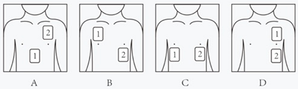

A. A

B. B

C. C

D. D

第 14 题 · 答案与解析

**参考答案（粉笔题库参考内容）**

B

**解析**

本题考查科技常识。

B项正确，A、C、D三项错误，自动体外除颤器（AED）又称自动体外电击器、自动电击器、自动除颤器、心脏除颤器及傻瓜电击器等，是一种便携式的医疗设备，它可以诊断特定的心律失常，并且给予电击除颤，是可被非专业人员使用的用于抢救心脏骤停患者的医疗设备。给患者贴电极片时，应在患者胸部适当的位置上，紧密地贴上电极片。通常而言，两块电极片分别贴在右胸上部和左胸左乳头外侧，如下图所示。

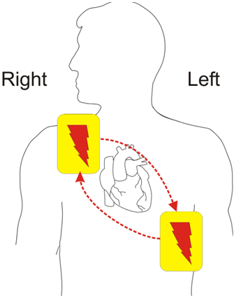

故正确答案为B。

### 第 15 题

关于党政机关公文的发文机关标志，下列说法错误的是（ ）。

A. 既可由发文机关名称加“文件”二字组成，也可单独用发文机关名称

B. 属于公文版头的要素之一

C. 有特定发文机关标志的普发性公文，必须加盖印章

D. 居中排布，推荐使用红色小标宋体字

第 15 题 · 答案与解析

**参考答案（粉笔题库参考内容）**

C

**解析**

本题考查公文写作与处理。

A、B、D三项正确，《党政机关公文格式》在“7.2 版头”中的“7.2.4 发文机关标志”部分规定：“由发文机关全称或者规范化简称加‘文件’二字组成，也可以使用发文机关全称或者规范化简称。发文机关标志居中排布，上边缘至版心上边缘为35mm，推荐使用小标宋体字，颜色为红色，以醒目、美观、庄重为原则。”

C项错误，《党政机关公文处理工作条例》在“第三章 公文格式”部分的第九条中规定：“（十三）印章。公文中有发文机关署名的，应当加盖发文机关印章，并与署名机关相符。有特定发文机关标志的普发性公文和电报可以不加盖印章。”

本题为选非题，故正确答案为C。

### 第 16 题

我国民间俗语说：“宅中现四喜，家中出贵人”，“四喜”即堂前飞燕、喜鹊来朝、枯木逢春、壁虎进宅。这种说法的盲目性在于否定了联系的（ ）。

A. 客观性

B. 普遍性

C. 多样性

D. 系统性

第 16 题 · 答案与解析

**参考答案（粉笔题库参考内容）**

A

**解析**

本题考查政治常识。
A项正确，联系的客观性是指联系是事物本身所固有的，不以人的意志为转移的。将飞燕、喜鹊、枯木和壁虎等事物的出现当做贵人出现的象征是一种主观臆造的关系，违背了联系的客观性。
B项错误，联系的普遍性是指事物或现象之间以及事物内部要素之间相互连结、相互依赖、相互影响、相互作用、相互转化等相互关系。题干未体现。
C项错误，联系的多样性是指世界上的事物是多种多样的，事物之间的联系也是多种多样的。题干未体现。
D项错误，联系的系统性是指事物的相互作用形成系统，系统是普遍联系中的系统，是联系的一种存在形态。题干未体现。
故正确答案为A。

### 第 17 题

党的二十大报告指出，健全宏观经济治理体系，发挥国家发展规划的战略导向作用，加强财政政策和货币政策协调配合，着力扩大内需，增强（ ）对经济发展的基础性作用和（ ）对优化供给结构的关键作用。

A. 能源、资本

B. 市场、政府

C. 生产、融资

D. 消费、投资

第 17 题 · 答案与解析

**参考答案（粉笔题库参考内容）**

D

**解析**

本题考查政治常识。
D项正确，A、B、C三项错误，党的二十大报告指出，健全宏观经济治理体系，发挥国家发展规划的战略导向作用，加强财政政策和货币政策协调配合，着力扩大内需，增强消费对经济发展的基础性作用和投资对优化供给结构的关键作用。
故正确答案为D。

### 第 18 题

深圳是一座人与自然和谐共生的城市，这片土地养育着多种以深圳地名命名的区域性物种，其中不包括（ ）。

A. 仙湖苏铁

B. 七娘山安蚁甲

C. 南沙黑脸琵鹭

D. 梧桐山突眼翅虫

第 18 题 · 答案与解析

**参考答案（粉笔题库参考内容）**

C

**解析**

本题考查地理国情。
A项正确，仙湖苏铁是苏铁科苏铁属的植物，系深圳仙湖植物园王定跃先生发现并命名的一个新种，分布在广西、广东及湖南的交界地区。
B、D两项正确，国家野外科学观测研究站新发现4种昆虫新物种，都是以深圳命名，分别为深圳四齿隐翅虫、七娘山安蚁甲、深圳突眼隐翅虫、深圳盘螱隐翅虫。七娘山位于广东省深圳市大鹏新区南澳镇新大村，是大鹏半岛南岛的主要山峰。深圳突眼隐翅虫发现于深圳梧桐山，位于广东省深圳市罗湖区。
C项错误，黑脸琵鹭是国家一级保护动物，广东海丰鸟类省级自然保护区于2004年3月2日首次发现黑脸琵鹭，作为全球重要的候鸟迁徙中转站和越冬歇息地，南沙湿地现成为黑脸琵鹭的重要歇息地之一。
本题为选非题，故正确答案为C。

### 第 19 题

习近平总书记着眼党和国家事业发展大局，用三个“一以贯之”，为在新的更高起点上开创新时代中国特色社会主义事业新局面提出了根本遵循，三个“一以贯之”是指（ ）。

①坚持和发展中国特色社会主义要一以贯之

②推动全面对外开放要一以贯之

③推进党的建设新的伟大工程要一以贯之

④增强忧患意识、防范风险挑战要一以贯之

⑤统筹区域协调发展要一以贯之

A. ①②④

B. ①③④

C. ②③⑤

D. ③④⑤

第 19 题 · 答案与解析

**参考答案（粉笔题库参考内容）**

B

**解析**

本题考查政治常识。

①③④正确，②⑤错误。在2018年1月5日举行的新进中央委员会的委员、候补委员和省部级主要领导干部学习贯彻习近平新时代中国特色社会主义思想和党的十九大精神研讨班上，习近平总书记着眼党和国家事业发展全局，鲜明提出“三个一以贯之”的要求并进行了深刻阐述：坚持和发展中国特色社会主义要一以贯之；推进党的建设新的伟大工程要一以贯之；增强忧患意识、防范风险挑战要一以贯之。

故正确答案为B。

### 第 20 题

下列行为体现了依法行政的程序正当原则的是（ ）。

A. 履行行政职责时所采取的措施和手段必要、适当

B. 平等对待行政管理相对人，不偏私、不歧视

C. 行使行政裁量权时符合法律目的，排除不相关因素的干扰

D. 依法保障行政管理相对人的知情权、参与权和救济权

第 20 题 · 答案与解析

**参考答案（粉笔题库参考内容）**

D

**解析**

本题考查法律常识。

A、B、C三项错误，合理行政原则，是指行政主体不仅应当在法律、法规、规章规定的范围内实施行政行为，而且要求行政行为要客观、适度，符合公平、正义等法律理性。包括公平公正对待、考虑相关因素和比例原则三个内容。其中，比例原则指行政机关所选择的具体措施和手段应当为法律所必需，结果和手段之间存在着正当性，A项体现了比例原则。B项体现了公平公正对待原则，C项体现了考虑相关因素原则。

D项正确，程序正当原则包括行政公开、公众参与和回避。选项中，保障知情权、参与权和救济权体现了程序正当原则。

故正确答案为D。

### 第 21 题

下列文言文中的“固”与“固若金汤”的“固”同义的是（ ）。

A. 人固有一死，或重于泰山，或轻于鸿毛

B. 至于颠覆，理固宜然

C. 汝心之固，固不可彻

D. 荆州与国邻接，江山险固

第 21 题 · 答案与解析

**参考答案（粉笔题库参考内容）**

D

**解析**

本题考查人文常识。

固若金汤有关典故最早出自于东汉·班固《汉书·蒯通传》：“边城之地，必将婴城固守，皆为金城汤池，不可攻也。”原义是金属造的城，滚水形成的护城河；比喻防守严密，无懈可击。其中“固”指坚固。

A项错误，“人固有一死，或重于泰山，或轻于鸿毛”出自西汉司马迁《报任安书》，意思是人生本来就有一死，但有的人死得比泰山还重，有的人死得却比鸿毛还轻。其中“固”指原本、本来。

B项错误，“至于颠覆，理固宜然”出自北宋苏洵《六国论》，意思是以至于到了覆灭的地步，道理本来就是这样子的。其中“固”指原本、本来。

C项错误，“汝心之固，固不可彻”出自先秦《列子·愚公移山》，意思是你的思想真顽固，顽固得没法开窍。其中“固”指顽固。

D项正确，“荆州与国邻接，江山险固”出自北宋司马光《赤壁之战》，意思是荆州与我们邻接，山川险要、坚固。其中“固”指坚固。

故正确答案为D。

### 第 22 题

2023年10月26日，神舟十七号载人飞船点火升空，将3名航天员送往“天宫”空间站，此次任务是我国载人航天工程进入空间站应用与发展阶段的第2次载人飞行任务。与历次“太空出差”相比，神舟十七号的新任务是（ ）。

A. 首次进行空间站舱外试验性维修作业

B. 首次进行空间站与地面实时视频通讯

C. 首次在轨进入科学实验舱

D. 首次实现6名航天员在轨飞行

第 22 题 · 答案与解析

**参考答案（粉笔题库参考内容）**

A

**解析**

本题考查科技常识。

A项正确，2023年10月25日上午9时，神舟十七号载人飞行任务新闻发布会在酒泉卫星发射中心召开，中国载人航天工程新闻发言人、载人航天工程办公室工作人员介绍了本次任务的相关情况。概括起来主要有以下任务：1.完成与神舟十六号乘组在轨轮换，驻留约6个月；2.持续评估空间站组合体功能性能；3.本次飞行任务首次进行空间站舱外试验性维修作业。

B项错误，2021年6月17日，神舟十二号带领航天员聂海胜、刘伯明、汤洪波成功升空。航天员在空间站核心舱安装无线WiFi设备，完成后与地面网络连成一体，航天员可以和地面人员进行顺畅沟通和视频通话。这是首次进行空间站与地面实时视频通讯。

C项错误，神舟十四号航天员乘组于2022年7月25日10时03分成功开启问天实验舱舱门，顺利进入问天实验舱。这是中国航天员首次在轨进入科学实验舱。

D项错误，2022年11月30日，神舟十五号航天员顺利入驻中国空间站，与神舟十四号航天员“会师”太空。这是载人航天首次实现6名航天员同时在轨飞行的“新突破”。

故正确答案为A。

### 第 23 题

《深圳经济特区消费者权益保护条例》于2024年1月1日起正式实施。该条例针对消费领域的一些突出问题，制定了有针对性的规范性制度和措施，以更好保护消费者的合法权益。下列选项中的行为，违反新条例规定的是（ ）。

A. 年过七旬的老李头参加某健康讲座时，在推荐的小程序上当场购买了8000元的远红外降压保健品，签收产品3天后他幡然醒悟，提交了无理由退货申请

B. 某视频平台试用会员规则中写明“试用会员期满前五日未取消即视为自动续费为正式会员”

C. 为刺激玩偶盲盒销售，某盲盒商家在包装盒正面用醒目文字标明“限定隐藏款爆率1：18，二十抽不出即送！”

D. 某连锁健身房一分店因资金困难停业，其在停业前一个月挂出店堂告示，并短信通知所有会员

第 23 题 · 答案与解析

**参考答案（粉笔题库参考内容）**

B

**解析**

本题考查法律常识。

A项正确，根据《深圳经济特区消费者权益保护条例》第二十一条第一款规定：“经营者采用网络、电视、电话、邮购等方式销售商品的，消费者有权自收到商品之日起七日内退货，且无需说明理由。”选项中，老李头通过网络购买签收产品3天后提交无理由退货申请符合规定。

B项错误，根据《深圳经济特区消费者权益保护条例》第二十五条规定：“网络交易经营者采取自动展期、自动续费等方式提供服务的，应当征得消费者同意，不得默认勾选、强制捆绑开通，并履行下列义务：······（三）在自动展期、自动续费等日期前五日，以电话、短信、即时通讯工具、电子邮件、消息推送等有效途径将服务内容、扣费金额等事项告知消费者；······”选项中，该平台应通过有效途径告知消费者自动续费，不符合规定。

C项正确，根据《深圳经济特区消费者权益保护条例》第三十五条第一款规定：“经营者采取随机抽取的方式向消费者提供特定范围内商品或者服务的，应当按照有关规定以显著方式公示抽取规则、商品或者服务分布、提供数量、抽取概率等信息。”选项中，商家标明了隐藏款概率符合规定。

D项正确，根据《深圳经济特区消费者权益保护条例》第三十八条规定：“经营者以预收款方式提供商品或者服务的，应当在终止经营、歇业或者变更直接提供商品或者服务的经营场所之日前十五日发布告示，并以电话、短信、即时通讯工具、电子邮件等有效途径告知消费者。”选项中，该分店提前一个月挂出告示并通过短信通知符合规定。

本题为选非题，故正确答案为B。

### 第 24 题

某市委组织部选调市财政局重要岗位领导干部杨某，参加省行政学院为期28天的脱产培训。根据修订的《干部教育培训工作条例》。下列说法错误的是（ ）。

A. 杨某必须服从组织调训

B. 培训期间，杨某享受在岗同等待遇

C. 杨某在培训期间累计请假时间不得超过4天

D. 由市委组织部和市财政局共同实施培训考核

第 24 题 · 答案与解析

**参考答案（粉笔题库参考内容）**

D

**解析**

本题考查政治常识。

A项正确，根据《干部教育培训工作条例》第二十三条：“脱产培训以组织调训为主。干部教育培训主管部门负责制定调训计划、选调干部参加培训，对重要岗位的干部可以实行点名调训。干部所在单位按照计划完成调训任务。干部必须服从组织调训。”

B项正确，C项正确，根据《干部教育培训工作条例》第十五条：“干部在参加组织选派的脱产培训期间，一般应当享受在岗同等待遇，一般不承担所在单位的日常工作、出国（境）考察等任务。因特殊情况确需请假的，必须严格履行手续，累计请假时间原则上不得超过总学时的，超过的应予退学。”杨某的脱产培训为期28天，累计请假时间不得超过4天。

D项错误，根据《干部教育培训工作条例》第五十条第一款：“干部教育培训考核应当区分不同教育培训方式分别实施。脱产培训的考核，由主办单位和干部教育培训机构实施；网络培训的考核，由主办单位和干部所在单位实施。”杨某为脱产培训，其考核应该由市委组织部和省行政学院实施。

本题为选非题，故正确答案为D。

### 第 25 题

下列选项中的行为，不属于法律上的不作为的是（ ）。

A. 某女久病在床，痛苦不堪，服毒自杀，其丈夫甲见其服毒、冷眼相看，并未送医救治，后该女毒发身亡

B. 乙看见儿子小乙（10周岁）正掐住邻居小孩（5 周岁）的脖子打闹，因忙于炒菜，并未理会。乙炒完菜，发现邻居小孩已窒息身亡

C. 丙受朋友之托帮忙照管名贵植物一盆，正值梅雨连绵，数日不见阳光，丙未使用植物生长灯，该名贵植物枯萎而死

D. 某人在网络社交平台丁上遭他人辱骂诽谤，其要求丁平台删除辱骂信息并封禁相关账号，丁平台不予理睬

第 25 题 · 答案与解析

**参考答案（粉笔题库参考内容）**

C

**解析**

本题考查法律常识。

法律上的不作为是指行为人负有实施某种积极行为的特定的法律义务，并且能够实行而不实行的行为。就我国目前来说，可将不作为之作为义务分为以下四种情形：1.法律明文规定的作为义务；2.职务或者业务要求的作为义务，指一定的主体由于担任某项职务或者从事某种职业而依法要求履行的一定作为义务；3.法律行为产生的作为义务。法律行为是指在法律上能够设立一定的权利和义务的行为；4.先行行为引起的作为义务，是指由于行为人先前实施的行为使某种合法权益处于遭受严重损害的危险状态，该行为人有了积极行动阻止损害结果发生的义务。

A项正确，根据《中华人民共和国民法典》第一千零五十九条第一款规定：“夫妻有相互扶养的义务。”这种扶养义务包括在生活上互相照应等，当一方生命面临危险时，另一方有救助的责任。因此，甲对其妻子负有法律明文规定的救助义务。但甲见其服毒仍冷眼相看，并未送医救治，最终导致妻子毒发身亡，属于法律上的不作为。

B项正确，根据《中华人民共和国民法典》第二十七条第一款规定：“父母是未成年子女的监护人。”第一千一百八十八条第一款规定：“无民事行为能力人、限制民事行为能力人造成他人损害的，由监护人承担侵权责任。监护人尽到监护职责的，可以减轻其侵权责任。”乙作为小乙的父母，对小乙具有法律明文规定的作为义务，即具有监护职责，但其见小乙掐住邻居年仅5周岁的小孩，能够予以制止但因忙于炒菜而未予以理会，导致邻居小孩因被掐而窒息身亡，属于法律上的不作为。

C项错误，丙作为朋友，帮忙照看名贵植物，未负有法律明文规定的作为义务，也没有职务或业务要求的作为义务，更未设立一定的权利和义务，也没有发生产生损害结果的先行行为，名贵植物枯萎亦是因为梅雨连绵这个非正常的外界因素，并不属于具有义务、能够实行而不实行的情形，不属于法律上的不作为。

D项正确，根据《中华人民共和国民法典》第一千一百九十五条第一、二款规定：“网络用户利用网络服务实施侵权行为的，权利人有权通知网络服务提供者采取删除、屏蔽、断开链接等必要措施。通知应当包括构成侵权的初步证据及权利人的真实身份信息。网络服务提供者接到通知后，应当及时将该通知转送相关网络用户，并根据构成侵权的初步证据和服务类型采取必要措施；未及时采取必要措施的，对损害的扩大部分与该网络用户承担连带责任。”某人在丁平台上遭他人辱骂诽谤，其有权通知丁平台采取删除等必要措施的权利，丁平台作为网络服务提供者在接到通知后，负有法律明文规定的采取必要措施的法定义务，在能够予以制止的情况下仍不予理睬，属于法律上的不作为。

本题为选非题，故正确答案为C。

### 第 26 题

从四个选项中选择一个替代问号，使两套图形的规律表现出最大的相似性，最适合的是（ ）。

A. A

B. B

C. C

D. D

第 26 题 · 答案与解析

**参考答案（粉笔题库参考内容）**

C

**解析**

元素组成不同，且每幅图均为两个小图形拼合在一起，优先考虑图形间关系。观察发现，第一组图形中，两个小图形均相交于线，考虑相交线的数量。第一组图形相交线的数量依次为：1、2、3，第二组图形相交线的数量依次为：4、5、？，故“？”处图形相交线的数量应为6，只有C项符合。

故正确答案为C。

### 第 27 题

从四个选项中选择一个替代问号，使两套图形的规律表现出最大的相似性，最适合的是（ ）。

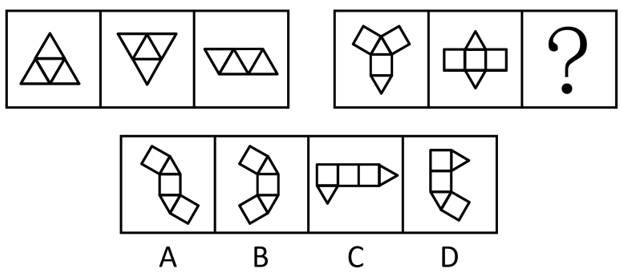

A. A

B. B

C. C

D. D

第 27 题 · 答案与解析

**参考答案（粉笔题库参考内容）**

A

**解析**

观察发现，第一组图形中，三个图形均为四面体的平面展开图；第二组图形应遵循此规律，前两个图形均为三棱柱的平面展开图，故“？”处应选择一个三棱柱的平面展开图，只有A项符合。

故正确答案为A。

### 第 28 题

从四个选项中选择一个替代问号，使两套图形的规律表现出最大的相似性，最适合的是（ ）。

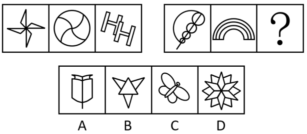

A. A

B. B

C. C

D. D

第 28 题 · 答案与解析

**参考答案（粉笔题库参考内容）**

B

**解析**

元素组成不同，无明显属性规律，考虑数量规律。观察发现，第一组图形中图二为“田”字变形图，优先考虑笔画数。第一组图形笔画数分别为1、2、3，第二组前两幅图形的笔画数分别为1、2，故“？”处应为三笔画图形，只有B项符合。

故正确答案为B。

### 第 29 题

从四个选项中选择一个替代问号，使两套图形的规律表现出最大的相似性，最适合的是（ ）。

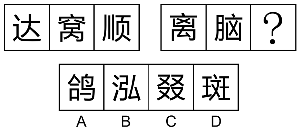

A. A

B. B

C. C

D. D

第 29 题 · 答案与解析

**参考答案（粉笔题库参考内容）**

D

**解析**

元素组成相似，优先考虑样式规律。观察发现，题干两组图中，第一组图均有“人”，第二组前两幅图均有“乂”，故“？”处也应该有“乂”，只有D项符合。

故正确答案为D。

### 第 30 题

从四个选项中选择一个替代问号，使两套图形的规律表现出最大的相似性，最适合的是（ ）。

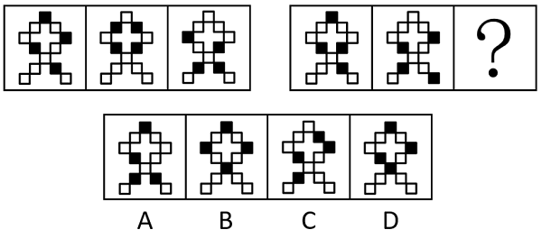

A. A

B. B

C. C

D. D

第 30 题 · 答案与解析

**参考答案（粉笔题库参考内容）**

B

**解析**

元素组成相同，但无明显位置规律，考虑相邻比较。观察发现，第一组图中，图1与图2有1个黑块的位置相同，图2与图3也有1个黑块的位置相同。第二组图应用此规律，图1与图2有1个黑块的位置相同，那么图2与“？”处也应有1个黑块的位置相同，只有B项符合。

故正确答案为B。

### 第 31 题

（1）忌不自信，比美徐公

（2）亲见徐公，自视弗如

（3）遍问亲友，皆称忌美

（4）王令臣谏，国力益强

（5）入朝觐见，言王之蔽

A. 3-2-1-4-5

B. 2-1-3-5-4

C. 1-3-2-4-5

D. 1-3-2-5-4

第 31 题 · 答案与解析

**参考答案（粉笔题库参考内容）**

D

**解析**

第一步：先确定逻辑关系最为明显的逻辑顺序。

观察题干，五个事件主要是围绕着“邹忌与徐公比美”开展的。逻辑关系的先后顺序比较明显的事件是事件（1）和事件（2），先“忌不自信，比美徐公”，然后才能“亲见徐公，自视弗如”，即邹忌先想要和徐公比美，然后看见了徐公，感觉不如他美，事件（1）应该在事件（2）前面，排除A、B两项。

第二步：逐一对照选项并判断正确答案。

根据第一步的结果可以判断只有C、D两项符合，通过分析事件（4）和事件（5）可知，应先“入朝觐见，言王之蔽”，再“王令臣谏，国力益强”，因此事件（5）应该在事件（4）前面，排除C项。

故正确答案为D。

### 第 32 题

（1）开启抱团揽才

（2）优质人才集聚

（3）成立引才联盟

（4）支撑长远发展

（5）政企高效协作

A. 1-3-2-5-4

B. 3-1-2-5-4

C. 3-5-1-2-4

D. 3-2-5-4-1

第 32 题 · 答案与解析

**参考答案（粉笔题库参考内容）**

C

**解析**

第一步：先确定逻辑关系最为明显的逻辑顺序。

观察题干，五个事件主要是围绕着“政企抱团引才”开展的。逻辑关系的先后顺序比较明显的事件是事件（1）和事件（3），先“成立引才联盟”，然后才能“开启抱团揽才”，事件（3）应该在事件（1）前面，排除A项。

第二步：逐一对照选项并判断正确答案。

根据第一步的结果可以判断只有B、C、D三项符合，通过分析事件（1）、事件（2）和事件（5）可知，应先“政企高效协作”，才能“开启抱团揽才”，然后“优质人才集聚”，因此事件（5）应该在事件（1）前面，事件（1）应该在事件（2）前面，排除B、D两项。

故正确答案为C。

### 第 33 题

（1）国际机构开展检测评估

（2）全面暂停进口日本水产

（3）排海方案引发全球担忧

（4）利用评估报告作为背书

（5）无视公共利益强行排海

A. 3-5-1-4-2

B. 3-1-4-5-2

C. 3-2-5-1-4

D. 5-2-3-1-4

第 33 题 · 答案与解析

**参考答案（粉笔题库参考内容）**

B

**解析**

第一步：先确定逻辑关系最为明显的逻辑顺序。

观察题干，五个事件主要是围绕着“日本排放核废水”开展的。逻辑关系的先后顺序比较明显的事件是事件（2）和事件（4），结合题干中其他事件可知，日本利用评估报告作为背书，从而强行排海，所以其他国家只能全面暂停进口日本水产，即事件（2）是最终的结果，因此，事件（4）在事件（2）的前面，故事件（2）为尾句，排除C、D两项。

第二步：逐一对照选项并判断正确答案。

根据第一步的结果可以判断A、B两项均符合，排海方案引发全球担忧后，应该是先由国际机构开展检测评估，然后日本利用评估报告作为背书，从而无视公共利益强行排海，即顺序应为（1）（4）（5），排除A项。

故正确答案为B。

### 第 34 题

（1）红色信念，晚舟归航

（2）逮捕高层，持续打压

（3）技术突破，遥遥领先

（4）逆风拼搏，加速研发

（5）启动调查，无端指控

A. 5-2-4-1-3

B. 5-4-2-3-1

C. 4-2-5-1-3

D. 4-5-2-3-1

第 34 题 · 答案与解析

**参考答案（粉笔题库参考内容）**

A

**解析**

第一步：先确定逻辑关系最为明显的逻辑顺序。

观察题干，五个事件主要围绕着“企业被打压进行反击”开展的。逻辑关系的先后顺序比较明显的是事件（5）和事件（4），要先“无端指控”，才能“逆风拼搏，加速研发”，因此事件（5）是加速研发的起因，事件（4）是对无端指控行为的反击，故事件（5）应排在首位，排除C、D两项。

第二步：逐一对照选项并判断正确答案。

根据第一步得到的结果可以判断只有A、B两项符合，通过分析事件（2）和事件（4）可得，事件（5）和事件（2）都属于加速研发的原因，因此事件（2）排在事件（4）前面，排除B项。

故正确答案为A。

### 第 35 题

（1）牧童遥指杏花村

（2）东边日出西边雨

（3）忽如一夜春风来

（4）寒露入暮愁衣单

（5）草长莺飞二月天

A. 1-4-3-2-5

B. 5-3-1-2-4

C. 3-5-4-1-2

D. 5-1-2-4-3

第 35 题 · 答案与解析

**参考答案（粉笔题库参考内容）**

D

**解析**

观察题干，五个事件均为诗句，可根据诗句描写的时间先后进行排序。

（1）“牧童遥指杏花村”出自杜牧的《清明》，描写的是清明时节（一般在公历4月4日至6日之间变动，并不固定在某一天，但以4月5日最常见）；

（2）“东边日出西边雨”出自刘禹锡的《竹枝词二首·其一》，诗句描写的情况多出现在夏季；

（3）“忽如一夜春风来”出自岑参的《白雪歌送武判官归京》，描写的是冬季；

（4）“寒露入暮愁衣单”出自王安石的《八月十九日试院梦冲卿》，描写的是秋季；

（5）“草长莺飞二月天”出自高鼎的《村居》，描写的是农历二月。

按照时间先后排序为5-1-2-4-3，对应D项。

故正确答案为D。

### 第 36 题

某景区漂流项目的工作人员用扩音器循环播放注意须知：“除非年龄在55岁以下，并且穿上救生衣，否则不能漂流。”同时，出于安全考虑，有高血压或心脏病的游客不能漂流。老王穿上了救生衣，但最后工作人员没允许他去漂流。

由此可推知，以下选项一定为真的是（ ）。

A. 如果老王年满55岁，则他一定有高血压或心脏病

B. 老王有高血压或心脏病

C. 老王年满55岁，且有高血压或心脏病

D. 老王要么年满55岁，要么有高血压或心脏病

第 36 题 · 答案与解析

**参考答案（粉笔题库参考内容）**

D

**解析**

第一步：翻译题干。

①能漂流55岁以下 且 穿上救生衣

②有高血压 或 心脏病漂流

第二步：根据题干条件进行推理。

如果老王年满55岁，是对条件①的否后，根据“否后必否前”可以得出老王不能漂流；

如果老王有高血压或心脏病，是对条件②的肯前，根据“肯前必肯后”可以得出老王不能漂流。

综上，只要满足其一，那么老王就不能漂流。

故正确答案为D。

### 第 37 题

蔬菜是重要的“菜篮子”产品，但其易腐烂、难贮存，长时间、远距离运输容易增加中间成本和质量安全隐患，进而影响城市蔬菜供应。可见，大中城市拥有足够面积的常年菜地存在必要性。然而，有些人对此持不同意见，认为城市寸土寸金，应该发展收益高的产业，没有必要发展农业。

下列选项如果为真，最能反驳以上意见的是（ ）。

A. 越来越多城际高速公路为农产品开设“绿色通道”，保证生鲜农产品运输畅通

B. 结合体验农业、观光农业等第三产业发展城市农业，既能带来高收益，还能发挥观光、休闲等生活性功能

C. 在城市发展农业能解决部分“低端岗位”就业问题，促进城市低收入群体创业增收

D. 一旦出现极端恶劣天气等突发情况影响运输，势必导致城市农产品供应短缺，不利于社会平稳发展

第 37 题 · 答案与解析

**参考答案（粉笔题库参考内容）**

D

**解析**

第一步：找出论点和论据。

论点：城市寸土寸金，应该发展收益高的产业，没有必要发展农业。

论据：无。

本题只有论点没有论据，削弱优先考虑削弱论点，即说明发展城市农业存在必要性。

第二步：逐一分析选项。

A项：该项说的是城际高速公路开设的“绿色通道”保证了生鲜农产品运输畅通，则没有必要发展城市农业，为加强项，无法削弱，排除；

B项：该项说的是发展城市农业既能带来高收益，也能发挥观光、休闲等生活性功能，即发展城市农业存在一定的好处，但存在好处不等同于有发展的必要性，因此不明确发展城市农业是否必要，为不明确项，无法削弱，排除；

C项：该项说的是发展城市农业可以促进城市低收入群体创业增收，即发展城市农业存在一定的好处，但存在好处不等同于有发展的必要性，因此不明确发展城市农业是否必要，为不明确项，无法削弱，排除；

D项：该项说的是一旦出现极端恶劣天气等突发情况，城市农产品供应会短缺，不利于社会平稳发展，此时城市农业的存在可以缓解农产品供应短缺的问题，保障社会平稳，即发展城市农业存在必要性，削弱论点，可以削弱，当选。

故正确答案为D。

### 第 38 题

这几年报名参加社会工作者职业资格考试的人越来越多了，可以说，所有想从事专门性社会服务工作的人都想取得社会工作者职业资格证书。阿社也想取得社会工作者职业资格证书，所以，阿社一定想从事专门性社会服务工作。

下列选项如果为真，最能加强上述论证的是（ ）。

A. 不想取得社会工作者职业资格证书的人，就不会报名参加社会工作者职业资格考试

B. 只有想从事专门性社会服务工作的人，才想取得社会工作者职业资格证书

C. 只有取得了社会工作者职业资格证书的人，才有资格从事专门性社会服务工作

D. 从事专门性社会服务工作的人大都持有社会工作者职业资格证书

第 38 题 · 答案与解析

**参考答案（粉笔题库参考内容）**

B

**解析**

第一步：找出论点和论据。

论点：阿社一定想从事专门性社会服务工作。

论据：阿社想取得社会工作者职业资格证书。

论点说的是“想从事专门性社会服务工作”，论据说的是“想取得社会工作者职业资格证书”，二者话题不一致，加强优先考虑搭桥，即在“想取得社会工作者职业资格证书”与“想从事专门性社会服务工作”之间建立联系。

第二步：逐一分析选项。

A项：可翻译为：报名参加社会工作者职业资格考试想取得社会工作者职业资格证书，没有涉及论点说的“想从事专门性社会服务工作”，无法加强，排除；

B项：可翻译为：想取得社会工作者职业资格证书想从事专门性社会服务工作，在“想取得社会工作者职业资格证书”与“想从事专门性社会服务工作”之间建立了联系，搭桥项，可以加强，当选；

C项：可翻译为：有资格从事专门性社会服务工作取得了社会工作者职业资格证书，“有资格从事专门性社会服务工作”与论点说的“想从事专门性社会服务工作”话题不一致，无法加强，排除；

D项：选项说的是“从事专门性社会服务工作”，而论点说的是“想从事专门性社会服务工作”，二者话题不一致，无法加强，排除。

故正确答案为B。

### 第 39 题

鲸鱼是动物，所以小鲸鱼是小动物。

以下选项中的逻辑错误，与题干最为相似的是（ ）。

A. 掉一根头发不算秃头，再掉一根头发也不算秃头，是最后掉的一根头发造成了秃头

B. 半夜被吵醒的甲对邻居乙说：“你夜半高歌，影响别人休息。”乙对甲说：“影响别人，又不影响你，关你什么事？”

C. 柠檬都是酸味的，百香果不是柠檬，所以百香果不是酸味的

D. 船舶抛锚了就必须请求救援，这艘船破了一个大洞，但没有抛锚，所以不必请求救援

第 39 题 · 答案与解析

**参考答案（粉笔题库参考内容）**

B

**解析**

第一步：分析题干中的逻辑错误。

鲸鱼是动物，所以小鲸鱼是小动物，其中“小鲸鱼”中的“小”指年龄小，“小动物”中的“小”指体型小，将“年龄小”偷换为“体型小”，犯了偷换概念的逻辑错误。

第二步：逐一分析选项。

A项：题干中出现了“掉一根头发”与“秃头”两个概念，在论证过程中未发生含义变化，都是同一个意思，不存在偷换概念，与题干所犯逻辑错误不一致，排除；

B项：甲对乙说的“你夜半高歌，影响别人休息”，其中“别人”指除了乙之外的人。乙对甲说的“影响别人，又不影响你”，其中“别人”指除了甲、乙之外的人，乙将“除了乙之外的人”偷换为“除了甲、乙之外的人”，犯了偷换概念的逻辑错误，与题干所犯逻辑错误一致，当选；

C项：柠檬都是酸味的，百香果不是柠檬，所以百香果不是酸味的，犯了否前推否后的逻辑错误，且“百香果”“柠檬”“酸味”三个概念在论证过程中未发生含义变化，都是同一个意思，不涉及偷换概念，与题干所犯逻辑错误不一致，排除；

D项：船舶抛锚了就必须请求救援，这艘船没有抛锚，所以不必请求救援，犯了否前推否后的逻辑错误，且“船”“抛锚”“救援”三个概念在论证过程中未发生含义变化，都是同一个意思，不涉及偷换概念，与题干所犯逻辑错误不一致，排除。

故正确答案为B。

### 第 40 题

博物馆陈列了簪、钗、钿、篦四种清代发饰，其主要材质各不相同，有金、银、铜、玉四种发饰的主要材质，以下说法均为真：

①如果簪是金的，那么钗一定不是铜的；

②如果钗不是金的，那么篦一定是玉的；

③如果钗是金的，那么钿一定是玉的；

④如果钿是铜的，那么篦一定不是银的；

⑤如果钿不是银的，那么篦就是银的；

⑥如果篦是铜的，那么簪一定不是玉的。

由此可推知，簪的主要材质是（ ）。

A. 金

B. 银

C. 铜

D. 玉

第 40 题 · 答案与解析

**参考答案（粉笔题库参考内容）**

C

**解析**

第一步：翻译题干。

①簪金钗铜；

②-钗金篦玉；

③钗金钿玉；

④钿铜篦银；

⑤-钿银篦银；

⑥篦铜簪玉。

第二步：根据题干条件进行推理。

题干条件②③涉及了钗金的所有情况，故从此处开始推理。结合条件②“-钗金篦玉”和条件③“钗金钿玉”可知，无论钗是否是金的，材质为玉的一定是篦或钿；再根据条件⑤“-钿银篦银”等价于“钿银 或 篦银”可知，材质为银的也一定是篦或钿，因此篦或钿的材质只能是银或玉，则簪和钗的材质只能是金或铜，假设簪是金的，根据条件①可知钗一定不是铜的，此时与前面推理的结果矛盾，因此簪是铜的，对应C项。

故正确答案为C。

### 第 41 题

某小区发生一起凶杀案，死者是一位女性，最先发现血泊中的死者尸体的人是她的邻居们，如果最先发现死者尸体的人是凶手，那么邻居们都是凶手。

以下选项中的逻辑结构，与题干最为相似的是（ ）。

A. 开展“特种兵旅行”的人都是大学生，开展“特种兵旅行”的人都是精力旺盛的人，所以大学生都是精力旺盛的人

B. 最先到达终点的人是第一名，第一名会得到万元奖励，所以最先到达终点的人会得到万元奖励

C. 凡是有理想的人都爱读书，如果小李爱读书，则说明小李有理想

D. 如果最先到达灾害现场的人是医生，而且医生会把伤亡人数降到最低，那么灾害现场的伤亡人数会降到最低

第 41 题 · 答案与解析

**参考答案（粉笔题库参考内容）**

A

**解析**

第一步：分析题干推理形式。

题干翻译为：最先发现死者尸体邻居们，最先发现死者尸体凶手，结论：邻居们凶手。

题干逻辑结构为：12，13，结论：23。

第二步：逐一分析选项。

A项：翻译为：开展“特种兵旅行”大学生，开展“特种兵旅行”精力旺盛的人，结论：大学生精力旺盛的人，逻辑结构为：12，13，结论：23，与题干推理形式一致，当选；

B项：翻译为：最先到达终点第一名，第一名得到万元奖励，结论：最先到达终点得到万元奖励，逻辑结构为：12，23，结论：13，与题干推理形式不一致，排除；

C项：翻译为：有理想爱读书，小李爱读书，结论：小李有理想，逻辑结构为：12，32，结论：31，与题干推理形式不一致，排除；

D项：翻译为：最先到达灾害现场医生，医生把伤亡人数降到最低，结论：灾害现场伤亡人数降到最低，逻辑结构为：12，23，结论：13，与题干推理形式不一致，排除。

故正确答案为A。

### 第 42 题

我国数字音乐产业经历了20多年稳步发展，尽管国内数字音乐用户付费率与国际平台相比还有一定差距，但国内用户付费习惯已普遍养成，市场已经颇具规模，然而近两年，数字音乐平台面临规模缩水、用户流失的严重风险。

下列选项如果为真，最不能解释上述矛盾现象的是（ ）。

A. 数字音乐用户版权意识缺失，付费意识易受免费资源冲击

B. 音乐市场缺乏优质音乐新作，内容陈旧导致用户黏性不足

C. 数字音乐平台收费标准提高，付费音乐消费能力持续低迷

D. 线上文化娱乐供给不断丰富，内容平台开启存量用户争夺

第 42 题 · 答案与解析

**参考答案（粉笔题库参考内容）**

A

**解析**

第一步：找出题干矛盾。

国内用户付费习惯已普遍养成，市场已经颇具规模，然而近两年，数字音乐平台面临规模缩水、用户流失的严重风险。

第二步：逐一分析选项。

A项：数字音乐用户版权意识缺失，付费意识易受免费资源冲击，与题干中“国内用户付费习惯已普遍养成”存在矛盾，无法解释为什么国内用户付费习惯已普遍养成的情况下，近两年数字音乐平台面临规模缩水、用户流失的严重风险，不能解释题干矛盾，当选；

B项：音乐作品内容陈旧导致用户黏性不足，从而导致数字音乐平台的用户流失，可以解释为什么国内用户付费习惯已普遍养成的情况下，近两年数字音乐平台面临规模缩水、用户流失的严重风险，可以解释题干矛盾，排除；

C项：数字音乐平台收费标准提高，付费音乐消费能力持续低迷，从而导致数字音乐平台的用户流失，可以解释为什么国内用户付费习惯已普遍养成的情况下，近两年数字音乐平台面临规模缩水、用户流失的严重风险，可以解释题干矛盾，排除；

D项：线上文化娱乐供给不断丰富，内容平台开启存量用户争夺，从而导致数字音乐平台的用户流失，可以解释为什么国内用户付费习惯已普遍养成的情况下，近两年数字音乐平台面临规模缩水、用户流失的严重风险，可以解释题干矛盾，排除。

本题为选非题，故正确答案为A。

### 第 43 题

桌子上摆放着11种规格的条形蛋糕模具（摆放位置如下图），张师傅悄悄地在其中一个模具下贴了一枚红星，并将“红星模具”的长度（L表示长度）告诉了徒弟小李，将宽度（W表示宽度）告诉了小范。小李和小范观察了一会儿，同时表示不知道“红星模具”是哪个，又过了一会儿，小范说：“现在我知道了。”小李听后想了想，接着说：“我也知道了。”

由此可推知，“红星模具”的规格是（ ）。

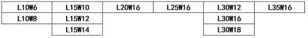

A. L30W12

B. L20W12

C. L30W16

D. L15W12

第 43 题 · 答案与解析

**参考答案（粉笔题库参考内容）**

C

**解析**

第一步：分析题干条件。

（1）11种规格的条形蛋糕模具，其中一个模具下贴了一枚红星；

（2）小李知道“红星模具”的长度，小范知道“红星模具”的宽度；

（3）小李和小范同时表示不知道“红星模具”是哪个；

（4）又过了一会儿，小范和小李依次表示都知道了。

第二步：根据题干条件进行推理。

结合条件（1）（2）（3）可知，只知道长度或宽度无法确定“红星模具”，即说明“红星模具”的长度、宽度的数值并不唯一，结合图中数值可知，长度不唯一的数值为L10、L15、L30，宽度不唯一的数值为W12、W16，故“红星模具”可能为L15W12、L30W12、L30W16，又结合条件（4），小范表示知道了，说明这三组数值中宽度是唯一的，即只有L30W16符合。

故正确答案为C。

### 第 44 题

某地发生一起重大诈骗案，警方通过调查抓获五个犯罪嫌疑人。面对警方的讯问，五人的供述如下：

甲：“不是我，也不是丁。”

乙：“如果是我，那么丙就没参与诈骗。”

丙：“乙和丁中必有一人参与。”

丁：“只有甲参与了，戊才会参与诈骗。”

戊：“至少有三个人参与了此次诈骗。”

经证实，甲只说了一半真话，其他人说的都是真话，则罪犯是（ ）。

A. 甲、乙、戊

B. 乙、丁、戊

C. 甲、丙、丁

D. 甲、乙、丙、戊

第 44 题 · 答案与解析

**参考答案（粉笔题库参考内容）**

A

**解析**

第一步：分析题干条件。

（1）甲：-甲 且 -丁；

（2）乙：乙丙；

（3）丙：乙 或 丁；

（4）丁：戊甲；

（5）戊：至少有三人参与诈骗；

（6）甲一半真话一半假话，其他人均为真话。

第二步：根据题干条件进行推理。

选项信息充分，优先考虑排除法。

根据条件（2）可知如果乙参与，则丙就没参与，排除D项；

根据条件（4）可知只有甲参与了，戊才会参与，排除B项；

余下的A、C两项中都有甲，说明甲一定是罪犯，因此“-甲”为假，根据“甲只说了一半真话”可知，“-丁”为真，即丁没有参与，排除C项；

经验证，A项符合所有条件。

故正确答案为A。

### 第 45 题

出丑效应是指这样一种现象：在公共场合中，才能平庸者固然不会受人倾慕，而全然无缺点的人也未必讨人喜欢，即最讨人喜欢的人是有才能或精明而带有小缺点的人。

根据以上定义，以下选项体现了出丑效应的是（ ）。

A. 某国家科技大奖得主在接受外国记者采访时因太紧张而说话结巴，反而因其“接地气”广受网友喜爱

B. 某知名律师经常因过度焦虑在开庭前夜彻夜难眠，但她专业能力十分出众，很多人慕名而来找她代理案件

C. 某歌手在演唱会上假唱，还在台上绊了一跤，于是他故意跌个四脚朝天，引得媒体纷纷报道

D. 曾被誉为“篮球闪电侠”的老球员浑身伤病，只能作为替补上场，他被新人球员轻松晃倒在地，但现场观众仍献上掌声表示鼓励

第 45 题 · 答案与解析

**参考答案（粉笔题库参考内容）**

A

**解析**

第一步：找出定义关键词。

“最讨人喜欢的人”、“有才能或精明而带有小缺点”。

第二步：逐一分析选项。

A项：获得国家科技大奖说明其有才能，因紧张而说话结巴，符合“有才能或精明而带有小缺点”，广受网友喜爱，符合“最讨人喜欢的人”，符合定义，当选；

B项：某知名律师因过度焦虑在开庭前夜彻夜难眠，焦虑失眠并不是“缺点”，不符合“有才能或精明而带有小缺点”，不符合定义，排除；

C项：某歌手在演唱会上假唱，还故意跌个四脚朝天，仅体现出“缺点”，不符合“有才能或精明而带有小缺点”，且媒体纷纷报道也未体现是因“喜欢”此歌手，不符合“最讨人喜欢的人”，不符合定义，排除；

D项：老球员浑身伤病，被新人球员轻松晃倒在地，仅体现出其作为球员身体素质不强的缺点，不符合“有才能或精明而带有小缺点”，且现场观众鼓掌是为了鼓励，未体现是因“喜欢”，不符合“最讨人喜欢的人”，不符合定义，排除。

故正确答案为A。

### 第 46 题

250，296，346，400，（ ）

A. 450

B. 458

C. 520

D. 586

第 46 题 · 答案与解析

**参考答案（粉笔题库参考内容）**

B

**解析**

观察数列没有明显特征，优先考虑多级数列。后项减前项得到新数列：46，50，54，（ ），是公差为4的等差数列，则下一项为54+4=58。故所求项为400+58=458。

故正确答案为B。

### 第 47 题

1123，2436，3547，4759，（ ）

A. 6880

B. 5879

C. 5970

D. 7327

第 47 题 · 答案与解析

**参考答案（粉笔题库参考内容）**

A

**解析**

数列各项均为四位数，考虑机械划分。将每项数字拆分成两部分，即（11、23），（24、36），（35、47），（47、59）。观察可得，23-11=12，36-24=12，47-35=12，59-47=12，即每项后部分-前部分=12。观察选项，只有A项80-68=12符合。

故正确答案为A。

### 第 48 题

25，4，1，，（ ）

A. 0

B. 

C. 

D. 1

第 48 题 · 答案与解析

**参考答案（粉笔题库参考内容）**

D

**解析**

数列均为幂次数，优先考虑幂次数列。将原数列转化为：，，，，数列底数为：5，4，3，2，是公差为-1的等差数列，则所求项底数为1；指数为：2，1，0，-1，是公差为-1的等差数列，则所求项指数为-2。故所求项为。

故正确答案为D。

### 第 49 题

（3，4，5），（6，6，12），（12，8，28），（21，24，51），（ ）

A. （33，48，63）

B. （27，32，85）

C. （36，48，108）

D. （33，64，95）

第 49 题 · 答案与解析

**参考答案（粉笔题库参考内容）**

D

**解析**

数列各项均三三分组，考虑多重数列。每组中的第一项分别为：3，6，12，21，（ ），后项减前项得到新数列：3，6，9，（ ），是公差为3的等差数列，下一项为12，则所求项中的第一项为21+12=33，排除B、C两项；每组中的三项加和分别为：12，24，48，96，（ ），是公比为2的等比数列，则所求项中的三项加和为96×2=192，排除A项。

故正确答案为D。

### 第 50 题

4，，1，，，（ ）

A. 

B. 

C. 

D. 

第 50 题 · 答案与解析

**参考答案（粉笔题库参考内容）**

C

**解析**

数列部分为分数且选项均为分数，考虑分数数列。对数列进行反约分可得：，，，，，（ ），分子部分为：4，6，9，13，18，（ ），后项减前项可得：2，3，4，5，（ ），为连续自然数列，下一项为6，则分子的下一项为18+6=24；分母部分为：1，4，9，16，25，（ ），均为幂次数，分别为，，，，，（ ），则分母的下一项为。故所求项为。

故正确答案为C。

### 第 51 题

老刘家有100亩草场，平均每亩草场年产草料4吨。草场上饲养了羊、驴、牛共252头，平均每头羊年需草料1吨，每头驴年需草料2吨，每头牛年需草料5吨。去年老刘家草场恰好能满足草料需求，今年老刘没有饲养羊，但驴和牛的数量都翻了一倍，草场仍恰好满足草料需求，则老刘家去年饲养了（ ）头牛。

A. 32

B. 33

C. 34

D. 35

第 51 题 · 答案与解析

**参考答案（粉笔题库参考内容）**

A

**解析**

根据题意可知，草场每年可生产草料100×4=400吨。设老刘家去年饲养羊、驴、牛分别为x头、y头、z头，根据“饲养了羊、驴、牛共252头”，可列式：x+y+z=252①；根据去年和今年草场均恰好满足草料需求，且今年没有饲养羊，驴和牛的数量都翻了一倍，可列式：x+2y+5z=400②；2×2y+2×5z=400③。联立方程①、②、③式可解得：x=200、y=20、z=32，则老刘家去年饲养了32头牛。

故正确答案为A。

### 第 52 题

某早餐店推出“10元2件”套餐，顾客花费10元即可在白粥、豆浆、油条、蛋饼、叉烧包、云吞面6个品类中任选2件，既可以选相同的，也可以选不同的。则至少售出（ ）份该套餐时，一定有2份套餐的搭配完全一致。

A. 15

B. 16

C. 21

D. 22

第 52 题 · 答案与解析

**参考答案（粉笔题库参考内容）**

D

**解析**

根据题干“至少······一定有”，可判定本题为最不利构造问题。根据题意可知该套餐中共有6个品类可供选择，若选出的2件为相同品类，共有种搭配；若选2件为不同品类，共有种搭配。则最不利情况为每种搭配售出1份，共计6+15=21份。则在此基础上再售出1份，一定有2份套餐的搭配完全一致，故至少售出21+1=22份。

故正确答案为D。

### 第 53 题

有只松鼠在某处发现了90粒松子，欲搬回25米远的家中储存，但这只松鼠每次最多只能携带45粒，且其往返途中每走1米必须要吃1粒松子。那么松鼠最多能搬（ ）粒松子回家。

A. 0

B. 10

C. 35

D. 40

第 53 题 · 答案与解析

**参考答案（粉笔题库参考内容）**

C

**解析**

方法一：根据题意可知，松鼠在搬运的往返途中始终要消耗松子，要使松鼠搬回家的松子尽量多，则松鼠需每次出发时携带最多数量的松子，且累计路程尽量少。若松鼠第一次携带45粒松子直接返回家中，则剩余45-25=20粒，不足以返回发现处，故松鼠需在中途中转一次，放下一些松子，再返回发现处搬运剩余的45粒松子。

设松鼠在距离发现处x米处A点中转，第一次携带45粒松子到A点还剩余（45-x）粒松子，返回发现处还需x粒松子，则此时在A点放置（45-2x）粒松子；第二次从发现处携带剩余45粒返回A点，还剩余（45-x）粒松子。此时A地松子累计量为（45-2x）+（45-x）=90-3x，该累计量为松鼠能携带的最大值45粒时，可使剩余量最大，即90-3x=45，解得x=15，则距离家剩余25-15=10米，还需消耗10粒松子，那么松鼠最多能搬45-10=35粒松子回家。

方法二：设松鼠在距离发现松子处x米中转。松鼠总共搬运90粒松子，途中共消耗（2x+25）粒松子。则最多搬运到家的松子数为90-（2x+25）=（65-2x）粒，其中2x为偶数，则（65-2x）一定为奇数，只有C项满足。

故正确答案为C。

### 第 54 题

某单位制定了年度部门预算，但年中进行了预算调整，行政管理费及人员经费压缩了50万元，这笔钱占原行政管理费及人员经费预算的40%，而原行政管理费及人员经费预算占原部门总预算的25%。则当前该单位部门预算是（ ）万元。

A. 450

B. 125

C. 500

D. 75

第 54 题 · 答案与解析

**参考答案（粉笔题库参考内容）**

A

**解析**

方法一：根据题意，原行政管理费及人员经费预算为50÷40%=125万元，原部门总预算为125÷25%=500万元，则当前该单位部门预算是500-50=450万元。

方法二：根据题意，，则，可得当前该单位部门预算为9的倍数，只有A项满足。

故正确答案为A。

### 第 55 题

有如下图所示的飞镖盘，当飞镖落到数字标示的扇形区域，可得相应分数，否则记0分，每个区域可落有多支飞镖。若一次性射出三支飞镖，恰好得到30分，则共有（ ）种得分组合。

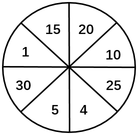

A. 6

B. 7

C. 8

D. 9

第 55 题 · 答案与解析

**参考答案（粉笔题库参考内容）**

C

**解析**

根据题意，三支飞镖得分之和为30分，每支可以得30分、25分、20分、15分、10分、5分、4分、1分、0分，并且每个区域可落有多支飞镖。选项数据不大，采用枚举法求解，如下表所示：

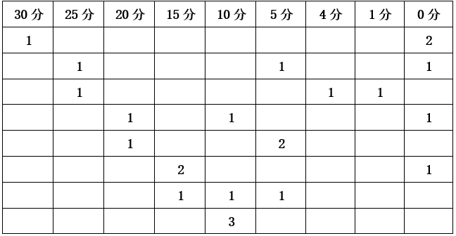

因为问的是得分组合，所以三支飞镖没有顺序，共8种得分组合。

故正确答案为C。

### 第 56 题

小朗和小峰每晚都会绕着体育场跑步。某晚，小朗、小峰分别从体育场的一号门、三号门同时出发匀速跑步，6分钟后，两人迎面相遇，相遇后，两人继续匀速前进。小峰又跑了5分钟到达一号门并由此进入体育场，横穿体育场从三号门跑出，沿与小朗相同的方向继续跑。已知小朗跑到三号门时，小峰距三号门还有180米，小峰又经过6分钟追上了小朗。则小朗的跑步速度为（ ）千米/小时。

A. 6

B. 7.2

C. 9

D. 10.8

第 56 题 · 答案与解析

**参考答案（粉笔题库参考内容）**

C

**解析**

小朗从一号门跑到两人迎面相遇的位置用时6分钟，小峰从两人迎面相遇的位置跑到一号门用时5分钟，根据“路程相同，速度与时间成反比”，则，设小朗速度为5v，小峰速度为6v。小朗跑到三号门时，小峰距离三号门还有180米，且小峰又经过6分钟追上小朗，根据追及公式，可列式：180=（6v-5v）×6，解得v=30米/分钟，则小朗速度为5v=5×30=150米/分钟=9千米/小时。

故正确答案为C。

### 第 57 题

某同城速递平台给予骑手每单a元基础收益（a为整数），且该平台在鼓励骑手多劳多得的同时，还鼓励其关注个人健康，在完成一定数量的订单后及时休息，并为此设定了每日基础接单量和健康临界接单量。骑手在完成基础接单量后，超出的订单每单收益平台补贴1.5元（a+1.5）；但若持续接单，超出健康临界接单量的订单每单收益平台扣除1元（a-1）。已知某骑手某日完成30单，共获得247.5元；第二日完成40单，共获得315元。若该骑手仅第二日超出了健康临界接单量，则扣除后的每单收益为（ ）元。

A. 5

B. 6

C. 7

D. 8

第 57 题 · 答案与解析

**参考答案（粉笔题库参考内容）**

B

**解析**

根据题意可得，骑手完成每单的基础收益a元为整数，则第一日完成30单时收益247.5元，平均每单价格为元，非整数，说明30单已超出每日基础接单量，但由题意可知30单未超过健康临界接单量，即这30单中每单收益可以分为a和（a+1.5）两类。则根据混合比例居中，可得：a<8.25<a+1.5，解得6.75<a<8.25，则5.75<a-1<7.25，排除A、D选项。

该骑手第一日完成30单时收益247.5元，第二日完成40单时收益315元，相差40-30=10单，收益相差315-247.5=67.5元，由题意可知这10单中每单收益可以分为（a+1.5）和（a-1）两类。

方法一：设这10单中每单收益（a+1.5）元的有x单，则每单收益（a-1）元的有（10-x）单。代入选项验证：

B项：若a-1=6元，则a+1.5=6+1+1.5=8.5元。8.5x+6（10-x）=67.5，解得x=3，满足条件。

C项：若a-1=7元，则a+1.5=7+1+1.5=9.5元。9.5x+7（10-x）=67.5，解得x=-1，不符合题意，排除。

方法二：两天相差的10单平均每单收益=6.75元，根据混合比例居中，可得：a-1<6.75<a+1.5，解得5.25<a<7.75，则4.25<a-1<6.75，排除C选项。

故正确答案为B。

### 第 58 题

某高校法学院对学生毕业后就职于司法机关、律所、企业的意愿进行调查，共725名学生参与调查，可选其中0至3项。结果显示，选择司法机关、律所、企业的学生分别有360人、380人、237人，3项都选的学生有60人，3项都不选的学生有8人，则仅选择其中1项的学生有（ ）人。

A. 517

B. 516

C. 515

D. 514

第 58 题 · 答案与解析

**参考答案（粉笔题库参考内容）**

A

**解析**

根据三集合容斥原理非标准型公式：A+B+C-满足两项-2×满足三项=总数-都不，可列式：360+380+237-选择其中两项的学生人数-2×60=725-8，解得：选择其中两项的学生人数=140人。根据三集合常识型公式：满足一项+满足两项+满足三项=总数-都不，可列式：仅选择其中1项的学生人数+140+60=725-8，解得：仅选择其中1项的学生人数=517人。

故正确答案为A。

### 第 59 题

某灯光秀表演中，无人机群先排列成红、绿两个正方形实心方阵，然后融合并变换灯光，形成一个黄色的正方框形空心方阵。原红方阵最外侧每边有8架无人机，且原红方阵恰好可填满黄方阵的空心，原绿方阵最外侧每边的无人机数量比黄方阵少4架。则参加灯光秀表演的无人机共有（ ）架。

A. 260

B. 233

C. 196

D. 185

第 59 题 · 答案与解析

**参考答案（粉笔题库参考内容）**

A

**解析**

设原绿方阵最外侧每边有n架无人机，则黄色正方框空心方阵最外侧每边有n+4架无人机，根据“原红方阵恰好可填满黄方阵的空心”可得：黄色正方框空心方阵共有架无人机。根据题意可知，黄色方阵为红、绿两个正方形方阵融合而成，即黄色无人机数量=红色无人机数量+绿色无人机数量，可列式：，解得n=14。则无人机总数=红色无人机数量+绿色无人机数量架。

故正确答案为A。

### 第 60 题

阿学的爸爸上午七点多出门钓鱼时，发现家里墙上时钟的时针与分针夹角为，中午十二点多回家吃饭时，发现墙上时钟的时针与分针夹角依然为，阿学的爸爸外出期间，时针与分针呈至多有（ ）次。

A. 4

B. 5

C. 6

D. 7

第 60 题 · 答案与解析

**参考答案（粉笔题库参考内容）**

B

**解析**

根据钟表问题结论：每1小时，时针与分针构成1次，结合题意可知，上午七点多到中午十二点多，必定有4次时针与分针呈（上午八点-中午十二点），具体情况如下图所示：

根据题意，要想次数尽可能多，则阿学的爸爸出门应尽量早，回家应尽量晚。根据上午七点多出门钓鱼时，时针与分针夹角为（即下图红色剪头所示），可知从阿学的爸爸出门到上午八点时，时针与分针不可能呈。

根据中午十二点多回家时，时针与分针夹角依然为（即下图红色剪头所示），可知从中午十二点到下午一点，至多有1次时针与分针呈。

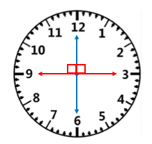

综上，阿学的爸爸外出期间，时针与分针呈至多有5次。

故正确答案为B。

### 第 61 题

将下列选项中的词语依次填入句子横线处，最恰当的一组是（ ）。

“与君远相知，不道云海深”，从王昌龄的笔端缓缓流出，带着明显的盛唐气象和        气概，承载着厚重隽永的博爱，承载着古往今来人们对和平美好的期望，流播在        的时空里。

A. 豪放、开阔

B. 豪爽、广阔

C. 豪迈、广袤

D. 豪情、宽广

第 61 题 · 答案与解析

**参考答案（粉笔题库参考内容）**

C

**解析**

第一空，搭配“气概”，指在对待重大问题上表现出来的态度、举动或气势。前文引用的诗句“与君远相知，不道云海深”意思是尽管相隔千里万里，但是只要能够相互了解、彼此相知，再深远辽阔的云海也不会将你我分开，展现了王昌龄豁达洒脱、气度宽广的精神气概，C项“豪迈”即气魄大，勇往直前，能体现出雄壮的慷慨激情，符合文意，保留。A项“豪放”指气魄大而不拘小节，也指处理事情果断有魄力，侧重体现奔放之意，与文意不符，排除；B项“豪爽”指豪放直爽，侧重形容人直截了当，无所顾忌，与文意不符，排除；D项“豪情”指豪迈的情怀，词性为名词，与“气概”搭配不当，排除。

第二空，代入验证，C项“广袤”指辽阔无边，置于此处能体现这两句诗在宽广的时空里流播，符合文意，当选。

故正确答案为C。

【文段出处】中国纪检监察报《历史文化源流 | 与君远相知 不道云海深》

### 第 62 题

将下列选项中的词语填入句子横线处，最恰当的一项是（ ）。

每一位党员干部都应该有刀刃向内的勇气，正视自己的缺点和错误并加以改正，不            ，不文过饰非。

A. 隐恶扬善

B. 掩耳盗铃

C. 沽名钓誉

D. 掩人耳目

第 62 题 · 答案与解析

**参考答案（粉笔题库参考内容）**

B

**解析**

横线处所填成语与“文过饰非”（用漂亮的言词掩饰自己的过失和错误）意思相近，且与“正视自己的缺点和错误并加以改正”意思相反，应体现不正视自己的缺点和错误，并加以掩饰之意。B项“掩耳盗铃”比喻自己欺骗自己，明明是掩盖不住的事情偏要想法子掩盖，可体现出不正视自己的缺点和错误，并加以掩饰之意，符合文意，当选。

A项“隐恶扬善”指隐瞒他人的坏处，而表扬他人的好处，搭配对象一般为他人，而文段搭配对象为自己，排除；

C项“沽名钓誉”比喻故意矫情做作，用手段猎取名声或赞誉，横线处强调“掩饰缺点和错误”，而非“猎取名声”，排除；

D项“掩人耳目”指捂住别人的耳朵，遮住别人的眼睛，比喻以假象蒙骗别人，对比“掩耳盗铃”，无法体现掩饰自己的缺点和错误之意，排除。

故正确答案为B。

### 第 63 题

将下列选项中的词语依次填入句子横线处，最恰当的一组是（ ）。

坐落在姚江畔的阳明古镇，与相距不远的王阳明故居，        已是余姚的名片。节日期间，这里也是城市会客厅，本地人、返乡客和外来游客，把阳明古镇挤得            。人行道上摩肩接踵，行人笑靥如花。

A. 俨然、密不透风

B. 俨然、熙熙攘攘

C. 宛然、密不透风

D. 宛然、熙熙攘攘

第 63 题 · 答案与解析

**参考答案（粉笔题库参考内容）**

B

**解析**

第一空，根据横线前后内容可知，阳明古镇、王阳明故居是展示余姚城市文化的名片，A项、B项“俨然”作副词时，形容很像，特别像，符合文意，均保留。C项、D项“宛然”指仿佛，与“俨然”相比程度较轻，与后文“节日期间，这里也是城市会客厅”的对应不如“俨然”更加契合，更能体现城市名片之意，均排除。

第二空，根据“人行道上摩肩接踵，行人笑靥如花”可知，节日期间来到阳明古镇的游客很多，呈现人挤人的热闹场景，B项“熙熙攘攘”形容人来人往，喧闹纷杂，符合文意，当选。A项“密不透风”比喻包围紧密或防守严密，侧重于包围或防守，如“穿着密不透风的防护服”“绿植将阳台遮得密不透风”，文段侧重阳明古镇内人来人往，而非被游客包围，不如“熙熙攘攘”更加契合文段语境，排除。

故正确答案为B。

【文段出处】人民网《姚江水，余姚城（我与一座城）》

### 第 64 题

将下列选项中的词语依次填入句子横线处，最恰当的一组是（ ）。

近两年，全国各家媒体竞相报道发源于台盘村的“村BA”篮球赛——激烈的角逐、热闹的场面、矫健的姿态引发了全国人民的关注。“村BA”        体现了村民积极、健康、精神富足的新形象，        彰显了乡村有序、充满活力的新气象。对于村民而言，这        是生产劳作之余的休憩，        是文化生活的精神荡涤。在台盘村，体育折射出文化的华彩，        文化则勾连起产业和消费。

A. 虽然、但、与其、不如、但

B. 不仅、也、既、也、而

C. 不但、还、虽然、但、但

D. 既、又、只要、就、而

第 64 题 · 答案与解析

**参考答案（粉笔题库参考内容）**

B

**解析**

第一空和第二空，根据“体现了村民积极、健康、精神富足的新形象”和“彰显了乡村有序、充满活力的新气象”可知，前后语境均体现了“村BA”带来的好处，B项“不仅······也”、C项“不但······还”、D项“既······又”均符合文段逻辑关系，保留。A项“虽然······但”为表示转折关系的关联词，与文段逻辑关系不符，排除。

第三空和第四空，根据“是生产劳作之余的休憩”和“是文化生活的精神荡涤”可知，此处构成近义并列关系，B项“既······也”符合文意，保留。C项“虽然······但”为表示转折关系的关联词，与文段逻辑关系不符，排除；D项“只要······就”为表示条件关系的关联词，与文段逻辑关系不符，排除。

第五空，代入验证，B项“而”置于此处起到顺承作用，符合文段逻辑关系，当选。

故正确答案为B。

【文段出处】光明日报《火热“村BA”》

### 第 65 题

将下列选项中的词语依次填入各句横线处，最恰当的一组是（ ）。

①今天，当皇帝的龙袍化作舞台上的戏服，鸦片的青烟消散在历史的风中，行进在辛亥一代开启的现代中国征程上，我们更需要        ——隔着新民主主义和社会主义革命两段辉煌历史，该如何打量辛亥革命这“中国历史上的伟大创举”？

②他小的时候，看父亲把一头小牛养大，在长久的岁月里，这头牛任劳任怨，父亲见证了它充满劳动和顺从的一生。父亲热爱这个年老的四足劳动者，全心全意地        它，在它没有用了以后，他既不想卖掉它，也不拿什么活儿去折磨它，只是让这头老牛自由自在地安安静静地度过它的晚年。

A. 深思、怜悯

B. 沉思、怜恤

C. 深思、怜恤

D. 沉思、怜悯

第 65 题 · 答案与解析

**参考答案（粉笔题库参考内容）**

C

**解析**

第一空，根据后文可知，横线处应体现出要认真思考辛亥革命这一伟大创举之意。A、C两项“深思”指深刻地考虑，强调的是思考的程度深，搭配对象往往是包含着深刻道理、需要做出决定的重要问题和大事，符合文意，均保留。B、D两项“沉思”着眼于思考的神态和程度，即深沉、静默地思考，表现为只专心地想事情而不顾其他状态，与文意不符，均排除。

第二空，“它”指代老牛，且根据前后文可知，横线处应体现父亲非常关心老牛且通过实际行动给予其照顾。C项“怜恤”指怜爱体恤，置于此处可体现出父亲关爱、同情老牛，并照顾老牛安度晚年之意，当选。A项“怜悯”指对遭遇不幸的人表示同情，与横线后“既不想卖掉它，也不拿什么活儿去折磨它”这一实际行动的对应没有C项“怜恤”好，且没有“怜恤”语义丰富，排除。

故正确答案为C。

【文段出处】人民日报《任仲平：开启民族复兴的百年征程》 读者《老牛》

### 第 66 题

将下列选项中的词语依次填入句子横线处，最恰当的一组是（ ）。

劳动是美好的，劳动者更是美好的，有特别突出一技之长的工匠，更是一道美丽的风景线。然而，这种美好要用诗歌来表达，是很不容易的。在短小的篇幅里，写出一个个劳动者的        ，更是极其艰难的。但是诗人成功地从大地、长天、厂房、车间里        出了优秀的诗行。

A. 神魂、凝练

B. 神韵、提炼

C. 神态、精炼

D. 神采、锤炼

第 66 题 · 答案与解析

**参考答案（粉笔题库参考内容）**

B

**解析**

第一空，搭配“写出”，根据“这种美好要用诗歌来表达”可知，横线处所填词语要体现出诗歌写出的劳动者之美，B项“神韵”指风度韵致，也指诗文书画的风格韵味，D项“神采”指人面部的神情和光彩，均与“写出”搭配恰当且符合文意，保留。A项“神魂”指精神，神志（多用于不正常时），与“写出”搭配不当，排除；C项“神态”指神情态度，侧重人的外在表情，未能体现出劳动者之美，排除。

第二空，搭配“诗行”，根据“在短小的篇幅里”“但是诗人成功地从大地、长天、厂房、车间里······出了优秀的诗行”可知，横线处所填词语要体现出诗人从众多劳动场景中创作凝练出的诗歌。B项“提炼”指用化学方法或物理方法从化合物或混合物中提取（所要的东西），也比喻对某事物进行去粗取精的加工、提高，符合文意，当选。D项“锤炼”指磨练，与“诗行”搭配不当，排除。

故正确答案为B。

【文段出处】封面新闻《成都作家凸凹用诗给工匠“画像” 从大地长天，厂房车间里提炼出诗行》

### 第 67 题

将下列选项中的词语依次填入句子横线处，最恰当的一组是（ ）。

“精专”读书法，并不是让我们穿凿附会、            ，那样只会“拘泥于章句而疏忽于会意，活脱书橱也”。而是提倡一种            、苦心孤诣的读书态度。读书就像品茗，虽然茶水的颜色和飘逸的茶香较易辨认，但茶中三味，却要细细品之才能体会得来。

A. 咬文嚼字、去粗取精

B. 咬文嚼字、去伪存真

C. 雕章琢句、去粗取精

D. 雕章琢句、去伪存真

第 67 题 · 答案与解析

**参考答案（粉笔题库参考内容）**

A

**解析**

第一空，根据文意可知，横线处所填成语应体现出读书时过于拘泥于章句之意，且横线处所填成语与“穿凿附会”形成并列，感情色彩偏消极。A、B两项“咬文嚼字”指过分地斟酌字句，多用来指死抠字眼儿，也用来指对文字的使用反复推敲，十分讲究，可用在消极语境，符合文意，均保留。C、D两项“雕章琢句”比喻对文章字句刻意修饰，多用于写文章，而非读书，与文意不符，均排除。

第二空，根据后文“读书就像品茗，虽然茶水的颜色和飘逸的茶香较易辨认，但茶中三味，却要细细品之才能体会得来”可知，横线处所填成语应体现出读书应细细品味其中精髓之意。A项“去粗取精”指去掉粗糙的部分，取其精华的部分，符合文意，当选。B项“去伪存真”指去除虚假的，留存真实的，文段并未论述真假，与文意不符，排除。

故正确答案为A。

【文段出处】人民网《周恩来的读书法》

### 第 68 题

将下列选项中的词语依次填入句子横线处，最恰当的一组是（ ）。

在            中寻找出路，在            中向前挺进，在            中发展壮大，在            中夺取胜利，我们党把马克思列宁主义基本原理同中国具体实际相结合，创立、丰富和发展了毛泽东思想，是马克思主义中国化的第一次历史性飞跃。

A. 千难万险、千磨万击、千辛万苦、千回百转

B. 千回百转、千难万险、千磨万击、千辛万苦

C. 千难万险、千回百转、千磨万击、千辛万苦

D. 千回百转、千磨万击、千辛万苦、千难万险

第 68 题 · 答案与解析

**参考答案（粉笔题库参考内容）**

B

**解析**

第一空，应体现“寻找出路”时的状态，“出路”即向前发展的途径，摆脱逆境的门路。B、D两项“千回百转”原指水流曲折蜿蜒，现形容反复回旋或进程曲折，恰好能够体现在找到正确道路之前的艰辛、曲折的摸索过程，均保留。A、C两项“千难万险”形容困难和危险极多，横线处仅体现找到正确方向的曲折过程，并未体现危险的状态，均排除。

第二空，根据“向前挺进”可知，横线处应体现前进道路上会遇到很多困难。B项“千难万险”形容困难和危险极多，D项“千磨万击”形容经受极多的磨难和打击，均与文意相符，保留。

第三空，根据 “发展壮大”可知，横线处应体现经历困苦以后成长之意。B项“千磨万击”形容经受极多的磨难和打击，D项“千辛万苦”形容各种各样的艰辛劳苦，两项对比，磨难与打击比辛苦更契合文意，与“发展壮大”对应更为准确，故排除D项。

第四空，代入验证，根据“夺取胜利”可知，横线处应体现取得胜利之前的努力。B项“千辛万苦”形容各种各样的艰辛劳苦，与文意相符，当选。

故正确答案为B。

【文段出处】人民网-人民日报《掌握历史主动 凝聚奋进伟力》

### 第 69 题

将下列选项中的词语依次填入句子横线处，最恰当的一组是（ ）。

“从地名看文化，从文化看中国”，带着            的节目宗旨和不断精进的艺术手法，新一季《中国地名大会》以地名知识为载体，从地理风貌、民间习俗、历史文化、文学作品、特色美食等多角度全方位全景式展现中华文化，        祖国大地的精彩纷呈，书写中国之进，阐释中国之变。

A. 一脉相承、擘画

B. 薪火相传、描摹

C. 一脉相承、描摹

D. 薪火相传、擘画

第 69 题 · 答案与解析

**参考答案（粉笔题库参考内容）**

C

**解析**

第一空，搭配“节目宗旨”，且根据“从地名看文化，从文化看中国”可知，横线处应体现新一季《中国地名大会》与往季的节目宗旨保持一致，A、C两项“一脉相承”指从同一个血统或派别世代承接流传下来，符合文意，均保留。B、D两项“薪火相传”指学问和技艺代代相传，与“节目宗旨”搭配不当，均排除。

第二空，搭配“祖国大地的精彩纷呈”，根据后文“书写中国之进，阐释中国之变”可知，横线处应体现该节目呈现祖国大地的精彩纷呈，C项“描摹”指照着底样写和画，或用语言文字表现人或事物的形象、情状、特性等，符合文意，当选。A项“擘画”指谋划、经营，常搭配“蓝图”“愿景”等，多强调对未来的谋划，而文段强调节目对当下祖国大地精彩内容的展现，与文意不符，排除。

故正确答案为C。

【文段出处】光明网《<中国地名大会>第三季：将历史写在大地上，把文化融入生活间》

### 第 70 题

将下列选项中的词语填入句子横线处，最恰当的一组是（ ）。

在那个            颓势初现的晚唐，诗人身陷牛李党争进退维谷，只能是郁郁寡欢，心事重重。而这首《锦瑟》大约写于唐大中二年（公元848年），正是诗人辞官归隐的暗淡岁月，也是他生命旅程的最后阶段，其心情之苍凉悲苦可想而知，整首诗的情感基调也就            了。

A. 日薄西山、不言自明

B. 穷途末路、不言自明

C. 穷途末路、一锤定音

D. 日薄西山、一锤定音

第 70 题 · 答案与解析

**参考答案（粉笔题库参考内容）**

A

**解析**

第一空，根据“颓势初现的晚唐”可知，横线处应体现晚唐走向衰败之意，A、D两项“日薄西山”指衰老的人或腐朽的事物临近死亡，符合文意，均保留。B、C两项“穷途末路”指无路可走，文段说明晚唐刚开始走向衰败，“穷途末路”强调已是绝境，置于此处程度过重，均排除。

第二空，根据“也”可知，横线处与“可想而知”语义相近。“可想而知”指不用说明就能想象得到，A项“不言自明”指不用说话就能明白，与“可想而知”语义相近，当选。D项“一锤定音”指凭某个人的一句话做出最后决定，与文意无关，排除。

故正确答案为A。

【文段出处】文汇报《今天，我们可以这样读唐诗》

### 第 71 题

下列各项中，没有语病的一项是（ ）。

A. 在那个没有现代通讯的年代，通过写信，使我得以表达对恩师的感激和思念之情。

B. 从俄乌冲突到巴以冲突，地缘政治冲突频发，全球政治经济形势愈发更加严峻。

C. 研究发现，正常人每天适量喝咖啡，并不会比不喝咖啡的人更容易患骨质疏松症。

D. 近年来，我国餐饮行业减少“舌尖上的浪费”取得显著成效，映衬出餐饮行业反餐饮浪费的决心和态度。

第 71 题 · 答案与解析

**参考答案（粉笔题库参考内容）**

C

**解析**

A项，介词滥用导致主语缺失，应删掉“通过”或“使”，排除；

B项，“愈发”与“更加”语义重复，成分多余，排除；

C项，表意明确，没有语病，当选；

D项，“映衬”指互相映照、衬托使显现，与“决心和态度”搭配不当，应改为“折射”，排除。

故正确答案为C。

【文段出处】北京青年报《咖啡和碳酸饮料能“吃”空骨头？别焦虑！》

人民日报《反餐饮浪费要做到“常”紧盯“新”》

### 第 72 题

下列各项中，没有语病的一项是（ ）。

A. 企业管理者可以是做实验的外行，但必须是经营技术的内行，只有这样的外行才能领导内行。

B. 回到故乡后，这里慢慢展现出它们原有的每样事物对我都无比亲切可爱。

C. 我们的生产不是为了剥削阶级服务的，而是为了人民群众服务的。

D. 没有可靠的数据，不管是开放碘盐，还是下调碘含量，也不过是缓解公众质疑的权宜之计。

第 72 题 · 答案与解析

**参考答案（粉笔题库参考内容）**

A

**解析**

A项，表述正确，没有语病，当选；

B项，“回到故乡后，这里慢慢展现出它原有的”之后缺失宾语，应改为“回到故乡后，这里慢慢展现出它原有的样子”，且“每样事物对我都无比亲切可爱”主客体语序不当，应改为“每样事物对我来说都无比亲切可爱”，排除；

C项，“为了······的”成分赘余，应去掉“了”，改为“我们的生产不是为剥削阶级服务的，而是为人民群众服务的”，排除；

D项，“不管是······还是······也不过是”关联词搭配不当，应改为“不管是······还是······都不过是”，排除。

故正确答案为A。

### 第 73 题

下列各项中，有语病的一项是（ ）。

A. 加强企业用工服务，对支持企业生产经营、保持就业局势稳定具有重要作用。

B. 随着我国优化出入境政策，预计今年出入境旅游人次可恢复至2019年的三至六成左右。

C. 装载煤炭、建材等货物的船舶在航道上有序航行，来往如梭，运河上呈现一派繁忙景象。

D. 全透明柔性电子皮肤一改先前穿戴不方便、不美观的缺点，能够让电子皮肤发挥更大的作用。

第 73 题 · 答案与解析

**参考答案（粉笔题库参考内容）**

B

**解析**

本题为病句辨析题。

B项，“三至六成左右”成分赘余，应改为“三至六成”，存在语病，当选；

A、C、D三项，均没有语病，表意明确，排除。

故正确答案为B。

【文段出处】

A项出处：人民网《创新校企合作模式 扩大技能人才供给》

B项出处：搜狐网《新加坡旅游局潘政志：“灵活性”或将成为旅游行业发展关键词》

C项出处：中国日报网《江苏扬州：京杭大运河冬季运输忙》

D项出处：科技日报《新型电子皮肤可实时检测生理信号》

### 第 74 题

对一部分游客来说，文化已经不是旅途中可有可无的点缀，而是旅途的“正餐”，浮光掠影、浅尝辄止、拍照打卡的传统观光游，已经难以满足他们历史文化、艺术思想的深度需求。

以上句子的语病类型是（ ）。

A. 句式杂糅

B. 不合逻辑

C. 成分残缺

D. 搭配不当

第 74 题 · 答案与解析

**参考答案（粉笔题库参考内容）**

C

**解析**

根据文意可知，该句意在表达传统观光游难以满足游客们自身对于历史文化、艺术思想的深度需求，但本句中“已经难以满足他们历史文化、艺术思想的深度需求”一句缺少必要的介词，致使句子结构上混乱不清，可在“他们”后加上介词“对于”，使其表意严密，因而本句语病类型为成分残缺，对应C项。

A项，“句式杂糅”指把两种不同的句法结构混杂在一个表达式中，结果造成语句结构混乱、语义纠缠，该句并未涉及，排除；

B项，“不合逻辑”指不合事理、前后矛盾、强加因果、概念混乱等不符合逻辑思维的句子形式，该句并未涉及，排除；

D项，“搭配不当”是指由于语法、逻辑、修辞等方面使用不当或不合事理造成表意不清的语句，该句并未涉及，排除。

故正确答案为C。

【文段出处】光明日报《【文化评析】“博物馆游”助推文化与生活深度融合》

### 第 75 题

把下面几个句子组成语意连贯的一段文字，排序正确的一项是（ ）。

①但人类对于发酵本质形成认识，并发展形成发酵工业，却只有近几百年的历史

②有需求就有进步，发酵工业的进步与人类需求息息相关，社会需求的增加推动着发酵技术的进一步发展

③发酵不是古今人类智慧的体现，而是地球历史上20亿年前就存在的自然现象，是微生物送给人类的礼物

④食物发酵是一项既古老又崭新的人类饮食行为，它经历了漫长的岁月，得到了不断的发展和充实

⑤几乎在地球上诞生生命的同时，发酵现象就已经存在了

A. ⑤-①-③-②-④

B. ④-⑤-③-①-②

C. ③-⑤-①-④-②

D. ④-⑤-③-②-①

第 75 题 · 答案与解析

**参考答案（粉笔题库参考内容）**

B

**解析**

对比选项，判断首句。④句对“食物发酵”下定义，指出其是古老又崭新的人类饮食行为，适合作首句，保留B、D两项。③句指出发酵在地球历史上20亿年前就已存在，⑤句指出几乎在地球诞生生命的同时，发酵现象就存在了，③⑤两句均在具体论述发酵历史悠久，是对④句的具体解释说明，故④句应在③⑤两句之前，排除A、C两项。

继续观察选项，B、D两项区别在于①②两句的位置不同，①句引出“发酵工业”，②句介绍发酵工业的进步与人类需求、社会需求有关，应先引出“发酵工业”这一话题，然后再介绍与其进步有关的因素，故①句应在②句之前，排除D项，B项当选。

故正确答案为B。

【文段出处】微信公众号《食物发酵学·餐饮人必读》

### 第 76 题

如今，许多人将公共图书馆视为图书借阅室，甚至自习室，而实际上，图书馆同博物馆、美术馆一样，有文物存藏和展示展览的功能。因为古籍不仅是可供人们阅读研究的文献，还是必须收藏保护的文物，将古籍等同于一些当代文献，视为普通的“公版书”，正是忽视了古籍的文物属性。人们常说的“一页宋版一两金”，指的就是珍贵的宋版书。纸寿千年，绢寿八百，古籍的修复、存藏、复制，每个环节都是颇具难度的“技术活”。目前，学界公认的解决古籍“藏”与“用”矛盾的重要方式，就是古籍数字化。古籍数字化是文明传承的必由之路，更是需要徐徐图之的文化工程，需要全社会赋之信心、细心和耐心。

这段文字意在说明（ ）。

A. 现代图书馆具有多重公共功能与属性

B. 应当重视古籍的文化价值和历史价值

C. 古籍数字化工程需要全社会久久为功

D. 要发挥图书馆存藏与展示古籍的功能

第 76 题 · 答案与解析

**参考答案（粉笔题库参考内容）**

C

**解析**

文段开篇通过论述图书馆有文物存藏和展示展览的功能来引出“古籍”的话题，接着论述古籍除可供人阅读研究外，还是需要收藏保护的文物，将其视为普通的当代文献忽视了其文物属性，并通过“宋版书”进行举例论证。接着论述问题，即古籍的修复、存藏、复制颇具难度，随后通过“解决方式”“必由之路”以及“需要”提出对策，即需要信心、细心和耐心地通过“古籍数字化”来解决问题，故文段核心话题为“古籍数字化”，对应C项。

A项，“现代图书馆”为文段开篇话题引入部分内容，非重点，且缺少文段核心话题“古籍数字化”，排除；

B项，“重视古籍价值”文段未提及，无中生有，且缺少文段核心话题“古籍数字化”，排除；

D项，“图书馆存藏与展示古籍的功能”为文段开篇话题引入部分内容，非重点，且缺少文段核心话题“古籍数字化”，排除。

故正确答案为C。

【文段出处】光明日报《让公共图书馆拥有多种“打开方式”》

### 第 77 题

“雨果奖”得主海漄，在凭借《时空画师》获奖且一鸣惊人之前，是一名标准的银行打工人，过着普通城市“社畜”的庸常生活，朝九晚五，平平无奇。有人在惊叹之余忍不住好奇：是否在常规工作的桎梏下，某种关于创造与艺术的灵性更容易被激发？写作，或者说创作，说到底，它和其他需要固定时间投入的工作没有本质区别，都需要持续的、有规律或计划的、长期的投入。更重要的是，真实生活是人类创作的恒久源泉，上班族的生活贴近最大基数普通人的日常生活，接触这个时代大多数人的生活常态，和普通人的思考逻辑、行为习惯保持一致，能最大程度保障创作的核心稳固。

下列说法与原文意思相符的是（ ）。

A. 海漄的获奖得益于将平平无奇的庸常生活升华为艺术

B. 朝九晚五的工作有助于长期持续投入创作

C. 枯燥乏味的工作岗位更容易激发创造与艺术的灵性

D. 循规蹈矩的常规工作未必扼杀人的创造力

第 77 题 · 答案与解析

**参考答案（粉笔题库参考内容）**

D

**解析**

A项，文段未提及海漄的获奖原因，且“将平平无奇的庸常生活升华为艺术”文段也并未提及，无中生有，排除；

B项，根据“写作，或者说创作，说到底，它和其他需要固定时间投入的工作没有本质区别，都需要持续的、有规律或计划的、长期的投入”可知，文段仅论述写作创作需要长期投入，并未讨论工作与长期持续投入创作之间的关系，“有助于长期持续投入创作”无中生有，排除；

C项，根据“是否在常规工作的桎梏下，某种关于创造与艺术的灵性更容易被激发”可知，文段中讨论的是“常规工作的桎梏”，并未提及“枯燥乏味的工作岗位”，无中生有，排除；

D项，根据“‘雨果奖’得主海漄，在凭借《时空画师》获奖且一鸣惊人之前，是一名标准的银行打工人，过着普通城市‘社畜’的庸常生活，朝九晚五，平平无奇”“更重要的是，真实生活是人类创作的恒久源泉······和普通人的思考逻辑、行为习惯保持一致，能最大程度保障创作的核心稳固”可知，真实普通的工作并不会扼杀人的创造力，表述正确，当选。

故正确答案为D。

【文段出处】南风窗《很多大作家，都做过打工人》

### 第 78 题

微综艺是指小体量、小投入、小制作的视听综艺节目。在大量的综艺选题被同质化制作和扎堆式播出的语境下，微综艺的出现力图求新求变，摆脱创作窠臼。某种意义上讲，微综艺是综艺市场的试水者，是综艺市场迭代升级的结果。再者，短视频平台的崛起让垂直化、碎片化、浅表化、短篇幅的视听产品成为用户的消费重点并形成观看习惯，这也推动了微综艺的勃兴。

对上文理解不正确的是（ ）。

A. 微综艺是综艺市场的新生力量

B. 短视频平台助力微综艺的发展

C. 微综艺比传统综艺节目更能赢得用户的口碑

D. 微综艺更契合短视频平台用户的收视习惯

第 78 题 · 答案与解析

**参考答案（粉笔题库参考内容）**

C

**解析**

A项，根据“在大量的综艺选题被同质化制作和扎堆式播出的语境下，微综艺的出现力图求新求变，摆脱创作窠臼”可知，微综艺属于综艺市场的新生事物，表述正确，排除；

B项，根据“再者，短视频平台的崛起让垂直化、碎片化、浅表化、短篇幅的视听产品成为用户的消费重点并形成观看习惯，这也推动了微综艺的勃兴”可知，短视频平台对于微综艺的发展确实具有推动作用，表述正确，排除；

C项，文段并未对比“微综艺”和“传统综艺节目”谁更能赢得用户口碑，属于无关对比，当选；

D项，根据“再者，短视频平台的崛起让垂直化、碎片化、浅表化、短篇幅的视听产品成为用户的消费重点并形成观看习惯，这也推动了微综艺的勃兴”可知，微综艺符合短视频平台用户的收视习惯，表述正确，排除。

本题为选非题，故正确答案为C。

【文段出处】光明网《微综艺呈现大世界》

### 第 79 题

平台企业利用新型技术所搭建的商业模式，绕开了对劳动者进行保护的既往社会契约，实际上是一种“技术破坏”。现有的劳动和社会保障立法逐渐被架空，面对平台用工的“去劳动关系化”（即平台不承认劳动法中规定的雇佣劳动关系），不同国家的司法部门在劳动者身份判定上面临难题。为数众多的立法者开始倾向于将平台从业者归类为过去劳动立法中已有的身份类别（完全的受雇佣者或所谓的第三类劳动者身份），从而给予一定的法律保障。但这种处理方式也受到一些学者的质疑，因为这可能忽略不同平台从业者的差异（工作内容、性别、国籍、种族等），并漠视了劳工群体自我赋权的能力。

以下说法与原文意思不一致的是（ ）。

A. 平台企业的商业模式带来了劳动者身份判定的困难

B. 平台从业者身份归类问题可通过司法实践予以解决

C. 目前平台从业者的劳动者权益保障受到了一定冲击

D. 如何应对平台用工“去劳动关系化”问题仍存争议

第 79 题 · 答案与解析

**参考答案（粉笔题库参考内容）**

B

**解析**

A项，根据“平台企业利用新型技术所搭建的商业模式······不同国家的司法部门在劳动者身份判定上面临难题”可知，目前平台企业的商业模式给劳动者的身份判定带来了困难，表述正确，排除；

B项，“司法实践”文段并未提及，无中生有，当选；

C项，根据“绕开了对劳动者进行保护的既往社会契约······面对平台用工的‘去劳动关系化’（即平台不承认劳动法中规定的雇佣劳动关系）”可知，劳动者的劳动权益受到了损害，表述正确，排除；

D项，根据“为数众多的立法者开始倾向于······但这种处理方式也受到一些学者的质疑”可知，立法者的处理方式目前存在争议，表述正确，排除。

本题为选非题，故正确答案为B。

【文段出处】《单读|我们会成为互联网巨头的奴隶吗？》

### 第 80 题

一年前，ChatGPT横空出世，5天内，这款聊天机器人随即揽下100万用户，2个月后，这个数字涨到了1亿。                         ，不少体验者是把ChatGPT当成升级版的谷歌搜索引擎来理解，但它俩其实完全不同。最大的区别在于，ChatGPT并没有在被提问时上网检索答案，抽取出个别网页，给你一个由他人编辑好的文本；而是像学生考试时努力回忆学到的知识点进行作答那样，回忆它阅读学习过的海量文本，再用自己的语言组织一个简洁的回答，实时生成给你看，替你节省点开链接、阅读理解的时间。不仅如此，它还要读懂你的追问、反驳乃至刁难，像接受论文答辩一样，跟你进行多个回合的灵活交谈，让你感觉对方是个普通人而不是机器。

最适合填入上文横线处的语句是（ ）。

A. 但ChatGPT是一款用户体验并不友好的新产品

B. 理解ChatGPT，对于很多人来说都太过复杂

C. 成为大热门的ChatGPT自然成为了众矢之的

D. ChatGPT会为许多风险隐患提供更为“深思熟虑”的方案

第 80 题 · 答案与解析

**参考答案（粉笔题库参考内容）**

B

**解析**

本题为语句填空题，横线位于文段中间，需结合上下文语境进行分析。横线前引出ChatGPT的话题，横线后指出不少体验者把它当成谷歌搜索引擎理解，随后通过“但”转折指出两者不一样，并具体解释ChatGPT是如何工作的，即不会直接给出一个由他人编好的文本，而是会用自己的语言回答问题，并且还会与搜索者进行多个回合的交流，故后文具体阐述如何理解ChatGPT，结合上下文，横线处应围绕“理解ChatGPT”进行论述，对应B项。

A、C、D三项，“用户体验并不友好”“成为了众矢之的”“风险隐患”文段均未提及，无中生有，排除。

故正确答案为B。

### 第 81 题

这方面的逸事较多，有两则小典故至今读来仍有强烈的警示意义。一则是《宋人轶事汇编》记载： 钱俶进宝犀带（注释：犀带，指饰有犀角的宝带），太祖曰：“朕有三条带，与此不同。”俶请宣示，上笑曰：“汴河一条，惠民河一条，五丈河一条。”俶大惭服。另一则是《南村辍耕录·缠足》记载： 李后主嫔妃窅娘纤丽善舞，后主令窅娘以帛绕脚，素袜舞云中，回旋有凌云之态。“由是人皆效之，以纤弓为妙。以不为者为耻也”。这两则典故一正一反，给出了有力印证。

对上文第一句中“这方面”理解最贴切的是（ ）。

A. 领导干部的生活作风具有“上行下效”的示范效应

B. 严惩腐败是管党治党、赢得民心的“徙木立信”之举

C. “见善则迁，有过则改”可提高个人道德修养

D. “水能载舟，亦能覆舟”是必须牢记的大道理

第 81 题 · 答案与解析

**参考答案（粉笔题库参考内容）**

A

**解析**

“这方面”出现在文段开头，后文“两则小典故”即是对其进行的举例说明，第一则典故翻译过来是说钱俶曾向宋太祖赵匡胤进献了一条用犀牛角为饰品的宝带，赵匡胤对钱俶说“朕有三条宝带，与你的宝带不一样”，钱俶请赵匡胤让他看看宝物，赵匡胤大笑着说“一条为汴河，一条称惠民河，一条谓五丈河”，钱俶听完，被赵匡胤不沉迷世俗财物，心系江山和万民的格局深深折服，并感到惭愧。第二则典故翻译过来是说南唐李煜有一个宠妾叫窅娘，窅娘精通跳舞，李煜便命窅娘裹脚跳舞，为了讨李煜的欢心，窅娘就用布缠绕自己的脚，把双足往上弯成月牙儿形状，此后，当时的妇女都争相效仿，以小脚为美开始裹脚。这两则典故分别从正反两个方面说明了领导人在生活细节上体现出来的态度对其他人有着非常重要的影响，对应A项“上行下效”。

B项，两则典故均未提及“严惩腐败”，无中生有，排除；

C项，“见善则迁，有过则改”指见到好的要学习改进，有了错误要及时改正，D项，“水能载舟，亦能覆舟”侧重强调人民群众力量的重要性，均与两则典故反映的道理不符，排除。

故正确答案为A。

【文段出处】书籍《之江新语》

### 第 82 题

以往探讨快递过度包装的时候，不少人习惯归咎于卖家，认为他们是过度包装的罪魁祸首，实际上并不完全如此。对于卖家来说，层层叠叠、最终沦为垃圾的包装材料，都是他们用真金白银买回来的，过度包装不仅无法带来实质性收益，还会增添额外的成本。表面上看，快递过度包装是一个环保观念的问题，更深一层探究，其中折射出的是快递行业的内部管理问题：“野蛮快递”屡见不鲜，由于对快递运输环节不放心，商家希望以过度包装来取信消费者，消费者希望通过过度包装带来安慰，双方一拍即合，快递包装也因此越来越厚重。

这段文字接下来最可能续写的内容是（ ）。

A. 缓解快递过度包装的关键在于快递企业

B. 对于过度包装，有必要从执法层面予以规范

C. 过度包装导致的资源浪费和环境污染日趋严重

D. 追求浮夸的消费理念助长了商家过度包装的行为

第 82 题 · 答案与解析

**参考答案（粉笔题库参考内容）**

A

**解析**

根据提问方式可知，本题为接语选择题。文段开篇提出不少人认为快递过度包装罪魁祸首在卖家，而后通过转折词“实际上”说明了过度包装并不能给卖家带来实质性收益。接着通过“更”强调快递过度包装的深层原因是快递行业的内部管理问题，尾句进行解释说明。故后文应围绕快递行业的问题导致快递过度包装的话题展开论述，对应A项。

B项，未提及文段核心话题“快递行业”，且“执法层面”文段并未论述，无法与文段衔接，排除；

C项，“环境污染”对应文段“环保”部分，为“更”之前论述的内容，与文段最后讨论的核心话题不一致，无法与文段衔接，排除；

D项，“追求浮夸的消费理念”文段并未论述，无法与文段衔接，排除。

故正确答案为A。

【文段出处】光明网《全员参与，杜绝包装“内卷”》

### 第 83 题

每个人都处于特定的时空环境下，有其自身的生存与活动空间，我们坚信正确的真理其实往往是一种“井底”的真理，它只适用于我们所生存的这口“井”里。一旦这只青蛙有勇气从井底跃出，他将理解真理的相对性。换言之，在具体时空环境下，真理是绝对的；例如二维平面中，三角形内角和必然等于180度；但当我们从二维世界跃入三维之中，同样的结论便不再成立。我们的价值评判标准也是同理。以“内卷”与“躺平”的争执为例，内卷派往往认为躺平是一种懒惰、不思进取与畏惧竞争的表现；而躺平派则认为自己“不思进取”地躺着，是在无意义的内卷环境下，对恶性竞争的无声反抗。实际上，“内卷”与“躺平”之争是特定条件下的产物。

最适合做上文标题的是（ ）。

A. “井”里与“井”外

B. “相对”才是真理

C. 世界维度决定思想高度

D. “内卷”“躺平”的辩证统一

第 83 题 · 答案与解析

**参考答案（粉笔题库参考内容）**

B

**解析**

文段开篇以井底之蛙的故事引出“真理的相对性”这一话题。随后以“三角形内角和”的例子再次强调在不同的时空环境下，真理的绝对性不再成立。接着指出我们的价值评判标准也是同理，并以“内卷”与“躺平”的争执为例再次论证，证明从不同的角度出发观点是不同的。故文段重在强调真理不是绝对的，而是相对的，对应B项。

A项，“井”仅对应文段开篇引出话题的内容，非重点，且表述不明确，排除；

C、D两项，“世界维度”“‘内卷’‘躺平’”均仅对应例子内容，非重点，排除。

故正确答案为B。

【文段出处】中华读书报《德勒兹：生命的另一种可能》

### 第 84 题

自新石器时代的快轮制陶技术发展成熟之后，盛水器皿多以圆形为主，圆形器皿有很多优点，也能满足人们在定居条件下的生活需要，但在人们外出狩猎和行军等长途跋涉的场合，需要随身携带蓄水的器具，圆形器皿虽然也可携带，但其圆形外型与身体接触的面积小，对身体产生的局部压力较大，令人不适。而且，圆形器皿置于身体一侧，增大了身体所占的横向空间，与身体的接触又很不稳定，会随着身体的运动来回滚动，影响携带者的灵活运动。此外，对于随身携带的盛水器皿，为了确保卫生和安全，只能直接通过器皿的口来饮用。所以，那些敞开大口的圆形器皿也不适用。在这种前提下，扁形水壶的形制便逐渐形成了。在新石器时代就出现了一些类似的器形，而到战国和秦汉，这种扁壶已逐步成熟并普及。

根据上文，扁壶在战国和秦汉时期普及的原因不包括（ ）。

A. 狩猎或行军等长途跋涉场合有蓄水需求

B. 蓄水量大，更好满足人们定居生活需要

C. 扁形外型携带舒适，不妨碍灵活运动

D. 壶口相对于圆形器皿敞口更为卫生安全

第 84 题 · 答案与解析

**参考答案（粉笔题库参考内容）**

B

**解析**

A项，根据“但在人们外出狩猎和行军等长途跋涉的场合，需要随身携带蓄水的器具······扁形水壶的形制便逐渐形成了”“而到战国和秦汉，这种扁壶已逐步成熟并普及”可知，该项为扁壶普及的原因，排除；

B项，根据“盛水器皿多以圆形为主，圆形器皿有很多优点，也能满足人们在定居条件下的生活需要”可知，蓄水量大的为“圆形器皿”，而非“扁形”，偷换概念，该项不是扁壶普及的原因，当选；

C项，根据“而且，圆形器皿置于身体一侧，增大了身体所占的横向空间······影响携带者的灵活运动”“在这种前提下，扁形水壶的形制便逐渐形成了······”“而到战国和秦汉，这种扁壶已逐步成熟并普及”可知，该项为扁壶普及的原因，排除；

D项，根据“此外，对于随身携带的盛水器皿，为了确保卫生和安全，只能直接通过器皿的口来饮用······那些敞开大口的圆形器皿也不适用”“在这种前提下，扁形水壶的形制便逐渐形成了······”“而到战国和秦汉，这种扁壶已逐步成熟并普及”可知，该项为扁壶普及的原因，排除。

本题为选非题，故正确答案为B。

### 第 85 题

经常听到国内许多专门家痛心疾首地抱怨各种走俏的传媒作品严重缺乏学术上的准确性和严肃性；但是专家学者们却往往又把自己的研究成果表述得过分艰涩干瘪而少趣味，使少数同行之外再不会有什么别的人愿意皱着眉头去读完它们。学术探索的过程本来应该是充满奇光异彩的。趣味从我们的学术著作中脱逸的现象，很可能表明一部分徒有其表的“学术著作”本身其实并不真正地具备“学术”一词所必须含有的基本品格。但确实也存在另一种情形，即作者缺乏下述这种充分意识：他应当尽可能地让读者与他共享的，乃是科学探索中的乐趣与喜悦，而不只是其中的艰辛与酸楚。

这段文字意在（ ）。

A. 分析传媒作品与学术著作受众规模差异的原因

B. 鼓励学术著作向走俏的传媒作品借鉴表达

C. 批判趣味已经从大多数学术著作中脱逸的现状

D. 提倡撰写学术著作应将趣味性与学术性并重

第 85 题 · 答案与解析

**参考答案（粉笔题库参考内容）**

D

**解析**

文段开篇论述国内许多专家抱怨传媒作品缺乏学术上的准确性和严肃性，接着通过转折词“但是”提出问题，即专家学者们研究成果的表述缺乏趣味性，趣味从学术著作中脱逸，之后分析问题产生的原因，为一部分“学术著作”不具备“学术”的基本品格及作者缺乏共享乐趣与喜悦的意识，故文段为“提出问题—分析问题”的结构，意在强调解决问题的对策，即学术著作应既包含“学术”的基本品格，也应该有共享乐趣与喜悦的意识，对应D项。

A项，“传媒作品与学术著作受众规模差异”文段并未提及，无中生有，排除；

B项，根据文段“经常听到国内许多专门家痛心疾首地抱怨各种走俏的传媒作品严重缺乏学术上的准确性和严肃性”可知，文段论述的是“各种走俏的传媒作品”的缺点，故“向走俏的传媒作品借鉴表达”表述错误，排除；

C项，“批判······的现状”为问题表述，而文段重点强调对策，非重点，排除。

故正确答案为D。

【文段出处】善本古籍《姚大力：重现古代中国汉字书写的历史——读<书于竹帛>》

## 材料 1

2022年，深圳全市绿化覆盖总面积达到101385.6公顷，比上年增长513.4公顷；其中建成区绿化覆盖面积41457.5公顷，比上年增长345.2公顷；建成区绿化覆盖率43.09%，比上年增长0.09个百分点；全市绿地面积98270.2公顷，比上年增长1.45%；其中建成区绿地面积36613.1公顷，比上年增长3.30%；建成区绿地率比上年增长0.98个百分点；全市公园绿地面积22219.0公顷，比上年增长222.5公顷，按常住人口计算人均公园绿地面积比上年增长1.13%。

2022年全市公园已达到1260个，公园总面积38209.9公顷，分别是2003年的8.6倍和5.6倍；全市公园中，有自然公园37个，比上年增加4个；城市公园191个，比上年增加4个；社区公园1032个，比上年增加14个。三级公园体系的建成，基本实现了市民出门500米可达社区公园，2公里可达城市综合圈，5公里可达自然公园的目标。全市公园绿化活动场地服务半径覆盖的居住用地面积达到21018.2公顷，较上年增长280.8公顷，公园绿化活动场地服务半径覆盖率达到90.87%，与上年持平。

2022年，全市绿道长度3119公里，比上年增长9.70%，增速较上年收窄5.78个百分点，万人拥有绿道长度1.77公里，比上年增长9.94%；绿道密度（全市绿道长度与全市面积之比）1.56公里/平方公里，居广东省首位。深圳市建成区绿化覆盖率、公园绿化活动场地服务半径覆盖率、万人拥有绿道长度3项指标已达到国家生态园林城市标准。

### 第 86 题

2022年，深圳市建成区面积约为（ ）万公顷。

A. 9.6

B. 9.8

C. 9.9

D. 10.0

第 86 题 · 答案与解析

**参考答案（粉笔题库参考内容）**

A

**解析**

根据题干“2022年，深圳市建成区面积约为······万公顷”，结合材料给出2022年深圳市建成区绿化覆盖面积及绿化覆盖率，可判定本题为现期比重问题。定位文字材料第一段可得：2022年深圳市建成区绿化覆盖面积41457.5公顷，建成区绿化覆盖率43.09%。根据绿化覆盖率，则2022年深圳市建成区面积万公顷，对应A项。

故正确答案为A。

### 第 87 题

2022年，深圳市每万人拥有公园绿地面积约为（ ）公顷。

A. 11.6

B. 12.1

C. 12.6

D. 无法判断

第 87 题 · 答案与解析

**参考答案（粉笔题库参考内容）**

C

**解析**

根据题干“2022年······每万人拥有······约为（ ）公顷”，结合材料时间为2022年，可判定本题为现期平均数问题。定位材料第一段和第三段可得：2022年，全市公园绿地面积22219.0公顷；全市绿道长度3119公里，万人拥有绿道长度1.77公里。则深圳市人口数万人。根据公式：每万人拥有公园绿地面积，故所求为公顷/万人，对应C项。

故正确答案为C。

### 第 88 题

下列统计指标中，其2022年同比增长率最高的是（ ）。

A. 全市绿化覆盖总面积

B. 全市公园绿地面积

C. 全市公园总数

D. 全市居住用地面积

第 88 题 · 答案与解析

**参考答案（粉笔题库参考内容）**

C

**解析**

根据题干“······2022年同比增长率最高的是”，可判定本题为一般增长率问题。定位材料第一、二段可得：2022年，深圳全市绿化覆盖总面积达到101385.6公顷，比上年增长513.4公顷。全市公园绿地面积22219.0公顷，比上年增长222.5公顷。2022年全市公园已达到1260个。全市公园中，有自然公园37个，比上年增加4个；城市公园191个，比上年增加4个；社区公园1032个，比上年增加14个。全市公园绿化活动场地服务半径覆盖的居住用地面积达到21018.2公顷，较上年增长280.8公顷。根据公式：增长率，则各选项2022年同比增长率分别为：

全市绿化覆盖总面积：；

全市公园绿地面积：；

全市公园总数：；

全市居住用地面积：。

观察发现，2022年全市公园总数同比增长率最高。

故正确答案为C。

### 第 89 题

根据上文，下列指标不能计算求得数值的是（ ）。

A. 2003年深圳市公园总面积（公顷）

B. 2020年全市万人拥有绿道长度（公里）

C. 2022年深圳全市面积（平方公里）

D. 2021年深圳市常住人口数（万人）

第 89 题 · 答案与解析

**参考答案（粉笔题库参考内容）**

B

**解析**

A项：定位文字材料第二段，2022年全市公园总面积38209.9公顷，是2003年的5.6倍。则2003年深圳市公园总面积公顷，可以计算求得数值；

B项：定位文字材料第三段，2022年全市万人拥有绿道长度1.77公里，比上年增长9.94%。材料未给出2020年相关的数据，故无法计算求得2020年全市万人拥有绿道长度；

C项：定位文字材料第三段，2022年全市绿道长度3119公里；绿道密度（全市绿道长度与全市面积之比）1.56公里/平方公里。则2022年深圳全市面积平方公里，可以计算求得数值；

D项：定位文字材料第三段，2022年全市绿道长度3119公里，比上年增长9.70%；万人拥有绿道长度1.77公里，比上年增长9.94%。根据公式：基期量，可得2021年全市绿道长度公里，2021年万人拥有绿道长度公里，则2021年深圳市常住人口数万人，可以计算求得数值。

本题为选非题，故正确答案为B。

### 第 90 题

根据上文，下列说法错误的是（ ）。

A. 2021年，深圳市建成区绿地率约为38.2%

B. 2022年，深圳市自然公园和城市公园数量占公园总数的比重同比均有所提高

C. 2003-2022年，深圳市公园总面积年均增加约1652公顷

D. 2020年，深圳全市绿道长度不足2500公里

第 90 题 · 答案与解析

**参考答案（粉笔题库参考内容）**

A

**解析**

A项：定位文字材料第一段，2022年，全市建成区绿化覆盖面积41457.5公顷，建成区绿化覆盖率43.09%；建成区绿地面积36613.1公顷；建成区绿地率比上年增长0.98个百分点。根据公式：建成区面积，绿地率，则2022年深圳市建成区绿地率，则2021年深圳市建成区绿地率=38.1%-0.98%<38%，错误；

B项：定位文字材料第二段，2022年全市公园已达到1260个；全市公园中，有自然公园37个，比上年增加4个；城市公园191个，比上年增加4个；社区公园1032个，比上年增加14个。根据37+191+1032=1260，可知2022年全市公园比上年增长4+4+14=22个，根据公式：增长率，则2022年深圳市公园总数同比增速；自然公园同比增速；城市公园同比增速。根据两期比重比较结论：部分增长率>整体增长率，比重上升，则深圳市自然公园、城市公园同比增速均大于全市公园总数同比增速，故两者的比重同比均有所提高，正确；

C项：定位文字材料第二段，可知2022年全市公园总面积38209.9公顷，是2003年的5.6倍。则2003年全市公园总面积公顷，根据公式：年均增长量，则2003-2022年，深圳市公园总面积年均增长量公顷，正确；

D项：定位文字材料第三段，2022年，全市绿道长度3119公里，比上年增长9.70%，增速较上年收窄5.78个百分点。则2021年全市绿道长度同比增速为9.70%+5.78%=15.48%，根据公式：，则2022年全市绿道长度较2020年同比增速，根据公式：基期量，则2020年深圳全市绿道长度公里<2500公里，正确。

本题为选非题，故正确答案为A。

## 材料 2

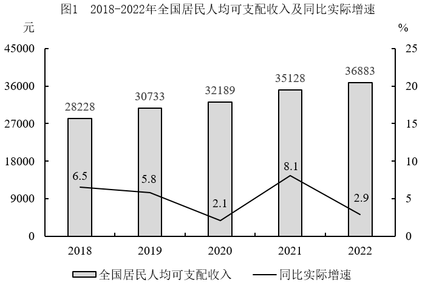

### 第 91 题

2022年，全国居民人均可支配收入的同比名义增速与实际增速相差（ ）个百分点。

A. 2.1

B. 2.9

C. 4.9

D. 5.0

第 91 题 · 答案与解析

**参考答案（粉笔题库参考内容）**

A

**解析**

根据题干“2022年······增速······”，可判定本题为一般增长率问题。定位图1可得：2021和2022年，全国居民人均可支配收入分别为35128元、36883元；2022年，全国居民人均可支配收入同比实际增速为2.9%。根据公式：增长率，可得2022年全国居民人均可支配收入同比名义增速，其与实际增速相差5%-2.9%=2.1%，即2.1个百分点。

故正确答案为A。

### 第 92 题

2019-2022年，全国居民人均可支配收入的年均名义增长率为（ ）。

A. 4.7%

B. 5.1%

C. 6.3%

D. 6.9%

第 92 题 · 答案与解析

**参考答案（粉笔题库参考内容）**

C

**解析**

根据题干“2019-2022年······年均名义增长率为”，可判定本题为年均增长率问题。定位图1可得：2019、2022年全国居民人均可支配收入分别为30733元、36883元。根据公式：，可得。结合选项增长率数值较小，根据进行估算，则有1+3r<1.2，解得r<6.7%，只有C项略小于6.7%。

故正确答案为C。

### 第 93 题

2022年，全国居民人均消费支出的构成项目中，与2021年相比金额变化最大的是（ ）。

A. 食品烟酒

B. 衣着

C. 居住

D. 交通通信

第 93 题 · 答案与解析

**参考答案（粉笔题库参考内容）**

A

**解析**

根据题干“2022年······与2021年相比金额变化最大的是”，可判定本题为增长量比较问题。定位图2可知2022年全国居民人均食品烟酒、衣着、居住、交通通信消费支出及其同比增速。因2022年全国居民人均食品烟酒消费支出的现期量和同比增速均大于交通通信，根据增长量比较口诀“大大则大”，可得前者变化量大于后者，排除D项。因食品烟酒和居住的人均消费支出的同比增速相近，前者现期量大于后者，可得前者变化量大于后者，排除C项。根据公式：增长量，可得人均食品烟酒消费支出同比变化量，人均衣着消费支出同比变化量，，则同比变化最大的是食品烟酒。
故正确答案为A。

### 第 94 题

2022年，全国居民人均消费支出约占全国居民人均可支配收入的（ ）。

A. 50%

B. 55%

C. 60%

D. 67%

第 94 题 · 答案与解析

**参考答案（粉笔题库参考内容）**

D

**解析**

根据题干“2022年······占······的”，结合材料时间为2022年，可判定本题为现期比重问题。定位图1可得：2022年全国居民人均可支配收入为36883元；定位图2可得：2022年全国居民人均教育文化娱乐消费支出为2469元，占比10.1%。根据公式：整体，则2022年全国居民人均消费支出元；根据公式：比重，则所求比重，对应D项。
故正确答案为D。

### 第 95 题

根据上图，以下正确的是（ ）。

A. 2022年，全国居民人均消费支出构成占比按从大到小排序，前四的项目分别是食、住、衣、行

B. 2018-2022年，全国居民人均可支配收入的五年均值大于这五年的中位数

C. 2019-2022年，全国居民人均可支配收入同比名义增速与实际增速的差值逐年收窄

D. 2022年，全国居民人均教育文化娱乐支出占人均消费支出的比重同比略有上升

第 95 题 · 答案与解析

**参考答案（粉笔题库参考内容）**

B

**解析**

A项：定位图2可知2022年全国居民人均消费支出构成占比。观察发现，全国居民人均消费支出构成占比按从大到小排序，前四的项目分别是食品烟酒（30.5%）、居住（24.0%）、交通通信（13.0%）、教育文化娱乐（10.1%），并非食、住、衣、行，错误；

B项：定位图1可知2018-2022年全国居民人均可支配收入。则2018-2022年全国居民人均可支配收入的均值为元，2018-2022年全国居民人均可支配收入的中位数为32189元，前者大于后者，正确；

C项：定位图1可知2018-2022年全国居民人均可支配收入及其同比实际增速。根据公式：增长率，则2022年全国居民人均可支配收入名义增速为，与实际增速的差值为5%-2.9%=2.1%，即2.1个百分点；2021年全国居民人均可支配收入名义增速为，与实际增速的差值为，即不到1.9个百分点。则2022年差值（2.1个百分点）>2021年差值（不到1.9个百分点），并非逐年收窄，错误；

D项：定位图2可知2022年全国居民人均消费支出构成部分的同比增速。观察发现，2022年全国居民人均教育文化娱乐支出同比增速为最低（-5.0%），根据“混合增长率居中”可知，2022年全国居民人均消费支出同比增速大于-5.0%。根据两期比重比较结论：若部分增长率小于整体增长率，则比重下降，由于2022年全国居民人均教育文化娱乐支出同比增速小于全国居民人均消费支出同比增速，则比重下降，错误。

故正确答案为B。

## 材料 3

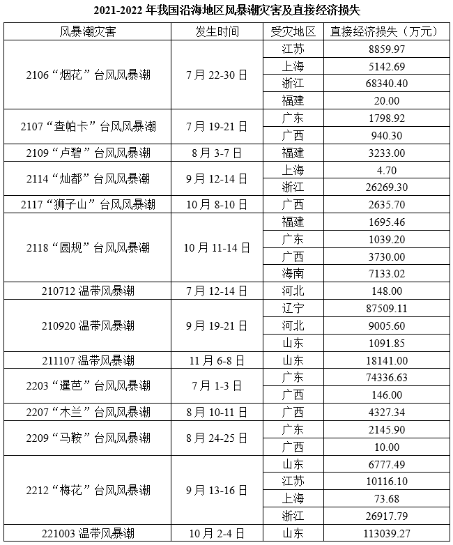

注：风暴潮编号的前2个数字表示年份。

### 第 96 题

2022年，台风风暴潮灾害造成的直接经济损失约占当年风暴潮灾害总直接经济损失的（ ）。

A. 47%

B. 52%

C. 57%

D. 63%

第 96 题 · 答案与解析

**参考答案（粉笔题库参考内容）**

B

**解析**

根据题干“2022年······占······”，可判定本题为现期比重问题。定位表格材料可得2022年我国沿海地区风暴潮灾害造成的直接经济损失。根据公式：比重，故所求，即2022年台风风暴潮灾害造成的直接经济损失约占当年风暴潮灾害总直接经济损失的52.5%，与B项最接近。

故正确答案为B。

### 第 97 题

以下月份中，（ ）风暴潮灾害造成的直接经济损失最为严重。

A. 2021年7月

B. 2021年9月

C. 2022年8月

D. 2022年10月

第 97 题 · 答案与解析

**参考答案（粉笔题库参考内容）**

B

**解析**

定位统计表可知2021年7月、2021年9月、2022年8月、2022年10月我国沿海地区风暴潮灾害造成的直接经济损失。则2021年7月直接经济损失为万元；2021年9月直接经济损失为万元；2022年8月直接经济损失为万元；2022年10月直接经济损失为113039.27万元。比较可知，2021年9月风暴潮灾害造成的直接经济损失最为严重。

故正确答案为B。

### 第 98 题

2021-2022年，遭受风暴潮灾害次数最多的地区是（ ）。

A. 广西

B. 广东

C. 浙江

D. 福建

第 98 题 · 答案与解析

**参考答案（粉笔题库参考内容）**

A

**解析**

定位统计表可知2021-2022年我国沿海地区风暴潮灾害受灾的情况。其中广西遭受的风暴潮灾害为：2107“查帕卡”台风风暴潮、2117“狮子山”台风风暴潮、2118“圆规”台风风暴潮、2203“暹芭”台风风暴潮、2207“木兰”台风风暴潮、2209“马鞍”台风风暴潮，共6次；广东遭受的风暴潮灾害为：2107“查帕卡”台风风暴潮、2118“圆规”台风风暴潮、2203“暹芭”台风风暴潮、2209“马鞍”台风风暴潮，共4次；浙江遭受的风暴潮灾害为：2106“烟花”台风风暴潮、2114“灿都”台风风暴潮、2212“梅花”台风风暴潮，共3次；福建遭受的风暴潮灾害为：2106“烟花”台风风暴潮、2109“卢碧”台风风暴潮、2118“圆规”台风风暴潮，共3次。比较可知，广西遭受的风暴潮灾害次数最多。

故正确答案为A。

### 第 99 题

下列饼图中，最有可能反映2022年我国沿海地区不同省份风暴潮灾害直接经济损失比重的是（ ）。

A. 

B. 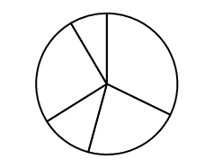

C. 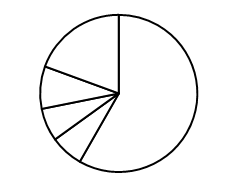

D. 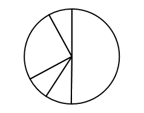

第 99 题 · 答案与解析

**参考答案（粉笔题库参考内容）**

A

**解析**

根据题干“下列饼图中，最有可能反映2022年······直接经济损失比重的是”，可判定本题为现期比重问题。定位统计表可知2022年广东、广西、山东、江苏、浙江五个省份的风暴潮灾害直接经济损失数据。广东风暴潮灾害直接经济损失为万元，广西风暴潮灾害直接经济损失为万元，山东风暴潮灾害直接经济损失为万元，江苏风暴潮灾害直接经济损失为万元，浙江风暴潮灾害直接经济损失为万元，五个省份的共同风暴潮灾害直接经济损失为万元。山东风暴潮灾害直接经济损失是占比最大的省份，比重为，约为饼状图的一半，结合选项，可排除B、C两项；直接经济损失次小的江苏（10100万元）明显是损失最小的广西（4480万元）2倍以上，结合选项，可排除D项。

故正确答案为A。

### 第 100 题

根据上表，以下说法错误的是（ ）。

A. 2022年，风暴潮灾害的次数和直接经济损失同比均有所降低

B. 2021-2022年，造成直接经济损失最小的台风风暴潮灾害是2209“马鞍”

C. 2021-2022年，广东因遭受风暴潮灾害造成的直接经济损失为79320.65万元

D. 2022年，我国沿海遭受风暴潮灾害的地区比上年少3个

第 100 题 · 答案与解析

**参考答案（粉笔题库参考内容）**

D

**解析**

A项：定位统计表可知，2022年我国沿海地区风暴潮灾害的次数为5，2021年次数为9，5<9，即2022年风暴潮灾害的次数同比有所降低；2022年我国沿海地区风暴潮灾害造成的直接经济损失约为74000+0+4000+2000+0+7000+10000+0+27000+113000=237000万元，2021年我国沿海地区风暴潮灾害造成的直接经济损失约为9000+5000+68000+0+2000+1000+3000+0+26000+3000+2000+1000+4000+7000+0+88000+9000+1000+18000=247000万元>237000万元，即2022年风暴潮灾害的直接经济损失同比有所降低，正确；

B项：定位统计表可知，2209“马鞍”台风风暴潮灾害造成的直接经济损失为2145.90+10.00=2155.90万元，而2021-2022年，其他台风风暴潮灾害造成直接经济损失明显均超过2155.90万元，则造成直接经济损失最小的台风风暴潮灾害是2209“马鞍”，正确；

C项：定位统计表可知，2021-2022年，广东遭受风暴潮灾害造成的直接经济损失为1798.92+1039.20+74336.63+2145.90=79320.65万元，正确；

D项：定位统计表可知，2022年我国沿海遭受风暴潮灾害的地区比上年少4个（福建、海南、河北、辽宁），错误。

本题为选非题，故正确答案为D。

