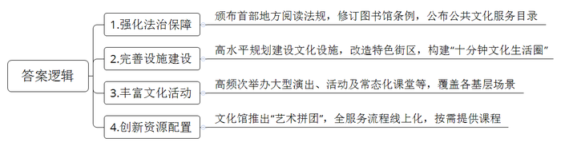
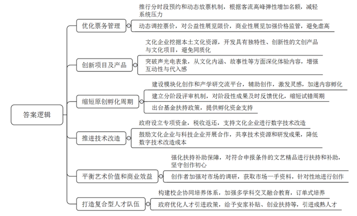

# 2025年深圳市公务员考试《申论》题（一卷）

<!-- gwy:overview:start -->
> **深圳 · 2025 · 申论 · 一卷** ｜ 3 题 · 图片 3 处 · 答案随题折叠

导航：[题目](#题目) · [材料 1](#材料-1)
<!-- gwy:overview:end -->

> 候选采集稿。参考答案及解析来自粉笔页面，不代表官方答案或真实高分答卷；来源使用许可与原卷对应关系仍需人工核实。

## 给定材料

### 材料 1

深圳充分发挥立法优势，颁布实施了全国首部地方性阅读法规《深圳经济特区全民阅读促进条例》，修订完善了《深圳经济特区公共图书馆条例》，强化法治保障。公布《深圳市市级基本公共文化服务目录（2025年版）》，优化文化服务和产品供给，让公共文化服务制度保障更加有力。

近年来，深圳高水平规划建设具有国际一流水平的深圳歌剧院等“新时代十大文化设施”，提升改造南头古城等“十大特色文化街区”，形成相互呼应的城市文化群落。目前，1800余家各类图书馆、博物馆、美术馆、文化馆、百姓书房与1300多个公园，让“十分钟文化生活圈”便捷可达，筑起现代都市的“诗意栖居”。

近几年，超100场大型演唱会、近3000场各类演出令深圳市民目不暇接。吾城吾歌、深圳读书月、莲花山草地音乐节等数万场文化活动进社区、进商圈、进企业、进校园，更是让市民走出家门即可享受优质文化资源，还有常态化举办的全民美育大课堂、“周末剧场”等，已成为市民日常精神文化生活的重要组成部分。

深圳的艺术场馆针对专业观众和普通观众对文化的不同需求，创新资源配置机制，不仅做到了广覆盖，更精准把握了需求差异。深圳市文化馆在全国率先推出“艺术拼团”服务模式，通过“深艺通”小程序实现了发起、拼团、开课全流程线上化。“市民想学什么，文化机构就提供什么”，连非遗锔瓷、树叶吹奏等小众技艺课程都通过“艺术拼团”方式拼成了网红课程。

### 材料 2

深圳持续提升文旅产品供给能力，不断丰富消费业态和场景，“低空+、公园+、文娱+”等消费新模式纷纷涌现。

2024年6月，深圳北站开航国内首个“低空+轨道”项目。9月，深圳推出“天空之城 大有可能”秋季文旅计划，发放1万份低空飞行产品体验券，吸引超万名游客搭乘直升机感受城市魅力。

今年“五一”假期首日，深圳文化新地标K11 ECOAST海滨文化艺术区迎来客流高峰。自4月28日开启首期试业，在短短4天里，日均客流量便突破15万人次，展现出强大的吸引力，成为大湾区文旅新热点。

文化消费市场在快速发展的同时，也存在着一些问题。有消费者反映，部分文化场馆预约名额秒空，热门展览票价虚高，一些文创产品同质化严重，沉浸式体验项目多停留在声光电表象。有业内人士表示，原创内容孵化周期长，数字技术改造成本高，平衡艺术价值与商业效益难度大，又缺乏复合型人才，很多优质文化资源一时难以转化为可持续消费模式。

### 材料 3

2024年10月28日，习近平总书记在中共中央政治局第十七次集体学习时强调，锚定建成文化强国战略目标，不断发展新时代中国特色社会主义文化。

2024年12月6日，广东省委常委会召开会议。会议指出，我们要认真学习好贯彻好，深入理解把握习近平文化思想的核心要义、精神实质、丰富内涵、实践要求，切实用以指导文化强省建设，为推进中国式现代化的广东实践提供坚强思想保证、强大精神力量、有利文化条件。

2024年12月31日，中国共产党深圳市第七届委员会第十次全体会议暨市委经济工作会议召开。会议强调，要加快推进高质量文化强市建设，在发展新时代中国特色社会主义文化中积极展现深圳作为。2025年2月25日，《2025年深圳市政府工作报告》提出，要切实担负起新时代新的文化使命，在建设中华民族现代文明中展现深圳担当作为。

## 题目

### 第 1 题

**请根据材料**5**，提炼出深圳在公共文化服务方面的特色做法。（20分）**

关联材料：材料 1

作答要求：

要求：

（1）归纳准确，简明扼要，条理清晰；

（2）总字数150字以内。

第 1 题 · 答案与解析

**参考答案（粉笔题库参考内容）**

1.强化法治保障。颁布首部地方阅读法规，修订图书馆条例，公布公共文化服务目录。

2.完善设施建设。高水平规划建设文化设施，改造特色街区，构建“十分钟文化生活圈”。

3.丰富文化活动。高频次举办大型演出、活动及常态化课堂等，覆盖各基层场景。

4.创新资源配置。文化馆推出“艺术拼团”，全服务流程线上化，按需提供课程。

**解析**

**参考答案说明**：本参考答案从“强化法治保障”“完善设施建设”“丰富文化活动”“创新资源配置”这四个方面展开，各条答案要点之间在内容上相互并列，没有交叉。

**考点**：考点概括措施类

**来源**：来源2025年深圳市公务员考试《申论》题（一卷）

粉笔申论页面对本题只提供「解析视频」入口，该入口是会员推广位，页面无视频地址与文字解析。

### 第 2 题

**请根据材料**12**，针对文化消费方面存在的问题，提出对策。（30分）**

关联材料：材料 2

作答要求：

要求：

（1）考虑全面，对策合理，条理清晰；

（2）总字数500字以内。

第 2 题 · 答案与解析

**参考答案（粉笔题库参考内容）**

1.优化票务管理。推行分时段预约和动态放票机制，根据客流高峰弹性增加名额，减轻系统压力；动态调控票价，对公益性展览限价，商业性展览加强价格监管，避免虚高。

2.创新项目及产品。文化企业挖掘本土文化资源，开发具有独特性、创新性的文创产品与文化项目，避免同质化；突破声光电表象，从文化内涵、故事性等方面深化体验内容，增强互动性与代入感。

3.缩短原创孵化周期。建设模块化创作和产学研交流平台，辅助创作，激发灵感，加速内容孵化；建立分阶段评审机制，对阶段性成果及时反馈优化，缩短试错周期；出台基金扶持政策，提供孵化资金支持。

4.推进技术改造。政府设立专项资金，税收返还，支持文化企业进行数字技术改造；鼓励文化企业与科技企业开展合作，共享技术资源和研发成果，降低数字技术改造成本。

5.平衡艺术价值和商业效益。强化扶持补助保障，对符合申报条件的文艺精品进行扶持和补助，坚守创作初心；创作者加强对市场的调研，获取市场一手资料，针对性地进行创作。

6.打造复合型人才队伍。构建校企协同培养体系，加强多学科交叉融合教育，订单式培养；政府优化人才引进政策，给予安家补贴、创业扶持等，引进成熟人才。

**解析**

**参考答案说明：**本参考答案从“优化票务管理”“创新项目及产品”“缩短原创孵化周期”“推进技术改造”“平衡艺术价值和商业效益”“打造复合型人才队伍”六个方面展开，各条答案要点之间在内容上相互并列，没有交叉。

**考点**：考点提出对策类

**来源**：来源2025年深圳市公务员考试《申论》题（一卷）

粉笔申论页面对本题只提供「解析视频」入口，该入口是会员推广位，页面无视频地址与文字解析。

### 第 3 题

**文化厚度铸就发展高度。请结合给定材料，围绕****“深圳切实担负起新时代新的文化使命，增强发展新动能，持续提升城市影响力”这一主题，自拟标题，写一篇议论文。（50分）**

关联材料：材料 3

作答要求：

要求：

（1）紧扣主题，观点鲜明，论述充分；

（2）结构严谨，条理清晰，语言流畅；

（3）总字数1200字左右。

第 3 题 · 答案与解析

**参考答案（粉笔题库参考内容）**

**担负新时代文化使命** **赋能城市发展新征程**

文化是城市发展的精神内核和持久动力。锚定建成文化强国的战略目标，发展新时代中国特色社会主义文化，既是国家战略要求，也是城市发展的必然选择。深圳必须切实担负起新时代文化使命，增强发展新动能，持续提升城市影响力。

**繁荣文化产业，激活经济增长新引擎****。**文化产业作为绿色产业、朝阳产业，是推动经济结构优化的重要力量。深圳立足市场需求，积极发展“文化+科技”“文化+创意”“文化+旅游”等新兴业态，打破传统产业边界，培育经济增长新支点。同时，构建了较为完备的支持保障体系，落实财税优惠、金融扶持等举措，为文化企业纾困解难、发展壮大提供制度保障。此外，人才是文化产业发展的核心资源，近年来，深圳加快文化人才队伍建设，构建多层次人才培养与引进机制，助力文体事业发展。

**推动当地文化赓续发展，不断创新，拓宽文化边界****。**要深耕本地文化土壤，系统梳理传统非遗文化与红色文化资源，建立完善保护传承机制，依托特色活动活化文化内涵，让优秀传统文化在当代焕发生机。同时，鼓励文化创新实践，推动传统文化元素与科技、旅游、创意等有效融合，开发具有时代感和吸引力的文化产品与服务，让文化在创新中拓宽边界，增强文化的辐射力与影响力。

**优化文化惠民服务，筑牢民生福祉根基****。**文化建设的根本目的是满足人民对美好生活的需要。深圳通过文化立法将公共文化服务纳入法治化轨道，保障市民文化权益。同时高水平规划建设文化设施，改造特色街区，“十分钟文化生活圈”基本形成。在服务供给上，针对不同群体的差异化需求，举办各类文化活动，并创新资源配置，真正实现了文化惠民、文化悦民。这种以人民为中心的文化发展理念，极大提升了市民的文化获得感和幸福感。

**加强精神文明建设，凝聚发展强大合力****。**深圳在创造经济奇迹的同时，也形成了独特的精神品格。“敢闯敢试、开放包容、务实尚法、追求卓越”的新时代深圳精神，既是城市文化的核心内涵，也是推动发展的不竭动力。深圳通过文明城市创建、志愿服务体系建设等途径，将其融入城市发展各领域，引导市民内化于心、外化于行，培育积极向上的价值追求。同时，依托社区文化阵地开展邻里互助等活动，增进人际交流，打造和谐友善的文化氛围，让精神文明成为激发奋斗精神的强大动力。

**深化交流合作，促进文化互鉴融合****。**作为国际化大都市，深圳始终秉持开放包容的文化态度。积极推动文化“走出去”，支持本土文化企业拓展海外市场，将优秀的文化产品和服务推向世界。在文化互动中，深圳既注重吸收借鉴各国优秀文化成果，也致力于传播中华文化价值，促进文明互鉴。这种双向的文化交流让文化成为连接深圳与世界的纽带，为深圳在全球竞争中赢得了更多话语权。

文化不仅是软实力，也是硬支撑。未来，深圳应以更高站位、更宽视野谋划文化发展，用文化增添城市魅力。

**解析**

**文章分析**

**担负新时代文化使命** **赋能城市发展新征程**

【**标题的优点：**首先，标题中含有主题词，使文章主题更突出、清晰。其次，形式上采用对称式结构，使标题更加完整、饱满。】

（1）文化是城市发展的精神内核和持久动力。（2）锚定建成文化强国的战略目标，发展新时代中国特色社会主义文化，既是国家战略要求，也是城市发展的必然选择。（3）深圳必须切实担负起新时代文化使命，增强发展新动能，持续提升城市影响力。

【**开头的优点：**★内容方面。范文的开头是紧扣题目给定的“深圳切实担负起新时代新的文化使命，增强发展新动能，持续提升城市影响力”这一主题展开的。首先，开头点出主题，做到了主题明确。其次，对“深圳切实担负起新时代新的文化使命，增强发展新动能，持续提升城市影响力”这一主题进行了分析阐述，指出了：（1）文化对城市发展的重要性；（2）新时代的文化使命的内涵；（3）引出主题。★文字表达方面：长短句配合使用，使语言表达有节奏感。】

**繁荣文化产业，激活经济增长新引擎。**（1）文化产业作为绿色产业、朝阳产业，是推动经济结构优化的重要力量。（2）深圳立足市场需求，积极发展“文化+科技”“文化+创意”“文化+旅游”等新兴业态，打破传统产业边界，培育经济增长新支点。（3）同时，构建了较为完备的支持保障体系，落实财税优惠、金融扶持等举措，为文化企业纾困解难、发展壮大提供制度保障。（4）此外，人才是文化产业发展的核心资源，近年来，深圳加快文化人才队伍建设，构建多层次人才培养与引进机制，助力文体事业发展。

【**论述段****1的优点：**★观点句：范文的观点句是紧扣“深圳切实担负起新时代新的文化使命，增强发展新动能，持续提升城市影响力”这一文章主题提出的。形式上，它在段首处直接写出，位置突出，容易发现。内容上，关键词突出，内容要点明确，可以明显看出主要论述“文化产业发展”。★论述内容：（1）文化产业对经济结构的优化作用；（2）新兴业态促进经济增长；（3）支持文化企业发展的政策保障；（4）人才对文化产业发展的重要性。注意：以上四个方面的内容都是紧扣“繁荣文化产业，激活经济增长新引擎”这个观点句进行分析论述的，论述的针对性强，内容层次丰富。在论述方法上采用了讲道理、举例子相结合的方式，论述充实有力。】

**推动当地文化赓续发展，不断创新，拓宽文化边界。**（1）要深耕本地文化土壤，系统梳理传统非遗文化与红色文化资源，建立完善保护传承机制，依托特色活动活化文化内涵，让优秀传统文化在当代焕发生机。（2）同时，鼓励文化创新实践，推动传统文化元素与科技、旅游、创意等有效融合，开发具有时代感和吸引力的文化产品与服务，让文化在创新中拓宽边界，增强文化的辐射力与影响力。

【**论述段****2****的优点：**★观点句：范文的观点句是紧扣“深圳切实担负起新时代新的文化使命，增强发展新动能，持续提升城市影响力”这一文章主题提出的。形式上，它在段首处直接写出，位置突出，容易发现。内容上，关键词突出，内容要点明确，可以明显看出主要论述“文化赓续创新”。★论述内容：（1）非遗文化与红色文化赓续的措施；（2）创新文化产品与服务的措施。注意：以上两个方面的内容都是紧扣“推动当地文化赓续发展，不断创新，拓宽文化边界”这个观点句进行分析论述的，论述的针对性强，内容层次丰富。在论述方法上采用了讲道理的方式，论述清晰透彻。】

**优化文化惠民服务，筑牢民生福祉根基。**（1）文化建设的根本目的是满足人民对美好生活的需要。（2）深圳通过文化立法将公共文化服务纳入法治化轨道，保障市民文化权益。（3）同时高水平规划建设文化设施，改造特色街区，“十分钟文化生活圈”基本形成。（4）在服务供给上，针对不同群体的差异化需求，举办各类文化活动，并创新资源配置，真正实现了文化惠民、文化悦民。（5）这种以人民为中心的文化发展理念，极大提升了市民的文化获得感和幸福感。

【**论述段****3****的优点：**★观点句：范文的观点句是紧扣“深圳切实担负起新时代新的文化使命，增强发展新动能，持续提升城市影响力”这一文章主题提出的。形式上，它在段首处直接写出，位置突出，容易发现。内容上，关键词突出，内容要点明确，可以明显看出主要论述“文化惠民服务”。★论述内容：（1）文化建设的根本目的；（2）公共文化服务立法；（3）文化设施规划高水平；（4）文化服务供给差异化；（5）文化惠民对市民的好处。注意：以上五个方面的内容都是紧扣“优化文化惠民服务，筑牢民生福祉根基”这个观点句进行分析论述的，论述的针对性强，内容层次丰富。在论述方法上采用了讲道理、举例子相结合的方式，论述充实有力。】

**加强精神文明建设，凝聚发展强大合力。**（1）深圳在创造经济奇迹的同时，也形成了独特的精神品格。“敢闯敢试、开放包容、务实尚法、追求卓越”的新时代深圳精神，既是城市文化的核心内涵，也是推动发展的不竭动力。（2）深圳通过文明城市创建、志愿服务体系建设等途径，将其融入城市发展各领域，引导市民内化于心、外化于行，培育积极向上的价值追求。（3）同时，依托社区文化阵地开展邻里互助等活动，增进人际交流，打造和谐友善的文化氛围，让精神文明成为激发奋斗精神的强大动力。

【**论述段****4****的优点：**★观点句：范文的观点句是紧扣“深圳切实担负起新时代新的文化使命，增强发展新动能，持续提升城市影响力”这一文章主题提出的。形式上，它在段首处直接写出，位置突出，容易发现。内容上，关键词突出，内容要点明确，可以明显看出主要论述“精神文明建设”。★论述内容：（1）新时代深圳精神的内涵；（2）深圳精神对培育市民价值追求的积极作用；（3）邻里活动增进人际关系和谐。注意：以上三个方面的内容都是紧扣“加强精神文明建设，凝聚发展强大合力”这个观点句进行分析论述的，论述的针对性强，内容层次丰富。在论述方法上采用了讲道理、举例子相结合的方式，论述充实有力。】

**深化交流合作，促进文化互鉴融合。**（1）作为国际化大都市，深圳始终秉持开放包容的文化态度。积极推动文化“走出去”，支持本土文化企业拓展海外市场，将优秀的文化产品和服务推向世界。（2）在文化互动中，深圳既注重吸收借鉴各国优秀文化成果，也致力于传播中华文化价值，促进文明互鉴。（3）这种双向的文化交流让文化成为连接深圳与世界的纽带，为深圳在全球竞争中赢得了更多话语权。

【**论述段****5****的优点：**★观点句：范文的观点句是紧扣“深圳切实担负起新时代新的文化使命，增强发展新动能，持续提升城市影响力”这一文章主题提出的。形式上，它在段首处直接写出，位置突出，容易发现。内容上，关键词突出，内容要点明确，可以明显看出主要论述“文化交流合作”。★论述内容：（1）本土文化和企业出海；（2）文明互鉴吸收优秀成果；（3）文化交流提升深圳国际地位。注意：以上三个方面的内容都是紧扣“深化交流合作，促进文化互鉴融合”这个观点句进行分析论述的，论述的针对性强，内容层次丰富。在论述方法上主要采用了讲道理的方式，论述清晰透彻。】

【**论述段之间的关系：**★内容的内在逻辑：范文的论述段之间是依照“并列”的逻辑展开的。论述段1先写了“繁荣文化产业，激活经济增长新引擎”，论述段2再写了“推动当地文化赓续发展，不断创新，拓宽文化边界”，论述段3再写了“优化文化惠民服务，筑牢民生福祉根基”，论述段4再写了“加强精神文明建设，凝聚发展强大合力”，论述段5接着写了“深化交流合作，促进文化互鉴融合”，论述逻辑清晰。】

文化不仅是软实力，也是硬支撑。未来，深圳应以更高站位、更宽视野谋划文化发展，用文化增添城市魅力。

【**结尾的优点：**范文的结尾回扣了“深圳切实担负起新时代新的文化使命，增强发展新动能，持续提升城市影响力”这一主题，语言简练，不拖沓。】

**考点**：考点文章写作题

**来源**：来源2025年深圳市公务员考试《申论》题（一卷）

粉笔申论页面对本题只提供「解析视频」入口，该入口是会员推广位，页面无视频地址与文字解析。

