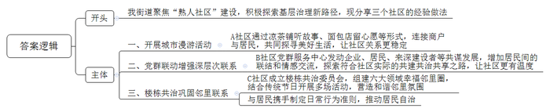
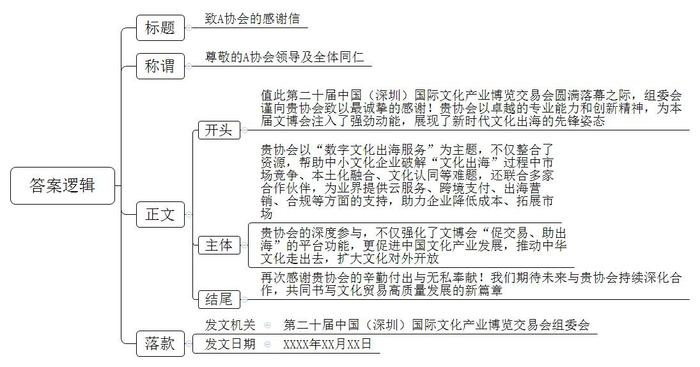
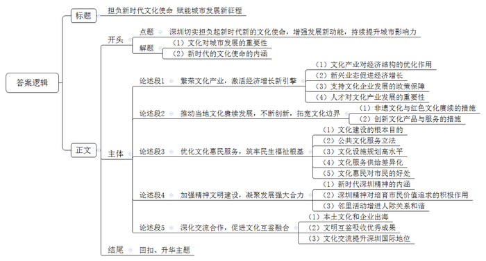

# 2025年深圳市公务员考试《申论》题（二卷）

<!-- gwy:overview:start -->
> **深圳 · 2025 · 申论 · 二卷** ｜ 3 题 · 图片 3 处 · 答案随题折叠

导航：[题目](#题目) · [材料 1](#材料-1)
<!-- gwy:overview:end -->

> 候选采集稿。参考答案及解析来自粉笔页面，不代表官方答案或真实高分答卷；来源使用许可与原卷对应关系仍需人工核实。

## 给定材料

### 材料 1

2024年10月28日，习近平总书记在中共中央政治局第十七次集体学习时强调，锚定建成文化强国战略目标，不断发展新时代中国特色社会主义文化。

2024年12月6日，广东省委常委会召开会议。会议指出，我们要认真学习好贯彻好，深入理解把握习近平文化思想的核心要义、精神实质、丰富内涵、实践要求，切实用以指导文化强省建设，为推进中国式现代化的广东实践提供坚强思想保证、强大精神力量、有利文化条件。

2024年12月31日，中国共产党深圳市第七届委员会第十次全体会议暨市委经济工作会议召开。会议强调，要加快推进高质量文化强市建设，在发展新时代中国特色社会主义文化中积极展现深圳作为。2025年2月25日，《2025年深圳市政府工作报告》提出，要切实担负起新时代新的文化使命，在建设中华民族现代文明中展现深圳担当作为。

### 材料 2

2024年，深圳市规模以上文化及相关产业企业3754家，合计实现营业收入12875.08亿元，占全省51.5%、全国9.1%，同比增长12.1%，高于全国、全省平均增速6.1和5.5个百分点，显示出深圳市文化产业强大的发展动力。

深圳制定《深圳市关于加快培育数字创意产业集群的若干措施》《深圳市促进网络微短剧产业高质量发展的若干措施》等政策，大力发展文化新业态，鼓励“文化+科技”“文化+创意”“文化+旅游”“文化+互联网”等新兴业态企业创新发展。

深圳积极落实“建设适用国际通用规则的文化艺术品（非文物）拍卖中心”综合改革试点任务，2025年3月成立前海文化艺术品保税展示交易中心，标志着深圳在文化贸易领域的制度创新取得新突破。

深圳文化产权交易所全国文化大数据交易中心线上平台，2025年新增交易额已突破200亿元，同比激增566%。这一数字跃升不仅昭示了文化要素市场化配置的澎湃活力，更勾勒出文化产业数字化转型的壮阔图景。

### 材料 3

“敢闯敢试、开放包容、务实尚法、追求卓越”的新时代深圳精神，既是深圳人共同的精神标识，也承载着崭新的时代内涵，为深圳砥砺前行提供强劲的精神力量。

深圳最新城市形象片《敢为人先》弘扬了敢闯敢试、敢为人先、埋头苦干的特区精神，凸显了一个鼓励创新、大胆逐梦的人文深圳形象。深圳出品的电视剧版《青春之城》在央视一套黄金档播出，该剧以深圳这座充满青春活力、奋斗逐梦的梦想之都、青春之城为原型，讲述几代人奋斗创业的励志故事，再现了大湾区火热的生活场景，展现光明的发展前景。

深圳具有海纳百川的胸怀，融合了传统岭南文化、客家文化、广府文化和外来文化，对各种优秀文化兼收并蓄，对各种进步观念和生活方式予以尊重和接纳，形成了平等、友善的人际氛围和文化熔炉。“来了就是深圳人”，深圳热情拥抱每一个来到这里的人。

深圳全面推进城市精神文明建设，广泛践行社会主义核心价值观，深入实施公民道德建设工程，至今已连续六次荣膺全国文明城市称号。深圳是一座充满爱心的“志愿者之城”，目前注册志愿者超400万人，平均每5人就有一名志愿者。全市200多支文化志愿服务队伍常年深入基层，开展“文义惠鹏城”“文化钟点工”“书香义工”等文化志愿服务。

深圳第一家以道德文明、廉洁诚信、修身自律等为主题的场馆——道德风范馆，近年来先后举办各类主题活动百余场，吸引众多党员干部、在校学生及市民群众和国内外游客参观，成为学习道德文化的重要课堂。

### 材料 4

深圳作为“全球全民阅读典范城市”，全民阅读的理念深入人心，阅读已成为市民生活的一部分。每年11月1日至30日举办的深圳读书月，已连续举办25届，每届吸引超过1000万人次参与。《深圳全民阅读发展报告2025》显示，2024年深圳成年居民人均年阅读量达22本，呈上升趋势。

近年来，深圳举办系列网络文明创建活动，让文明新风引领网络空间。创新开展“圳能量”话题“揭榜制”，激发各新媒体平台打造网民喜闻乐见的新媒体产品，在网络空间生动讲好深圳故事；挥动“圳清朗”网络综合治理组合拳，促进形成风清气正的良好网络生态。

### 材料 5

深圳充分发挥立法优势，颁布实施了全国首部地方性阅读法规《深圳经济特区全民阅读促进条例》，修订完善了《深圳经济特区公共图书馆条例》，强化法治保障。公布《深圳市市级基本公共文化服务目录（2025年版）》，优化文化服务和产品供给，让公共文化服务制度保障更加有力。

近年来，深圳高水平规划建设具有国际一流水平的深圳歌剧院等“新时代十大文化设施”，提升改造南头古城等“十大特色文化街区”，形成相互呼应的城市文化群落。目前，1800余家各类图书馆、博物馆、美术馆、文化馆、百姓书房与1300多个公园，让“十分钟文化生活圈”便捷可达，筑起现代都市的“诗意栖居”。

近几年，超100场大型演唱会、近3000场各类演出令深圳市民目不暇接。吾城吾歌、深圳读书月、莲花山草地音乐节等数万场文化活动进社区、进商圈、进企业、进校园，更是让市民走出家门即可享受优质文化资源，还有常态化举办的全民美育大课堂、“周末剧场”等，已成为市民日常精神文化生活的重要组成部分。

深圳的艺术场馆针对专业观众和普通观众对文化的不同需求，创新资源配置机制，不仅做到了广覆盖，更精准把握了需求差异。深圳市文化馆在全国率先推出“艺术拼团”服务模式，通过“深艺通”小程序实现了发起、拼团、开课全流程线上化。“市民想学什么，文化机构就提供什么”，连非遗锔瓷、树叶吹奏等小众技艺课程都通过“艺术拼团”方式拼成了网红课程。

### 材料 6

水上迎亲实景展演《花艇水上漂》、非遗雅集、品疍家美食、赏传统音乐听咸水谣……围绕疍家精神、疍家文化保护与传承等开展的疍家非遗展演活动至今已举办了十三届，是深圳盐田疍家人每年必有的一个盛会。盐田某小学依托“传统文化进课堂”系列活动，开展“非遗文化主题”探研，学生们在课堂上诵读《摇啊摇，疍家船》，文字如桨，划开想象的涟漪……古老渔歌与现代童声碰撞，非遗文化在稚嫩掌心重焕生机。

目前，深圳共有非遗代表性项目311项，代表性传承人275人。在福田区建成全国首个“非遗主题社区图书馆”。积极探索“非遗+旅游”“非遗+商圈”“非遗+高校”等新模式。组建非遗高校联盟，加强人才培养。实施“文化润疆”工程，组建优秀非遗项目参加对口援疆非物质文化遗产展。

传承红色基因，续写春天故事。深圳打造了“改革开放再出发”“东纵峥嵘岁月”等多条独具深圳特色的红色旅游线路，上线“云遇深圳红”VR主题影音馆，进一步推动了深圳红色文化的赓续与发展。

### 材料 7

深圳经过多年发展，构建了涵盖组织保障、政策支持、资金扶持等较为完备的文化产业支持保障体系。多个区针对数字创意产业相关领域，出台了涵盖金融扶持、税收优惠、产业空间以及细分行业领域的相关专项扶持政策。

“只要大家有想法，我们就有办法！”近年来，龙岗区开展“我帮企业搭场景”专项行动，加大对数字IP产业的扶持力度，推动文化IP与关联产业相互赋能、双向奔赴。有企业家感慨，在政府的撮合下，企业间的交流合作比以往任何时候都要紧密。

### 材料 8

近年来，深圳通过人才政策优化重构，加快文化人才队伍建设，龙华区引进多名文体名家并成立工作室，发挥名家效应和示范带动作用，广泛链接资源，开展围棋大师邀请赛、民谣音乐节、国际女排邀请赛等系列活动、赛事，激发大众参与热情，活跃城区文化氛围；坪山区积极扶持文艺精品创作，实施竞技体育后备人才“育苗工程”，助力文体事业发展。

深圳市剧协高度重视戏剧人才培养，实施“创意剧场”本土剧目扶持计划，对“创意剧场”入选剧目，给予资金扶持、专家指导等，挖掘各方资源，发挥各方优势，支持深圳原创戏剧发展，打造良好的原创戏剧发展生态。

### 材料 9

在凉茶铺听老板讲凉茶铺的历史和发生在店里的美好故事，在面包店墙上留下自己的心愿或祝福，在咖啡店参与性格测试，在冰淇淋店拍照留念……这是深圳A社区开展的一场“探寻熟人社区的美好生活”城市漫游活动，让大家与美好生活撞个满怀，让社区关系更稳定。

B社区党群服务中心为增强社区居民深层次联系，积极发动企业、居民、来深建设者等共谋社区发展。通过不断增加居民间的联结和情感交流，逐步探索出一条符合社区实际的共建共治共享之路，推动群众从“陌邻”变“睦邻”，打造有温度的“熟人社区”。

C社区成立了“楼栋共治委员会”，组建了涵盖育儿、运动、美食、阅读、养宠、公益等六个领域的幸福邻里圈。结合传统节日，开展“幸福楼栋一起过节”活动，营造“远亲不如近邻，近邻胜远亲”文化氛围。开展入户调研、幸福文化节、协商议事、邻里圈友见面会等各类活动21场，直接服务居民群众逾1000人次。楼栋共治委员会与居民携手制定的“幸福邻里公约”更是成为了居民内化于心、外化于行的日常行为准则。

基层之治，机杼万端。这些是H街道下辖的三个社区开展“熟人社区”建设的美好点滴。

### 材料 10

深圳文化一直在努力寻求跨界，积极与科技、旅游、创意等有效融合，极大拓宽了文化的原有边界，爆发出巨大的创造力，在城市发展中体现出生生不息的活力。

“太炫了！整部舞剧文化气息浓厚，科技感、未来感十足！”观众感叹。深圳出品的国内首部人工智能题材舞剧《深AI你》惊艳亮相，该剧通过充满未来气质的创新舞蹈语汇、前沿数字技术和虚拟现实技术的有机结合，探讨了人与科技和谐共生的主题。

山海艺术节、中德春日游园、唤醒咖啡节等文商旅活动让市民争相奔赴；观非遗表演、寻文化地标等各类国潮活动引发众多网友直播打卡；周末的甘坑客家小镇里总是热闹非凡，身穿汉服的姑娘在古朴的建筑旁拍照；华侨城创意文化园，已成为深圳文艺青年和潮流人士心中的圣地……

作为中国首个被联合国教科文组织授予“设计之都”称号的城市，深圳努力打造“永不落幕的深圳设计周”，通过举办环球设计大奖“鲲鹏奖”、全球“设计之都”城市圆桌对话暨全球设计师大会等活动，持续提升“深圳设计”国内国际影响力。

### 材料 11

近年来，深圳大力发展旅游业，以资源上的硬实力和服务上的软实力，吸引游客纷至沓来。跻身“国内十大热门海滨城市”“国内十大旅游目的地”，被《孤独星球》评为“全球十大最佳旅行城市”。数据显示，2024年深圳接待游客1.85亿人次，增长10.8%，旅游收入2650亿元，增长11.3%。

《关于加快建设现代化国际大都市的工作方案（2025-2027年）》以深圳市委2025年1号文件印发实施。该方案提出，要通过完善出入境服务，打造一站式旅游综合性服务平台等多项具体举措，健全“食、住、游、购、娱”等全场景全链条涉外服务体系，增强城市旅游国际吸引力。

2025年4月，蛇口邮轮母港汽笛长鸣，近2000名国际游客随“太平洋世界”号邮轮抵深，共同见证2025“Amazing Shenzhen”全球旅游计划启航。深圳实施的过境免签延长至240小时，叠加“即买即退”离境退税政策，形成“时间+消费”双重利好。2025年一季度，深圳离境退税商品销售额达1.83亿元，同比增长3.76倍；深圳入境游客突破800万人次，同比增长17.3%；国际旅游收入100.65亿元，同比增长30.6%。

### 材料 12

深圳持续提升文旅产品供给能力，不断丰富消费业态和场景，“低空+、公园+、文娱+”等消费新模式纷纷涌现。

2024年6月，深圳北站开航国内首个“低空+轨道”项目。9月，深圳推出“天空之城 大有可能”秋季文旅计划，发放1万份低空飞行产品体验券，吸引超万名游客搭乘直升机感受城市魅力。

今年“五一”假期首日，深圳文化新地标K11 ECOAST海滨文化艺术区迎来客流高峰。自4月28日开启首期试业，在短短4天里，日均客流量便突破15万人次，展现出强大的吸引力，成为大湾区文旅新热点。

文化消费市场在快速发展的同时，也存在着一些问题。有消费者反映，部分文化场馆预约名额秒空，热门展览票价虚高，一些文创产品同质化严重，沉浸式体验项目多停留在声光电表象。有业内人士表示，原创内容孵化周期长，数字技术改造成本高，平衡艺术价值与商业效益难度大，又缺乏复合型人才，很多优质文化资源一时难以转化为可持续消费模式。

### 材料 13

作为“中国文化产业第一展”，中国（深圳）国际文化产业博览交易会是中国唯一一个国家级、国际化、综合性的文化产业博览交易会。自2004年创办以来，始终以博览与交易为核心，全力打造中国文化产品与项目交易平台，促进中国文化产业发展，推动中华文化走出去，扩大文化对外开放。

2024年，第二十届中国（深圳）国际文化产业博览交易会展示规模达16万平方米，共有6015家政府组团、文化机构和企业线上线下参展，展出文化产品超过12万件，4000多个文化产业投融资项目在现场进行展示与交易，首次设立国际文化贸易展，国际展区吸引来自60个国家和地区、302家海外展商线上线下参展。

在本届展会上，A协会的展台展示了数字文化出海服务的相关内容。该协会进行资源整合，帮助中小文化企业破解“文化出海”过程中市场竞争、本土化融合、文化认同等难题；联合多家合作伙伴，为业界提供云服务、跨境支付、出海营销、合规等方面的支持，助力企业降低成本、拓展市场。

### 材料 14

“英雄站在光里，而我们愿是那束光。”深圳原创舞剧《咏春》自2022年底国内首演以来，已在国内外47座城市、57个剧场演出242场，足迹遍布新加坡、伦敦、巴黎、莫斯科等地，“深圳出品”频频出圈出海，为“文化出海”提供了宝贵的“深圳样本”。

2024年，深圳“一带一路”国际音乐季以“湾区共新声、丝路共明天”为年度主题，吸引来自逾20个国家和地区的17个优秀艺术团组、43位艺术家及流行歌手来深，为市民呈现一系列高水平文化演出。

2024年12月，深圳歌剧舞剧院携手德国汉堡国立歌剧院，全新演绎深圳版《卡门》，在保留欧洲文化风俗的同时，在舞美和创作中增加了更多中国元素和深圳创意。

2025年深圳（龙华）·米兰双城时尚周在意大利米兰完美收官，引发了一场震撼人心的“中国浪潮”。本届双城时尚周搭建了中意时尚产业深度对话和合作桥梁，通过“科技+时尚+非遗”的创新实践，向世界展示了深圳在全球时尚领域别具一格的魅力。

2025年4月，海外知名博主“甲亢哥”到深圳开启了旅游直播，乘坐汽车下水、体验无人驾驶载人航空器、与机器人共舞、看无人机表演，多个高科技名场面火爆国际互联网，让世界看见了一个真实立体、充满活力的深圳。

### 材料 15

生活在深圳这座城市，无疑是幸福的。从年初到年尾，深圳音乐厅、深圳图书馆灯火璀璨，深圳晚八点、鹤湖讲坛、深圳市民文化大讲堂等常设文化品牌活动纷至沓来。深圳读书月，就像是一场涌动在这座城市每一个角落的文化浪潮。莲花山草地音乐节，则是古典音乐爱好者的梦幻之地，清风明月下，躺在草地上与数千人一同沉浸在美妙的旋律中，这样的夜晚，无疑是一份难以磨灭的城市记忆。如果说，一座城市的文化能否对内形成认同，对外产生影响，关键在于是否形成了标志性的独特文化存在。那么，深圳的魅力，不仅来自于繁华的商业景象，还源于对文化艺术的投入，更体现在文化的持续创新与不懈追求中。

## 题目

### 第 1 题

**某区拟召开“基层治理经验交流会”，H街道应邀在会上作经验交流发言，请根据材料9，草拟发言的主要内容。（20分）**

关联材料：材料 9

作答要求：

（1）紧扣材料，归纳准确，内容全面；

（2）总字数300字以内。

第 1 题 · 答案与解析

**参考答案（粉笔题库参考内容）**

我街道聚焦“熟人社区”建设，积极探索基层治理新路径，现分享三个社区的经验做法：

一、开展城市漫游活动。A社区通过凉茶铺听故事、面包店留心愿等形式，连接商户与居民，共同探寻美好生活，让社区关系更稳定。二、党群联动增强深层次联系。B社区党群服务中心发动企业、居民、来深建设者等共谋发展，增加居民间的联结和情感交流，探索符合社区实际的共建共治共享之路，让社区更有温度。三、楼栋共治巩固邻里联系。C社区成立楼栋共治委员会，组建六大领域幸福邻里圈，结合传统节日开展多场活动，营造和谐邻里氛围；与居民携手制定日常行为准则，推动居民自治。

**解析**

**参考答案说明**：（1）格式方面，根据题干要求，本参考答案只需撰写“正文”部分。（2）正文部分，一方面从内容上来看，开头介绍了H街道开展基层治理的背景；接着主体部分从“开展城市漫游活动”“党群联动增强深层次联系”“楼栋共治巩固邻里联系”三个方面介绍了经验。另一方面，形式上，本参考答案做到了分段分条撰写，整体上条理较为清晰。

**考点**：总结类

**来源**：2025年深圳市公务员考试《申论》题（二卷）

粉笔申论页面对本题只提供「解析视频」入口，该入口是会员推广位，页面无视频地址与文字解析。

### 第 2 题

**假如第二十届中国（深圳）国际文化产业博览交易会组委会准备向参展的A协会发一封感谢信，请结合材料13，草拟感谢信。（30分）**

关联材料：材料 13

作答要求：

（1）要素完整，条理清晰，语言流畅，感染力强；

（2）可不拘泥于材料；

（3）如出现人名，一律以“XXX”代替；

（4）总字数500字以内。

第 2 题 · 答案与解析

**参考答案（粉笔题库参考内容）**

致A协会的感谢信

尊敬的A协会领导及全体同仁：

值此第二十届中国（深圳）国际文化产业博览交易会圆满落幕之际，组委会谨向贵协会致以最诚挚的感谢！贵协会以卓越的专业能力和创新精神，为本届文博会注入了强劲动能，展现了新时代文化出海的先锋姿态。

贵协会以“数字文化出海服务”为主题，不仅整合了资源，帮助中小文化企业破解“文化出海”过程中市场竞争、本土化融合、文化认同等难题，还联合多家合作伙伴，为业界提供云服务、跨境支付、出海营销、合规等方面的支持，助力企业降低成本、拓展市场。

贵协会的深度参与，不仅强化了文博会“促交易、助出海”的平台功能，更促进中国文化产业发展，推动中华文化走出去，扩大文化对外开放。

再次感谢贵协会的辛勤付出与无私奉献！我们期待未来与贵协会持续深化合作，共同书写文化贸易高质量发展的新篇章！

第二十届中国（深圳）国际文化产业博览交易会组委会

XXXX年XX月XX日

**解析**

**参考答案说明：**（1）格式方面，本参考答案写到了“标题”“称谓”“正文”“落款”四个部分。（2）正文部分，一方面从内容上来看，围绕“第二十届中国（深圳）国际文化产业博览交易会组委会向A协会致谢”这一主题，本参考答案的开头先表达感谢，并阐明其参展的重要意义；主体部分介绍了A协会的积极做法及作用；最后，结尾再次致谢并发出展望。另一方面，形式上，本参考答案做到了分段撰写，整体上条理较为清晰。

**考点**：总结类

**来源**：2025年深圳市公务员考试《申论》题（二卷）

粉笔申论页面对本题只提供「解析视频」入口，该入口是会员推广位，页面无视频地址与文字解析。

### 第 3 题

**文化厚度铸就发展高度。请结合给定材料，围绕“深圳切实担负起新时代新的文化使命，增强发展新动能，持续提升城市影响力”这一主题，自拟标题，写一篇议论文。（50分）**

关联材料：材料 1、材料 2、材料 3、材料 4、材料 5、材料 6、材料 7、材料 8、材料 9、材料 10、材料 11、材料 12、材料 13、材料 14、材料 15

作答要求：

（1）紧扣主题，观点鲜明，论述充分；

（2）结构严谨，条理清晰，语言流畅；

（3）总字数1200字左右。

第 3 题 · 答案与解析

**参考答案（粉笔题库参考内容）**

**担负新时代文化使命** **赋能城市发展新征程**

文化是城市发展的精神内核和持久动力。锚定建成文化强国的战略目标，发展新时代中国特色社会主义文化，既是国家战略要求，也是城市发展的必然选择。深圳必须切实担负起新时代文化使命，增强发展新动能，持续提升城市影响力。

**繁荣文化产业，激活经济增长新引擎。**文化产业作为绿色产业、朝阳产业，是推动经济结构优化的重要力量。深圳立足市场需求，积极发展“文化+科技”“文化+创意”“文化+旅游”等新兴业态，打破传统产业边界，培育经济增长新支点。同时，构建了较为完备的支持保障体系，落实财税优惠、金融扶持等举措，为文化企业纾困解难、发展壮大提供制度保障。此外，人才是文化产业发展的核心资源，近年来，深圳加快文化人才队伍建设，构建多层次人才培养与引进机制，助力文体事业发展。

**推动当地文化赓续发展，不断创新，拓宽文化边界。**要深耕本地文化土壤，系统梳理传统非遗文化与红色文化资源，建立完善保护传承机制，依托特色活动活化文化内涵，让优秀传统文化在当代焕发生机。同时，鼓励文化创新实践，推动传统文化元素与科技、旅游、创意等有效融合，开发具有时代感和吸引力的文化产品与服务，让文化在创新中拓宽边界，增强文化的辐射力与影响力。

**优化文化惠民服务，筑牢民生福祉根基。**文化建设的根本目的是满足人民对美好生活的需要。深圳通过文化立法将公共文化服务纳入法治化轨道，保障市民文化权益。同时高水平规划建设文化设施，改造特色街区，“十分钟文化生活圈”基本形成。在服务供给上，针对不同群体的差异化需求，举办各类文化活动，并创新资源配置，真正实现了文化惠民、文化悦民。这种以人民为中心的文化发展理念，极大提升了市民的文化获得感和幸福感。

**加强精神文明建设，凝聚发展强大合力。**深圳在创造经济奇迹的同时，也形成了独特的精神品格。“敢闯敢试、开放包容、务实尚法、追求卓越”的新时代深圳精神，既是城市文化的核心内涵，也是推动发展的不竭动力。深圳通过文明城市创建、志愿服务体系建设等途径，将其融入城市发展各领域，引导市民内化于心、外化于行，培育积极向上的价值追求。同时，依托社区文化阵地开展邻里互助等活动，增进人际交流，打造和谐友善的文化氛围，让精神文明成为激发奋斗精神的强大动力。

**深化交流合作，促进文化互鉴融合。**作为国际化大都市，深圳始终秉持开放包容的文化态度。积极推动文化“走出去”，支持本土文化企业拓展海外市场，将优秀的文化产品和服务推向世界。在文化互动中，深圳既注重吸收借鉴各国优秀文化成果，也致力于传播中华文化价值，促进文明互鉴。这种双向的文化交流让文化成为连接深圳与世界的纽带，为深圳在全球竞争中赢得了更多话语权。

文化不仅是软实力，也是硬支撑。未来，深圳应以更高站位、更宽视野谋划文化发展，用文化增添城市魅力。

**解析**

**文章分析**

**担负新时代文化使命** **赋能城市发展新征程**

【**标题的优点：**首先，标题中含有主题词，使文章主题更突出、清晰。其次，形式上采用对称式结构，使标题更加完整、饱满。】

（1）文化是城市发展的精神内核和持久动力。（2）锚定建成文化强国的战略目标，发展新时代中国特色社会主义文化，既是国家战略要求，也是城市发展的必然选择。（3）深圳必须切实担负起新时代文化使命，增强发展新动能，持续提升城市影响力。

【**开头的优点：**★内容方面。范文的开头是紧扣题目给定的“深圳切实担负起新时代新的文化使命，增强发展新动能，持续提升城市影响力”这一主题展开的。首先，开头点出主题，做到了主题明确。其次，对“深圳切实担负起新时代新的文化使命，增强发展新动能，持续提升城市影响力”这一主题进行了分析阐述，指出了：（1）文化对城市发展的重要性；（2）新时代的文化使命的内涵；（3）引出主题。★文字表达方面：长短句配合使用，使语言表达有节奏感。】

**繁荣文化产业，激活经济增长新引擎。**（1）文化产业作为绿色产业、朝阳产业，是推动经济结构优化的重要力量。（2）深圳立足市场需求，积极发展“文化+科技”“文化+创意”“文化+旅游”等新兴业态，打破传统产业边界，培育经济增长新支点。（3）同时，构建了较为完备的支持保障体系，落实财税优惠、金融扶持等举措，为文化企业纾困解难、发展壮大提供制度保障。（4）此外，人才是文化产业发展的核心资源，近年来，深圳加快文化人才队伍建设，构建多层次人才培养与引进机制，助力文体事业发展。

【**论述段1的优点：**★观点句：范文的观点句是紧扣“深圳切实担负起新时代新的文化使命，增强发展新动能，持续提升城市影响力”这一文章主题提出的。形式上，它在段首处直接写出，位置突出，容易发现。内容上，关键词突出，内容要点明确，可以明显看出主要论述“文化产业发展”。★论述内容：（1）文化产业对经济结构的优化作用；（2）新兴业态促进经济增长；（3）支持文化企业发展的政策保障；（4）人才对文化产业发展的重要性。注意：以上四个方面的内容都是紧扣“繁荣文化产业，激活经济增长新引擎”这个观点句进行分析论述的，论述的针对性强，内容层次丰富。在论述方法上采用了讲道理、举例子相结合的方式，论述充实有力。】

**推动当地文化赓续发展，不断创新，拓宽文化边界。**（1）要深耕本地文化土壤，系统梳理传统非遗文化与红色文化资源，建立完善保护传承机制，依托特色活动活化文化内涵，让优秀传统文化在当代焕发生机。（2）同时，鼓励文化创新实践，推动传统文化元素与科技、旅游、创意等有效融合，开发具有时代感和吸引力的文化产品与服务，让文化在创新中拓宽边界，增强文化的辐射力与影响力。

【**论述段2的优点：**★观点句：范文的观点句是紧扣“深圳切实担负起新时代新的文化使命，增强发展新动能，持续提升城市影响力”这一文章主题提出的。形式上，它在段首处直接写出，位置突出，容易发现。内容上，关键词突出，内容要点明确，可以明显看出主要论述“文化赓续创新”。★论述内容：（1）非遗文化与红色文化赓续的措施；（2）创新文化产品与服务的措施。注意：以上两个方面的内容都是紧扣“推动当地文化赓续发展，不断创新，拓宽文化边界”这个观点句进行分析论述的，论述的针对性强，内容层次丰富。在论述方法上采用了讲道理的方式，论述清晰透彻。】

**优化文化惠民服务，筑牢民生福祉根基。**（1）文化建设的根本目的是满足人民对美好生活的需要。（2）深圳通过文化立法将公共文化服务纳入法治化轨道，保障市民文化权益。（3）同时高水平规划建设文化设施，改造特色街区，“十分钟文化生活圈”基本形成。（4）在服务供给上，针对不同群体的差异化需求，举办各类文化活动，并创新资源配置，真正实现了文化惠民、文化悦民。（5）这种以人民为中心的文化发展理念，极大提升了市民的文化获得感和幸福感。

【**论述段3的优点：**★观点句：范文的观点句是紧扣“深圳切实担负起新时代新的文化使命，增强发展新动能，持续提升城市影响力”这一文章主题提出的。形式上，它在段首处直接写出，位置突出，容易发现。内容上，关键词突出，内容要点明确，可以明显看出主要论述“文化惠民服务”。★论述内容：（1）文化建设的根本目的；（2）公共文化服务立法；（3）文化设施规划高水平；（4）文化服务供给差异化；（5）文化惠民对市民的好处。注意：以上五个方面的内容都是紧扣“优化文化惠民服务，筑牢民生福祉根基”这个观点句进行分析论述的，论述的针对性强，内容层次丰富。在论述方法上采用了讲道理、举例子相结合的方式，论述充实有力。】

**加强精神文明建设，凝聚发展强大合力。**（1）深圳在创造经济奇迹的同时，也形成了独特的精神品格。“敢闯敢试、开放包容、务实尚法、追求卓越”的新时代深圳精神，既是城市文化的核心内涵，也是推动发展的不竭动力。（2）深圳通过文明城市创建、志愿服务体系建设等途径，将其融入城市发展各领域，引导市民内化于心、外化于行，培育积极向上的价值追求。（3）同时，依托社区文化阵地开展邻里互助等活动，增进人际交流，打造和谐友善的文化氛围，让精神文明成为激发奋斗精神的强大动力。

【**论述段4的优点：**★观点句：范文的观点句是紧扣“深圳切实担负起新时代新的文化使命，增强发展新动能，持续提升城市影响力”这一文章主题提出的。形式上，它在段首处直接写出，位置突出，容易发现。内容上，关键词突出，内容要点明确，可以明显看出主要论述“精神文明建设”。★论述内容：（1）新时代深圳精神的内涵；（2）深圳精神对培育市民价值追求的积极作用；（3）邻里活动增进人际关系和谐。注意：以上三个方面的内容都是紧扣“加强精神文明建设，凝聚发展强大合力”这个观点句进行分析论述的，论述的针对性强，内容层次丰富。在论述方法上采用了讲道理、举例子相结合的方式，论述充实有力。】

**深化交流合作，促进文化互鉴融合。**（1）作为国际化大都市，深圳始终秉持开放包容的文化态度。积极推动文化“走出去”，支持本土文化企业拓展海外市场，将优秀的文化产品和服务推向世界。（2）在文化互动中，深圳既注重吸收借鉴各国优秀文化成果，也致力于传播中华文化价值，促进文明互鉴。（3）这种双向的文化交流让文化成为连接深圳与世界的纽带，为深圳在全球竞争中赢得了更多话语权。

【**论述段5的优点：**★观点句：范文的观点句是紧扣“深圳切实担负起新时代新的文化使命，增强发展新动能，持续提升城市影响力”这一文章主题提出的。形式上，它在段首处直接写出，位置突出，容易发现。内容上，关键词突出，内容要点明确，可以明显看出主要论述“文化交流合作”。★论述内容：（1）本土文化和企业出海；（2）文明互鉴吸收优秀成果；（3）文化交流提升深圳国际地位。注意：以上三个方面的内容都是紧扣“深化交流合作，促进文化互鉴融合”这个观点句进行分析论述的，论述的针对性强，内容层次丰富。在论述方法上主要采用了讲道理的方式，论述清晰透彻。】

【**论述段之间的关系：**★内容的内在逻辑：范文的论述段之间是依照“并列”的逻辑展开的。论述段1先写了“繁荣文化产业，激活经济增长新引擎”，论述段2再写了“推动当地文化赓续发展，不断创新，拓宽文化边界”，论述段3再写了“优化文化惠民服务，筑牢民生福祉根基”，论述段4再写了“加强精神文明建设，凝聚发展强大合力”，论述段5接着写了“深化交流合作，促进文化互鉴融合”，论述逻辑清晰。】

文化不仅是软实力，也是硬支撑。未来，深圳应以更高站位、更宽视野谋划文化发展，用文化增添城市魅力。

【**结尾的优点：**范文的结尾回扣了“深圳切实担负起新时代新的文化使命，增强发展新动能，持续提升城市影响力”这一主题，语言简练，不拖沓。】

**考点**：文章写作题

**来源**：2025年深圳市公务员考试《申论》题（二卷）

粉笔申论页面对本题只提供「解析视频」入口，该入口是会员推广位，页面无视频地址与文字解析。

