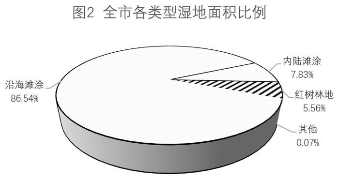
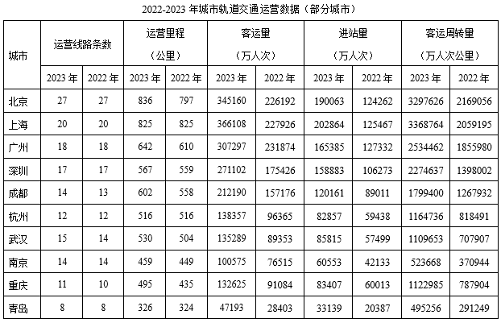
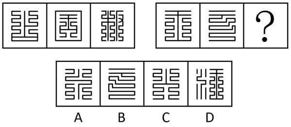
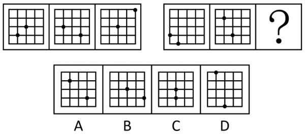
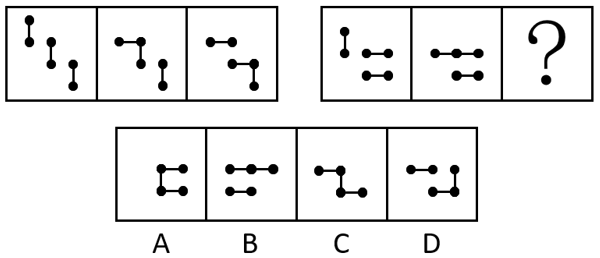
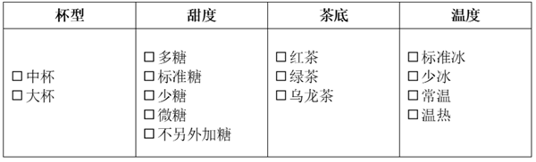
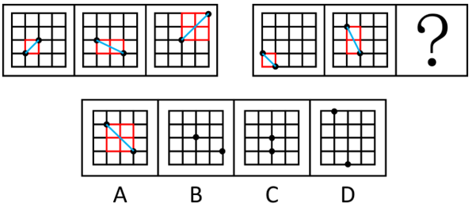

# 2025年深圳市考公务员录用考试《行测》试题（网友回忆版）

> 候选采集稿。参考答案及解析来自粉笔页面，不代表官方答案或真实高分答卷；来源使用许可与原卷对应关系仍需人工核实。

## 题型与作答说明

政治理论

（15题）

每题的备选答案中，只有一个最符合题意。

常识判断

（15题）

每题的备选答案中，只有一个最符合题意。

判断推理

（20题）

本部分包括图形推理、事件排序、演绎推理三种类型的试题，在四个选项中选出一个最恰当的答案。

数量关系

（10题）

在这部分试题中，每道题呈现一段表述数字关系的文字，要求你迅速、准确地计算出答案。

言语理解与表达

（25题）

本部分包括表达与理解两方面的内容。请根据题目要求，在四个选项中选出一个最恰当的答案。

资料分析

（15题）

所给出的图、表、文字或综合性资料均有若干个问题要你回答。你应根据资料提供的信息进行分析、比较、计算和判断处理。

## 给定材料

### 材料 dom-material-8d578ed26c1e42ad

2023年，全国新增发电装机容量3.7亿千瓦，同比多投产1.7亿千瓦。其中，新增并网太阳能发电装机容量2.2亿千瓦，同比多投产1.3亿千瓦，占新增发电装机总容量的比重达到58.5%。截至2023年底，全国全口径发电装机容量29.2亿千瓦，其中，非化石能源发电装机容量15.7亿千瓦，占总装机容量比重在2023年首次突破50%，达到53.9%。分类型看，水电4.2亿千瓦，其中抽水蓄能5094万千瓦；核电5691万千瓦；并网风电4.4亿千瓦，其中，陆上风电4.0亿千瓦、海上风电3729万千瓦；并网太阳能发电6.1亿千瓦。全国并网风电和太阳能发电合计装机规模从2022年底的7.6亿千瓦，连续突破8亿千瓦、9亿千瓦、10亿千瓦大关，2023年底达到10.5亿千瓦，同比增长38.6%，火电13.9亿千瓦，其中，煤电11.6亿千瓦，同比增长3.4%，占总发电装机容量的比重为39.9%，首次降至40%以下。2023年，全国6000千瓦及以上电厂发电设备利用小时3592小时，同比降低101小时。分类型看，水电3133小时，同比降低285小时，其中，常规水电3423小时，同比降低278小时；抽水蓄能1175小时，同比降低6小时。火电4466小时，同比提高76小时；其中，煤电4685小时，同比提高92小时。核电7670小时，同比提高54小时。并网风电2225小时，同比提高7小时。并网太阳能发电1286小时，同比降低54小时。2023年，全国各电力交易中心累计组织完成市场交易电量5.67万亿千瓦时，同比增长7.9%，占全社会用电量比重为61.4%，同比提高0.6个百分点。其中，全国电力市场中长期电力直接交易电量合计为44288.9亿千瓦时，同比增长7%。

### 材料 dom-material-1a0b9cc608282a21

### 材料 dom-material-395159eb5afe7c77

## 题目

### 第 1 题

习近平总书记强调，现在，全党全国各族人民正满怀信心全面建设社会主义现代化国家、全面推进中华民族伟大复兴，一代代中国共产党人为之奋斗的美好理想正在一步步实现，以下关于全面建设社会主义现代化国家的说法，不正确的是（ ）。

A. 党的二十大描绘了全面建设社会主义现代化国家的宏伟蓝图

B. 全面建设社会主义现代化国家，关键在党

C. 全面建设社会主义现代化国家，一个民族也不能少

D. 全面建设社会主义现代化国家，最艰巨最繁重的任务在经济大省

### 第 2 题

下列思想不属于马克思主义哲学观点的是（ ）。

A. 如果偶然性不起任何作用的话，世界历史就会带有非常神秘的性质

B. 离开革命实践的理论是空洞的理论，而不以革命理论为指南的实践是盲目的实践

C. 实践高于（理论的）认识，因为它不仅具有普遍性的品格，而且还具有直接现实性的品格

D. 一个时代的最后一种哲学是哲学发展的成果，是精神的自我意识可以提供的最高形态的真理

### 第 3 题

习近平总书记指出：“要把巡视利剑磨得更光更亮，勇于亮剑，始终做到利剑高悬、震慑常在。”2024年2月，中共中央印发新修订的《中国共产党巡视工作条例》，更加突出政治性、实践性、指导性。根据该条例，下列关于巡视组的说法错误的是（ ）。

A. 巡视组应当履行执纪审查的职责

B. 巡视组应当按照民主集中制原则研究讨论决定重大事项

C. 巡视组可通过听取汇报、个别谈话、下沉调研等方式了解情况

D. 巡视组不干预被巡视党组织的正常工作

### 第 4 题

文化关乎国本，国运，站在新的历史起点上，奋进新征程的今日中国正以习近平文化思想为引领，锚定2035年建成文化强国的战略目标，不断铸就中华文化新辉煌，关于推进新时代文化建设，下列说法不正确的是（ ）。

A. 要坚持把社会效益放在首位、社会效益和经济效益相统一

B. 要把育人才、建队伍作为深化文化体制机制改革的中心环节

C. 要坚持保护第一、合理利用和最小干预原则，推动文化遗产系统性保护和统一监管

D. 最关键的是要把党管宣传、党管意识形态、党管媒体、党管互联网原则落实到位

### 第 5 题

《中共中央关于制定国民经济和社会发展第十四个五年规划和二〇三五年远景目标的建议》明确提出，要改善人民生活品质，提高社会建设水平，收入是民生之源，以下举措符合新时代推进社会建设的要求的是（ ）。

①坚持按劳分配为主体、多种分配方式并存

②提高劳动报酬在初次分配中的比重

③多渠道增加城乡居民转移性收入

④完善再分配机制，合理调节过高收入，取缔非法收入

⑤着力提高低收入群体收入，扩大中等收入群体，缩小高收入群体

⑥完善按要素分配政策制度，探索通过土地、资本等要素使用权、收益权增加中低收入群体要素收入

A. ①②④⑤

B. ①③④⑤

C. ①②④⑥

D. ②③④⑥

### 第 6 题

习近平总书记在重要文章《深入推进党的自我革命》中对怎样推进党的自我革命提出“九个以”的实践要求。对于“九个以”，下列表述不正确的是（ ）。

A. 以跳出历史周期率为战略目标

B. 以解决大党独有难题为主攻方向

C. 以自我监督和人民监督相结合为强大动力

D. 以培养年轻干部为长远之策

### 第 7 题

党的二十届三中全会提出，要健全促进实体经济和数字经济深度融合制度。关于促进实体经济和数字经济深度融合制度，下列举措不恰当的是（ ）。

A. 促进知识、技术、数据等要素向制造业集聚，持续提高制造业在国民经济中占比

B. 加快新一代信息技术全方位全链条普及应用，发展工业互联网

C. 促进平台经济创新发展，健全平台经济常态化监管制度

D. 提升数据安全治理监管能力，建立高效便利安全的数据跨境流动机制

### 第 8 题

马克思的劳动异化理论指出，在资本主义条件下，劳动所生产的对象，即劳动的产品，作为一种异己的存在物，作为不依赖于生产者的力量，同劳动相对立。从根源上消除劳动异化的途径是消灭（ ）。

A. 私有制

B. 商品经济

C. 按劳分配

D. 资本主义意识形态

### 第 9 题

习近平总书记指出，改革开放以来，我们党提出的一系列“两手抓”，包括一手抓物质文明建设、一手抓精神文明建设，一手抓经济建设、一手抓法治建设，一手抓发展、一手抓稳定，一手抓改革开放、一手抓惩治腐败等，都是符合历史唯物主义要求的。上述重要讲话直接体现的马克思主义哲学观点不包括（ ）。

A. 事物发展需要通过量变的积累实现质的飞跃

B. 事物总是有着这样那样的联系，不能孤立地静止地看待事物发展

C. 在观察社会发展时，要注意矛盾双方既对立又统一的辩证关系

D. 物质生产是社会生活的基础，但上层建筑也可以反作用于经济基础

### 第 10 题

2025年3月，中共中央办公厅印发《关于在全党开展深入贯彻中央八项规定精神学习教育的通知》。某党支部召开会议传达精神并开展专题学习，党员小李将在会上作学习分享，以下是他想要引用的体现中央八项规定精神内涵的古语，其中援引不恰当的是（ ）。

A. 不受虚言，不听浮术，不采华名，不兴伪事

B. 慧者心辨而不繁说，多力而不伐功，此以名誉扬天下

C. 奢靡之始，危亡之渐

D. 善禁者，先禁其身而后人

### 第 11 题

西柏坡是革命圣地，党中央和毛泽东同志在这里指挥了三大战役，指导革命取得全国胜利，进而建立了新中国。毛泽东同志在这里提出了“两个务必”的重要思想。关于上述历史，下列说法错误的是（ ）。

A. 西柏坡是中国革命最后一个农村指挥所

B. 三大战役按时间先后排序依次是淮海战役、辽沈战役、平津战役

C. 毛泽东同志在党的七届二中全会上提出了“两个务必”的重要思想

D. “两个务必”具体指务必使同志们继续地保持谦虚、谨慎、不骄、不躁的作风，务必使同志们继续地保持艰苦奋斗的作风

### 第 12 题

《中国共产党纪律处分条例》从党章这个总源头出发，坚持严的基调，为中国式现代化全面推进强国建设、民族复兴伟业提供坚强纪律保障。根据该条例，对违犯党纪的党组织的问责方式不包括（ ）。

A. 责令作出书面检查

B. 予以组织调整

C. 予以改组

D. 予以解散

### 第 13 题

2025年国务院政府工作报告提出，要高质量完成国有企业改革深化提升行动。下列有关“十四五”期间国有企业改革深化提升措施，不恰当的是（ ）。

A. 强化国有企业对重点领域保障，支撑国家战略安全

B. 以市场化方式推进整合重组，提升国有资本配置效率

C. 健全管企业为主的国有资产监管体制

D. 健全国有企业推进原始创新制度安排

### 第 14 题

习近平总书记指出，要构建亲清统一的新型政商关系，促进非公有制经济健康发展和非公有制经济人士健康成长。以下举措中，有利于形成“亲清统一的新型政商关系”的有（ ）。

①强化竞争政策基础地位，坚持对各类所有制企业一视同仁、平等对待

②要求金融机构在授信、信贷管理等方面对民营经济组织予以优待和倾斜

③充分发挥财政资金直达机制作用，推进涉企资金直达快享

④制定政商交往行为指引，明确高频场景的政商交往操作指南

⑤出台民营经济促进法，对侵犯各种所有制经济产权和合法利益的行为实行问责同罚

A. 2项

B. 3项

C. 4项

D. 5项

### 第 15 题

习近平总书记强调，要牢牢把握高质量发展这个首要任务，因地制宜加快发展新质生产力。深圳市大力实施高质量发展“十大计划”，全力持续打造“四个先锋城市”。“四个先锋城市”不包括（ ）。

A. 极速宽带先锋城市

B. 人工智能先锋城市

C. 绿色能源先锋城市

D. 数字孪生先锋城市

### 第 16 题

《管子》是我国最早论述宏观经济学思想的著作之一，《管子·国蓄》有云：“据有余而制不足”，认为应以国家的“有余”来控制民间的“不足”，其强调的是（ ）。

A. 共同富裕

B. 供需平衡

C. 国家调控

D. 社会效率

### 第 17 题

党政机关公文中，通知适用于发布、传达要求下级机关执行和有关单位周知或者执行的事项，批转、转发公文。按照通知的内容和功能分类，《深圳市人民政府关于调整市政府领导班子成员分工的通知》属于（ ）。

A. 发布性通知

B. 指示性通知

C. 任免性通知

D. 事务性通知

### 第 18 题

风险评估是重大行政决策过程的重要组成部分，是指在行政决策过程中，对可能影响社会稳定及公共安全的因素开展系统调查，科学预测、分析和评估，制定风险应对策略和预案。行政决策中的风险评估应主要关注（ ）。

A. 行政决策产生的社会效益

B. 行政决策引发的负面影响

C. 行政决策耗费的公共资源

D. 行政决策实施的执行难度

### 第 19 题

大年初五，青年小吴因发型邋遢被舅舅张某批评，小吴一气之下去理发店剃了光头。当晚，张某酒后骑车发生车祸，不幸离世。事后，舅妈赖某诉至法院，认为小吴明知“正月理发死舅舅”仍去理发，要求小吴承担民事侵权赔偿责任，赔偿100万。关于本案，下列说法不正确的是（ ）。

A. 谚语“正月理发死舅舅”不能作为承担法律责任的依据

B. 法院应依法驳回原告赖某的诉讼请求

C. 张某酒后骑车导致的意外身亡，与小吴正月理发无因果关系

D. 赖某应对小吴知晓该谚语进行举证

### 第 20 题

某核稿人员对以下公文进行审核并提出修改意见。根据党政机关公文写作规范，下列选项所述修改意见不正确的是（ ）。

关于申请修复教学楼经费的报告

市教育局：

因特大暴雨灾害，我校第二、 第三教学楼受到不同程度损坏，特申请经费100万元，用以修复教学楼以保障教育教学工作正常开展。此外，我校将于今年9月开展建校20周年校庆活动，拟邀请贵局主要领导同志为校庆活动致辞。

妥否，请速回复。

XXX学校名称

2025年04月01日

A. 标题文种错误，改为“关于申请修复教学楼经费的请示报告”

B. 应当一文一事，删除校庆致辞邀请的相关内容

C. 结束语不当，“请速回复”改为“请批复”

D. 成文日期的月、日不编虚位，改为“2025年4月1日”

### 第 21 题

近年来，深圳着力建设新型智慧城市，“人工智能+”行动，深化“千行百业+AI”全域全时全场景应用并取得显著成效。以下不属于“人工智能+”领域的典型应用的是（ ）。

A. 构建智能交通系统，实现交通信号的智能调度和路况实时监测

B. 实施智能医疗，构建全周期智能健康管理系统，开发个性化健康方案

C. 改善城市治理，支持机器人在公共安全、市政环卫等场景中的应用

D. 发展高端制造，提升工业自动化生产线的机械臂预定路径运行效率

### 第 22 题

第十五届全国运动会将于2025年11月在粤港澳大湾区举行，深圳首次成为全运会主要承办城市之一，外国友人汤姆计划届时入境深圳观看运动赛事，并借此机会体验火爆的“Shenzhen Travel”。以下是可能的旅行心愿清单，其中可以实现的有（ ）。

①在深圳市体育中心体育馆现场观看全运会开幕式

②沿着滨海骑行道，从前海石公园骑行至莲花山公园邓小平铜像

③观赏正在盛放的簕杜鹃花海

④在蛇口港乘坐海上邮轮近距离欣赏港珠澳大桥美景并与之合影

⑤尽情享受“中国制造”购物乐趣及离境退税“即买即退”服务

A. ①②③

B. ①②④

C. ②④⑤

D. ③④⑤

### 第 23 题

中国地域广阔、民族众多，各地民歌风格异彩纷呈、各具特色。民歌不仅反映了当地的风土人情，也体现了各民族的精神气质。下列歌曲中，其民族风格与其他三项不同的是（ ）。

A. 《达坂城的姑娘》

B. 《打起手鼓唱起歌》

C. 《翻身农奴把歌唱》

D. 《克拉玛依之歌》

### 第 24 题

深圳平安金融中心是深圳市第一高楼，是向世界展示深圳经济发展的重要地标，以下最合适作为该楼楹联的是（ ）。

A. 载凯旋舞，扬悉尼歌，缩舆地于一方，星分欧亚移经纬；沐侏罗风，卷句丽雨，听回声自千古，人越时空鉴海田

B. 铁骨凌霄二百米，劈云阶直上，敢教鹏翼培风上；钢魂淬火三天势，立玉宇横空，更借风雷滚行

C. 岳立冠南天，登楼看珠灿东方，鹏腾大海；龙光冲北斗，凭栏念太阿镇国，砥柱安民

D. 举风鹏大翼垂天，进取当头，一楼自有冲霄势；启春脚群心向日，宽和在抱，百姓欣随领路人

### 第 25 题

见义勇为是中华民族的传统美德、社会期待的高尚行为，也是我国法律推崇的可贵精神、司法制度着力塑造的社会价值。下列行为属于见义勇为的是（ ）。

A. 甲是医学院在读学生，乘高铁时偶遇一位老人突然晕倒，主动上前实施急救，成功挽救老人生命

B. 乙是某市应急管理工作负责人，下辖村镇发生洪涝灾害，他深入一线抢险救灾，却被洪水冲走不幸殉职

C. 丙下班后去父母家吃饭，恰巧撞见盗贼正要翻窗入室，他毫不犹豫上前英勇搏斗，身上多处负伤

D. 丁在公园僻静处看到两名小伙准备欺负一小孩，遂上前伸张正义，将两名小伙打得鼻青脸肿，为小孩及时解围

### 第 26 题

位于北半球的台风，低空气流围绕台风眼呈逆时针方向旋转。深圳市民林某在台风登陆前在窗边看刮风，此时的风向不可能是（ ）。

A. 正东风

B. 正西风

C. 偏南风

D. 偏北风

### 第 27 题

“蛰虫惊而出走”，惊蛰是一个和百虫相关的节气，其特点在于“百虫惊醒”。以下对惊蛰时节百虫复苏现象的解释，最符合科学原理的是（ ）。

A. 惊蛰前后气温回升加快，土壤温度升高，地下的虫子被气温“热醒”

B. 惊蛰前后农民开始深翻土地，准备耕种，地下的虫子被农民“热醒”

C. 惊蛰前后春雷轰鸣，响彻天际，地下的虫子被雷声“吵醒”

D. 惊蛰前后春雨骤降，水汽充沛，地下的虫子被雨水“泡醒”

### 第 28 题

“科学”流言是一种不负责任、未经证实的传闻或谣言，通常以科学为名，但实际缺乏科学依据和实证支持。以下言论中，具有科学依据、不属于“科学”流言的是（ ）。

A. 长期只吃白青菜，肝脏会成“油犀”，纯素饮食易致脂肪性肝炎

B. 航天员不能有近视眼，因为在太空中戴眼镜可能会带来意外伤害

C. 孕妇应尽量穿防辐射服，以有效保护胎儿免受日常电磁辐射影响

D. 中国古代木结构建筑不使用一颗钉子，全靠榫卯结构搭建

### 第 29 题

王某大学期间因盗窃同学财物被判处有期徒刑9个月，并宣告缓刑，学校保留了其学籍。2023年，王某大学毕业参加国家公务员考试，经过笔试面试体检程序，被确定为考察人选。经考察发现，王某父亲被开除公职且父母均被列为失信联合惩戒对象，另王某大学同学表示其人品不佳，建议慎重考虑，最终王某未被录用。上述案例中，王某未被录用的直接原因是（ ）。

A. 本人因犯罪受过刑事处罚

B. 父亲曾被开除公职

C. 父母均被列为失信联合惩戒对象

D. 大学同学的负面评价

### 第 30 题

正在举行的2025年日本大阪世界博览会上，中国馆以其独特风姿吸引着各国观众的目光，成为本世博会靓丽的“中国名片”。“中国馆”的建筑外观取形于（ ）。

A. 中国传统灯

B. 中国传统书简长卷

C. 中国古代方鼎

D. 中国古代传国玺

### 第 31 题

从四个选项中选择一个替代问号，使之呈现一定规律性，最合适的是（ ）。

A. A

B. B

C. C

D. D

### 第 32 题

从四个选项中选择一个替代问号，使之呈现一定规律性，最合适的是（ ）。

A. A

B. B

C. C

D. D

### 第 33 题

从四个选项中选择一个替代问号，使之呈现一定规律性，最适合的是（ ）。

A. A

B. B

C. C

D. D

### 第 34 题

从所给的四个选项中，选择最合适的一个填入问号处，使之呈现一定的规律性。

A. A

B. B

C. C

D. D

### 第 35 题

把下面的六个图形分为两类，使每一类都有各自的共同特征或规律，分类正确的一项是（ ）。

A. ①③⑤，②④⑥

B. ①②⑤，③④⑥

C. ①④⑤，②③⑥

D. ①⑤⑥，②③④

### 第 36 题

（1）副高推动雨带北进

（2）雨带滞留降雨持续

（3）形成汛期特大洪涝

（4）北半球进入夏半年

（5）冷暖气团汇于江淮

A. 4-5-1-3-2

B. 5-1-2-4-3

C. 4-1-5-2-3

D. 4-5-1-2-3

### 第 37 题

（1）群众反映强烈盼改善

（2）成立共建共治委员会

（3）老旧社区环境脏乱差

（4）居民幸福感显著增强

（5）基层党组织牵头抓总

A. 1-3-5-2-4

B. 3-5-1-4-2

C. 4-1-5-2-3

D. 3-1-5-2-4

### 第 38 题

（1）覆纸干刷成页

（2）刊刻阳纹凸字

（3）均匀涂布油墨

（4）打磨雕版木材

（5）反贴图文纸稿

A. 4-5-2-3-1

B. 4-5-3-2-1

C. 5-4-2-3-1

D. 5-2-3-1-4

### 第 39 题

（1）解衣欲睡，月色入户

（2）友亦未寝，相与漫步

（3）幸会佳景，悠然忘机

（4）月映竹柏，庭下如水

（5）欣然起行，深夜访友

A. 1-5-2-3-4

B. 5-2-1-3-4

C. 1-5-2-4-3

D. 5-1-2-4-3

### 第 40 题

（1）“三北”工程启动，生态效益显著

（2）签署《巴黎协定》，彰显大国担当

（3）保护环境成为国策，社会意识提高

（4）全面建立河湖长制，守护河湖健康

（5）提出“双碳”目标，能源绿色转型

A. 1-3-2-4-5

B. 1-2-4-3-5

C. 1-5-2-3-4

D. 5-1-3-2-4

### 第 41 题

近年来，宠物食品厂商争相推出“高端猫粮”，号称采用区别于普通猫粮的优质原料，添加更全营养素，如高比例添加去骨鲜肉、加入维生素或益生菌等，其售价往往也远高于普通猫粮。不少宠物医院建议，为更好呵护猫咪健康，有条件的家庭最好购买高端猫粮。

以下选项如果为真，最能反驳宠物医院建议的是（ ）。

A. 商业数据表明，高端猫粮的市场占有率和用户青睐度日趋走低

B. 据统计，日常饮食引发的肠道问题是猫咪健康的首要危害因素

C. 不同品种、成长阶段、健康状态的猫咪，其营养需求存在差异

D. 尚无权威研究证明对人类有益的维生素等对猫咪也有同样功效

### 第 42 题

时间贫困正成为当代青年最普遍的体验之一，简单来说是在日常工作生活中产生的时间不够用的感受，也即要做的事情太多，但可支配的时间太少。一项关于当代青年时间贫困的调查研究显示，六成以上的受访青年感觉时间贫困，且随着城市线级的变化，受访青年时间贫困的比例也有所变化。一线城市受访青年感觉时间贫困的比例最高，四线、五线城市则相对更低。调查认为，城市线级与青年时间贫困率直接正相关。

下列说法如果为真，有助于得出调查结论的是（ ）。

A. 城市线级越高，新产业、新业态越集聚，青年面临更多的工作机遇和挑战

B. 城市线级越高，平均通勤时间往往越长，大大挤压了青年人的可支配时间

C. 从人口年龄结构来看，城市线级越高，青年人口在城市总人口中的占比越高

D. 城市线级越高，物质精神生活越丰富，会有更多消磨青年时间的“时间杀手”

### 第 43 题

甲、乙两国交战超过半个世纪，战火迄今未休。多年前，为了防御甲国的攻击，乙国投入巨资开发了一套全天候机动式防空系统，用于拦截射程范围在5-70公里的火箭弹。乙国对外宣称，该系统能计算出目标的弹道、落点，拦截率达90%。该系统目前仍在服役中。然而，新近解密的文件披露，十年前甲国发起的某次攻击中，实际上只有50%的火箭弹被该系统拦截。

以下选项如果为真，无助于解释以上矛盾的是（ ）。

A. 因长年作战，乙国国力严重损耗，十年前采取了主动限制作战规模的措施

B. 该次攻击中，甲国火力异常集中，该系统用来拦截火箭弹的弹药短时耗尽

C. 绝大多数未被拦截的火箭弹都落在百公里外的荒野地区

D. 90%的拦截率来自作战模型推论而非真实作战环境数据

### 第 44 题

人们在进行决策或辩护某个观点或结论的时候，一般是有理由的。所谓理由，就是用来支撑或证明某种观点或结论的信念、证据、类比或其他陈述。

根据上述定义，以下选项不包含“理由”的是（ ）。

A. 低空经济的发展可以降低物流成本。数据显示，2024年社会物流总费用19.0万亿元，较上年回落0.3个百分点

B. 有人认为阅读纸质书比电子书的效果好，电子书缺乏纸质书的触感，削弱了阅读体验

C. 正如植物需要阳光和水分才能茁壮成长，孩子也需要教育和关爱才能成长为有用之才

D. 有钱出钱，有力出力，“力”可能是多方面的，“钱”的用途也是多方面的

### 第 45 题

六名棋手小王、小安、小杨、小李、小张、小刘参加围棋积分赛。积分赛分为三轮，每轮比赛开三台“一对一”的棋局，三轮共9局，但三轮中任意两名棋手最多只对弈一局。棋手的个人积分规则为：赢一局计1分，输一局计-1分，平局计0.5分。每局棋开始前，都以抽签方式决定谁执黑棋谁执白棋。关于比赛结果，已知如下信息：

（1）第三轮结束后，三台棋局中6位棋手的个人总积分依次是2.5比0.5，3比-1，-1比-3；

（2）小安在对局中没有赢过，也没有执过白棋；

（3）凡执过白棋的棋手都没有全胜；

（4）小李输赢的局数相同，且执过2局黑棋；

（5）小王执过黑棋；

（6）某一局中，执黑棋的小张输给了小杨。

由此可推知，积分最高的棋手是（ ）。

A. 小王

B. 小杨

C. 小刘

D. 小张

### 第 46 题

微型塑料是指粒径小于5毫米的塑料颗粒，其理化性质稳定、来源广泛，在海洋、大气及土壤等环境中普遍存在，进入人体后，可能在消化系统、呼吸系统、循环系统等部位蓄积。卫生领域权威国际组织发布报告指出，目前还没有足够数据来全面了解微型塑料对人类健康的影响。因此，一些媒体宣称微型塑料不会对人体产生危害。

以下选项如果为真，最能反驳上述结论的是（ ）。

A. 许多国家和地区已在限塑禁塑方面展开积极行动，未来将加速推进全球塑料条约谈判

B. 人们无时无刻不暴露在微型塑料环境中，人口密集和活动频繁的地区，微型塑料浓度更高

C. 动物研究表明，海洋高等哺乳动物脏器内偶见微型塑料颗粒，其肠道菌群发生显著改变

D. 微型塑料吸附环境中的其他分子后形成稳定的化合物，成为有害物质进入人体的重要载体

### 第 47 题

相传，在一场关于“琴的声音从何而来”的辩论中，有人认为琴声在琴上，有人认为琴声在琴师的手指上，苏轼听后赋诗一首：“若言琴上有琴声，放在匣中何不鸣？若言声在指头上，何不于君指上听？”

以下选项中，与苏轼的论证方式不同的是（ ）。

A. 有人认为，李贺应当避讳其父“晋肃”名号，不宜考取进士，韩愈称：“父名晋肃，子不得举进士；若父名仁，子不得为人乎？”

B. 甲：“语言可以创造财富。”乙：“如果语言可以创造财富，那么，夸夸其谈的人就可以成为世界首富了。”

C. 甲：“神是全知、全能、全善的。”乙：“神若愿阻恶但无力，则非全能；若能阻恶但不愿，则非全善；若既愿又能，那为何恶仍在？”

D. 家国兴亡自有时，吴人何苦怨西施。西施若解倾吴国，越国亡来又是谁？

### 第 48 题

同住一间宿舍的甲、乙、丙、丁四人即将大学毕业，面临考研、考公、应聘国企、自主创业四种意向选择，四人的规划如下：

（1）甲希望为家乡发展作贡献，只考虑返乡考公或者应聘国企；

（2）乙和丙是挚友，除非与丙一起自主创业，否则乙会考研；

（3）丙不想考研，也不打算应聘国企，如果甲考公，他会和甲一同备考；

（4）丁为人特立独行，希望和甲、乙、丙作出不同的选择。

如果四人的规划都得以实现，以下情况不可能发生的是（ ）。

A. 四人的选择各不相同

B. 甲、乙、丙作出同种选择

C. 丁选择考研

D. 丁选择应聘国企

### 第 49 题

折柳赠别这一习俗由来已久，古代诗歌中柳树与离别之情常相伴出现。提及柳树，人们往往首先想到它繁茂的青色。因此，有学者认为，古代诗人写柳是借柳色之“青”来寄寓其“情”。

以下选项如果为真，不能支持学者观点的是（ ）。

A. 不少诗歌直接点明柳之“青”继而引出人“情”，如“依依袅袅复青青，勾引春风无限情”

B. 柳树与离别最早的关联，可以追溯至《诗经》：“昔我往矣，杨柳依依。今我来思，雨雪霏霏。”

C. 在古代诗歌中，柳树可用来寄寓离别情之外的其他感情，如“无情最是台城柳，依旧烟笼十里堤”

D. 古代诗歌也常用柳树之外的青植物寄寓别情，如“江春不肯留行客，草色青青送马蹄”

### 第 50 题

在日常语言中，条件句可以分为直陈条件句和虚拟条件句两类。反事实条件句属于虚拟条件句。一个反事实条件句应满足三个条件：

（1）表示条件的判断通常事实上为假；

（2）表示条件的判断和依赖条件而存在的判断之间有着意义、内容方面的密切联系；

（3）如果前一判断得到满足，那么后一判断所表达的事物情况就会发生或有可能发生。

根据上述定义，下列选项不属于反事实条件句的是（ ）。

A. 东风不与周郎便，铜雀春深锁二乔

B. 功名富贵若长在，汉水亦应西北流

C. 但使龙城飞将在，不教胡马度阴山

D. 安得广厦千万间，大庇天下寒士俱欢颜

### 第 51 题

4，9，20，35，66，（ ）

A. 78

B. 91

C. 115

D. 136

### 第 52 题

1，，，，，（ ）

A. 

B. 

C. 

D. 

### 第 53 题

{3，4，85}，{5，3，128}，{7，2，（ ）}

A. 50

B. 51

C. 52

D. 53

### 第 54 题

2025，675，135，45，9，（ ）

A. 5

B. 3

C. 1

D. \-1

### 第 55 题

841，846，856，867，880，（ ）

A. 877

B. 884

C. 888

D. 891

### 第 56 题

有Y、L两款3年期理财产品，Y的年预期收益率为5%（单利），L的年预期收益率为4%（按年计复利）。彭大爷现有40万元计划全部购买Y或L，则Y的预期收益比L的预期收益（ ）。（结果保留整数）

A. 多1万元

B. 少1万元

C. 多2万元

D. 少2万元

### 第 57 题

M、N两部电视剧于2025年3月20日（周四）同日开播，M剧周四至周六每天播出3集，N剧周一至周五每天播出2集，但清明节期间（4月4日、4月5日、4月6日）两部剧都停播。若至2025年4月21日，M、N两部剧均未播完，则期间共有（ ）天两部剧都有播出。

A. 8

B. 9

C. 10

D. 11

### 第 58 题

某咖啡馆新推出两款联名活动套餐：甲套餐售价74元，包含3杯大杯和1杯中杯，附赠贴纸；乙套餐售价68元，包含2杯大杯和2杯中杯，附赠徽章。因公司团建，张三计划购买甲、乙套餐各若干份，钱刚好用完。点单时，服务员给了甲套餐打八折的优惠，但却把两种套餐的份数搞反了，结账后张三余下的钱刚好再购买7杯中杯。已知相同杯型咖啡的单价相同，则张三原计划购买（ ）份套餐。

A. 12

B. 14

C. 16

D. 18

### 第 59 题

某商场举行消费满额抽奖活动，现场共布置了50个礼盒，每个礼盒中均放有1张奖品券或1张现金券，每名消费达标顾客有2次抽奖机会。某日恰好有25名顾客参与抽奖，礼盒全部抽完。已知至少有20%的顾客2次都抽中现金券，至多有60%的顾客2次都抽中同种类券，则一共至少有（ ）张现金券。

A. 10

B. 15

C. 20

D. 25

### 第 60 题

阿哥、阿姐请小妹帮忙买奶茶，每杯奶茶都有4个必选定制项（如下图所示）。小妹在途中把阿哥、阿姐不同的定制要求忘了，如果她随意购买3杯不同的奶茶，则恰有1杯刚好满足阿哥或阿姐定制要求的概率是（ ）。

A. 

B. 

C. 

D. 

### 第 61 题

将下列选项中的词语依次填入文段横线处，最恰当的一组是:

在“生产-分配-流通-消费”的链路中，消费是终点也是新起点，是加快释放内需潜力的主要（ ）。今天，消费作为中国经济“主引擎”的作用进一步（ ），持续改善消费环境，加速消除消费堵点，已经成为国之大计。

A. 落脚点、突显

B. 着力点、凸显

C. 出发点、显现

D. 切入点、展现

### 第 62 题

将下列选项中的词语依次填入文段横线处，最恰当的一组是：

应届毕业生身份的特殊性，固然是求职“红利”，但在客观上拉高了试错成本，带来不小的约束。譬如，（ ）高昂的机会成本，有的人不愿失去应届生身份，（ ）不敢轻易作出岗位选择，因而错失眼下的机遇。

A. 囿于、瞻前顾后

B. 基于、心猿意马

C. 鉴于、拖泥带水

D. 碍于、提心吊胆

### 第 63 题

将下列选项中的词语依次填入文段横线处，最恰当的一组是：

新闻宣传平台要坚持“说人话、切热点”，说人话，就是            ，多说受众听得懂的白话，少说正确的废话，常说平实的真话。切热点，就是要直面社会关切，不回避问题、不            ，坚持理性解读、辩证分析、情理相融。

A. 开门见山、避重就轻

B. 直截了当、避难趋易

C. 言简意赅、避繁就简

D. 一针见血、避实就虚

### 第 64 题

将下列选项中的词语依次填入文段横线处，最恰当的一组是：

随着《哲学原理》《古典罗马法》等译著“上新”，“汉译世界学术名著丛书”迎来出版1000种这一里程碑，            的千种“汉译名著”，滋养着读者渴望知识的心田。

A. 洋洋洒洒

B. 林林总总

C. 叹为观止

D. 蔚为大观

### 第 65 题

将下列选项中的词语依次填入文段横线处，最恰当的一组是：

如今，互联网消费品类与选择种类超出前人想象，也超越了个体的认知极限，想要        各种热点几无可能。然而，缺乏亮点的产品带货却无孔不入地霸占屏幕；            的影视作品，还能在各平台刷出清一色好评······市场与算法合力营销的“伪热度”，正消耗着人们的注意力资源。

A. 穷尽 乏善可陈

B. 遍历 差强人意

C. 饱览 不名一文

D. 熟稔 可圈可点

### 第 66 题

“道德法庭”是个比喻的说法，其实是指一种舆论力量，社会谴责仿佛就是一种审判，常说“                    ”，若非厚颜无耻之人，终难抵挡这般威慑。

填入画横线部分最恰当的一项是：

A. 为渊驱鱼，为丛驱雀

B. 十目所视，十手所指

C. 兼听则明，偏信则暗

D. 不塞不流，不止不行

### 第 67 题

将下列选项中的词语依次填入文段横线处，最恰当的一组是：

交流性是人类语言的根本属性，        过去有学者主张语言的最大用途是思考，    当代科学家发现，如同动物的梳毛行为一样，人类语言主要用于交流，正是凭借语言，人类得以高效地维护社交网络，维系群体团结，不断扩大群体规模。        语言仅是思考的工具，        也许不必考虑修辞问题。但语言        用于日常交流，担负起联结社会的重任，那么它        自然进入修辞学的视野，成为修辞活动。

A. 虽然、但、如果、那么、一旦、就

B. 尽管、而、如果、那么、只有、才

C. 虽然、但、由于、因此、一旦、就

D. 尽管、而、由于、因此、只有、才

### 第 68 题

将下列选项中的词语依次填入文段横线处，最恰当的一组是：

近年来，一些城市相继出台大力度的人才吸引政策，通过购房补贴、落户入编、创业扶持等筹码引智引才。随着“抢人大战”的          ，越来越多高校毕业生开始从被城市选择，变成主动选择城市，城市获得想要的人才，人才也在            。

A. 白热化 待价而沽

B. 白热化 择善而从

C. 常态化 待价而沽

D. 常态化 择善而从

### 第 69 题

将下列选项中的词语依次填入各句横线处，最恰当的一组是:

（1）开展“庭院建设活动”以来，许多农户一心扑到学习科学知识、发展庭院经济上来。不但改善了         ，增加了个人收益，还提高了科学文化水平。

（2）历史沉积于北京的每一片天空、每一寸土地，这里的一砖一瓦都记载着一段流传千载的故事，每一个古老         都透露出中华文化丰厚的底蕴。

（3）这个评剧团的演员多来自农村，熟悉农村的         演反映农村现实生活的现代戏得心应手。

A. 风俗 风气 习俗

B. 风气 习俗 风俗

C. 风俗 习俗 风俗

D. 风气 风气 习俗

### 第 70 题

将下列选项中的词语依次填入各句横线处，最恰当的一组是：

（1）其实，新闻理想并不是只有在热闹喧嚣处才能实现，那种为采写新闻而制造新闻的做法是            的。

（2）要推翻一种传统的看法，必须有过硬的证据，证据不足就轻下的断语，是            的。

（3）择业取向和趋势发生变化本身            ，需要重视的是，在这一过程中，有一部分年轻人的择业观念正走向功利化、庸俗化。

A. 不足为意 不足为凭 不足为训

B. 不足为训 不足为意 不足为凭

C. 不足为凭 不足为意 不足为训

D. 不足为训 不足为凭 不足为意

### 第 71 题

下列各项中，有语病的一项是：

A. 我们的情绪需要有放松调节的出口，但如何不被其裹挟，靠的还是自己的定力。

B. 医药电商应履行好审核把关义务，否则不仅难以成为呵护健康的帮手，反而成为制约。

C. 这一套制度组合拳，足以保障为学生减负的良好初衷不打折扣、不偏不倚。

D. 以发布“十大语文差错”的方式向社会普及语言文学知识，对于激发国人规范运用语言文字意识、提高社会语言文字运用水平，意义不可小觑。

### 第 72 题

下列各项中，没有语病的一项是：

A. 但从小在中国长大的经历，这位身在异国的华商对故乡有着难以名状的情愫和责任感。

B. 从这个故事里告诉我们一个道理：只要能够冷静、理智地对待突发事件，即使陷于可怕的境地，也能反败为胜。

C. 当下，不少年轻人选择放下手机，抛弃“宅文化”，走进夜校课堂，开启另类“夜生活”。

D. 他出身于一个偏远农村，其家族世世代代务农为生，党抚育他长大，如今上了大学。

### 第 73 题

下列各项中，有语病的一项是：

A. 冰雪旅游的逐渐兴起和过境免签政策的落地实施，为近期旅游产业的发展增添了新动力。

B. 以体育来促进旅游业提升，再由此推动体育在本地的发展与普及，是市政府寻求发展的思路。

C. 深圳国庆期间，上万架无人机腾空起飞，生动演绎“赛博烟花”，成为国内旅游的热门城市。

D. 相关部门对国内旅游市场秩序开展集中整治，让市场环境有了明显改善，进一步促进了旅游消费。

### 第 74 题

下列各项中，没有语病的一项是：

A. 这套被称为“地球往事”三部曲的系列小说，无疑问鼎了科幻文学中的巅峰之作。

B. 旅鸽的灭绝提醒着我们，即使是丰富的物种也会迅速灭绝，没有人能够准确预测鸟类的未来。

C. 智能体和具身智能等新范式快速发展，进一步拓宽了人工智能的能力和应用场景。

D. 近年来，网络文学IP转化持续活跃，涵盖影视动漫、有声读物和游戏电竞等领域，跨界融合为作品带来新的表现空间。

### 第 75 题

把下面几个句子组成语意连贯的一段文字，排序正确的一项是（ ）。

（1）全球共有20多座超级火山，除了黄石和长谷，还有新西兰的陶波火山、苏门答腊岛的多巴火山等。

（2）超级火山是指那些曾一次性喷发至少1000立方千米岩浆的火山。

（3）据推演测算，最大规模的超级火山喷发可以让半径100千米范围内的一切毁于一旦。

（4）而大量硫气体进入平流层，会在全球范围内造成显著的降温效应，这就是所谓的“火山严冬”。

（5）科学家对超级火山的威胁性进行了不少研究。

A. 2-1-5-3-4

B. 2-5-3-4-1

C. 5-2-1-3-4

D. 5-2-3-4-1

### 第 76 题

在司法实践中，判例制度是一种重要的法律适用方式，它要求法官在审理案件时，参照先前的判决结果，而非仅凭个人理解或自由裁量，这种制度的实施使得司法裁决更加具有连续性和稳定性，增强了公众对司法公正的信任。同时，判例制度还为法官提供了一个明确的参考框架，有助于减少个人主观因素导致的判决差异。然而，判例制度也要求法官具备较高的法律素养和审判经验，以辨别案件之间的相似性和差异性。

上文最能回答下列问题中的（ ）。

A. 如何界定判例与法官的关系

B. 判例制度有哪些作用和价值

C. 在我国适用判例制度是否可行

D. 法官如何正确地运用司法判例

### 第 77 题

资本在它产生的那一刻起就成为一个充满着矛盾的混合体。虽然它作为一种生产关系无法长久地驾驭它自己创造出来的生产力，虽然它带来了资本主义社会极端个人主义张扬和两极分化，虽然它开拓世界市场引起民族国家之间对立、世界霸权主义盛行和地缘战争频发等。但是，资本作为进步力量，将处于分散状态的生产资料、财产和人口集聚起来，创造出以往一切时代都难以比拟的生产力。资本作为现代经济发展润滑剂、倍增器，促进了现代社会发展。我们要研究资本，要研究资本的积极方面。社会主义市场经济是一个伟大创造，社会主义市场经济中有各种形态的资本，要发挥资本作为生产要素的积极作用，同时有效控制其消极作用。

下列说法与上文意思不相符的是（ ）。

A. 两极分化、霸权主义、地缘战争等问题可能因资本而起

B. 资本作为一种生产关系能使生产力实现前所未有的发展

C. 对资本的研究需要重点关注其作为进步力量的积极方面

D. 社会主义市场经济制度是有效发挥资本积极作用的产物

### 第 78 题

浪漫主义文学强调个人情感与自由的表达，追求超越现实的理想境界。但浪漫主义的超越性，并非脱离现实世界的无稽之谈，也非纯粹的幻想和空想，而是基于对现实世界的深刻洞察和反思，是作家对生活理想化的一种表达。浪漫主义追求的美，是对自然、人性、爱情等美好事物的赞美和向往。文学作品若缺乏美的追求，便失去了其独特的魅力。作家只有深入体验生活、感悟人生，将个人情感与社会现实相结合，其作品才能引起读者的共鸣，实现其超越现实的理想追求。

下列说法与上文观点一致的是（ ）。

A. 浪漫主义文学注重自由表达对美好事物的主观感受

B. 浪漫主义的超越性在于作家对现实世界的观察与认识

C. 浪漫主义文学追求一切美好的事物，有其独特的魅力

D. 深刻的生活体验与人生感悟成就浪漫主义文学精品

### 第 79 题

分解力又称分辨率，通常分辨率越高清晰度也越高，分辨率也是电视系统分解与综合图像的能力。其单位是一个画面高度内的电视线数，可以在图像屏幕高度的范围内，用分辨多少根垂直黑白线条的数目描述。分解力的大小与电视系统扫描行数、摄像机的性能、电视信号处理及传输通道的带宽等因素有关，由于电视机中信号处理电路的频带范围有限，即使摄像机的分解力很高，在信号处理过程中也要遭受损失。最终的图像不可能显示出理想的清晰度，因此片面追求很高的分解力是没有意义的。两部摄像机，即使具有相同的分解力，但是图像信号的调制度不同时，获得图像的视觉效果也会大不相同。

上文没有介绍分解力（ ）。

A. 与电视机图像清晰度的关系

B. 大小受到多种因素共同影响

C. 效果呈现受限于信号处理能力

D. 可用于评估摄像机的视效性能

### 第 80 题

近几年，海洋碳汇已成为海洋领域研究的新热点。国际社会日益认识到海洋碳汇的价值与潜力，将海洋碳汇纳入国际气候变化治理体系的趋势也愈发明显。我国具有广阔的海域、丰富的生物多样性与扎实的科研条件，这些为海洋碳汇的发展奠定了坚实基础。随着“碳达峰”“碳中和”目标的提出，沿海各省份纷纷在加快海洋碳汇发展、推进海洋碳汇核算、开展海洋碳汇交易试点等方面进行积极探索。然而，由于海洋碳汇交易工作起步较晚，与之相关的规章制度、行业规范及技术标准缺乏，即使放眼国际，目前也尚无被广泛认可的海洋碳汇标准，一个活跃的海洋碳汇交易市场远未形成。这对我国既是挑战，更是机遇。

这段文字接下来最可能续写的内容是（ ）。

A. 我国海洋碳汇相关制度规范标准现状

B. 我国海洋碳汇交易标准体系建设路径

C. 对国际海洋碳汇交易市场的远景展望

D. 沿海各省份探索海洋碳汇的具体实践

### 第 81 题

大凡一个读书的人，对于现社会，总是觉得不满足的，尤其是社会科学学者。他必先对于现状，觉得不满，然后要求改革；要求改革，然后要想法子；要想法子，然后要研究学问。若其对于现状，本不知其不好，因而没有改革的思想，又或明知其不好，而只想在现状之下，求个苟安，或者捞摸些好处，因而没有改革的志愿，那还讲做学问干什么？所以对于现状的不满，乃是治学问者，尤其是治社会科学者真正的动机。此等愿望，诚然是社会进步的根源；然欲遂行改革，非徒有热情，便可济事，必须有适当的手段；而这个适当的手段，就是从社会科学里来的。

上文意在强调（ ）。

A. 治学问的出发点是不愿苟安于现状

B. 社会科学具备遂行改革的内外要素

C. 社会科学治学动机应是对现状不满

D. 社会进步的根源是行适当手段改革

### 第 82 题

中国古代思想家老子把管理和领导艺术分为四种层次。其中最高层次是“不知有之”，就是要求领导干部要学会营造情境，去间接地引导群众，从而“把党的正确主张转化为群众的自觉行动”。“不知有之”的领导艺术要求领导干部善于营造制度和文化等领导情境，提供群众所需要的服务，邓小平提出“领导就是服务”。具体来说，领导提供的服务有三个重点：第一，提供群众所需的环境和条件；第二，提供群众所需的平台和舞台，提供发展的机会和实现人生出彩的机会，这就是影响群众想干、愿意干的重要激励因素；第三，把规则规范融入领导服务之中，通过服务和激励来引导群众的正确行为。

这段文字的主旨是（ ）。

A. 介绍老子划分的管理和领导艺术最高层次及其内涵

B. 分析“不知有之”领导情境下领导应当具备的素质

C. 阐明“不知有之”领导艺术的特征及相应服务要点

D. 分析最高层次领导艺术对引导群众正确行为的影响

### 第 83 题

过去，在不少人的印象中，国货多不够洋气，就算品质与进口品牌相当，美誉度也多被矮化，作为“平替”存在。不过似乎也就是几年光景，国货立起了新的“人设”——一些老字号走出了属于自己的跨界节拍和创新步伐，不仅爆款频出，而且在国际市场上施展出不小的影响力；而那些才诞生不久的新锐国货品牌更是爆发力惊人，它们直接创造了新的品类，开辟了新的赛道并成功领跑。人们选择某一种甚至某一品类的国货商品，当然可以解释为是对商品高品质、高性价比投下的信任票。但当这种选择趋势出现在服装、化妆品、食品、日用品甚至手机、汽车等更多高科技含量的领域中时，与其说这种被信任的对象是某一具体的品牌或品类，不如说是强大制造能力支撑的“中国制造”。

下文接下来最可能介绍国货产品（ ）。

A. 走出国门在全世界打响品牌知名度的必要性

B. 在国内外市场领跑全新赛道的经典商业案例

C. 在消费品甚至高科技领域可预见的发展前景

D. 在强大“中国制造”支撑下弯道超车的原因

### 第 84 题

作为公认的人类综合性竞技体育的最高殿堂，奥运会自19世纪末重启至今，已经与媒体深度融合，演化为一种全球规模的文化产品。随之而来的是，观众对内容的需求正在从赛事本身向上下游的整条“故事链”无限延展。奥运会的消费形式正在打破媒体传播的“单向度”，朝着更立体、更娱乐的“泛体育化”演变。不妨回忆一下，就在前几天，人们还在对“奥运会还有没有人看了”的话题争论不休，可真到了比赛开场，还是会情不自禁关注。这也再一次证明，奥运会早已超越单纯的体育范畴，成为全社会的焦点大事件。

下列最适合作为上文标题的是（ ）。

A. 百年奥运，媒体重塑竞技生态

B. 消费至上，奥运破解流量密码

C. 破界拓维，奥运文化冲出赛场

D. 逐梦奥运，体育精神传递能量

### 第 85 题

“搭子”泛指具有相同爱好，一起从事某种活动的同伴，当下很多年轻人在日常生活中有各类“搭子”，如“旅游搭子”“饭搭子”“学习搭子”等，与朋友不同，“搭子”是一种更为轻松的社交对象。“搭子”的互动往往被控制在满足特定需求的范围内，通常用化名或简称，相互之间不会主动打听隐私，在降低人际交往成本的同时，还能体验不同的兴趣爱好。从心理学角度来看，“搭子现象”体现人际交往和群体归属的原理。人们倾向于与有共同之处的人建立联系，共同的兴趣爱好、目标追求能让人彼此间找到认同感和归属感。不仅如此，“搭子现象”也体现了年轻人对个性化和自我实现的追求。通过与不同领域、不同背景的人交往合作，年轻人可以拓宽视野、丰富经验，进而实现自我成长和提升。

以下对“搭子社交”的概括最准确的是（ ）。

A. 是年轻人中流行的全新社交模式，旨在替代传统朋友关系，以满足情感需求

B. 以有相同爱好为基础，在有限互动中降低交往成本并促进个人成长的社交形式

C. 是一种极度注重兴趣爱好匹配，忽略人际交往深度与情感交流的实用型社交方式

D. 通过简单组合完成特定事项的临时性社交行为，符合年轻人个性化和自我实现需求

### 第 86 题

根据上文推算，2023年全国非化石能源发电装机容量同比新增超过（ ）亿千瓦。

关联材料：dom-material-8d578ed26c1e42ad

A. 2.95

B. 3.05

C. 3.25

D. 3.55

### 第 87 题

2022年，全国并网风电和太阳能发电合计装机容量占总装机容量的比重为（ ）。

关联材料：dom-material-8d578ed26c1e42ad

A. 23.1%

B. 29.7%

C. 36.0%

D. 42.4%

### 第 88 题

2023年，下列全国6000千瓦及以上电厂发电设备类型，其利用小时数同比降幅最大的是（ ）。

关联材料：dom-material-8d578ed26c1e42ad

A. 水电

B. 常规水电

C. 抽水蓄能

D. 并网太阳能发电

### 第 89 题

2023年，全社会用电量同比（ ）。

关联材料：dom-material-8d578ed26c1e42ad

A. 减少1万亿千瓦时以上

B. 减少不到1万亿千瓦时

C. 增长不到1万亿千瓦时

D. 增长1万亿千瓦时以上

### 第 90 题

根据材料，下列说法不正确的是（ ）。

关联材料：dom-material-8d578ed26c1e42ad

A. 2022年，新增并网太阳能发电装机容量对新增发电装机总容量的贡献率超过40%

B. 2023年，抽水蓄能装机容量占水电装机容量的比重超过12.5%

C. 2023年，全国6000千瓦及以上电厂发电设备中火电设备利用小时数同比增长不足2%

D. 2023年，全国电力市场中长期电力直接交易电量占市场交易电量的比重较上年比有所下降

### 第 91 题

材料各区（新区）中，湿地面积和耕地面积相差最大的是（ ），相差最小的是（ ）。

关联材料：dom-material-1a0b9cc608282a21

A. 光明区、罗湖区

B. 光明区、盐田区

C. 南山区、罗湖区

D. 南山区、盐田区

### 第 92 题

深圳市湿地面积与耕地面积之比接近于（ ）。

关联材料：dom-material-1a0b9cc608282a21

A. 8：5

B. 8：7

C. 10：5

D. 10：7

### 第 93 题

若福田红树林自然保护区核心区（红树林地）面积为122公顷，则其占全市红树林地面积的比重范围为（ ）。

关联材料：dom-material-1a0b9cc608282a21

A. <45%

B. 45%-50%

C. 50%-55%

D. \>55%

### 第 94 题

若大鹏新区陆域面积为287平方公里，则以下饼图中，最能准确反映该区耕地、湿地、林地及其他类型土地面积占比结构的是：

关联材料：dom-material-1a0b9cc608282a21

A. 

B. 

C. 

D. 

### 第 95 题

根据材料，下列说法正确的是（ ）。

关联材料：dom-material-1a0b9cc608282a21

A. 坪山区的耕地、湿地和林地面积在全市同类型土地面积中均位列前三

B. 南山区、宝安区和大鹏新区的湿地面积之和占全市湿地面积的75%以上

C. 各区（新区）林地面积的中位数大于平均数

D. 深圳市沿海滩涂面积比内陆滩涂面积大12倍

### 第 96 题

客运强度（每单位运营里程的客运量）是衡量城市轨道交通（以下简称“城轨交通”）拥挤程度的重要指标。2022年，下列城市中，城轨交通客运强度最大的是（ ）。

关联材料：dom-material-395159eb5afe7c77

A. 北京

B. 上海

C. 广州

D. 深圳

### 第 97 题

2023年，上表10个城市中，城市轨道交通客运周转量同比增长超过50%的有（ ）个。

关联材料：dom-material-395159eb5afe7c77

A. 6

B. 5

C. 4

D. 3

### 第 98 题

客运量是进站量与换乘量之和，2023年，深圳城轨交通换乘量同比增长约：

关联材料：dom-material-395159eb5afe7c77

A. 55%

B. 62%

C. 71%

D. 77%

### 第 99 题

按各城市2023年平均每条城轨交通线路运营里程从大到小排序，下列选项正确的是（ ）。

关联材料：dom-material-395159eb5afe7c77

A. 重庆>成都>上海>青岛

B. 北京>成都>青岛>上海

C. 成都>上海>杭州>青岛

D. 青岛>上海>杭州>重庆

### 第 100 题

根据上表，下列说法正确的有（ ）个。

①2023年，上表10个城市中，城轨交通运营线路条数同比增加的有3个

②2023年，上表10个城市中，城轨交通运营里程同比增长最多的是重庆

③2023年，深圳城轨交通日均客运量同比增加超250万人次

④若2023年全国城轨交通客运周转量为2418亿人公里，则“北上广深”四城客运周转量之和在全国占比过半

关联材料：dom-material-395159eb5afe7c77

A. 1

B. 2

C. 3

D. 4

## 答案与解析

第 1 题

**参考答案（粉笔题库参考内容）**

D

**解析**

本题考查理论与政策。

A项正确，2022年10月16日上午10时，中国共产党第二十次全国代表大会在北京人民大会堂开幕。党的二十大擘画了以中国式现代化推进中华民族伟大复兴的宏伟蓝图，发出了为全面建设社会主义现代化国家、全面推进中华民族伟大复兴而团结奋斗的伟大号召。

B项正确，党的二十大报告指出：“全面建设社会主义现代化国家、全面推进中华民族伟大复兴，关键在党。”

C项正确，2021年6月7日至9日，习近平总书记在青海考察时指出，全面建设社会主义现代化国家，一个民族也不能少。

D项错误，党的二十大报告指出：“全面建设社会主义现代化国家，最艰巨最繁重的任务仍然在农村。”这既是对新时代“三农”形势的清醒认识，也是告诫全党，不管工业化、城镇化进展到哪一步，“三农”的基础地位都不会改变。

本题为选非题，故正确答案为D。

第 2 题

**参考答案（粉笔题库参考内容）**

D

**解析**

本题考查马克思主义。

A项正确，这句话是恩格斯的观点，体现了马克思主义哲学中必然性与偶然性的辩证统一关系：必然性通过偶然性表现并支配其发展方向，偶然性是必然性的补充，二者共同推动历史进程，否定偶然性会陷入机械决定论或宿命论的神秘误区，唯有承认二者的辩证关系，才能科学揭示历史的客观规律。

B项正确，这句话体现了马克思主义哲学中实践与理论的辩证统一关系：理论源于革命实践，脱离实践的理论会沦为空洞抽象；同时，实践必须以科学理论为指导，缺乏理论指引的实践会因盲目性偏离正确方向。二者相互依存、相辅相成，既批判了忽视实践的“教条主义”，也反对排斥理论的“经验主义”，凸显了“实践是认识的基础，认识对实践具有反作用”的马克思主义认识论观点。

C项正确，马克思主义哲学认为实践高于理论认识，因其兼具普遍性的品格与直接现实性的品格：普遍性指实践能提炼事物共性、揭示规律，这与理论的普遍性相通；而直接现实性是实践独有的本质特征，它能将理论中“观念的存在”转化为“现实的存在”，这种“从思想到现实”的直接转化能力是理论无法实现的，故实践是认识的基础、目的及检验真理的唯一标准，其决定性作用源于直接现实性对理论局限性的超越。

D项错误，这句话不属于马克思主义哲学观点，其核心问题在于宣扬“绝对真理”，违背了马克思主义的辩证真理观。马克思主义认为，真理是具体的、历史的，具有相对性，任何真理都受限于一定时代的实践水平和认识条件，会随实践发展而不断深化，不存在“最高形态的真理”。该观点将某一时代的哲学视为真理发展的终极形态，实质是形而上学的“绝对真理观”，与马克思主义强调真理开放性和发展性的立场根本对立。

本题为选非题，故正确答案为D。

第 3 题

**参考答案（粉笔题库参考内容）**

A

**解析**

本题考查理论与政策。

A项错误，D项正确，根据《中国共产党巡视工作条例》第二十四条规定：“巡视组应当严格执行请示报告制度，对巡视工作中的重要情况和重大问题及时向巡视工作领导小组请示报告。巡视组依靠被巡视党组织开展工作，不干预被巡视党组织的正常工作，不履行执纪审查的职责。”

B项正确，根据《中国共产党巡视工作条例》第十二条规定：“开展巡视工作的党组织设立巡视组······巡视组应当按照民主集中制原则研究讨论决定重大事项。组长全面负责本组工作，副组长协助组长开展工作。”

C项正确，根据《中国共产党巡视工作条例》第二十三条规定：“巡视组采取下列方式了解情况：（一）听取被巡视党组织的工作汇报和有关机关、部门的专题汇报；（二）与被巡视党组织领导班子成员和其他干部群众进行个别谈话；（三）受理反映被巡视党组织领导班子及其成员和下一级党组织领导班子主要负责人问题的来信、来电、来访等；（四）抽查核实领导干部报告个人有关事项的情况；（五）向有关知情人询问情况；（六）调阅、复制有关文件、档案、会议记录等资料；（七）召开座谈会；（八）列席有关会议；（九）进行民主测评、问卷调查；（十）下沉调研了解情况；（十一）开展专项检查；（十二）提请有关单位予以协助；（十三）开展巡视工作的党组织批准的其他方式。”

本题为选非题，故正确答案为A。

第 4 题

**参考答案（粉笔题库参考内容）**

B

**解析**

本题考查理论与政策。

2025年4月16日出版的第8期《求是》杂志发表中共中央总书记、国家主席、中央军委主席习近平的重要文章《加快建设文化强国》（以下简称文章）。

A项正确，B项错误，文章指出：“第二，着力激发全民族文化创新创造活力。文化的生命力在于创新创造。要落实党的二十届三中全会部署，坚持以人民为中心的创作导向，坚持把社会效益放在首位、社会效益和经济效益相统一，把激发创新创造活力作为深化文化体制机制改革的中心环节，加快完善文化管理体制和生产经营机制。”故B项中“育人才、建队伍”错误。

C项正确，文章指出：“文化遗产是辉煌灿烂中华文明的有力见证，是老祖宗留给我们的宝贵财富。要秉持敬畏历史、热爱文化之心，坚持保护第一、合理利用和最小干预原则，推动文化遗产系统性保护和统一监管，加强历史文化名城、街区、村镇的整体保护和活态传承。健全文化遗产保护传承体制机制，加快完善法规制度体系，加强工作力量配备和管理资源整合，切实增强权威性、协同性、约束力。”

D项正确，文章指出：“第一，坚定不移走中国特色社会主义文化发展道路。我们党是具有高度文化自觉的马克思主义政党，始终站在时代前列，引领文化发展进步，带领人民走出了中国特色社会主义文化发展道路。这条道路最本质的特征，就是坚持党的领导。我多次讲过，过不了互联网这一关，就过不了长期执政这一关。这里最关键的，就是必须把党管宣传、党管意识形态、党管媒体、党管互联网原则落实到位，提升信息化条件下文化领域治理能力，在思想上、精神上、文化上筑牢党的执政基础和群众基础。”

本题为选非题，故正确答案为B。

第 5 题

**参考答案（粉笔题库参考内容）**

C

**解析**

本题考查理论与政策。

①②④⑥正确，③⑤错误，《中共中央关于制定国民经济和社会发展第十四个五年规划和二〇三五年远景目标的建议》在“十二、改善人民生活品质，提高社会建设水平”部分指出：“42.提高人民收入水平。坚持按劳分配为主体、多种分配方式并存，提高劳动报酬在初次分配中的比重，完善工资制度，健全工资合理增长机制，着力提高低收入群体收入，扩大中等收入群体。完善按要素分配政策制度，健全各类生产要素由市场决定报酬的机制，探索通过土地、资本等要素使用权、收益权增加中低收入群体要素收入。多渠道增加城乡居民财产性收入。完善再分配机制，加大税收、社保、转移支付等调节力度和精准性，合理调节过高收入，取缔非法收入。发挥第三次分配作用，发展慈善事业，改善收入和财富分配格局。”故“转移性收入”和“缩小高收入群体”说法有误。

故正确的有①②④⑥。

故正确答案为C。

第 6 题

**参考答案（粉笔题库参考内容）**

D

**解析**

本题考查理论与政策。

A、B、C三项正确，D项错误，2024年12月16日出版的第24期《求是》杂志发表习近平总书记的重要文章《深入推进党的自我革命》，文中提出“九个以”的实践要求，即“以坚持党中央集中统一领导为根本保证，以引领伟大社会革命为根本目的，以新时代中国特色社会主义思想为根本遵循，以跳出历史周期率为战略目标，以解决大党独有难题为主攻方向，以健全全面从严治党体系为有效途径，以锻造坚强组织、建设过硬队伍为重要着力点，以正风肃纪反腐为重要抓手，以自我监督和人民监督相结合为强大动力。”

本题为选非题，故正确答案为D。

第 7 题

**参考答案（粉笔题库参考内容）**

A

**解析**

本题考查理论与政策。

A项错误，党的二十届三中全会通过的《中共中央关于进一步全面深化改革 推进中国式现代化的决定》在“三、健全推动经济高质量发展体制机制”部分指出：“（8）健全因地制宜发展新质生产力体制机制······促进各类先进生产要素向发展新质生产力集聚，大幅提升全要素生产率······（9）健全促进实体经济和数字经济深度融合制度······建立保持制造业合理比重投入机制，合理降低制造业综合成本和税费负担。”故“促进知识、技术、数据等要素向制造业集聚”表述有误，应为“促进各类先进生产要素向发展新质生产力集聚”；“持续提高制造业在国民经济中占比”表述有误，应为“建立保持制造业合理比重投入机制”。

B、C、D三项正确，党的二十届三中全会通过的《中共中央关于进一步全面深化改革 推进中国式现代化的决定》在“三、健全推动经济高质量发展体制机制”部分指出：“（9）健全促进实体经济和数字经济深度融合制度······加快新一代信息技术全方位全链条普及应用，发展工业互联网，打造具有国际竞争力的数字产业集群。促进平台经济创新发展，健全平台经济常态化监管制度······加快建立数据产权归属认定、市场交易、权益分配、利益保护制度，提升数据安全治理监管能力，建立高效便利安全的数据跨境流动机制。”

本题为选非题，故正确答案为A。

第 8 题

**参考答案（粉笔题库参考内容）**

A

**解析**

本题考查马克思主义。

A项正确，马克思在《1844年经济学哲学手稿》中指出，劳动所生产的对象，即劳动的产品，作为一种异己的存在物，作为不依赖于生产者的力量，同劳动相对立。根据马克思的劳动异化理论，要消灭异化劳动，就必须通过消灭私有制的社会主义革命，实现没有私有制、没有异化劳动的共产主义。

B项错误，商品经济最早产生于第二次社会大分工，是指直接以交换为目的的经济形式，包括商品生产和商品交换。与题意无关。

C项错误，按劳分配是社会主义经济制度中个人消费品的分配原则，其核心是在生产资料公有制基础上，对社会总产品进行必要扣除后，根据劳动者提供的劳动数量和质量分配个人消费品。与题意无关。

D项错误，资本主义意识形态是在资本主义国家中占统治地位的、反映了作为统治阶级的资产阶级的利益和要求的各种思想理论和观念的总和。与题意无关。

故正确答案为A。

第 9 题

**参考答案（粉笔题库参考内容）**

A

**解析**

本题考查马克思主义。

A项错误，题干中“两手抓”的一系列表述主要强调的是矛盾双方的辩证关系与统筹兼顾，并未直接体现“事物发展需要通过量变的积累实现质的飞跃”这一观点。

B项正确，“两手抓”表明不能孤立地、静止地看待事物发展，而是要看到不同方面之间的相互联系。物质文明建设和精神文明建设、经济建设和法治建设等，它们之间存在着紧密的联系，相互影响、相互作用，体现了联系的观点。

C项正确，“两手抓”体现了矛盾双方既对立又统一的辩证关系。物质文明建设与精神文明建设是不同的方面，但又相互依存、相互促进；经济建设与法治建设也是既对立又统一的关系，法治建设为经济建设提供保障，经济建设为法治建设提供物质基础。

D项正确，物质文明建设、经济建设等属于物质生产和经济基础范畴，精神文明建设、法治建设等属于上层建筑范畴，“两手抓”体现了物质生产是社会生活的基础，同时也强调了上层建筑对经济基础的反作用。

本题为选非题，故正确答案为A。

第 10 题

**参考答案（粉笔题库参考内容）**

B

**解析**

本题考查理论与政策。

2012年12月4日，中共中央政治局召开会议，审议通过了《中央政治局关于改进工作作风、密切联系群众的八项规定》，简称为中央八项规定。其内容包括：改进调查研究、精简会议活动、精简文件简报、规范出访活动、改进警卫工作、改进新闻报道、严格文稿发表、厉行勤俭节约等8个方面。中央八项规定精神实质是：厉行勤俭节约、反对奢侈浪费和奢靡之风、廉洁从政、工作作风务实等，与此相违背的，就是违反了中央八项规定精神。

A项正确，“不受虚言，不听浮术，不采华名，不兴伪事”出自《申鉴·俗嫌》。强调务实品格，反对虚言、浮术、华名、伪事，这与中央八项规定中反对形式主义，要求党员干部务实工作、深入基层了解真实情况等精神内涵高度相符。

B项错误，“慧者心辨而不繁说，多力而不伐功，此以名誉扬天下”出自《墨子·修身》。强调的是聪明人心里明白不多说，努力做事不邀功争赏，主要侧重于个人品德修养和做事风格，这与中央八项规定所强调的改进工作作风、密切联系群众、反对“四风”等精神内涵联系不紧密，不能直接体现中央八项规定的精神内涵。

C项正确，“奢靡之始，危亡之渐”出自《新唐书》。直接警示奢靡的危害，对应中央八项规定中“厉行勤俭节约”的要求。

D项正确，“善禁者，先禁其身而后人”出自《申鉴·政体》。意思是善于用禁令治理社会的人，首先按禁令要求自己，然后再去要求别人，这体现了中央八项规定以上率下的精神，要求党员干部以身作则，先严格要求自己，再去带动他人，符合中央八项规定精神内涵。

本题为选非题，故正确答案为B。

第 11 题

**参考答案（粉笔题库参考内容）**

B

**解析**

本题考查毛泽东思想。

A项正确，西柏坡作为解放战争后期的中共中央所在地，是三大战役的指挥中心。党中央迁往北平（北京）前，西柏坡是“中国革命最后一个农村指挥所”。

B项错误，三大战役的时间先后顺序为辽沈战役（1948年9月12日-11月2日）、淮海战役（1948年11月6日-1949年1月10日）、平津战役（1948年11月29日-1949年1月31日）。选项中将淮海战役排在辽沈战役之前，顺序错误。

C、D两项正确，1949年3月，毛泽东同志在党的七届二中全会上提出“两个务必”。“两个务必”是指“务必使同志们继续地保持谦虚、谨慎、不骄、不躁的作风，务必使同志们继续地保持艰苦奋斗的作风”。

本题为选非题，故正确答案为B。

第 12 题

**参考答案（粉笔题库参考内容）**

B

**解析**

本题考查理论与政策。

A、C、D三项正确，B项错误，《中国共产党纪律处分条例》第九条规定：“对于违犯党纪的党组织，上级党组织应当责令其作出书面检查或者给予通报批评。对于严重违犯党纪、本身又不能纠正的党组织，上一级党的委员会在查明核实后，根据情节严重的程度，可以予以：（一）改组；（二）解散。”

本题为选非题，故正确答案为B。

第 13 题

**参考答案（粉笔题库参考内容）**

C

**解析**

本题考查理论与政策。

A项正确，2023年10月，《求是》杂志发表重要文章《服务国家战略，推进国企功能性改革》。文章指出，强化重点领域保障，更好支撑国家战略安全。安全是发展的前提。国有企业作为维护国家战略安全的重要基石，必须把维护产业链供应链和能源资源安全作为重大使命责任，推动国有资本进一步向关系国家安全、国民经济命脉和国计民生的领域集中······

B项正确，《国务院关于推进国有资本投资、运营公司改革试点的实施意见》在“一、总体要求”部分“（二）试点目标。”中指出：“通过改组组建国有资本投资、运营公司，构建国有资本投资、运营主体，改革国有资本授权经营体制，完善国有资产管理体制，实现国有资本所有权与企业经营权分离，实行国有资本市场化运作。发挥国有资本投资、运营公司平台作用，促进国有资本合理流动，优化国有资本投向，向重点行业、关键领域和优势企业集中，推动国有经济布局优化和结构调整，提高国有资本配置和运营效率，更好服务国家战略需要。”

C项错误，《中共中央、国务院关于深化国有企业改革的指导意见》在“四、完善国有资产管理体制”部分指出：“（十二）以管资本为主推进国有资产监管机构职能转变。国有资产监管机构要准确把握依法履行出资人职责的定位，科学界定国有资产出资人监管的边界，建立监管权力清单和责任清单，实现以管企业为主向以管资本为主的转变。”

D项正确，《中共中央关于进一步全面深化改革 推进中国式现代化的决定》在“二、构建高水平社会主义市场经济体制”部分指出：“深化国资国企改革，完善管理监督体制机制，增强各有关管理部门战略协同，推进国有经济布局优化和结构调整······健全国有企业推进原始创新制度安排。”

本题为选非题，故正确答案为C。

第 14 题

**参考答案（粉笔题库参考内容）**

C

**解析**

本题考查理论与政策。

2023年7月14日，《中共中央 国务院关于促进民营经济发展壮大的意见》（以下简称《意见》）发布。

①正确，《意见》在“二、持续优化民营经济发展环境”部分“（二）全面落实公平竞争政策制度”中指出：“强化竞争政策基础地位，健全公平竞争制度框架和政策实施机制，坚持对各类所有制企业一视同仁、平等对待。”

②错误，2025年4月30日，十四届全国人大常委会第十五次会议表决通过《民营经济促进法》。《民营经济促进法》在“第三章 投资融资促进”部分“第二十四条”中指出：“金融机构在授信、信贷管理、风控管理、服务收费等方面应当平等对待民营经济组织。”

③正确，《意见》在“三、加大对民营经济政策支持力度”部分“（八）完善支持政策直达快享机制”中指出：“充分发挥财政资金直达机制作用，推动涉企资金直达快享。加大涉企补贴资金公开力度，接受社会监督。”

④正确，2024年9月，广州市从进一步优化政商关系入手，印发实施《广州市政商交往若干场景行为指引及答疑（第一批）》。《广州市政商交往若干场景行为指引及答疑（第一批）》指出：“结合基层一线在政商交往中意见反映较多、政策边界不清、存在纪法认识模糊等典型场景和问题，制定行为指引和案例问答，旨在推动公职人员在政商交往中做到亲而有度、清而有为，对在坚持亲清统一原则基础上的政商交往给予有力支持和保护······”

⑤正确，2025年4月30日，十四届全国人大常委会第十五次会议表决通过《民营经济促进法》，自2025年5月20日起施行。作为我国第一部专门关于民营经济发展的基础性法律，《民营经济促进法》将进一步优化民营经济发展环境，对侵犯各种所有制经济产权和合法利益的行为实行问责同罚。这体现了政府依法行政，保障企业合法权益，有利于建立“清”的关系；同时，也增强了企业对政府的信任，促进了政商之间的合作，有利于形成“亲”的关系。所以该举措有利于形成“亲清统一的新型政商关系”。

故①③④⑤表述正确，共4项。

故正确答案为C。

第 15 题

**参考答案（粉笔题库参考内容）**

C

**解析**

本题考查理论与政策。

A、B、D三项正确，《2025年深圳市政府工作报告》在“二、2025年工作安排”部分“（四）牢固树立和践行人民城市理念，不断提升超大城市规划、建设、治理现代化水平”中指出：“加快建设新型智慧城市，持续打造人工智能先锋城市，深化‘千行百业+AI’全域全时全场景应用······持续打造数字孪生先锋城市，优化提升全市域统一时空信息平台，全量归集‘空中、地上、地下、海洋’四类空间信息······持续打造极速宽带先锋城市，新增5G-A基站4000个以上，实现万兆宽带网络覆盖学校、医院、楼宇、社区1000个以上，争取建设国家级互联网骨干直联点，加快建设卫星互联网基础设施，持续推进往返深圳航班空中网络覆盖。”

C项错误，《2025年深圳市政府工作报告》在“二、2025年工作安排”部分“（七）加快经济社会发展全面绿色转型，着力打造人与自然和谐共生的可持续发展先锋”中指出：“加快构建新型能源体系······持续打造数字能源先锋城市，加快构建新型电力系统······加快长期失效桩清退和老旧桩升级改造，联动推进全市加油站优化升级和合理布局。”

本题为选非题，故正确答案为C。

第 16 题

**参考答案（粉笔题库参考内容）**

C

**解析**

本题考查经济常识。

C项正确，A、B、D三项错误，“据有余而制不足”的意思是（君主）占据着有余的资源（粮食、货币等）来控制民间资源的不足，强调的是国家利用自身掌握的资源等优势对民间经济进行调节和控制。《管子》中认为经济手段是驭民的关键，这直接体现了国家调控的思想。

故正确答案为C。

第 17 题

**参考答案（粉笔题库参考内容）**

D

**解析**

本题考查公文写作与处理。

A项错误，发布性通知是用通知发布规章，以提高规章的法定效力，使执行单位认真贯彻规章的一种带有命令性和规定性的下行公文。

B项错误，指示性通知是上级机关对下级机关的工作进行部署、指示与指导的一种公文。这种通知带有政策性、指导性，主要用于对重要工作、重大问题阐明方针政策，提出工作原则。

C项错误，任免性通知是上级机关任免下级机关的领导人或上级机关的有关任免事项需要下级机关知道时使用的文书，其重点在于人员职务的任命或免除。

D项正确，事务性通知又称告知性通知，主要用来处理一般性行政事务或其他事务性的工作。上级机关或部门要传达或布置相关事项，要求下级机关或单位执行或办理，且办理的事项都为具体事项。《深圳市人民政府关于调整市政府领导班子成员分工的通知》主要是对领导班子成员的工作分工进行调整和明确，不涉及职务的任免，其目的是为了更好地明确工作职责，提高工作效率，属于事务性通知。

故正确答案为D。

第 18 题

**参考答案（粉笔题库参考内容）**

B

**解析**

本题考查管理常识。

B项正确，A、C、D三项错误，重大决策社会稳定风险评估的目的是使决策的组织者和领导者确立风险责任意识，在决策过程中能充分预见和有效规避、预防、控制未来在重大决策的实施过程中可能产生的社会稳定风险，确保社会大局和谐稳定。因此，行政决策中的风险评估应主要关注行政决策引发的负面影响，重点查找可能影响社会稳定、公共安全、生态环境、财政金融等方面的风险点、风险源。

故正确答案为B。

第 19 题

**参考答案（粉笔题库参考内容）**

D

**解析**

本题考查法律常识。

A、B、C三项正确，D项错误，根据《中华人民共和国民法典》第一千一百六十五条规定：“行为人因过错侵害他人民事权益造成损害的，应当承担侵权责任。依照法律规定推定行为人有过错，其不能证明自己没有过错的，应当承担侵权责任。”题中，“正月理发死舅舅”是一句谚语，并无科学依据，不能作为承担法律责任的依据；张某死亡是由于酒后骑车，与小吴理发不存在因果关系，法院应驳回赖某诉讼请求。本案中，赖某应就小吴存在主观过错，实施侵权行为以及该侵权行为与张某的死亡存在因果联系进行举证，而非举证证明小吴知晓该谚语。

本题为选非题，故正确答案为D。

第 20 题

**参考答案（粉笔题库参考内容）**

A

**解析**

本题考查公文写作与处理。

A项错误，根据《党政机关公文处理工作条例》规定，报告适用于向上级机关汇报工作、反映情况，回复上级机关的询问；请示适用于向上级机关请求指示、批准。该公文是请求市教育局批准修复教学楼经费，应使用“请示”文种，而不是“请示报告”，请示应当一文一事。因此，标题应当修改为“关于申请修复教学楼经费的请示”。

B项正确，根据《党政机关公文处理工作条例》规定，请示应当一文一事。不得在报告等非请示性公文中夹带请示事项。该公文中申请修复教学楼经费和邀请领导为校庆活动致辞属于两件事。因此，应当删除校庆致辞邀请的相关内容。

C项正确，请示的规范结束语应为“请批复”或“妥否，请批示”，而“请速回复”不符合规范。因此，“请速回复”可以修改为“请批复”。

D项正确，根据《党政机关公文处理工作条例》规定，成文日期署会议通过或者发文机关负责人签发的日期，日期用阿拉伯数字标全年、月、日，虚位不编。因此，成文日期应当修改为2025年4月1日。

本题为选非题，故正确答案为A。

第 21 题

**参考答案（粉笔题库参考内容）**

D

**解析**

本题考查科技常识。

A项正确，构建智能交通系统，通过实时交通数据采集与后台分析，利用人工智能技术动态调节交通信号灯时长，实现交通信号的智能调度和路况实时监测，为市民提供实时交通信息和最佳出行建议，属于“人工智能+”领域在交通方面的典型应用。

B项正确，实施智能医疗，利用人工智能技术构建全周期智能健康管理系统，通过对患者历史数据和实时监测结果的综合分析，为患者提供个性化的健康方案，属于“人工智能+”领域在医疗方面的典型应用。

C项正确，改善城市治理，运用人工智能技术支持机器人在公共安全、市政环卫等场景中的应用，这涉及到人工智能技术在公共安全和城市治理方面的结合应用，属于“人工智能+”领域的典型应用。

D项错误，提升工业自动化生产线的机械臂预定路径运行效率，通常是通过传统的自动化控制技术和编程来实现的，重点在于按照预设的程序和路径运行，没有体现出人工智能技术的应用。如果只是单纯地按照预定路径运行，而没有利用人工智能技术进行自我学习、优化决策或智能感知环境并做出相应调整，就不属于“人工智能+”领域的典型应用。

本题为选非题，故正确答案为D。

第 22 题

**参考答案（粉笔题库参考内容）**

D

**解析**

本题考查地理国情。

①错误，中华人民共和国第十五届运动会将于2025年11月9日至21日举行，由广东、香港、澳门三地共同举办，开幕式由广州承办，闭幕式由深圳承办。因此，该心愿不可以实现。

②错误，滨海骑行道西起茅洲河口，东至大鹏鹿嘴，全长200公里，串联三湾（深圳湾、大鹏湾、大亚湾）一洋（伶仃洋）一河（深圳河）景观，是融海岸自然、海滨活力、海边慢行的休闲活力骑行带。不能直接沿着滨海骑行道，从前海石公园骑行至莲花山公园邓小平铜像。因此，该心愿不可以实现。

③正确，簕杜鹃即三角梅，是深圳市花，一年四季都开花，盛花期一般是每年10月至次年4月，11月正好是盛花期。因此，该心愿可以实现。

④正确，从蛇口邮轮母港出发的游船航线会经过港珠澳大桥，游客可以在船头感受穿越大桥的震撼，同时欣赏到大桥的壮丽景色‌。此外，游船上还设有观海休闲区，是海上看港珠澳大桥的最佳位置‌。因此，该心愿可以实现。

⑤正确，深圳有许多大型商场和购物区，有丰富的“中国制造”商品以供选择。同时，深圳已推出离境退税“一单一包”便利化模式，并在部分核心商圈启动试点，与“即买即退”政策叠加，境外旅客可以在符合条件的“即买即退”商店享受相关服务。因此，该心愿可以实现。

综上，③④⑤正确。

故正确答案为D。

第 23 题

**参考答案（粉笔题库参考内容）**

C

**解析**

本题考查人文常识。

A项正确，《达坂城的姑娘》是王洛宾整理编曲的一首维吾尔族民歌，也是现代中国第一首汉语译配的维吾尔民歌，歌词简洁直白，富有画面感，旋律节奏明快活泼，生动地描绘出达坂城的景象和姑娘的美丽。

B项正确，《打起手鼓唱起歌》是一首创作于20世纪70年代具有浓郁维吾尔族风格的歌曲，旋律优美流畅，节奏明快活泼，歌词生动形象，以欢快的笔触描绘了人们在美好的生活中打起手鼓、唱起歌的欢乐场景，表达了对生活的热爱和对未来的憧憬。

C项错误，《翻身农奴把歌唱》是一首藏族风格的歌曲。歌曲旋律优美，富有藏族音乐的特色，展现了西藏民主改革后，农奴翻身得解放的喜悦心情和对新生活的赞美。

D项正确，《克拉玛依之歌》是一首具有维吾尔族风格的歌曲。它以新疆克拉玛依为背景，旋律中融入了维吾尔族音乐的元素，表达了对克拉玛依的热爱和赞美之情。

本题为选非题，故正确答案为C。

第 24 题

**参考答案（粉笔题库参考内容）**

C

**解析**

本题考查人文常识。

C项正确，A、D两项错误，2022年深圳市委宣传部、深圳市文联等部门联合组织了“深圳2023迎春楹联征集活动”，评选出10副深圳主题佳联。其中A项适合世界之窗，“悉尼”“欧亚”体现了世界之窗浓缩世界不同地方景观的特色。C项适合深圳平安金融中心，“岳立冠南天，登楼看珠灿东方”可以理解为高楼巍峨屹立于深圳这座位于南方的城市，登楼远眺，深圳经过多年发展，经济繁荣，如同东方一颗耀眼的明珠。D项适合深圳市民中心大楼。

B项错误，这副对联气势磅礴，展现出钢铁建筑或工程的雄浑伟力与坚韧精神，但与深圳平安金融中心无直接关系。

故正确答案为C。

第 25 题

**参考答案（粉笔题库参考内容）**

C

**解析**

本题考查法律常识。

A、D项错误，C项正确，根据《深圳经济特区奖励和保护见义勇为人员条例》第六条规定：“本条例所称见义勇为行为，是指：（一）同正在进行的侵犯国家、集体、个人财产或者公民人身权利的违法犯罪行为进行斗争，使之免遭或者减轻损害的；（二）同正在进行的危害国家安全和社会公共秩序的违法犯罪行为进行斗争，制止违法犯罪行为的；（三）积极协助公安、司法机关追捕犯罪嫌疑人，或者协助侦破大案，事迹突出的；（四）在抢险救灾中，不顾个人安危，使国家财产和人民生命财产免受重大损失，事迹突出，影响重大的。”A项中，甲救治老人不符合上述见义勇为定义；C项中，盗贼正在实施盗窃行为，丙上前英勇搏斗，构成见义勇为；D项中，两名小伙并未正在实施侵犯公民人身或财产权行为，丁不构成见义勇为。

B项错误，根据《深圳经济特区奖励和保护见义勇为人员条例》第二条规定：“对在特区内见义勇为的人员进行奖励和保护，适用本条例；本市公民在外地见义勇为的，参照适用本条例。人民警察、武装警察、现役军人和其他公职安全保卫人员，在非执行公务时的见义勇为行为适用本条例。”选项中，乙作为应急管理工作负责人，其深入一线抢险救灾属于职务行为，不构成见义勇为。

故正确答案为C。

第 26 题

**参考答案（粉笔题库参考内容）**

B

**解析**

本题考查地理国情。

A项正确，台风中心在深圳南方时，深圳处于台风中心的北方，按照逆时针旋转规律，气流旋转到深圳时是来自东方的，因此，风向有可能是正东风。

B项错误，台风中心在深圳北方时，深圳在台风中心的南方，气流逆时针旋转，理论上深圳吹偏西风。然而，在台风登陆深圳前，台风中心很难正好位于深圳的正北方。因为台风通常从低纬度洋面生成向西北方向移动，所以在登陆前，深圳基本不会出现正西风的情况。

C项正确，台风中心在深圳西南方时，深圳位于台风中心的东北部，气流逆时针旋转，深圳可能吹偏南风（如东南风）。因此，风向有可能是偏南风。

D项正确，台风中心在深圳东方时，深圳位于台风中心的西方，按照北半球台风气流逆时针旋转的规律，深圳吹偏北风。因此，风向有可能是偏北风。

本题为选非题，故正确答案为B。

第 27 题

**参考答案（粉笔题库参考内容）**

A

**解析**

本题考查人文常识。

A项正确，C项错误，惊蛰是二十四节气中的第三个节气。惊蛰反映了自然界生物受节律变化影响而萌发、生长的状态。时至惊蛰，阳气上升、气温回暖、春雷乍动、雨水增多，万物生机盎然。昆虫的苏醒是多种环境因素共同作用的结果，昆虫能敏锐感知到环境温度的变化，因此温度是主要因素。惊雷只是其中一个较为引人注目的现象。但是从中国各地自然物候进程看，由于南北跨度大，春雷始鸣的时间迟早不一，“惊蛰始雷”仅与中国南方部分地区的自然节律相吻合。

B项错误，农民深翻土地不是虫子苏醒的主要原因，且深翻土地一般不会使地下温度升高到让虫子“热醒”的程度。

D项错误，春雨虽然能滋润土壤，改善昆虫的生存环境，但不是让虫子苏醒的关键因素，主要还是气温回升起主导作用。

故正确答案为A。

第 28 题

**参考答案（粉笔题库参考内容）**

A

**解析**

本题考查科技常识。

A项错误，长期不摄入肉类、豆制品、奶类等食物，会导致蛋白质摄入不足，影响体内载脂蛋白的合成和功能，影响机体对脂质的代谢和利用，导致脂肪在肝脏中积聚。因此纯素饮食易致脂肪性肝炎。

B项正确，属于“科学”流言。一个能实现完全工作状态的航天员，在特定工作场景下他的眼睛本来就是头盔和眼镜“矫正”过的；而他的眼睛自然衰老或出现问题时，也可以通过眼镜矫正来维持他的工作状态。“不能有近视眼”并非铁板不通的死要求。

C项正确，属于“科学”流言。日常生活中的电磁辐射主要来源于电器设备、通信基站等，这些辐射的强度通常较低，处于安全范围内，一般不会对胎儿造成明显危害。

D项正确，属于“科学”流言。榫卯的结构运用范围非常广泛，比如面与面、点与面、点与点以及构件组合等，通过凸凹的交错扣合，组成既牢不可分，又难以撼动的木结构作品。但是宋人李诫所著的《营造法式》，最后一卷写着“诸作用钉料例、诸作用胶料例”。此外明清时期的悬山顶、歇山顶建筑上，也可以看到钉帽，在屋顶两侧搏风版上会有成组的钉子用来固定檩条的两端。

本题为选非题，故正确答案为A。

第 29 题

**参考答案（粉笔题库参考内容）**

A

**解析**

本题考查法律常识。

A项正确，B、C、D三项错误，根据《中华人民共和国公务员法》第二十六条规定：“下列人员不得录用为公务员：（一）因犯罪受过刑事处罚的；（二）被开除中国共产党党籍的；（三）被开除公职的；（四）被依法列为失信联合惩戒对象的；（五）有法律规定不得录用为公务员的其他情形的。”题中，王某因盗窃同学财物被判处有期徒刑9个月，虽被宣告缓刑，但仍属于法律规定的“因犯罪受过刑事处罚”的情形，是未被录用为公务员的直接原因。

故正确答案为A。

第 30 题

**参考答案（粉笔题库参考内容）**

B

**解析**

本题考查人文常识。

B项正确，A、C、D三项错误，2025年日本大阪世博会“中国馆”的建筑外观取形于中国传统的书简长卷，融合竹子、汉字、书卷三个主要元素。内部延续书简长卷的主题立意，并将其与现代展览建筑有机结合，层层递进的展示空间犹如文明演进，从历史走向未来。

故正确答案为B。

第 31 题

**参考答案（粉笔题库参考内容）**

C

**解析**

元素组成不同，且无明显属性规律，考虑数量规律。观察发现，题干出现类似迷宫的生活化图形，且第一组图形图3出现一条线隔开其余两部分的图形，考虑部分数。第一组图形的部分数依次为1、2、3，依次递增；第二组图形前两幅图的部分数依次为1、2，则？处应该选择部分数为3的图形，只有C项符合。

故正确答案为C。

第 32 题

**参考答案（粉笔题库参考内容）**

A

**解析**

元素组成相同，但无明显位置规律。观察发现，题干第一组图形均由两个小球组成，且图一到图三中两个小球的距离逐渐变远，观察两个小球的连接方式发现，两个小球依次分别在“一个单独格子”、“两个相邻方块构成的‘日’字形格子”和“四个相邻方块构成的‘田’字形格子”的对角线两端的顶点上；第二组图形前两幅图也满足该规律，故？处图形应为两个小球分别在“四个相邻方块构成的‘田’字形格子”的对角线两端的顶点上，只有A项符合。

故正确答案为A。

第 33 题

**参考答案（粉笔题库参考内容）**

C

**解析**

元素组成相同，优先考虑位置规律。观察发现，第一组图中，从图1到图2只有最左边的短线顺时针旋转，其他短线位置不动，从图2到图3只有最中间的短线顺时针旋转，其他短线位置不动。第二组图应用此规律，从图1到图2只有最左边的短线顺时针旋转，其他短线位置不动，那么从图2到问号处图形应该只有最中间的短线顺时针旋转，其他短线位置不动，只有C项符合。

故正确答案为C。

第 34 题

**参考答案（粉笔题库参考内容）**

D

**解析**

元素组成基本相同，优先考虑位置规律。九宫格优先看横行，第一行中，图1顺时针旋转且在端点处增加1条直线得到图2，图2顺时针旋转且在端点处增加1条直线得到图3，第二行符合此规律，因此第三行中问号处图形应该由图2顺时针旋转且在端点处增加1条直线得到，据此可以排除A、C两项。继续观察发现，第一行在端点处是沿顺时针方向增加直线，第二行在端点处是沿逆时针方向增加直线，第三行图1在端点处沿顺时针方向增加直线得到图2，因此问号处图形也应该由图2在端点处沿顺时针方向增加直线得到，只有D项符合。

故正确答案为D。

第 35 题

**参考答案（粉笔题库参考内容）**

D

**解析**

本题为分组分类题目。元素组成不同，且无明显属性规律，考虑数量规律。观察发现，题干均有线条围成的封闭图形，且封闭图形内外都有小黑点，考虑素数量，封闭图形内部小黑点的个数分别为2、3、3、1、4、4，其中图①⑤⑥封闭图形内部小黑点个数均为偶数，图②③④封闭图形内部的小黑点个数均为奇数，即图①⑤⑥为一组，图②③④为一组。

故正确答案为D。

注：封闭图形外部的黑点分为多个部分，故优先考虑封闭图形内部的黑点数量。

第 36 题

**参考答案（粉笔题库参考内容）**

C

**解析**

第一步：先确定逻辑关系最为明显的逻辑顺序。

观察题干，五个事件主要是围绕着“北半球夏半年的雨季变化”开展的。逻辑关系的先后顺序比较明显的是事件（4），北半球先进入夏半年，再发生后续的气候变化，排除B项。

第二步：逐一对照选项并判断正确答案。

根据第一步的结果可以判断A、C、D三项均符合，通过分析事件（1）和事件（5）可知，应先“副高推动雨带北进”，再发生“冷暖气团汇于江淮”，进而发生后续的降雨持续、汛期特大洪涝，因此事件（1）应该在事件（5）前面，排除A、D两项。

故正确答案为C。

第 37 题

**参考答案（粉笔题库参考内容）**

D

**解析**

第一步：先确定逻辑关系最为明显的逻辑顺序。

观察题干，五个事件主要围绕“老旧社区环境改善”展开。逻辑关系的先后顺序比较明显的是事件（1）和事件（3），只有先出现“老旧社区环境脏乱差”，才会有“群众反映强烈盼改善”，所以事件（3）应排在事件（1）前面，排除A、C两项。

第二步：逐一对照选项并判断正确答案。

根据第一步的结果可以判断只有B、D两项符合。结合选项进行进一步分析，在“群众反映强烈盼改善”后，需要“基层党组织牵头抓总”来解决问题，所以事件（1）应排在事件（5）之前，排除B项。

故正确答案为D。

第 38 题

**参考答案（粉笔题库参考内容）**

A

**解析**

第一步：先确定逻辑关系最为明显的逻辑顺序。

观察题干，五个事件主要是围绕着“雕版印刷工艺”开展的。逻辑关系的先后顺序比较明显的是事件（4），要先选择雕版印刷的版料木材，然后再有后续制作流程，排除C、D两项。

第二步：逐一对照选项并判断正确答案。

根据第一步的结果可以判断A、B两项均符合，打磨雕版木材后，应该是先反贴图文纸稿，然后据此刊刻阳纹凸字，再均匀涂布油墨后，实现覆纸干刷成页，即顺序应为4-5-2-3-1，排除B项。

故正确答案为A。

第 39 题

**参考答案（粉笔题库参考内容）**

C

**解析**

第一步：先确定逻辑关系最为明显的逻辑顺序。

观察题干，五个事件主要围绕着“深夜访友赏美景”开展的。逻辑关系的先后顺序比较明显的是事件（1）和事件（5），要先“解衣欲睡，月色入户”，随后才能“欣然起行，深夜访友”，因此事件（1）应排在事件（5）前面，排除B、D两项。

第二步：逐一对照选项并判断正确答案。

根据第一步得到的结果可以判断只有A、C两项符合，通过分析事件（2）、事件（3）和事件（4）可知，应先“友亦未寝，相与漫步”，随后才会看到“月映竹柏，庭下如水”的景色，随之产生“幸会佳景，悠然忘机”的感受，三个事件的顺序应为2-4-3，排除A项。

故正确答案为C。

第 40 题

**参考答案（粉笔题库参考内容）**

A

**解析**

观察题干，五个事件围绕我国关于环保的具有重要历史意义的事件展开。

（1）中国政府为改善生态环境，于1978年决定把“三北”工程列为国家经济建设的重要项目；

（2）2016年中国签署《巴黎协定》；

（3）1983年第二次全国环境保护会议，把保护环境确立为基本国策；

（4）我国在2018年6月底全面建立河长制，并在2018年底全面建立湖长制；

（5）2020年9月中国明确提出2030年“碳达峰”与2060年“碳中和”目标，即“双碳”目标。

根据时间先后排序应该是1-3-2-4-5，对应A项。

故正确答案为A。

第 41 题

**参考答案（粉笔题库参考内容）**

C

**解析**

第一步：找出论点和论据。

论点：为更好呵护猫咪健康，有条件的家庭最好购买高端猫粮。

论据：宠物食品厂商争相推出“高端猫粮”，号称采用区别于普通猫粮的优质原料，添加更全营养素，如高比例添加去骨鲜肉、加入维生素或益生菌等。

本题论据说的是高端猫粮的优势，论点说的是最好购买高端猫粮，论据可以合理得到论点，因此二者话题一致，削弱优先考虑削弱论点。

第二步：逐一分析选项。

A项：该项说的是高端猫粮的市场占有率和用户青睐度走低，和论点中讨论的是否要购买高端猫粮无关，无法削弱，排除；

B项：该项说的是日常饮食引发的肠道问题是猫咪健康的首要危害因素，但不明确食用高端猫粮能否避免这个问题，无法削弱，排除；

C项：该项说的是不同品种、成长阶段、健康状态的猫咪，其营养需求存在差异，说明在不同情况下应当选择不同营养素配比的猫粮，而不是购买含有更全营养素的高端猫粮，削弱论点，可以削弱，当选；

D项：该项说的是无权威证明对人类有益的维生素对猫咪也有效，说明添加了维生素的高端猫粮是否比普通猫粮更好是不明确的，但在高端猫粮中还含有其他营养素，如高比例去骨鲜肉、益生菌等，这些营养素如果能更好呵护猫咪健康，那么高端猫粮也是值得购买的，无法削弱，排除。

故正确答案为C。

第 42 题

**参考答案（粉笔题库参考内容）**

B

**解析**

第一步：找出论点和论据。

论点：城市线级与青年时间贫困率直接正相关。

论据：六成以上的受访青年感觉时间贫困，且随着城市线级的变化，受访青年时间贫困的比例也有所变化。一线城市受访青年感觉时间贫困的比例最高，四线、五线城市则相对更低。

本题论点和论据都在讨论城市线级和青年时间贫困率之间的关系，话题一致，加强优先考虑补充论据。

第二步：逐一分析选项。

A项：该项说的是城市线级和青年工作机遇和挑战之间的关系，但论点讨论的是城市线级与青年时间贫困率之间的关系，话题不一致，无法加强，排除；

B项：该项说的是城市线级越高，平均通勤时间往往越长，大大挤压了青年人的可支配时间，说明青年的可支配时间确实会受到城市线级的影响，即城市线级与青年时间贫困率正相关，补充论据，可以加强，当选；

C项：该项说的是城市线级越高，青年人口在城市总人口中的占比越高，但论点讨论的是城市线级与青年时间贫困率之间的关系，话题不一致，无法加强，排除；

D项：该项说的是城市线级越高，物质精神生活越丰富，会有更多消磨青年时间的“时间杀手”，说明城市线级越高，可供青年选择消遣时间的方式就越多，但不明确青年是否会因此感觉到可支配的时间变少，为不明确项，无法加强，排除。

故正确答案为B。

第 43 题

**参考答案（粉笔题库参考内容）**

A

**解析**

第一步：找出题干矛盾。

乙国对外宣称其开发的全天候机动式防空系统的拦截率达90%，而十年前甲国发起的某次攻击中，实际上只有50%的火箭弹被该系统拦截。

第二步：逐一分析选项。

A项：该项强调乙国主动“限制作战规模”，但未明确说明是限制了乙国对甲国的打击，还是限制了乙国对甲国的防御，因此无法解释乙国防空系统的拦截能力为何减弱，无法解释题干矛盾，当选；

B项：该项说明甲国火力集中导致用来拦截火箭弹的弹药耗尽，解释了实际拦截率下降的原因，即拦截能力受限于弹药数量，非系统本身拦截效率问题，可以解释题干矛盾，排除；

C项：该项说明绝大多数未被拦截的火箭弹落在“百公里外”，结合题干说的乙国防空系统拦截范围为5-70公里可知，绝大多数未被拦截的火箭弹超出了射程范围，在射程范围内的火箭弹只有极少数未被拦截，因此该系统的实际拦截率很高，并非只有50％，可以解释题干矛盾，排除；

D项：该项直接指出宣称数据是理论模型推算，而非实战结果，说明真实拦截率可能因实战环境（如干扰、火力密度、操作失误等）低于理论值，可以解释题干矛盾，排除。

本题为选非题，故正确答案为A。

第 44 题

**参考答案（粉笔题库参考内容）**

D

**解析**

第一步：找出定义关键词。

“支撑或证明某种观点或结论的信念、证据、类比或其他陈述”。

第二步：逐一分析选项。

A项：“2024年社会物流总费用19.0万亿元，较上年回落0.3个百分点”是用具体的数据作为证据来支撑“低空经济的发展可以降低物流成本”的观点，符合“支撑或证明某种观点或结论的信念、证据、类比或其他陈述”，是该观点的“理由”，符合定义，排除；

B项：“电子书缺乏纸质书的触感，削弱了阅读体验”是通过说明电子书的缺点来证明“阅读纸质书比电子书的效果好”的观点，符合“支撑或证明某种观点或结论的信念、证据、类比或其他陈述”，是该观点的“理由”，符合定义，排除；

C项：将“孩子”类比为“植物”，通过“植物需要阳光和水分才能茁壮成长”来证明“孩子需要教育和关爱才能成长为有用之才”的观点，符合“支撑或证明某种观点或结论的信念、证据、类比或其他陈述”，是该观点的“理由”，符合定义，排除；

D项：只是说明“钱”和“力”的用途是多方面的，但没有证明“钱”和“力”的具体用途，以及为何得出了“有钱出钱，有力出力”这个观点，不符合“支撑或证明某种观点或结论的信念、证据、类比或其他陈述”，不是该观点的“理由”，不符合定义，当选。

本题为选非题，故正确答案为D。

第 45 题

**参考答案（粉笔题库参考内容）**

A

**解析**

第一步：分析题干条件。

（1）第三轮结束后，三台棋局中6位棋手的个人总积分依次是2.5比0.5，3比-1，-1比-3；

（2）小安在对局中没有赢过，也没有执过白棋；

（3）凡执过白棋的棋手都没有全胜；

（4）小李输赢的局数相同，且执过2局黑棋；

（5）小王执过黑棋；

（6）某一局中，执黑棋的小张输给了小杨。

第二步：根据题干条件进行推理。

根据条件（1）和条件（3）可知，最高分为3分，即该棋手全胜，并且积3分的棋手3局执的都是黑棋，故3局均执黑棋的棋手即为积分最高的棋手；

根据条件（2）可知，小安在对局中没有赢过，则小安的积分应为-3，故积分最高的不是小安；

根据条件（4）可知，小李有胜有负，不可能全胜，故积分最高的不是小李；

根据条件（6）可知，执黑棋的小张输给了小杨，则小杨执过白棋，再根据条件（3）可知，小杨的积分不可能为3分，且小张输给了小杨，故积分最高的不是小张和小杨。

综合上述推理可知，小王和小刘中必有一人积分最高，即两人中有一人3局均执黑棋，已知共9局比赛，结合条件（2）可知，小安执3局黑棋，结合条件（4）可知，小李执2局黑棋，结合条件（6）可知，小张至少执1局黑棋，此时共出现至少6局黑棋，结合条件（3）可知，全胜的人均执黑棋，即剩下3局黑棋只能均由1人执，结合条件（5）可知，此人是小王，故积分最高的是小王，对应A项。

故正确答案为A。

第 46 题

**参考答案（粉笔题库参考内容）**

D

**解析**

第一步：找出论点和论据。

论点：微型塑料不会对人体产生危害。

论据：卫生领域权威国际组织发布报告指出，目前还没有足够数据来全面了解微型塑料对人类健康的影响。

本题论点讨论的是微型塑料不会对人体产生危害，论据讨论的是没有足够数据来全面了解微型塑料对人类健康的影响，因为没有足够的数据了解微型塑料对人类影响，所以它不会对人体产生危害，论点论据话题一致，削弱优先考虑削弱论点，即微型塑料会对人体产生危害。

第二步：逐一分析选项。

A项：指出各地在限塑禁塑方面展开积极行动，但没有体现限塑的原因是否与微型塑料对人体的影响有关，话题不一致，不能削弱，排除；

B项：指出人们暴露在浓度较高的微型塑料环境中，与微型塑料是否会对人体产生危害无关，话题不一致，不能削弱，排除；

C项：指出微型塑料会改变海洋高等哺乳动物的肠道菌群，而论点说的是微型塑料对人体的危害，主体不一致，不能削弱，排除；

D项：指出微型塑料是有害物质进入人体的重要载体，说明微型塑料会对人体产生危害，削弱论点，可以削弱，当选。

故正确答案为D。

第 47 题

**参考答案（粉笔题库参考内容）**

C

**解析**

第一步：分析题干论证方式。

苏轼没有直接反对“琴声在琴上”“琴声在琴师的手指上”这两个观点，而是假设了“如果琴声来自于琴，那么放在琴匣里为什么发不出声音？如果琴声发自手指，那么为什么不在手指上听琴声？”，推出了荒谬的结论，从而证明观点是错误的。

第二步：逐一分析选项。

A项：韩愈没有直接反对“父名晋肃子不得举进士”这一观点，而是假设了“父亲名叫晋肃，因为父亲的名字，儿子就不能参加进士考试，那么如果父亲名‘仁’，难道儿子就不能做人了吗？”，推出了荒谬的结论，从而证明观点是错误的，与苏轼的论证方式相同，排除；

B项：乙没有直接反对“语言可以创造财富”这一观点，而是假设了“如果语言可以创造财富，那夸夸其谈的人就可以成为世界首富”，推出了荒谬的结论，从而证明观点是错误的，与苏轼的论证方式相同，排除；

C项：乙是在解释为什么“神不是全知、全能、全善的”，并非先假设其观点再推出荒谬的结论，与苏轼的论证方式不同，当选；

D项：该项没有直接反对“西施能导致吴国灭亡”这一观点，而是反问“越国的灭亡又是由谁导致的呢？”，即假设了“如果西施能使吴国灭亡，那越国灭亡又是因为谁呢？”从而证明观点是错误的，与苏轼的论证方式相同，排除。

本题为选非题，故正确答案为C。

第 48 题

**参考答案（粉笔题库参考内容）**

B

**解析**

第一步：分析题干条件。

（1）甲考公或者应聘国企；

（2）-乙考研乙和丙一起创业；

（3）-丙考研 且 -丙应聘国企；

（4）甲考公丙考公；

（5）丁与甲、乙、丙的选择不同。

第二步：根据题干条件进行推理。

题干条件中提到甲考公两次，可由此入手进行假设。

假如甲选择考公，根据条件（4），肯前推肯后，丙也选择考公，根据条件（2），否后推否前，乙选择考研，再根据条件（5）丁与甲、乙、丙的选择不同，则丁可以选择应聘国企或者自主创业，排除D项；

假如甲不选择考公，根据条件（1），或关系否一推一，甲选择应聘国企。此时存在两种情况：假如乙不考研，根据条件（2），肯前推肯后，乙和丙一起自主创业，再根据条件（5）丁与甲、乙、丙的选择不同，则丁可以选择考公或者考研，排除C项；假如乙考研，根据条件（3）-丙考研 且 -丙应聘国企，丙可以选择考公或者自主创业，再根据条件（5）丁与甲、乙、丙的选择不同，则丁可以选择自主创业或者考公，四人的选择可以各不相同，排除A项。

综上所述，甲、乙、丙不可能作出同种选择。

本题为选非题，故正确答案为B。

第 49 题

**参考答案（粉笔题库参考内容）**

B

**解析**

第一步：找出论点和论据。

论点：古代诗人写柳是借柳色之“青”来寄寓其“情”。

论据：折柳赠别这一习俗由来已久，古代诗歌中柳树与离别之情常相伴出现。提及柳树，人们往往首先想到它繁茂的青色。

本题论点和论据讨论的都是柳树“青”与“情”之间的关系，二者话题一致，加强优先考虑补充论据，且本题为选非题，将可以加强的选项排除即可。

第二步：逐一分析选项。

A项：选项指出不少诗歌直接点明柳之“青”继而引出人“情”，并进行了举例，补充论据，可以加强，排除；

B项：选项指出柳树与离别最早的关联可以追溯至《诗经》，但没有说明古代诗人写柳是否是借柳色之“青”来寄寓其“情”，无法加强，当选；

C项：选项指出在古代诗歌中，柳树可用来寄寓离别情之外的其他感情，说明古代诗人会通过写柳寄情，且所举诗句将柳树比作“青色的烟雾”，借柳色之“青”来寄寓其“情”，可以加强，排除；

D项：选项指出古代诗歌也常用柳树之外的青植物寄寓别情，说明“青”和“情”之间确实存在关联，可以加强，排除。

本题为选非题，故正确答案为B。

第 50 题

**参考答案（粉笔题库参考内容）**

D

**解析**

第一步：找出定义关键词。

“表示条件的判断通常事实上为假”、“表示条件的判断和依赖条件而存在的判断之间有着意义、内容方面的密切联系”、“如果前一判断得到满足，那么后一判断所表达的事物情况就会发生或有可能发生”。

第二步：逐一分析选项。

A项：“东风不与周郎便，铜雀春深锁二乔”意思是如果当年东风不帮助周瑜，那么铜雀台就会深深地锁住东吴的二乔，但是实际上，赤壁之战中东风帮助了周瑜，所以“东风不与周郎便”在事实上为假，符合“表示条件的判断通常事实上为假”；并且如果“东风不与周郎便”，那么就会“铜雀春深锁二乔”，二者之间存在条件关系，符合“表示条件的判断和依赖条件而存在的判断之间有着意义、内容方面的密切联系”、“如果前一判断得到满足，那么后一判断所表达的事物情况就会发生或有可能发生”，符合定义，排除；

B项：“功名富贵若长在，汉水亦应西北流”意思是如果功名富贵能够长久存在，那么汉水也应该向西北流去，但是实际上，功名富贵不会长久的存在，所以“功名富贵长在”在事实上为假，符合“表示条件的判断通常事实上为假”；并且如果“功名富贵长在”，那么“汉水亦应西北流”（实际上功名富贵不会长在，汉水本应向东南流，西北流也是不可能的，隐藏的含义是一件不可能的事情发生，那么另一件不可能的事情也可能会发生），二者之间存在条件关系，符合“表示条件的判断和依赖条件而存在的判断之间有着意义、内容方面的密切联系”、“如果前一判断得到满足，那么后一判断所表达的事物情况就会发生或有可能发生”，符合定义，排除；

C项：“但使龙城飞将在，不教胡马度阴山”意思是倘若龙城的飞将李广如今还在，绝不许匈奴南下牧马度过阴山，但是实际上，李广当时已经不在了，所以“龙城飞将在”在事实上为假，符合“表示条件的判断通常事实上为假”；并且如果“龙城飞将在”，那么就会“不教胡马度阴山”，二者之间存在条件关系，符合“表示条件的判断和依赖条件而存在的判断之间有着意义、内容方面的密切联系”、“如果前一判断得到满足，那么后一判断所表达的事物情况就会发生或有可能发生”，符合定义，排除；

D项：“安得广厦千万间，大庇天下寒士俱欢颜”意思是如何能得到千万间宽敞的房屋，普遍庇护天下贫寒的士人，让他们都能欢笑，其中“安得广厦千万间”并非条件句，不存在事实上为假的情况，不符合“表示条件的判断通常事实上为假”，不符合定义，当选。

本题为选非题，故正确答案为D。

第 51 题

**参考答案（粉笔题库参考内容）**

B

**解析**

数列无明显特征，且作差、作和均无规律，考虑因式分解。原数列各项可因式分解为：2×2，3×3，5×4，7×5，11×6，（ ）。乘号左侧为：2，3，5，7，11，（ ），是质数数列，则下一项为13；乘号右侧为：2，3，4，5，6，（ ），是连续的自然数，则下一项为7。故所求项=13×7=91。

故正确答案为B。

第 52 题

**参考答案（粉笔题库参考内容）**

D

**解析**

数列大部分为分数，考虑分数数列。分子、分母均未呈单调递增或递减趋势，考虑反约分，原数列可转化为：，，，，，（ ），分母部分：2，4，8，16，32，（ ），是公比为2的等比数列，则所求项分母为32×2=64；分子部分：2，5，10，17，26，（ ），无明显规律，考虑作差，后项减前项得到新数列：3，5，7，9，（ ），是公差为2的等差数列，下一项为9+2=11，则所求项分子为26+11=37。故所求项为。

故正确答案为D。

第 53 题

**参考答案（粉笔题库参考内容）**

B

**解析**

数列各项均三三分组，考虑多重数列。观察发现，，，即每组中：，故所求项。

故正确答案为B。

第 54 题

**参考答案（粉笔题库参考内容）**

B

**解析**

观察数列，相邻两项之间存在明显的倍数关系，优先考虑作商。前项除以后项得到新数列：3，5，3，5，（ ），是以3、5为循环的周期数列，则新数列下一项为3。故所求项为9÷3=3。

故正确答案为B。

第 55 题

**参考答案（粉笔题库参考内容）**

C

**解析**

数列各项均为多位数，考虑机械划分。观察发现：841+4+1=846，846+4+6=856，856+5+6=867，867+6+7=880，即规律为：前一项+该项后两位数字之和=后一项，则所求项=880+8+0=888。

故正确答案为C。

第 56 题

**参考答案（粉笔题库参考内容）**

A

**解析**

若是全部购买Y理财产品，即按年收益率5%（单利）计算，根据单利公式：利息=本金×年收益率×时间，则3年预期收益为40×5%×3=6万元。若是全部购买L理财产品，即按年收益率4%（复利）计算，根据复利公式：本息和，则3年预期本息和万元，此时3年预期收益=44.8-40=4.8万元，故Y的预期收益比L的预期收益多6-4.8=1.2万元，与A项最接近。

故正确答案为A。

第 57 题

**参考答案（粉笔题库参考内容）**

B

**解析**

根据题意可知，M、N两部电视剧在每周四和周五都有播出。从3月20日至4月21日，共有31-19+21=33天，周⋯⋯5天，则这最后5天为周四至周一，即题目所求期间内应共有4×2+2=10天为周四或周五。3月20日至4月4日，共有31-19+4=16天，周⋯⋯2天，即4月4日为周五，则4月5日为周六、4月6日为周日。由于清明期间停播，则4月4日（周五）两部剧都未播出。题目所求期间共有10-1=9天两部剧都有播出。

故正确答案为B。

第 58 题

**参考答案（粉笔题库参考内容）**

B

**解析**

设大杯单价为x元，中杯单价为y元。根据题意可列方程组为：3x+y=74······①；2x+2y=68······②。解得x=20，y=14。设张三买了甲套餐a份，乙套餐b份。已知张三计划购买甲、乙套餐的钱刚好用完，可知张三总钱数为（74a+68b）元；点单时甲套餐打了8折，则甲套餐单价为74×0.8=59.2元，结合“但却把两种套餐的份数搞反了，结账后张三余下的钱刚好再购买7杯中杯”，可列方程：（74a+68b）-（59.2b+68a）=7×14，整理得3a+4.4b=49。由于a、b为套餐数必须是正整数，结合选项范围，故b可能的取值有5、10、15。当b=5时，解得a=9；当b=10或15时，a均非正整数。则张三原计划购买5+9=14份套餐。

故正确答案为B。

第 59 题

**参考答案（粉笔题库参考内容）**

C

**解析**

根据题意可知，至少有25×20%=5名顾客2次都抽中现金券，即共抽中5×2=10张现金券；至多有25×60%=15名顾客2次都抽中同种类券，则至少有25-15=10名顾客抽中不同种类券，即每人抽中1张现金券和1张奖品券，故抽中不同种类券的10名顾客共抽中10×1=10张现金券。则一共至少有10+10=20张现金券。

故正确答案为C。

第 60 题

**参考答案（粉笔题库参考内容）**

D

**解析**

根据公式：概率，分析如下：

由题意可知，奶茶的定制组合共有2×5×3×4=120种，小妹随意购买3杯不同奶茶有种情况；

满足定制要求的1杯满足了阿哥或阿姐的要求，有2种可能；另外2杯一定不满足阿哥或阿姐的定制要求，有种可能。则满足题目要求的有种情况。

综上，所求概率。

故正确答案为D。

第 61 题

**参考答案（粉笔题库参考内容）**

B

**解析**

第一空，根据“消费是终点也是新起点”以及“消费作为中国经济‘主引擎’的作用”可知，横线处需体现消费在加快释放内需潜力这一过程中的关键地位和重要作用。B项“着力点”指在解决问题或实现目标时，集中力量进行操作的关键部位或重点方向。能够体现消费在链路中的重要作用，保留。A项“落脚点”本意是指落脚的地方，常引申为事情的归宿、目的所在，侧重强调结果或终点，C项“出发点”通常是指开始进行某件事情的起点、开端，侧重强调起点，D项“切入点”是指解决问题或开展工作时，能够最先着手或深入的地方，即侧重强调从某处开始，文段横线处需体现消费对于释放内需潜力的重要作用，而非单纯强调释放内需潜力的起始位置或结束位置，故A、C、D三项均不符合文意，排除。

第二空，代入验证。B项“凸显”指清楚地显露。填入文段，对应后文“持续改善消费环境，加速消除消费堵点，已经成为国之大计”，表明在当前情况下，消费作为主引擎的重要作用愈发明显，符合文意，当选。

故正确答案为B。

【文段出处】北京日报《下架、致歉、整改，这套标准动作不该是3·15限定》

第 62 题

**参考答案（粉笔题库参考内容）**

A

**解析**

第一空，由“譬如”可知，前后文构成解释说明的关系，横线处所填词语应用以表明“高昂的机会成本”与“不愿失去应届生身份，不敢轻易作出岗位选择”之间的逻辑关系，且要体现出因机会成本高昂而产生的某种限制或影响之意。A项“囿于”指受限于、被束缚，D项“碍于”指受某事物妨碍，均能表达出应届生因受机会成本高这一因素的影响，在求职选择中受到约束的状态，符合文意，保留。B项“基于”指根据，以······为基础，强调的是基础性、前提性的关系，与文段强调的受限的语意不符，排除；C项“鉴于”指考虑到某种情况，侧重从宏观角度考虑，不能体现出高昂的机会成本给学生带来的选择限制，与文意不符，排除。

第二空，由“不敢轻易作出岗位选择，因而错失眼下的机遇”可知，横线处所填成语要体现出应届生因有所顾虑而在选择上犹豫之意，A项“瞻前顾后”指顾虑这，顾虑那，犹豫不决，符合文意，当选。D项“提心吊胆”形容对事情不能放心，非常害怕，强调恐惧情绪，文段主要体现的是因受限制而在选择上的犹豫，并非单纯的担心害怕，与文意不符，排除。

故正确答案为A。

【文段出处】人民日报《给予毕业生更从容的择业期（暖闻热评）》

第 63 题

**参考答案（粉笔题库参考内容）**

A

**解析**

第一空，根据后文“多说白话、少说废话、常说真话”可知，新闻宣传要用受众听得懂的白话，直接、简洁地表达观点，让受众能够快速理解。A项“开门见山”比喻说话、写文章直截了当，一开始就涉及主题，B项“直截了当”形容做事、说话不绕弯子，C项“言简意赅”指语言虽精练简洁，但已概括要义，均能体现新闻宣传的直接、简洁让受众听得懂，保留。D项“一针见血”比喻说话、做文章直接、简短而切中要害，更侧重于切中问题的关键，而不是强调让受众听得懂，排除。

第二空，顿号引导同义并列，和回避问题语义相近，并且结合前后文表达“切热点”就是要求新闻宣传要直面社会关切，不回避问题，并进行理性、辩证的分析，所以横线处应该体现的是不正面面对实质性问题。A项“避重就轻”指回避要害问题，只谈无关重要的，与“直面社会关切，不回避问题”的语境相呼应，能准确表达出切热点时不能只关注轻的方面而避开重的问题，当选。B项“避难趋易”指避开困难的而拣容易的做，侧重于逃避困难的事情，去做容易的事情，强调的是对困难和容易的选择，而不是对问题重要性的把握，与语境不符，排除；C项“避繁就简”指避开繁杂的，从事简单的，主要强调的是对复杂和简单的处理方式，而不是对问题重要性的把握，与语境不符，排除。

故正确答案为A。

【文段出处】人民日报《说人话、切热点、有态度》

第 64 题

**参考答案（粉笔题库参考内容）**

D

**解析**

根据“‘汉译世界学术名著丛书’迎来出版1000种”“千种‘汉译名著’”可知，横线所填成语需体现种类繁多、内容丰富之意。D项“蔚为大观”形容事物丰富多彩，形成盛大景象，符合文意，当选。

A项“洋洋洒洒”形容文章或谈话篇幅长、内容丰富，如“洋洋洒洒几十万字”，通常不用来形容种类繁多，故与“千种‘汉译名著’”搭配不当，排除；

B项“林林总总”形容杂乱众多，强调事物数量多、品类杂，文段并未体现杂乱之意，且从文段感情色彩角度来看，文段感情色彩积极，B项不如D项更加契合，排除；

C项“叹为观止”指赞美看到的事物好到了极点，通常表达为“令人叹为观止”“让人叹为观止”等，置于此处用法错误，排除。

故正确答案为D。

【文段出处】新华网《砥砺中国学术的他山之石——“汉译世界学术名著丛书”出版1000种》

第 65 题

**参考答案（粉笔题库参考内容）**

A

**解析**

本题从第二空入手，搭配“影视作品”，横线前后句式一致引导并列，横线处所填成语与“缺乏亮点”语意相近，且感情色彩消极，A项“乏善可陈”指没有什么好的地方可以称道，符合文意，保留。B项“差强人意”指大体上还能使人满意，D项“可圈可点”指文章精彩，值得加以圈点，形容表现好，值得肯定或赞扬，二者均为褒义词，与文段感情色彩不符，排除；C项“不名一文”指一个钱也没有，与文意不符，排除。

第一空，代入验证。A项“穷尽”指尽头或到尽头，置于此处对应前文可以体现人们无法掌握全部热点，符合文意，当选。

故正确答案为A。

【文段出处】人民日报评论微信公众号《“这个火？我不看！”你有“热度排斥症”吗？ | 睡前聊一会儿》

第 66 题

**参考答案（粉笔题库参考内容）**

B

**解析**

根据“舆论力量”“社会谴责”及“若非厚颜无耻之人，终难抵挡这般威慑”可知，横线所填短语应体现众人监督、谴责能产生强大的力量，B项“十目所视，十手所指”指个人的言论行动总是在群众的监督之下，不允许做坏事，做了也不可能隐瞒，符合文意，当选。

A项“为渊驱鱼，为丛驱雀”意思是把鱼赶到深潭中，把鸟赶到树林里，比喻把可以依靠的人赶到敌方去，把朋友变成敌人，与文意不符，排除；C项“兼听则明，偏信则暗”指听取多方面的意见，才能明辨是非，只听信单方面的话，就会糊涂，分不清是非，与文段强调的舆论谴责的威慑力无关，排除；D项“不塞不流，不止不行”意思是不把某一种东西堵塞住，另一种东西就不能流行、发展，比喻只有破除旧的、错误的东西，才能建立新的、正确的东西，与文意不符，排除。

故正确答案为B。

【文段出处】人民网《人民日报：为自己开庭》

第 67 题

**参考答案（粉笔题库参考内容）**

A

**解析**

第一空和第二空，根据“过去······语言的最大用途是思考”与“当代······人类语言主要用于交流”可知，第一空后内容与第二空后内容语意相反，故第一、二空所填关联词需体现转折关系。A、C两项“虽然······但······”可引导转折关系，保留。B、D两项“尽管······而······”关联词搭配不当，常见搭配为“尽管······然而······”，排除。

第三空和第四空，根据“语言仅是思考的工具”可知，文段假设语言只有一种功能，故横线处所填关联词需体现假设关系，A项“如果······那么······”可引导假设关系，符合文意，保留。C项“由于······因此······”引导因果关系，与文意不符，排除。

第五空和第六空，代入验证。根据文意可知，语言“用于日常交流，担负起联结社会的重任”这一条件达成时，就会带来“自然进入修辞学的视野，成为修辞活动”的结果，故第五、六空所填关联词需体现条件关系，A项“一旦······就······”可引导条件关系，符合文意，当选。

故正确答案为A。

【文段出处】光明日报《修辞智慧与文明交流互鉴》

第 68 题

**参考答案（粉笔题库参考内容）**

A

**解析**

第一空，根据“一些城市相继出台大力度的人才吸引政策，通过购房补贴、落户入编、创业扶持等筹码引智引才”及“抢人大战”可知，横线处应体现各城市争抢人才的状态较为激烈之意，A、B两项“白热化”指事情、局势发展到最激烈的阶段，符合文意，均保留。C、D两项“常态化”指使事物成为经常发生的状态，文段未体现“抢人大战”经常发生之意，与文意不符，均排除。

第二空，根据“越来越多高校毕业生开始从被城市选择，变成主动选择城市，城市获得想要的人才”可知，横线处应体现高校毕业生会权衡不同城市的状况再进行主动选择，A项“待价而沽”原比喻等待时机出来做官，后多比喻等待有好的待遇、条件才肯答应任职或做事，符合文意，当选。B项“择善而从”指采纳正确的意见或选择好的方法加以实行，与文意不符，排除。

故正确答案为A。

【文段出处】来宾日报《抢人才关键要留住人才》

第 69 题

**参考答案（粉笔题库参考内容）**

B

**解析**

第一空，搭配“改善”，且根据“许多农户一心扑到学习科学知识、发展庭院经济上来”可知，通过开展“庭院建设活动”形成好的氛围，B、D两项，“风气”指社会上或某个集体中流行的爱好或习惯，符合文意且搭配恰当，保留；A、C两项，“风俗”指社会上长期形成的风尚、礼节、习惯等的总和，与文意不符，且与“改善”搭配不当，排除。

第二空，根据文意可知，横线需体现北京的历史沉淀透露出中华文化丰厚的底蕴，B项“习俗”指习惯和风俗，填入文段可体现通过历史传统习惯展现中华文化的丰厚底蕴，符合文意，保留；D项“风气”指社会上或某个集体中流行的爱好或习惯，无法反映出中华文化的底蕴，排除。

第三空，代入验证，“农村的风俗”符合文意且搭配恰当，当选。

故正确答案为B。

【文段出处】北京热门生活资讯《北京历史文化：胡同与四合院》

第 70 题

**参考答案（粉笔题库参考内容）**

D

**解析**

第一空，根据前文可知，横线处表达为了采写新闻而制造新闻的做法是不可取的。B、D两项“不足为训”指不能当作范例或法则，不值得效仿，符合文意，均保留。A项“不足为意”指不值得放在心上，C项“不足为凭”指不能作为凭证或依据，均与文意不符，排除。

第二空，根据前文可知，横线处表达证据不足就轻下的断语是不可信的。D项“不足为凭”指不能作为凭证或依据，符合文意，保留。B项“不足为意”指不值得放在心上，与文意不符，排除。

第三空，代入验证，根据后文“需要重视的是，在这一过程中，有一部分年轻人的择业观念正走向功利化、庸俗化”可知，横线处表达择业取向和趋势发生变化本身是无需过度重视的。D项“不足为意”指不值得放在心上，符合文意，当选。

故正确答案为D。

【文段出处】共产党员网《不要打扰救援工作》中国文明网《让青年勇于拥抱更高远的梦想》

第 71 题

**参考答案（粉笔题库参考内容）**

C

**解析**

本题为病句辨析题。

C项，“保障”后的结构不完整，可在“不偏不倚”后加上“地兑现”，使其表意严密，因而本句语病类型为成分残缺，当选；

A、B、D三项，均没有语病，表意明确，排除。

故正确答案为C。

第 72 题

**参考答案（粉笔题库参考内容）**

C

**解析**

A项，成分残缺导致主语不明确，应改为“但从小在中国长大的经历，让这位身在异国的华商对故乡有着难以名状的情愫和责任感”，排除；

B项，介词滥用导致主语缺失，应删掉“从······里”，排除；

C项，表意明确，没有语病，当选；

D项，搭配不当、偷换主语且不合逻辑，“务农为生”应改为“以务农为生”或“靠务农为生”，“党抚育他长大，如今上了大学”应改为“党抚育他长大，他如今上了大学”，且“其家族世世代代务农为生”与“党抚育他长大”逻辑脱节，排除。

故正确答案为C。

第 73 题

**参考答案（粉笔题库参考内容）**

C

**解析**

A项，主语为“冰雪旅游的逐渐兴起”和“过境免签政策的落地实施”，与后文“增添了新动力”搭配合理，无语病，排除；

B项，句子逻辑关系明确，语句通顺，无语病，排除；

C项，“深圳国庆期间”存在状语位置不当的问题，正确表达应为“国庆期间，深圳······”；此外，“成为国内旅游的热门城市”的主语应为“深圳”，但前文描述“无人机腾空起飞”的动作，导致主语衔接混乱，当选；

D项，句子因果关系明确，语句通顺，无语病，排除。

故正确答案为C。

第 74 题

**参考答案（粉笔题库参考内容）**

D

**解析**

A项，“问鼎”与“巅峰之作”语义重复，可改为“问鼎了科幻文学”或“无疑是科幻文学的巅峰之作”，排除；

B项，“丰富的”和“物种”搭配不当，可改为“数量丰富的物种”，排除；

C项，“拓宽”和“能力”搭配不当，可改为“提升了人工智能的能力，拓宽了人工智能的应用场景”，排除；

D项，表意明确，没有语病，当选。

故正确答案为D。

【文段出处】《黄胸鹀——从灭绝边缘到曙光重现》《抢抓人工智能发展的历史性机遇》《国潮写作热度高 类型多元 创新IP转化加速——2024年度网络文学观察》

第 75 题

**参考答案（粉笔题库参考内容）**

A

**解析**

对比选项，确定首句。（2）句通过下定义的方式引出“超级火山”的话题，（5）句论述科学家对超级火山的威胁性进行了相关研究，按照行文逻辑顺序，应先引出“超级火山”这一话题再展开论述有关其的研究，故（2）句更适合作为首句，排除C、D两项，保留A、B两项。

对比A、B两项，分析（2）句后接（1）句还是（5）句，（1）句介绍全球超级火山的数量，并列举了一些具体的超级火山例子，（5）句论述科学家对超级火山的威胁性进行了相关研究，（2）（1）两句均围绕着“超级火山”这一话题展开论述，（1）句衔接在（2）句之后作为对超级火山具体的举例介绍，而（5）句话题围绕“超级火山的威胁性”展开论述，话题不一致，无法与（2）句衔接，排除B项，A项当选。

故正确答案为A。

第 76 题

**参考答案（粉笔题库参考内容）**

B

**解析**

文段开篇点明在司法实践中判例制度是一种重要的法律适用方式。随后从两个方面阐述：一方面指出判例制度能使司法裁决更具连续性和稳定性，增强公众对司法公正的信任，体现了其对司法裁决及公众信任方面的作用；另一方面表明判例制度为法官提供明确参考框架，有助于减少个人主观因素导致的判决差异，阐述了其对法官审判工作的作用。最后指出判例制度要求法官具备较高法律素养和审判经验，即其可以促进法官自身的能力建设。故文段重点讨论判例制度的作用和价值，对应B项。

A项，“界定判例与法官的关系”无中生有，文段仅说明判例对法官工作的约束和辅助作用，未涉及具体界定方法，排除；

C项，“在我国适用判例制度是否可行”无中生有，文段并未针对可行性的相关内容进行介绍，排除；

D项，“法官如何正确地运用司法判例”无中生有，文中仅提到法官需具备能力“辨别案件异同”，但未提及具体运用方法，排除。

故正确答案为B。

第 77 题

**参考答案（粉笔题库参考内容）**

D

**解析**

A项，根据“虽然它带来了资本主义社会极端个人主义张扬和两极分化，虽然它开拓世界市场引起民族国家之间对立、世界霸权主义盛行和地缘战争频发等”可知，该项符合文意，排除；

B项，根据“资本作为进步力量，将处于分散状态的生产资料、财产和人口集聚起来，创造出以往一切时代都难以比拟的生产力”可知，该项符合文意，排除；

C项，根据“我们要研究资本，要研究资本的积极方面”可知，该项符合文意，排除；

D项，“产物”指在某种条件下产生的事物或结果，故该项强调社会主义市场经济制度是资本发展而来的，根据“社会主义市场经济是一个伟大创造，社会主义市场经济中有各种形态的资本，要发挥资本作为生产要素的积极作用，同时有效控制其消极作用”可知，文段只说明社会主义市场经济制度可以发挥资本积极作用，并未提及社会主义市场经济制度是资本发展的结果，无中生有，当选。

本题为选非题，故正确答案为D。

【文段出处】光明日报《正确把握资本范畴 推动实现共同富裕》

第 78 题

**参考答案（粉笔题库参考内容）**

B

**解析**

文段开篇论述浪漫主义追求超越现实的理想境界，接着通过转折词“但”指出浪漫主义的超越性是基于对现实的洞察和反思，随后具体说明浪漫主义对美的追求及其在文学作品中的重要性，尾句通过“只有······才······”再次指出将个人情感与社会现实相结合才能实现浪漫主义文学超越现实的理想追求，故文段重在强调只有洞察和感悟现实世界才能实现浪漫主义的超越性，对应B项。

A项，缺少文段主题词“超越性”，偏离文段重点，排除；

C项，“追求一切美好的事物”无中生有，文段并未提及，排除；

D项，缺少文段主题词“超越性”，偏离文段重点，排除。

故正确答案为B。

第 79 题

**参考答案（粉笔题库参考内容）**

D

**解析**

A项，根据“通常分辨率越高清晰度也越高”“最终的图像不可能显示出理想的清晰度，因此片面追求很高的分解力是没有意义的”可知，文段有介绍，排除；

B项，根据“分解力的大小与电视系统扫描行数、摄像机的性能、电视信号处理及传输通道的带宽等因素有关”可知，文段有介绍，排除；

C项，根据“由于电视机中信号处理电路的频带范围有限，即使摄像机的分解力很高，在信号处理过程中也要遭受损失。最终的图像不可能显示出理想的清晰度”可知，文段有介绍，排除；

D项，根据“两部摄像机，即使具有相同的分解力，但是图像信号的调制度不同时，获得图像的视觉效果也会大不相同”可知，文段仅提到图像信号的调制度不同，视觉效果也会不同，但未提到可用于评估性能，无中生有，当选。

本题为选非题，故正确答案为D。

第 80 题

**参考答案（粉笔题库参考内容）**

B

**解析**

根据提问方式可知，本题为接语选择题。文段开篇引出海洋碳汇的话题，并指出国际社会将海洋碳汇纳入国际气候变化治理体系的趋势愈发明显，接着指出我国具有海洋碳汇发展的坚实基础，沿海各省在海洋碳汇方面进行积极探索，后文通过“然而”进行转折，指出海洋碳汇交易的问题，即海洋碳汇交易缺乏相关规章制度、行业规范及技术标准，目前也尚无被广泛认可的海洋碳汇标准，最后指出上述问题对我国来说是挑战，也是机遇，故后文应围绕我国建设海洋碳汇交易标准的对策展开，对应B项。

A、D两项，均为前文具体论述过的内容，后文不会再继续论述，排除；

C项，“国际海洋碳汇交易市场”与文段最后谈论的核心话题不一致，文段最后重点围绕我国海洋碳汇交易展开，衔接不当，排除。

故正确答案为B。

【文段出处】经济日报《标准体系待建立》

第 81 题

**参考答案（粉笔题库参考内容）**

C

**解析**

文段开篇引出话题，介绍读书人尤其是社会科学学者对于现状总是不满，接着通过阐述对现状不满，然后有改革的想法，进而需要研究学问，解释了不满与研究学问之间的逻辑联系。之后通过对现状不知不好以及只想苟安于现状两个方面进行反面论证，强调如果对现状没有不满，没有改革思想和志愿，做学问就失去了意义，进一步解释了对现状不满对于治学的重要性。随后通过“所以”总结前文，得出结论，即对现状不满是治学问者尤其是治社会科学者的真正动机，最后通过说明改革的适当的手段来自社会科学，进一步表明不满现状对于治社会科学者的重要性。故文段重点强调对现状不满是社会科学治学的重要动机，对应C项。

A项，“不愿苟安于现状”偏离文段核心话题“社会科学”且对应反面论证的内容，非重点，排除；

B项，“内外要素”文段并未提及，无中生有，排除；

D项，“社会进步的根源”偏离文段核心话题“社会科学”，“行适当手段改革”对应尾句，补充说明内容，非重点，排除。

故正确答案为C。

【文段出处】吕思勉《从我学习历史的经过说到现在的学习方法》

第 82 题

**参考答案（粉笔题库参考内容）**

C

**解析**

文段开篇指出老子划分的管理和领导艺术的最高层次是“不知有之”，接着具体解释了这一层次要求领导干部营造情境、间接引导群众，将党的正确主张转化为群众的自觉行动，随后强调“不知有之”的领导艺术要求领导干部营造制度和文化等领导情境，提供群众所需服务，并详细阐述了领导提供服务的三个重点，故文段主要论述了“不知有之”领导艺术的特征（营造情境、间接引导等）及相应服务要点（提供环境条件、提供平台舞台、融入规则规范等），对应C项。

A项，缺少文段主题词“不知有之”，且“最高层次及其内涵”并未涉及服务要点，表述片面，排除；

B项，“领导应当具备的素质”文段并未提及，无中生有，排除；

D项，缺少文段主题词“不知有之”，且“引导群众正确行为”只是服务要点中的一个方面，表述片面，排除。

故正确答案为C。

【文段出处】学习日报《现代治理所需要的领导艺术》

第 83 题

**参考答案（粉笔题库参考内容）**

D

**解析**

本题为接语选择题，需通读全文，重点把握文段最后讨论的核心话题。文段开篇指出过去国货存在被矮化的刻板印象，接着通过“不过”转折，介绍国货的新变化，即老字号创新，新锐国货品牌开辟并领跑新赛道，随后说明人们选择国货的原因不仅在于商品本身，更是对“中国制造”的信任。根据话题一致性与连贯性原则，后文应围绕“中国制造”展开论述，对应D项。

A项，“走出国门在全世界打响品牌知名度”文段未提及，无中生有，排除；

B项，缺少文段最后的核心话题“中国制造”，衔接不当，排除；

C项，未包含文段最后的核心话题“中国制造”，衔接不当，排除。

故正确答案为D。

【文段出处】光明日报《年轻人为何钟情于新国货》

第 84 题

**参考答案（粉笔题库参考内容）**

C

**解析**

文段开篇指出奥运会与媒体深度融合，演变为全球规模的文化产品，接着说明观众对奥运会内容的需求向上下游延展，随后指出奥运会的消费形式打破“单向度”向“泛体育化”演变，并举例进行解释，尾句通过“这也再一次证明”总结上文得出结论，强调奥运会早已超越单纯体育范畴，成为全社会的焦点大事件。故文段重在强调奥运会突破体育范畴，向更广泛领域拓展，对应C项。

A项“媒体重塑竞技生态”偏离文段核心，文段重在强调奥运会突破体育范畴，而非媒体对竞技生态的重塑，排除；

B项“消费至上”、D项“体育精神传递能量”文段并未涉及，均无中生有，排除。

故正确答案为C。

【文段出处】ECO氪体《奥运迈向下个百年，谁能硬控全民热点？》

第 85 题

**参考答案（粉笔题库参考内容）**

B

**解析**

文段开篇通过下定义介绍“搭子”是有相同爱好并一起活动的同伴，是一种更为轻松的社交对象，其互动控制在特定需求范围内，能降低人际交往成本，体验不同的兴趣爱好。接着从心理学角度说明“搭子”基于共同的兴趣爱好建立联系，能让人有认同感和归属感。随后通过“不仅如此······也”表并列，指出年轻人通过与不同领域，不同背景的人交往合作，拓宽视野、实现自我成长。故文段重点指出“搭子社交”是以有相同爱好为基础，在有限互动中降低交往成本并促进个人成长的社交形式，对应B项。

A项，文段仅说明“搭子”与朋友不同，“替代传统朋友关系”表述过于绝对，排除；

C项，“忽略人际交往深度与情感交流”表述错误，文段只是说互动控制在特定范围内，并非直接忽略情感交流，且“注重兴趣爱好匹配”仅对应并列前半部分，表述片面，排除；

D项，“临时性社交行为”文段未明确提及，无中生有，且“年轻人个性化和自我实现需求”仅对应并列后半部分，表述片面，排除。

故正确答案为B。

【文段出处】桂林日报《年轻人怎就迷上了“搭子社交”？》

第 86 题

**参考答案（粉笔题库参考内容）**

A

**解析**

根据题干“根据上文推算，2023年······同比新增超过······亿千瓦”，可判定本题为增长量计算问题。定位文字材料可得：2023年，全国新增发电装机容量3.7亿千瓦；截至2023年底，全国全口径发电装机容量29.2亿千瓦，其中，非化石能源发电装机容量15.7亿千瓦，占总装机容量比重在2023年首次突破50%，达到53.9%。可推出2022年全国非化石能源发电装机容量占总装机容量比重没有突破50%，即最多为50%，根据公式：基期量=现期量-增长量，则2022年全国全口径发电装机容量为29.2-3.7=25.5亿千瓦，根据公式：部分=整体×比重，则2022年全国非化石能源发电装机容量最多为25.5×50%=12.75亿千瓦。根据公式：增长量=现期量-基期量，则2023年全国非化石能源发电装机容量同比增长量最少为15.7-12.75=2.95亿千瓦，即同比新增超过2.95亿千瓦。

故正确答案为A。

第 87 题

**参考答案（粉笔题库参考内容）**

B

**解析**

根据题干“2022年······占······比重为”，结合材料时间为2023年，可判定本题为基期比重问题。定位文字材料可得：2023年，全国新增发电装机容量3.7亿千瓦······截至2023年底，全国全口径发电装机容量29.2亿千瓦······全国并网风电和太阳能发电合计装机规模2022年底为7.6亿千瓦。根据公式：比重、基期量=现期量-增长量，可得所求，与B项最接近。

故正确答案为B。

第 88 题

**参考答案（粉笔题库参考内容）**

A

**解析**

根据题干“2023年······同比降幅最大的是”，可判定本题为一般增长率问题。定位文字材料可得：2023年，全国6000千瓦及以上电厂发电设备各类型利用小时数分别为水电3133小时，同比降低285小时；常规水电3423小时，同比降低278小时；抽水蓄能1175小时，同比降低6小时；并网太阳能发电1286小时，同比降低54小时。根据公式：，则2023年，全国6000千瓦及以上电厂发电设备各类型利用小时数同比降幅分别为：

水电，；

常规水电，；

抽水蓄能，；

并网太阳能发电，。

比较可知，水电利用小时数同比降幅最大。

故正确答案为A。

第 89 题

**参考答案（粉笔题库参考内容）**

C

**解析**

根据题干“2023年······同比”，结合选项为减少/增长+具体单位，可判定本题为增长量计算问题。定位文字材料可知：2023年，全国各电力交易中心累计组织完成市场交易电量5.67万亿千瓦时，同比增长7.9%，占全社会用电量比重为61.4%，同比提高0.6个百分点。根据公式：基期量，可得2022年全国各电力交易中心累计组织完成市场交易电量万亿千瓦时。根据公式：整体，可得2023年全社会用电量万亿千瓦时，2022年全社会用电量万亿千瓦时。根据公式：增长量=现期量-基期量，可得2023年全社会用电量同比增长量=9.23-8.63=0.6万亿千瓦时，即增长不到1万亿千瓦时。

故正确答案为C。

第 90 题

**参考答案（粉笔题库参考内容）**

B

**解析**

A项：定位文字材料可得，2023年，全国新增发电装机容量3.7亿千瓦，同比多投产1.7亿千瓦。其中，新增并网太阳能发电装机容量2.2亿千瓦，同比多投产1.3亿千瓦。根据公式：基期量=现期量-增长量、贡献率，则所求，正确；

B项：定位文字材料可得，（2023年）水电（装机容量）4.2亿千瓦，其中抽水蓄能5094万千瓦。根据公式：比重，则所求，错误；

C项：定位文字材料可得，2023年，全国6000千瓦及以上电厂发电设备利用小时······分类型看，火电4466小时，同比提高76小时。根据公式：增长率，则所求，正确；

D项：定位文字材料可得，2023年，全国各电力交易中心累计组织完成市场交易电量同比增长7.9%（b）。其中，全国电力市场中长期电力直接交易电量同比增长7%（a）。根据两期比重比较结论：当部分增长率（a）＜整体增长率（b）时，比重下降。7%（a）＜7.9%（b），故比重较上年比有所下降，正确。

本题为选非题，故正确答案为B。

第 91 题

**参考答案（粉笔题库参考内容）**

C

**解析**

定位图1可知各区（新区）湿地面积和耕地面积。则光明区湿地面积和耕地面积相差974-13=961公顷，南山区湿地面积和耕地面积相差1026-63=963公顷，南山区湿地面积和耕地面积相差更大，排除A、B两项；罗湖区湿地面积和耕地面积相差29-3=26公顷，盐田区湿地面积和耕地面积相差96-8=88公顷，罗湖区湿地面积和耕地面积相差更小，排除D项，C项当选。

故正确答案为C。

第 92 题

**参考答案（粉笔题库参考内容）**

D

**解析**

根据题干“深圳市······与······之比接近于”，可判定本题为比值计算问题。定位图1可得深圳市各区（新区）湿地面积与耕地面积。深圳市湿地面积为613+3+1026+96+1191+156+12+54+13+889=4053公顷，耕地面积为5+29+63+8+466+442+121+453+974+285=2846公顷，深圳市湿地面积与耕地面积之比，与D项最接近。

故正确答案为D。

第 93 题

**参考答案（粉笔题库参考内容）**

C

**解析**

根据题干“······占······的比重范围为”，可判定本题为现期比重问题。定位统计图1可得深圳市各区（新区）湿地面积。则深圳市湿地面积为613+3+1026+96+1191+156+12+54+13+889=4053公顷；定位统计图2可得，全市各类型湿地面积中红树林地占比为5.56%。根据公式：比重，可得所求为，在C项范围内。

故正确答案为C。

第 94 题

**参考答案（粉笔题库参考内容）**

B

**解析**

根据题干“······最能准确反映······占比结构的是”，可判定本题为现期比重问题。定位图1可知：大鹏新区耕地、湿地、林地面积分别为285公顷、889公顷、22446公顷。由于1平方公里=100公顷，则大鹏新区陆域面积为287×100=28700公顷，其他类型土地面积为28700-285-889-22446=5080公顷。根据饼图中需要包含4个区域的面积，排除D项；根据公式：比重，则大鹏新区林地面积占其陆域面积的比重为，即所占比重超过，排除A、C两项。

故正确答案为B。

第 95 题

**参考答案（粉笔题库参考内容）**

B

**解析**

A项，定位图一可知各区（新区）耕地、湿地、林地面积。湿地面积前三名从大到小依次为宝安区（1191公顷）、南山区（1026公顷）、大鹏新区（889公顷），则湿地面积在全市同类型土地面积中位列第三的为大鹏新区，并非坪山区，错误；

B项，定位图一可得，南山区、宝安区、大鹏新区的湿地面积分别为1026公顷、1191公顷、889公顷。根据本篇材料第2题可知，全市湿地面积为4053公顷。根据公式：比重，可知南山区、宝安区和大鹏新区的湿地面积之和占全市湿地面积的比重为，正确；

C项，定位图一可得，福田区、罗湖区、南山区、盐田区、宝安区、龙岗区、龙华区、坪山区、光明区、大鹏新区的林地面积分别为989公顷、3232公顷、1906公顷、4520公顷、6540公顷、11075公顷、3750公顷、6972公顷、2893公顷、22446公顷。十个区的数据按从小到大排序，位列第五和第六的分别为3750公顷、4520公顷，则中位数为公顷，平均数为公顷，故各区（新区）林地面积的中位数小于平均数，错误；

D项，定位图二可得，深圳市沿海滩涂面积比例为86.54%，内陆滩涂面积比例为7.83%。根据公式：部分=整体×比重、多几倍=是几倍-1，可知所求倍，错误。

故正确答案为B。

第 96 题

**参考答案（粉笔题库参考内容）**

C

**解析**

根据题干“客运强度（每单位运营里程的客运量）······2022年······城轨交通客运强度最大的是”，结合材料时间为2022年，可判定本题为现期平均数问题。定位统计图可得2022年选项中各城市轨道交通运营里程和客运量。根据公式：客运强度，可得2022年选项中各城市城轨交通客运强度分别为：

北京：万人次/公里；

上海：万人次/公里；

广州：万人次/公里；

深圳：万人次/公里。

比较可得，2022年广州城轨交通客运强度最大。

故正确答案为C。

第 97 题

**参考答案（粉笔题库参考内容）**

B

**解析**

根据题干“2023年······同比增长超过50%······”，可判定本题为一般增长率问题。定位统计表可知2022年和2023年10个城市轨道交通客运周转量。根据公式：增长率，则2023年上表10个城市轨道交通客运周转量的同比增速分别为：

北京，；

上海，；

广州，；

深圳，；

成都，；

杭州，；

武汉，；

南京，；

重庆，；

青岛，。

综上，同比增长超过50%的城市有北京、上海、深圳、武汉、青岛，共5个。

故正确答案为B。

第 98 题

**参考答案（粉笔题库参考内容）**

B

**解析**

根据题干“······2023年······同比增长约”，结合选项为百分数，可判定本题为一般增长率问题。定位统计表可得：2023年和2022年深圳城轨交通客运量分别为271102万人次、175426万人次，进站量分别为158883万人次、106273万人次。根据“客运量是进站量与换乘量之和”，可知换乘量=客运量-进站量，则2023年深圳城轨交通换乘量万人次，2022年换乘量万人次。根据公式：，则2023年深圳城轨交通换乘量同比增长率。

故正确答案为B。

第 99 题

**参考答案（粉笔题库参考内容）**

A

**解析**

根据题干“按各城市2023年平均······从大到小排序······”，结合材料时间为2023年，可判定本题为现期平均数问题。定位统计表可知2023年各城市的城市轨道交通运营线路条数及运营里程。根据公式：平均每条城轨交通线路运营里程，则选项中各城市的平均运营里程分别为：

A项：重庆：；成都：；上海：；青岛：。从大到小排序为：重庆>成都>上海>青岛，正确。

正确答案有且仅有一个，无需验证剩余选项。

故正确答案为A。

第 100 题

**参考答案（粉笔题库参考内容）**

C

**解析**

①：定位统计表可得2022年和2023年10个城市轨道交通运营线路条数。观察可得2023年城轨交通运营线路条数大于2022年的城市有：成都（14条>13条），武汉（15条>14条），重庆（11条>10条）。综上可知，2023年10个城市中，城轨交通运营线路条数同比增加的有3个，正确；

②：定位统计表可得2022年和2023年10个城市轨道交通运营里程。根据公式：增长量=现期量-基期量，则10个城市轨道交通运营里程同比增长量为：重庆， 495-435=60公里；成都，602-558=44公里；北京，836-797=39公里；广州，642-610=32公里。观察可知，剩余城市轨道交通运营里程同比增量明显小于60公里。则2023年10个城市中，城轨交通运营里程同比增长最多的是重庆（60公里），正确；

③：定位统计表可得：2022年和2023年深圳市城轨交通客运量分别为175426万人次和271102万人次。根据公式：日均客运量，可得所求为万人次>250万人次，正确；

④：定位统计表可得：2023年北京、上海、广州、深圳城市轨道交通客运周转量分别为：3297626万人次公里、3368764万人次公里、2534462万人次公里、2274637万人次公里。根据公式：比重，可得所求为，占比未过半，错误。

综上，①②③均正确，共3个。

故正确答案为C。

