# 2008年湖北省公务员录用考试《行测》题（A类）

<!-- gwy:overview:start -->
> **湖北 · 2008 · 行测 · A类** ｜ 135 题 · 图片 69 处 · 答案随题折叠

| 题型模块 | 题量 | 题号 |
| --- | ---: | ---: |
| 言语理解与表达 | 30 | 1–30 |
| 数量关系 | 20 | 31–50 |
| 判断推理 | 40 | 51–90 |
| 常识判断 | 25 | 91–115 |
| 资料分析 | 20 | 116–135 |
| **合计** | **135** | |

导航：[题型与作答说明](#题型与作答说明) · [题目](#题目) · [材料 1](#材料-1)
<!-- gwy:overview:end -->

> 候选采集稿。参考答案及解析来自粉笔页面，不代表官方答案或真实高分答卷；来源使用许可与原卷对应关系仍需人工核实。

## 题型与作答说明

言语理解与表达

（30题）

本部分包括选词填空与阅读理解两种类型的试题。

数量关系

（20题）

本部分包括数字推理与数学运算两种类型的试题。

判断推理

（40题）

本部分包括图形推理、演绎推理、定义判断与类比推理四种类型的试题。

常识判断

（25题）

本部分为单项选择题，各题的四个选项中，只有一项是符合题意的，请将答案填在答题卡上。

资料分析

（20题）

针对下列文字、表或图回答问题，你应根据资料提供的信息进行分析、比较、计算、处理。

## 题目

### 第 1 题

听了他的解释，疑团打消了，心里＿＿＿多了。

A. 酣畅

B. 欢畅

C. 宽畅

D. 痛畅

第 1 题 · 答案与解析

**参考答案（粉笔题库参考内容）**

C

**解析**

本题考查近义实词语境最佳选择。

句子中说听到解释后心里疑团打消，所以括号处所填词语必须能体现出“拨开疑云见天”的意味，而C项“宽畅”一词不但有畅快之意，还有宽慰、宽心之感，能和前面的疑团形成对应，当选。

A项“酣畅”多用来表示饮酒、写文章一类动作快意、畅快，B项“欢畅”是指欢悦舒畅，D项“痛畅”比喻极其畅快，均与语境不合，予以排除。

故正确答案为C。

**考点**：实词填空、词的辨析-词义侧重

**来源**：2008年湖北省公务员录用考试《行测》题（A类）第1题

### 第 2 题

即席发言，要力求说到点子上，＿＿＿地表明自己的看法，褒贬＿＿＿，毫不含糊。

A. 直截了当 得体

B. 旗帜鲜明 得体

C. 直截了当 分明

D. 旗帜鲜明 分明

第 2 题 · 答案与解析

**参考答案（粉笔题库参考内容）**

D

**解析**

本题考查成语与实词的混搭填空。

句子中，前半句说即席发言要说到点子上，所以后半句的潜台词是要明确、清晰地表达，因此第一个括号内应填入“旗帜鲜明”。“旗帜鲜明”形容立场、观点、态度十分明确。

“褒贬”与“分明”为固定搭配，“得体”与“褒贬”搭配不当且不合句义。

故正确答案为D。

**考点**：对应关系-前后呼应、混搭填空、词的辨析-搭配对象

**来源**：2008年湖北省公务员录用考试《行测》题（A类）第2题

### 第 3 题

正确认识人类精神生产与经济活动＿＿＿政治现象之间的关系，＿＿＿认识到思想文化的进步对人类历史发展产生的不可忽略的巨大影响。

A. 及其 从而

B. 及 从而

C. 及其 进而

D. 及 进而

第 3 题 · 答案与解析

**参考答案（粉笔题库参考内容）**

D

**解析**

本题考查连词的辨析与填空。

第一空，“及”所连接的事物是并列关系；“及其”所连接的事物是包含关系。本题中“经济活动”和“政治现象”是并列关系，所以应该填“及”，排除A、C两项。

第二空，“从而”连接前后表示因果关系，下文用“从而”引出结果、目的等；“进而”表示在前一个行动的基础上进一步的行动，表递进关系。题干中，认识“人类精神生产与……现象之间的关系”与“认识到思想文化的进步”两者之间为递进关系，所以第二处填“进而”，排除B项。

故正确答案为D。

**考点**：对应关系-前后呼应、词的辨析-程度轻重

**来源**：2008年湖北省公务员录用考试《行测》题（A类）第3题

### 第 4 题

＿＿＿你孜孜不倦地追求生活的真善美，终有一天会得到生活的＿＿＿评价。

A. 只有 公平

B. 只要 公正

C. 只管 公证

D. 如果 正确

第 4 题 · 答案与解析

**参考答案（粉笔题库参考内容）**

B

**解析**

本题考查实词与虚词的混搭填空。

第一空，阅读可知，两个分句之间为条件关系。通过“终有一天”可以推断出“孜孜不倦地追求真善美，就可以获得生活的某种评价”，因此括号内需要填入表示充分条件关系的关联词。B项符合要求；A项“只有”通常与“才”搭配，表示必要条件关系；C项中“只管”是指只顾着做某事，其他事情都不考虑，通常置于主语之后；D项为强干扰项，“如果”表示假设设定，“只要”表示肯定设定。“终有一天”表示的是肯定语气，因此，“只要”更符合语境。

第二空，“公平”是指处理事情合情合理，不偏袒哪一方面；“公正”是说公平正直，没有偏私；“公证”为名词，指法院或被授以权力的机关对于民事上权利义务关系所作的证明；“正确”是指符合事实、道理或某种公认的标准。C项“公证”明显错误，予以排除；“评价”通常用“公正”来形容，排除A、D项。

故正确答案为B。

**考点**：混搭填空、词的辨析-搭配对象

**来源**：2008年湖北省公务员录用考试《行测》题（A类）第4题

### 第 5 题

针对这一情况，我处已经采取了＿＿＿，任何单位和个人不得＿＿＿进入办公大楼。

A. 办法 擅自

B. 措施 擅自

C. 办法 私自

D. 措施 私自

第 5 题 · 答案与解析

**参考答案（粉笔题库参考内容）**

B

**解析**

本题考查近义实词语境最佳选择。

第一空，“办法”是指处理事情或解决问题的方法，“措施”是针对某种情况而采取的处理办法（用于较大的事情）。两者之间的区别在于“办法”比较口语化，而“措施”较为正式，为书面语。根据“我处”可知，题干是对某件事的正式说明，选择“措施”更符合语境。

第二空，“私自”是指背着组织或有关的人，自己做不合乎规章制度的事；“擅自”是对不在自己的职权范围以内的事情自作主张。“私自”是口语，“擅自”是书面语。根据句意，括号内应填入“擅自”。

故正确答案为B。

**考点**：实词填空、词的辨析-词义侧重

**来源**：2008年湖北省公务员录用考试《行测》题（A类）第5题

### 第 6 题

瑞士的钟表做得非常＿＿＿，每颗螺丝，每一个齿轮都有非常＿＿＿的加工程序。

A. 精美 严厉

B. 精致 严密

C. 精细 严格

D. 精巧 严谨

第 6 题 · 答案与解析

**参考答案（粉笔题库参考内容）**

C

**解析**

本题考查实词搭配对象的辨析与填空。

第一空，“精美”指精致美好，“精致”是指精巧细致，“精细”为精密细致，“精巧”形容（技术、器物构造）精细巧妙。四个词语之间的区别不大，因此本题的突破口在于第二个括号。

第二空，“严厉”是指严肃而厉害，“严谨”指严肃谨慎，两者多形容人的态度，不可以用来形容加工程度，因此A、D项排除；“严密”是指仔细，周到，多用来形容计划，与加工程序搭配不当，予以排除；“严格”形容在执行制度或掌握标准时认真、不放松，填入第二空内，符合句义。

故正确答案为C。

**考点**：实词填空、词的辨析-搭配对象、词的辨析-词义侧重

**来源**：2008年湖北省公务员录用考试《行测》题（A类）第6题

### 第 7 题

口头的承诺并不具备法律上的＿＿＿，而只是一种良心的自我＿＿＿。

A. 效应 制约

B. 效力 制约

C. 效应 约束

D. 效力 约束

第 7 题 · 答案与解析

**参考答案（粉笔题库参考内容）**

D

**解析**

第一空，“效应”可以指物理的或化学的作用所产生的效果，或某个人或某事物在社会上引起的反应或效果；“效力”是指事物所产生的作用。形容法律产生的作用，一般采用“法律效力”的搭配，A、C项排除。

第二空，“制约”是说甲事物的存在和变化以乙事物的存在和变化为条件，称甲事物为乙事物所制约，强调外在的压力和约束；“约束”是说限制，管束。对于“自我”来说，通常与“约束”搭配。

故正确答案为D。

**考点**：实词填空、词的辨析-搭配对象、词的辨析-词义侧重

**来源**：2008年湖北省公务员录用考试《行测》题（A类）第7题

### 第 8 题

从心理学的角度来说，＿＿＿地表达自己想法的人更加具有领导者的＿＿＿。

A. 无所顾忌 气质

B. 肆无忌惮 潜质

C. 无所顾忌 潜质

D. 肆无忌惮 气质

第 8 题 · 答案与解析

**参考答案（粉笔题库参考内容）**

C

**解析**

本题考查成语与实词的混搭填空。

第一空，“无所顾忌”是说没有什么顾虑和惧怕，“肆无忌惮”形容非常放肆，一点没有顾忌，含贬义。这里形容领导者，所以不能使用有贬义色彩的“肆无忌惮”，排除B、D项。

第二空，“气质”是说人的一种比较稳定的个性特征或泛指人的风格、气度；“潜质”指潜在的良好素质。“从心理学角度”以及“更加具有”表现了是某种素质而非一种风格。

故正确答案为C。

**考点**：混搭填空、词的辨析-感情色彩、词的辨析-词义侧重

**来源**：2008年湖北省公务员录用考试《行测》题（A类）第8题

### 第 9 题

一个八岁的小孩子＿＿＿能够把《论语》背下来，这真是一件啧啧＿＿＿的事情。

A. 竟然 称道

B. 竟然 称奇

C. 居然 称道

D. 居然 称奇

第 9 题 · 答案与解析

**参考答案（粉笔题库参考内容）**

D

**解析**

本题考查实词词义侧重的辨析与填空。

第一空，“竟然”和“居然”都表示由于事情的结果因与原来的预期相反而感到意外的语气。“竟然”侧重表示“不该这样而这样”，语气较重。“居然”可以表示“不应该或不可能发生的事成为事实”，也可以表示“不容易这样而竟能这样”。本句表示的是“不容易这样而竟能这样”，故用“居然”。

第二空，“称道”是指称赞，夸奖；“称奇”是称赞奇妙，比“称道”语义重。此外，啧啧称奇也是固定搭配。

故正确答案为D。

**考点**：实词填空、词的辨析-词义侧重

**来源**：2008年湖北省公务员录用考试《行测》题（A类）第9题

### 第 10 题

北京奥运会组委会＿＿＿从2004年开始将先后＿＿＿新的会徽和吉祥物标示。

A. 公布 起用

B. 宣布 启用

C. 公布 启用

D. 宣布 起用

第 10 题 · 答案与解析

**参考答案（粉笔题库参考内容）**

B

**解析**

本题考查实词对象搭配的辨析与填空。

第一空，“公布”是指（政府机关的法律、命令、文告，团体的通知事项）公开发布，使大家知道；“宣布”是说正式告诉大家。北京奥组委的通知事项并没有法令、公告之类的命令意味，更多地是公开宣布的意思，所以选“宣布”。

第二空，“起用”一般指重新任用已退职或免职的官员；“启用”指开始使用。句中会徽和吉祥物并非人物个体，所以选“启用”。

故正确答案为B。

**考点**：实词填空、词的辨析-词义侧重

**来源**：2008年湖北省公务员录用考试《行测》题（A类）第10题

### 第 11 题

下列各句没有语病的一句是：

A. 我们车间今年第三季度生产形势很好，生产成本降一倍，产品数量翻一番

B. 今年4月10日的美国股市高科技板纳斯达克综合指数因恐惧通货膨胀在尾市狂跌400点，是今年以来单日下跌点最多的一天

C. 胡萝卜有许多优点，它的适应性强，病虫害少，便于储运。其次是含有多种营养，食用方法多

D. 为迎接加入WTO后全球经济一体化背景下的国际竞争的挑战，上海举办的首届人力资源管理高级研修班

第 11 题 · 答案与解析

**参考答案（粉笔题库参考内容）**

C

**解析**

本题考查病句辨析的能力。

C项表述通顺，没有语病。

因此，结合选项应该选择C。

A项，生产成本下降不能和“一倍”搭配，倍数一般形容增长，排除；B项，“美国股市高科技板纳斯达克综合指数因恐惧通货膨胀在尾市狂跌400点”主语是美国股市，宾语却是“一天”，缩短后成为“纳斯达克是今年下跌最多的一天”，主语宾语搭配不当，排除；D项中，“上海举办的首届人力资源管理高级研修班”中“的”字赘余，形成语病，予以排除。

故正确答案为C。

**来源**：2008年湖北省公务员录用考试《行测》题（A类）第11题

### 第 12 题

国家主权神圣不可侵犯。不过，全球化下，征服土地式的主权侵犯已变得不太可能。于是，“主权”意识正在被淡忘。但是，有种主权侵犯却是潜移默化、无声无息的，这就是文化侵犯。

这段话主要是为了说明：

A. 国家主权神圣不可侵犯

B. “主权”的意识正在被淡化

C. 文化侵略的特点

D. 文化侵略很容易被忽略

第 12 题 · 答案与解析

**参考答案（粉笔题库参考内容）**

D

**解析**

本题为中心理解题。

本段文字开头部分在叙述由于土地侵犯不太可能，导致主权意识被淡忘，关键部分在“但是”之后，强调了文化侵略正在无声无息中发生，相比征服土地式的主权侵犯，文化侵略“潜移默化”，所以对比出了文化侵略容易被忽略的特点。

因此，结合选项应该选择D。

A、B项的总结都是对句子前半部分的提炼；而C项表述缺乏对整则材料的针对性，予以排除。

故正确答案为D。

**考点**：关联词-转折

**来源**：2008年湖北省公务员录用考试《行测》题（A类）第12题

### 第 13 题

中国现代化国际关系研究院印度问题专家傅小强表示，中印巴的三角关系一直是中印关系中的一个第三方因素，印度也看到中国对南亚国家关系的发展是齐头并进的，中国不会因为发展与印度的关系而破坏与巴基斯坦的紧密关系，也不会因为与巴基斯坦的长期友好关系而使与印度的关系裹足不前。所以近一两年，印度对中国以及中印关系的看法＿＿＿。

填入横线上最恰当的是：

A. 越来越明媚

B. 越来越开放

C. 越来越现实

D. 越来越重视

第 13 题 · 答案与解析

**参考答案（粉笔题库参考内容）**

C

**解析**

本题考查语句填空。

前文中提到印度看到了中国对南亚国家的关系的发展是齐头并进的，不会因为与其中任何一方关系的好坏而影响与另一方的关系，所以，印度对中国以及中印关系的看法应是越来越现实。

因此，结合选项应该选择C。

A项，“明媚”并不适合形容国际关系，排除；B项“开放”在文意中并未体现，排除；D项“重视”在文中也没有体现，文章中体现的是对彼此的一视同仁，所以不存在孰重孰轻的选择，予以排除。

故正确答案为C。

**考点**：横线在结尾

**来源**：2008年湖北省公务员录用考试《行测》题（A类）第13题

### 第 14 题

目前，一种叫做“驾驶员警报器”的产品被开发出来，计划在12个月内投入市场。它可能使因驾驶疲劳而导致交通事故的风险降低20%-40%。从这段文章可以推导出，“驾驶员警报器”（    ）。

A. 是为了降低因疲劳而导致的交通事故

B. 是为了阻止司机打瞌睡

C. 已经通过实验测试

D. 已经销售了12个月

第 14 题 · 答案与解析

**参考答案（粉笔题库参考内容）**

A

**解析**

第一步：抓住题干主要信息。

题干指出：“它可能使因驾驶疲劳而导致交通事故的风险降低”。

第二步：逐一分析选项。

A项，由题干可知，“驾驶员警报器”是为了降低因疲劳而导致的交通事故，该项正确。

B项，该项在题干中并未具体说明，排除。

C项，题干只是说这种产品已经被开发出来，是否通过实验测试尚未可知，排除。

D项，题干说计划12个月内投入市场，而非销售了12个月，排除。

第三步：再次标注答案。

故正确答案为A。

**考点**：实词

**来源**：2008年湖北省公务员录用考试《行测》题（A类）第14题

### 第 15 题

聪明的投资者总是在保守的投资和高风险、高回报的投资之间平衡他们的资产。

根据这句话，下列哪种说法是正确的：

A. 聪明的投资者优先考虑保守的投资

B. 聪明的投资者追求高回报，但尽量避免高风险的投资

C. 聪明的投资者不一定能够获得高回报

D. 在保守的投资和高风险、高回报的投资间平衡资产的人不是聪明的投资者

第 15 题 · 答案与解析

**参考答案（粉笔题库参考内容）**

C

**解析**

本题考查细节判断。

此题可以采用排除法。选项D是与题干完全相反的表述，所以首先应当排除；题干说聪明的投资者在保守投资、高风险高回报的投资之间平衡，并没有说优先考虑哪种投资或片面追求哪种投资，所以可以排除A、B；C项说明聪明的投资者并不一定获得高回报，与文意相符合。

故正确答案为C。

**考点**：细节判断题

**来源**：2008年湖北省公务员录用考试《行测》题（A类）第15题

### 第 16 题

调查结果显示，环保意识越高的地区的公众，环保行为的参与度也越积极，但环保意识与环保满意度却呈相反关系，即环保意识越高，环保满意度却越低。

这段话主要支持了这样一种观点，即：

A. 环保意识越高的公众看环保问题的眼光越强

B. 环保意识越高的公众对环保质量要求也高

C. 环保质量总是落后于公众的环保要求

D. 环保质量是一个永不能得到公众满意的话题

第 16 题 · 答案与解析

**参考答案（粉笔题库参考内容）**

B

**解析**

本题为中心理解题。

根据转折关系词“但”可知，整则材料的语意重点是其后的内容，即环保意识越高，环保满意度越低，也就是环保意识高的人对环保质量要求也高。

因此，结合选项应该选择B。

A项在材料中没有体现，所以不选；C项错误，因为环保质量是一个不变的客观存在，公众的要求是根据自身意识提高而发生的主观判断，句中没有涉及，所以排除；D项句中也没有提及永远不能满意的说法，所以排除。

故正确答案为B。

**考点**：关联词-转折

**来源**：2008年湖北省公务员录用考试《行测》题（A类）第16题

### 第 17 题

在当今国际体系中，民族国家不再是唯一的国际行为主体时，需要塑造新的认同，而非以旧瓶装新酒，倡导什么温和、理性和开放的“新民族主义”，而应该超越民族主义本身。在当今以主权国家而非民族国家为国际社会的基本单元时，应该以爱国主义代替民族主义，为国家自豪，为未来鼓舞。

这段话的观点是：

A. 国际体系中的民族国家越来越多

B. 爱国主义是对民族主义的一种超越

C. 主权国家将在国际社会中取代民族国家

D. 国际体系应该向温和、理性和开放的方向发展

第 17 题 · 答案与解析

**参考答案（粉笔题库参考内容）**

B

**解析**

本题为中心理解题。

首先根据这段文字可以判定，几个主语体现的是民族国家、民族主义、爱国主义，谈论的内容也是它们的关系，简单抽出核心意义便是：民族国家不再是唯一主体，需要新认同，但不是新民族主义，应该是爱国主义。整个文意落脚点在爱国主义上。

因此，结合选项应该选择B。

A项错误，“在当今国际体系中，民族国家不再是唯一的国际行为主体”可以说明其他种类国家例如主权国家，也在出现，并不一定单指民族国家越来越多；C项错误，“在当今以主权国家而非民族国家为国际社会的基本单元时，应该以爱国主义代替民族主义”并不是在说“主权国家将在国际社会中取代民族国家”；文中“而非以旧瓶装新酒，倡导什么温和、理性和开放的‘新民族主义’”可知D项错误。

故正确答案为B。

**考点**：关联词-对策

**来源**：2008年湖北省公务员录用考试《行测》题（A类）第17题

### 第 18 题

世上的书分两种：有字之书和无字之书。“读万卷书”说明是读有字的书；“行万里路”呢，说的也是读书，但读的是无字的书。

这段话支持了这样一种观念，即：

A. 人生这条路要走好，就要读万卷书

B. 写文章要有两个基础，一是博览群书，一是游遍名山

C. 既要学好理论，又要加强实践

D. 用理论指导实践，避免盲目的实践

第 18 题 · 答案与解析

**参考答案（粉笔题库参考内容）**

C

**解析**

本题为中心理解题。

“有字的书”指的是实体书籍，“读万卷书”是指获得书中的理论；“无字的书”指的是抽象意义上的“书”，即人生阅历，实际历练。所以理论和实践是这句话的真实意义。

因此，结合选项应该选择C。

A项表述片面，文段涉及“读万卷书”和“行千里路”两个方面，这两个方面对于人生同等重要，而A项只是突出一方面的重要性；B选项在题干中并未说明，予以排除；D项错误，文段将“读万卷书”和“行万里路”放在一个同等的地位上，并没有谁指导谁的问题。

故正确答案为C。

**考点**：关联词-并列

**来源**：2008年湖北省公务员录用考试《行测》题（A类）第18题

### 第 19 题

在青年期，我们通过与同伴的来往，表露各自的喜、怒、哀、乐，促进情感交流，使自己能为别人所接受、理解、关心、喜爱，尤其是亲密的交往，使人感到自己有朋友，有可以依恋的人，由此而产生发自内心的慰藉，免于内心孤独感、失落感的产生。

这段话主要描述的是：

A. 人际交往对青年心理上的重要作用

B. 人际交往对青年身体上的重要作用

C. 人际交往对青年身心健康所起的重要作用

D. 人际交往能促进青年的情感交流

第 19 题 · 答案与解析

**参考答案（粉笔题库参考内容）**

A

**解析**

根据提问“主要描述”可知本题为中心理解题。

材料提到我们通过与同伴的来往，可以“使自己能为别人所接受、理解、关心、喜爱”，“由此而产生发自内心的慰藉，免于内心孤独感、失落感的产生”。由此可知，文段主要讲述的是人际交往对于青年心理上的作用。

因此，结合选项应该选择A。

C项为干扰项。C选项说得很全面，但实际上文段并没有提到人际交往对青年身体产生的作用；同理，B选项的表述也不恰当；D项以偏概全，没有提到青年情感交流所产生的作用。

故正确答案为A。

**考点**：关联词-因果

**来源**：2008年湖北省公务员录用考试《行测》题（A类）第19题

### 第 20 题

传统媒体是二维的，而网络宣传则是多维的，它能将文字、图像和声音有机地组合在一起，传递多感官的信息，让顾客如身临其境般感受商品或服务。

通过这段文字，作者想要表明：

A. 网络宣传与传统媒体的区别

B. 网络宣传具有多维的特点

C. 网络宣传能让顾客有身临其境的感受

D. 网络宣传最终将代替传统媒体

第 20 题 · 答案与解析

**参考答案（粉笔题库参考内容）**

B

**解析**

本题为中心理解题。

根据转折关系词“而”可知，材料的语意重点是其后的内容，即文段主要是想说网络宣传的多维性，并不是想对传统媒体和网络宣传做比较，可以排除A项；C项只是网络宣传多维性产生的一个积极效果，而非材料的语意重点，排除；D项排除，文段并没有想表明这个意思。

故正确答案为B。

**考点**：关联词-转折

**来源**：2008年湖北省公务员录用考试《行测》题（A类）第20题

### 第 21 题

根据我国五年规划的目标，经济增长率应当保持在8%左右。因为要实现国民生产总值每十年翻一番的目标，平均每年增长率应为7.2%，将经济增长的目标确定为8%，可以确保十年翻一番目标的实现。

根据这段话，下列哪种判断是正确的：

A. 中国经济增长的潜力是8%

B. 中国经济增长的最佳速度是8%

C. 要实现每十年翻一番的目标，平均每年经济增长率不得低于7.2%

D. 根据五年规划的目标，经济增长率不得低于8%

第 21 题 · 答案与解析

**参考答案（粉笔题库参考内容）**

C

**解析**

本题考查细节判断。

C项实现十年翻一番的目标，平均每年增长不得低于7.2%是题干中的同义转换，表述正确。

因此，结合选项应该选择C。

原文中“根据我国五年规划的目标，经济增长率应当保持在8%左右”并不能代表A项中“我国经济增长的潜力在8%”和B项中“最佳速度是8%”，A、B项排除；D项错误，原文中说的是“保持在8%左右”，并没有说不得低于8%。

故正确答案为C。

**考点**：细节判断题

**来源**：2008年湖北省公务员录用考试《行测》题（A类）第21题

### 第 22 题

他们终生面壁苦读，是为了破书，不作书呆子。

这句话中“破书”的意思是：

A. 把书读残破

B. 打倒书中的观点

C. 质疑权威

D. 吸收书本内容的精髓

第 22 题 · 答案与解析

**参考答案（粉笔题库参考内容）**

D

**解析**

本题考查词句理解。

这里的“破”，不能按照字面意思理解，句中说“是为了破书，不作书呆子”意思是说我们读书要灵活，不要过于死板，主要是要吸收书本中的精华，后半句不做书呆子其实是对前半句的解释。

因此，结合选项应该选择D。

选项A只是“破书”的字面意思，首先排除；“破书”不是说要去质疑书本中的东西，或是打倒书本中的观念，故选项B、C是不正确的。

故正确答案为D。

**考点**：实词

**来源**：2008年湖北省公务员录用考试《行测》题（A类）第22题

### 第 23 题

值得提及的是，人才类型的相对性很强，有的在现在的岗位上是适应型人才，而换合适的工作岗位又可能成为开拓型人才，因为不同的工作岗位可导致内在因素与表现特征不同程度的变化。

这段话中人才类型的相对性指的是：

A. 相对于时间

B. 相对于平庸之辈

C. 相对于岗位

D. 相对于领导

第 23 题 · 答案与解析

**参考答案（粉笔题库参考内容）**

C

**解析**

本题考查细节判断。

这句话一开始先抛出人才相对性很强的结论，后半句作具体阐释，三句话中都把“岗位”作为关键词进行说明，最后“因为”一词后又做了总结，所以整个相对性指的是相对于岗位。

因此，结合选项应该选择C。

时间、平庸之辈和领导皆未在材料中出现，予以排除。

故正确答案为C。

**考点**：实词

**来源**：2008年湖北省公务员录用考试《行测》题（A类）第23题

### 第 24 题

汽车的油耗主要与车辆的总质量以及燃烧是否完整有关，另外与个人的驾驶技术和驾驶习惯也有一定关联，而与汽车的排量并没有必然的关系。

从这段话中我们可以得知：

A. 要想省油，应该选用质量好的车

B. 小排量的车不一定比大排量的车油耗低

C. 汽车的油耗与汽车的排量之间没有关系

D. 燃烧不完整的车一定比燃烧完整的车油耗高

第 24 题 · 答案与解析

**参考答案（粉笔题库参考内容）**

B

**解析**

本题考查细节判断。

B选项中，小排量和大排量不一定谁比谁更省油，等同于题干中汽车油耗与排量没有必然关系的说法，表述正确。

因此，结合选项应该选择B。

从文段中我们得知汽车的耗油量与车辆的总质量、燃烧是否完整、个人驾驶技术、个人驾驶习惯等多种因素都有关系，与汽车排量没有必然关系。要判断比较其中的一个因素，就要控制好其他因素，不能单纯比较，所以，选项A、D都是无法确定的；C选项过于绝对，题干中说没有必然关系，并没有否认二者关联，所以不正确。

故正确答案为B。

**考点**：细节判断题

**来源**：2008年湖北省公务员录用考试《行测》题（A类）第24题

### 第 25 题

法律规定，以“广而言之案”立案，必须有受害人的自诉，除非是严重的危害社会秩序和国家利益的诽谤行为。而因为一篇报道涉及了辽宁省铁岭市西丰县委书记张志国，西丰县公安局便以“涉嫌诽谤罪”为由对采写报道的《法制日报》记者朱文娜进行立案调查，该局多名干警赶到报社对该记者进行拘传。

这段话主要支持了这样一种观点，即：

A. 当地公安局替县委书记立案公诉有理

B. 当地公安局替县委书记立案公诉无理

C. 当地公安局替县委书记立案公诉违法

D. 当地公安局拘传《法制日报》记者无理

第 25 题 · 答案与解析

**参考答案（粉笔题库参考内容）**

C

**解析**

本题为中心理解题。

转折关系词“而”表明前后两个分句之间是矛盾对立的关系。前面是具体法条，而后面具体的法律事件和前文形成了对照关系，“而······便······”的句式说明了和前面法条的对立，潜台词是没有达到法条规定的程度，便兴师动众对记者采取拘传行为，违背法条。

所以对此对应的是C选项，当地公安局替县委书记立案公诉违法。

题干后半句对行动持否定态度，所以A错误；另外，该行动违反法条，实际上是违法，程度上超过了“理”的范畴，所以B、D也不正确。

故正确答案为C。

**考点**：特殊问法

**来源**：2008年湖北省公务员录用考试《行测》题（A类）第25题

### 第 26 题

一位擅长政治新闻报道的美国记者曾说：“只要给我足够的资金，我能使一块砖头当选为州长”。

对其理解不正确的一项是：

A. 说明美国的政治是有钱人的游戏

B. 对广告在美国政治中所起作用的嘲讽

C. 说明广告拥有巨大的社会影响力

D. 说明在美国只要拥有足够的资金就可以当选为州长

第 26 题 · 答案与解析

**参考答案（粉笔题库参考内容）**

C

**解析**

本题考查细节判断。

题干是一位政治新闻报道的记者关于美国竞选这一政治活动所说的一句话，说明题干内容是与美国政治紧密相关的，四个选项中只有C项与美国政治无关。

因此，结合选项应该选择C。

其他三项都可根据题干推断出来。

本题为选非题，故正确答案为C。

**考点**：细节判断题

**来源**：2008年湖北省公务员录用考试《行测》题（A类）第26题

### 第 27 题

当人们陷于心理压力时，牺牲、自怜、延迟以及倦怠的感觉会产生，他会发现再去奋斗变得非常困难，而且会把所有的事情一拖再拖。处理未知的事物变成是一个非常困难的考验，而且要去了解未来，也会造成相当的困扰；最好的方法似乎是让所有事情都维持现状。

这段话主要想表达的意思是：

A. 压力发生在心理上会引发许多问题

B. 人们因为发现奋斗非常困难，所以把所有事情一拖再拖

C. 维持现状是解决心理压力的最好办法

D. 现代社会必然会导致出很多心理问题

第 27 题 · 答案与解析

**参考答案（粉笔题库参考内容）**

A

**解析**

本题为中心理解题。

阅读可知，材料主要表述的是人陷于心理压力时会出现的种种问题和负面影响。

因此，结合选项应该选择A。

选项B只是人们心理承受压力时产生的问题的一个表现，并不是文段所要表达的主要意思；选项C太过于绝对，文段中是说“似乎”是让所有的事物都维持现状；选项D在文段中并没有提到，予以排除。

故正确答案为A。

**考点**：关联词-并列

**来源**：2008年湖北省公务员录用考试《行测》题（A类）第27题

### 第 28 题

所有的事物都有其相对的一面，而且许多都是显而易见的：白天相对于黑夜，炎热相对于寒冷，高相对于矮，自由相对于监禁，爱相对于恨，以及诸如此类的东西。要了解一个事物的本质，通过测验其相反的事物，总会有所帮助。

下列说法中没有体现出上面认识的是：

A. 监狱中的囚犯渴望自由

B. 跟姚明走在一起产生渺小之感

C. 挣扎在海中的人感觉口渴

D. 雪灾来临时怀念一家人围炉夜话的温暖

第 28 题 · 答案与解析

**参考答案（粉笔题库参考内容）**

C

**解析**

本题为中心理解题。

阅读可知题干是典型的总—分—总结构，先阐明事物有对立面，然后举例对相对性进行解释说明，最后阐明理解相对性的意义。

因此，结合选项应该选择C，其和材料的举例中没有对应，且海中的人并不能和口渴表现出相对关系，所以错误。

A、B、D三项都可以在材料中找到对应。A选项对应原文中“自由相对于监禁”；B选项对应原文中“高相对于矮”；D选项对应原文中“爱相对于恨”。

本题为选非题，故正确答案为C。

**考点**：细节判断题

**来源**：2008年湖北省公务员录用考试《行测》题（A类）第28题

### 第 29 题

印刷术是一种粗浅的发明；枪炮是一种不太奥妙难测的东西；指南针是一件前人已经知道一点的东西。可是这三件发明在我们的时代已经使世界有了多大的变化！一个在学术上，另一个在军事上，第三个在财宝、商品和航海上。而这些发明，我说只是偶然碰上的，是由机会造成的。如此说来，人类统治万物的权力肯定是深藏于知识之中的。在知识里蕴藏着许多东西，这些东西是帝王的财宝不能购买，他们的势力所不能指挥的。

这段话的主要意思是：

A. 在知识中蕴藏着丰富的财富

B. 这三件发明是偶然碰上，并偶然派上用场的

C. 印刷术、枪炮和指南针只有在国外才获得了新的用途

D. 知识就是力量

第 29 题 · 答案与解析

**参考答案（粉笔题库参考内容）**

D

**解析**

本题为中心理解题。

阅读可知，这段文字是典型的“分—总”结构。先通过印刷、枪炮和指南针举例，然后进一步阐述它们对时代的影响，最后总领式地点出人类统治万物的权力来源—知识。文段的落脚点在知识上，所以强调的也是知识的作用。

因此，结合选项应该选择D。

A项属于字面理解，并不是文章传递的主旨；B项属于“分—总”结构中的“分”，并非材料主旨；C项错误，“只有在国外才获得新用途”原文中没有体现，予以排除。

故正确答案为D。

**考点**：分述句特征-引入铺垫

**来源**：2008年湖北省公务员录用考试《行测》题（A类）第29题

### 第 30 题

正常皮肤有皮脂和汗液，它们保持着皮肤的柔软和滋润。手掌和脚跟等处无皮脂只有汗液维持着皮质的柔润，冬天出汗时，皮肤干燥，再加上这些部位与外界接触、摩擦，皮肤变得厚硬又缺乏弹性，当活动张力过大时，就会引起皲裂。如果裂缝过深过头时，就有可能裂入真皮而造成裂口见血或鲜血直流，非常疼痛。

下列选项中能正确反映这段话的观点是（  ）。

A. 正常皮肤由皮脂和汗液组成

B. 冬天皮肤容易因为干燥而引起皲裂

C. 皮肤的结构与功用

D. 皮肤在夏天比冬天更易保持柔润

第 30 题 · 答案与解析

**参考答案（粉笔题库参考内容）**

B

**解析**

本题属于细节判断题。考查具体要素的细节判断。

A项，对应原文第一句话，“正常皮肤有皮脂和汗液”，强调的是正常的皮肤中含有皮脂和汗液，不能推导出“正常皮肤就由这两种元素组成”的观点，故排除。

B项，对应原文“冬天出汗时，皮肤干燥······就会引起皲裂”，可知该项表述符合原文。

C、D项，原文未涉及相关内容，属于无中生有，故排除。

故正确答案为B。

【文段出处】《手足皴裂的皮肤护理》

**考点**：细节判断题

**来源**：2008年湖北省公务员录用考试《行测》题（A类）第30题

### 第 31 题

2，8，20，38，62，（    ）

A. 100

B. 92

C. 93

D. 72

第 31 题 · 答案与解析

**参考答案（粉笔题库参考内容）**

B

**解析**

题干中数列符合以下多级数列规律：

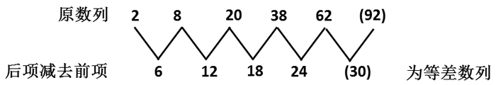

故正确答案为B。

**来源**：2008年湖北省公务员录用考试《行测》题（A类）第31题

### 第 32 题

2，7，13，20，25，31，（    ）

A. 35

B. 36

C. 37

D. 38

第 32 题 · 答案与解析

**参考答案（粉笔题库参考内容）**

D

**解析**

用后一项减去前一项，分别得到5、6、7、5、6，可见，所给数列中，相邻两项的差是以5、6、7为一个循环，则数列第七项减去第六项应该为7，38-31=7。

故正确答案为D。

**来源**：2008年湖北省公务员录用考试《行测》题（A类）第32题

### 第 33 题

0，3，8，15，24，（    ）

A. 33

B. 35

C. 48

D. 49

第 33 题 · 答案与解析

**参考答案（粉笔题库参考内容）**

B

**解析**

题干中数列符合以下多级数列规律：

故正确答案为B。

**来源**：2008年湖北省公务员录用考试《行测》题（A类）第33题

### 第 34 题

1/2，1，4/3，19/12，（    ）

A. 133/60

B. 137/60

C. 107/60

D. 147/60

第 34 题 · 答案与解析

**参考答案（粉笔题库参考内容）**

C

**解析**

故正确答案为C。

**来源**：2008年湖北省公务员录用考试《行测》题（A类）第34题

### 第 35 题

1，2，4，4，1，（    ）

A. 16

B. 17

C. 1/32

D. 1/16

第 35 题 · 答案与解析

**参考答案（粉笔题库参考内容）**

C

**解析**

题干中数列符合以下三级数列规律：

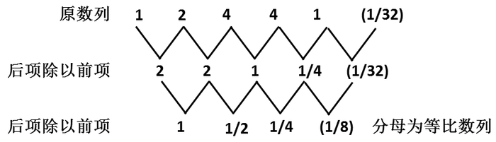

可见三级数列的分母为等比数列，往上递推可得正确答案为C。

故正确答案为C。

**来源**：2008年湖北省公务员录用考试《行测》题（A类）第35题

### 第 36 题

6，4，12，8，18，16，（    ），（    ）

A. 24，18

B. 20，32

C. 24，32

D. 18，64

第 36 题 · 答案与解析

**参考答案（粉笔题库参考内容）**

C

**解析**

原数列为交叉数列：

奇数项：6、12、18、（24）为等差数列；

偶数项：4、8、16、（32）为等比数列。

故正确答案为C。

**来源**：2008年湖北省公务员录用考试《行测》题（A类）第36题

### 第 37 题

8，18，181，11811，（    ）

A. 11181

B. 11118

C. 118111

D. 111811

第 37 题 · 答案与解析

**参考答案（粉笔题库参考内容）**

D

**解析**

观察数列可知以下规律：每次都比前项数位增加，先在前项数字最左边添加数字1，再在前项数字末尾添加数字1，最后在数字最左边和末尾分别添加数字1，故第5项应在第4项最左边添加数字1，得到111811。

故正确答案为D。

**来源**：2008年湖北省公务员录用考试《行测》题（A类）第37题

### 第 38 题

3，6，5，10，9，16，15，（    ）

A. 24

B. 17

C. 23

D. 25

第 38 题 · 答案与解析

**参考答案（粉笔题库参考内容）**

A

**解析**

原数列为交叉数列。

往上递推得答案为A。

故正确答案为A。

**来源**：2008年湖北省公务员录用考试《行测》题（A类）第38题

### 第 39 题

2，7，22，67，（    ）

A. 198

B. 176

C. 230

D. 202

第 39 题 · 答案与解析

**参考答案（粉笔题库参考内容）**

D

**解析**

题干中数列符合以下多级数列规律：

故正确答案为D。

**来源**：2008年湖北省公务员录用考试《行测》题（A类）第39题

### 第 40 题

15，7，12，6，9，5，（    ），（    ）

A. 6，4

B. 14，11

C. 6，5

D. 14，10

第 40 题 · 答案与解析

**参考答案（粉笔题库参考内容）**

A

**解析**

原数列为交叉数列。

奇数项：15、12、9、（6）为等差数列；

偶数项：7、6、5、（4）等差数列。

故正确答案为A。

**来源**：2008年湖北省公务员录用考试《行测》题（A类）第40题

### 第 41 题

如果每500米远架一根电线杆，则30公里需要架设多少根电线杆：

A. 31

B. 30

C. 61

D. 60

第 41 题 · 答案与解析

**参考答案（粉笔题库参考内容）**

C

**解析**

由单边线性植树计数模型易知，。

故正确答案为C。

**来源**：2008年湖北省公务员录用考试《行测》题（A类）第41题

### 第 42 题

四个房间，每个房间里不少于2人，任何三个房间里的人数不少于8人，这四个房间至少有多少人：

A. 9

B. 11

C. 10

D. 12

第 42 题 · 答案与解析

**参考答案（粉笔题库参考内容）**

B

**解析**

方法一：

设四个房间的人数分别为a、b、c、d，则

；

；

；

，

故，解得，故a+b+c+d的最小值为11。

故正确答案为B。

方法二：

若有三个房间中均为2人，则2+2+2=6&lt;8，不合题意；若有两个房间中均为2人，则其它两个房间每个房间至少为8-2-2=4人，总人数为8+4=12人；若有一个房间中为2人，则其他三个房间每个至少有3人，此时总人数为2+3+3+3=11人；若没有房间为2人，则总人数至少人。综上所述，总人数至少为11人。

故正确答案为B。

**考点**：非典型最值问题

**来源**：2008年湖北省公务员录用考试《行测》题（A类）第42题

### 第 43 题

从4时到5时，钟的时针与分针可成直线的机会有多少次：

A. 1

B. 2

C. 3

D. 4

第 43 题 · 答案与解析

**参考答案（粉笔题库参考内容）**

B

**解析**

从4时到5时，时针和分针有一次成0°角和一次成180°角的状态，故成直线的机会有2次。

故正确答案为B。

**来源**：2008年湖北省公务员录用考试《行测》题（A类）第43题

### 第 44 题

一个植树小组植树，如果每人栽6棵，还剩14棵；如果每人栽7棵，就缺4棵。这个植树小组一共要栽多少棵树：

A. 19

B. 59

C. 18

D. 122

第 44 题 · 答案与解析

**参考答案（粉笔题库参考内容）**

D

**解析**

解法1：

设该小组共有n人，则：6n+14=7n-4，解得n=18。于是一共需要栽树。

解法2：

树的数目应为整数，由整数特性可知：总数目加上4后必能被7整除，由此可排除A和C；总数目减去14后必能被6整除，再排除B项。

解法3：

由题意知，如果每人多栽7-6=1棵树则需增加14+4=18棵树苗用于栽种，故植树小组有，一共要栽树。

故正确答案为D。

**考点**：和差倍比问题

**来源**：2008年湖北省公务员录用考试《行测》题（A类）第44题

### 第 45 题

90张多米诺骨牌整齐地排成一列，依顺序编号1、2、3、······90。第一次拿走所有奇数位置上的骨牌，第二次再从剩余骨牌中拿走所有奇数位置上的骨牌，依此类推，请问最后剩下的一张骨牌的编号是多少：

A. 32

B. 64

C. 88

D. 16

第 45 题 · 答案与解析

**参考答案（粉笔题库参考内容）**

B

**解析**

原来的编号：1、2、3、4、5、6、7······87、88、89、90；

第一次取走后剩下：2、4、6、8、10······88、90；

第二次取走后剩下：4、8、12、16······80、84、88；

第三次取走后剩下：8、16、24、32······80、88。

通过分析发现：

第一次取走后剩下的骨牌编号为2的倍数；

第二次取走后剩下的骨牌编号为4=2^2的倍数；

······

第n次取走后剩下的骨牌编号为2^n的倍数。

故最后剩下的骨牌编号为90以内2的最大次方数，即为64。

故正确答案为B。

**来源**：2008年湖北省公务员录用考试《行测》题（A类）第45题

### 第 46 题

小明步行45分钟可从甲地到乙地，小华乘车15分钟可从乙地到甲地。当小明和小华在路上相遇时，小明已经走了30分钟，小华用车接小明返回乙地，还需要多少分钟：

A. 10

B. 15

C. 3

D. 5

第 46 题 · 答案与解析

**参考答案（粉笔题库参考内容）**

D

**解析**

解法1：

当小明和小华在路上相遇时，小明已走了的路程，距乙地还剩1/3路程，故从相遇处乘车返回乙地还需要。

解法2：

由题意知，小华乘车的速度是小明步行速度的倍，在相遇处小明还需步行45-30=15分钟才能抵达乙地，则乘车只需。

故正确答案为D。

**考点**：普通行程

**来源**：2008年湖北省公务员录用考试《行测》题（A类）第46题

### 第 47 题

青年义务服务队甲队原有35人，乙队原有176人，因任务需要，甲队人力应加强，现从预备队调来2人，再从乙队支援多少人后，甲队人数刚好是乙队人数的一半：

A. 35

B. 34

C. 33

D. 88

第 47 题 · 答案与解析

**参考答案（粉笔题库参考内容）**

B

**解析**

假设从乙队支援n人到甲队，列方程得：，解得n=34。

故正确答案为B。

**考点**：和差倍比问题

**来源**：2008年湖北省公务员录用考试《行测》题（A类）第47题

### 第 48 题

某服装厂要生产一批某种型号的学生服，已知每3米长的某种面料可做上衣2件，或做裤子3条。计划用300米长的这种布料生产学生服，应用多少米布料生产上衣，才能恰好配套：

A. 120

B. 150

C. 180

D. 210

第 48 题 · 答案与解析

**参考答案（粉笔题库参考内容）**

C

**解析**

解析1：

每套衣服共用布料，则300米的布料一共可以制作衣服，上衣共用料。

解析2：

根据题意可知在用料上上衣:裤子=3:2，故300米的布料应使用来生产上衣才能恰好配套。

故正确答案为C。

**考点**：和差倍比问题

**来源**：2008年湖北省公务员录用考试《行测》题（A类）第48题

### 第 49 题

一只小鸟离开在树枝上的鸟巢，向北飞了20米，之后又向东飞了20米，然后又向上飞了20米。最后，它沿着到鸟巢的直线飞回了家。请问小鸟飞行的总长度与下列哪个最接近：

A. 34米

B. 80米

C. 94米

D. 100米

第 49 题 · 答案与解析

**参考答案（粉笔题库参考内容）**

C

**解析**

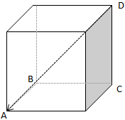

如上图所示，小鸟的飞行路径应为A-B-C-D-A，根据勾股定理知：。故小鸟的飞行总长，易知最终计算值大于80且小于100。

故正确答案为C。

**考点**：几何结论类-三角形相关

**来源**：2008年湖北省公务员录用考试《行测》题（A类）第49题

### 第 50 题

纽约时间是香港时间减13小时，你与一位在香港的朋友约定，香港时间6月1日晚上8时与他通电话，那么在纽约你应几月几日几时给他打了电话：

A. 6月1日上午7时

B. 5月31日上午7时

C. 6月2日上午9时

D. 6月2日上午7时

第 50 题 · 答案与解析

**参考答案（粉笔题库参考内容）**

A

**解析**

香港时间6月1日晚上8时即是20时，此时纽约时间应是20-13=7时，即6月1日上午7时。

故正确答案为A。

**考点**：星期日期问题

**来源**：2008年湖北省公务员录用考试《行测》题（A类）第50题

### 第 51 题

从所给四个选项中，选择最合适的一个填入问号处，使之呈现一定的规律性：

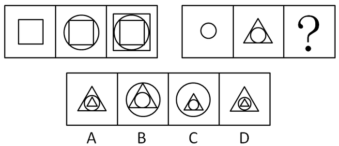

A. A

B. B

C. C

D. D

第 51 题 · 答案与解析

**参考答案（粉笔题库参考内容）**

B

**解析**

元素组成相似，元素叠加。

每组图前两个图形叠加得第三个图形，且叠加时两图间存在交点。

故正确答案为B。

**考点**：样式规律-加减同异

**来源**：2008年湖北省公务员录用考试《行测》题（A类）第51题

### 第 52 题

从所给四个选项中，选择最合适的一个填入问号处，使之呈现一定的规律性：

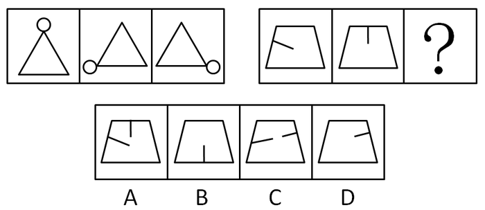

A. A

B. B

C. C

D. D

第 52 题 · 答案与解析

**参考答案（粉笔题库参考内容）**

D

**解析**

元素组成相同，考查位置规律。

第一组图形中小圆形依次逆时针平移到三角形的每个顶点上；第二组图形中一条线段在梯形内部顺时针平移到与梯形每边垂直相交的位置。

故正确答案为D。

**考点**：位置规律-平移

**来源**：2008年湖北省公务员录用考试《行测》题（A类）第52题

### 第 53 题

从所给四个选项中，选择最合适的一个填入问号处，使之呈现一定的规律性：

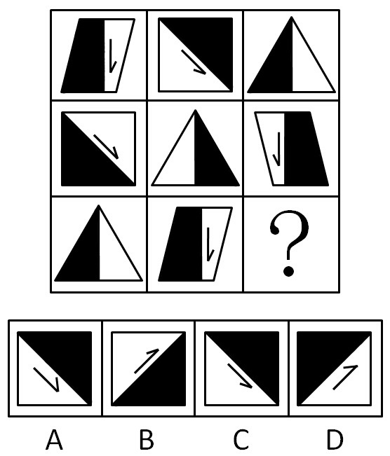

A. A

B. B

C. C

D. D

第 53 题 · 答案与解析

**参考答案（粉笔题库参考内容）**

C

**解析**

元素组成相似，考查位置和周遍变化。

下一行图形是由上一行图形往前移动一格，并且图形内作一次翻转变换而来。

故正确答案为C。

**考点**：位置规律-综合

**来源**：2008年湖北省公务员录用考试《行测》题（A类）第53题

### 第 54 题

从所给四个选项中，选择最合适的一个，使之呈现一定的规律性：

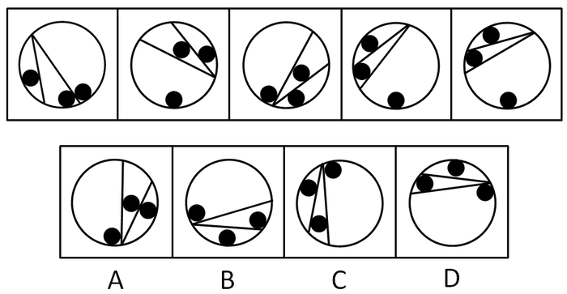

A. A

B. B

C. C

D. D

第 54 题 · 答案与解析

**参考答案（粉笔题库参考内容）**

B

**解析**

元素组成相同，考查位置规律。

每个图中小球的位置均可使小球保持稳定的平衡。

故正确答案为B。

**来源**：2008年湖北省公务员录用考试《行测》题（A类）第54题

### 第 55 题

从所给四个选项中，选择最合适的一个填入问号处，使之呈现一定的规律性：

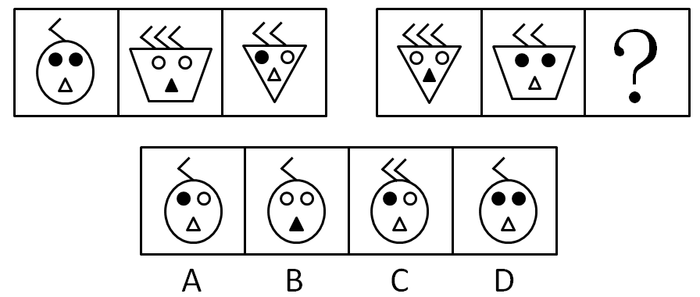

A. A

B. B

C. C

D. D

第 55 题 · 答案与解析

**参考答案（粉笔题库参考内容）**

A

**解析**

元素组成相似，元素遍历。

每组图中“头发”的个数1，2，3各出现一遍；“脸”的形状三角形、梯形、椭圆各出现一遍；“眼睛”均有三个黑圆、三个白圆；“嘴巴”均为一个黑三角、两个白三角。

故正确答案为A。

**考点**：样式规律-遍历

**来源**：2008年湖北省公务员录用考试《行测》题（A类）第55题

### 第 56 题

从所给四个选项中，选择最合适的一个填入问号处，使之呈现一定的规律性：

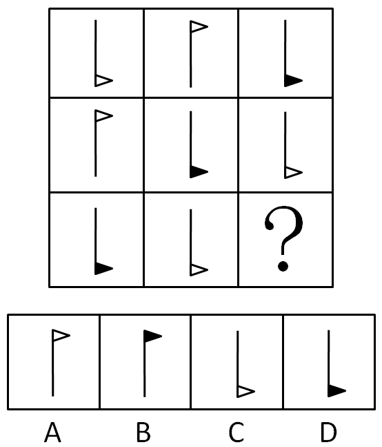

A. A

B. B

C. C

D. D

第 56 题 · 答案与解析

**参考答案（粉笔题库参考内容）**

A

**解析**

每一行均出现一个位置在上面的白三角形、位置在下面的黑三角形和位置在下面的白三角形。

故正确答案为A。

**考点**：样式规律-遍历

**来源**：2008年湖北省公务员录用考试《行测》题（A类）第56题

### 第 57 题

从所给四个选项中，选择最合适的一个填入问号处，使之呈现一定的规律性：

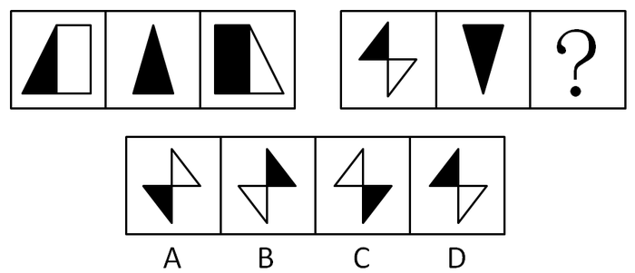

A. A

B. B

C. C

D. D

第 57 题 · 答案与解析

**参考答案（粉笔题库参考内容）**

A

**解析**

元素组成相似，综合考查阴影位置和属性。

每组图中第一和第三个图形互为轴对称，且黑白颜色互换。

故正确答案为A。

**来源**：2008年湖北省公务员录用考试《行测》题（A类）第57题

### 第 58 题

从所给四个选项中，选择最合适的一个填入问号处，使之呈现一定的规律性：

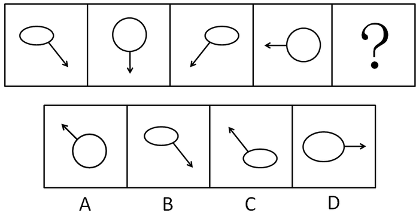

A. A

B. B

C. C

D. D

第 58 题 · 答案与解析

**参考答案（粉笔题库参考内容）**

C

**解析**

箭头位置明显发生变化，箭头的方向依次顺时针旋转45度，且椭圆和圆交替出现。

故正确答案为C。

**考点**：位置规律-旋转、样式规律-遍历

**来源**：2008年湖北省公务员录用考试《行测》题（A类）第58题

### 第 59 题

左边给定的是纸盒的外表面，下面哪一项能由它折叠而成？（  ）

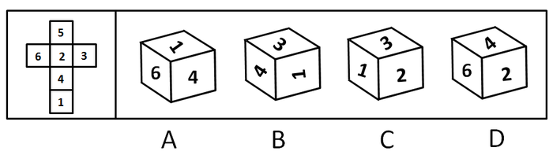

A. A

B. B

C. C

D. D

第 59 题 · 答案与解析

**参考答案（粉笔题库参考内容）**

B

**解析**

可以看出，折叠后1和2、3和6、4和5所在的面分别相对，排除A、C两项；1应该和4的方向一致，排除；D项中，4应该在底部，排除。

故正确答案为B。

**考点**：空间类-空间重构-六面体

**来源**：2008年湖北省公务员录用考试《行测》题（A类）第59题

### 第 60 题

从所给四个选项中，选择最合适的一个，使之呈现一定的规律性：

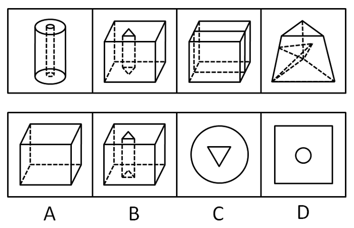

A. A

B. B

C. C

D. D

第 60 题 · 答案与解析

**参考答案（粉笔题库参考内容）**

B

**解析**

左边每个图形都是立体图形，而且图形内部都有其他结构。

故正确答案为B。

**来源**：2008年湖北省公务员录用考试《行测》题（A类）第60题

### 第 61 题

如果甲和乙都能获得奖学金，那么丙和丁也都能获得奖学金。遗憾的是丙没有获得奖学金，据此可推知：

A. 甲和乙都没获得奖学金

B. 甲和乙只有一人没获得奖学金

C. 丁获得奖学金

D. 甲和乙不可能都获得奖学金

第 61 题 · 答案与解析

**参考答案（粉笔题库参考内容）**

D

**解析**

第一步：翻译题干。

甲∧乙⇒丙∧丁

事实信息：﹣丙

第二步：从事实信息开始推导，得出答案。

题干推导关系后件是个联言命题，联言命题的一个命题肢不成立，整个联言命题都不成立，因此，由丙没有拿到奖学金，可知“丙和丁都能得到奖学金”为假，即从“﹣丙”可知“﹣（丙∧丁）”。“﹣（丙∧丁）”是否定题干推导关系的后件，根据逆否规则，否后件可以推出否前件，即“﹣（丙∧丁）⇒﹣（甲∧乙）”。再由摩根规则，“﹣（甲∧乙）”等价于“﹣甲∨﹣乙”，即甲和乙至少有一人没有获得奖学金，两人不可能同时获得奖学金。

故正确答案为D。

**考点**：常规翻译

**来源**：2008年湖北省公务员录用考试《行测》题（A类）第61题

### 第 62 题

以前在农村，只有男孩子才有读书的权利。张飞农村出来，并顺利地考上大学。那么张飞：

A. 与父母的关系搞得很好

B. 有头脑，接受了新思想

C. 是男孩，并受到了家里的重视

D. 是女孩，并受到家里的重视

第 62 题 · 答案与解析

**参考答案（粉笔题库参考内容）**

C

**解析**

第一步：翻译题干。

有读书的权利⇒男孩。张飞：考上大学。

第二步：根据题干事实信息推出答案。

张飞：考上大学⇒有读书的权利⇒是男孩。A、B为无关选项。

故正确答案为C。

**考点**：常规翻译

**来源**：2008年湖北省公务员录用考试《行测》题（A类）第62题

### 第 63 题

某校发生了一起抢劫案，公安局抓获了四名犯罪嫌疑人甲、乙、丙、丁，审讯他们时，

甲说：不是我干的。

乙说：是丁干的。

丙说：是乙干的。

丁说：不是我干的。

这四人中只有一人说了真话，那么抢劫案是谁干的：

A. 甲

B. 乙

C. 丙

D. 丁

第 63 题 · 答案与解析

**参考答案（粉笔题库参考内容）**

A

**解析**

第一步：找突破口。

乙和丁的话之间是矛盾关系，因此必为一真一假。

第二步：看其他的话。

本题只有一个人说了真话，因此甲和丙必为假话。因此可知是甲干的。

故正确答案为A。

**考点**：只有一真/一假

**来源**：2008年湖北省公务员录用考试《行测》题（A类）第63题

### 第 64 题

在50年代，我国森林覆盖率为19%，60年代为11%，70年代为6%，80年代不到4%。随着森林覆盖率的逐年减少，植被大量破坏，削弱了土地对雨水的拦蓄作用，一下暴雨，水卷泥沙滚滚而下使洪涝灾害逐年严重。可见，森林资源的破坏，是酿成洪灾的原因。

以下哪项使用的方法与上文最类似：

A. 棉花是植物纤维，疏松多孔，能保温。积雪是由水冻结而成的，有40%至50%的空气间隙，也是疏松多孔的，能保温。可见，疏松多孔是能保温的原因

B. 把一群鸡分为两组，一组喂精白米，鸡得一种病，脚无力，不能行走，症状与人的脚气病相似。另一组用带壳稻米喂，鸡不得这种病。由此推测带壳稻米含有某些精白米中所没有的东西，它是避免得脚气病的原因。进一步研究发现，这种东西就是维生素B1

C. 意大利的雷地反复进行一个实验，在4个大口瓶里，放进肉和鱼，然后盖上盖或蒙上纱布，苍蝇进不去，一个蛆都没有。另4个大口瓶里，放进同样的肉和鱼，敞开瓶门，苍蝇飞进去产卵，腐烂的肉和鱼很快生满了蛆。可见，苍蝇产卵是鱼肉腐烂生蛆的原因

D. 在有空气的玻璃罩内通电击铃，随着抽出空气量的变化，铃声越来越小。若把空气全抽出，则完全听不到铃声。可见，声音是靠空气传播的

第 64 题 · 答案与解析

**参考答案（粉笔题库参考内容）**

D

**解析**

第一步：翻译题干。

森林覆盖率逐年减少⇒洪涝灾害逐年严重，结论：森林资源被破坏⇒酿成洪灾。

题干的推导方法是，从一种现象的变化引起另一种现象的变化，得出前一现象是后一现象的原因。

第二步：逐一翻译选项并判断正确答案。

A项，棉花疏松多孔⇒能保温，积雪疏松多孔⇒能保温，结论：疏松多孔⇒能保温；

B项，喂精白米的鸡⇒得病，喂带壳稻米的鸡⇒不得病，结论：带壳稻米含有某些精白米中所没有的东西⇒避免得脚气病；

C项：没有苍蝇进瓶里⇒没有蛆，有苍蝇进瓶里⇒有蛆，结论：苍蝇产卵⇒有蛆；

D项：空气量逐渐减少⇒铃声逐渐变小，结论：空气⇒声音传播。

对比选项和题干的格式，只有D项和题干一样，通过两种现象之间的变化的关系，得出前一种现象是后一种现象的原因；

A项根据具体现象推导因果关系；

B、C两项都是通过求同求异并用法来推导因果关系，与题干的推导方法不同。

故正确答案为D。

**考点**：论证结构

**来源**：2008年湖北省公务员录用考试《行测》题（A类）第64题

### 第 65 题

马明、刘建、张义三个男同学各有一个妹妹，这天，六个人一起打羽毛球，举行的是男女混合双打，并且规定，兄妹俩人不搭伴。

第一盘对局的情况是：刘建和小萍对张义和小英。

第二盘对局的情况是：张义和小红对刘建和马明的妹妹。

根据题干的条件，以下哪项为真：

A. 刘建和小红、马明和小英、张义和小萍各是兄妹

B. 刘建和小英、马明和小萍、张义和小红各是兄妹

C. 刘建和小萍、马明和小英、张义和小红各是兄妹

D. 刘建和小红、马明和小萍、张义和小英各是兄妹

第 65 题 · 答案与解析

**参考答案（粉笔题库参考内容）**

A

**解析**

每个选项均给出完整的排列组合情况，所以可用排除法。

找到题干中的突破口：张义分别和小英、小红搭伴，因此张义的妹妹是小萍。

故正确答案为A。

**考点**：排除法

**来源**：2008年湖北省公务员录用考试《行测》题（A类）第65题

### 第 66 题

有一则电视广告说，草原绿鸟鸡，饿了吃青草，馋了吃蚂蚱，似乎在暗示该种鸡及其鸡蛋的营养价值与该种鸡所吃的草原食物有关。

为了验证这个结论，下面哪种实验方法最可靠：

A. 选择一优良品种的蛋鸡投放到草原上喂养，然后与在非草原喂养的普通鸡的营养成分相比较

B. 化验、比较草原上的鸡食物和非草原上的鸡食物的营养成分

C. 选择品种、等级完全相同的蛋鸡，一半投放到草原上喂养，一半在非草原喂养，然后比较它们的营养成分

D. 选出不同品种的蛋鸡，投放到草原上喂养，然后比较它们的切实有效成分

第 66 题 · 答案与解析

**参考答案（粉笔题库参考内容）**

C

**解析**

第一步：找出论点和论据。

论点：该种鸡及其鸡蛋的营养价值与该种鸡所吃的草原食物有关。

论据：无。

只有论点没有论据，加强可以考虑补充论据，如解释原因、举例。

第二步：逐一分析选项。

A项：鸡的品种和食物均不同，无法确定食物是影响鸡蛋营养价值的唯一因素，实验无效，无法加强，排除；

B项：即使食物营养成分不同，也无法确定鸡会因食物不同产出营养价值不同的鸡蛋，不明确选项，无法加强，排除；

C项：其他条件相同，只考查草原食物和营养价值两者间的变化，实验有效，补充论据加强，当选；

D项：蛋鸡都在草原上喂养，无法说明食物是否会影响蛋鸡的营养价值，实验无效，无法加强，排除。

故正确答案为C。

**考点**：补充论据

**来源**：2008年湖北省公务员录用考试《行测》题（A类）第66题

### 第 67 题

在美国与欧洲某国作战期间，美国海军为招募兵员，曾经在全国广为散发海报。当时最有名的广告是这样说的：美国海军的死亡率比纽约市民的还要低。面对质询，负责的海军官员解释说：“根据统计，现在纽约市民每年的死亡率是16%，而尽管是战时，美国海军士兵的死亡率也不过9%。”

如果以上资料为真，则以下哪项能够解释上述看起来很让人怀疑的结论：

A. 在战争期间，由于有部分海军负担运输任务，并不直接参战，因而海军士兵的死亡率要低于陆军士兵

B. 上述统计中的纽约市民包括生存能力较差的婴儿、老人和病人等

C. 由于美国海军有一定实力，作战时伤亡较小，敌军更喜欢攻击没有什么抵抗能力的普通市民

D. 美国海军的这种宣传主要是为了鼓动人们入伍，所以，其中不免有夸张的成分

第 67 题 · 答案与解析

**参考答案（粉笔题库参考内容）**

B

**解析**

第一步：找出论点和论据。

论点：美国海军的死亡率比纽约市民的还要低。

论据：根据统计，现在纽约市民每年的死亡率是16%，而尽管是战时，美国海军士兵的死亡率也不过9%。

本题为原因解释题，题干矛盾在于为何即便在作战时海军的死亡率会比纽约市民平时的还要低，选择能够解释这一矛盾的选项即可。

第二步：逐一分析选项。

A项对比的是海军士兵和陆军士兵的死亡率，跟市民平时死亡率比海军士兵作战时死亡率高无关，排除；

B项说明有的市民生存能力差，有老弱病残，死亡率自然就会高，而士兵多为优中选优，身体素质好，死亡率相应就低，能够解释为何即便在作战时海军的死亡率也比市民平时的死亡率还要低，当选；

C项只能说明海军有一定实力，作战伤亡小，但是题干讨论的不仅仅是作战时海军士兵和市民二者死亡率的对比，而是说即便作战时，海军士兵的死亡率也比市民平时的死亡率低，不能解释题干的矛盾，排除；

D项说的是海军的宣传目的，跟市民平时死亡率比海军士兵作战时死亡率高无关，排除。

故正确答案为B。

**考点**：原因解释

**来源**：2008年湖北省公务员录用考试《行测》题（A类）第67题

### 第 68 题

面对日益严峻的环境污染和生态失衡，“我们只有一个地球”这一口号具有强烈的震撼力。它提醒人们注意环境保护的重要性。

以下哪项与这句口号的提出者的想法最接近：

A. 在宇宙中，其他的星球都不可能有生命存在

B. 在宇宙中，即使有其他的星球适宜人类居住，人类也无法迁往那个星球

C. 人类不可能找到比地球更适宜自己居住的星球了

D. 只有温暖的阳光和充足的雨水才可以生存

第 68 题 · 答案与解析

**参考答案（粉笔题库参考内容）**

C

**解析**

第一步：抓住题干主要信息。

题干的逻辑主线为：因为“我们只有一个地球”，所以人类要注意保护环境。

第二步：分析题干信息，并结合选项得出答案。

口号提出者通过强调地球只有一个来说明保护环境的重要性，说明口号提出者认为地球对人类的生存极为重要，地球是最适宜人类居住的星球，C项的表述与口号提出者的想法最为接近；

题干只强调地球的唯一性和重要性，其他星球是否有可能存在生命、人类能否迁往其他星球、人类需要什么样的环境才能生存，在题干中均没有体现，无法推出，A、B、D均属于无关选项。

故正确答案为C。

**考点**：日常结论

**来源**：2008年湖北省公务员录用考试《行测》题（A类）第68题

### 第 69 题

在过去的3年中，发生了6架W66客机坠毁事件。面对一幕幕惨剧，人们不由得怀疑W66客机的设计有问题。而制造商反驳说，每次事故调查都说明，事故责任是驾驶员操作失误。

上述制造商的话基于以下哪个前提：

A. W66的设计不是造成驾驶员犯错，从而导致飞机失事的原因

B. 由于设计错误引起的飞机失事，与由于制造方面的缺陷导致的飞机失事是可以区别开来的

C. 怀疑W66设计有问题的人并没有查出任何设计问题

D. 对于W66这种类型的飞机，每3年发生6起坠毁事件的事故发生率并不算高

第 69 题 · 答案与解析

**参考答案（粉笔题库参考内容）**

A

**解析**

第一步：找到论点和论据。

论点：W66客机失事的原因不是因为设计有问题。

论据：事故责任是驾驶员操作失误。

第二步：判断加强方式。

由于论据与论点之间是交叉关系，因此需要加强论证。

第三步：逐一判断选项。

A项说明操作失误与设计有问题没有交叉，即排除了操作失误是由于设计问题导致的，加强了论证；

B项只将设计错误与制造缺陷区分，未提到导致失事的原因，为无关选项；

C项中未查出有问题不是没有问题，因此排除；

D项没有失事的原因，为无关选项。

故正确答案为A。

**考点**：必要条件

**来源**：2008年湖北省公务员录用考试《行测》题（A类）第69题

### 第 70 题

一切有利于生产力发展的方针政策都是符合人民根本利益的。改革开放有利于生产力的发展，所以改革开放是符合人民根本利益的。

以下哪种推理方式与上面的这段论述最为相似：

A. 一切行动听指挥是一支队伍能够战无不胜的纪律保证。所以，一个企业，一个地区要发展，必须提倡令行禁止，服从大局

B. 经过对最近六个月销售的健身器跟踪调查，没有发现一台因质量问题而退货或返修。因此，可以说这批健身器的质量是合格的

C. 如果某种产品超过了市场需求，就可能出现滞销现象。“草群”领带的供应量大大超过了市场需求，因此，一定会出现滞销现象

D. 凡是超越代理人权限所签的合同都是无效的。这份房地产建设合同是超越代理权限签订的，所以它是无效的

第 70 题 · 答案与解析

**参考答案（粉笔题库参考内容）**

D

**解析**

第一步：翻译题干。

有利于发展生产力⇒符合人民根本利益，改革开放⇒有利于生产力发展，改革开放⇒符合人民根本利益。

第二步：逐一判断选项。

A项，战无不胜⇒听从指挥，因此要发展⇒服从大局；

B项，没有退货或返修⇒质量合格；

C项，商品超过市场需求⇒滞销，“草群”领带超过市场需求⇒滞销；

D项，超越权限⇒无效，房地产合同⇒超越权限，房地产合同⇒无效。

故正确答案为D。

**考点**：推理形式

**来源**：2008年湖北省公务员录用考试《行测》题（A类）第70题

### 第 71 题

外部不经济，是指一种经济行为对其本身和外部产生出来的负效益。

下列选项中，属于外部不经济现象的是：

A. 学校周边钢厂的烟囱冒出黑色灰尘

B. 国家出资提高公众健康水平

C. 湘江岸边的造纸厂流出经处理合格的水

D. 吃完东西后将包装用的塑料袋扔到分类的垃圾箱

第 71 题 · 答案与解析

**参考答案（粉笔题库参考内容）**

A

**解析**

第一步：抓住定义中的关键词。

定义中强调“经济行为”、“对其本身和外部”、“负效益”。

第二步：逐一判断选项。

B、C、D中行为产生的均为正效益，与定义相悖。

故正确答案为A。

**考点**：单定义-其他句式

**来源**：2008年湖北省公务员录用考试《行测》题（A类）第71题

### 第 72 题

转移收入，是指来自非生产、交换过程的收入，如资助、赠与和遗产收入等各种形式的转移收入。下列选项中，有关转移收入说法正确的是（    ）。

A. 转移收入是给予者自愿的，与生产、交换的竞争无关

B. 转移收入与工资、业主利润等一样，属于生产、交换过程的范畴

C. 转移收入的存在是因为产权使用效率的提高

D. 以上说法均不正确

第 72 题 · 答案与解析

**参考答案（粉笔题库参考内容）**

A

**解析**

第一步：判断题干中的关键词。

方式：来自非生产、交换过程。

结果：资助、赠与和遗产收入等各种形式。

第二步：逐一分析选项。

A项，“自愿”符合赠与和遗产收入的规定，与生产、交换的竞争无关，符合定义关键词。

B项，“属于生产、交换过程的范畴”与关键词相悖，不符合定义。

C项，产权使用效率高与转移收入定义无关，不符合定义。

D项，A选项正确，故该项错误。

第三步：再次标注答案。

故正确答案为A。

**考点**：单定义-其他句式

**来源**：2008年湖北省公务员录用考试《行测》题（A类）第72题

### 第 73 题

基尼系数，是衡量分配不平等程度的重要指标。国际上通常认为，当基尼系数低于0.2表示收入绝对平均；0.3~0.4表示相对合理；0.4~0.5表示收入差距较大；0.6以上表示收入差距悬殊。

下列选项中，有关基尼系数说法不正确的是：

A. 基尼系数是测量收入平等的指标

B. 基尼系数可在0和1之间取任何值，收入分配越是趋向平等，基尼系数也越小

C. 我国城市基尼系数从1978年的0.15上升到2000年的0.32，这说明至2000年城市居民个人收入差距逐步拉大

D. 我国农村地区基尼系数在90年代为0.338左右，处于国际水平的相对合理区域

第 73 题 · 答案与解析

**参考答案（粉笔题库参考内容）**

A

**解析**

第一步：抓住定义中的关键词。

定义中强调“衡量分配不平等程度”。

第二步：逐一判断选项。

A中测量“收入平等”与定义中的衡量“分配不平等程度”不一致；

由定义中可推出B、C、D均正确。

本题为选非题，故正确答案为A。

**考点**：单定义-其他句式

**来源**：2008年湖北省公务员录用考试《行测》题（A类）第73题

### 第 74 题

质权，指为了担保债权的履行，债务人或第三人将其动产或权利移交债权人占有，当债务人不履行债务时，债权人有就其占有的财产优先受偿的权利。

根据以上定义，下面哪项属于质权：

A. 越某向梁某借款30万元，将自己的房屋作价15万元抵押给梁某，并依法进行了抵押登记

B. 孙某为了向银行借款50万，就找了当地一个声誉很好的陈某作担保，并送给他一条价值500元的好烟

C. 李某在乙处修理电视机，因为钱不够，就将自己的手表放在乙处，说第二天拿钱来，就把电视机取走

D. 钱某向赵某借了辆自行车，并且白纸黑字地写了借据

第 74 题 · 答案与解析

**参考答案（粉笔题库参考内容）**

C

**解析**

第一步：抓住定义中的关键词。

定义中强调“债务人”、“债权人”、“动产或权利的移交”等。

第二步：逐一判断选项。

选项A中房屋是不动产，所以不属于质权；

选项B不存在债务人和债权人的关系，也不属于质权；

选项C符合定义，属于质权；

选项D借自行车写借据也不存在动产和权利的移交。

故正确答案为C。

**考点**：方式目的

**来源**：2008年湖北省公务员录用考试《行测》题（A类）第74题

### 第 75 题

佣金，是指经纪人、代理商等中间人完成受委托事项后，由委托人向其支付的报酬。

下列选项中，属于佣金的是：

A. 某啤酒经销商，获取出厂价和批发价之间的10元差额

B. 小王是某公司职员，公司每月付他2000元工资

C. 某超市供销某品牌香烟，烟厂付超市10%的报酬

D. 经王某介绍，小李做成一笔大生意，为答谢王某，小李送上5千元红包

第 75 题 · 答案与解析

**参考答案（粉笔题库参考内容）**

C

**解析**

第一步：抓住定义中的关键词。

定义中强调“经纪人、代理商等中间人”、“由委托人向其支付的报酬”等。

第二步：逐一判断选项。

选项A并不是由委托人支付的；

选项B小王不属于中间人；

选项C符合佣金的定义；

选项D中王某与小李不构成委托与被委托关系。

故正确答案为C。

**考点**：主客体

**来源**：2008年湖北省公务员录用考试《行测》题（A类）第75题

### 第 76 题

国民财富，是指某个国家在特定时点上所拥有的各种有形生产资产、无形生产资产、天然资源（已探明或已收入使用）以及对外的金融净资产的总和。

下列选项中，不应计入国民财富的是：

A. 某制衣厂生产的价值5万元的布匹

B. 小王在学术研究上取得重大突破，并获得专利

C. 中国对外金融净资产

D. 深山里未被发现的金矿

第 76 题 · 答案与解析

**参考答案（粉笔题库参考内容）**

D

**解析**

第一步：抓住定义中的关键词。

定义中强调“有形生产资产、无形生产资产、天然资源（已探明或已收入使用）以及对外的金融净资产”等。

第二步：逐一判断选项。

选项A属于有形生产资产；

选项B属于无形生产资产；

选项C属于对外的金融净资产；

选项D是天然资源，但却是还未被发现的，不符合定义。

本题为选非题，故正确答案为D。

**考点**：单定义-其他句式

**来源**：2008年湖北省公务员录用考试《行测》题（A类）第76题

### 第 77 题

企业，是指具有法人地位、创造价值、增加效用、追求利润最大化的独立商品生产单位。

下列选项中，属于企业的是：

A. 主要给家人或客人做饭的家庭

B. 从事家庭式小商品生产的家庭企业

C. 部队里面的连队

D. 从事自给自足生产劳动的农户

第 77 题 · 答案与解析

**参考答案（粉笔题库参考内容）**

B

**解析**

第一步：抓住定义中的关键词。

定义中强调“独立商品生产单位”等。

第二步：逐一判断选项。

A中的家庭、C中的连队、D中的自给自足的农户均不涉及生产商品（即用来交换的物品），不是独立商品生产单位；

B中的家庭企业从事小商品生产，是独立商品生产单位，符合定义。

故正确答案为B。

**考点**：拆词

**来源**：2008年湖北省公务员录用考试《行测》题（A类）第77题

### 第 78 题

公共物品，是指在消费上具有非竞争性、非排他性的商品，供整个社会共同享用的物品。

下列选项中，不属于公共物品的是：

A. 警察提供的安全服务

B. 研究和开发

C. 环境保护

D. 商场的名牌电视机

第 78 题 · 答案与解析

**参考答案（粉笔题库参考内容）**

D

**解析**

第一步：判断定义中的关键词。

定义中强调“非竞争性”，“非排他性”，“供整个社会共同享用”等。

第二步：逐一判断选项。

D中商场中的名牌电视机是用来卖的，不是供整个社会共同享用的，具有竞争性和排他性，不符合定义，其余三项均符合定义规定。

本题为选非题，故正确答案为D。

**考点**：拆词

**来源**：2008年湖北省公务员录用考试《行测》题（A类）第78题

### 第 79 题

保险的最大诚信原则，是指保险双方当事人在签订和履行保险合同的整个过程中，必须诚实守信，以最大的诚意恪守信用，如实告知重要情况，不欺骗不隐瞒，并保证正确履行各自的权利和义务。

下列选项中，投保人没有履行最大诚信原则的是：

A. 刘某，因肝癌病休治疗。2005年7月，刘某所在装饰公司为全公司职员投保团体人身保险，公司在提交被保险人名单时，在健康状况一栏中说明了刘某因肝癌病休的情况

B. 张某，身体健康，在单位集体组织下投保简易人身保险，在投保单上“被保险人健康情况”一栏填“健康”两字

C. 新学期，学校让新生每人交纳了保险费25元，其中学生平安保险10元，附加疾病险15元。9月8日新生张某，腹部疼痛，经医院确诊为某先天性疾病。之后，张某住院治疗，张父向保险公司提出报销医药费

D. 李某患胃癌住院治疗，手术后出院，并正常参加工作。后来，李某经人介绍投保了简易人身险，填写投保单时没有申报身患癌症的事实

第 79 题 · 答案与解析

**参考答案（粉笔题库参考内容）**

D

**解析**

第一步：抓住定义中的关键词。

定义中强调“诚实守信”。

第二步：逐一判断选项。

D项中隐瞒身患癌症的事实明显不是诚实守信的行为，不符合定义，其余三项均符合定义关键词。

本题为选非题，故正确答案为D。

**考点**：拆词

**来源**：2008年湖北省公务员录用考试《行测》题（A类）第79题

### 第 80 题

思维指人脑对客观间接的概括的反映。根据思维过程中的凭借物或者思维状态的不同可以将思维分为：（1）动作思维，是指在思维过程中以实际动作作为支持的思维，特点为任务是直观的、以具体形式给予的，解决方式是实际动作；（2）形象思维，是指用表象来进行分析、综合、抽象、概括的过程，特点是借助鲜明、生动的客观形象；（3）抽象思维，是指借助概念、判断、推理等形式来反映客观事物的运动规律，对事物的本质特征和内部联系加以认识的过程。

下列哪项符合动作思维的定义：

A. 福尔摩斯通过在屋子找不到其他的出口，断定凶手一定是从屋顶的烟囱出去的，尽管烟囱很小

B. 洪熙官的儿子很小的时候就被要求每天看着父亲练武功。渐渐地，他也能跟着父亲一起比划起来

C. 刘教授喜欢在他的文章中通过列举大量的事例来说明问题

D. 建筑系的学生在设计建筑方案时有时候需要先根据建筑图纸制作出一个模型来，这样似乎更有助于发现建筑设计的缺陷

第 80 题 · 答案与解析

**参考答案（粉笔题库参考内容）**

B

**解析**

第一步：找出定义关键词。

思维：“人脑对客观间接的概括的反映”；

动作思维：“在思维过程中以实际动作作为支持”、“特点为任务是直观的、以具体形式给予的”、“解决方式是实际动作”；

形象思维：“用表象来进行分析、综合、抽象、概括的过程”、“特点是借助鲜明、生动的客观形象”；

抽象思维：“借助概念、判断、推理等形式来反映客观事物的运动规律”、“对事物的本质特征和内部联系加以认识的过程”。

第二步：逐一分析选项。

A项：判断凶手出口，是“借助概念、判断、推理等形式来反映客观事物的运动规律”，属于抽象思维，不符合定义，排除；

B项：父亲练武功儿子通过观察学会了，是“在思维过程中以实际动作作为支持”最后用实际动作解决，属于实际动作，符合定义，当选；

C项：列举事例，是“用表象来进行分析、综合、抽象、概括的过程”，属于形象思维，不是以实际的动作为支持的，不符合定义，排除；

D项：学生根据建筑图纸制作出一个模型来发现缺陷，是“用表象来进行分析、综合、抽象、概括的过程”，属于形象思维，不符合“在思维过程中以实际动作作为支持”，不符合定义，排除。

故正确答案为B。

**考点**：常规问法

**来源**：2008年湖北省公务员录用考试《行测》题（A类）第80题

### 第 81 题

（    ） 对于 思索 相当于 奔跑 对于 （    ）

A. 学习——运动

B. 思考——奔走

C. 考虑——走路

D. 动脑——锻炼

第 81 题 · 答案与解析

**参考答案（粉笔题库参考内容）**

B

**解析**

逐一代入选项。

A项：后一组词为种属关系，前一组词不构成种属关系，前后逻辑关系不一致，排除；

B项：两组词均为近义关系，前后逻辑关系一致，当选；

C项：前一组词为近义关系，后一组词为并列关系，前后逻辑关系不一致，排除；

D项：前一组词为近义关系，后一组词为交叉关系，前后逻辑关系不一致，排除。

故正确答案为B。

**考点**：语义关系-近义关系

**来源**：2008年湖北省公务员录用考试《行测》题（A类）第81题

### 第 82 题

莱茵河：欧洲

A. 多瑙河：北美洲

B. 非洲：尼罗河

C. 亚马逊河：南美洲

D. 亚洲：黄河

第 82 题 · 答案与解析

**参考答案（粉笔题库参考内容）**

C

**解析**

第一步：判断题干词语间的对应关系。

题干两词为对应关系，是位置的对应。

第二步：判断选项词语间的逻辑关系。

A中多瑙河位于欧洲；

B、D中前后词顺序与题干相反；

C中的亚马逊河位于南美洲。

故正确答案为C。

**考点**：逻辑关系-对应关系

**来源**：2008年湖北省公务员录用考试《行测》题（A类）第82题

### 第 83 题

《雷雨》：周朴园

A. 斯嘉丽：《飘》

B. 林黛玉：《红楼梦》

C. 《家》：高觉民

D. 《暴风骤雨》：九斤老太

第 83 题 · 答案与解析

**参考答案（粉笔题库参考内容）**

C

**解析**

第一步：判断题干词语间的逻辑关系。

题干两词为对应关系，是作品与作品中角色的对应。

第二步：判断选项词语间的逻辑关系。

A、B中两词顺序与题干相反，“九斤老太”出自鲁迅的小说集《呐喊》中的作品《风波》，高觉民是《家》中的角色。

故正确答案为C。

**考点**：逻辑关系-对应关系

**来源**：2008年湖北省公务员录用考试《行测》题（A类）第83题

### 第 84 题

农业：工业

A. 劳动：工资

B. 复印机：电脑

C. 高级：职称

D. 土地：果实

第 84 题 · 答案与解析

**参考答案（粉笔题库参考内容）**

B

**解析**

第一步：判断题干两词间的逻辑关系。

题干两词为并列关系。

第二步：判断选项词语间的逻辑关系。

A中两词为因果关系；

B中两词为并列关系；

C中两词为属性关系；

D中两词为对应关系。

故正确答案为B。

**考点**：逻辑关系-并列关系

**来源**：2008年湖北省公务员录用考试《行测》题（A类）第84题

### 第 85 题

（    ） 对于 愚笨 相当于 强壮 对于 （    ）

A. 傻子——青年

B. 智商——运动

C. 聪明——瘦弱

D. 机灵——灵活

第 85 题 · 答案与解析

**参考答案（粉笔题库参考内容）**

C

**解析**

第一步：将选项逐一代入，判断各选项前后部分的逻辑关系。

A中两词为属性关系，但前后两组的两词顺序不一致；

B中智商和愚笨不构成逻辑关系；

C中两词均为全同关系中的反义词关系；

D中前一组为反义词关系，后一组不是反义词。

第二步：逻辑关系相同即为答案。

故正确答案为C。

**考点**：语义关系-反义关系

**来源**：2008年湖北省公务员录用考试《行测》题（A类）第85题

### 第 86 题

二氧化碳 对于 干冰 相当于 （    ） 对于 （    ）

A. 一氧化碳——墨

B. 石墨——金刚石

C. 水——液体

D. 空气——氧气

第 86 题 · 答案与解析

**参考答案（粉笔题库参考内容）**

B

**解析**

第一步：判断题干词语间的对应关系。

题干两词为对应关系，是化学式相同的物质间不同状态的对应。

第二步：逐一判断选项。

A中两物质的化学式不同；

B中两词的化学式均为C，且状态不同；

C、D中的液体和空气不是纯净物，不存在化学式。

故正确答案为B。

**考点**：逻辑关系-对应关系

**来源**：2008年湖北省公务员录用考试《行测》题（A类）第86题

### 第 87 题

郭沫若 对于 （    ） 相当于 （    ） 对于 《管锥编》

A. 《女神》——钱钟书

B. 《炉中煤》——茅盾

C. 《死城》——鲁迅

D. 《人间词话》——周立波

第 87 题 · 答案与解析

**参考答案（粉笔题库参考内容）**

A

**解析**

第一步：将选项逐一代入，判断各选项前后部分的逻辑关系。

A中《女神》的作者是郭沫若，钱钟书是《管锥编》的作者，均为作品与其作者的对应；

B、C、D与题干组成的后一组词语均不构成逻辑关系。

第二步：逻辑关系相同即为答案。

故正确答案为A。

**考点**：逻辑关系-对应关系

**来源**：2008年湖北省公务员录用考试《行测》题（A类）第87题

### 第 88 题

网络日记 对于 （    ） 相当于 菠萝 对于 （    ）

A. 网络——苹果

B. 电脑——香蕉

C. 博客——凤梨

D. 写手——水果

第 88 题 · 答案与解析

**参考答案（粉笔题库参考内容）**

C

**解析**

第一步：将选项逐一代入，判断各选项前后部分的逻辑关系。

A、B中前两词均为对应关系，后两词均为并列关系；

C中两组词均可组成全同关系，且为同义词；

D中前两次为对应关系，后两词为种属关系。

第二步：逻辑关系相同即为答案。

故正确答案为C。

**考点**：逻辑关系-全同关系

**来源**：2008年湖北省公务员录用考试《行测》题（A类）第88题

### 第 89 题

（    ） 对于 舞蹈 相当于 探春 对于 （    ）

A. 唱歌——《西游记》

B. 探戈——《金瓶梅》

C. 杨贵妃——贾宝玉

D. 华尔兹——《红楼梦》

第 89 题 · 答案与解析

**参考答案（粉笔题库参考内容）**

D

**解析**

第一步：将选项逐一代入，判断各选项前后部分的逻辑关系。

A代入后前一组词为并列关系，后一组词不存在逻辑关系；

B代入后前一组为种属关系，后一组不构成逻辑关系；

C中前一组不构成逻辑关系，后一组为并列关系；

D中前一组为种属关系，后一组为对应关系，是作品与其中人物的对应。

第二步：逻辑关系相同即为答案。

D华尔兹属于舞蹈中的一种形式，探春属于红楼梦中的一个人物，因此选择D,而不是因为均存在逻辑关系，所以为正确答案。

故正确答案为D。

**考点**：逻辑关系-包容关系

**来源**：2008年湖北省公务员录用考试《行测》题（A类）第89题

### 第 90 题

（    ） 对于 铁观音 相当于 （    ） 对于 新闻联播

A. 咖啡——报纸

B. 茶——电视

C. 茶——新闻

D. 寺庙——电视

第 90 题 · 答案与解析

**参考答案（粉笔题库参考内容）**

C

**解析**

第一步：将选项逐一代入，判断各选项前后部分的逻辑关系。

A与题干不构成逻辑关系；

B中前一组为种属关系，后一组为对应关系，是新闻与其传播载体的对应；

C中两组均为种属关系；

D中前一组不构成逻辑关系。

第二步：逻辑关系相同即为答案。

故正确答案为C。

**考点**：逻辑关系-包容关系

**来源**：2008年湖北省公务员录用考试《行测》题（A类）第90题

### 第 91 题

科学揭示燃烧现象的是：

A. 哥白尼

B. 牛顿

C. 拉瓦锡

D. 爱迪生

第 91 题 · 答案与解析

**参考答案（粉笔题库参考内容）**

C

**解析**

C项正确，法国著名化学家安托万-洛朗·拉瓦锡于1777年向巴黎科学院提出了一篇报告《燃烧概论》，阐明了燃烧作用的氧化学说，科学揭示了燃烧现象，也彻底地推翻了燃素说；

A、B、D错误，哥白尼解释的是日心说，牛顿揭示了万有引力定律，爱迪生则是发明家，发明了电灯，开创了现代对电的利用。

故正确答案为C。

**考点**：化学常识

**来源**：2009年广西壮族自治区公务员录用考试《行测》题第21题

### 第 92 题

下列选项中，属于十七大报告首次提出的是：

A. 环境保护

B. 创造条件让更多群众拥有财产性收入

C. 分配更加注重公平

D. 廉政文化

第 92 题 · 答案与解析

**参考答案（粉笔题库参考内容）**

B

**解析**

十七大报告中首次提出的是“创造条件让更多群众拥有财产性收入”。

故正确答案为B。

**考点**：重要文件

**来源**：2008年湖北省公务员录用考试《行测》题（A类）第92题

### 第 93 题

孔子的学生们追忆孔子日常教诲和生活行为，整理成一部语录体书，称作（    ），这部书成为儒家的经典，对后世有很大影响。

A. 《尚书》

B. 《春秋》

C. 《诗》

D. 《论语》

第 93 题 · 答案与解析

**参考答案（粉笔题库参考内容）**

D

**解析**

A项错误，《尚书》又称《书》、《书经》，为一部多体裁文献汇编，是中国现存最早的史书；

B项错误，《春秋》是古代中国的儒家典籍，被列为“五经”之一。《春秋》是鲁国的编年史，传说是由孔子修订的；

C项错误，《诗》又称《诗经》，是我国第一部诗歌总集，收入自西周初年至春秋中叶五百多年的诗歌311篇，又称《诗三百》；

D项正确，《论语》由孔子的弟子及其再传弟子编撰而成。它以语录体和对话文体为主，记录了孔子及其弟子言行，集中体现了孔子的政治主张、论理思想、道德观念及教育原则等。

故正确答案为D。

**考点**：文学常识

**来源**：2008年湖北省公务员录用考试《行测》题（A类）第93题

### 第 94 题

当前，在新的历史时期，我国的统一战线被称为：

A. 民主统一战线

B. 统一战线

C. 社会主义统一战线

D. 爱国统一战线

第 94 题 · 答案与解析

**参考答案（粉笔题库参考内容）**

D

**解析**

新民主主义革命时期的统一战线经历了四个阶段：

第一个阶段——统一战线的产生和第一次国共合作（1921年~1927年）被称为革命统一战线；

第二个阶段——土地革命时期的统一战线（1927年~1937年）；

第三个阶段——抗日民族统一战线和第二次国共合作（1937年~1945年）；

第四个阶段——解放战争时期的人民民主统一战线（1945年~1949年）。

他们都属于早期统一战线，不属于新的历史时期的统一战线。

新中国成立后，主要是社会主义革命和建设时期的统一战线，时间是从中华人民共和国建立直到1978年党的十一届三中全会召开之前。

改革开放后，形成了建设有中国特色社会主义新时期的统一战线：从1978年12月党的十一届三中全会召开至今，这一时期的统一战线称为爱国统一战线。

故正确答案为D。

**考点**：中国历史

**来源**：2008年湖北省公务员录用考试《行测》题（A类）第94题

### 第 95 题

行政相对人若对北京海关的具体行政行为不服的，应向（    ）申请行政复议。

A. 北京市人民政府

B. 海关总署

C. 北京海关

D. 监察部

第 95 题 · 答案与解析

**参考答案（粉笔题库参考内容）**

B

**解析**

本题考查法律常识。

《行政复议法》第二十七条规定：“对海关、金融、外汇管理等实行垂直领导的行政机关、税务和国家安全机关的行政行为不服的，向上一级主管部门申请行政复议。”

故正确答案为B。

**考点**：行政法

**来源**：2008年湖北省公务员录用考试《行测》题（A类）第95题

### 第 96 题

我国对作品实行（    ）原则，作者在作品完成时即取得著作权，受法律保护。

A. 实际履行

B. 协作履行

C. 自动保护

D. 先申请

第 96 题 · 答案与解析

**参考答案（粉笔题库参考内容）**

C

**解析**

我国《著作权法》明确规定，作品实行自动保护，作品完成即取得著作权。

故正确答案为C。

**考点**：民法典

**来源**：2008年湖北省公务员录用考试《行测》题（A类）第96题

### 第 97 题

“共产主义是没有剥削的制度，产品极大丰富，各尽所能，按需分配。按需分配，没有极大丰富的物质条件是不可能的，要实现共产主义，一定要完成社会主义阶段的任务。”社会主义阶段的任务很多，但根本的一条就是：

A. 满足人们对物质财富的需求

B. 协调经济基础与上层建筑的矛盾

C. 发展生产力

D. 群众利益无小事，维护人民利益

第 97 题 · 答案与解析

**参考答案（粉笔题库参考内容）**

C

**解析**

发展生产力是社会主义本质的内在要求。发展生产力是解决社会主义初级阶段主要矛盾的客观要求。初级阶段的主要矛盾是人民日益增长的物质文化需要同落后的社会生产之间的矛盾。这一矛盾的主要方面是落后的社会生产力。发展生产力是体现社会主义制度优越性的基本条件。也就是说，社会主义阶段的根本任务是发展生产力。

故正确答案为C。

**来源**：2008年湖北省公务员录用考试《行测》题（A类）第97题

### 第 98 题

“善泳者溺，善骑者堕，各以其所好反自为祸。”古人这句话给我们的哲学启示是：

A. 事物在一定条件下是可以转化的

B. 要透过现象认识事物的本质

C. 人可以得于长处，也可以失于长处

D. 矛盾的主要方面决定事物的本质

第 98 题 · 答案与解析

**参考答案（粉笔题库参考内容）**

A

**解析**

“善泳者溺，善骑者堕，各以其所好反自为祸”，这说明事物在一定条件下是可以转化的。

B、C、D项皆与此无关。

故正确答案为A。

**考点**：唯物辩证法

**来源**：2008年湖北省公务员录用考试《行测》题（A类）第98题

### 第 99 题

国务院发布的《耕地占用税条例》规定：“本条例的实施办法，由各省、自治区、直辖市人民政府根据本条例的规定，结合本地区的实际情况制定，并报财政部备案。”据此，各省级人民政府制定实施办法的行为属于：

A. 特别授权立法

B. 中央行政立法

C. 补充性立法

D. 一般授权立法

第 99 题 · 答案与解析

**参考答案（粉笔题库参考内容）**

C

**解析**

A项错误，特别授权立法是指依据特定法律、法规授权或者依据国家权力机关或上级国家行政机关通过专门决议的委托，制定规范性法律文件的行为。

B项错误，中央行政立法是指中央行政机关即国务院及其各部门制定行政法规和部门规章的活动。

C项正确，补充性立法是指行政机关为补充法律、法规在某个具体方面内容的不足而进行的行政立法活动。

D项错误，一般授权立法是指国家行政机关直接依照宪法和有关组织法规定的职权，制定行政法规和行政规章的活动属于国家行政机关直接依照宪法和有关组织法规定的职权，制定行政法规和行政规章的活动。

各省、自治区、直辖市制定本省实施办法，符合定义中补充性立法的定义。

故正确答案为C。

**考点**：宪法

**来源**：2008年湖北省公务员录用考试《行测》题（A类）第99题

### 第 100 题

邓小平坚持马克思主义的思想路线，把“解放思想”和“实事求是”联系起来表述，更鲜明地体现了马克思主义思想体系的开放性，体现了它的（  ）的统一。

A. 科学性、理论性和实践性

B. 科学性、理论性和革命性

C. 理论性、实践性和革命性

D. 实践性、科学性和革命性

第 100 题 · 答案与解析

**参考答案（粉笔题库参考内容）**

D

**解析**

实践性、革命性和科学性的统一是马克思主义哲学的根本特征，同时，邓小平对实事求是思想路线的贡献主要表现为：从世界观和方法论的统一上升华了“实事求是”；率先倡导重新确立了党的实事求是的思想路线；把实事求是的思想路线上升为一个完整的系统；提出并论证了实事求是与解放思想的辨证统一；阐明了思想路线同政治路线、组织路线的关系；强调了实事求是的思想路线与群众路线的统一；坚持了系统的实事求是的思想方法和工作方法；身体力行，为全党树立了坚持实事求是的榜样。

故正确答案为D。

**来源**：2008年湖北省公务员录用考试《行测》题（A类）第100题

### 第 101 题

我国刑法规定的“在我国领域内犯罪”是指：

A. 受害人居住在我国领域内

B. 犯罪人居住在我国领域内

C. 犯罪行为或结果有一项发生在我国领域内

D. 受害人与犯罪人均居住在我国领域内

第 101 题 · 答案与解析

**参考答案（粉笔题库参考内容）**

C

**解析**

A、B、D错误，刑法第六条第三款规定：“犯罪的行为或结果有一项发生在中华人民共和国领域内，就认为是在中华人民共和国领域内犯罪。”因此排除A、B、D。

故正确答案为C。

**考点**：刑法

**来源**：2008年湖北省公务员录用考试《行测》题（A类）第101题

### 第 102 题

邓小平同志曾深刻指出：“我们评价一个国家的政治体制、政治结构和政策是否正确，关键看三条：第一是看国家的政局是否稳定；第二是看能否增进人民的团结，改善人民的生活；第三是看生产力是否得到持续发展。”这一重要论断深刻揭示了：

A. 社会发展与人的全面发展的辩证关系

B. 人民群众是社会的产物

C. 生产力和生产关系的辩证关系

D. 上层建筑和经济基础的辩证关系

第 102 题 · 答案与解析

**参考答案（粉笔题库参考内容）**

D

**解析**

吴邦国同志在《坚持中国特色社会主义政治发展道路 努力把人大工作提高到一个新水平》一文中指出，邓小平的这番话深刻揭示了上层建筑和经济基础的辩证关系。

故正确答案为D。

**来源**：2008年湖北省公务员录用考试《行测》题（A类）第102题

### 第 103 题

近年来，某地的洪水泛滥越来越严重，对民生危害越来越大。造成洪水泛滥的原因之一是人类活动增多所造成的地球环境破坏，从哲学上看：

A. 事物之间存在着因果联系

B. 改造自然与人类活动存在着矛盾的关系

C. 人类活动必将引起自然灾害的出现

D. 洪水与自然灾害之间存在本质的联系

第 103 题 · 答案与解析

**参考答案（粉笔题库参考内容）**

A

**解析**

人类活动增多导致了地球环境遭到破坏，而地球环境遭到破坏有可能引起洪水泛滥，洪水泛滥对民生危害越来越大，这从哲学角度揭示了事物之间存在着因果联系。

故正确答案为A。

**考点**：唯物辩证法

**来源**：2008年湖北省公务员录用考试《行测》题（A类）第103题

### 第 104 题

“大头娃娃”主要是从小食用（    ）含量过少的劣质奶粉引起的。

A. 蛋白质

B. 脂肪

C. 葡萄糖

D. 维生素

第 104 题 · 答案与解析

**参考答案（粉笔题库参考内容）**

A

**解析**

由于小儿处于生长发育的阶段，对营养素尤其是蛋白质的需要相对较多，此时如母乳不足而未及时添加其他富含蛋白质的食品，奶粉配制过稀或长期服用蛋白质含量不足的劣质奶粉，突然停奶而未及时添加辅食，长期以淀粉类食品，如粥、米粉、奶糕等喂养均可导致“大头娃娃”的发生。

故正确答案为A。

**考点**：生物常识

**来源**：2008年湖北省公务员录用考试《行测》题（A类）第104题

### 第 105 题

《反不正当竞争法》中所说的商业秘密，是指不为公众所知悉，能为权利人带来经济利益，具有实用性并经权利人（    ）。

A. 采用的生产技术

B. 采用的科学成果

C. 采取保密措施的技术信息和经营信息

D. 采用的经营方式

第 105 题 · 答案与解析

**参考答案（粉笔题库参考内容）**

C

**解析**

本题考查《反不正当竞争法》中对商业秘密的规定。商业秘密是指不为公众所知悉，能为权利人带来经济利益，具有实用性并经权利人采取保密措施的设计资料、程序、产品配方、制作工艺、制作方法、管理诀窍、客户名单、货源情报、产销策略等技术信息和经营信息。A、B、D项缺少了经权利人采取保密措施这一商业机密的构成要件，而且所列内容只是商业机密的一部分，均排除。

故正确答案为C。

**考点**：其他法律法规

**来源**：2008年湖北省公务员录用考试《行测》题（A类）第105题

### 第 106 题

我国独立自主、自力更生和对外开放方针的主要理论基础是：

A. 矛盾的同一性和斗争性辩证关系原理

B. 内因和外因辩证关系原理

C. 矛盾的普遍性和特殊性辩证关系原理

D. 矛盾发展的不平衡性原理

第 106 题 · 答案与解析

**参考答案（粉笔题库参考内容）**

B

**解析**

独立自主、自立更生是内因，对外开放是外因，外因必须通过内因起作用，所以这一方针的主要理论基础是内因和外因辩证关系原理。

故正确答案为B。

**考点**：唯物辩证法

**来源**：2008年湖北省公务员录用考试《行测》题（A类）第106题

### 第 107 题

吊销违法者的经营许可证是：

A. 行政命令

B. 行政处罚

C. 行政处分

D. 行政强制执行

第 107 题 · 答案与解析

**参考答案（粉笔题库参考内容）**

B

**解析**

行政处罚包括人身罚、行为罚、财产罚、申诫罚四种。其中人身罚主要指行政拘留；行为罚主要指暂扣许可证件、降低资质等级、吊销许可证件、限制开展生产经营活动、责令停产停业、责令关闭、限制从业。财产罚主要指罚款、没收违法所得、没收非法财物；申诫罚主要指警告、通报批评。

故正确答案为B。

**考点**：行政法

**来源**：2008年湖北省公务员录用考试《行测》题（A类）第107题

### 第 108 题

《宪法》规定，中华人民共和国（    ）领导全国武装力量。

A. 国际部

B. 国家主席

C. 国务院

D. 中央军事委员会

第 108 题 · 答案与解析

**参考答案（粉笔题库参考内容）**

D

**解析**

《宪法》第九十三条规定：“中华人民共和国中央军事委员会领导全国武装力量。”

故正确答案为D。

**考点**：宪法

**来源**：2008年湖北省公务员录用考试《行测》题（A类）第108题

### 第 109 题

“蚯蚓爬上路，雨水乱如麻”这句气象谚语说明的生物现象是：

A. 蚯蚓是有氧呼吸的生物

B. 蚯蚓喜欢生活在水中

C. 蚯蚓不能生活在水中

D. 蚯蚓能预报天气变化

第 109 题 · 答案与解析

**参考答案（粉笔题库参考内容）**

D

**解析**

蚯蚓爬上路之后雨水乱如麻，说明蚯蚓能预报天气变化。这与蚯蚓是否能够或是否喜欢生活在水中无关，与有氧还是无氧呼吸也无关。

故正确答案为D。

**考点**：自然地理

**来源**：2008年湖北省公务员录用考试《行测》题（A类）第109题

### 第 110 题

我们党在长期执政条件下，保持先进性和增强创造力的决定性因素是（    ）。

A. 着重从思想上建党

B. 坚持批评与自我批评

C. 坚持解放思想、实事求是的思想路线，弘扬与时俱进的精神

D. 真正做到“三个代表”

第 110 题 · 答案与解析

**参考答案（粉笔题库参考内容）**

C

**解析**

本题考查保持党的先进性和增强党的创造力的决定性因素。

A项，思想建党是我们党的伟大创造和优良传统，是保持党的根本性质的内在要求，但不是能够保持党的先进性的决定性因素。该项应排除。

B项，批评与自我批评是中国共产党的三大作风之一。党内批评是解决党内矛盾、坚持真理、修正错误的基本方法，有助于党内团结和监督，但不是保持先进性和增强创造力的决定性因素。该项应排除。

C项，始终坚持解放思想、实事求是的思想路线，弘扬与时俱进的精神，才能保证我党在正确的道路上时刻行走在时代的前列，保持其先进性和创造性。该项应选。

D项，实现“三个代表”是我党保持先进性和增强创造力的目的，而不是决定性因素。该项应排除。

故正确答案为C。

**考点**：其他建设

**来源**：2008年湖北省公务员录用考试《行测》题（B类）第90题

### 第 111 题

下列属于内部行政行为的是：

A. 行政许可

B. 行政处罚

C. 行政强制

D. 行政处分

第 111 题 · 答案与解析

**参考答案（粉笔题库参考内容）**

D

**解析**

内部行政行为是指行政主体在内部行政组织管理过程中所作的只对行政组织内部产生法律效力的行政行为。

A项错误，行政许可是行政机关根据公民、法人或者其他组织的申请，经依法审查，准予其从事特定活动的行为，是对社会实施的外部管理行为，故排除；

B项错误，行政处罚是指行政机关依法对违反行政管理秩序的公民、法人或者其他组织，以减损权益或者增加义务的方式予以惩戒的行为，并不仅对内，故排除；

C项错误，行政强制是指行政机关或法定授权的组织依照法定权限和程序对公民的人身和公民法人和其他组织的财产加以限制的具体行政行为，故排除；

D项正确，行政处分是指国家机关、企事业单位对所属的国家工作人员违法失职行为尚不构成犯罪给予的一种惩戒。对所属员工，是一种内部行政行为。

故正确答案为D。

本题相关知识点：

内部行政行为与外部行政行为主要区别：

1．行为与相对人之间的关系不同。

实施内部行政行为的行政机关与该行政行为的相对人之间，必定存在一种领导与被领导的隶属关系以及其它隶属关系，或者存在一种监督与被监督的法定的监督关系。实施外部行政行为的行政机关与该行政行为的相对人之间，基本上不存在领导与被领导的隶属关系或者其它隶属关系，而只存在管理与被管理的关系。

2．行政行为的作用力不同。

内部行政行为通常只涉及行政机关的内部行政事务，其作用主要和行政机关的正常运转有关，不影响外部相对人的权利和义务；外部行政行为是行政机关对外行使公共权利的行为，因而直接影响着外部相对人的利益。

**考点**：行政法

**来源**：2008年湖北省公务员录用考试《行测》题（A类）第111题

### 第 112 题

有研究指出，私人保险支出越多的国家往往越富有，在这些国家，购买保险是一种大众化的投资手段，产生这种现象的主要原因是：

A. 贫穷国家开展保险事业的效果不大

B. 经济实力是保险业的坚实后盾，现代保险日益发达

C. 保险费用在总经济收入中所占的比重增长导致了基础投资不足

D. 保险只是富人或富国的事

第 112 题 · 答案与解析

**参考答案（粉笔题库参考内容）**

B

**解析**

题干中提到购买保险是一种大众化的投资手段。产生这一现象，表明必须有两个方面的原因，一是经济实力，二是保险业的发展。

故正确答案为B。

**考点**：宏观经济与调控政策

**来源**：2008年湖北省公务员录用考试《行测》题（A类）第112题

### 第 113 题

在新的发展观下，单一以GDP考核干部的情况将得到改进，新的考核体系将更加全面，这属于：

A. 由现象到本质

B. 由实践到认识

C. 由感性认识上升到理性认识

D. 用理性认识指导实践

第 113 题 · 答案与解析

**参考答案（粉笔题库参考内容）**

D

**解析**

用符合新的发展观的、更全面的新考核体系来考核干部情况，也就是用理性认识来指导实践。

故正确答案为D。

**考点**：认识论

**来源**：2008年湖北省公务员录用考试《行测》题（A类）第113题

### 第 114 题

关于平等，以下说法错误的是：

A. 平等是历史的范畴

B. 人人平等这一观念的确立是因为宗教的兴起和不断地传播

C. 平等是人与人之间对等对待的社会关系

D. 平等要求采取一视同仁的普遍原则，反对区别对待

第 114 题 · 答案与解析

**参考答案（粉笔题库参考内容）**

D

**解析**

平等是历史的范畴，平等要求采取一视同仁的普遍原则，但该一视同仁必须有例外，区别对待那些有特殊需要的人。

本题为选非题，故正确答案为D。

**考点**：唯物史观

**来源**：2008年湖北省公务员录用考试《行测》题（A类）第114题

### 第 115 题

下列做法中符合《公务员法》规定的是（    ）。

A. 某市税务局干部沈某到该市某国有企业中挂职锻炼一年

B. 公务员李某因在定期考核中被确定为基本称职，被降低一个职务层次任职

C. 某市公安局与技术员田某签订的公务员聘任合同，应当报该市组织部门批准

D. 公务员王某对其在定期考核中被定为基本称职不服，向有关部门提出申诉

第 115 题 · 答案与解析

**参考答案（粉笔题库参考内容）**

A

**解析**

A项正确，根据旧《公务员法》第六十六条规定：“根据培养锻炼公务员的需要，可以选派公务员到下级机关或者上级机关、其他地区机关以及国有企业事业单位挂职锻炼。”故表述正确。备注：根据新《公务员法》第七十二条规定：“根据工作需要，机关可以采取挂职方式选派公务员承担重大工程、重大项目、重点任务或者其他专项工作。公务员在挂职期间，不改变与原机关的人事关系。”本题关于挂职锻炼的说法已过时。

B项错误，根据《公务员法》第五十条第二款规定：“公务员在年度考核中被确定为不称职的，按照规定程序降低一个职务或者职级层次任职。”

C项错误，根据《公务员法》第一百条第一款规定：“机关根据工作需要，经省级以上公务员主管部门批准，可以对专业性较强的职位和辅助性职位实行聘任制。”

D项错误，根据《公务员法》第九十五条第一款规定：“公务员对涉及本人的下列人事处理不服的，可以自知道该人事处理之日起三十日内向原处理机关申请复核；对复核结果不服的，可以自接到复核决定之日起十五日内，按照规定向同级公务员主管部门或者作出该人事处理的机关的上一级机关提出申诉；也可以不经复核，自知道该人事处理之日起三十日内直接提出申诉：（四）定期考核定为不称职······”

故正确答案为A。

**考点**：行政法

**来源**：2008年湖北省公务员录用考试《行测》题（A类）第115题

## 材料 1

据某市统计，截止到2004年底，全市16岁以下的少年儿童总数是2272194人，其中，学龄前期儿童为739616人，占其总数的32.55%。另据有关资料显示，在我国目前抚养一个婴儿到16岁，农村平均需要1600元，城市平均需要6900元，全国平均2200元，2004年该市儿童消费主要体现在吃、穿、玩具等方面，不同年龄消费费用不同：在婴儿期内食品支出占总支出的81.5%，在幼儿期内占81.2%，在学龄前期占77.9%，在学龄期内占71.4%；在服装方面，学龄前儿童支出大体维持在总消费金额的13%左右，但进入学龄期后，占总体的21.8%。

### 第 116 题

在我国，城市抚养一个婴儿的费用相当于农村抚养一个婴儿的：

A. 3倍左右

B. 4倍左右

C. 5倍左右

D. 2倍左右

第 116 题 · 答案与解析

**参考答案（粉笔题库参考内容）**

B

**解析**

由题干条件知，在我国目前抚养一个婴儿到16岁，农村平均需要1600元，城市平均需要6900元，因。

故正确答案为B。

**考点**：文字资料、现期倍数

**来源**：2008年湖北省公务员录用考试《行测》题（A类）第116题

### 第 117 题

该市儿童在食品消费比例支出最大的是：

A. 婴儿期

B. 幼儿期

C. 学龄前期

D. 学龄期

第 117 题 · 答案与解析

**参考答案（粉笔题库参考内容）**

A

**解析**

该市儿童在婴儿期内食品支出占总支出的81.5%，在幼儿期内占81.2%，在学龄前期占77.9%，在学龄期内占71.4%。因81.5%为四个比例值中的最大值，知在婴儿期食品消费比例支出最大。

故正确答案为A。

**考点**：文字资料、直接找数

**来源**：2008年湖北省公务员录用考试《行测》题（A类）第117题

### 第 118 题

该市儿童在服装消费比例支出最大的是：

A. 婴儿期

B. 幼儿期

C. 学龄前期

D. 学龄期后

第 118 题 · 答案与解析

**参考答案（粉笔题库参考内容）**

D

**解析**

该市学龄前儿童服装消费支出大体维持在总消费金额的13%左右，进入学龄期后占总体的21.8%，易知在服装消费比例支出最大的是学龄期后。

故正确答案为D。

**考点**：文字资料、直接找数

**来源**：2008年湖北省公务员录用考试《行测》题（A类）第118题

### 第 119 题

该市当年16岁以下，学龄期以上的儿童比例是：

A. 四分之一左右

B. 四倍左右

C. 33.55%

D. 66.45%

第 119 题 · 答案与解析

**参考答案（粉笔题库参考内容）**

D

**解析**

由材料知，学龄期以上的儿童比例为，与D项中的66.45%最接近。

故正确答案为D。

**考点**：文字资料、现期比重

**来源**：2008年湖北省公务员录用考试《行测》题（A类）第119题

### 第 120 题

该市学龄期儿童的服装消费金额所占比例比学龄前儿童高出约：

A. 3.8%

B. 6.5%

C. 40.4%

D. 67.7%

第 120 题 · 答案与解析

**参考答案（粉笔题库参考内容）**

D

**解析**

该市学龄期儿童的服装消费金额所占比例比学龄前儿童高，仅D项符合。

故正确答案为D。

**考点**：文字资料、现期倍数

**来源**：2008年湖北省公务员录用考试《行测》题（A类）第120题

## 材料 2

2003年全球研发投入700强企业概况：

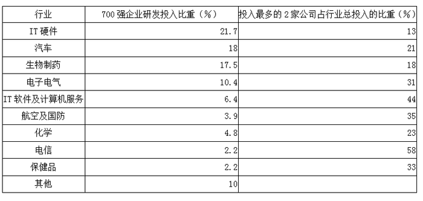

### 第 121 题

资料显示，2003年全球研发投入700强企业高度密集于哪四个行业：

A. IT硬件、汽车、保健品、电信

B. IT硬件、电子电气、工程、化学

C. IT硬件、汽车、生物制药、电子电气

D. 汽车、生物制药、电子电气、其他

第 121 题 · 答案与解析

**参考答案（粉笔题库参考内容）**

C

**解析**

由题干，2003年全球研发投入700强企业在各行业中的比重，IT硬件21.7%最高，之后依次为汽车18%、生物制药17.5%和电子电气10.4%。

故正确答案为C。

**考点**：直接找数、统计表

**来源**：2008年湖北省公务员录用考试《行测》题（A类）第121题

### 第 122 题

由资料显示，以下说法不正确的是：

A. 生物制药研发投入高于保健品投入15.3个百分点

B. 生物制药研发投入低于IT硬件4.2个百分点

C. 电信研发投入与保健品研发投入比重持平

D. 化学研发投入低于电子电气研发投入6个百分点

第 122 题 · 答案与解析

**参考答案（粉笔题库参考内容）**

D

**解析**

A选项正确，由表知，生物制药研发投入高于保健品投入17.5-2.2=15.3个百分点；

B选项正确，生物制药研发投入低于IT硬件21.7-17.5=4.2个百分点；

C选项正确，电信研发投入与保健品研发投入比重均为2.2%；

D选项错误，由题干，电子电气研发投入比重－化学研发投入比重=10.4%-4.8%=5.6%。

本题为选非题，故正确答案为D。

**考点**：统计表、综合分析

**来源**：2008年湖北省公务员录用考试《行测》题（A类）第122题

### 第 123 题

下列有关IT硬件研发投入说法不正确的是：

A. IT硬件研发投入高于IT软件及计算机服务15.3个百分点

B. IT硬件、IT软件及计算机服务研发投入之和占研发总投入的28.1%

C. IT硬件、IT软件及计算机服务研发投入之和，比汽车、生物制药、电子电气这三个行业研发投入要高

D. IT硬件、IT软件及计算机服务、汽车、生物制药研发投入占总投入的比重超过一半

第 123 题 · 答案与解析

**参考答案（粉笔题库参考内容）**

C

**解析**

A选项正确，IT硬件研发投入高于IT软件及计算机服务21.7-6.4=15.3个百分点；

B选项正确，IT硬件、IT软件及计算机服务研发投入之和占研发总投入的21.7%+6.4%=28.1%；

C选项错误，由题干知，IT硬件、IT软件及计算机服务研发投入比重之和，汽车、生物制药、电子电气三个行业研发投入比重之和，后者较大；

D选项正确，IT硬件、IT软件及计算机服务、汽车、生物制药研发投入占总投入的比重为28.1%+18%+17.5%>50%。

本题为选非题，故正确答案为C。

**考点**：统计表、综合分析

**来源**：2008年湖北省公务员录用考试《行测》题（A类）第123题

### 第 124 题

从研发经费投入最多的2家公司占行业总投入的比重数据看，行业投入经费高度集中于大型公司的是：

A. 电信

B. 保健品

C. 航空及国防

D. IT软件及计算机服务

第 124 题 · 答案与解析

**参考答案（粉笔题库参考内容）**

A

**解析**

由图表知，电信业研发经费投入最多的2家公司占行业总投入的比重为58%，是各个行业中最大的，而其他行业的该值均不超过44%。

故正确答案为A。

**考点**：直接找数、统计表

**来源**：2008年湖北省公务员录用考试《行测》题（A类）第124题

### 第 125 题

根据所给数据资料，可以推出的选项为：

\[1\]全球研发支出最多的企业基本上都是高科技企业

\[2\]2003年全球研发支出最多的700家企业高度密集于IT、汽车、生物制药、电子电气等行业

\[3\]电信行业中投入最多的2家公司的研发投入占电信行业研发总经费支出的“半壁江山”

A. \[1\]

B. \[3\]

C. \[1\] \[2\] \[3\]

D. \[1\] 与 \[3\]

第 125 题 · 答案与解析

**参考答案（粉笔题库参考内容）**

B

**解析**

从资料中无法判断700强企业是否就是全球研发支出最多的企业，所以\[1\]错误，可排除A、C和D。

700家企业和700强企业不是同一概念，所以\[2\]说法错误；电信业研发经费投入最多的2家公司占行业总投入的比重为58%，故\[3\]说法正确。

故正确答案为B。

**考点**：统计表、综合分析

**来源**：2008年湖北省公务员录用考试《行测》题（A类）第125题

## 材料 3

我国城乡居民收入差距

单位：元

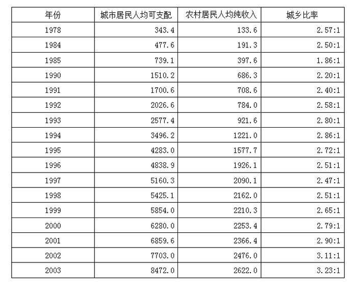

### 第 126 题

上表中，农村居民人均纯收入增加最多的年份为：

A. 1995年

B. 1993年

C. 1996年

D. 2003年

第 126 题 · 答案与解析

**参考答案（粉笔题库参考内容）**

A

**解析**

由图表知：

1993年农村居民人均纯收入增加；

1995年为；

1996年为；

2003年为。

故增加最多的年份为1995年。

故正确答案为A。

**考点**：增长量比较、统计表

**来源**：2008年湖北省公务员录用考试《行测》题（A类）第126题

### 第 127 题

上表中，城乡居民收入差额最大的年份为：

A. 2002年

B. 1999年

C. 2000年

D. 2003年

第 127 题 · 答案与解析

**参考答案（粉笔题库参考内容）**

D

**解析**

由图表知：

1999年城乡收入差额为5854.0-2210.3元；

2000年为6280.0-2253.4元；

2002年为7703-2476元；

2003年为8472-2622元。

利用首数法，四个式子计算值首数分别为3、4、5、5，故1999年和2000年的城乡居民收入差额较小，排除B和C项；估算2002和2003年的差额值，因7700-2400=5300，8400-2600=5800，所以城乡居民收入差额最大的年份为2003年。

故正确答案为D。

**考点**：简单加减计算、统计表

**来源**：2008年湖北省公务员录用考试《行测》题（A类）第127题

### 第 128 题

2001年城乡居民收入年增额之比为：

A. 2.9

B. 2.79

C. 0.11

D. 5.1

第 128 题 · 答案与解析

**参考答案（粉笔题库参考内容）**

D

**解析**

2001年城市居民人均收入增加额为6859.6-6280.0元；

农村居民人均纯收入增加额为2366.4-2253.4元；

两者的比值为。

故正确答案为D。

**考点**：比值计算、统计表

**来源**：2008年湖北省公务员录用考试《行测》题（A类）第128题

### 第 129 题

上表中，城市居民人均收入增长率最低的年份为：

A. 1998年

B. 1999年

C. 2003年

D. 1991年

第 129 题 · 答案与解析

**参考答案（粉笔题库参考内容）**

A

**解析**

1991年城市居民人均收入增长率为；

1998年为；

1999年为；

2003年为。

将这四个分数化同分子，易知3/51的值最小，故1998年的增长率最低。

故正确答案为A。

**考点**：一般增长率、统计表

**来源**：2008年湖北省公务员录用考试《行测》题（A类）第129题

### 第 130 题

根据上表，下列叙述正确的是：

A. 1978-2003年，城市居民人均可支配收入各年增长率呈递增趋势

B. 1990-2003年，农村居民人均纯收入呈递增趋势

C. 城市居民人均可支配收入年增长率始终高于农村居民人均纯收入年增长率

D. 1978-2003年，城乡居民收入比率呈逐年递增趋势

第 130 题 · 答案与解析

**参考答案（粉笔题库参考内容）**

B

**解析**

A选项错误，由图表知，1991年的城市居民人均可支配收入增长率较1990年的明显下降；

B选项正确，由图表知1990-2003年，农村居民人均纯收入呈递增趋势；

C选项错误，1984年城市居民人均可支配收入增长率为，农村居民人均纯收入增长率为，0.46>0.41；

D选项错误，1978-2003年，城乡居民收入比率明显呈非递增趋势。

故正确答案为B。

**考点**：统计表、综合分析

**来源**：2008年湖北省公务员录用考试《行测》题（A类）第130题

## 材料 4

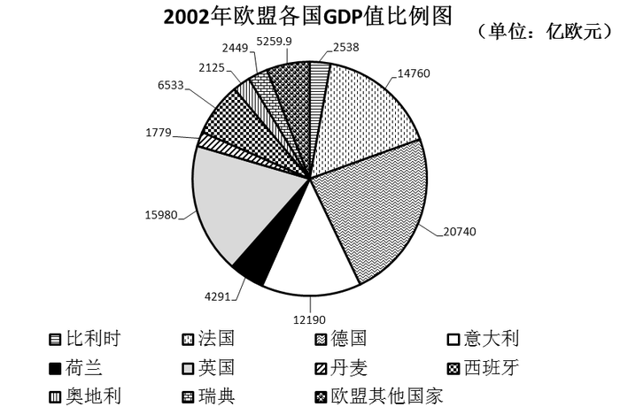

### 第 131 题

根据2002年欧盟各国GDP值比例图，西班牙的排名为：

A. 第5

B. 第6

C. 第7

D. 第8

第 131 题 · 答案与解析

**参考答案（粉笔题库参考内容）**

A

**解析**

图中欧盟各国GDP值比例按从大到小排列，得到20740、15980、14760、12190、6533······1779，其中西班牙是6533，排在第5名。

故正确答案为A。

**考点**：排序类、统计图

**来源**：2008年湖北省公务员录用考试《行测》题（A类）第131题

### 第 132 题

荷兰的GDP总量占欧盟GDP总量的：

A. 2.0%

B. 4.8%

C. 7.3%

D. 13.8%

第 132 题 · 答案与解析

**参考答案（粉笔题库参考内容）**

B

**解析**

解法1：

考虑本材料题的各小题需多次使用GDP总量进行计算，有必要计算出其精确值。各国GDP总量

\=20740+12190+4291+15980+1779+6533+2125+2449+5259.9+2538+14760=88644.9，荷兰GDP占比为，经观察可知，4291略小于8864的一半，即最终比例计算值略小于5%，只有B项符合。

解法2：

利用量角器，测量图中代表荷兰的扇形的圆心角，测量角度大约为18°，利用公式计算，有：

，最接近B项。

故正确答案为B。

**考点**：现期比重、统计图

**来源**：2008年湖北省公务员录用考试《行测》题（A类）第132题

### 第 133 题

德、法、英三国GDP总量占欧盟GDP总量的：

A. 48.4%

B. 53.8%

C. 55.2%

D. 58.1%

第 133 题 · 答案与解析

**参考答案（粉笔题库参考内容）**

D

**解析**

德、法、英三国的GDP总量为14760+20740+15980=51480，德、法、英三国GDP总量占比为。

故正确答案为D。

**考点**：现期比重、统计图

**来源**：2008年湖北省公务员录用考试《行测》题（A类）第133题

### 第 134 题

奥地利的GDP总量比比利时的GDP总量少：

A. 5%

B. 16.3%

C. 19.4%

D. 22.5%

第 134 题 · 答案与解析

**参考答案（粉笔题库参考内容）**

B

**解析**

由统计图知，比利时的GDP值为2538，奥地利的GDP值为2125，则奥地利的GDP总量比比利时的GDP总量少，与B项最接近。

故正确答案为B。

**考点**：一般增长率、统计图

**来源**：2008年湖北省公务员录用考试《行测》题（A类）第134题

### 第 135 题

从上图可以推出的结论是：

Ⅰ.瑞典与比利时的GDP总量相差最少

Ⅱ.前五名之外的其他国家的GDP总量小于德、法两国GDP总量之和

Ⅲ.英国GDP总量比德国GDP总量少的比例小于丹麦GDP总量比瑞典GDP总量少的比例

A. 只有Ⅰ

B. 只有Ⅱ

C. 只有Ⅲ

D. Ⅰ、Ⅱ、Ⅲ均正确

第 135 题 · 答案与解析

**参考答案（粉笔题库参考内容）**

D

**解析**

Ⅰ正确，结论Ⅰ中，瑞典GDP值为2449，比利时GDP值为2538，相差为2538-2449=89，尚不足100，而其他任意两国都没有如此接近；

Ⅱ正确，结论Ⅱ中，前五名国家的GDP总量为20740+15980+14760+12190+6533，显然该计算值超过68000，除这五国以外的其他国家GDP总值为，而德、法两国总数为35000以上；

Ⅲ正确，验证结论Ⅲ，英国GDP值比德国GDP值小的比例为，丹麦GDP总量比瑞典GDP总量少的比例为。

故正确答案为D。

**考点**：统计图、综合分析

**来源**：2008年湖北省公务员录用考试《行测》题（A类）第135题

