# 2008年湖北省公务员录用考试《行测》题（B类）

<!-- gwy:overview:start -->
> **湖北 · 2008 · 行测 · B类** ｜ 125 题 · 图片 17 处 · 答案随题折叠

| 题型模块 | 题量 | 题号 |
| --- | ---: | ---: |
| 言语理解与表达 | 25 | 1–25 |
| 数量关系 | 20 | 26–45 |
| 判断推理 | 40 | 46–85 |
| 常识判断 | 25 | 86–110 |
| 资料分析 | 15 | 111–125 |
| **合计** | **125** | |

导航：[题型与作答说明](#题型与作答说明) · [题目](#题目) · [材料 1](#材料-1)
<!-- gwy:overview:end -->

> 候选采集稿。参考答案及解析来自粉笔页面，不代表官方答案或真实高分答卷；来源使用许可与原卷对应关系仍需人工核实。

## 题型与作答说明

言语理解与表达

（25题）

本部分包括选词填空与阅读理解两种类型的试题。

数量关系

（20题）

本部分包括数字推理与数量关系两种类型的试题。

判断推理

（40题）

本部分包括图形判断、演绎推理、定义判断与类比推理四种类型的试题。

常识判断

（25题）

根据题目要求，在四个选项中选出一个最恰当的答案。

资料分析

（15题）

所给出的图、表或一段文字均有几个问题要你回答。你应根据资料提供的信息进行分析、比较、计算和判断处理。

## 题目

### 第 1 题

资本的自然属性是逐利性，但资本也 ＿＿＿ 承担相应的社会功能。当资本的逐利性与其社会功能不能 ＿＿＿ 共存时，这就要求政府充当社会属性的执行者和监管者，因为政府是公共利益的代表者。

A. 必须 和平

B. 必需 和谐

C. 必需 和平

D. 必须 和谐

第 1 题 · 答案与解析

**参考答案（粉笔题库参考内容）**

D

**解析**

此题考查近义实词的语境搭配。

第一空，“必须”是表示事理上和情理上的必要，是副词，可用以修饰“承担”作状语，一般表示主观上一定要；而“必需”是动词，不能修饰动词“承担”，所以第一个空格应填“必须”。

第二空，“和谐”是指和睦协调，而“和平”是指非暴力的、不通过战争方式的。资本的逐利性与社会功能与是否是用战争方式无关，所以第二个空格应填“和谐”。

故正确答案为D。

**考点**：实词填空、词的辨析-词义侧重

**来源**：2008年湖北省公务员录用考试《行测》题（B类）第1题

### 第 2 题

它 ＿＿＿ 也会回家来看看，走时眼睛里会 ＿＿＿ 出些许的留恋与不舍。

A. 偶然 透露

B. 偶尔 透露

C. 偶然 流露

D. 偶尔 流露

第 2 题 · 答案与解析

**参考答案（粉笔题库参考内容）**

D

**解析**

此题考查实词和虚词的混搭。

第一空，“偶尔”指有时候，跟“经常”相对，强调频度的多少。“偶然”指事情发生意外，跟“必然”相对，强调可能性和必然性。根据语境，它会回家看看的次数是指频率，所以第一个空格应填“偶尔”最符合语境。

第二空，“透露”的意思是透漏，泄漏消息，宾语是消息，是主动性的行为；而“流露”是指意思、感情等不由自主地表现出来，宾语是意思、感情等。“留恋与不舍”是感情，所以第二个空格填“流露”。

故正确答案为D。

**考点**：混搭填空、词的辨析-搭配对象、词的辨析-词义侧重

**来源**：2008年湖北省公务员录用考试《行测》题（B类）第2题

### 第 3 题

＿＿＿ 上次的惨痛教训，他们这次将 ＿＿＿ 的重点放在岛上的两个机场。

A. 基于 防御

B. 鉴于 防御

C. 基于 防范

D. 鉴于 防范

第 3 题 · 答案与解析

**参考答案（粉笔题库参考内容）**

B

**解析**

此题考查实词和虚词的混搭。

第一空，“基于”的意思是由于，“鉴于”的意思是关于，考虑到。而“鉴”还有一层意思为可以使人警惕或引为教训的事情。对于“惨痛教训”应当引为教训，所以第一个空应填“鉴于”。

第二空，“防范”的意思是戒备、防备，“防御”的意思是防守抵御，不仅防守而且有抵御，显然第二空处应当选的是“防御”，而非“防范”。

故正确答案为B。

**考点**：混搭填空、词的辨析-词义侧重

**来源**：2008年湖北省公务员录用考试《行测》题（B类）第3题

### 第 4 题

老人们都很 ＿＿＿ ，对孩子们从不发脾气。

A. 慈善

B. 和善

C. 善良

D. 善意

第 4 题 · 答案与解析

**参考答案（粉笔题库参考内容）**

B

**解析**

此题考查近义实词的不同侧重点辨析。

“慈善”是指对人关怀而有同情心，仁慈而善良；“和善”是指温和而善良；“善良”的意思是纯真温厚，没有恶意；善意是指好意。

空格处在“很”之后，显然当选一个形容词，后半句提到不发脾气，侧重于“和”，与是否对人关怀，是否有同情心，是否有恶意无关。

故正确答案为B。

**考点**：实词填空、词的辨析-词义侧重

**来源**：2008年湖北省公务员录用考试《行测》题（B类）第4题

### 第 5 题

允许媒体发言，是一种文明， ＿＿＿ 允许媒体存在一定的出于真实的谬误，也是保证媒体有效发言的文明。 ＿＿＿ 这种文明， ＿＿＿ 祛除任何对于真实的畏惧。

A. 一旦 只有 才能

B. 甚至 只有 才能

C. 一旦 只要 就能

D. 甚至 只要 就能

第 5 题 · 答案与解析

**参考答案（粉笔题库参考内容）**

B

**解析**

此题考查关联词的运用和语境搭配。

通过阅读材料，我们可以明显发现“ 允许媒体存在谬误，也是······”与“允许媒体发言，是一种文明”两句之间存在递进的关系，所以第一个空格应选“甚至”。

后两个空显然是呈条件关系，在仔细阅读句子之后，可知后两个空当是必要条件，而非充分条件，所以应填“只有，才能”。

故正确答案为B。

**考点**：词的辨析-程度轻重、词的辨析-词义侧重

**来源**：2008年湖北省公务员录用考试《行测》题（B类）第5题

### 第 6 题

地球是慷慨的，她养育了一代又一代人类；地球是无情的，她也报复了＿＿施虐、＿＿索取的人类。地球是我们唯一的栖身之所，糟蹋地球就是糟蹋我们自己。

A. 大事 过度

B. 恣意 长期

C. 恣意 过度

D. 大事 长期

第 6 题 · 答案与解析

**参考答案（粉笔题库参考内容）**

C

**解析**

此题考查近义实词的语境搭配。

第一空，根据文意，“······施虐，······索取”在语义上对应的是“糟蹋地球”。“恣意”是指放纵、肆意，指的是人类施虐行为的过度放纵，符合语境。“大事”指重大的事件。显然第一个空格处应选“恣意”。

第二空，“过度”指得是超过适当的限度，是指程度上的“过分”，符合语境，“长期”是指时间上的“长”，并没有体现出“糟蹋”之感，所以第二个空格应选“过度”。

故正确答案为C。

**考点**：实词填空、对应关系-前后呼应

**来源**：2008年湖北省公务员录用考试《行测》题（B类）第6题

### 第 7 题

世界上最累的人莫过于平俗之辈去 ＿＿＿ ，无才之人却要 ＿＿＿ 。

A. 依附权贵 日理万机

B. 附庸风雅 日理万机

C. 依附权贵 跑官要官

D. 附庸风雅 跑官要官

第 7 题 · 答案与解析

**参考答案（粉笔题库参考内容）**

B

**解析**

此题考查成语的语境搭配。

根据句意，很明显可以看出空格处填的词语应与空格前的“平俗”、“无才”相对应。“附庸风雅”指的是缺乏文化修养的人为了装点门面而结交文人，参加有关文化活动。“平俗”之辈追求“风雅”，才能体现其中之“累”。所以第一个空应填“附庸风雅”。

“日理万机”是形容政务繁忙，工作辛苦。“有才”之人才能做到日理万机，“无才”之人要做到日理万机是非常困难的。所以B项正确。

“依附权贵”的意思是依靠权贵的力量。“跑官要官”是指通过各种途径当官。“平俗”的人去“依附权贵”，“无才”的人通过各种途径当官，并不能体现出来“累”。

故正确答案为B。

**考点**：关联关系-转折关系、对应关系-前后呼应、成语填空

**来源**：2008年湖北省公务员录用考试《行测》题（B类）第7题

### 第 8 题

稿子写完了，老王说过于＿＿＿＿，要我联系一些实际，＿＿＿＿一些内容。

A. 简单 添加

B. 生硬 补添

C. 空洞 增添

D. 理论 增加

第 8 题 · 答案与解析

**参考答案（粉笔题库参考内容）**

C

**解析**

此题考查近义实词的语境搭配。

突破口在于第一个空格，空格后提到“要我联系一些实际”，那么就是说稿子有些脱离实际，“空洞”的意思是没有内容或内容不切实际，所以第一个空格应填“空洞”。所以C项正确。

“简单”、“生硬”都没有内容空泛，不切实际的意思，所以A、B两项不选； “理论”为名词不能放在“过于”之后，所以D项不选。

第二个空格，选项的四个词都表示增加、添加的意思，区别不大，重点在第一个空格的选择。

故正确答案为C。

**考点**：实词填空、对应关系-前后呼应

**来源**：2008年湖北省公务员录用考试《行测》题（B类）第8题

### 第 9 题

一块木头是什么？这要看具体情况。拿它来做家具就是＿＿＿＿，拿它来烧火就是＿＿＿＿，拿它来挑水就是工具，拿它来和坏人斗争就是＿＿＿＿……这就是质的多样性。

A. 材料 原料 武器

B. 原料 燃料 武器

C. 原料 燃料 凶器

D. 材料 原料 凶器

第 9 题 · 答案与解析

**参考答案（粉笔题库参考内容）**

B

**解析**

此题考查近义实词的语境搭配。

根据“挑水”对应“工具”，可知空格处填入的词应是与“家具”、“烧火”、“与坏人斗争”一一对应的。

第一空，“原料”一般指来自矿业、农业、林业、牧业和渔业的产品，而“材料”一般指经过一些加工的原料。第一个空格处不好做出选择，所以先从后面入手。

第二空，“燃料”是用以产生光、热等能量的物质，所以第二个空格处明显应填“燃料”。排除A、D两项。

第三空，既然是和坏人斗争，那就不可能是“凶器”，而是“武器”，所以C项错误而B项正确。

故正确答案为B。

**考点**：实词填空、词的辨析-词义侧重

**来源**：2008年湖北省公务员录用考试《行测》题（B类）第9题

### 第 10 题

＿＿＿＿的深圳是个小渔村，生活在这里的人们与全国＿＿＿＿地区的农民一样，日出而作，日落而息。

A. 曾经 其他

B. 曾经 任何

C. 从前 其他

D. 过去 到处

第 10 题 · 答案与解析

**参考答案（粉笔题库参考内容）**

C

**解析**

此题考查近义实词的语境搭配。

第一空，“从前”指以前，是过去的时间。“深圳是个小渔村”明显是在说过去的深圳，所以“从前”符合文意。“曾经”一般要用在动词前面，表示某种动作、行为或情况是以前某段时间存在或发生过的，并且动词后面往往有助词“过”。在此处明显不合适。所以排除A、B两项。

第二空，“到处”不能搭配“地区”，所以排除D项。“其他”是指除此之外的别的。题干后半句意思是，生活在“这里”和生活在“全国除了‘这里’之外的别的地区”都一样，所以“其他”符合语境。

故正确答案为C。

**考点**：实词填空、词的辨析-搭配对象

**来源**：2008年湖北省公务员录用考试《行测》题（B类）第10题

### 第 11 题

下列各句没有语病的一句是：

A. 强调生活的教育意义，并不意味着可以用生活取代教育，因为生活毕竟带有零散性，并且还会有消极的东西

B. 限期使用的产品，应当在显著位置清晰地标明生产日期、安全使用期和失效日期

C. 他们在遇到困难的时候，并没有消沉，而是在大家的信赖和关怀中得到了力量，树立了克服困难的信心

D. 根据一个小学学校的统计，今年小学生的“人情消费”与去年相比，增加了近一倍左右

第 11 题 · 答案与解析

**参考答案（粉笔题库参考内容）**

B

**解析**

A项，并列不当，“消费的东西”比较具体，“零散性”相对抽象，二者并列不太合适，导致句意模糊，应改为“生活毕竟具有零散性，还可能包含诸多与教育无关的消费性内容”，排除；

B项，句意明确，没有语病，当选；

C项，介词使用不当，“在······中”一般用于表示空间、范围或过程，此处表达“从信赖和关怀里获得力量”，应改为“从大家的信赖和关怀中得到了力量”，排除；

D项，成分赘余，“近一倍”和“左右”都表示不确定的约数，二者同时使用造成重复，应删去其中一个，改为“增加了近一倍”或“增加了一倍左右”，排除。

本题为选非题，故正确答案为B。

**来源**：2008年湖北省公务员录用考试《行测》题（B类）第11题

### 第 12 题

党的十七大，是在我国改革发展＿＿＿＿＿＿召开的一次十分重要的会议。

A. 攻坚阶段

B. 关键阶段

C. 重要阶段

D. 新的阶段

第 12 题 · 答案与解析

**参考答案（粉笔题库参考内容）**

B

**解析**

此题考查近义实词的语境搭配。

A项，“攻坚阶段”指到了最关键、最困难和最艰苦的阶段，也是最重要的阶段。但是最常用于事情的最后阶段，不符合文意；

D项“新”是与“旧”相对应的，材料中并没有提到“旧”，所以不存在这种语境，所以不选；

“关键”和“重要”语义相近，但“关键”强调尤为重要，在程度上比“重要”要深，更适合语境，符合惯常搭配，所以排除C项，B项符合题意。

故正确答案为B。

**考点**：实词填空、词的辨析-词义侧重

**来源**：2008年湖北省公务员录用考试《行测》题（B类）第12题

### 第 13 题

改革开放以来我们取得一切成绩和进步的根本原因归结起来就是：

A. 开辟了中国特色社会主义道路，形成了中国特色社会主义理论体系

B. 坚持了中国共产党的正确领导，实现了改革开放

C. 坚持了实事求是的思想路线

D. 贯彻落实了科学发展观，构建了社会主义和谐社会

第 13 题 · 答案与解析

**参考答案（粉笔题库参考内容）**

A

**解析**

题目问的是“根本原因”，所以答案应侧重思想性，系统性，A项最符合。

B、C、D三项是A项的支撑，属于A项的构成部分。

故正确答案为A。

**来源**：2008年湖北省公务员录用考试《行测》题（B类）第13题

### 第 14 题

人的心理发展的源泉与决定因素是历史过程中不断发展的文化，而文化则是人的社会生活与社会活动的产物。根据上文的内容，表述正确的一项是：

A. 文化是社会活动的产物，它是在历史过程中不断发展的

B. 人的心理发展既来源于历史过程中不断发展的文化，又取决于历史过程中不断发展的文化

C. 人的心理发展归根结底是人的社会活动的产物

D. 人的心理发展与文化有关，但与人的社会活动并无必然的联系

第 14 题 · 答案与解析

**参考答案（粉笔题库参考内容）**

B

**解析**

据提问可知，此题为细节判断题。

A项错误，由“文化是人的社会生活与社会活动的产物”可知，A项表述不完整；

B项正确，通过前半句话可知，“人的心理发展的源泉”和“人的心理的决定因素”是“在历史过程中不断发展的文化”，所以可以得出B项符合题意；

C项错误，属于主观臆断；

D项错误，人的心理发展与文化有关，文化是社会活动和社会生活的产物，所以人的心理发展必然与人的社会活动有联系。

故正确答案为B。

**考点**：细节判断题

**来源**：2008年湖北省公务员录用考试《行测》题（B类）第14题

### 第 15 题

我们可以把一年中的日子分成两个部分：工作和休息。所有人都希望工作时间短，休息时间长，还是莎士比亚深谙忙与闲的道理，他借剧中人物之口说道：“如果终年都是游乐的假日，嬉戏将和工作一样厌烦，正因为假日难得，＿＿＿＿＿＿＿＿＿＿。”

填入横线上最恰当的是：

A. 人们才会如此高兴

B. 人们才会感到度假是自己的权利

C. 人们才会感到人生的快乐

D. 人们才会如此的期盼

第 15 题 · 答案与解析

**参考答案（粉笔题库参考内容）**

D

**解析**

据提问可知，此题为语句填空。

根据关键词“正因为”可知“假日难得”和空格处构成因果关系，又因为材料中说“所有人都希望工作时间短，休息时间长”，可知人们对休息的感情态度是“期盼”，所以“假日难得”取得的结果就是“人们对此很期盼”。所以D项正确。

A项“高兴”、B项“权利”、C项“人生的快乐”在材料中都没有体现出来，所以不选。

故正确答案为D。

**考点**：横线在结尾

**来源**：2008年湖北省公务员录用考试《行测》题（B类）第15题

### 第 16 题

科学理性有一个特点：可以理解的事物就可以被接受，不能理解的事物就不可以接受并且排斥。这是人智的特点也正是人智的局限所在。这句话想说明：

A. 科学的合理性

B. 科学的作用

C. 科学的局限性

D. 科学的客观性

第 16 题 · 答案与解析

**参考答案（粉笔题库参考内容）**

D

**解析**

据提问可知此题为中心理解题。

材料中提到“可以理解就可以接受，不可以理解就不可以接受”是人智的特点和局限，但是不管理解与否，科学仍是客观存在，并不因为人们的喜恶来决定事物出现与否。所以可以引申出材料想要说明的是科学的客观性，D项正确。

A项中的“合理性”和B项中的“作用”在材料中都不能体现出来；材料中的“局限性”是指人智，并非指科学，所以C项错误。

故正确答案为D。

**考点**：分述句特征-引入铺垫

**来源**：2008年湖北省公务员录用考试《行测》题（B类）第16题

### 第 17 题

人总觉得不满足，而且很难为满足确定标准。一旦确立了满足的标准，人们又会不满足，这正是人可贵的地方。对这段话的正确理解是：

A. 知足常乐

B. 满足是没有确定的标准的

C. 人要前进，就要永不满足

D. 满足与不满足没有绝对的界限

第 17 题 · 答案与解析

**参考答案（粉笔题库参考内容）**

C

**解析**

文段开头指出人总是不满足，很难为满足确定标准，接着指出确定了满足的标准之后人还是觉得不满足，最后通过指代词“这”总结全文，指出人不满足是可贵的，故文段旨在强调人不满足的重要性，对应C项。

A项：“知足常乐”指知道满足就很快乐，文段旨在强调不满足的重要性，无中生有，排除；

B项：根据“一旦确立了满足的标准，人们又会不满足”可知，文段只是说人们不会满足于已确立的满足标准，并非满足的标准无法确立，且文段旨在强调满足的重要性，非重点，排除；

D项：文段并未论述满足与不满足之间的界限，“界限”无中生有，排除。

故正确答案为C。

**考点**：关联词-因果

**来源**：2008年湖北省公务员录用考试《行测》题（B类）第17题

### 第 18 题

1999年起，我国普通高校开始实行扩招。大幅度的扩招＿＿＿＿＿＿＿＿＿＿，因此出现了高校学生质量滑坡现象。填入画横线部分最恰当的一项是：

A. 使入学门槛骤然降低

B. 缓解了学生和家长的思想压力

C. 给就业带来了巨大的压力

D. 使更多的学生有了上学的机会

第 18 题 · 答案与解析

**参考答案（粉笔题库参考内容）**

A

**解析**

据提问可知，此题为语句填空题。

由关键词“因此”可知，画横线句和“出现高校学生质量滑坡现象”存在因果关系，A项“入学门槛骤然降低”与“学生质量滑坡”存在因果关系，所以A项正确。

B、D两项是正面的意义，不能导致“质量滑坡”；C项“就业”与“学生质量滑坡”没有因果关系。

故正确答案为A。

**考点**：横线在中间

**来源**：2008年湖北省公务员录用考试《行测》题（B类）第18题

### 第 19 题

利人利己者把生活看成一个合作的舞台，而不是一个角斗场。一般人看事情：非强即弱、非胜即败。世界之大。人人都有足够的立足空间，他人之得不必就视为自己之失。

这段话谈论的核心意思是：

A. 生活是一个合作的舞台

B. 双赢符合现实人生的辩证法

C. 善待他人也要善待自己

D. 利人与利己并存不悖

第 19 题 · 答案与解析

**参考答案（粉笔题库参考内容）**

D

**解析**

文段开篇指出利人利己者将生活视为合作舞台而非角斗场，接着对比一般人的看法，即认为事情非强即弱、非胜即败，最后指出世界空间足够，他人所得并非自己所失，故文段重点强调了利人与利己并非对立而是可以同时存在的，对应D项。

A项，“生活是一个合作的舞台”偏离文段重点，文段重点强调的是利人与利己的关系，且缺少主题词“利人”与“利己”，排除；

B项，“双赢符合现实人生的辩证法”中的“辩证法”在文中无从体现，过于拔高，排除；

C项，“善待他人也要善待自己”强调了对自己的善待，文中并无此意，排除。

故正确答案为D。

【文段出处】书籍《高效能人士的七个习惯》

**考点**：主题词

**来源**：2008年湖北省公务员录用考试《行测》题（B类）第19题

### 第 20 题

目前我国法律对个人隐私的保护力度比较薄弱，个人的隐私主要是通过个人名誉权来保护的。而且，个人名誉权受到侵害的，要造成侵害后果的才予以追究。对于绝大多数受“骚扰”的人来说，受侵害的后果并不是很明显，也很难追究。

通过这段话，作者想表达的是：

A. 我国有关保护个人隐私权的法律有待完善

B. 我国个人受侵害的后果并不明显

C. 我国现行法律保护个人的名誉权

D. 我国的个人隐私主要是通过个人名誉权来保护的

第 20 题 · 答案与解析

**参考答案（粉笔题库参考内容）**

A

**解析**

文段开篇指出我国法律对个人隐私的保护力度比较薄弱，个人隐私主要通过个人名誉权来保护，接着论述个人名誉权受到侵害要造成明显侵害后果才予以追究，而绝大多数受“骚扰”的人，其受侵害的后果并不明显，很难追究。故文段重点强调我国在个人隐私保护方面存在法律规定不够完善、保护力度不足的问题，对应A项。

B项，“我国个人受侵害的后果并不明显”只是文段阐述我国法律对个人隐私保护问题时提到的一个方面，非重点，排除；

C项，“现行法律保护个人的名誉权”偏离文段重点，文段重点强调法律对个人隐私保护的不足，排除；

D项，“我国的个人隐私主要是通过个人名誉权来保护的”偏离文段重点，文段重点强调法律对个人隐私保护力度薄弱，需要完善，排除。

故正确答案为A。

**考点**：关联词-对策

**来源**：2008年湖北省公务员录用考试《行测》题（B类）第20题

### 第 21 题

自去年12月在迈阿密举行美洲首脑会议后，拉美国家加快了建立自由贸易区的步伐，一体化进程已进入了一个新的时期。这段话不能反映的是：

A. 美洲首脑会议举行的地点

B. 美洲首脑会议的作用

C. 拉美一体化进程进入新时期

D. 拉美一体化形成

第 21 题 · 答案与解析

**参考答案（粉笔题库参考内容）**

D

**解析**

据提问可知，此题属于细节判断题。

A项正确，“在迈阿密举行”点出了首脑会议的地点；

B项正确，会议之后，拉美地区一体化进程进入新的时期，体现了会议的作用；

C项正确，表述在材料中有原文出现；

D项错误，材料中提到“一体化进程已进入了一个新的时期”，并没有说“一体化”已经形成，所以D项表述错误。

本题为选非题，故正确答案为D。

**考点**：细节判断题

**来源**：2008年湖北省公务员录用考试《行测》题（B类）第21题

### 第 22 题

投资仍然是拉动中国经济增长的主要动力，但与以前主要靠地方政府利益驱动不同，现在的投资越来越受到企业利润和盈利能力的驱动，投资质量有明显提高。同时，盈利能力越强的工业行业，投资增长也越高。

这段话想表达的主要观点是：

A. 投资仍然是拉动中国经济增长的主要动力

B. 现在的投资越来越步入以市场为主导的良性循环轨道

C. 以前的投资主要是靠地方政府利益驱动的

D. 盈利能力的行业投资增长越高

第 22 题 · 答案与解析

**参考答案（粉笔题库参考内容）**

B

**解析**

据提问“主要观点”可知，此题为中心理解题。

文段以“投资仍然是拉动中国经济增长的主要动力”引出论题，根据转折词 “但”可知，材料重点说的是现在的投资和以前投资不一样，以及造成这种不同的原因。因为投资驱动的改变，投资质量有了明显提高，且“盈利越强则投资增长越高”，表明现在的投资越来越步入良性循环轨道。而“企业利润和盈利能力”是不同于“地方政府利益驱动”的以市场为主导的驱动，所以材料的主要意思就是现在的投资越来越步入以市场为主导的良性循环轨道，所以B项正确。

A、C、D三项分别是对文段第1个分句、第2个分句以及最后一句话的同义转述，不能全面概括文段含义，都不是主要意思，排除。

故正确答案为B。

**考点**：关联词-并列、关联词-转折

**来源**：2008年湖北省公务员录用考试《行测》题（B类）第22题

### 第 23 题

青藏高原的原始生态环境在全球占有特殊的地位，但生态环境十分脆弱，一旦遭到破坏则不可逆转，有的植被恢复需要上百年的时间。高寒、干旱、原始和极其脆弱是这一区域生态环境的显著特征。

以下选项中符合原文意思的是：

A. 青藏高原的植物十分脆弱，遭到破坏则不可逆转

B. 高寒、干旱使得青藏高原的生态环境十分脆弱

C. 青藏高原的生态环境是最古老、最原始的

D. 青藏高原的生态环境虽然原始，但抗破坏能力很弱

第 23 题 · 答案与解析

**参考答案（粉笔题库参考内容）**

D

**解析**

据提问可知本题为细节判断题。

A项错误，偷换概念，题干说的是青藏高原生态环境的脆弱，而不是“植物”脆弱；

B项错误，“高寒、干旱”和“极其脆弱”之间是并列关系，均为青藏高原生态环境的显著特征，而非因果关系；

C项错误，“最”古老、“最”原始之说在题干中缺乏依据，予以排除；

D项正确，题干首先指出青藏高原具有原始的生态环境，接下来又说其生态环境非常脆弱。原始、极其脆弱是青藏高原生态环境的显著特征。“极其脆弱”意味着抗破坏能力很弱，由此可知D项表述符合文意。

故正确答案为D。

**考点**：细节判断题

**来源**：2008年湖北省公务员录用考试《行测》题（B类）第23题

### 第 24 题

人类基因的数量与阿猫、阿狗这样的哺乳动物的基因数量几乎差不多，跟鼠类的还非常接近。更可气的是，水稻基因数量竟然是人类的两倍。这段话想要表达的观点是：

A. 哺乳动物的基因数量都差不多

B. 基因数量的多少并不能代表物种等级的高低

C. 人类与鼠类在基因上是非常接近的

D. 某些植物的基因比动物的还要多

第 24 题 · 答案与解析

**参考答案（粉笔题库参考内容）**

B

**解析**

据提问“想表达”可知，此题为中心理解题。

材料先提到人类基因数量与哺乳类动物差不多，又说作为植物的水稻甚至比人类基因的数量更多，可见基因数量的多少并不能代表物种等级的高低，B项符合文意。

A、C、D三项都是对B项的支持，属于材料表达的某一方面。

故正确答案为B。

**考点**：主题词

**来源**：2008年湖北省公务员录用考试《行测》题（B类）第24题

### 第 25 题

世界上许多民族正面临着在世界舞台上丧失母语的话语权，不得不依附于西方弥补语言文字，从而使本民族的文化被逐渐弱化。这段话可以被用来论证下面的哪一种观点：

A. 保护本民族母语的重要性

B. 语言文字也有强势弱势之分

C. 民族的文化被逐渐弱化的原因

D. 我们不能在语言文字上依附于西方

第 25 题 · 答案与解析

**参考答案（粉笔题库参考内容）**

C

**解析**

据提问可知，此题为中心理解题。

根据关键词“从而”可知，“从而”前后部分存在因果关系，可以知道材料描述了“使本民族的文化被逐渐弱化”的原因，所以C选项正确。

A项不是材料主要表达的意思；B项“强势”在材料中没有体现；D项属于主观臆断。

故正确答案为C。

**考点**：关联词-因果

**来源**：2008年湖北省公务员录用考试《行测》题（B类）第25题

### 第 26 题

343，453，563，（  ）

A. 673

B. 683

C. 773

D. 783

第 26 题 · 答案与解析

**参考答案（粉笔题库参考内容）**

A

**解析**

原数列为等差数列，公差为110，故未知项为563＋110＝673。

故正确答案为A。

**来源**：2008年湖北省公务员录用考试《行测》题（B类）第26题

### 第 27 题

2，10，6，（  ），3，15

A. 5

B. 4

C. 2

D. 0

第 27 题 · 答案与解析

**参考答案（粉笔题库参考内容）**

A

**解析**

这是对称形式的分组数列，第一项对应最后一项，第二项对应倒数第二项，以此类推，2 × 15 = 30，10×3=30，6×(5)=30，因此括号中应为5。

故正确答案为A。

**来源**：2008年湖北省公务员录用考试《行测》题（B类）第27题

### 第 28 题

2，3，5，10，20，（  ）

A. 30

B. 35

C. 40

D. 45

第 28 题 · 答案与解析

**参考答案（粉笔题库参考内容）**

C

**解析**

这是一组递推数列，从第三项开始，每项都为其前面所有项相加之和，即5＝2＋3，10＝2＋3＋5，20＝2＋3＋5＋10，(40)＝2＋3＋5＋10＋20。

故正确答案为C。

**来源**：2008年湖北省公务员录用考试《行测》题（B类）第28题

### 第 29 题

21，23，26，31，38，（  ），62

A. 47

B. 49

C. 51

D. 53

第 29 题 · 答案与解析

**参考答案（粉笔题库参考内容）**

B

**解析**

第5项和第6项为11和13，因此原数列第6项应为38+11=49。

故正确答案为B。

**来源**：2008年湖北省公务员录用考试《行测》题（B类）第29题

### 第 30 题

1，2，2，4，4，6，8，8，（  ）

A. 12

B. 14

C. 10

D. 16

第 30 题 · 答案与解析

**参考答案（粉笔题库参考内容）**

D

**解析**

原数列为交叉数列。

奇数项：1 2 4 8 (16)成等比数列；

偶数项：2 4 6 8成等差数列。

故正确答案为D。

**来源**：2008年湖北省公务员录用考试《行测》题（B类）第30题

### 第 31 题

1，2，9，121，（  ）

A. 210

B. 16900

C. 289

D. 25600

第 31 题 · 答案与解析

**参考答案（粉笔题库参考内容）**

B

**解析**

观察数列无明显特征且作差无规律，考虑递推数列。9 = (1 + 2)²、121 = (2+9)^2，递推规律为：第三项 = (第一项 + 第二项)^2，故所求项为(9+121)^2=16900。

故正确答案为B。

**来源**：2008年湖北省公务员录用考试《行测》题（B类）第31题

### 第 32 题

16，29，55，（  ），211

A. 101

B. 109

C. 126

D. 107

第 32 题 · 答案与解析

**参考答案（粉笔题库参考内容）**

D

**解析**

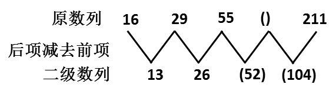

二级数列为首项为13，公比为2的等比数列，第3项和第4项为52和104，因此原数列第4项应为55+52=107。

故正确答案为D。

**来源**：2008年湖北省公务员录用考试《行测》题（B类）第32题

### 第 33 题

4，5，（  ），14，23，37

A. 6

B. 7

C. 8

D. 9

第 33 题 · 答案与解析

**参考答案（粉笔题库参考内容）**

D

**解析**

这是一组递推数列，从第三项开始，每项为前两项之和，即4+5=(9)，5+(9)=14，14＋23＝37，因此第三项应为9。

故正确答案为D。

**来源**：2008年湖北省公务员录用考试《行测》题（B类）第33题

### 第 34 题

8，12，（  ），34，50，68

A. 16

B. 20

C. 21

D. 28

第 34 题 · 答案与解析

**参考答案（粉笔题库参考内容）**

C

**解析**

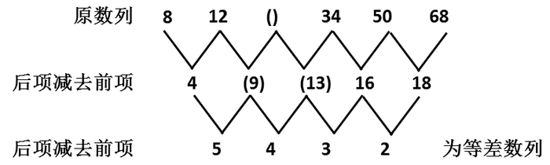

三级数列为首项为5，公差为-1的等差数列，可反推出二级数列的第二项和第三项分别为9和13，因此原数列的第三项为12+9=21。

故正确答案为C。

**来源**：2008年湖北省公务员录用考试《行测》题（B类）第34题

### 第 35 题

34，36，35，35，（  ），34，37，（  ）

A. 36，33

B. 33，36

C. 34，37

D. 37，34

第 35 题 · 答案与解析

**参考答案（粉笔题库参考内容）**

A

**解析**

解析1：

将数列进行两两分组，可以发现每组两项[34, 36]，[35, 35]，[（ ）, 34]，[37,（ ）]的和都为70，因此原数列的第5项和第8项应分别为36和33。

解析2：

原数列也可看做交叉数列，奇数项为34 35 (36) 37，偶数项为36 35 34 (33)，分别是公差为1和-1的等差数列，因此括号中应为36、33。

故正确答案为A。

**来源**：2008年湖北省公务员录用考试《行测》题（B类）第35题

### 第 36 题

3条直线最多能将平面分成几部分：

A. 4部分

B. 6部分

C. 7部分

D. 8部分

第 36 题 · 答案与解析

**参考答案（粉笔题库参考内容）**

C

**解析**

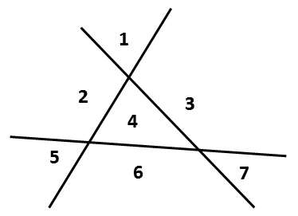

如图所示：三条直线两两交叉，最多可将平面分成7部分，C项正确。

故正确答案为C。

**考点**：几何公式类-平面图形、几何其他题型

**来源**：2008年湖北省公务员录用考试《行测》题（B类）第36题

### 第 37 题

从4点到5点，时针与分针成直角的机会有几次：

A. 1次

B. 2次

C. 3次

D. 4次

第 37 题 · 答案与解析

**参考答案（粉笔题库参考内容）**

B

**解析**

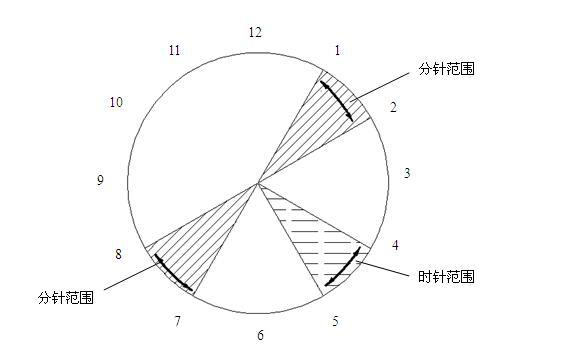

如图所示从4点到5点时针在4点和5点之间的30°范围内，若分针与时针成直角，则分针必须在1点和2点、7点和8点之间，因为分针的速度是时针的12倍，所以分针在1点和2点、7点和8点之间范围内不可能2次与时针成直角，因此共有2次机会。

故正确答案为B。

**来源**：2008年湖北省公务员录用考试《行测》题（B类）第37题

### 第 38 题

商场为了促销，将原价75元的商品，先提价40％，再打8折，该商品实际售价是多少元：

A. 80

B. 72

C. 78

D. 84

第 38 题 · 答案与解析

**参考答案（粉笔题库参考内容）**

D

**解析**

75元的商品先提价40%，再打8折的实际售价为75 × 1.4 × 0.8 = 75 × 4/5 × 1.4= 60 × 1.4 = 84元。

故正确答案为D。

**考点**：经济利润问题

**来源**：2008年湖北省公务员录用考试《行测》题（B类）第38题

### 第 39 题

一个快钟每小时比标准时间快1分钟，一个慢钟每小时比标准时间慢3分钟。如将两个钟同时调到标准时间，结果在24小时内，快钟显示10点整时，慢钟恰好显示9点整。则此时的标准时间是：

A. 9点15分

B. 9点30分

C. 9点35分

D. 9点45分

第 39 题 · 答案与解析

**参考答案（粉笔题库参考内容）**

D

**解析**

一个快钟每小时比标准时间快1分钟，一个慢钟每小时比标准时间慢3分钟，说明快钟每个小时比慢钟多走4分钟。又根据快钟显示10点整时，慢钟恰好显示9点整，说明快钟比慢钟多走了60分钟，即比标准时间多走了60÷4=15分钟，因此此时的标准时间是10点整减15分钟，是9点45分。

故正确答案为D。

**来源**：2008年湖北省公务员录用考试《行测》题（B类）第39题

### 第 40 题

某校八年级学生数学竞赛共有20道题目，每答对一道得5分，不答或答错扣一分，80分以上至少要答对的题目数是多少：

A. 15道

B. 16道

C. 17道

D. 18道

第 40 题 · 答案与解析

**参考答案（粉笔题库参考内容）**

C

**解析**

解析1：

设答对的题目数为x，则得分80分以上有不等式5x－(20－x)＞80，解得x＞16.7，即17道。

解析2：

设答对的题目数为x，答错的题目数为y，可得5x－y＞80，x＋y＝20，将选项直接代入，可排除A、B、D三项。

解析3：

按鸡兔同笼问题思路，答对一题得5分，不答或答错扣1分，所以不答或答错比答对一题少得6分，将题目看作全部正确然后分析差异，设答错的题目数为x，若得分在80分以上，有不等式100－6x＞80，解得x＜3.3，即答错3道，答对17道。

故正确答案为C。

**考点**：非典型最值问题

**来源**：2008年湖北省公务员录用考试《行测》题（B类）第40题

### 第 41 题

小明步行45分钟可从甲地到乙地，小华开车15分钟能从乙地到甲地，当两人在路上相遇时，小明已经走了30分钟，小华开车送小明返回甲地，还需要多少分钟：

A. 10

B. 15

C. 3

D. 5

第 41 题 · 答案与解析

**参考答案（粉笔题库参考内容）**

A

**解析**

同样的路程，小明步行需要45分钟，小华开车需要15分钟，说明小明和小华的速度比为1:3。两人在路上相遇后，小华开车送小明返回甲地，即以小华开车的速度走小明步行走过的路程，这段路程小明用了30分钟，则小华开车送小明返回甲地需要30 × 1/3 = 10分钟。

故正确答案为A。

**考点**：普通行程

**来源**：2008年湖北省公务员录用考试《行测》题（B类）第41题

### 第 42 题

一船顺水而下，速度是每小时6千米，逆流而上每小时4千米。求往返两地相距24千米的码头间平均速度是多少：

A. 5

B. 4.8

C. 4.5

D. 5.5

第 42 题 · 答案与解析

**参考答案（粉笔题库参考内容）**

B

**解析**

解析1：

运用等距离平均速度公式，平均速度为(2 × 6 × 4)/(6 + 4) = 4.8。

等距离平均速度公式：v̄ = 2v1v2/(v1 + v2)

解析2：

顺流行驶24千米的时间为24÷6=4小时，逆流行驶24千米的时间为24÷4=6小时，因此往返24千米的平均速度是：总路程/总时间 = (24 × 2)/(4 + 6) = 48/10 = 4.8。

故正确答案为B。

**考点**：平均速度

**来源**：2008年湖北省公务员录用考试《行测》题（B类）第42题

### 第 43 题

把一个正方形的一边减少20%，另一边增加2米。得到一个长方形，它与原正方形的面积相等，那么，正方形面积是多少平方米：

A. 8

B. 10

C. 16

D. 64

第 43 题 · 答案与解析

**参考答案（粉笔题库参考内容）**

D

**解析**

方法一：设正方形的边长为a，根据题意可知，(1-20%)a×(a+2)=a×a，解得a=8，因此正方形的面积为8×8=64平方米。

方法二：因为正方形的面积应为一完全平方数，可排除A、B选项；带入C项验证，面积为16的正方形边长为4，4×1−20%×4+2=3.2×6=19.2，与原正方形面积不相等，排除。

故正确答案为D。

**考点**：几何公式类-平面图形

**来源**：2008年湖北省公务员录用考试《行测》题（B类）第43题

### 第 44 题

一个小于100的整数与5的差是4的倍数，与5的和是7的倍数，这个数最大是多少：

A. 85

B. 89

C. 97

D. 93

第 44 题 · 答案与解析

**参考答案（粉笔题库参考内容）**

D

**解析**

100以内7的倍数较少，可以考虑从7的倍数入手，这个整数加5是7的倍数，运用直接代入法，将A、B、C、D项加5分别为90、94、102、98，其中只有98可以被7整除。

故正确答案为D。

**来源**：2008年湖北省公务员录用考试《行测》题（B类）第44题

### 第 45 题

纽约时间是香港时间减13小时，你与一位在香港的朋友约定香港时间6月1日晚上8时与他通电话，那么在纽约你应几月几日几时给他打电话：

A. 6月1日上午7时

B. 5月31日上午7时

C. 6月2日上午9时

D. 6月2日上午7时

第 45 题 · 答案与解析

**参考答案（粉笔题库参考内容）**

A

**解析**

6月1日晚上8时即6月1日20时，减13小时后为6月1日上午7时，A项正确。应注意区分此类问题和时差计算问题，若提问某地在某时另一时区的另外地点时间则需要考虑时区和国际日期变更线。相邻两个时区相差一小时，不同时区的时间计算遵从同减异加，东加西减原则，“同”指同在东时区或西时区，则两时区相减，“异”则相反。国际日期变更线位于太平洋180°经线，从东向西越过这条界线时，日期要加一天，从西向东越过这条界线时，日期要减去一天。

故正确答案为A。

**考点**：星期日期问题

**来源**：2008年湖北省公务员录用考试《行测》题（B类）第45题

### 第 46 题

从所给四个选项中，选择最合适的一个填入问号处，使之呈现一定的规律性：

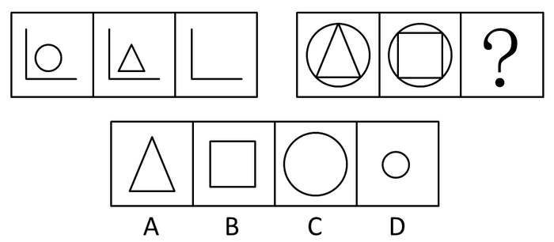

A. A

B. B

C. C

D. D

第 46 题 · 答案与解析

**参考答案（粉笔题库参考内容）**

C

**解析**

每组图形中前两个图形相加后去异存同得到第三个图形。

故正确答案为C。

**考点**：样式规律-加减同异

**来源**：2008年湖北省公务员录用考试《行测》题（B类）第46题

### 第 47 题

从所给四个选项中，选择最合适的一个填入问号处，使之呈现一定的规律性：

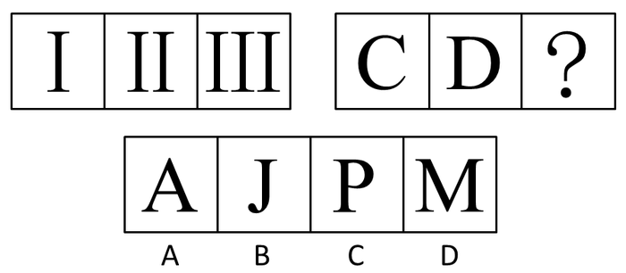

A. A

B. B

C. C

D. D

第 47 题 · 答案与解析

**参考答案（粉笔题库参考内容）**

A

**解析**

元素组成不同，无明显属性规律，考虑数量规律。观察发现，第一组图形的线条数分别为1、2、3，第二组前两幅图形的线条数分别为1、2，故“？”处图形的线条数应为3，只有A项符合。

故正确答案为A。

**考点**：数量规律-线、文字/字母/数字类

**来源**：2008年湖北省公务员录用考试《行测》题（B类）第47题

### 第 48 题

从所给四个选项中，选择最合适的一个填入问号处，使之呈现一定的规律性：

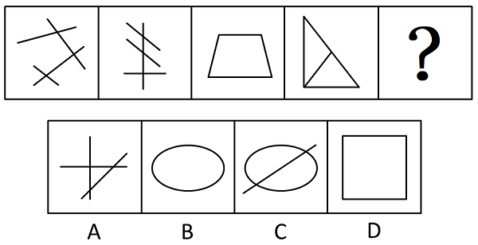

A. A

B. B

C. C

D. D

第 48 题 · 答案与解析

**参考答案（粉笔题库参考内容）**

D

**解析**

元素组成凌乱，考查数数。每个图形中的直线数目均为4。

故正确答案为D。

**考点**：数量规律-线

**来源**：2008年湖北省公务员录用考试《行测》题（B类）第48题

### 第 49 题

从所给四个选项中，选择最合适的一个填入问号处，使之呈现一定的规律性：

A. A

B. B

C. C

D. D

第 49 题 · 答案与解析

**参考答案（粉笔题库参考内容）**

B

**解析**

元素组成相似，元素的运算。

每一行中前两图形虚实线叠加得第三个图形，且叠加规律为：虚＋虚＝虚，实＋实＝虚，虚＋实＝实，实＋虚＝实。

故正确答案为B。

**考点**：样式规律-黑白运算

**来源**：2008年湖北省公务员录用考试《行测》题（B类）第49题

### 第 50 题

从所给四个选项中，选择最合适的一个，使之呈现一定的规律性：

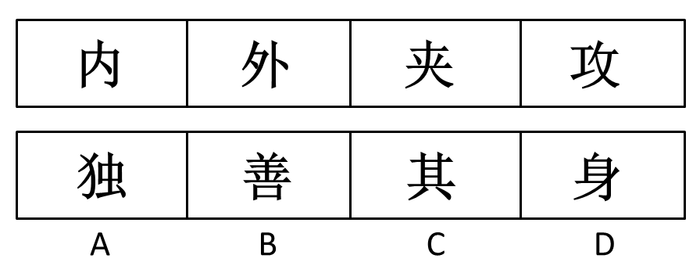

A. A

B. B

C. C

D. D

第 50 题 · 答案与解析

**参考答案（粉笔题库参考内容）**

C

**解析**

数汉字笔画。

每个图形中汉字的笔画数依次为4，5，6，7，8。

故正确答案为C。

**考点**：数量规律-线、文字/字母/数字类

**来源**：2008年湖北省公务员录用考试《行测》题（B类）第50题

### 第 51 题

请从所给的四个选项中，选择最合适的一项填在问号处，使之呈现一定的规律性：

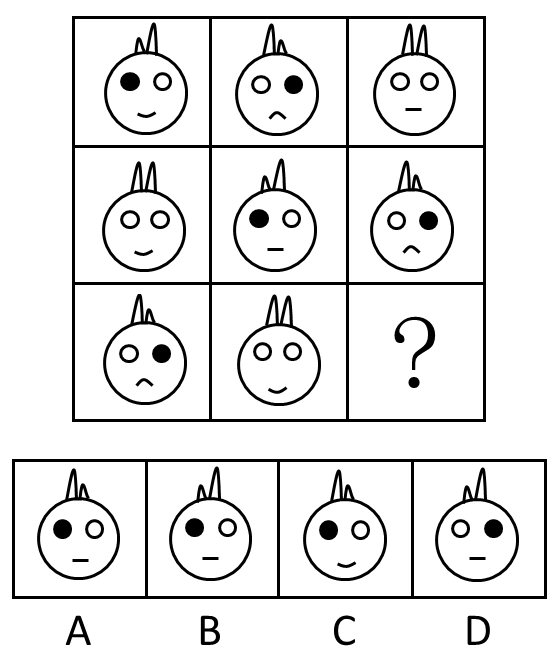

A. A

B. B

C. C

D. D

第 51 题 · 答案与解析

**参考答案（粉笔题库参考内容）**

B

**解析**

元素组成相似，考查元素周遍。每一行中，兔子的嘴巴都有一个上弯，一个下弯，一个平；耳朵都有一个双长，一个左短右长，一个左长右短；眼睛都有一个双白，一个左白右黑，一个左黑右白。

故正确答案为B。

**考点**：样式规律-遍历

**来源**：2008年湖北省公务员录用考试《行测》题（B类）第51题

### 第 52 题

从所给四个选项中，选择最合适的一个填入问号处，使之呈现一定的规律性：

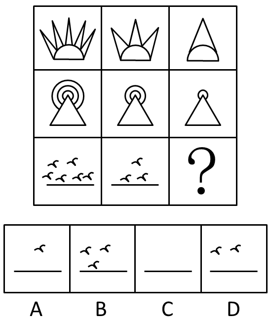

A. A

B. B

C. C

D. D

第 52 题 · 答案与解析

**参考答案（粉笔题库参考内容）**

C

**解析**

部分元素不变，部分呈现明显数量递减，考数量。

每一横行中每个图形的下半部分不变，上半部分中重复的小图形的个数成等差数列递减。第一行三角形个数依次为5，3，1；第二行圆的个数为3，2，1；第三行海鸥的个数为6，3，0。

故正确答案为C。

**考点**：数量规律-素

**来源**：2008年湖北省公务员录用考试《行测》题（B类）第52题

### 第 53 题

从所给四个选项中，选择最合适的一个填入问号处，使之呈现一定的规律性：

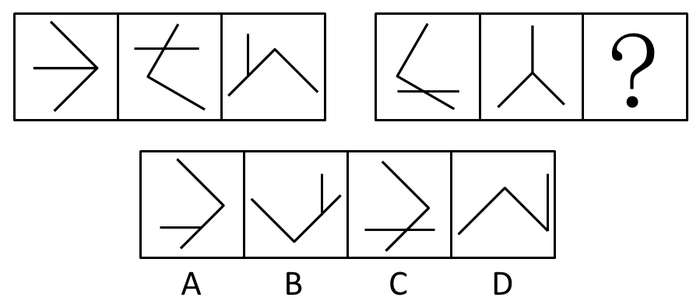

A. A

B. B

C. C

D. D

第 53 题 · 答案与解析

**参考答案（粉笔题库参考内容）**

A

**解析**

元素组成相同，两种元素的位置关系考查。

每组图中的图形都由一个角和一条线段组成。角的开口朝向为左、下、右各出现一次；线段的位置也是三种情况各出现一次，分别为与角共顶点、与角的边十字相交、顶点在角的边上。

故正确答案为A。

**考点**：样式规律-遍历

**来源**：2008年湖北省公务员录用考试《行测》题（B类）第53题

### 第 54 题

从所给四个选项中，选择最合适的一个填入问号处，使之呈现一定的规律性：

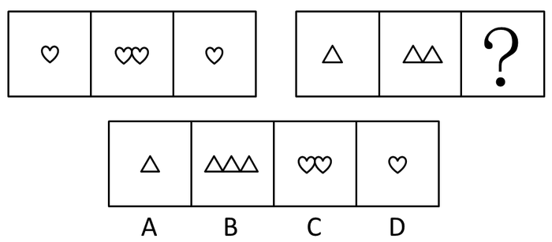

A. A

B. B

C. C

D. D

第 54 题 · 答案与解析

**参考答案（粉笔题库参考内容）**

A

**解析**

元素组成相似，元素叠加-相减。

第二个图形减去第一个图形得到第三个图形。

故正确答案为A。

**考点**：样式规律-加减同异

**来源**：2008年湖北省公务员录用考试《行测》题（B类）第54题

### 第 55 题

左边给定的是纸盒外表面的展开图，右边哪一项能由它折叠而成？请把它找出来。

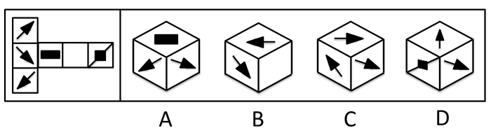

A. A

B. B

C. C

D. D

第 55 题 · 答案与解析

**参考答案（粉笔题库参考内容）**

D

**解析**

折纸盒，用排除法。

A项，如果左面与右面成立，则顶面的图案当为黑方加斜线；

B项，如果左面与右面成立，则顶面图案当为黑长方或黑方加斜线；

C项，左右两面不可能同时成立。

故正确答案为D。

**考点**：空间类-空间重构-六面体

**来源**：2008年湖北省公务员录用考试《行测》题（B类）第55题

### 第 56 题

若钥匙不是在宿舍里丢失的，那就一定是在办公室或走廊上或大街上丢失的，又因为离开宿舍时用它锁的门，假如在办公室或走廊上丢失，就会有失物招领告示，现没有看见告示，可见：

A. 钥匙丢在宿舍里

B. 钥匙丢在办公室

C. 钥匙丢在走廊上

D. 钥匙丢在大街上

第 56 题 · 答案与解析

**参考答案（粉笔题库参考内容）**

D

**解析**

第一步：翻译题干。

钥匙丢失：宿舍∨办公室∨走廊∨大街上；在办公室∨走廊⇒有告示。

第二步：从事实信息展开推导，结合选项得出答案。

事实信息①：离开宿舍时用它锁的门，所以钥匙不会丢在宿舍里，即“－宿舍”。事实信息②，现在没有告示，即“－有告示”，因为“办公室∨走廊⇒有告示”，根据逆否规则和摩根规则，可得“－有告示⇒－（办公室∨走廊）⇒－办公室∧－走廊”，即钥匙不是在办公室和走廊丢的。因为“钥匙丢失：宿舍∨办公室∨走廊∨大街上”，已推出“－宿舍∧－办公室∧－走廊”，可见钥匙丢在大街上。

故正确答案为D。

**考点**：常规翻译

**来源**：2008年湖北省公务员录用考试《行测》题（B类）第56题

### 第 57 题

一次提审之后，办案员甲对乙说：“我相信犯罪嫌疑人说的一定是真话，但真话他未必都说了。”甲的意思不包括：

A. 犯罪嫌疑人没有把他知道的全说出来

B. 犯罪嫌疑人说的都是他知道的

C. 犯罪嫌疑人隐瞒了事实真相

D. 犯罪嫌疑人否定了事实真相

第 57 题 · 答案与解析

**参考答案（粉笔题库参考内容）**

D

**解析**

日常结论题，根据题干信息逐一分析选项。

A项：根据题干“真话他未必都说了”，可知犯罪嫌疑人没有说出全部真话，说明他没有把所知道的都说出来，而是隐瞒了一部分事实真相，可以推出，排除；

B项：根据题干“犯罪嫌疑人说的一定是真话”，可知犯罪嫌疑人说的都是他知道的真话，可以推出，排除；

C项：根据题干“真话他未必都说了”，可知犯罪嫌疑人没有说出全部真话，说明他没有把所知道的都说出来，而是隐瞒了一部分事实真相，可以推出，排除；

D项：根据题干“犯罪嫌疑人说的一定是真话”，可知犯罪嫌疑人说的都是真话，所以无法推出犯罪嫌疑人否定了事实真相，无法推出，当选。

本题为选非题，故正确答案为D。

**考点**：日常结论

**来源**：2008年湖北省公务员录用考试《行测》题（B类）第57题

### 第 58 题

法院调解，是指在人民法院审判人员主持下，双方当事人自愿就民事权益争议平等协商、达成协议、从而解决纠纷进行的活动。

根据上述定义，下列情况属于法院调解的是：

A. 某地区林业机关与农业机关因权限交叉产生冲突，告之法庭，后在上级机关的调解下达成协议并撤诉。

B. 两家因某一件小事发生纠纷，打起了漫长的官司，花费巨大，后都感到不值得，于是私下和解后纷纷撤诉。

C. 两姐妹合开一家理发馆，后因分红问题发生纠纷，但在他们即将闹上法庭的时候，终于达成谅解。

D. 两夫妻一方提出要离婚，另一方则拿不定注意，后法院审判员在对他们讲明是非的基础上使他们又和好如初。

第 58 题 · 答案与解析

**参考答案（粉笔题库参考内容）**

D

**解析**

第一步：抓住定义中的关键词。

定义中强调“在人民法院审判人员主持下”等。

第二步：逐一判断选项。

由A项中的“上级机关”、B项中的“私下和解”、C项中的“即将闹上法庭的时候”可知，A、B、C三项均不是“在人民法院审判人员主持下”进行的，不符合定义。

故正确答案为D。

**考点**：大前提

**来源**：2008年湖北省公务员录用考试《行测》题（B类）第58题

### 第 59 题

因为青少年不应当吸烟，所以提案禁止向青少年出售香烟是十分合理的。但是，禁止使用自动售烟机，就如同在交通要道上设置路障，堵住100位驾驶员，仅仅只是为了逮捕其中的一位无证驾驶者，路障阻碍的不仅仅只是那些违法的人，而是所有的人。

下列哪一个问题的答案，能够帮助我们正确评价以上所提出的禁令，即对禁止使用自动售烟机所提出的反对意见：

A. 自动售烟机比其他自动售货机更容易出错吗

B. 目前是否有法律规定，禁止将成人专用的东西出售给青少年

C. 提高香烟销售税能阻止青少年购买香烟吗

D. 禁止设置自动售烟机是否给许多成年买烟者带来了不便

第 59 题 · 答案与解析

**参考答案（粉笔题库参考内容）**

D

**解析**

第一步：弄清题意。

题干要求找出一个选项，能够正确评价对禁止使用自动售烟机所提出的反对意见。题干中对禁止使用自动售烟机提出反对意见的理由是妨碍了成年人购买香烟。

第二步：逐一判断选项。

A项“容易出错”和C项“提高香烟销售税”跟反对禁止使用售烟机的理由无关，属于无关选项；

B项法律是否规定不能向青少年售烟，并不能说明禁止使用售烟机会妨碍成年人买烟的问题，不能帮助我们对禁止使用自动售烟机提出反对意见进行评价；

D项，禁止设置自动售烟机是否给许多成年买烟者带来了不便，如果答案是肯定的，则支持题干中的反对意见，如果答案是否定的，则削弱题干中的反对意见，因此D项的答案能够帮助我们正确评价禁令的反对意见。

故正确答案为D。

**来源**：2008年湖北省公务员录用考试《行测》题（B类）第59题

### 第 60 题

我国许多企业都缺乏应有的“网络意识”，不懂得借助网络来开展经营活动，不懂得通过注册域名来保护自己的合法权益，中国网络报最近对1000家企业网络域名注册工作的一次调查表明，已经注册了域名的企业仅仅只有30%。

以下哪项，如果为真，最能削弱上述论证：

A. 全国有许多未被调查的企业注册域名

B. 一些企业不知道如何注册网络域名

C. 不注册域名的企业不一定就没有健全、敏锐的“网络意识”

D. 目前注册域名还太麻烦，收费又高，不少企业认为不合算

第 60 题 · 答案与解析

**参考答案（粉笔题库参考内容）**

A

**解析**

第一步：找出论点和论据。

论点：我国许多企业缺乏应有的“网络意识”，不懂得通过注册域名来保护自己的合法权益。

论据：中国网络报最近对1000家企业网络域名注册工作的一次调查表明，已经注册了域名的企业仅仅只有30%。

本题论点强调的是我国许多企业，论据强调的是1000家企业，论点和论据强调的范围不一致，话题不一致，削弱考虑拆桥，即证明论据中的企业不能代表我国的许多企业。

第二步：逐一分析选项。

A项：说明论据的调查对象不能代表我国许多企业，因此调查结果不能表明我国许多企业的真实情况，削弱题干的论证，当选；

B项：一些企业不知道如何注册网络域名，具有加强作用，排除；

C项：不注册域名的企业不一定没有健全、敏锐的“网络意识”，说明不能通过有没有注册域名来判断企业有没有网络意识，但C项的表述中用的是“不一定”，是一种可能性的削弱，削弱力度小于A项，排除；

D项：注册域名合不合算与懂不懂得注册域名没有关系，属于无关选项，排除。

故正确答案为A。

**考点**：削弱-实验类、拆桥

**来源**：2008年湖北省公务员录用考试《行测》题（B类）第60题

### 第 61 题

“草原酒家”是大草原上一家远近闻名的老字号饭店，但它有一些不成文的“规矩”，如果“草原酒家”在某一天既卖红焖羊肉，又卖羊杂碎汤，那么它也一定卖烤全羊；该饭店星期天从不卖烤全羊；……人们都熟悉这些“规矩”，也习以为常。此外，我们还知道，只有当卖红焖羊肉时，王老板才去“草原酒家”吃饭。

如果上述断定是真的，那么以下哪项也一定是真的：

A. 星期天王老板不会去“草原酒家”吃饭

B. 如果“草原酒家”在星期天卖红焖羊肉，那么这天它一定不卖羊杂碎汤

C. “草原酒家”在星期天不卖羊杂碎汤

D. “草原酒家”只有星期天不卖红焖羊肉

第 61 题 · 答案与解析

**参考答案（粉笔题库参考内容）**

B

**解析**

第一步：翻译题干。

红焖羊肉∧羊杂汤⇒烤全羊；星期天：-烤全羊；王老板去吃饭⇒红焖羊肉。

第二步：逐一判断选项。

事实信息是解题突破口。

星期天：-烤全羊⇒-（红焖羊肉∧羊杂汤）=-红焖羊肉∨-羊杂汤。

由结论三的逆否命题可知，-红焖羊肉⇒-王老板去吃饭。

A项中星期天推不出一定不卖红焖羊肉，因此无法得出王老板一定不去吃饭；

B项由上述逆否结论和选言命题的性质，即否定一个选言支必得出另外一个选言支，可得B正确；

C项由星期天推不出不卖羊杂汤，因此错误；

D项可翻译为-红焖羊肉⇒星期天，从结论中无法得出。

故正确答案为B。

**考点**：常规翻译

**来源**：2008年湖北省公务员录用考试《行测》题（B类）第61题

### 第 62 题

药检局对于五种消炎药进行药效比较，结果如下：甲与乙药效相同；丙比甲有效；丁副作用最大；戊药效最差。因此：

A. 丙最有效

B. 丁比戊药效好

C. 甲比戊副作用大

D. 甲和乙副作用相同

第 62 题 · 答案与解析

**参考答案（粉笔题库参考内容）**

B

**解析**

第一步：翻译题干。

甲药效＝乙药效，丙药效＞甲药效，戊药效最差。丁副作用最大。

第二步：判断整体关系。

丙药效＞甲药效＝乙药效＞戊药效。丁副作用最大。

第三步：逐一判断选项。

由于没有提到丁药效，因此A项无法得出；

由“戊药效最差”可知，B项正确；

由于没有提到甲、乙、戊的副作用，因此C、D两项无法得出。

故正确答案为B。

**考点**：日常结论

**来源**：2008年湖北省公务员录用考试《行测》题（B类）第62题

### 第 63 题

韩国人爱吃酸菜，罗艺爱吃酸菜，所以，罗艺是韩国人。

能证明上述推理荒谬的是：

A. 所有的阿肯特的人都说谎，汤姆是阿肯特人，所以汤姆说谎

B. 会走路的动物都有腿，所以，桌子是会走路的

C. 雪村爱翠花，翠花爱吃酸菜，所以，雪村爱吃酸菜

D. 所有的金子都闪光，所以，有些闪亮的是金子

第 63 题 · 答案与解析

**参考答案（粉笔题库参考内容）**

B

**解析**

第一步：翻译题干。

韩国人⇒爱吃酸菜，罗艺⇒爱吃酸菜，得出罗艺⇒韩国人。

第二步：逐一判断选项。

A项，阿肯特人⇒说谎，汤姆⇒阿肯特人，因此汤姆⇒说谎；

B项，会走路的动物⇒有腿，桌子⇒有腿，得出桌子⇒会走路；

C项，雪村⇒爱翠花，翠花⇒爱吃酸菜，得出雪村⇒爱吃酸菜；

D项，金子⇒闪光，因此闪光⇒金子。

通过比较可得B与题干的论证方式相同。

故正确答案为B。

**考点**：推理形式

**来源**：2008年湖北省公务员录用考试《行测》题（B类）第63题

### 第 64 题

签订技术转让合同必须遵守国家的法律，符合国家政策的要求。否则，即使是当事人双方自愿签订的合同，非但不能受到法律保护，还要根据情况依法追究法律责任。

与以上论述等值的是：

A. 如果双方当事人的行为都是自愿的，就会受到法律的保护

B. 如果双方当事人的行为都是自愿的，就要承担法律责任

C. 只有双方当事人的行为合法，才能产生预期的法律后果，受到法律的保护

D. 如果双方当事人的行为合法，就会产生预期的法律后果，受到法律的保护

第 64 题 · 答案与解析

**参考答案（粉笔题库参考内容）**

C

**解析**

第一步：抓住题干主要信息。

受到法律保护⇒遵守国家的法律∧符合国家政策的要求。

第二步：分析题干信息，并结合选项得出答案。

由题意可知“遵守国家的法律∧符合国家政策的要求⇒行为合法”，再根据第一步中的推导关系可得：受到法律保护⇒遵守国家的法律∧符合国家政策的要求⇒行为合法。

A项：自愿签订⇒受到法律保护，“自愿签订”不是有效条件，无法推出绝对表达的结论；

B项：自愿签订⇒承担法律责任，“自愿签订”不是有效条件，无法推出绝对表达的结论；

C项：受到法律保护⇒行为合法，正是第二步中得到的推导关系，因此C项中说法可以推出；

D项：行为合法⇒受到法律保护，“行为合法”是第二步中得到的推导关系的肯后条件，无法推出绝对表达的结论。

故正确答案为C。

**考点**：常规翻译

**来源**：2008年湖北省公务员录用考试《行测》题（B类）第64题

### 第 65 题

专业的选择对一个人事业的成功非常重要。近年来，很多人认为“学计算机编程一定会有光明的前程”。实际上，这一看法与几年前流行的下述观点类似：“学法律最有可能取得事业成功。”而现在法律专业毕业生明显是供大于求了。

从上述信息中，可以推知如下哪项结论：

A. 由于在工作中将越来越多地使用计算机，法律专业毕业生也要学习计算机编程

B. 计算机程序员将越来越需要律师的服务

C. 市场上很快会出现对律师的大量需求

D. 学习计算机编程的毕业生数量很快就要超过市场需求量了

第 65 题 · 答案与解析

**参考答案（粉笔题库参考内容）**

D

**解析**

第一步：抓住题干主要信息。

第一句强调专业对事业成功的重要性；第二句说近些年很多人认为学计算机编程一定会有光明的前程；第三句说几年前也有人认为学法律最有可能取得事业成功；第四句说法律专业毕业生供大于求。

第二步：分析题干信息，并结合选项得出答案。

从人们前几年对法律专业学生的预测和现在法律专业毕业生的实际情况，可以推出，学计算机编程的毕业生数量也将供大于求，即选项D的说法正确。题干论述的是专业对事业的影响，并举了计算机编程专业和法律专业两个例子来说明，没有论及法律专业学生和计算机编程、程序员之间的关系，故A项中法律专业毕业生学习计算机编程，B项中计算机程序员需要律师的服务，都无法从题干中推出；题干没有说明市场对律师的需求情况，C项无法推出。A、B、C三项均属于无关选项。

故正确答案为D。

**考点**：日常结论

**来源**：2008年湖北省公务员录用考试《行测》题（B类）第65题

### 第 66 题

转移收支：指因社会义务而发生的收支，如财政补贴等。它在很大程度上就有按需分配的因素。

根据以上定义，下列叙述不是转移收支的是：

A. 为一位因抓捕毒贩而牺牲的警察的家属发放抚恤金

B. 一位退休在家的老人从儿子那每月拿到一定的生活费

C. 在冰冻灾害中，好心人士向灾区人民捐助的物资

D. 一位被歹徒打伤的受害者向歹徒求取的赔偿

第 66 题 · 答案与解析

**参考答案（粉笔题库参考内容）**

D

**解析**

第一步：抓住定义中的关键词。

定义中强调“因社会义务而发生的收支”。

第二步：逐一判断选项。

D项中受害者向歹徒求取的赔偿不是因社会义务而发生的收支，不符合定义。其余三项均符合定义要求。

本题为选非题，故正确答案为D。

**考点**：原因结果

**来源**：2008年湖北省公务员录用考试《行测》题（B类）第66题

### 第 67 题

资源使用效率，是指在社会范围内，以一定的投入创造出大的产出，或以最少的投入获取一定的产出。下列选项中，不利于资源使用效率提升的是：

A. 对每一种资源的使用和加工都尽量采取最好的方法或技术来处理，使其可用性最大

B. 采取最佳的组织形式或结构安排，将各种资源按其功能特色搭配起来，使各种资源的联合生产能力最大

C. 为提高资源使用效率，采取绝对公平的收入分配制度

D. 不浪费每一种资源，将每一种资源都派上最好的用场

第 67 题 · 答案与解析

**参考答案（粉笔题库参考内容）**

C

**解析**

第一步：抓住定义中的关键词。

定义中强调“以一定的投入创造出大的产出”或“以最少的投入获取一定的产出”等。

第二步：逐一判断选项。

A项中可用性最大、B项中生产能力最大均属于以一定投入创造出大的产出，D项中每一种资源的最合理利用是争取最少的资源投入，均符合定义；

C项中的公平收入分配制度与定义无关。

故正确答案为C。

**考点**：方式目的

**来源**：2008年湖北省公务员录用考试《行测》题（B类）第67题

### 第 68 题

居民消费是指直接为居民个人消费的物质和劳务产品价值总值，包括个人生活中的食品、衣着等物质性消费，也包括各种劳务性消费。

根据以上定义，下列属于居民消费的是：

A. 企业购买的原材料

B. 政府购买图书仪器

C. 家庭购买的文教用品

D. 学校购买的文教用品

第 68 题 · 答案与解析

**参考答案（粉笔题库参考内容）**

C

**解析**

第一步：抓住定义中的关键词。

定义中强调“居民个人消费”、“物质和劳务”等。

第二步：逐一判断选项。

A项中的企业的消费、B项中的政府的消费、D项中的学校的消费均不是居民的个人消费，不符合定义。

故正确答案为C。

**考点**：拆词

**来源**：2008年湖北省公务员录用考试《行测》题（B类）第68题

### 第 69 题

机构单位是能够拥有资源、承担负债，从事经济活动并与其他单位进行经济交易的实体。

根据以上定义，下列属于机构单位的是：

A. 某企业的下属工厂

B. 由某高校所有的学生食堂

C. 北京协和医院管理的某科室

D. 长沙市黄花机场

第 69 题 · 答案与解析

**参考答案（粉笔题库参考内容）**

D

**解析**

第一步：抓住定义中的关键词。

定义中强调“拥有资源”、“承担负债”、“从事经济活动”、“与其他单位进行经济交易”。

第二步：逐一判断选项。

A项中下属工厂、B项中的学生食堂均不承担负债，C项中的某科室不与其他单位进行经济交易，均不符合定义；D项中长沙市黄花机场符合定义要求。

故正确答案为D。

**考点**：单定义-其他句式

**来源**：2008年湖北省公务员录用考试《行测》题（B类）第69题

### 第 70 题

典型调查是指只收集典型单位资料的调查方法。典型单位指在被分析研究的现象方面具有突出特征的单位，可以是具极端标志的单位；也可以是最一般的单位即普通单位的代表，通过典型调查可以研究总体发展的一般情况和特点。

下列选项中，属于典型调查的是：

A. 在某单位工作业绩经验总结调查中，有意识地选择销售业绩第一名和销售业绩最后一名的职员进行调查

B. 在某校在校生每月生活费用支出调查中，随机选择100名在校生进行问卷调查

C. 在某市工业企业生产情况调查中，选择少数经营业绩好、企业利润占全部工业企业比重较大的8个大型企业进行调查

D. 在某市工业生产设备情况调查中，对全部工业企业的每一台生产设备进行调查

第 70 题 · 答案与解析

**参考答案（粉笔题库参考内容）**

A

**解析**

由于典型调查主要依赖于典型单位这一概念，因此需分析典型单位这一概念即可。

第一步：抓住定义中的关键词。

定义中强调“具有极端标志的单位”、“最一般单位的代表”等。

第二步：逐一判断选项。

A项中调查的单位属于具有极端标志的单位，符合定义；

B项中随机调查的在校生、D项中每一台设备均不是“典型单位”，均不符合定义；

C项中选取的调查对象既没有极端标志也不是最一般单位的代表，不符合定义。

故正确答案为A。

**考点**：常规问法

**来源**：2008年湖北省公务员录用考试《行测》题（B类）第70题

### 第 71 题

季节变化是指社会经济现象随着一年的季节发生改变而呈现有规律的变动。

根据以上定义，下列属于季节变动的是：

A. 夏季用电高于其他季节

B. 冰冻灾害后第二年一般发洪水

C. 瑞雪兆丰年

D. CPI 数持续上涨

第 71 题 · 答案与解析

**参考答案（粉笔题库参考内容）**

A

**解析**

第一步：抓住定义中的关键词。

定义中强调“随着一年的季节”、“有规律的变动”等。

第二步：逐一判断选项。

A项表述现象符合定义要求；

B、C两项不是有规律的变动，D项不存在随着季节的变化，均不符合定义。

故正确答案为A。

**考点**：原因结果

**来源**：2008年湖北省公务员录用考试《行测》题（B类）第71题

### 第 72 题

直接调控是指政府利用手中掌握的资源，用行政办法对经济运行进行直接的调节和控制，以达到政府意愿目标。

下列选项中，不属于直接调控方式的是：

A. 商品房价的市场供求规律自发调节

B. 银行贷款实行额度控制

C. 住房分配采取行政配给

D. 超缺物资实行定量供应

第 72 题 · 答案与解析

**参考答案（粉笔题库参考内容）**

A

**解析**

第一步：抓住定义中的关键词。

定义中强调“政府”、“利用行政方法”等。

第二步：逐一判断选项。

A项中的自发调节显然不是由政府采用行政方法控制的，因此不符合定义；

其余三项均符合定义要求。

故正确答案为A。

**考点**：主客体

**来源**：2008年湖北省公务员录用考试《行测》题（B类）第72题

### 第 73 题

资本范畴：是指剩余价值的价值，它既体现为实物形态，如机器设备、原材料等，又体现为劳动者技能、教育程度和其他劳动能力上的人力资本。

下列选项中，属于资本范畴的是：

A. 企业的车辆

B. 劳动者身上的技能

C. 企业的办公楼

D. 以上均是

第 73 题 · 答案与解析

**参考答案（粉笔题库参考内容）**

D

**解析**

第一步：抓住定义中的关键词。

定义中关键词为“资本范畴”。

第二步：逐一判断选项。

A项正确，属于设备，是企业的固定资产，属于资本范畴；

B项正确，是劳动者技能，属于资本范畴；

C项正确，是企业的固定资产，属于资本范畴。

故正确答案为D。

**考点**：单定义-其他句式

**来源**：2008年湖北省公务员录用考试《行测》题（B类）第73题

### 第 74 题

其他存款性公司是指除中央银行以外的所有存款性公司，主要进行吸收存款、发放贷款和创造存款等活动，我国称之为存款货币银行。

下列选项中，不属于其他存款性公司的是：

A. 城市商业银行

B. 保险公司

C. 邮政储汇局

D. 城市信用社

第 74 题 · 答案与解析

**参考答案（粉笔题库参考内容）**

B

**解析**

第一步：抓住定义中的关键词。

定义中强调“除中央银行以外”、“存款性公司”。

第二步：逐一判断选项。

B项的保险公司的主要经济活动不包括创造存款、发放贷款，不是存款性公司，因此不符合定义；

其余A、C、D三项均符合定义。

本题为选非题，故正确答案为B。

**考点**：拆词

**来源**：2008年湖北省公务员录用考试《行测》题（B类）第74题

### 第 75 题

最终产品是指在一定时期内生产的并由其最后使用者购买的产品和劳务。最终产品用于最终使用，和用于再出售而供生产某种产品用的中间产品不同。

下列选项中，有关最终产品说法正确的是：

A. 某项绿色工程，其中间产品是所栽种的树木，而最终产品则是改善后的环境质量

B. 面粉厂生产的面粉捐给冰冻灾害严重的灾区人民，这里的面粉是最终产品

C. 面包店生产的面包卖给居民，这里的面包是最终产品

D. 以上均正确

第 75 题 · 答案与解析

**参考答案（粉笔题库参考内容）**

C

**解析**

第一步：抓住定义中的关键词。

定义中强调“最后使用者购买”、“产品和劳务”等。

第二步：逐一判断选项。

A项环境质量不是由最终使用者购买的产品和劳务；B项面粉是捐赠给灾民的，不是“购买”，A、B两项均不符合定义；

C项面包为产品，并且被最终使用者（即居民）所食用，符合定义。

故正确答案为C。

**考点**：单定义-其他句式

**来源**：2008年湖北省公务员录用考试《行测》题（B类）第75题

### 第 76 题

狐狸：狡猾

A. 忠诚：狗

B. 母鸡：鸡蛋

C. 牛：勤劳

D. 乌鸦：凶兆

第 76 题 · 答案与解析

**参考答案（粉笔题库参考内容）**

C

**解析**

第一步：判断题干词语间的逻辑关系。

题干两词为属性关系，后词是前词的一种特征描述。

第二步：判断选项词语间的逻辑关系。

A项中两词为属性关系，但对应顺序与题干相反；

B项为对应关系；

C项为属性关系，且后词为前词的一种特征描述；

D项为对应关系，是事物与其象征意义的对应。

故正确答案为C。

**考点**：逻辑关系-对应关系

**来源**：2008年湖北省公务员录用考试《行测》题（B类）第76题

### 第 77 题

初级中学：初中

A. 幼儿园：幼稚园

B. 彩电：彩色电视

C. 公共关系：公关

D. 罗曼蒂克：浪漫

第 77 题 · 答案与解析

**参考答案（粉笔题库参考内容）**

C

**解析**

第一步：判断题干词语间的逻辑关系。

题干两词为全同关系中的同义词关系，且后词是前词的简称。

第二步：判断选项词语间的逻辑关系。

A项为同义词，但后词不是前词的简称；

B项为同义词，但两词对应顺序与题干相反；

C项为同义词，且后词是前词的简称；

D项为同义词，但前词是后词的音译，与题干逻辑关系不符。

故正确答案为C。

**考点**：逻辑关系-全同关系

**来源**：2008年湖北省公务员录用考试《行测》题（B类）第77题

### 第 78 题

（    ） 对于 曹植 相当于 “儿童相见不相识，笑问客从何处来” 对于 （    ）

A. “野旷天低树，江清月近人”——李白

B. “本是同根生，相煎何太急”——贺知章

C. “野旷天低树，江清月近人”——孟浩然

D. “空山不见人，但闻人语响”——白居易

第 78 题 · 答案与解析

**参考答案（粉笔题库参考内容）**

B

**解析**

第一步：将选项逐一代入，判断各选项前后部分的逻辑关系。

题干中的诗句为贺知章所作，A项中诗句为孟浩然所作，B项中诗句为曹植所作，D项中诗句为王维所作。

第二步：判断选项词语间的逻辑关系。

由以上分析可得，只有B项的前后两组均为对应关系，是诗句与其作者的对应。

故正确答案为B。

**考点**：逻辑关系-对应关系

**来源**：2008年湖北省公务员录用考试《行测》题（B类）第78题

### 第 79 题

菡萏：荷花

A. 糖果：果冻

B. 芙蓉：水芙蓉

C. 番茄：土豆

D. 蚍蜉：大蚂蚁

第 79 题 · 答案与解析

**参考答案（粉笔题库参考内容）**

D

**解析**

第一步：判断题干词语间的逻辑关系。

题干两词为全同关系中的同义词关系，前词是后词的古式书面语。

第二步：判断选项词语间的逻辑关系。

A、C两项中两词均不是同义词关系；B项中两词为同义词关系，但二者都是荷花的古代称谓；

D项中两词为同义词关系，且前词是后词的古式书面语，符合题干。

故正确答案为D。

**考点**：逻辑关系-全同关系

**来源**：2008年湖北省公务员录用考试《行测》题（B类）第79题

### 第 80 题

（    ） 对于 火车 相当于 手 对于 （    ）

A. 车厢——身体

B. 铁轨——手臂

C. 汽车——手指

D. 列车员——操作员

第 80 题 · 答案与解析

**参考答案（粉笔题库参考内容）**

A

**解析**

第一步：将选项逐一代入，判断前后两部分的逻辑关系。

A项中与题干两词均可组成包容关系中的组成关系；

B项中前一组为对应关系，后一组为组成关系；

C项中前一组为并列关系，后一组为组成关系；

D项中前一组为职业和工作地点的对应，后一组为职业与使用对象的对应。

第二步：逻辑关系相同即为答案。

由以上分析可得，A项正确。

故正确答案为A。

**考点**：逻辑关系-包容关系

**来源**：2008年湖北省公务员录用考试《行测》题（B类）第80题

### 第 81 题

（    ） 对于 司汤达 相当于 巴黎圣母院 对于 （    ）

A. 《人间喜剧》——巴尔扎克

B. 《红与黑》——雨果

C. 《安娜·卡列尼娜》——大仲马

D. 《战争与和平》——马克·吐温

第 81 题 · 答案与解析

**参考答案（粉笔题库参考内容）**

B

**解析**

第一步：将选项逐一代入，判断各选项前后部分的逻辑关系。

题干中《巴黎圣母院》为雨果的作品；A项中《人间喜剧》为巴尔扎克的作品；B项中《红与黑》是司汤达的作品；C项中《安娜·卡列尼娜》、D项中《战争与和平》是列夫·托尔斯泰的作品。

第二步：判断选项词语间的逻辑关系。

只有B的前后两部分均为对应关系，是作者与其作品的对应。

故正确答案为B。

**考点**：逻辑关系-对应关系

**来源**：2008年湖北省公务员录用考试《行测》题（B类）第81题

### 第 82 题

（    ） 对于 卵 相当于 鸟 对于 （    ）

A. 鱼——蛋

B. 胚胎——羽毛

C. 爬行动物——哺乳动物

D. 种子——幼仔

第 82 题 · 答案与解析

**参考答案（粉笔题库参考内容）**

A

**解析**

第一步：将选项逐一代入，判断各选项前后部分的逻辑关系。

A项中鱼产卵，鸟产蛋，均为生物与卵的对应；

B项中后一组为组成关系，前一组不是组成关系；

C项中鸟和哺乳动物不构成逻辑关系；

D项中后一组为相同物种中不同时间下的对应，而前一组不是。

第二步：判断选项词语间的逻辑关系。

由以上分析可知，A项正确。

故正确答案为A。

**考点**：逻辑关系-对应关系

**来源**：2008年湖北省公务员录用考试《行测》题（B类）第82题

### 第 83 题

教室：自习

A. 商场：保洁

B. 学校：宣传

C. 公路：驾车

D. 邮局：汇款

第 83 题 · 答案与解析

**参考答案（粉笔题库参考内容）**

C

**解析**

第一步：判断题干词语间逻辑关系。

教室是用来上自习的一个场所，二者是场所和功能的对应关系，而且教室只是一个硬件设施，并不提供其它的服务。

第二步：判断选项词语间逻辑关系。

A项：保洁不是商场的用途，商场需要保洁，但不是用来保洁，二者不是场所和功能的对应关系；

B项：学校不是用来宣传的，学校是教书育人的场所，宣传和学校也不是场所和功能的对应关系；

C项：公路是驾车的场所，二者是场所和功能的对应关系，而且公路只是一个硬件设施；

D项：邮局是汇款的一个场所，二者是场所和功能的对应关系，但是邮局并不仅是一个硬件设施，汇款是邮局提供的一项服务，是由工作人员完成的，这一点上与题干的逻辑关系略有差异。

故正确答案为C。

**考点**：逻辑关系-对应关系

**来源**：2008年湖北省公务员录用考试《行测》题（B类）第83题

### 第 84 题

改革：开放

A. 进口：出口

B. 上楼：出门

C. 苗头：倾向

D. 江西：湖南

第 84 题 · 答案与解析

**参考答案（粉笔题库参考内容）**

A

**解析**

第一步：判断题干词语间的逻辑关系。

对内改革，对外开放，题干两词为并列关系中的矛盾关系。

第二步：判断选项词语间的逻辑关系。

A项：外贸由进口和出口两个部分组成，进口和出口为矛盾关系，与题干逻辑关系一致，当选；

B项：上楼和出门二者无明显逻辑关系，与题干逻辑关系不一致，排除；

C项：苗头和倾向均指略微显露的发展趋势或情况，二者为近义关系，与题干逻辑关系不一致，排除；

D项：江西和湖南是两个不同省份，二者为反对关系，与题干逻辑关系不一致，排除。

故正确答案为A。

**考点**：逻辑关系-并列关系

**来源**：2008年湖北省公务员录用考试《行测》题（B类）第84题

### 第 85 题

历史：明智

A. 新闻：广播

B. 法律：约束

C. 制度：学问

D. 政策：援藏

第 85 题 · 答案与解析

**参考答案（粉笔题库参考内容）**

B

**解析**

第一步：判断题干词语间逻辑关系。

题干两个词属于事物与其作用的对应关系，历史可以使人明智。

第二步：判断选项词语间逻辑关系。

A项，广播是新闻传播的一种方式，与题干不符。

B项，法律可以使人受到约束，约束是法律的作用，符合题意。

C项，制度与学问之间无直接逻辑关系，与题干不符。

D项，政策与援藏是包容关系，援藏政策是政策中的一类，与题干不符。

第三步：再次标注答案

故正确答案为B。

**考点**：逻辑关系-对应关系

**来源**：2008年湖北省公务员录用考试《行测》题（B类）第85题

### 第 86 题

提出“究天人之际，通古今之变”治史思想的史学家是：

A. 司马迁

B. 司马相如

C. 班固

D. 司马光

第 86 题 · 答案与解析

**参考答案（粉笔题库参考内容）**

A

**解析**

司马迁在《报任安书》里提到，他著述《太史公书》（即《史记》）的目的是“欲以究天人之际，通古今之变”。

故正确答案为A。

**考点**：文学常识

**来源**：2008年湖北省公务员录用考试《行测》题（B类）第86题

### 第 87 题

下列对选举中的平等原则的理解错误的是：

A. 男女平等

B. 一人一次一票

C. 票的效力相等

D. 地区平等

第 87 题 · 答案与解析

**参考答案（粉笔题库参考内容）**

D

**解析**

本题已过时。根据2015年新修改的《选举法》第十四条第一款规定：“地方各级人民代表大会代表名额，由本级人民代表大会常务委员会或者本级选举委员会根据本行政区域所辖的下一级各行政区域或者各选区的人口数，按照每一代表所代表的城乡人口数相同的原则，以及保证各地区、各民族、各方面都有适当数量代表的要求进行分配。”因此，目前看来城乡已实现同票同权。

我国平等选举原则的主要含义指：社会公民公平地享有选举权和被选举权，一人一票，同一次选举中每一选民只有一张选票，每张选票的效力相等。

本题为选非题，故正确答案为D。

**考点**：宪法

**来源**：2008年湖北省公务员录用考试《行测》题（B类）第87题

### 第 88 题

行政机关委托的组织行使委托的行政权力侵犯公民、法人合法权益造成损害的，（  ）为赔偿义务机关。

A. 行政机关

B. 受委托的组织

C. 具体工作人员

D. 组织负责人

第 88 题 · 答案与解析

**参考答案（粉笔题库参考内容）**

A

**解析**

《国家赔偿法》规定，受行政机关委托的组织或者个人在行使受委托的行政权力时侵犯公民、法人和其他组织的合法权益造成损害的，委托的行政机关为赔偿义务机关。

故正确答案为A。

**考点**：行政法

**来源**：2008年湖北省公务员录用考试《行测》题（B类）第88题

### 第 89 题

国家行政权力的载体是：

A. 全国人民代表大会

B. 政府机构

C. 各级党委

D. 审判机关、检察机关以及军事机关

第 89 题 · 答案与解析

**参考答案（粉笔题库参考内容）**

B

**解析**

行政机构亦称政府机构，是行政管理活动的重要主体，是行政权力、政府职能的物质载体。在我国，行政机构是指中央和地方各级人民政府及其所属工作部门。

故正确答案为B。

本题相关知识点：

政府机构这一概念，包括下列四层涵义：（1）政府机构是国家机构的组成部分；（2）政府享有的行政权力是国家权力的组成部分；（3）各级政府机构都是整个国家行政机关系统的组成部分；（4）政府机构以担负国家公共行政事务为主要职能。

**来源**：2008年湖北省公务员录用考试《行测》题（B类）第89题

### 第 90 题

我们党在长期执政条件下，保持先进性和增强创造力的决定性因素是（    ）。

A. 着重从思想上建党

B. 坚持批评与自我批评

C. 坚持解放思想、实事求是的思想路线，弘扬与时俱进的精神

D. 真正做到“三个代表”

第 90 题 · 答案与解析

**参考答案（粉笔题库参考内容）**

C

**解析**

本题考查保持党的先进性和增强党的创造力的决定性因素。

A项，思想建党是我们党的伟大创造和优良传统，是保持党的根本性质的内在要求，但不是能够保持党的先进性的决定性因素。该项应排除。

B项，批评与自我批评是中国共产党的三大作风之一。党内批评是解决党内矛盾、坚持真理、修正错误的基本方法，有助于党内团结和监督，但不是保持先进性和增强创造力的决定性因素。该项应排除。

C项，始终坚持解放思想、实事求是的思想路线，弘扬与时俱进的精神，才能保证我党在正确的道路上时刻行走在时代的前列，保持其先进性和创造性。该项应选。

D项，实现“三个代表”是我党保持先进性和增强创造力的目的，而不是决定性因素。该项应排除。

故正确答案为C。

**考点**：其他建设

**来源**：2008年湖北省公务员录用考试《行测》题（B类）第90题

### 第 91 题

《＿＿＿＿＿ 处分条例》自2007年6月1日起正式施行，这预示着我国公职人员纪律处分规范正日趋完善，治贪治庸的惩罚体系正日趋健全。

A. 行政机关公务员

B. 行政事业机关公务员

C. 事业机关公务员

D. 行政企事机关公务员

第 91 题 · 答案与解析

**参考答案（粉笔题库参考内容）**

A

**解析**

国务院总理温家宝签署第495号国务院令，公布了《行政机关公务员处分条例》，这部条例于2007年6月1日起正式施行。

故正确答案为A。

本题相关知识点：行政机关公务员违反法律、法规、规章以及行政机关的决定和命令，应当承担纪律责任的，依照本条例给予处分。

**来源**：2008年湖北省公务员录用考试《行测》题（B类）第91题

### 第 92 题

合同生效后，当事人就质量要求不明确又不能达成补充协议的，应按照国家标准履行；没有国家标准、行业标准的，应按照（  ）履行。

A. 地区标准

B. 企业标准

C. 通常标准或者符合合同目的的特定标准

D. 所有者标准

第 92 题 · 答案与解析

**参考答案（粉笔题库参考内容）**

C

**解析**

《合同法》第61条规定：当事人就合同有质量要求不明确的，按照国家标准、行业标准履行；没有国家标准、行业标准的，按照通常标准或者符合合同目的的特定标准履行。

故正确答案为C。

**考点**：民法典

**来源**：2008年湖北省公务员录用考试《行测》题（B类）第92题

### 第 93 题

邓小平坚持马克思主义的思想路线，把“解放思想”和“事实求是”联系起来表述，更鲜明地体现了马克思主义思想体系的开放性，体现了它的（  ）的统一性。

A. 科学性、理论性和实践性

B. 科学性、理论性和革命性

C. 理论性、实践性和革命性

D. 实践性、科学性和革命性

第 93 题 · 答案与解析

**参考答案（粉笔题库参考内容）**

D

**解析**

马克思主义的科学性和革命性具有内在的统一性。科学性是革命性的前提；革命性是科学性的必然结论。

马克思主义既尊重社会发展的客观规律，又尊重无产阶级和人民群众的主体地位，所以它是科学性和革命性高度统一的理论。

马克思主义的科学性和革命性的统一，又是以科学的实践观为基础的，进一步体现为理论与实践的统一。实践性是马克思主义的最本质的特征。

故正确答案为D。

**考点**：科学社会主义

**来源**：2008年湖北省公务员录用考试《行测》题（B类）第93题

### 第 94 题

1954年9月，第一届全国人民代表大会第一次会议在北京召开，标志着（  ）在范围内系统地建立起来。

A. 社会主义社会制度

B. 人民代表大会制度

C. 政治协商制度

D. 中国民主宪政制度

第 94 题 · 答案与解析

**参考答案（粉笔题库参考内容）**

B

**解析**

本题考查毛中特。

1954年9月15日，1211名全国人大代表走进中南海怀仁堂。第一届全国人民代表大会第一次会议在这里召开，标志着我国以人民代表大会制度为根本的政治制度得到全面确立。

故正确答案为B。

**考点**：党的历史

**来源**：2008年湖北省公务员录用考试《行测》题（B类）第94题

### 第 95 题

我国的地势是：

A. 东高西低

B. 南高北低

C. 西北走

D. 西高东低

第 95 题 · 答案与解析

**参考答案（粉笔题库参考内容）**

D

**解析**

我国地势呈西高东低走势，西南青藏高原平均海拔在4000米以上，东部沿海地区平均海拔500米以下。

故正确答案为D。

本题相关知识点：

第一阶梯包括：青藏高原、柴达木盆地 。

第二阶梯包括：准噶尔盆地、塔里木盆地、四川盆地、内蒙古高原、黄土高原、云贵高原 。

第三阶梯包括：东北平原、华北平原、长江中下游平原、辽东丘陵、山东丘陵、东南丘陵。

**考点**：自然地理

**来源**：2008年湖北省公务员录用考试《行测》题（B类）第95题

### 第 96 题

AB血型的男性和AB血型的女性结婚，不可能出现哪种血型的孩子：

A. A型

B. B型

C. AB型

D. O型

第 96 题 · 答案与解析

**参考答案（粉笔题库参考内容）**

D

**解析**

父母的血型均为AB型，子女的血型可能为A型、B型或是AB型，但不可能是O型。

故正确答案为D。

**考点**：生物常识

**来源**：2008年湖北省公务员录用考试《行测》题（B类）第96题

### 第 97 题

科学管理的中心问题是：

A. 提高企业盈利率

B. 提高管理水平

C. 提高人的积极性

D. 提高劳动生产率

第 97 题 · 答案与解析

**参考答案（粉笔题库参考内容）**

D

**解析**

科学管理（scientific management），以美国F .W .泰罗（又译为：F .W .泰勒）为代表的管理阶段 、管理理论和制度的统称。20世纪初产生，在西方一直延续到20世纪40年代。泰罗把科学管理概括为：科学，而不是单凭经验办事；和谐 ，而不是合作；合作，而不是个人主义；以最大限度的产出 ，取代有限的产出，每个人都发挥最大的工作效率，获得最大的成功，也就是用高效率的生产方式代替低成本的生产方式，以加强劳动力成本控制。科学管理的主要目的就是提高劳动生产率。

故正确答案为D。

**来源**：2008年湖北省公务员录用考试《行测》题（B类）第97题

### 第 98 题

“种地选好种，一垄顶两垄”，这句农业谚语说明的生物现象是：

A. 适者生存

B. 变异

C. 遗传

D. 生殖

第 98 题 · 答案与解析

**参考答案（粉笔题库参考内容）**

A

**解析**

达尔文认为，在生存斗争中，具有有利变异的个体，容易在生存斗争中获胜而生存下去。反之，具有不利变异的个体，则容易在生存斗争中失败而死亡。种地选好种体现出对于具有有利变异的个体的倾向性选择，而避免具有不利变异个体的选择，从而导致“一垄顶两垄”的结果。

故正确答案为A。

**考点**：生物常识

**来源**：2008年湖北省公务员录用考试《行测》题（B类）第98题

### 第 99 题

（  ）是划分阶级的依据。

A. 人数

B. 收入

C. 权利

D. 对生产资料的占有关系

第 99 题 · 答案与解析

**参考答案（粉笔题库参考内容）**

D

**解析**

人类社会进入阶级社会以来，经历了三种以生产资料私有制为基础的社会：即奴隶社会、封建社会和资本主义社会。虽然每一种社会的生产资料私有制的性质各不相同，每一种阶级社会又各有不同的阶级划分，但是划分阶级的原则是共同的。按照列宁的定义，就是根据在社会生产体系中所处的不同地位、对生产资料的占有关系、在社会劳动组织中的不同作用、领得社会财富的方式和多少等这四个方面来划分的。从以上四方面看，划分阶级，对生产资料的占有，是根本的标志，因为它决定人们在社会生产体系中所处的地位、劳动组织中的作用以及获得社会财富的方式和多少。

故正确答案为D。

**考点**：科学社会主义

**来源**：2008年湖北省公务员录用考试《行测》题（B类）第99题

### 第 100 题

地理环境对社会发展的作用主要通过：

A. 对人的心理素质的影响才能实现

B. 对人的生理结构的影响才能实现

C. 对生产过程的影响才能实现

D. 对民族气质的影响才能实现

第 100 题 · 答案与解析

**参考答案（粉笔题库参考内容）**

C

**解析**

地理环境主要通过两条途径对社会的发展产生影响，一是通过影响生产的发展，直接间接地对社会发展产生影响；二是通过对军事、政治的影响，制约不同国家的社会发展。

故正确答案为C。

**考点**：其他

**来源**：2008年湖北省公务员录用考试《行测》题（B类）第100题

### 第 101 题

邓小平同志诞辰一百周年纪念大会上，胡锦涛发表重要讲话。胡锦涛在讲话中深切缅怀了邓小平同志为民族独立、人民解放和国家富强、人民幸福建立的不朽功勋，邓小平同志把毕生心血和精力都贡献给了党和人民的事业，贡献给了中国人民，赢得了全党、全国人民的衷心爱戴，也赢得了各国人民的普遍尊敬，这主要体现了：

A. 个人价值是社会价值与自我价值的统一

B. 个人对社会的贡献是社会存在和社会发展的基本保障

C. 伟人的个人活动不受社会发展规律的制约

D. 个人对社会的物质贡献比精神贡献更重要

第 101 题 · 答案与解析

**参考答案（粉笔题库参考内容）**

A

**解析**

胡锦涛对邓小平同志的深切缅怀主要体现了个人价值是社会价值与自我价值的统一，B、C、D三项无论是否是胡锦涛同志讲话中所体现出的，这三句话本身就不正确。

故正确答案为A。

本题相关知识点：

人的价值客体与价值主体包括人的个人价值和社会价值两个方面。人的个人价值是指社会对人的创造性活动在物质和精神两个方面给予尊重和满足；人的社会价值是指个人的创造活动对于满足社会需要所作的贡献。

人的社会价值与自我价值是统一的、不可分割的。但二者又不是平行的，社会价值是人的根本价值，自我价值的基础。一个人把社会公共利益放在首位并为社会作出贡献，他就具有了很高的社会价值，同时也使自己受到社会的尊重，变得高尚完美，实现了个人价值。

**考点**：唯物史观

**来源**：2008年湖北省公务员录用考试《行测》题（B类）第101题

### 第 102 题

专利发明在我国受保护的期限是：

A. 5年

B. 10年

C. 15年

D. 20年

第 102 题 · 答案与解析

**参考答案（粉笔题库参考内容）**

D

**解析**

按照我国《专利法》规定，发明专利受法律保护时间为20年，实用新型专利和外观设计专利的法律保护时间都是10年，超过受保护年限的专利便成为失效专利。

故正确答案为D。

**考点**：其他法律法规

**来源**：2008年湖北省公务员录用考试《行测》题（B类）第102题

### 第 103 题

《反不正当竞争法》中所说的商业秘密，是指不为公众所知悉，只为权利人带来经济利益，具有实用性并经权利人：

A. 采用的生产技术

B. 采用的科学效果

C. 采取保密措施的技术信息和经营信息

D. 采取的经营方式

第 103 题 · 答案与解析

**参考答案（粉笔题库参考内容）**

C

**解析**

商业秘密（Business Secret），按照我国《反不正当竞争法》的规定，是指不为公众所知悉、能为权利人带来经济利益，具有实用性并经权利人采取保密措施的技术信息和经营信息。商业秘密包括两部分：技术信息和经营信息。管理方法，产销策略，客户名单、货源情报等经营信息；生产配方、工艺流程、技术诀窍、设计图纸等技术信息。

故正确答案为C。

**考点**：劳动法和经济法

**来源**：2008年湖北省公务员录用考试《行测》题（B类）第103题

### 第 104 题

把物质理解为某种具体物质形态的观点属于：

A. 庸俗实物主义的物质观

B. 形而上学唯物主义的物质观

C. 朴素唯物主义的物质观

D. 辩证唯物主义的物质观

第 104 题 · 答案与解析

**参考答案（粉笔题库参考内容）**

C

**解析**

古代朴素唯物主义，否认世界是神创造的，认为世界是物质的，但把物质归结为具体的物质形态，如水、火、土等。

故正确答案为C。

本题相关知识点：

形而上学唯物主义物质观：它把物质归结为自然科学意义上的原子，认为原子是世界的本原，原子的属性就是物质的属性。因而具有机械性，形而上学性和历史观上的唯心主义等局限。

唯物主义认为：物质是第一性的，意识是第二性的。世界的本原是物质，世界的万事万物都是物质派生出来的。

物质世界是按照它本身所固有的规律运动、变化和发展的，规律是客观的，是不以人的主观意志为转移的。

辩证的唯物主义观点：这是相对于机械唯物主义而言的，即将辩证法与唯物主义相结合，主要观点参见唯物辩证法。

**考点**：唯物论

**来源**：2008年湖北省公务员录用考试《行测》题（B类）第104题

### 第 105 题

生产最基本、最重要的社会条件是：

A. 政治法律制度

B. 生产关系

C. 历史变化传统

D. 伦理道德规范

第 105 题 · 答案与解析

**参考答案（粉笔题库参考内容）**

B

**解析**

马克思主义政治经济学指出，生产最基本、最重要的社会条件是生产关系。

故正确答案为B。

**考点**：政治经济学-其他

**来源**：2008年湖北省公务员录用考试《行测》题（B类）第105题

### 第 106 题

下列属于公务员领导职务的是：

A. 市公安局法制科科长

B. 市国土局调研科员

C. 省政府巡视员

D. 省政府咨询顾问

第 106 题 · 答案与解析

**参考答案（粉笔题库参考内容）**

A

**解析**

根据我国公务员相关法律法规，公务员领导职位包括国家级正职、国家级副职、省部级正职、省部级副职、厅局级正职、厅局级副职、县处级正职、县处级副职、科级正职、科级副职。非领导职务由高至低分为巡视员、副巡视员、调研员、副调研员、主任科员、副主任科员、科员、办事员。

题目的四个选项中，市国土局调研科员、省政府巡视员、省政府咨询顾问都是非领导职务。

故正确答案为A项。

**考点**：行政法

**来源**：2008年湖北省公务员录用考试《行测》题（B类）第106题

### 第 107 题

《行政复议法》规定，被申请人不依法提出书面答复、提交当初做出具体行政行为的证据、依据和其他有关材料的，（  ）。

A. 经两次催告仍不提交的，视为没有证据、依据

B. 责令被申请人限期补交

C. 对被申请人予以训诫

D. 视为没有证据、依据，决定撤销该具体行政行为

第 107 题 · 答案与解析

**参考答案（粉笔题库参考内容）**

D

**解析**

根据《行政复议法》第七十条规定，被申请人不按照本法第四十八条、第五十四条的规定提出书面答复、提交作出行政行为的证据、依据和其他有关材料的，视为该行政行为没有证据、依据，行政复议机关决定撤销、部分撤销该行政行为，确认该行政行为违法、无效或者决定被申请人在一定期限内履行，但是行政行为涉及第三人合法权益，第三人提供证据的除外。

故正确答案为D。

**考点**：行政法

**来源**：2008年湖北省公务员录用考试《行测》题（B类）第107题

### 第 108 题

下列权利中属于法人应该享有的权利是：

A. 生命健康权

B. 亲权

C. 肖像权

D. 商标权

第 108 题 · 答案与解析

**参考答案（粉笔题库参考内容）**

D

**解析**

法人是具有民事权利能力和民事行为能力，依法独立享有民事权利和承担民事义务的组织。简言之，法人是具有民事权利主体资格的社会组织，不是指具体的个体。故其享有的权利不包括生命健康权、亲权、肖像权。

故正确答案为D。

**考点**：民法典

**来源**：2008年湖北省公务员录用考试《行测》题（B类）第108题

### 第 109 题

2008年3月14日，一群不法分子在西藏自治区首府拉萨市区的主要路段实施打砸抢烧，焚烧过往车辆，追打过路群众，冲击商场、电信营业网点和政府机关，给当地人民的生命财产造成重大损失，使当地的社会秩序受到了严重破坏，想借机分裂国家、破坏奥运。中国政府对“拉萨3-14打砸抢烧”暴力恐怖活动坚决依法予以打击，我国政府的态度表明：

A. 中华人民共和国是中国唯一合法政府

B. 一个国家两种制度

C. 地方政府要服从中央的统一管理

D. 不允许任何势力以任何方式分裂国家政权

第 109 题 · 答案与解析

**参考答案（粉笔题库参考内容）**

D

**解析**

A项错误，题目中未曾提到在西藏实施打砸抢烧行为的不法分子设立政府；

B项错误，西藏自治区是民族自治，但并不是享受一国两制的特区；

C项错误，这部分不法分子的打砸抢烧行为并不是政府行为，与地方政府是否服从中央管理无关。

故正确答案为D。

**考点**：政治建设

**来源**：2008年湖北省公务员录用考试《行测》题（B类）第109题

### 第 110 题

“先天下之忧而忧，后天下之乐而乐”，这句名言所包含的哲理是：

A. 个人价值融于社会价值中

B. 人的自由是相对的

C. 人的发展具有历史阶段性

D. 社会发展要以人为本

第 110 题 · 答案与解析

**参考答案（粉笔题库参考内容）**

A

**解析**

“先天下之忧而忧，后天下之乐而乐”，这句话的意思是在天下人都忧愁之前忧愁，在天下人都开始享乐之后享乐。把个人的忧乐与天下人的忧乐系在一起，把个人的价值融于社会价值之中。

故正确答案为A。

本题相关知识点：出自宋·范仲淹《岳阳楼记》，原句为：其必曰“先天下之忧而忧，后天下之乐而乐”乎！噫！微斯人，吾谁与归？

**考点**：唯物史观

**来源**：2008年湖北省公务员录用考试《行测》题（B类）第110题

## 材料 1

根据下面的图形，完成各题。

下图为2000一2006年我国两种层次货币供应量M1和M2的增长率。根据此图回答下面的各题。(注：该图中M1和M2的增长率都为百分数)

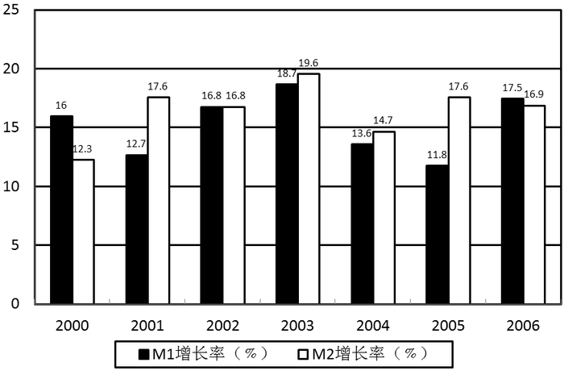

### 第 111 题

在所有的年份中，我国M2的增长率最大的年份为：

A. 2001年

B. 2002年

C. 2003年

D. 2004年

第 111 题 · 答案与解析

**参考答案（粉笔题库参考内容）**

C

**解析**

由图中可知，M2增长率最大的年份为2003年，其增长率为19.6%。

故正确答案为C。

**考点**：直接找数、综合资料

**来源**：2008年湖北省公务员录用考试《行测》题（B类）第111题

### 第 112 题

2005年我国M1的增长率为：

A. 13.6％

B. 11.8％

C. 14.7％

D. 17.6％

第 112 题 · 答案与解析

**参考答案（粉笔题库参考内容）**

B

**解析**

由图中可知，2005年M1的增长率为11.8%。

故正确答案为B。

**考点**：直接找数、综合资料

**来源**：2008年湖北省公务员录用考试《行测》题（B类）第112题

### 第 113 题

在所有的年份中，M2增长率相等的年份是：

A. 2002、2006年

B. 2003、2005年

C. 2004、2007年

D. 2001、2005年

第 113 题 · 答案与解析

**参考答案（粉笔题库参考内容）**

D

**解析**

仔细观察图中资料，可知只有2001年和2005年M2增长率相等，为17.6%。

故正确答案为D。

**考点**：直接找数、综合资料

**来源**：2008年湖北省公务员录用考试《行测》题（B类）第113题

### 第 114 题

2002年M1的增长率为2006年M1增长率的多少倍：

A. 0.96倍

B. 1.04倍

C. 0.99倍

D. 1.05倍

第 114 题 · 答案与解析

**参考答案（粉笔题库参考内容）**

A

**解析**

2002年M1的增长率是16.8%，2006年M1的增长率是17.5%，故可得16.8% ÷ 17.5% = 168 ÷ 175 = 0.96。

故正确答案为A。

**考点**：现期倍数、统计图

**来源**：2008年湖北省公务员录用考试《行测》题（B类）第114题

### 第 115 题

下列关于M1和M2增长率的表述正确的是：

A. 2000年到2006年中有3年M2的增长率高于M1

B. 2000年的M2的增长率要高于2000年的M1增长率

C. 在2000年到2006年的所有年份中。M2增长率都要高于M1增长率

D. 2002年的M1增长率和M2增长率相等

第 115 题 · 答案与解析

**参考答案（粉笔题库参考内容）**

D

**解析**

2001、2003、2004、2005总共有4年M2的增长率高于M1，A说法错误；

2000年的M2的增长率低于M1的增长率，B说法错误；

2000年和2006年M1的增长率高于M2的增长率，C说法错误；

2002年的M1和M2的增长率均为16.8%，D说法正确。

故正确答案为D。

**考点**：统计图、综合分析

**来源**：2008年湖北省公务员录用考试《行测》题（B类）第115题

## 材料 2

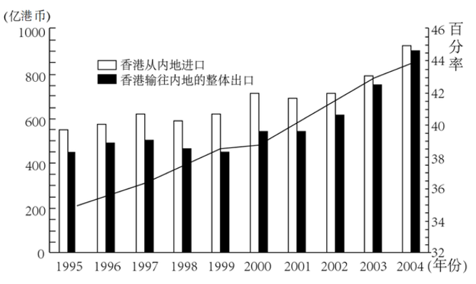

### 第 116 题

2003年香港对内地进出口总额约为：

A. 750亿港币

B. 1530亿港币

C. 1800亿港币

D. 2000亿港币

第 116 题 · 答案与解析

**参考答案（粉笔题库参考内容）**

B

**解析**

定位统计图可得：2003年进口额在800亿港币左右，出口额在750亿港币左右，两者之和应在800+750=1550亿港币左右，对应B项。

故正确答案为B。

**考点**：直接找数、统计图

**来源**：2008年湖北省公务员录用考试《行测》题（B类）第116题

### 第 117 题

1995—2004年，香港向内地出口年均增长率约为：

A. 26.2%

B. 16.3%

C. 10.4%

D. 21.4%

第 117 题 · 答案与解析

**参考答案（粉笔题库参考内容）**

C

**解析**

定位统计图可得：2004年香港为内地出口额约为900亿港币，1995年出口额约为450亿港币。根据年均增长率公式：(1+r)^n = 现期量/基期量，设1995—2004年香港为内地出口年均增长率为r，则(1+r)^9 = 900/450 = 2。若r=10%，则(1+10%)^4=1.21^2＞1.4，即(1+10%)^9＞1.4^2×1.1＞2，则r小于10%，与C项最接近。

故正确答案为C。

**考点**：年均增长率、统计图

**来源**：2008年湖北省公务员录用考试《行测》题（B类）第117题

### 第 118 题

1995—2004年，香港与内地进出口差额在150亿港币以上的年份有：

A. 1个

B. 2个

C. 3个

D. 4个

第 118 题 · 答案与解析

**参考答案（粉笔题库参考内容）**

C

**解析**

150亿港币在左侧的竖轴上表现为三小格，白格与黑格的长度差超过三个小格即满足题意，由此可知1999年、2000年和2001年三个年份白格与黑格的长度差超过三个小格，即进出口差额超过150亿港币。

故正确答案为C。

**考点**：直接找数、统计图

**来源**：2008年湖北省公务员录用考试《行测》题（B类）第118题

### 第 119 题

根据上图，下列说法正确的是：

A. 1995—2004年，香港对内地的进口值呈逐年递增的趋势

B. 2001—2004年，香港对内地的进口增长率高于出口增长率

C. 2000—2004年，香港对内地的进出口差额呈递减趋势

D. 上世纪90年代亚洲金融危机对香港对内地的进出口影响甚微

第 119 题 · 答案与解析

**参考答案（粉笔题库参考内容）**

C

**解析**

A项：定位统计图可得：1998年和2001年香港与内地的进口值比上一年减少，并非逐年递增，错误；

B项：定位统计图可得：2001年，香港与内地的进口额约为700亿港币，出口额约为550亿港币；2004年，香港与内地的进口额约为950亿港币，出口额约为900亿港币。根据公式：增长率= (现期量−基期量)/基期量，则2001—2004年，香港与内地的进口增长率= (950−700)/700 = 250/700 = 30%^+，出口增长率= (900-550)/550 = 350/550 = 60%^+。比较可知，2001—2004年香港与内地的进口增长率低于出口增长率，错误；

C项：定位统计图可得：2000—2004年香港与内地进口额与出口额的长度差逐渐减小，即进出口差额呈递减趋势，正确；

D项：定位统计图可得：1998年香港对内地的出口额与进口额均较上年下降，1999年出口额仍较上年下降，进口额虽有所回升，但仍未超过1997年进口额，显然受到亚洲金融危机的影响较大，错误。

故正确答案为C。

**考点**：统计图、综合分析

**来源**：2008年湖北省公务员录用考试《行测》题（B类）第119题

### 第 120 题

2003年香港对内地进出口总额占香港同期进出口总额的比例与1998年相比：

A. 多5.5个百分点

B. 多10.75个百分点

C. 多1.75个百分点

D. 少2.5个百分点

第 120 题 · 答案与解析

**参考答案（粉笔题库参考内容）**

A

**解析**

观察图表，白格和黑格相差长度的中点对应的是香港对内地进出口总额占香港同期进出口总额的比例，可知2003年约为43%，1998年约为37.5%，43%－37.5%＝5.5%。

故正确答案为A。

**考点**：简单加减计算、统计图

**来源**：2008年湖北省公务员录用考试《行测》题（B类）第120题

## 材料 3

根据下列文字资料完成各题。

        2007年前三个季度，城镇居民人均可支配收入为10346元，扣除价格因素后实际增长13.2%，同比提高3.2个百分点。农村居民人均现金收入3321元，扣除价格因素后实际增长14.8%，同比提高3.4个百分点。由此中国出现了比较罕见的城镇居民投入增长幅度低于农村居民收入增幅的现象。2007年前三个季度，全国城镇单位在岗职工月平均工资为1853元，同比增长18.8%，其中，国有经济单位职工月平均工资为1980元，同比增长20.8%，集体经济单位职工月平均工资1111元，同比增长18.0%，其他经济类型单位职工月平均工资1794元，同比增长15.6%，而农村劳动力外出务工的月平均工资为1015元，同比增长11.8%。由此可见，农民工的收入增长远无低于城镇居民工资的平均水平。

### 第 121 题

2006年前三个季度，我国农村居民人均现金收入为：

A. 2257元

B. 2893元

C. 3212元

D. 3300元

第 121 题 · 答案与解析

**参考答案（粉笔题库参考内容）**

B

**解析**

定位文字材料“2007年前三个季度农村人均现金收入3321元，扣除价格因素后实际增长14.8%”，代入公式基期量= 现期量/(1+增长率) =3321/(1+14.8%) ≈ 3321/1.15 ≈ 2900，只有B项最接近。

故正确答案为B。

备注：一般用名义增速求基期，因为材料只有实际增速，故用14.8%。

**考点**：基期计算、文字资料

**来源**：2008年湖北省公务员录用考试《行测》题（B类）第121题

### 第 122 题

2007年前三个季度，我国城镇居民人均可支配收入比农村居民人均现金收入高多少倍：

A. 3.12

B. 2.12

C. 1.12

D. 4.12

第 122 题 · 答案与解析

**参考答案（粉笔题库参考内容）**

B

**解析**

我国城镇居民人均可支配收入10346元，农村居民人均现金收入3321元，城镇居民人均可支配收入比农村居民人均现金收入高(10346−3321)/3321 = 10346/3321 − 1倍，10346约为3321的3倍，再减1应为2倍左右。

故正确答案为B。

（注意：B比A高几倍应为B减去A后再除以A）

**考点**：文字资料、现期倍数

**来源**：2008年湖北省公务员录用考试《行测》题（B类）第122题

### 第 123 题

2006年前三个季度，我国其他经济类型单位职工月平均工资为：

A. 1452元

B. 2074元

C. 1552元

D. 1172元

第 123 题 · 答案与解析

**参考答案（粉笔题库参考内容）**

C

**解析**

2007年前三个季度我国其他经济类型单位职工月平均工资1794元，同比增长15.6%，因此2006年此值为1794 ÷ (1 + 15.6%)，直除首位为1，排除选项B，又注意到1794÷(1+15.6%)＞1800÷1.2=1500。

故正确答案为C。

**考点**：基期计算、文字资料

**来源**：2008年湖北省公务员录用考试《行测》题（B类）第123题

### 第 124 题

2007年前三个季度，我国城镇单位在岗职工月平均工资比农村劳动力外出务工的月平均工资大约高出：

A. 82.6％

B. 84.1％

C. 95.1％

D. 88.2％

第 124 题 · 答案与解析

**参考答案（粉笔题库参考内容）**

A

**解析**

2007年前三个季度，我国全国城镇单位在岗职工月平均工资为1853元，农村劳动力外出务工的月平均工资为1015元，城镇单位在岗职工月平均工资比农村劳动力外出务工的月平均工资大约高出(1853 − 1015)/1015 = 838/1015 ＜ 838/1000=83.8%，只有A项符合。

故正确答案为A。

**考点**：一般增长率、文字资料

**来源**：2008年湖北省公务员录用考试《行测》题（B类）第124题

### 第 125 题

2006年前三个季度，我国国有经济和集体经济在岗职工月平均工资之差为：

A. 697.5元

B. 869元

C. 1039元

D. 528元

第 125 题 · 答案与解析

**参考答案（粉笔题库参考内容）**

A

**解析**

2007年前三个季度我国国有经济单位职工月平均工资为1980元，同比增长20.8%，集体经济单位职工月平均工资1111元，同比增长18.0%，所以2006年前三个季度国有经济单位职工月平均工资为1980/(1+20.8%)元，集体经济单位职工月平均工资为1111/(1+18.0%)，两者相差1980/(1 + 20.8%) − 1111/(1 + 18.0%) ≈ 870/1.2，估算结果在700左右。

故正确答案为A。

**考点**：基期和差、文字资料

**来源**：2008年湖北省公务员录用考试《行测》题（B类）第125题

