# 2010年湖北省公务员录用考试《行测》题

<!-- gwy:overview:start -->
> **湖北 · 2010 · 行测 · 统考** ｜ 140 题 · 图片 172 处 · 答案随题折叠

| 题型模块 | 题量 | 题号 |
| --- | ---: | ---: |
| 言语理解与表达 | 40 | 1–40 |
| 数量关系 | 20 | 41–60 |
| 判断推理 | 30 | 61–90 |
| 资料分析 | 20 | 91–110 |
| 常识判断 | 30 | 111–140 |
| **合计** | **140** | |

导航：[题型与作答说明](#题型与作答说明) · [题目](#题目) · [材料 1](#材料-1)
<!-- gwy:overview:end -->

> 候选采集稿。参考答案及解析来自粉笔页面，不代表官方答案或真实高分答卷；来源使用许可与原卷对应关系仍需人工核实。

## 题型与作答说明

言语理解与表达

（40题）

每道题包含一个句子或一段话，后面是一个不完整的陈述，要求你从四个选项中选出一个来完成陈述。你的选择应与所提要求最相符合。

数量关系

（20题）

本部分包括数字推理与数学运算两种类型的试题。

判断推理

（30题）

本部分包括图形推理、定义判断、类比推理与逻辑判断四种类型的试题。

资料分析

（20题）

所给出的图、表、文字资料均有若干个问题要你回答。你应根据资料提供的信息进行分析、比较、计算和判断处理。

常识判断

（30题）

本部分为单项选择题，各题的四个选项中，只有一项是符合题意的，请将答案填在答题卡上。

## 题目

### 第 1 题

家庭是社会生产和生活的一个基本单位，家庭收入和支出的＿＿＿＿，是反映家庭经济水平的一个重要＿＿＿＿。

A. 数量 原则

B. 渠道 因素

C. 模式 指标

D. 状况 侧面

第 1 题 · 答案与解析

**参考答案（粉笔题库参考内容）**

C

**解析**

本题考查实词对象搭配与填空。

第一个空格中的词语是第二个空格中词语的主语。A选项“数量”是“原则”，明显搭配不当。同样，B选项“渠道”是反映家庭经济水平的“因素”，无法搭配。排除A、B。家庭收入和支出的“状况”显然是家庭经济水平的主要方面，“侧面”不符合语境，排除D。“指标”的意思是“反映某方面发展要求的绝对数字或升降百分比”。与“反映家庭经济水平”相对应，填“指标”符合语境。

故正确答案为C。

### 第 2 题

音乐是声音中最早进入电影的一个艺术＿＿＿＿，它向来以擅长表现感情、＿＿＿＿气氛而受到编创人员的喜爱。

A. 环节 烘托

B. 元素 渲染

C. 手段 打造

D. 形式 调动

第 2 题 · 答案与解析

**参考答案（粉笔题库参考内容）**

B

**解析**

此题考查实词语境的最佳搭配。

第一空，“音乐”不能与“环节”或“手段”搭配，A、C两项排除。音乐是电影中各种艺术表现方式的组成部分之一，“元素”在日常生活中表示一个事物的组成部分，所以第一空用“元素”合适。

第二空，音乐在电影中只是一个组成部分，它的重要作用只是烘托、渲染气氛，“打造”和“调动”词义更广，能起到这么大作用的是电影故事本身，综上，选B。

故正确答案为B。

### 第 3 题

郭店《老子》的文字考释工作主要是由湖北省荆门市博物馆进行的，其成果《郭店楚墓竹简》一书已成为各学科学者进一步研究的基础，这充分证明其工作是＿＿＿＿＿＿的，此后，又有不少学者对该书有所补充，有所＿＿＿＿。

A. 有条不紊 借鉴

B. 有目共睹 修订

C. 独树一帜 讨论

D. 卓有成效 匡正

第 3 题 · 答案与解析

**参考答案（粉笔题库参考内容）**

D

**解析**

此题考查成语和实词的混搭填空。

第一空，“有条不紊”形容说话、办事很有条理，“有目共睹”指大家都能看得见，形容十分明显，“独树一帜”比喻创造独特风格，自成一家，“卓有成效”指很有成绩、效果。根据原文“其成果《郭店楚墓竹简》一书已成为各学科学者进一步研究的基础”可知材料强调的是其工作获得了一定成果，所以第一个空格用“卓有成效”一词最符合语境。

第二空，据前面“又有不少学者对该书有所补充”可知该书还有不足之处，需要的是补充修订，“借鉴”和“讨论”在这明显不合语境，“匡正”与“修订”含义相近，用于此处也合适，综上，选D。

故正确答案为D。

### 第 4 题

苏东坡成全了黄州，黄州也成全了苏东坡，这实在是一种＿＿＿＿＿＿的有趣关系。东坡写于黄州的那些杰作，既宣告着黄州进入了一个新的美学等级，也宣告着东坡进入了一个新的人生阶段，两方面一起＿＿＿＿，谁也离不开谁。

A. 相辅相成 提升

B. 水乳交融 闻名

C. 如影随形 升华

D. 同舟共济 流传

第 4 题 · 答案与解析

**参考答案（粉笔题库参考内容）**

A

**解析**

此题考查成语和实词的混搭填空。

第一空，据原文第一个空前面“苏东坡成全了黄州，黄州也成全了苏东坡”可知苏东坡与黄州之间是互相影响、成全的关系，“相辅相成”指两件事物互相配合，互相辅助，缺一不可，符合文意。“水乳交融”形容感情上的融洽或结合紧密，“如影随形”比喻两人关系亲密，常在一起，“同舟共济”比喻同心协力，战胜困难，这三个词都侧重于感情上的亲密，没有侧重语境中需要的“互相影响”含义，故选A。

第二空，主语是“黄州进入新的美学等级”和“苏东坡进入新的人生阶段”这两方面，根据语境搭配，“提升”一词符合文意，验证了A项正确。

故正确答案为A。

### 第 5 题

这本书虽然以心理学经典理论为基础，但其主要内容都是年轻人非常＿＿＿＿的话题，再加上轻松的语言、丰富的事例，使得年轻人在阅读时总能找到自己的＿＿＿＿。

A. 敏感 收获

B. 熟悉 影子

C. 热衷 答案

D. 时髦 榜样

第 5 题 · 答案与解析

**参考答案（粉笔题库参考内容）**

B

**解析**

此题考查实词的最佳语境搭配。

由“使得”一词可知材料前后构成因果关系。原文首先提出这本书是以心理学经典理论为基础，按理说这是大家所不常见的，会造成阅读困难，据“但”引导的转折关系可知此处是与前文相反的意思，话题“熟悉”才不会造成这本书的难以理解，再加上轻松的语言和丰富的事例，这些都是与年轻人息息相关的熟悉之处，自然会产生阅读时能找到自己“影子”的结果，可知B项正确。

A项“敏感”一词色彩中性，由“敏感的话题”并不一定能得出“收获”；C项“热衷”的话题依旧不能推出“总能找到自己的答案”的必然结果；D项“时髦”也并不一定就是“榜样”，这三项前后语境搭配都不当，均不选。

故正确答案为B。

### 第 6 题

老舍能写反映北京底层市民生活的《骆驼祥子》，恐怕写不了表现上海工商界生活的《子夜》。大师熟悉的＿＿＿＿也会是有限的，谁也不是全能的。

A. 领域

B. 话题

C. 体裁

D. 形象

第 6 题 · 答案与解析

**参考答案（粉笔题库参考内容）**

A

**解析**

此题考查实词的最佳语境搭配。

材料前一句举例论证，后一句得出结论观点。根据材料首句可知，老舍写得出《骆驼祥子》但可能写不出《子夜》的原因是：他熟悉北京底层市民生活，而不了解上海工商界生活，这两者是不同的区域和范围，“领域”一词含义正与此相合，据前后语境可知选A。

B项“话题”和D项“形象”都范围过小，不合语境，材料强调的是因对不同领域生活的不熟悉造成的结果，所以也不选；《骆驼祥子》和《子夜》的体裁都属于小说，材料没有表现出体裁的不同，所以C也不选。

故正确答案为A。

### 第 7 题

一旦我们把某种东西认为是＿＿＿＿＿＿的，对于那些熟悉的事物，我们就很难看清它们的真面目，正所谓“只缘身在此山中”。

填入划横线部分最恰当的一项是：

A. 理所当然

B. 平淡无奇

C. 司空见惯

D. 由来已久

第 7 题 · 答案与解析

**参考答案（粉笔题库参考内容）**

A

**解析**

此题考查成语的语境搭配。

根据语境分析，空格前后构成因果关系，能让我们对于那些熟悉的事物难以看清其真面目的原因，就是我们把它看作是应该就那样，不容置疑，因而容易忽视其实质，“理所当然”意思是按道理应当就是这样，含有完全合理、不容怀疑的意义，符合语境，可知A项正确。

“平淡无奇”意为没有什么显著或出色的地方；“司空见惯”形容经常看到的事物，不足为奇；“由来已久”意为事情从发生到现在已经过了很长一段时间，这三个词如填入空格都不能作为后半句的解释，不合语境，均不选。

故正确答案为A。

### 第 8 题

唐高宗李治在位时期完成的《唐律疏议》是一部极为重要的法典，全面体现了中国古代法律制度的＿＿＿＿、风格和基本特征，成为中华法系的＿＿＿＿性法典，对后世及周边国家产生了极为深远的影响。

A. 性质 权威

B. 原则 方向

C. 水平 代表

D. 观念 指导

第 8 题 · 答案与解析

**参考答案（粉笔题库参考内容）**

C

**解析**

此题考查语境最佳实词的填空。

第一空，“法律制度”不能与“观念”搭配，仅从一部法典不能体现法律制度的“性质”和“原则”，根据语境，可知第一空格填“水平”最合适。

第二空，由“对后世及周边国家产生了极为深远的影响”可知这部法典成为一部代表之作，故第二空格应填入“代表”，这仅是古代的一部重要法典，并不可能成为整个中华法系的“权威”、“方向”、“指导”，这三个词程度过重，综上选择C。

故正确答案为C。

### 第 9 题

江汉平原的黄土地，＿＿＿＿可以种植任何农作物，不仅出产颇丰，而且水资源丰富，渔业发达，成为长江中下游平原上的鱼米之乡，为鄂菜提供了＿＿＿＿＿＿的原材料。

依次填入画横线部分最恰当的一项是：

A. 自古 五味俱全

B. 完全 种类繁多

C. 由于 独具特色

D. 几乎 用之不竭

第 9 题 · 答案与解析

**参考答案（粉笔题库参考内容）**

D

**解析**

本题可从第二空入手，根据“不仅出产颇丰，而且水资源丰富，渔业发达，成为长江中下游平原上的鱼米之乡”可知，此处强调原材料供给丰富、充足。B项“种类繁多”指种类非常多，D项“用之不竭”强调资源丰富、取之不尽，均符合文意，保留。A项“五味俱全”形容调味齐全适宜，C项“各具特色”强调各有特点，均无法体现原材料的丰富，排除。

第二空，搭配“可以种植任何农作物”，D项“几乎”表示接近全部，语气委婉，即差不多所以农作物都能种植，符合文意，当选。B项“完全”语气绝对，不符合实际，排除。

故正确答案为D。

### 第 10 题

每年“世界读书日”前后，“阅读”都会成为一个热门话题。在＿＿＿＿＿＿地广泛提倡读书之外，近年来，“阅读”领域内的一些新变化，如迅速＿＿＿＿开来的“浅阅读”现象，也越来越引起人们的关注。

A. 一如既往 流行

B. 大张旗鼓 蔓延

C. 始终如一 活跃

D. 不遗余力 扩展

第 10 题 · 答案与解析

**参考答案（粉笔题库参考内容）**

A

**解析**

此题考查成语和实词的混搭填空。

第一空，“一如既往”指态度没有变化，完全像从前一样；“大张旗鼓”形容声势和规模很大；“始终如一”指自始至终一个样子，形容能坚持，不间断，表示的是一种状态；“不遗余力”指全部力量都使出来，一点都不保留，全力以赴。根据原文“每年”、“近年来”的表述，第一个空格应填入表示“延续和从前一样”意思的词，用“一如既往”最符合语境。

第二空，应填入和后面的“现象”相搭配的词，“扩展”显然与之不符；“蔓延”一般含有消极含义，不好的情况蔓延，而原文整体叙述客观中性，所以不选“蔓延”。根据语境搭配，此处选择“流行”最合适。综上，选A。

故正确答案为A。

### 第 11 题

如果一个人同时戴两块手表，可能会觉得不＿＿＿＿，因为他不知道该相信哪一块手表；如果在一个企业里出现两种不同的标准，则必将让员工＿＿＿＿＿＿。

A. 愿意 各行其是

B. 舒服 怨声载道

C. 适应 无所适从

D. 放心 人心涣散

第 11 题 · 答案与解析

**参考答案（粉笔题库参考内容）**

C

**解析**

本题可从第二空入手，由“企业里出现两种不同的标准”可知，在企业采取两种标准的情况下，会使员工不知道按照那种标准去做，令员工手足无措，C项“无所适从”指不知听哪一个好，不知怎么办，符合文意，保留；A项“各行其是”指按照各自认为对的去做，体现不出手足无措的意思，排除；B项“怨声载道”形容人民群众普遍感到不满、D项“人心涣散”指思想不统一，形容人心不齐，均与文意不符，排除。

验证第一空，如果戴两块手表，可能会令人觉得不适合、不习惯，C项“适应”符合文意，当选。

故正确答案为C。

### 第 12 题

容易犯错误是我们人类无法避免的一个弱点，不管科技发展到什么程度，事故总是会在不经意间发生。懂得这个道理，我们就可以“＿＿＿＿＿＿”，只有这样，或许我们才能＿＿＿＿应对一切可能出现的麻烦。

A. 未卜先知 巧妙

B. 未雨绸缪 从容

C. 先发制人 完美

D. 稳操胜券 主动

第 12 题 · 答案与解析

**参考答案（粉笔题库参考内容）**

B

**解析**

此题考查成语和实词的混搭填空。

第一空，根据语境这里应该是表示能够据这个道理防范于未然，“未卜先知”指没有占卜便能事先知道，形容有预见、先见之明，事故的发生显然是无法预料的，所以第一个空格不能用“未卜先知”，A排除；“先发制人”指采取主动先下手，不合文意，C也排除；D项“稳操胜券”比喻有充分的把握取得胜利。懂得这个道理也只是“或许”能应对可能出现的麻烦，“稳操胜券”用法过于绝对；而“未雨绸缪”比喻事先做好准备，又据后文“只有这样，或许我们才能（    ）应对一切可能出现的麻烦”，可知第一个空格用“未雨绸缪”最符合文意，故选B。

第二空，对可能出现的麻烦做好事先准备，那么我们自然就可以在真正遇到麻烦时“从容”地应对，验证了B项正确。

故正确答案为B。

### 第 13 题

一个人的心理只要是健康的，他就有自知之明，就有可能＿＿＿＿地了解自己，知道自己存在的价值，对自己的能力，性格和优缺点都能做出＿＿＿＿＿＿的评价。

A. 透彻 恰如其分

B. 如实 不偏不倚

C. 客观 条分缕析

D. 准确 鞭辟入里

第 13 题 · 答案与解析

**参考答案（粉笔题库参考内容）**

A

**解析**

此题考查实词和成语混搭填空。

第一空，对应前文的“自知之明”，表示了解自己的情况，能正确认识自己的长处与短处，结果则是体现出深刻、全面地了解自己，对应A项“透彻”正确，体现出了解自己的程度。 “如实”、“客观”和“准确”都不能用来形容了解自己的程度，排除B、C、D三项；

第二空，所填的词语应含有评价得恰当到位的意思，“恰如其分”指说话办事十分恰当合适，且常与“评价”搭配，综上，选A。“不偏不倚”指不偏向任何一方；“条分缕析”指分析有条理、脉络清晰；“鞭辟入里”形容分析透彻，切中要害。

故正确答案为A。

### 第 14 题

在人们的认识领域里，心理学总是被蒙上一层神秘的面纱，认为心理学＿＿＿＿＿＿，离我们的生活很遥远。实际上，心理学与我们的日常生活紧密相连，心理学＿＿＿＿在生活的表象之下，支配着人们的行动。

A. 深不可测 隐藏

B. 夸大其词 蕴含

C. 变幻莫测 躲藏

D. 高不可攀 掩盖

第 14 题 · 答案与解析

**参考答案（粉笔题库参考内容）**

A

**解析**

此题考查成语和实词混搭的填空。

第一空，由句中“被蒙上一层神秘的面纱”、“离我们的生活很遥远”可知人们心中的心理学是深奥、神秘、遥不可及的。“夸大其词”指把事情说得超过原有的程度；“变幻莫测”指事物变化迅速，捉摸不定，变化多端，难以揣测，这两个成语都与句意不符，故排除B、C项。

第二空，“掩盖”和“隐藏”意思相近，但此处用“掩盖”与“在······之下”不相搭配，故选择“隐藏”。综上，选A。

故正确答案为A。

### 第 15 题

中华文明之所以绵延数千年而不绝，中国社会之所以会有超＿＿＿＿结构的历史，就是因为它一直有一套＿＿＿＿的，为多数民众所接受的主流价值观念，即所谓的儒家价值观。

A. 稳定 完整

B. 平衡 悠久

C. 严谨 通俗

D. 系统 平和

第 15 题 · 答案与解析

**参考答案（粉笔题库参考内容）**

A

**解析**

第一空，文段前两句在句式表达是一致的，构成并列关系，故填入的词语要照应相应位置的词语，前面强调“绵延数千年而不绝”，后面应该也是说明中国社会“不绝”，故应填入A项的“稳定”或B项“平衡”。C项“严谨”形容态度严肃谨慎，细致、周全、完善，追求完美。并不能代表这种社会结构是“不绝”的，应排除。D项“系统”指将零散的东西进行有序的整理、编排形成的具有整体性的整体，横线前并没有“零散”和“整体”类似的表达，应排除。

第二空，B项“悠久”强调的是时间长，而文中侧重于“为多数民众所接受的主流价值观念”，没有说明“时间”的问题，故填入A项“完整”合适，照应最后的“儒家价值观”，强调是一整套观念。

故正确答案为A。

### 第 16 题

入世以来，中国加大了和国际市场的融合，金融市场开放让中国不能再像亚洲金融危机时那样＿＿＿＿＿＿。面对危机，中国沉着冷静，努力将此次冲击化作调整和发展的＿＿＿＿。

A. 束手无策 机遇

B. 独善其身 契机

C. 毫发无损 动力

D. 自行其是 起点

第 16 题 · 答案与解析

**参考答案（粉笔题库参考内容）**

B

**解析**

此题考查成语和实词的混搭填空。

第一空，根据题干，入世前的中国金融市场与之后的相比是更加封闭，而封闭导致的结果就是受亚洲金融危机影响较小，第一个空格用“束手无策”显然不合语境，C项“毫发无损”的说法绝对化，D项“自行其是”指做自己认为对的事，不考虑别人的意见，词义色彩常为贬义，而原文是客观中性表述，所以第一个空用“独善其身”最合适，可知选B。

第二空，“契机”意为机会，指事物转化的关键，用于此处符合语境，验证了B项正确。

故正确答案为B。

### 第 17 题

我国大气环境污染问题日益严峻，并逐渐呈现区域性复合型污染的新＿＿＿＿。目前，大气污染的范围已不再局限于单个城市或单个工业区周围，城市间大气污染的相互影响和＿＿＿＿日渐突出，在珠三角，长三角，京津冀等城市群地区尤其＿＿＿＿。

A. 形势 制约 突出

B. 特点 叠加 明显

C. 局面 传播 惊人

D. 趋势 牵制 严重

第 17 题 · 答案与解析

**参考答案（粉笔题库参考内容）**

B

**解析**

此题考查实词的最佳语境搭配。

先第一空，据后文“目前”引导的大气污染新情况可知横线前面“区域性复合型污染”并不是大气污染问题未来的情况，故D项“趋势”表示未来的发展动向与文意不符，排除；“形势”、“局面”都侧重的是一种整体上的情况，而“特点”则侧重所具有的某个独特的地方，此空用“特点”更符合语境。

第二空有点难，所以先看第三空，由于前文已经出现“日渐突出”的表述，再用“突出”则显重复，故排除A项。

最后再看第二空，“和”之后应该用表示并列的另一特点，“叠加”更能表现出目前“区域性复合型污染”的特点，与前文“单个城市或单个工业区”相照应。综上，选B。

故正确答案为B。

### 第 18 题

在全球金融危机的影响下，国内许多地方企业成批停产，倒闭，但国家高新区却＿＿＿＿＿＿，依然保持着较高的增长率。

填入画横线部分最恰当的一项是：

A. 迎难而上

B. 因势利导

C. 另辟蹊径

D. 逆风飞扬

第 18 题 · 答案与解析

**参考答案（粉笔题库参考内容）**

D

**解析**

文段通过“但”构成转折，与前文“国内许多地方企业成批停产、倒闭”形成对比，强调国家高新区在金融危机背景下逆势发展，保持较高增长率。D项“逆风飞扬”比喻在不利环境下取得显著成绩，符合文意，当选。

A项“迎难而上”意为遇到困难不退缩，主动上前克服，仅强调面对困难的做法，不能体现做法产生的结果，无法与“较高的增长率”呼应，排除；B项“因势利导”指顺着事情发展的趋势，向有利于实现目的的方向加以引导，C项“另辟蹊径”比喻另创一种风格或方法，均与文意不符，排除。

故正确答案为D。

### 第 19 题

传统绘画风格对中国动画电影的影响＿＿＿＿＿＿，其中意义最为深远的就是水墨画对国产动画电影所作的＿＿＿＿，这不仅是中国民族风格的体现，也是世界动画界的一次＿＿＿＿。

A. 比比皆是 革新 合作

B. 不胜枚举 突破 尝试

C. 不一而足 贡献 创举

D. 至关重要 贡献 创举

第 19 题 · 答案与解析

**参考答案（粉笔题库参考内容）**

C

**解析**

第一空，根据横线后面“其中”一词可知前一句的表述应是说明传统绘画风格对中国动画电影的影响很多，然后才能从这众多影响中提取某一点，故第一空的意思为“很多、众多”，观察四个选项，A项“比比皆是”指到处都是，形容极其常见；B项“不胜枚举”意为不能一个个例举出来，形容数量很多；C项“不一而足”意为不止一个，非常多，三个选项均符合文段意思；而D项“至关重要”比喻最重要的，是解决问题时的关键点，没有众多这一含义，排除D项。

第三空，根据原文强调的是水墨画对动画界的极为重要影响，“创举”更符合此意义，“合作”和“尝试”词意太轻，排除A、B两项。

第二空，代入验证，水墨画只是国产动画电影制作中一个元素，这里强调的并非是它带来的革新和突破，而是它对国产电影产生的作用和影响，且“对······所作的贡献”为常用搭配，故此空用“贡献”合适。

故正确答案为C。

### 第 20 题

以德为先，首要的是提高干部的党性修养，＿＿＿＿＿＿是要解决党员干部的信仰问题，而关键之处在于通过积极有效的载体化虚为实，＿＿＿＿＿＿。

A. 重中之重 有目共睹

B. 首当其冲 雷厉风行

C. 归根结底 立竿见影

D. 千方百计 有的放矢

第 20 题 · 答案与解析

**参考答案（粉笔题库参考内容）**

C

**解析**

此题考查语境分析下的成语运用能力。

第一空，材料主要解读了“以德为先”的内涵，根据“首要的是”、“关键之处”可知，第一空应选择的是与之类似的表示地位意义的词，“归根结底”用于此处符合语境。“千方百计”在此处语意不通，故排除D；A项“重中之重”即为最重要的，与后一句话中“关键之处”意义相同，如果用的话意思重复，故排除A；B项“首当其冲”比喻最先受到攻击，遭遇灾害或受到伤害，显然不恰当。

第二空，根据文意，“通过······”之后，应该产生一定的效果，“立竿见影”符合语境。

故正确答案为C。

### 第 21 题

湖北以在洞庭湖之北而得名，但在地理上提的最多的却是长江。她影响着整个湖北的气候，土壤，物产，同时也酝酿了灿烂辉煌的楚文化。

这段文字中的“她”指的是：

A. 湖北

B. 洞庭湖

C. 地理特点

D. 长江

第 21 题 · 答案与解析

**参考答案（粉笔题库参考内容）**

D

**解析**

据提问可知此题是考查词语指代题。

此题较简单，根据就近原则，定位“她”的位置，可知其指代的是前面的“长江”，将“长江”代入验证，“长江影响着整个湖北的气候、土壤、物产”，符合文意，故选D。

A项“湖北”不能影响整个湖北的气候、土壤、物产；B项“洞庭湖”在文中只是用来解释湖北得名的原因；C项“地理特点”在文中并没有提到，所以A、B、C三项都不选。

故正确答案为D。

### 第 22 题

大多数人一般选择夏季旅行，其实在全国的绝大多数省份，夏季都是最没有旅行质量的季节，高温难耐，体力消耗大，此时的风景极少有吸引眼球的特质，景致大打折扣，尤其是一些人文景点，在强光的照射下更显得索然无味。

对这段文字的意图概括最准确的是：

A. 建议大家尽量避开夏季出游

B. 说明季节变化会影响景观质量

C. 探讨影响旅行质量的各方面因素

D. 分析人们对旅行存在的认识误区

第 22 题 · 答案与解析

**参考答案（粉笔题库参考内容）**

A

**解析**

据提问“意图”一词可知此题是中心理解题。

材料首先指出大多数人选择夏季旅行这一现象，接着用“其实”引导转折，为材料的重点，指出在绝大多数省份夏季是最没有旅行质量的季节，之后讲述夏季不适合旅行的各种原因。由此可知，这段材料意在建议大家尽量不要在夏季旅行，故A项正确。

B项无中生有，材料并没有体现此点；C项只是材料的表面主旨，并非作者意图表述的内容；D项并不是材料的重点。

故正确答案为A。

### 第 23 题

地处美丽富饶的江汉平原腹地的荆州古城，有着2600多年的历史，是历朝封王置府的重镇。这里东衔九省通衢的武汉三镇，西临举世瞩目的长江三峡，南傍浩淼无垠的洞庭湖，北垂雄奇险秀的武当山，区位优势十分明显。

这段文字主要介绍荆州：

A. 地理位置

B. 悠久历史

C. 灿烂文化

D. 富饶物产

第 23 题 · 答案与解析

**参考答案（粉笔题库参考内容）**

A

**解析**

据提问可知此题是中心理解题。

由原文“这里东衔九省通衢的武汉三镇……区位优势十分明显”可知材料主要介绍的是荆州古城的地理位置，所以选A。

材料首句有提到“悠久历史”，但文段的重点是后面的内容，所以不选B；C、D两项在材料中都没有提到，均不选。

故正确答案为A。

### 第 24 题

农业有着艺术永远无法比拟的实践性。湖北的农民在节庆的巫文化中，按照自己的需要造就了各种神灵，向它们许愿，祈求它们保佑农业生产的顺利进行。这种节庆活动，意外地促成了农业生产经验的发展，比如“春社”中放在社神前的“社种”，竟使农民能利用温室观察稻种出芽的情况；“嫁毛娘”的过程中，燃烧的火把消灭了大量飞蛾。

这段文字意在说明：

A. 巫文化对农业与艺术的不同影响

B. 巫文化怎样促进农业生产的发展

C. 推动历史进步的是人力而非神力

D. 湖北的农民创造了哪些节庆形式

第 24 题 · 答案与解析

**参考答案（粉笔题库参考内容）**

B

**解析**

据提问可知此题是中心理解题。

材料首先提出农业具有独特的实践性这一观点，接着指出具体这一实践性体现在哪，这是这段材料的重点。文段提出湖北的巫文化竟“意外地促成了农业生产经验的发展”，再举例说明巫文化是怎样促进农业生产的，故B项表述符合材料主旨，选B。

A项无中生有，材料并没有提到巫文化对艺术的影响，故不选；C项没有抓住材料的重点，文段并不是讨论是什么推动历史进步；D项表述也非材料主旨，也不选。

故正确答案为B。

### 第 25 题

有一次，就在一架民航客机即将着陆时，乘务员突然通知机上的乘客说“由于机场拥挤，无法降落，预计到达时间要推迟1个小时”，机舱里顿时一片抱怨之声，乘客们都在焦急等待着度过这段难熬的时间。几分钟后，乘务员又宣布“再过30分钟，飞机可以安全降落”，乘客们如释重负地松了口气。又过了5分钟，广播里又说“现在飞机就要降落了”，尽管晚了十几分钟，乘客们还是喜出望外。

这段文字传达的道理是：

A. 既来之，则安之

B. 退一步海阔天空

C. 道歉更易获得别人的谅解

D. 适当的言语有利于稳定情绪

第 25 题 · 答案与解析

**参考答案（粉笔题库参考内容）**

D

**解析**

据提问“道理”可知此题是考查道理判断的中心理解题。

材料讲述了在一架推迟降落飞机上，乘客们在不同时候得知不同飞机运行信息下不同的心境，乘客在这之中不断获得比乘务员上一次推断更好的信息，情绪渐渐得到稳定，最后结果是“尽管晚了十几分钟，乘客们还是喜出望外”，说明如果语言运用适当，将有利于稳定情绪，所以D项正确。

A项实际与乘客的心态相反，B项的“退一步”在文中并没有体现，且A、B项都是在乘客角度读出的信息，并不是材料得出的关键；C项也只是片面理解材料蕴含的某一方面，所以A、B、C都不选。

故正确答案为D。

### 第 26 题

人类社会的发展历史证明，中间阶层是社会的稳定器，他们有稳定的工作和收入，经济上乐于消费，政治上渴望稳定。中国目前的问题是中间阶层的规模还不够大，也不稳定，而且随着经济形势的变化，也开始面临失业的威胁。如果政府袖手旁观，置之不理，将不利于社会的稳定。

这段文字意在说明：

A. 稳定是社会发展的前提和保障

B. 中间阶层的壮大有利于扩大内需

C. 为什么中间阶层是社会的稳定器

D. 要培育和帮助中间阶层发展壮大

第 26 题 · 答案与解析

**参考答案（粉笔题库参考内容）**

D

**解析**

据提问“意在说明”可知此题是中心理解题。

阅读材料可知材料的论述主体对象是“中间阶层”，材料首先说明了中间阶层是社会的稳定器的原因，之后提出目前中国中间阶层面临的困境，最后一句点出重点：正是因为前面所说的原因，所以如果政府不帮助解决这个问题，将不利于社会的稳定，即表达了作者希望政府能够帮助中间阶层摆脱此困境，故D项表述符合作者意图。

材料论述的重点是“中间阶层”，A项中“稳定”的意义并非材料主旨；B项“扩大内需”原文中并没有提到；C项只是材料原文的部分内容，并非材料的意图，所以A、B、C三项均不选。

故正确答案为D。

### 第 27 题

从概念本身来说，“文化旅游”并非一个新名词，早在古罗马时代，人们就已经尝试了以文化需求为诱导的外出旅行活动。宗教朝圣、探寻历史古迹、参加特殊节庆活动等，都是旅游体验的一部分。可以说，旅游本身就有文化因子，而文化旅游，更是可以在丰富旅游者旅行见闻的同时，提供旅行者和被访地双方更加独特的文化碰撞和交流。20世纪70年代后期，作为一种特殊的旅游概念，“文化旅游”模式逐渐兴起。

下列说法与原文相符的是：

A. 蕴含文化色彩的旅游由来已久

B. “文化旅游”模式诞生于古罗马

C. 文化交流可以促进旅游业的繁荣

D. 文化是促使人们旅游的关键因素

第 27 题 · 答案与解析

**参考答案（粉笔题库参考内容）**

A

**解析**

第一步：给出解题思路。

本题为细节判断题，应将选项带回原文进行一一对应。

第二步：逐一判断选项。

A项，对应原文“早在古罗马时代，人们就已经尝试了以文化需求为诱导的外出旅行活动”可知，A项说法与原文相符。

B项，对应原文“从概念本身来说，‘文化旅游’并非一个新名词，早在古罗马时代······”和“20世纪70年代后期，作为一种特殊的旅游概念，‘文化旅游’模式逐渐兴起”可知，“文化旅游”概念本身产生于古罗马，但是“文化旅游”模式无法确认诞生地是否在罗马，B项属于无中生有，故排除。

C项，对应原文“文化旅游······提供旅行者和被访地双方更加独特的文化碰撞和交流”可知是文化旅游推动了文化交流，而不是C项表述的“文化交流推动文化旅游”，该项为因果倒置，故排除。

D项，在原文找不到对应，属于无中生有，故排除。

第三步：再次标注答案。

故正确答案为A。

### 第 28 题

低碳城市是一个新生事物，没有现成可借鉴的模式。专家指出，对低碳经济的认识问题上，首先需要澄清“低碳等于贫困”、“低碳等于高成本”等误区。低碳经济是在较高的文明发展水平前提下，出现的一种碳生产力水平较高、但人均碳排放水平较低的经济状态。在这个过程中，能源结构的清洁化和资源禀赋起着决定性作用，单位产出所需要的能源消耗不断下降。

“这个过程”指的是：

A. 建设低碳城市的过程

B. 提高社会文明程度的过程

C. 降低人均碳排放水平的过程

D. 转变对低碳经济认识的过程

第 28 题 · 答案与解析

**参考答案（粉笔题库参考内容）**

C

**解析**

定位“这个过程”的位置，其中包含指代词“这”，故其所指应该在前，这个过程是低碳经济这一经济状态中出现的一个过程，即“碳生产力水平较高、但人均碳排放水平较低”，且“这个过程”之后的内容是对其的进一步解释，由此可知，C项正确。

A项“建设低碳城市的过程”、D项“转变对低碳经济认识的过程”均对应文段开头的内容，并非代词指代的对象，排除；B项“提高社会文明程度”仅是一个前提，并非“这个过程”所指的内容，排除。

故正确答案为C。

### 第 29 题

汽车销售员乔·吉拉德的推销方式有点儿与众不同，他会做一些在别人看来费力不讨好的事。例如，他的1万多名顾客每个月都会收到他寄来的问候卡片，上面永远只有这样一句话：“我喜欢你。”除此之外，别无他语，也别无他物。这样一种不可思议的方法帮助乔平均每天卖出5辆车，创造出连续12年销售第一的奇迹，被吉尼斯世界纪录称为“世界上最了不起的卖车人”。

乔·吉拉德运用的最独特销售“秘诀”是：

A. 细节决定成败

B. 莫以善小而不为

C. 喜欢可以引起喜欢

D. 千里之行，始于足下

第 29 题 · 答案与解析

**参考答案（粉笔题库参考内容）**

C

**解析**

据提问和选项可知此题是中心理解题。

材料讲述了乔·吉拉德通过自己的独特推销方法获得成功的故事，而促使他能够创造销售奇迹的关键是他每个月都给他的顾客寄问候卡片，上面仅写着“我喜欢你”，这是他的“秘诀”。这是因为对别人表示喜欢这一行为，他人一般都会为此有情感上的愉悦，容易产生对表示者的好感，那么自然选择向乔·吉拉德买车的可能性便提高，由此可知C项表述符合材料隐含的道理。

A项是干扰项，但“细节决定成败”的表述过于空泛，针对性不强，题干强调的是乔·吉拉德运用的最独特的秘诀；B项“莫以善小而不为”表示不要以为是很小的好事而不去做；D项“千里之行始于足下”表示事情都是从头做起，逐步进行的，两项引申偏颇，在故事中并没有根据，故A、B、D三项均不选。

故正确答案为C。

### 第 30 题

长期以来，“准确定位”被认为是制定城市发展战略的头等大事，也被视为提升城市竞争力的关键环节。这种定位思维偏重城市作为空间的存在和物理形态的延续，却忽视了城市的功能和价值的体现，忽视了对“人”这个城市主体的观照，最终造成城市建设“摊大饼”、千城一面。如果说资源禀赋决定了城市竞争中的比较优势，那么城市的品牌和价值才是城市竞争优势的核心。只有从定位导向转到价值导向，才能真正提升城市品质、产业品质和市民生活品质，推动城市竞争力的提升和城市生产力发展的良性循环。

对这段文字的主旨概括最准确的是：

A. 城市竞争力实际是多种因素的综合体

B. 城市建设“摊大饼”的模式并不可取

C. 城市发展要更加重视城市价值的提升

D. 制定城市发展战略应该注意因地制宜

第 30 题 · 答案与解析

**参考答案（粉笔题库参考内容）**

C

**解析**

文段首先介绍了长期以来，“准确定位”在城市发展战略中所占的地位以及存在的缺陷，接着指出“城市的品牌和价值才是城市竞争优势的核心”，最后总结，“只有从定位导向转到价值导向，才能真正提升城市品质、产业品质和市民生活品质，推动城市竞争力的提升和城市生产力发展的良性循环。”通过一个必要条件的关系说明了文段的主旨，故文段旨在强调城市价值提升的重要性。C选项是文段主旨的同义替换，故本题答案为C。

A选项，强调的是城市竞争力，与文段讨论城市发展的主题不一致，故排除。

B选项，城市发展存在的问题，不是文段重点，文段的重点是解决这些问题，故排除。

D选项，文段没有提到制定城市发展战略，无中生有，故排除。

故正确答案为C。

### 第 31 题

很多人都打过篮球，知道打篮球与踢足球相比，投进一个球比踢进一个球要容易得多。这跟篮球架的高度有关。如果把篮球架做成两层楼那样高，要进球可就不那么容易了。反过来讲，假如篮球架只有普通人那么高，进球更容易了，我们还会去玩它吗？就是因为篮球架有一个适当的高度，我们跳一跳就够得着，才使得篮球成为一个世界性的体育项目。

这个事例提醒我们：

A. 制定一个奋斗目标，是成功的前提

B. 真正伟大的目标，一定是面对未来的

C. 目标高度合适，有利于调动人的积极性

D. 一步步完成小目标，最终可以完成大目标

第 31 题 · 答案与解析

**参考答案（粉笔题库参考内容）**

C

**解析**

据提问和选项可知此题是中心理解题。

材料的事例先对比篮球和足球不同的进球容易度，接着道出原因，引出重点“这跟篮球架的高度有关”。之后分别从篮球架过高和过低两个方面分述目标高度的不合适造成的不良影响，以此论证适合的高度的重要性。最后得出结论“篮球架有一个适当的高度，才使得篮球成为一个世界性的体育项目”。由此可知，C项表述正是这个事例告诉我们的道理，所以选C。

A、B项对材料说明道理的主体对象认识错误，材料的重点是“目标高度合适”，而非仅是“目标”；D项引申错误，材料事例并不能说明这个道理，所以A、B、D均不选。

故正确答案为C。

### 第 32 题

2009年9月15日，武汉市深化医药卫生体制改革工作会议召开，具有武汉本土特色的医改方案正式出台，并同步推出全国首个普通市民看得懂的“市民版”方案。“市民版”方案中所提炼的“要让市民平时少得病，得病有保障，看病更方便，治病少花钱”四项承诺，是武汉此次医改的根本所在。按照方案，本市3年医改目标为：实现基本医保全面覆盖，优先使用基本药物，取消公立医院药品加成，挤干药价水分，切实降低居民就医负担。2009年，武汉市级财政已经安排12.93亿元资金，用于支持医疗机构建设，为此次医改奠定基础。

对这段文字的主旨概括最准确的是：

A. 强调实现医改目标的必要条件

B. 强调财政支持对实施医改的意义

C. 介绍武汉市医改方案的主要特色

D. 介绍武汉市医改方案及初步进展

第 32 题 · 答案与解析

**参考答案（粉笔题库参考内容）**

D

**解析**

据提问“主旨概括”可知此题是中心理解题。

阅读材料，材料首句就提出武汉深化医改会议出台了具本土特色的医改方案这一事实，接着分别叙述此医改方案的根本和目标，最后一句介绍了目前医改获得的资金支持。综合来看，这段文字就是在介绍武汉市医改方案及初步取得的进展，故选D。

A项“必要条件”在材料中并没有体现；B项中“财政支持”是从最后一句得出，但这并不是这段文字的主旨；C项表述不够全面，没有包含文段最后一句的内容，故A、B、C三项均不选。

故正确答案为D。

### 第 33 题

在过去的一个世纪，中国所发生的变化用任何形容词来表述都不为过。形容词有一个优势，可以让每个人充分发挥自己的想象力；但这个优势同时也是一个劣势，那就是每个人想象的内容是不可比较的。没有比较，就难以看出系统性变化。能够看出系统性变化的是基于一定标准的追踪调查数据。非常遗憾的是，对人类历史上发生的如此重大的变化，迄今为止，尚没有可供比较的跟踪数据。

这段文字意在说明：

A. 中国在过去一个世纪中发生了重大的变化

B. 数据比较是准确评价历史变化的前提

C. 应该建立系统数据反映中国发生的变化

D. 人们对中国所发生的变化存在不同认识

第 33 题 · 答案与解析

**参考答案（粉笔题库参考内容）**

C

**解析**

材料首先提出用“形容词”来表述中国所发生的变化具有优势，接着用“但”这一转折关联词指出形容词也具有劣势，从而引出“基于一定标准的追踪调查数据”对了解中国发生的变化的重要性，最后道出目前人类历史上发生的变化尚没有可供比较的跟踪数据这一遗憾事实。由此可知，这段文字意在说明我们应该吸取过去的教训，建立系统数据以反映中国发生的变化，故选C。

A、D两项不是文段重点，排除；

B项是对客观现象的描述，并非解决问题的对策，排除；

故正确答案为C。

### 第 34 题

2009 年 4 月 30 日，武汉农村综合产权交易所正式挂牌运营，成为农村产权交易市场化的新平台。在交易产品设计上，武汉农交所的特色在于“综合”二字。与成都、重庆相比，武汉农交所的交易品种更多，交易范围更广。成都农村产权交易所的交易产品主要是农村土地流转和林地流转，重庆农村土地交易所仅限于土地交易，而武汉农交所的交易产品覆盖了当前农村产权交易不存在争议的所有九大类，其中，农业领域产权交易、农村集体经济组织股权交易、农村房屋产权交易在全国都有突破意义。

这段文字主要：

A. 分析武汉农交所成立的背景

B. 比较武汉农交所目前的优势

C. 说明武汉农交所的交易范围

D. 强调武汉农交所的突出特点

第 34 题 · 答案与解析

**参考答案（粉笔题库参考内容）**

D

**解析**

据提问可知此题是中心理解题。

材料首句先提出武汉农交所正式挂牌运营这一事实，接着以总——分结构叙述武汉农交所的特点，先说“武汉农交所的特色在于‘综合’二字”，之后以与成都和重庆农交所相比的例子证明这个特色具体表现在哪些方面，所以整段文字都在强调武汉农交所的特色，D项正确。

A项武汉农交所成立的“背景”在材料中并没有体现；文段强调的是武汉农交所的特点，特点不一定是“优势”，所以B项也不选；C项表述片面，“交易范围广”仅是武汉农交所特点的一个方面，也不选。

故正确答案为D。

### 第 35 题

学历的高低决定着网民对信息的判断能力，决定着表达自身意见和意志的理性程度。＿＿＿＿＿＿＿＿＿＿，也就是：网民学历越低，其信息判断力就越弱，表达自身意见和意志的理性程度就越弱。

根据文意，下列哪句话填入划线处最合适：

A. 一般情况下，二者之间呈正相关关系

B. 网络如同放大器，可以放大个体的非理性

C. 青少年网民容易出问题，主要原因在于学历

D. 从历史变化看，中国网民学历结构呈下降趋势

第 35 题 · 答案与解析

**参考答案（粉笔题库参考内容）**

A

**解析**

此题考查语句填空。

根据“也就是”一词可知，横线后面的内容是对横线内容的具体解释，横线处应填和“也就是”之后内容意思相近的句子，最后一句表达的就是网民学历和信息判断力、表达自身意见和意志的理性程度之间的关系，故A项表述填入符合文意。

B项仅谈“理性”，不能概括横线后的内容；C项谈的是青少年网民易出问题的原因，不符合最后一句的语意重点；D项本身表述有误，由文段内容，并不能推出“中国网民学历结构呈下降趋势”这一结论。

故正确答案为A。

### 第 36 题

中国的农产品不是没有市场 ，＿＿＿＿＿＿＿＿＿＿，引导农民种植适销对路的产品。比如，有些特色农产品，像东北参、冬虫夏草，在国外卖得都比一座楼房还贵，就是普通的蕨菜、核桃这些农产品，在韩国、日本都是十分抢手的紧缺货。

根据文意，下列哪句话填入划线处最合适：

A. 加快农村现代化物流基础设施建设

B. 要重视发挥农产品经纪人的积极作用

C. 关键是要获得全面而准确的需求信息

D. 资金匮乏是农村规模难以扩大的“瓶颈”

第 36 题 · 答案与解析

**参考答案（粉笔题库参考内容）**

C

**解析**

此题考查语句填空。

根据横线处前后语境，可知横线处应该填能让中国的农产品有市场的条件，再由后文的“比如”可知，后文的例子是对这个条件的解释说明，文段举的例子意在说明那些需求信息的重要性，所以选C项。

A、B、D项填入横线处与后半句都不能连接成一个完整的句子，均不选。

故正确答案为C。

### 第 37 题

有专家认为，央企并购地方国企并不值得大力提倡。从以往的并购重组经验来看，央企与国企之间的并购重组，效果并不比民营与国企、外资与国企重组的效果好。央企与地方国企之间，出资人代表虽然不一样，但机制和体制却相差不多，＿＿＿＿＿＿＿＿＿＿，并不利于重组后的创新。

根据文意，下列哪句话填入划线处最合适：

A. 在经营理念和价值取向上是趋同化的

B. 央企在经营困难时更容易得到政府的支持

C. 这些央企大规模并购地方企业的风潮值得警惕

D. 一些央企是否具备市场并购主体的地位值得警惕

第 37 题 · 答案与解析

**参考答案（粉笔题库参考内容）**

A

**解析**

此题考查语句填空。

根据语境，横线处应和前面“机制和体制却相差不多”一句语意并列一致，作为“并不利于重组后的创新”的主语，其表达的含义应与“但”这一转折关系之前内容相反，应选择表示央企和地方国企之间有相同之处这一含义的语句，所以选A。

B项表述若填入，与后文相矛盾，不合逻辑；C项和D项与前后语境不合，转移了话题，故均不选。

故正确答案为A。

### 第 38 题

社会上，人与人之间大多是依照他们了解并一致遵守的规则进行交往的。当规则有争议、不一致或是不清楚时，＿＿＿＿＿＿＿＿＿＿ 。不单小孩子玩的游戏、职业球赛是这样，生产和贸易也是如此。

根据文意，下列哪句话填入横线处最合适：

A. “游戏”就倾向于崩溃

B. 规则需要有相当程度的稳定性

C. 最终会确立一套只对一方有利的规则

D. 参赛者需要一定时间来理解并适应新规则

第 38 题 · 答案与解析

**参考答案（粉笔题库参考内容）**

A

**解析**

此题考查语句填空。

由文段最后一句“不单······是这样······也是如此”可知前文说的应该是小孩子玩游戏、职业球赛时的状况。横线所在的句子构成条件关系，横线处是前半句的结果，小孩子玩游戏或职业球赛时如果有规则争议，那么“游戏”就不能持续下去，所以选A。

B项不是横线前文可以得出的结果；C项表述本身有误，制定规则不该偏袒一方；D项“新规则”在文中并没有体现。

故正确答案为A。

### 第 39 题

①以体现一个国家经济形势的危机状况

②并不预示着一个国家马上就会改换门庭

③国家有别于企业的最显著特点是“国家主权神圣不可侵犯”

④“国家破产”更像是一个形容词

⑤而不是一个动词

将以上5个句子重新排序，语序正确的是：

A. ④①⑤③②

B. ④⑤①②③

C. ③④①⑤②

D. ③①②④⑤

第 39 题 · 答案与解析

**参考答案（粉笔题库参考内容）**

C

**解析**

根据选项，④句中存在表递进关系的“更”，不能作为首句，所以首句为③，故排除A、B两项；再看①句“以体现国家经济形势的危机状况”，③句中的国家主权神圣不可侵犯，明显不能直接体现①的内容，所以①不能直接在③后出现，故排除D。④句提到了“国家破产”，能够体现国家经济形势的危机状况，所以①在④后语义连贯，对应C项。

④⑤存在“是······而不是······”的关联词，所以⑤在④后，又因为①是对④的进一步体现，所以④①关系比④⑤更紧密，故此三句的排序因为④①⑤。同④①的关系一样，②是对⑤的进一步体现。所以顺序应为④①⑤②。验证C项正确。

故正确答案为C。

### 第 40 题

①尤其需要说明的是，湖北发现的晚期猿人化石——郧县猿人和郧西猿人

②说明湖北是晚期猿人重要的生活区域之一

③湖北境内目前已经发现的人类化石主要是晚期人类化石

④因此具有十分重要的时空坐标意义

⑤不仅在时间上分别与蓝田猿人和北京猿人相当

⑥而且在空间上分别位于蓝田猿人和北京猿人的南方

将以上6个句子重新排序，语序正确的是：

A. ①②③⑤⑥④

B. ①⑤⑥④③②

C. ③④①⑤⑥②

D. ③②①⑤⑥④

第 40 题 · 答案与解析

**参考答案（粉笔题库参考内容）**

D

**解析**

首先对比选项判断首句，①句中“尤其”表示进一步强调说明，不能做句首，所以句首为③，排除A、B两项。②句“说明湖北是晚期猿人重要的生活区域之一”，明显是由③句中提到的“湖北境内发现的人类化石主要是晚期人类化石”推断得出的。再看④句“因此具有十分重要的时空坐标意义”，我们发现从③句是不能直接推出“时空坐标意义”的。可见③②关系比③④更紧密，对应D项。

故正确答案为D。

### 第 41 题

1，8，28，80，208，（  ）

A. 468

B. 498

C. 508

D. 512

第 41 题 · 答案与解析

**参考答案（粉笔题库参考内容）**

D

**解析**

观察数列，无明显特征，且作差作和均无规律，考虑递推。圈三数，找规律。观察发现：，，，递推规律为：（第二项-第一项）=第三项。因此，所求项。

故正确答案为D。

### 第 42 题

6，7，18，23，（  ），47

A. 25

B. 38

C. 40

D. 50

第 42 题 · 答案与解析

**参考答案（粉笔题库参考内容）**

B

**解析**

观察数列，每项周围均有幂次数，考虑幂次修正数列。观察发现：，，，，。其底数为2，3，4，5，是公差为1的等差数列，则下一项底数为5+1=6；指数均为2；修正项为+2，-2循环交替。故所求项。

故正确答案为B。

### 第 43 题

1，10，26，75，196，（  ）

A. 380

B. 425

C. 520

D. 612

第 43 题 · 答案与解析

**参考答案（粉笔题库参考内容）**

C

**解析**

观察数列，无明显特征，优先考虑多级数列。后项减前项得到新数列：9，16，49，121，（    ），新数列均为幂次数，可转化为：，，，，（    ），其底数为简单递推和数列，则下一项的底数为7+11=18；指数均为2，则新数列下一项为，故所求项为196+324=520。

故正确答案为C。

### 第 44 题

123，139，177，261，463，（  ）

A. 627

B. 721

C. 833

D. 999

第 44 题 · 答案与解析

**参考答案（粉笔题库参考内容）**

D

**解析**

观察数列无明显规律，且尝试多级数列、递推数列、幂次数列均无明显规律，故考虑将数列每项数字拆分成两个数相加的形式。原数列可转化为：123=120+3，139=130+9，177=150+27，261=180+81，463=220+243。“+”号前后的数字分别形成两个新数列：

数列①：120，130，150，180，220，后项减前项为10，20，30，40，（    ），是公差为10的等差数列，故数列①的下一项为220+(40+10)=270；

数列②：3，9，27，81，243，是公比为3的等比数列，故数列②的下一项为。

故所求项为270+729=999。

故正确答案为D。

### 第 45 题

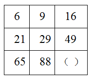

A. 97

B. 114

C. 126

D. 147

第 45 题 · 答案与解析

**参考答案（粉笔题库参考内容）**

D

**解析**

图形数阵，单独考虑横向和竖向均无规律，一起看。观察第二行发现：，，，规律为：第二行数字=第一行数字修正项，修正项是公差为-1的等差数列；观察第三行发现：，，规律为：第三行数字=第二行数字修正项，修正项是公差为-1的等差数列。故所求项。

故正确答案为D。

### 第 46 题

建造一个容积为16立方米，深为4米的立方体无盖水池，如果池底和池壁的造价分别为每平方米160元和每平方米100元，那么该水池的最低造价是多少元：

A. 3980

B. 3560

C. 3270

D. 3840

第 46 题 · 答案与解析

**参考答案（粉笔题库参考内容）**

D

**解析**

设水池的长为x米，宽为y米。根据公式：长方体的体积=abc，可得4xy=16，则xy=4。因为水池为立方体无盖，则水池造价，要求水池造价最低，即x+y应最小，根据不等式性质可得，则x+y最小值为4，故水池最低造价元。

故正确答案为D。

### 第 47 题

有46名学生需要到河对岸去参观明清时期的古民居。现只有一条船，每条船最多载6人（其中1人划船），往返一次需要7分钟，如果早晨8点钟准时开始渡河，到8点38分时，至少还有多少人在等待渡河：

A. 10

B. 15

C. 20

D. 25

第 47 题 · 答案与解析

**参考答案（粉笔题库参考内容）**

B

**解析**

根据题意，余3，故到8点38分时，共往返5次，此时已经开始第6次过河，前5次渡河后需要1人划船返回，因此共有人已经过河或者正在过河，在河边等待的还有46-31=15人。

故正确答案为B。

### 第 48 题

参加某部门招聘考试的共有120人，考试内容共有6道题。1至6道题分别有86人，88人，92人，76人，72人和70人答对，如果答对3道题或3道以上的人员能通过考试，那么至少有多少人能通过考试：

A. 50

B. 61

C. 75

D. 80

第 48 题 · 答案与解析

**参考答案（粉笔题库参考内容）**

B

**解析**

本题考查多集合反向构造型最值问题，一共答题人次，共答对86+88+92+76+72+70=484人次，则答错的人次为720-484=236。答对3道题或3道以上的人能通过考试，即答错4道及以上的人未通过考试，当236答错人次中每人均答错4道题时，则未通过考试的人数会最多，即通过考试的人最少。因此未通过考试的人最多为人，则通过考试的人数至少为有120-59=61人。

故正确答案为B。

### 第 49 题

足球比赛的计分规则是：胜一场得3分，平一场得1分，负一场得0分，如果某国家足球队共打了28场比赛，其中负6场，共得40分，那么这个队胜了多少场：

A. 8

B. 10

C. 12

D. 9

第 49 题 · 答案与解析

**参考答案（粉笔题库参考内容）**

D

**解析**

根据题意，负6场，则胜的场数和平的场数共有28-6=22场。设胜的场数为x场，则平的场数为(22-x)场，根据题意，可得方程：，解得x=9。

故正确答案为D。

### 第 50 题

小张，小王，小李和小东四人，其中每三个人的岁数之和为65，68，62，75。这四个人中年龄最小的是多少岁：

A. 15

B. 16

C. 17

D. 18

第 50 题 · 答案与解析

**参考答案（粉笔题库参考内容）**

A

**解析**

方法一：设四个人的年龄按照从小到大的顺序分别为a，b，c，d，根据题意可得：a+b+c=62······①，a+b+d=65······②，a+c+d=68······③，b+c+d=75······④。由①+②+③+④可得：3(a+b+c+d)=270，因此，a+b+c+d=90······⑤，⑤-④可得：a=15，则四人年龄最小的是15岁。

方法二：每三个人的岁数之和为65，68，62，75，相加得：65+68+62+75=270岁，每个人岁数重复相加了3次，因此这四个人的年龄之和为岁。其中，除了年龄最小的人外其他三个人年龄之和最大，即为75，故年龄最小的人的岁数为90-75=15岁。

故正确答案为A。

### 第 51 题

有一项工作任务，小明先做4小时，小方接着做8小时可以完成，小明先做6小时，小方接着做4小时也可以完成，如果小明先做2小时后再让小方接着做，那么小方可以完成工作还需要几个小时：

A. 8

B. 10

C. 11

D. 12

第 51 题 · 答案与解析

**参考答案（粉笔题库参考内容）**

D

**解析**

根据题意，4小明+8小方=6小明+4小方，解得，小明=2小方。赋小方的效率为1，小明的效率为2，则工作总量。小明先做2小时的工作量为，剩余工作量为16-4=12，故小方还需小时完成工作。

故正确答案为D。

### 第 52 题

去超市购买商品，如果购买9件甲商品，5件乙商品和1件丙商品一共需要72元。如果购买13件甲商品，7件乙商品和1件丙商品一共需要86元。若甲、乙、丙三种商品各买2件，共需要多少钱：

A. 88

B. 66

C. 58

D. 44

第 52 题 · 答案与解析

**参考答案（粉笔题库参考内容）**

A

**解析**

方法一：设甲、乙、丙的价格分别为x、y、z元，根据题意可列方程组9x+5y+z=72······①，13x+7y+z=86······②，由于钱数不一定为整数，考虑赋零法，赋x=0，联立方程组解得y=7，z=37。故甲、乙、丙三种商品各买2件，共需要元。

方法二：设甲、乙、丙的价格分别为x、y、z元，根据题意可列方程组9x+5y+z=72······①，13x+7y+z=86······②，②-①得：2x+y=7······③，①+②-11③=y+2z=81······④，③+④=2x+y +y+2z=2(x+y+z)=7+81=88。

故正确答案为A。

### 第 53 题

的个位数是几：

A. 3

B. 5

C. 7

D. 9

第 53 题 · 答案与解析

**参考答案（粉笔题库参考内容）**

C

**解析**

，，，，尾数分别为7，9，3，1，7，因此7的幂次数循环规律为以4为循环周期，尾数以7，9，3，1循环；

，，，，尾数分别为8，4，2，6，8，因此8的幂次数循环规律为以4为循环周期，尾数以8，4，2，6循环；

，指数均为2012，2012能被4整除，故原式尾数应为1+6=7。

故正确答案为C。

### 第 54 题

三位数的自然数N满足：除以6余3，除以5余3，除以4也余3，则符合条件的自然数N有几个：

A. 8

B. 9

C. 15

D. 16

第 54 题 · 答案与解析

**参考答案（粉笔题库参考内容）**

C

**解析**

根据题意可知，这个三位数N除以6、5、4余数均为3，根据同余定理，这个三位数N应该为6、5、4的公倍数＋3，6、5、4的最小公倍数为60，则N=60n+3，且N为三位数，可得：，解得，因此符合条件的自然数有15个。

故正确答案为C。

### 第 55 题

老张和老王两个人在周长为400米的圆形池塘边散步。老张每分钟走9米，老王每分钟走16米。现在两个人从同一点反方向行走，那么出发后多少分钟他们第二次相遇：

A. 16

B. 32

C. 25

D. 20

第 55 题 · 答案与解析

**参考答案（粉笔题库参考内容）**

B

**解析**

根据题意，老张和老王是在环形路程中，同时同点反向出发，则相遇两次，路程和应为2圈。根据相遇公式：，可得分钟。

故正确答案为B。

### 第 56 题

有一条新修的道路，现在需要在该道路的两边植树，已知路长为5052米，如果每隔6米植一棵树，那么一共需要植多少棵树：

A. 1646

B. 1648

C. 1686

D. 1628

第 56 题 · 答案与解析

**参考答案（粉笔题库参考内容）**

C

**解析**

根据两端植树公式：棵数，因道路两边都要植树，故一共需要植树棵。

故正确答案为C。

### 第 57 题

某俱乐部会下中国象棋的有85人，会下围棋的有78人，两种都会下的有35人，两种都不会下的有18人，那么该俱乐部共有多少人：

A. 128

B. 146

C. 158

D. 166

第 57 题 · 答案与解析

**参考答案（粉笔题库参考内容）**

B

**解析**

设俱乐部总人数为x，根据两集合容斥原理公式：A+B-A∩B=总数-都不，可得85+78-35=x-18，解得x=146人。

故正确答案为B。

### 第 58 题

甲家庭和乙家庭共有图书3245册，甲家庭的图书数量是乙家庭的4倍，甲家庭和乙家庭各有图书多少册：

A. 2596，649

B. 2425，820

C. 2620，625

D. 2530，715

第 58 题 · 答案与解析

**参考答案（粉笔题库参考内容）**

A

**解析**

方法一：设乙家庭有图书x册，则甲家庭有图书4x册，根据题意可得x+4x=3245，解得x=649，则乙家庭有图书649册，观察选项，只有A项满足。

方法二：选项信息充分，利用代入排除法，根据题意可知，甲家庭的图书数量是乙家庭的4倍，观察选项只有A项满足4倍的关系。

故正确答案为A。

### 第 59 题

有一只青蛙在井底，每天上爬10米，又下滑6米，这口井深20米，这只青蛙爬出井口至少需要多少天：

A. 2

B. 3

C. 4

D. 5

第 59 题 · 答案与解析

**参考答案（粉笔题库参考内容）**

C

**解析**

方法一：根据题干条件列表如下：

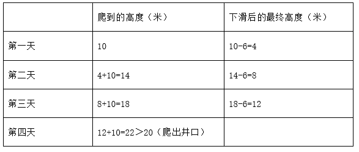

故这只青蛙爬出井口至少需要4天。

方法二：根据公式：（N为次数或天数，C为井深，A为每次爬的高度，B为每次下滑的高度）。可得天，则N向上取整为4天，故这只青蛙爬出井口至少需要4天。

故正确答案为C。

### 第 60 题

有颜色不同的五盏灯，每次使用一盏、两盏、三盏、四盏和五盏，并按一定次序挂在灯杆上表示不同的信号，这些颜色不同的灯共可以表示多少种不同的信号：

A. 240

B. 300

C. 320

D. 325

第 60 题 · 答案与解析

**参考答案（粉笔题库参考内容）**

D

**解析**

根据题意，不同信号由一盏、两盏、三盏、四盏、五盏灯按照不同颜色不同顺序组成，则这些颜色不同的灯共可以表示的信号数为：120+120=325种。

故正确答案为D。

### 第 61 题

从四个选项选择最合适的一个填入问号处，使之呈现一定的规律性。

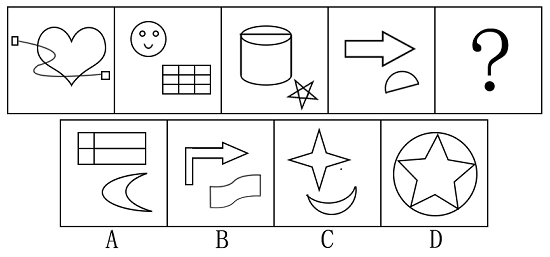

A. A

B. B

C. C

D. D

第 61 题 · 答案与解析

**参考答案（粉笔题库参考内容）**

C

**解析**

图形组成凌乱，可能考属性，考数数。

图形在对称性、曲折性和封闭性上不存在明显的规律，故数数。已知四个图形中，均包含8条直线，故未知图形也应包含8条直线。四个选项中，A项的直线条数为6，B项为11，C项为8，D项为10。

故正确答案为C。

### 第 62 题

从四个选项选择最合适的一个填入问号处，使之呈现一定的规律性。

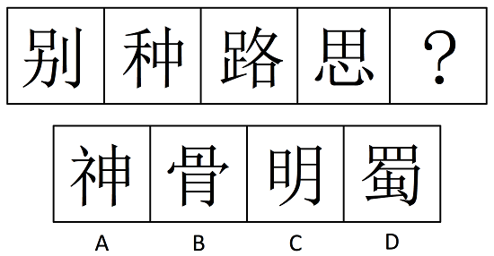

A. A

B. B

C. C

D. D

第 62 题 · 答案与解析

**参考答案（粉笔题库参考内容）**

D

**解析**

组成元素凌乱，可能考属性也可能考数数。

观察已知图形，各个汉字包含的封闭区域个数分别为1、2、3、4，依此规律，下一个汉字的封闭区域个数应为5，四个选项中，只有“蜀”字符合。“神”、“骨”、“明”三个汉字的封闭区域数量都为4个。

故正确答案为D。

### 第 63 题

从四个选项选择最合适的一个填入问号处，使之呈现一定的规律性。

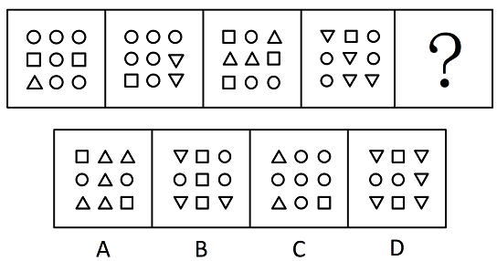

A. A

B. B

C. C

D. D

第 63 题 · 答案与解析

**参考答案（粉笔题库参考内容）**

A

**解析**

组成元素相同，数量和位置不同，考数量和位置。

观察已知图形，三角形的个数从左到右分别为1、2、3、4，依此规律，未知图形中，三角形的个数应为5。四个选项中，A、D两项符合。再观察位置，奇数项三角朝上，偶数项的三角朝下，只有A项符合。

故正确答案为A。

### 第 64 题

从四个选项选择最合适的一个填入问号处，使之呈现一定的规律性。

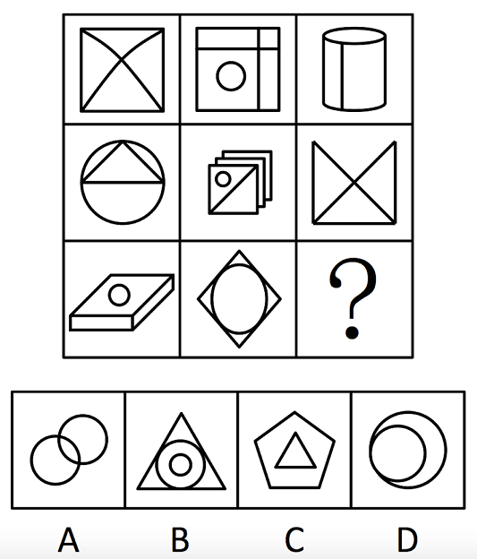

A. A

B. B

C. C

D. D

第 64 题 · 答案与解析

**参考答案（粉笔题库参考内容）**

A

**解析**

组成元素凌乱，可能考属性也可能考数数。

九宫图中，以列为单位，第一列各图中，封闭区域的个数均为4；第二列各图中，封闭区域的个数均为5；依此规律，第三列中，由前两图的封闭区域个数为3，可推知未知图形应包含3个封闭区域。四个选项中，只有A项满足，B项包含5个，C、D两项各包含2个。

故正确答案为A。

### 第 65 题

从四个选项选择最合适的一个填入问号处，使之呈现一定的规律性。

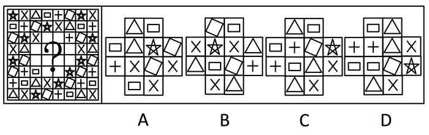

A. A

B. B

C. C

D. D

第 65 题 · 答案与解析

**参考答案（粉笔题库参考内容）**

C

**解析**

观察已知图形，以行为单位，每一行中，第7、8个图案和第1、2个图案相同，且每一行前6个图案样式周遍。依此规律，第3行的两个未知图案应为三角形和长方形，A、C、D三项满足；第6行的两个未知图案应为三角形和叉形，只有C、D两项满足；D项的第三行出现两个长方形，不符合规律，排除。

故正确答案为C。

### 第 66 题

从四个选项选择最合适的一个填入问号处，使之呈现一定的规律性。

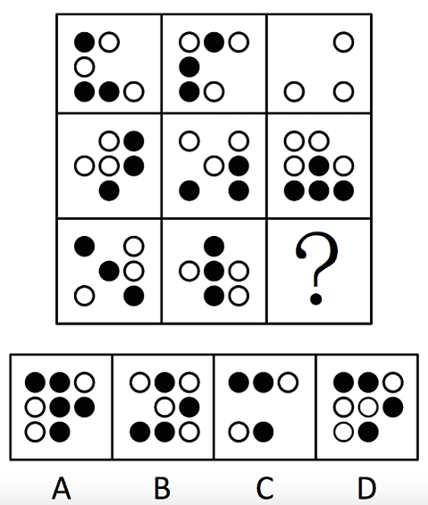

A. A

B. B

C. C

D. D

第 66 题 · 答案与解析

**参考答案（粉笔题库参考内容）**

D

**解析**

元素组成相似，优先考虑样式规律。观察发现，题干图形均由黑球和白球构成，考虑黑白运算。九宫格优先横向看，前两行图形的黑白运算规律为：黑+白=空，白+黑=空，空+白=白，黑+黑=白，白+空=白，空+白=白，白+白=黑，空+黑=黑，黑+空=黑；第三行应用前两行得到的规律，只有D项符合。

故正确答案为D。

### 第 67 题

从四个选项选择最合适的一个填入问号处，使之呈现一定的规律性。

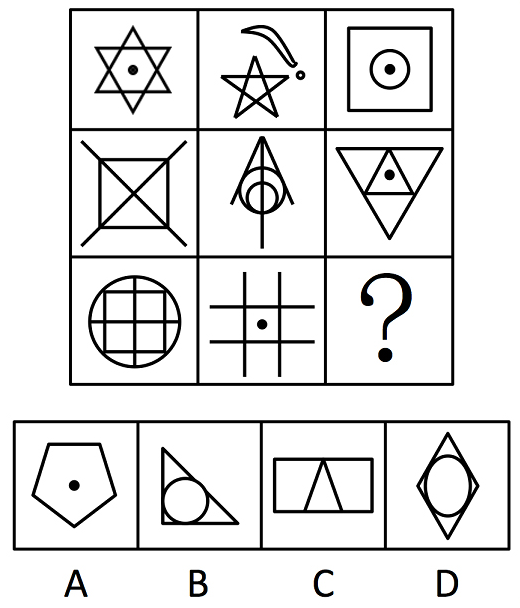

A. A

B. B

C. C

D. D

第 67 题 · 答案与解析

**参考答案（粉笔题库参考内容）**

A

**解析**

组成元素凌乱，考数数。

九宫图中，以行为单位，第1行的3个图形中，直线的数量分别为6、5、4条，总和为15条；第2行的3个图形中，直线的数量分别为6、3、6条，总和为15条；因此第三行直线总数同样也应为15，前两个图形直线的数量分别为6、4条，故第三个图形直线的数量应为5条，只有A符合条件。

故正确答案为A。

### 第 68 题

给定纸盒外表面，下面哪个图形可以和题中图形折成同样的盒子。

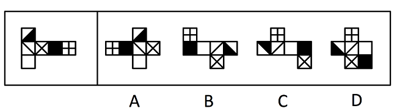

A. A

B. B

C. C

D. D

第 68 题 · 答案与解析

**参考答案（粉笔题库参考内容）**

B

**解析**

将题干和选项展开图标上序号，如下图所示（各选项面都相同，故相同的面用相同字母表示），逐一进行分析。

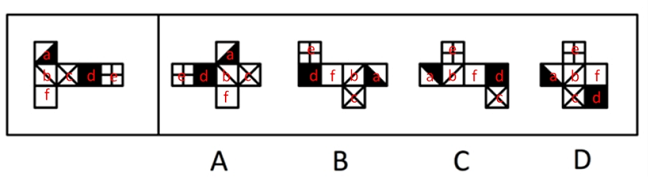

以面b和面c的公共边为起始边，在面b内顺时针画边，如下图所示，题干展开图中边1对应面c，边2对应面f，边3对应面e。

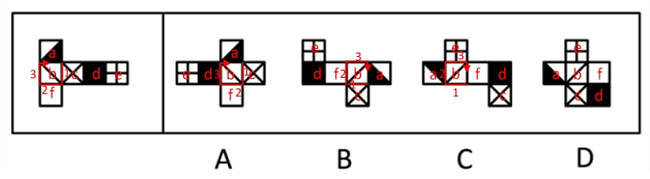

A项：边1对应面c，边2对应面f，边3对应面d，与题干不一致，排除；

B项：边1对应面c，边2对应面f，边3对应面e，与题干一致，当选；

C项：边1对应面c，边2对应面a，边3对应面e，与题干不一致，排除；

D项：无法折叠成六面体，排除。

故正确答案为B。

### 第 69 题

给定纸盒外表面，下面哪一个图形是由它折成的：

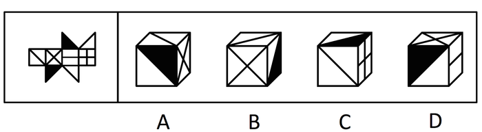

A. A

B. B

C. C

D. D

第 69 题 · 答案与解析

**参考答案（粉笔题库参考内容）**

A

**解析**

A项：选项与题干展开图一致，当选；

B项：题干展开图中白三角形的直角边不挨着叉面，但是选项挨着，选项与题干展开图不一致，排除；

C项：题干展开图中黑三角形的直角边不挨着田字面，但是选项挨着，选项与题干展开图不一致，排除；

D项：题干展开图中叉面和一条直线面的公共边应该挨着直线，但选项不挨着，选项与题干展开图不一致，排除。

故正确答案为A。

### 第 70 题

下面左视图和主视图正确的是：

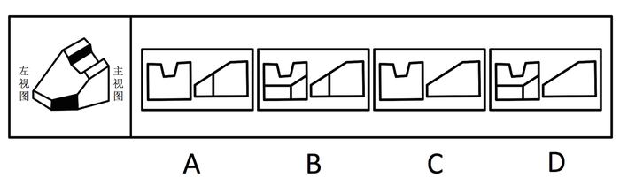

A. A

B. B

C. C

D. D

第 70 题 · 答案与解析

**参考答案（粉笔题库参考内容）**

B

**解析**

本题考查三视图。

三视图是观测者从三个不同位置观察同一个空间几何体而画出的图形，主视图是从物体的前面向后面投射所得的视图，左视图是从物体的左面向右面投射所得的视图。四个选项中，只有B项符合三视图的视图规则，A、C、D三项的视图均不完整。

故正确答案为B。

### 第 71 题

口红效应是指每当经济不景气，人们的消费就会转向购买廉价商品，而口红虽非生活必需品，却兼具廉价和粉饰的作用，能够给消费者带来心理慰藉。

下列符合口红效应的是：

A. 近来公司效益不好，胡老板卖掉了自己的高级轿车，改骑自行车上班，既环保又锻炼身体

B. 为了约会，小刘虽然工资不高，还是买了一身名牌西装来装扮

C. 今年单位效益不好，小杨取消了假期带全家到国外旅行的计划，改为到近郊旅游，结果感觉还不错

D. 为了明天的面试，小黄到理发店理了一个新发型，看上去朝气蓬勃，使他信心十足

第 71 题 · 答案与解析

**参考答案（粉笔题库参考内容）**

C

**解析**

第一步：找出定义关键词。

“经济不景气”、“转向购买廉价商品”、“非生活必需品”。

第二步：逐一分析选项。

A项，“卖掉高级轿车，改骑自行车”并未体现购买廉价商品，不符合定义，排除；

B项，“名牌西装”不是“廉价商品”，不符合定义，排除；

C项，“单位效益不好”对应“经济不景气”，把“国外旅行计划”改成“近郊旅游”对应“转向购买廉价商品”，旅行是“非生活必需品”，符合定义，当选；

D项，只说了小黄为了面试去理发，没提及定义中的关键因素，属于无关项，排除。

故正确答案为C。

### 第 72 题

原始取得是指根据法律规定，最初取得财产的所有权或不依赖于原所有人的意志而取得财产的所有权。

下列不属于原始取得的是：

A. 农民种植并收获的粮食

B. 老王养的牛产下的牛犊

C. 违法犯罪分子的财产收归国家所有

D. 朋友赠送的礼物

第 72 题 · 答案与解析

**参考答案（粉笔题库参考内容）**

D

**解析**

第一步：抓住定义中的关键词。

该定义项的关键在于财产所有权的取得方式，可以是“最初取得”，也可以是“不依赖于原所有人的意志而取得”。

第二步：逐一判断选项。

A项，“农民种植并收获的粮食”属于“最初取得”；B项“老王养的牛产下的牛犊”也属于“最初取得”；

C项，国家没收违法犯罪分子的财产是依据法律规定的，属于“不依赖于原所有人的意志而取得”；

D项，“朋友赠送的礼物”依赖于朋友的意志，如果朋友不愿意赠送，就没办法取得礼物的所有权，所以不属于原始取得。

本题为选非题，故正确答案为D。

### 第 73 题

从权利：民事权利可分为主权利与从权利。从权利是指在互有关联的两个民事权利中，其效力受另一效力制约的权利。从权利随主权利的存在而存在或消灭而消灭。

下列属于从权利的是：

A. 抵押权

B. 债权

C. 著作权

D. 上诉权

第 73 题 · 答案与解析

**参考答案（粉笔题库参考内容）**

A

**解析**

第一步：抓住定义中的关键词。

该定义项中的关键词为“效力受另一效力制约”、“随主权利的存在而存在或消灭而消灭”。

第二步：逐一判断选项。

A项，“抵押权”是随债权的存在而存在的，没有债权就没有抵押权，符合定义；

B、C、D三项中，“债权”、“著作权”、“上诉权”没有受其他权利或效力的制约，可以单独存在或消灭，故不属于从权利。

故正确答案为A。

### 第 74 题

学习迁移即一种学习对另一种学习的影响，它广泛地存在于知识、技能、态度和行为规范的学习中。任何一种学习都会受到学习者已有知识经验、技能、态度等的影响，只要有学习，就有迁移。

下列属于学习迁移的是：

A. 小王的父亲是著名的画家，受父亲影响，他从小就对绘画产生了兴趣，后来也成为一名画家

B. 某大学生在人多的教室里复习功课总容易分心，于是换到一个独处的安静环境，学习效率非常高

C. 小芳学会了拉二胡，自己尝试拉小提琴，结果也很快学会

D. 某学生沉迷于网络游戏致使学习成绩下降，后来通过老师的教育和同学的帮助，改掉了毛病，学习进步非常快

第 74 题 · 答案与解析

**参考答案（粉笔题库参考内容）**

C

**解析**

第一步：找出定义关键词。

“一种学习对另一种学习的影响”，而且这种影响来自“学习者已有知识经验、技能、态度等”。

第二步：逐一分析选项。

A项，小王对绘画产生兴趣是“受父亲影响”，不是受自身已有技能的影响，不符合定义，排除；

B项，说的是某大学生改变学习环境之后学习效率提高，不符合定义，排除；

C项，小芳很快学会拉小提琴是受已经会拉二胡的影响，符合定义，当选；

D项，是某学生在老师和同学的帮助下提高学习成绩，这两种情况都没有体现出“一种学习对另一种学习的影响”，不符合定义，排除。

故正确答案为C。

### 第 75 题

投射效应是指以己度人，认为自己具有某种特性，他人也一定会有与自己相同的特性，从而把自己的感情、意志、特性投射到他人身上，同时认为对方也应该有同样的感受和认知。简单来说，这是一种强加于人的一种认知障碍。

下列属于投射效应的是：

A. 某人非常喜欢打篮球，只要跟别人说话就围绕着篮球的话题没完没了，不管别人是否感兴趣

B. 某人喜爱武术，因而看电影只喜欢看武打片

C. 林丽与王飞两人性格相投，一见钟情，不顾家人反对结为夫妻

D. 公司林老板看到新招聘来的大学生很像自己年轻时的样子，因而非常喜欢他，同时对他寄予很高的期望

第 75 题 · 答案与解析

**参考答案（粉笔题库参考内容）**

A

**解析**

第一步：抓住定义中的关键词。

该定义项中的关键词是“以己度人”、把自己的感情、意志、特性“强加”到他人身上。

第二步：逐一判断选项。

A项中的主体喜欢打篮球，“不管别人是否感兴趣”，只要跟别人说话就围绕篮球的话题说个没完，属于“强加”自己的兴趣于交谈人身上，符合定义；

B项只是主体一个人的行为，不涉及他人；

C项两人性格相投，不是“以己度人”；

D项只是老板对员工的一种赏识，没有把自己的特性“强加”于员工身上。

B、C、D三项均不符合定义。

故正确答案为A。

### 第 76 题

十堰：武当山

A. 宜昌：神农架

B. 咸宁：九宫山

C. 襄阳：古隆中

D. 黄陂：木兰山

第 76 题 · 答案与解析

**参考答案（粉笔题库参考内容）**

B

**解析**

第一步：判断题干词语间逻辑关系。

二者是一一对应关系，武当山位于十堰，且武当山是山名，十堰是市名。

第二步：判断选项词语间逻辑关系。

A项：神农架是个林区，为副省级行政单位，并不是具体的某一个山，与题干逻辑关系不一致，排除；

B项：九宫山位于湖北省咸宁市，且九宫山是山名，咸宁是市名，与题干逻辑关系一致，当选；

C项：古隆中位于襄阳市，但古隆中并不是山的名称，与题干逻辑关系不一致，排除；

D项：木兰山位于武汉市黄陂区，与题干逻辑关系不一致，排除。

故正确答案为B。

### 第 77 题

收入分配：基尼系数

A. 食品支出：恩格尔系数

B. CPI：消费者价格指数

C. 环境保护：幸福指数

D. 香港：恒生指数

第 77 题 · 答案与解析

**参考答案（粉笔题库参考内容）**

A

**解析**

第一步：判断题干词语间逻辑关系。

基尼系数是测定收入分配差异的指标，收入分配差异越大，基尼系数越高。

第二步：判断选项词语间逻辑关系。

A项，恩格尔系数是食品支出总额占个人消费支出总额的比重，食品支出总额的占比越高，恩格尔系数越高，和题干逻辑一致；

B项，CPI就是消费者价格指数；

C项，环境保护和幸福指数之间没有关系；

D项，恒生指数是香港股市价格的重要指标，跟“香港”不存在直接逻辑关系。

故正确答案为A。

### 第 78 题

交通违章：警察：银行

A. 招商：企业家：政府

B. 离婚：夫妻：民政局

C. 犯罪：法官：监狱

D. 比赛：裁判：运动场

第 78 题 · 答案与解析

**参考答案（粉笔题库参考内容）**

C

**解析**

第一步：判断题干词语间逻辑关系。

出现交通违章行为，需要警察出面解决，警察开出的罚单是在银行缴纳。

第二步：判断选项词语间逻辑关系。

C项，出现犯罪行为，需要法官出面审判，法官审判的结果在监狱中执行。“犯罪”与“交通违章”都是违法行为，“警察”和“法官”分别是相应违法行为的执法人，“银行”和“监狱”都是违法行为造成的后果的执行地点，三个词构成对应关系。

A、B、D三项均不是违法行为，逻辑关系与题干不相符。

故正确答案为C。

### 第 79 题

光线：折射：水

A. 绿叶：光合作用：叶绿素

B. 水蒸气：凝结：玻璃

C. 电脑：计算：数据

D. 海洋：洋流：台风

第 79 题 · 答案与解析

**参考答案（粉笔题库参考内容）**

B

**解析**

第一步：判断题干词语间逻辑关系。

光线可以在水中产生折射。

第二步：判断选项词语间逻辑关系。

A项，绿叶在可见光的作用下能进行光合作用，要完成光合作用必须有叶绿素的存在；

B项，水蒸气可以在玻璃上凝结。其逻辑关系与题干相似，“光线”和“水蒸气”分别通过“水”和“玻璃”这两种介质发生某种变化；

C项，电脑可以用来计算数据；

D项，洋流是海水沿一定途径的大规模运动，海洋、洋流和台风不存在什么明显的逻辑关系。

故正确答案为B。

### 第 80 题

（  ）对于 终止 相当于 回车 对于 （  ）

A. 叫停 打的

B. 继续 前行

C. 句号 换行

D. 犯罪 网络

第 80 题 · 答案与解析

**参考答案（粉笔题库参考内容）**

C

**解析**

第一步：将选项逐一代入，判断各选项前后部分的逻辑关系。

A项中，前面部分是叫停对于终止，后面部分是回车对于打的；

B项中，前面部分是继续对于终止，后面部分是回车对于前行；

C项中，前面部分是句号对于终止，后面部分是回车对于换行；

D项中，前面部分是犯罪对于终止，后面部分是回车对于网络。

第二步：逻辑关系相同即为答案。

根据第一步可知，逻辑关系完全相同的是C项，句号意味着终止；回车意味着换行。其他三项的前后部分均没有构成明显的逻辑关系。

故正确答案为C。

### 第 81 题

进入6月份，不少市民发现，蚊子越来越多，简直无法控制，灭蚊剂也杀不死，一些曾经“一用就灵”的灭蚊剂如今渐渐失效。在武汉的各大医院皮肤科被蚊虫叮咬的儿童患者挤满了病房。

以下哪项不是这一现象出现的原因：

A. 6月份气温适中，雨量充沛，最适宜蚊子繁殖生长

B. 蚊子的抗药性非常强，被杀死的往往是“娇弱”的蚊种，适者则顽强地生存了下来

C. 蚊子特别喜欢叮咬儿童

D. 不规范使用灭蚊剂导致蚊子抗药性的产生和快速增强

第 81 题 · 答案与解析

**参考答案（粉笔题库参考内容）**

C

**解析**

第一步：找出题干所述现象。

蚊子越来越多，灭蚊剂失效，被蚊虫叮咬的儿童患者多。

第二步：逐一判断选项。

A项，6月份的天气最适宜蚊子繁殖生长，解释了6月份蚊子越来越多的原因，排除；

B项，蚊子抗药性强，解释了灭蚊剂失效，杀不死蚊子的原因，排除；

C项，“蚊子特别喜欢叮咬儿童”不能解释“被蚊虫叮咬的儿童患者挤满病房”这一现象，因为题干仅表明被蚊子叮咬而住院的患者中儿童多，并未断定被蚊子叮咬的人中儿童多，同时也解释不了题干中蚊子越来越多的现象，当选；

D项，蚊子抗药性增强，解释了灭蚊剂失效，杀不死蚊子的原因，排除。

本题为选非题，故正确答案为C。

### 第 82 题

如果不能有效解决房价过高、房租不断上涨以及不成正比的工资收入这些问题，那么“蚁族”生活的期限将被延长，“蚁族”的梦想也将推迟实现。

由此推出：

A. 只有有效抑制房价过高和租金上涨，保持工资收入增长的合理比例，才能不推迟“蚁族”梦想的实现

B. 如果有效解决了房价过高、房屋租金不断上涨以及不成正比的工资收入这些问题，“蚁族”生活的期限将会缩短，“蚁族”的梦想也能够实现

C. 缩短“蚁族”生活的期限，就能加速“蚁族”梦想的实现

D. 如果“蚁族”的梦想被推迟实现，就不能有效解决房价过高、房屋租金不断上涨以及不成正比的工资收入这些问题

第 82 题 · 答案与解析

**参考答案（粉笔题库参考内容）**

A

**解析**

第一步：翻译题干。利用充分必要条件。

这些问题“蚁族”生活的期限将被延长 且 “蚁族”的梦想推迟实现。

第二步：逐一翻译选项。

A项，-推迟“蚁族”梦想的实现没有这些问题，是题干推导关系的逆否规则，正确；

B项，没有这些问题“蚁族”生活的期限将被延长 且 -“蚁族”的梦想推迟实现，是否前件推出否后件的无效推理，错误；

C项，-“蚁族”生活的期限将被延长“蚁族”的梦想推迟实现，后件是个联言命题，不能主观推测支命题之间的关系，错误；

D项，“蚁族”的梦想推迟实现这些问题，是肯后件推出肯前件的无效推理，错误。

故正确答案为A。

### 第 83 题

每年高考成绩公布期间，社会总要掀起一阵“状元热”和“排名热”。国人热衷于排名的做法，往往会阻碍了创新型人才的成长。

以下哪项不能支持上述观点：

A. “排名热”具有社会需求，有利于促进竞争

B. 排名就是固化，容易滋生固步自封情绪，而创新排斥各种排名

C. 过分支持一次考试的赢者，容易形成不宽容失败者的氛围，不利于创新型人才的成长

D. 社会需要各式各样的人才，高考只是评价人才的一种标准

第 83 题 · 答案与解析

**参考答案（粉笔题库参考内容）**

A

**解析**

第一步：找出论点和论据。

论点：热衷于排名的做法往往会阻碍创新型人才的成长。没有论据。

第二步：逐一判断选项。

A项说“排名热”有助于促进竞争，是支持排名这一做法，直接削弱了论点；

B项说明排名的坏处以及排名对创新的负面影响，支持论点；

C项说明过分支持考试排名靠前的考生会对名次落后的考生造成负面影响，阻碍创新型人才的成长，支持论点；

D项削弱高考在评价人才方面的重要性，支持论点。

本题为选非题，故正确答案为A。

### 第 84 题

某学校甲、乙、丙三位老师年龄各不相同，一位喜欢足球，一位喜欢篮球，一位喜欢排球。现在知道：甲比喜欢足球的人年龄大；喜欢排球的老师比喜欢篮球的老师年龄小；乙老师年龄最大。

由此可以推出：

A. 甲老师年龄最小

B. 乙老师喜欢排球

C. 丙老师喜欢足球

D. 三人年龄大小无法确定

第 84 题 · 答案与解析

**参考答案（粉笔题库参考内容）**

C

**解析**

第一步：找突破口。

根据题干信息，按年龄大小排列，①乙年龄最大，②甲＞喜欢足球的人，③喜欢篮球的人＞喜欢排球的人，从“乙年龄最大”和“甲＞喜欢足球的人”可知，“乙＞甲＞喜欢足球的人”，因此喜欢足球的人是丙，且丙的年龄最小。

第二步：结合其他信息进行推导，得出答案。

由题干已知信息，“喜欢篮球的人＞喜欢排球的人”，因此喜欢篮球的人是乙，喜欢排球的人是甲。

故正确答案为C。

### 第 85 题

吸烟有害健康是众所周知的说法，如何在烟盒上做出恰当的警示，从而有效降低人们尤其是青少年的吸烟欲望，却很不容易。加拿大规定，每一条香烟都必须从政府规定的16种警示语中选择至少6种，并且要经常更换；最好不用大字标题，不得出现“禁止向未成年人销售”字句。

这种做法是以下面哪项为前提假设的：

Ⅰ.用语气生硬的大字标题容易引起青少年的逆反心理

Ⅱ.“禁止向未成年人销售”字句会被青少年认为“香烟是成年人的专用品”而更加起劲地尝试

Ⅲ.过分强调吸烟有害健康会引起烟草企业的反对

Ⅳ.警示语经常更换以免被当成老生常谈或出现过期消息

A. Ⅰ、Ⅱ、Ⅲ和Ⅳ

B. Ⅰ、Ⅱ和Ⅲ

C. Ⅰ、Ⅱ和Ⅳ

D. Ⅰ和Ⅱ

第 85 题 · 答案与解析

**参考答案（粉笔题库参考内容）**

C

**解析**

第一步：找出论点和论据。

论点：在烟盒上做出恰当的警示，有效降低人们尤其是青少年的吸烟欲望。

论据①：从政府规定的16种警示语中选择至少6种，并且要经常更换；

论据②：最好不用大字标题；

论据③：不得出现“禁止向未成年人销售”字句。

第二步：逐一判断选项。

Ⅰ在论点和论据②之间建立联系，说明“不使用大字标题”跟“降低青少年吸烟欲望”之间的关系，加强论证；

Ⅱ在论点和论据③之间建立联系，解释为什么不出现“禁止向未成年人销售”的字句能够降低青少年的吸烟欲望，加强论证；

Ⅲ谈的是烟草企业的态度，跟论点无关，属于无关选项；

Ⅳ在论点和论据①之间建立联系，加强“更换警示语”跟“降低吸烟欲望”之间的关系，支持论点。

综上分析，除了Ⅲ，Ⅰ、Ⅱ、Ⅳ都加强论证。

故正确答案为C。

### 第 86 题

托勒密派天文学家坚持“地球静止说”，其根据是如果地球是转动的，每天一圈，那么地球表面上任何一点在很短的时间都将运动很大一段距离。这时，如果一块石头从塔顶落下来，应该落在离塔很远的地方。可是人们看到的情景并非如此。石头总是落在塔基边缘，可见“地球运动说”是错误的。

下面哪个选项最能对这些论断提出质疑：

A. 难道从塔顶落下的石头不会受到人为的干扰吗？

B. 难道塔一定是垂直的吗？

C. 地球不转动怎么会有白天和黑夜的替换？

D. 从正在航行的船桅杆顶上落下的一件重物不也是落到桅杆脚下而没有落到船底吗？

第 86 题 · 答案与解析

**参考答案（粉笔题库参考内容）**

D

**解析**

第一步：找出题干的论点和论据。

论点：“地球运动说”是错误的。

论据：根据是如果地球是转动的，每天一圈，那么地球表面上任何一点在很短的时间都将运动很大一段距离。这时，如果一块石头从塔顶落下来，应该落在离塔很远的地方，可石头总是落在塔基边缘。

第二步：判断削弱方式。

要证明这个例子无法解释地球是静止还是运动的。

第三步：逐一判断选项。

A项，“从塔顶落下的石头可能受人为干扰”质疑了这个实验的准确性，在一定程度上质疑了题干论断的推理过程的有效性；

B项，塔是否垂直与石头的落地距离无关，无法质疑论点；

C项，题干没有提及“白天和黑夜的替换”，属于无关选项；

D项，正在航行的船是运动的，这个时候重物从船桅杆顶上落下，同样是落在桅杆脚下，说明无论是在相对运动的情况下，还是在相对静止的情况下，重物的落地距离是相近的，由此可说明不能通过观察石头从塔顶落下的落地距离来得出结论。与A项相比，D项通过实例更有效地质疑了论断。

故正确答案为D。

### 第 87 题

文化是活的生命。持久的生命力有赖于其影响力，而社会大众的喜爱是构成影响力的前提条件。

由此可以推出：

A. 受到大众喜爱的文化就会有影响力和持久的生命力

B. 不受大众喜爱的文化就没有持久的生命力

C. 文化没有影响力就不会受到社会大众的喜爱

D. 只有具备了持久的生命力，才可能会受到社会大众的喜爱

第 87 题 · 答案与解析

**参考答案（粉笔题库参考内容）**

B

**解析**

第一步：翻译题干。利用充分必要条件。

①持久的生命力有影响力。

②有影响力受大众喜爱的文化。

根据充分必要命题推理规则中的传递规则，①、②的推导关系连起来可得到③：持久的生命力受大众喜爱的文化。

第二步：逐一翻译选项并判断正确选项。利用逆否规则。

A项，受到社会大众喜爱的文化有影响力 且 持久的生命力，A项的后件把题干①、②错误地联结起来，推理无效；

B项，-受大众喜爱的文化持久的生命力，是③的逆否命题，符合推理规则；

C项，-有影响力受大众喜爱，是②的无效推理，属于否前件推出否后件的无效推理；

D项，受大众喜爱持久的生命力，是③的无效推理，属于肯后件推出肯前件的无效推理。

故正确答案为B。

### 第 88 题

尽管中国现在不缺乏大企业，也不缺乏受重视的企业，但他们不等同于受人尊重的企业。对企业内部的员工、外部的消费者、利益相关者不尊重，尤其是对资源、环境及其利益相关者不负责任的企业，即使每天都在捐款，也不会受到尊重。

上述论证是以下面哪项为前提假设的？

A. 企业知名度与受人尊重的程度不一定成正比

B. 只有主动承担内部与外部责任的企业才能成为受人尊重的企业

C. 受人尊重的程度对企业的长远发展至关重要

D. 企业受尊重不一定要捐款

第 88 题 · 答案与解析

**参考答案（粉笔题库参考内容）**

B

**解析**

第一步：找出论点和论据。

论点：中国现在不缺乏大企业，也不缺乏受重视的企业，但他们不等同于受人尊重的企业。

论据：对企业内部的员工、外部的消费者、利益相关者不尊重，尤其是对资源、环境及其利益相关者不负责任的企业，即使每天都在捐款，也不会受到尊重。

论点论据都在说一些企业不会受到尊重，问题为前提假设，加强考虑必要条件。

第二步：逐一分析选项。

B项说明企业受尊重的前提条件，将论点和论据联系起来，加强论证；

A项，题干没有提及企业知名度，属于无关选项；

C项中的“企业的长远发展”，题干没有提及，属于无关选项；

D项不是必须假设的，即使企业受尊重一定要捐款，也不代表捐款的企业一定受尊重，无法加强论证。

故正确答案为B。

### 第 89 题

实行低利率政策是抗击通货膨胀的有效手段。目前的低利率水平可以使中国通货膨胀处于可控范围之内，不会发生恶性通胀，也使企业能够以较低廉的利息代价得到资金支持，从而使企业渡过难关。

以下哪项如果为真，最能反驳上述论断：

A. 我国的利率不仅是低利率，而且已经是负利率

B. 最近政府正在考虑提高利率

C. 实行低利率未必对企业有利

D. 低利率政策下的信贷爆发式增长在一定程度上增加了通胀发生的可能性

第 89 题 · 答案与解析

**参考答案（粉笔题库参考内容）**

D

**解析**

第一步：找出论点和论据。

论点：实行低利率政策是抗击通货膨胀的有效手段。

论据：目前的低利率水平可以使中国通货膨胀处于可控范围之内，不会发生恶性通胀，也使企业能够以较低廉的利息代价得到资金支持，从而使企业渡过难关。

本题论点和论据都是在说低利率政策可以抗击通货膨胀，二者话题一致，削弱首先考虑削弱论点，其次考虑削弱论据。

第二步：逐一分析选项。

A项：只是提到我国利率的现状，没有涉及低利率对通货膨胀的影响，无法削弱，排除；

B项：提到政府在考虑提高利率，这没有说明低利率和通货膨胀之间的关系，无法削弱，排除；

C项：只是说明低利率可能对企业不利，无法说明低利率和通胀之间的关系，无法削弱，排除；

D项：指出低利率政策下可能造成信贷爆发式增长，这增加了通货膨胀发生的可能性，说明低利率政策并不是抗击通货膨胀的有效手段，直接削弱论点，当选。

故正确答案为D。

### 第 90 题

长期以来，大家对金融危机的认识是，发生金融危机的国家受损最大。的确，过去的金融危机是受伤，而这次金融危机则让所在国受益。美国是这次金融危机的源头，赚的却比赔的多。

下列哪些选项可以支持这个结论：

Ⅰ.欧债危机泛滥，使欧洲的竞争力弱化，而美国的竞争力则在增强

Ⅱ.美国利用危机强化了对石油、黄金的捆绑，使之变成美元的另类筹码

Ⅲ.美国非常善于利用危机实现自己的长远目的，使之成为实现战略目标的契机

Ⅳ.美元独霸的货币制度在成功回归，美元地位并未下降和削弱

A. Ⅰ、Ⅱ、Ⅲ和Ⅳ

B. Ⅰ、Ⅱ和Ⅲ

C. Ⅰ、Ⅱ和Ⅳ

D. Ⅰ和Ⅱ

第 90 题 · 答案与解析

**参考答案（粉笔题库参考内容）**

A

**解析**

第一步：找出论点。

论点：这次金融危机让所在国受益。美国是这次金融危机的源头，赚的却比赔的多。

第二步：逐一判断选项。

I说明美国的竞争力在增强；

II提到美国利用危机强化对石油、黄金的捆绑；

III中，美国使危机成为实现战略目标的契机；

IV说明美元独霸的货币制度在回归。

I、II、III、IV四项中提到的情形都反映出美国是受益方，均支持论点。

故正确答案为A。

## 材料 1

根据以下资料，完成各题。

        2009年，中国农业生产在国家继续加大支农政策力度的作用下，克服不利气候条件的影响，实现了稳步的增长。

        据国家统计局公布的统计数据显示，2009年第一产业增加值35477亿元（包括农林牧渔服务业），比上年实际增长4.2%。第一产业增加值占国内生产总值的比重为10.6%，比上年下降0.1个百分点。在农、林、牧、渔业增加值中，农业增加值19699亿元，实际增长3.1%；林业增加值1581亿元，实际增长6.0%；畜牧业增加值达到9640亿元，实际增长5.5%；渔业增加值达到3431亿元，实际增长5.5%。第一产业内部，农业比重比上年提高1.6个百分点；林业比重为4.5%，渔业比重为7.9%，均比上年略有提高；畜牧业比重为27.2%，比上年下降2.4个百分点。

### 第 91 题

2009年国内生产总值是多少亿元：

A. 376056

B. 334689

C. 333156

D. 185840

第 91 题 · 答案与解析

**参考答案（粉笔题库参考内容）**

B

**解析**

根据题干“2009年国内生产总值是多少亿元”，结合材料给出了2009年第一产业增加值及第一产业增加值占国内生产总值的比重，可判定本题为现期比重问题。

定位文字材料第二段可得：2009年第一产业增加值35477亿元（包括农林牧渔服务业）······第一产业增加值占国内生产总值的比重为10.6%。根据公式：总体，可得2009年国内生产总值亿元，与B项最接近。

故正确答案为B。

### 第 92 题

2009年，在农、林、牧、渔业增加值中，增长最快的是：

A. 农业

B. 林业

C. 畜牧业

D. 渔业

第 92 题 · 答案与解析

**参考答案（粉笔题库参考内容）**

B

**解析**

定位文字资料第二段可得：农业增加值实际增长3.1%；林业增加值实际增长6.0%；畜牧业增加值实际增长5.5%；渔业增加值实际增长5.5%。其中，林业增加值增长最快。

故正确答案为B。

### 第 93 题

2009年，第一产业内部农业增加值所占的比重是：

A. 41.4%

B. 51.5%

C. 55.5%

D. 58.6%

第 93 题 · 答案与解析

**参考答案（粉笔题库参考内容）**

C

**解析**

根据题干“2009年······所占的比重是”，结合材料时间为2009年，可判定本题为现期比重问题。定位文字资料第二段可得：2009年第一产业增加值35477亿元；农业增加值19699亿元。根据公式：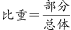，则第一产业内部农业增加值所占的比重为。

故正确答案为C。

### 第 94 题

2008年，第一产业内部畜牧业增加值约是多少亿元？

A. 9137

B. 9340

C. 9750

D. 10078

第 94 题 · 答案与解析

**参考答案（粉笔题库参考内容）**

A

**解析**

根据题干“2008年······畜牧业增加值约是多少亿元”，结合材料时间为2009年，可判定本题为基期计算问题。定位文字资料第二段可得：（2009年）畜牧业增加值达到9640亿元，实际增长5.5%。根据公式：基期量，则2008年第一产业内部畜牧业增加值约为亿元，与A项最接近。

故正确答案为A。

### 第 95 题

如果按2009年的增长率，第一产业在2010年可实现增加值多少亿元：

A. 36967

B. 37605

C. 40514

D. 50377

第 95 题 · 答案与解析

**参考答案（粉笔题库参考内容）**

A

**解析**

根据题干“······在2010年可实现增加值多少亿元”，结合材料时间为2009年，可判定本题为现期计算问题。定位文字资料第二段可得：2009年第一产业增加值35477亿元，比上年实际增长4.2%。根据公式：现期量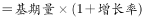，则按2009年的增长率，2010年第一产业可实现增加值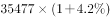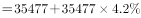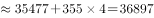亿元，与A项最接近。

故正确答案为A。

## 材料 2

根据以下资料，完成各题。

### 第 96 题

“家电下乡”产品销售额下降最多的是几月份：

A. 8 月

B. 9 月

C. 10 月

D. 11 月

第 96 题 · 答案与解析

**参考答案（粉笔题库参考内容）**

B

**解析**

根据题干“······销售额下降最多的是几月份”，可判定本题为增长量比较问题。定位第一个统计表可得：2009年7~11月“家电下乡”产品的销售额分别为88.2亿元、75.9亿元、61.8亿元、74.9亿元、73.0亿元。根据公式：增长量＝现期量-基期量，则销售额下降的月份有8月、9月、11月，分别为：

8月增量＝75.9-88.2＝-12.3亿元；

9月增量＝61.8-75.9＝-14.1亿元；

11月增量＝73.0-74.9＝-1.9亿元，其中，下降最多的是9月份。

故正确答案为B。

### 第 97 题

“家电下乡”产品销售额增幅最大的是几月份：

A. 2 月

B. 3 月

C. 7 月

D. 12 月

第 97 题 · 答案与解析

**参考答案（粉笔题库参考内容）**

A

**解析**

根据题干“······销售额增幅最大的是几月份”，可判定本题为一般增长率问题。定位第一个统计表可得：2009年“家电下乡”产品销售额分别为1月（4.8亿元）、2月（13.0亿元）、3月（22.4亿元）、6月（54.8亿元）、7月（88.2亿元）、11月（73.0亿元）、12月（111.7亿元）。根据公式：增长率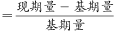，则各月销售额增幅如下：

2月：；

3月：；

7月：；

12月：，综上2月产品销售额增幅最大。

故正确答案为A。

### 第 98 题

“家电下乡”产品销售额增量最多的月份增加了几个亿：

A. 34.3

B. 33.4

C. 37.8

D. 38.7

第 98 题 · 答案与解析

**参考答案（粉笔题库参考内容）**

D

**解析**

根据题干“······销售额增量最多的月份增加了几个亿”，可判定本题为增长量计算问题。定位第一个统计表可得：2009年1~12月“家电下乡”产品的销售额。根据公式：增长量＝现期量-基期量，则观察发现7月和12月销售额增量较多：

7月：88.2-54.8＝33.4亿元；

12月：111.7-73.0＝38.7亿元，则12月“家电下乡”产品销售额增量最多，为38.7亿元。

故正确答案为D。

### 第 99 题

1-9月“家电下乡”产品销售量从高到低，列第四位的是：

A. 手机

B. 空调

C. 计算机

D. 热水器

第 99 题 · 答案与解析

**参考答案（粉笔题库参考内容）**

B

**解析**

定位第二个统计表可得：1-9月“家电下乡”产品销售量从高到低前四位分别是冰箱（10654470）、彩电（3669241）、洗衣机（2665636）、空调（2123015）。因此，列第四位的是空调。

故正确答案为B。

### 第 100 题

与10月相比，12月“家电下乡”产品中销售量增加一倍以上的产品有多少种：

A. 1种

B. 2种

C. 3种

D. 4种

第 100 题 · 答案与解析

**参考答案（粉笔题库参考内容）**

B

**解析**

根据题干“与10月相比，12月······销售量增加一倍以上的······”，可判定本题为现期倍数问题。定位第二个统计表可得：2009年10月和12月各种类家电产品的销售量。其中与10月相比，12月“家电下乡”产品中销售量增加一倍以上的产品有：

手机：；

电磁炉：，共2种。

故正确答案为B。

### 第 101 题

由以上数据，下列结论中可以推出的是：

A. 10-12月“家电下乡”产品中，销售量波动最小的是冰箱

B. 10-12月热水器、电磁炉销售量增长较为缓慢

C. 2009 年“家电下乡”产品销售额逐月增长

D. 1-9月“家电下乡”产品中销售量最大的三种产品的销售量之和占比不足75%

第 101 题 · 答案与解析

**参考答案（粉笔题库参考内容）**

A

**解析**

A项：定位第二个统计表，观察发现10-12月“家电下乡”产品中，冰箱10月、11月、12月的数据比较接近且波动没有超过30%，是所有家电中波动最小的，正确；

B项：定位第二个统计表可得；2009年10月份和12月份电磁炉销售量分别为35583台、78903台。根据公式：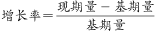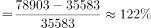，增长并不缓慢，错误；

C项：定位第一个统计表可得：2009年1-12月“家电下乡”产品销售额。其中，8月销售额（75.9亿元）＜7月销售额（88.2亿元），非逐月增长，错误；

D项：定位第二个统计表可得：2009年1-9月各“家电下乡”产品的销售量。其中销售量最大的三种产品为冰箱、彩电、洗衣机，销售量之和为10654470＋3669241＋2665636＝16989347台；各产品总销量之和10654470＋3669241＋1381878＋2665636＋458610＋2123015＋309335＋15823＋32993＝21311001台。则1-9月“家电下乡”产品中销售量最大的三种产品销售量之和占总销售量的比重，占比大于75%，错误。

故正确答案为A。

## 材料 3

根据以下资料，完成各题。

### 第 102 题

与2008年相比，2009年猪肉产量增长率为：

A. 4.6%

B. 5.8%

C. 7.1%

D. 10.2%

第 102 题 · 答案与解析

**参考答案（粉笔题库参考内容）**

B

**解析**

根据题干“与2008年相比，2009年猪肉产量增长率为”，可判定本题为一般增长率问题。定位统计图可得：2008年的猪肉产量为4620.5万吨，2009年猪肉产量为4888.8万吨。根据公式：增长率，则与2008年相比2009年猪肉产量增长率为。

故正确答案为B。

### 第 103 题

2004-2009年，增长率最高的是哪个时期：

A. 2005年

B. 2004-2006年

C. 2008年

D. 2007-2009年

第 103 题 · 答案与解析

**参考答案（粉笔题库参考内容）**

D

**解析**

根据题干“······增长率最高的······”，可判定本题为一般增长率问题。定位统计图可得：2004年-2009年猪肉产量。根据公式：增长率，则各时期猪肉产量增长率如下：

2005年：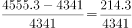；

2004-2006年：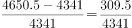；

2008年：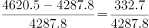；

2007-2009年：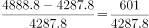。

由于分母相同，分子大的分数大，则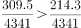、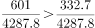；由于分母小且分子大的分数大，则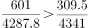，即2007-2009年的增长率最高。

（注意：本题中2005年及2008年单年份的默认为同比增长率）

故正确答案为D。

### 第 104 题

2005-2009年，增长率从高到低依次排列正确的是：

A. 2008 年＞2005 年＞2009 年＞2006 年＞2007 年

B. 2008 年＞2006 年＞2009 年＞2005 年＞2007 年

C. 2009 年＞2008 年＞2006 年＞2005 年＞2007 年

D. 2008 年＞2009 年＞2005 年＞2006 年＞2007 年

第 104 题 · 答案与解析

**参考答案（粉笔题库参考内容）**

D

**解析**

根据题干“······增长率从高到低······”，可判定本题为一般增长率问题。定位统计图可得：2004年-2009年猪肉产量。根据公式：增长率，各时期猪肉产量增长率如下：

2005年：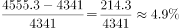；

2006年：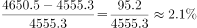；

2007年：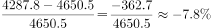；

2008年：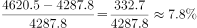；

2009年：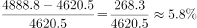，则2005-2009年，增长率从高到低依次为2008年＞2009年＞2005年＞2006年＞2007年。

故正确答案为D。

### 第 105 题

2004-2009 年，哪年的产量最接近平均值：

A. 2004 年

B. 2008 年

C. 2006 年

D. 2005 年

第 105 题 · 答案与解析

**参考答案（粉笔题库参考内容）**

D

**解析**

根据题干“2004-2009年，哪年的产量最接近平均值”，可判定本题为现期平均数问题。定位统计图可得：2004-2009年猪肉产量分别为4341万吨、4555.3万吨、4650.5万吨、4287.8万吨、4620.5万吨、4888.8万吨。则2004-2009年猪肉产量的平均值约为

万吨，与2005年的猪肉产量（4555.3万吨）最接近。

故正确答案为D。

## 材料 4

根据以下资料，完成各题。

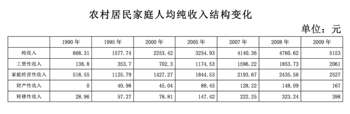

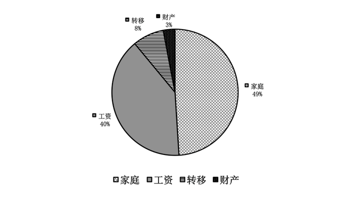

### 第 106 题

2000-2009年，农村居民家庭人均纯收入平均每年增长：

A. 236.04元

B. 322.18元

C. 353.27元

D. 474.52元

第 106 题 · 答案与解析

**参考答案（粉笔题库参考内容）**

B

**解析**

根据题干“2000-2009年，······平均每年增长”，可判定本题为年均增长量问题。定位统计表可得：2000年、2009年农村居民家庭人均纯收入分别为2253.42元、5153元。根据公式：年均增长量＝，则2000-2009年农村居民家庭人均纯收入平均每年增长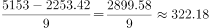元。

故正确答案为B。

### 第 107 题

与2008年相比，2009年农村居民家庭人均纯收入增长率为：

A. 6.9%

B. 7.6%

C. 8.2%

D. 8.8%

第 107 题 · 答案与解析

**参考答案（粉笔题库参考内容）**

C

**解析**

根据题干“与2008年相比，2009年······增长率为”，可判定本题为一般增长率问题。定位统计表可得：2008年、2009年农村居民家庭人均纯收入分别为4760.62元、5153元。根据公式：增长率，则2009年农村居民家庭人均纯收入增长率为。

故正确答案为C。

### 第 108 题

2009年，农村居民家庭人均纯收入构成中，增幅最小的是：

A. 工资性收入

B. 家庭经营性收入

C. 财产性收入

D. 转移性收入

第 108 题 · 答案与解析

**参考答案（粉笔题库参考内容）**

B

**解析**

根据题干“2009年，······增幅最小的是”，可判定本题为一般增长率问题。定位统计表可得：2008年、2009年农村居民家庭各类人均收入的值。根据公式：增长率，则2009年农村居民家庭各类人均收入的增长率如下：

工资性收入：；

家庭经营性收入：；

财产性收入：；

转移性收入：，则增幅最小的是家庭经营性收入。

故正确答案为B。

### 第 109 题

按照2009年增长率计算，2010年农村居民家庭人均工资性收入将达到：

A. 2291.45元

B. 2309.37元

C. 2345.86元

D. 2326.21元

第 109 题 · 答案与解析

**参考答案（粉笔题库参考内容）**

A

**解析**

根据题干“······2010年农村居民家庭人均工资性收入将达到”，可判定本题为现期计算问题。定位统计表可得：2008年、2009年农村居民家庭人均工资性收入分别为1853.73元、2061元。根据公式：增长率，则2009年农村居民家庭人均工资性收入增长率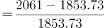；根据公式：现期量，则2010年农村居民家庭人均工资性收入将达到元，与A项最接近。

故正确答案为A。

### 第 110 题

由以上数据，可以推出下列哪个结论正确：

A. 1990-2009 年，农村居民家庭人均纯收入及各构成部分均呈递增趋势

B. 1990-2009 年，农村居民家庭人均纯收入呈现加速增长趋势

C. 2009 年，家庭经营性收入首次占比低于半数

D. 1995-2009 年，农村居民家庭人均纯收入构成，年均增速最快的是转移性收入

第 110 题 · 答案与解析

**参考答案（粉笔题库参考内容）**

D

**解析**

A项：定位统计表可得：1990年和2009年农村居民家庭人均纯收入分别为668.31元、5153元；工资性收入分别为138.8元、2061元；家庭经营性收入分别为518.55元、2527元；财产性收入分别为0元、167元；转移性收入分别为28.96元、398元。根据2009年各类收入均大于1990年，则1990-2009 年农村居民家庭人均纯收入及各构成部分均呈递增趋势，正确；

B项：定位统计表可得：1990年、1995年和2000年农村居民家庭人均纯收入分别为668.31元、1577.74元、2253.42元。根据公式：增长率，则1995年农村居民家庭人均纯收入相对于1990年的增速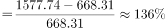，2000年农村居民家庭人均纯收入相对于1995年的增速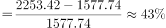，前者＞后者，增速降低，并非加速增长，错误；

C项：材料中没有给出1991-1994、1996-1999、2001-2004、2006年的收入数据，故无法判断2009年家庭经营性收入占比是否为首次低于半数，错误；

D项：定位统计表可得：1995年和2009年农村居民家庭人均工资性收入分别为353.7元、2061元；家庭经营性收入分别为1125.79元、2527元；财产性收入分别为40.98元、167元；转移性收入分别为57.27元、398元。根据公式： 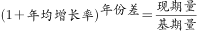，且年份差相同，都是2009-1995＝14，可直接比较的大小：

工资性收入：；

家庭经营性收入：；

财产性收入：；

转移性收入：，则年均增速最快的是转移性收入，正确。

故正确答案为D。

备注：本题A、D项均正确，但由于题目年代较为久远，推测出题人将A项的递增趋势理解为逐年递增，进而将D项设置为正确答案。

### 第 111 题

【不定选】下列日常生活常识，正确的是：

A. 甲烷的主要成分是氢气

B. 焚烧塑料会产生白色污染

C. 棉花、涤纶是高分子有机材料

D. 蛋白质是人体所需要的六大营养元素之一

第 111 题 · 答案与解析

**参考答案（粉笔题库参考内容）**

CD

**解析**

A项错误，甲烷是由C（碳）和H（氢）两种元素组成，化学式是，氢气由H元素组成，化学式是，两者都含有H元素，但不能说甲烷的主要成分是氢气。

B项错误，白色污染是人们对难降解的塑料垃圾（多指塑料袋）污染环境现象的一种形象说法，主要来源有食品包装、泡沫塑料填充包装、快餐盒、农用地膜等。焚烧塑料能够降低白色污染，但是燃烧过程中会产生很多有害气体，需要在规定条件下焚烧。

C项正确，用有机高分子化合物制成的材料称为有机高分子材料，可分为天然有机高分子材料和合成有机高分子材料。前者包括棉花、羊毛、木材、草类（天然纤维）和天然橡胶等，后者包括塑料、合成纤维（涤纶、腈纶、锦纶）和合成橡胶等。

D项正确，人体所需的六大营养元素是蛋白质、碳水化合物、脂肪、维生素、矿物质和水。

故正确答案为C、D。

### 第 112 题

下列名言与出处，对应正确的是：

A. 《管子》：学而时习之，不亦说乎

B. 《老子》：四海之内皆兄弟

C. 《论语》：天行健，君子以自强不息

D. 《庄子》：吾生也有涯，而知也无涯

第 112 题 · 答案与解析

**参考答案（粉笔题库参考内容）**

D

**解析**

“学而时习之，不亦说乎”出自孔子的《论语》；

“四海之内皆兄弟”也是出自《论语·颜渊》，原句为“君子敬而无失，与人恭而有礼，四海之内，皆兄弟也”；

“天行健，君子以自强不息”出自《周易》；

“吾生也有涯，而知也无涯”出自《庄子·养生主》一文。

故正确答案为D。

**本题相关知识点：**

有关《周易》“天行健，君子以自强不息。地势坤，君子以厚德载物”一句的延伸知识点。

清华大学的校训：“自强不息，厚德载物。”民国时期，梁启超在清华大学任教时，曾给当时的清华学子作了《论君子》的演讲，他在演讲中希望清华学子们都能继承中华传统美德，并引用了《易经》上的“自强不息”、“厚德载物”等话语来激励清华学子。此后，清华人便把“自强不息，厚德载物”8个字写进了清华校规，后来又逐渐演变成为清华校训。

### 第 113 题

对民主社会主义认识正确的是：

①最初的民主社会主义是资本主义社会主义

②民主社会主义是马克思社会主义的分支

③民主社会主义否认了社会制度的客观性

④民主社会主义肯定了工人阶级的领导地位

⑤民主社会主义把社会主义看成是一种道德需要、道德抗议，否认其历史必然性

A. ①②③④

B. ②③④⑤

C. ①③④⑤

D. ①②④⑤

第 113 题 · 答案与解析

**参考答案（粉笔题库参考内容）**

C

**解析**

②：错误，民主社会主义是社会民主党所宣扬的一种部分类似资产阶级民主制度的社会主义。1951年6月，社会党国际成立时通过的原则宣言《民主社会主义的任务与目标》，明确提出了以“民主社会主义”作为自己的奋斗纲领，公开反对马克思主义的科学社会主义。民主社会主义的内容包括：在理论基础上宣扬多元性，主张放弃统一的世界观，自称既接受人道主义的启示，又发端于宗教原则，也不拒绝马克思主义，实质上是各种实用主义观点的大杂烩，否认马克思主义的指导作用。由此可见 “民主社会主义是马克思社会主义的分支”表述有误，排除A、B、D选项。

故正确答案为C。

### 第 114 题

实践高于理论的原因是因为实践有：

A. 普遍有用性

B. 主观能动性

C. 直接现实性

D. 客观现实性

第 114 题 · 答案与解析

**参考答案（粉笔题库参考内容）**

C

**解析**

实践的直接现实性是指实践不是仅仅停留在意识范围内的精神的观念的活动，而是通过人与客观世界的实际的相互作用而引起客观世界的变化的活动，是人与世界之间的实实在在的物质、能量和信息的交换过程。直接现实性是实践所特有的品格，即具有把观念的东西变成现实的特点，这是理论所不具有的。正因为实践具有这种特有品格，所以是实践决定认识（理论），实践高于理论，而并非理论高于实践。故正确答案为C。

本题相关知识点：

主观能动性又称自觉能动性、意识的能动性，是指认识世界和改造世界中有目的、有计划、积极主动的有意识的活动能力。马克思哲学观点认为，主观能动性是人类特有的。人区别于动物的特点是，人具有主观能动性，人能够有意识地自觉地想问题、办事情。

### 第 115 题

马克思说：“蒸汽、电力和自动纺织机甚至是比巴尔贝斯、拉斯拜尔和布朗基诸位公民更危险万分的革命家。”这一论断的含义是：

A. 科技革命对统治者的地位有威胁

B. 科技革命会导致政治变革

C. 科技革命对社会变革有直接决定作用

D. 滥用科技革命的成果会给人类带来危险

第 115 题 · 答案与解析

**参考答案（粉笔题库参考内容）**

B

**解析**

本题考查科技革命对社会的影响。科技革命对于社会的影响是多方面的、深远的。包括引起社会的政治革命，这才是马克思这段话的含义。

A项错误，科技革命并不直接导致对统治阶级甚至是反动统治阶级的威胁，对于先进的统治阶级更没有这个问题；

B项正确，题干强调了科技发展带来的社会变革，选项与题干相符。

C项错误，该项把社会问题简单化了，科技革命对社会制度不会有直接的作用，而要通过复杂的社会程序才会显现出其对社会制度的影响；

D项错误，该项说法本身有合理性，但它不是这段话所强调的，何况题干没有说对科技成果的滥用。

故正确答案为B。

### 第 116 题

2009年，中共十七届四中全会强调，在新时期加强党的建设，应着重：

①坚持解放思想，坚持改革开放，创建和谐社会

②提高党的执政能力建设

③增强党员的责任感和使命感

④立法为公、执政为民

⑤加强党与人民群众的血肉联系

A. ①②③④

B. ②③④⑤

C. ①③④⑤

D. ①②③⑤

第 116 题 · 答案与解析

**参考答案（粉笔题库参考内容）**

D

**解析**

七届四中全会于2009年9月15日至18日在北京举行，会上审议通过了《中共中央关于加强和改进新形势下党的建设若干重大问题的决定》。

全会强调，加强党的建设，要着眼于继续解放思想、坚持改革开放、推动科学发展、促进社会和谐，着眼于提高党的执政能力、保持和发展党的先进性，着眼于增强全党为党和人民事业不懈奋斗的使命感和责任感，着眼于保持党同人民群众的血肉联系。

④：错误，“立法为公、执政为民”是我国执法系统的执法观，不属于新时期加强党的建设的内容，应排除。

故正确答案为D。

本题相关知识点：

胡锦涛在2003年的“七一”讲话中论述的是，“三个代表”重要思想的本质是“立党为公、执政为民”。

### 第 117 题

根据《公务员法》的回避原则，下列哪种情况不需要回避：

A. 一个市内，丈夫是公安局局长，妻子是教育局局长

B. 父亲是某市公安局局长，儿子是下级分局局长

C. 丈夫是某市公安局局长，妻子的妹妹的女儿是该局财政科科员

D. 丈夫是某市公安局局长，妻子是该局财政科科员

第 117 题 · 答案与解析

**参考答案（粉笔题库参考内容）**

C

**解析**

《公务员回避规定》第五条规定：“公务员凡有下列亲属关系的，不得在同一机关双方直接隶属于同一领导人员的职位或者有直接上下级领导关系的职位工作，也不得在其中一方担任领导职务的机关从事组织、人事、纪检、监察、审计和财务工作：

（一）夫妻关系；

（二）直系血亲关系，包括祖父母、外祖父母、父母、子女、孙子女、外孙子女；

（三）三代以内旁系血亲关系，包括伯叔姑舅姨、兄弟姐妹、堂兄弟姐妹、表兄弟姐妹、侄子女、甥子女；

（四）近姻亲关系，包括配偶的父母、配偶的兄弟姐妹及其配偶、子女的配偶及子女配偶的父母、三代以内旁系血亲的配偶。

本规定所列亲属关系，包括法律规定的拟制血亲关系。

本规定所称直接隶属，是指具有直接上下级领导关系；同一领导人员，包括同一级领导班子成员；直接上下级领导关系，包括上一级正副职与下一级正副职之间的领导关系。”

A项正确，同一市内，丈夫是公安局局长，妻子是教育局局长，二者在同一机关直接隶属于同一领导人员的职位，需要回避；

B项正确，父亲和儿子属于直系血亲关系，公安局局长和下级分局局长属于直接上下级领导关系，应该回避；

C项错误，该局长妻子妹妹的女儿，与该局长不属于需要回避的亲属关系，不需要回避；

D项正确，财政科科员从事的是财务工作，也属于应当回避的范围。

本题为选非题，故正确答案为C。

### 第 118 题

把长江分为上游、中游、下游的两个城市是：

A. 重庆、湖口

B. 宜昌、湖口

C. 宜昌、九江

D. 重庆、九江

第 118 题 · 答案与解析

**参考答案（粉笔题库参考内容）**

B

**解析**

把长江分为上游、中游、下游的两个城市是宜昌和湖口，宜昌以上为上游，占长江全长的70.4%，宜昌到湖口为中游，湖口到上海为下游。

故正确答案为B。

本题相关知识点：

长江是亚洲第一大河，其流域面积、长度、水量都占亚洲第一位，和黄河一起并称为“母亲河”。它发源于青藏高原唐古拉山的主峰各拉丹冬雪山。长江流经：青藏高原-青海（青）-四川（川）-西藏（藏）-云南（滇）-重庆（渝）-湖北（鄂）-湖南（湘）-江西（赣）-安徽（皖）-江苏（苏）-上海（沪）注入东海。长江全长6397千米，是世界第三长河，仅次于非洲的尼罗河与南美洲的亚马逊河，水量也是世界第三。

### 第 119 题

成立股份有限公司，向公司登记机关登记的应该是：

A. 全体股东指定的代表

B. 全体股东指定的法律代理人

C. 公司董事长

D. 公司总经理

第 119 题 · 答案与解析

**参考答案（粉笔题库参考内容）**

A

**解析**

根据《公司法》第二十九条，成立股份有限公司，股东认足公司章程规定的出资后，由全体股东指定的代表或者共同委托的代理人向公司登记机关报送公司登记申请书、公司章程等文件，申请设立登记。故正确答案为A。

本题相关知识点：

股份有限公司设董事会，其成员为五人至十九人。董事会设董事长一人，可以设副董事长。董事长和副董事长由董事会以全体董事的过半数选举产生。

### 第 120 题

扩张性货币政策指的是：

A. 提高基本存款利率

B. 发行国库券

C. 提高贴现率

D. 降低贴现率

第 120 题 · 答案与解析

**参考答案（粉笔题库参考内容）**

D

**解析**

本题考查经济常识。

扩张性货币政策是指通过提高货币供应量来刺激总需求的政策。

A项错误，提高基本存款利率，会使得更多的货币存入银行，从而减少市场货币供应量，属于紧缩性货币政策。

B项错误，发行国库券属于财政政策，而非货币政策。

C项错误，贴现率是指商业银行办理票据贴现业务时，按一定的利率计算利息，这种利率即为贴现率。当贴现率高的时候，如果要提前取得现金就要付出高的成本，这样就能减少市场上货币流通量，属于紧缩性货币政策。

D项正确，降低贴现率属于扩张性货币政策。

### 第 121 题

英国《权利法案》的颁布具有历史意义，它包含的内容有：

①国王没有权利废止法律或者终止法律的实行

②人人生而平等，每个人都是自由的

③国王在和平年代不可以有武装军队

④私有财产神圣不可侵犯

⑤议会可以监督国王和大臣的活动

A. ①②③④

B. ②④

C. ①③⑤

D. ①②③④⑤

第 121 题 · 答案与解析

**参考答案（粉笔题库参考内容）**

C

**解析**

《权利法案》是英国资产阶级革命中的重要法律性文件，但非是宪法。其奠定了英国君主立宪政体的理论和法律基础，确立了议会所拥有的权力高于王权的原则，标志着君主立宪制开始在英国建立，为英国资本主义的迅速发展扫清了道路。①③⑤均为《权利法案》的内容。

“人人生而平等，每个人都是自由的”和“私有财产神圣不可侵犯”是《世界人权宣言》的内容，包含②和④的选项都不正确。

故正确答案为C。

本题相关知识点：

《世界人权宣言》是在法国大革命时期颁布的纲领性文件，于1789年8月26日颁布。它以美国的《独立宣言》为蓝本，采用18世纪的启蒙学说和自然权论，宣布自由、财产、安全和反抗压迫是天赋不可剥夺的人权，肯定了言论、信仰、著作和出版自由，阐明了司法、行政、立法三权分立、法律面前人人平等、私有财产神圣不可侵犯等原则。

英国《权利法案》全称《国民权利与自由和王位继承宣言》，是英国资产阶级革命中的重要法律文件，奠定了英国君主立宪政体的理论和法律基础，确立了议会高于王权的原则，具有宪法的性质，标志着君主立宪制开始在英国建立。英国《权利法案》的意义包括：为限制国王的权利提供的法律保障，确立了议会的权利，英国从此确立了君主立宪制的资产阶级统治。

### 第 122 题

赵某下班以后去财务科领取工资，财务因粗心多给了他500元，赵某因赶着回家，所以拿到钱，没有数，就直接塞进了口袋。他的行为属于：

A. 无因管理

B. 不当得利

C. 无权处分行为

D. 盗窃

第 122 题 · 答案与解析

**参考答案（粉笔题库参考内容）**

B

**解析**

无因管理是指当事人没有法定的或者约定的义务，为避免他人利益受损失而进行管理或者服务的法律事实。王某承包村里的鱼塘，经过精心饲养，收成看好。就在鱼出塘上市之际，王某不幸溺水而死，而其两个儿子都在外地工作，无力照管鱼塘。王某的同村好友李某便主动担负起照管鱼塘的任务，并组织人员将鱼打捞上市出卖，这种行为属于无因管理。

不当得利是指没有合法根据，使他人受有损失而自己获得的一种利益。如售货时多收货款，拾得遗失物据为己有等。

无权处分行为，是指无处分权人处分他人财产而订立的合同。例如，甲将某物借给乙使用，乙将该物非法转让给丙，乙丙之间的买卖合同属于因无权处分而订立的合同。

盗窃是指在未得到他人许可的情况下，以自以为不会被他人及时发觉或者及时维护的方式取得财物或其他物质的行为。

从以上定义看，本题中赵某的行为属于不当得利。

故正确答案为B。

### 第 123 题

下列属于后果预测法的有：

①德尔菲法

②对演法

③会议法

④集思广益法

⑤推理法

A. ①②③④

B. ②④

C. ①③⑤

D. ①②③④⑤

第 123 题 · 答案与解析

**参考答案（粉笔题库参考内容）**

C

**解析**

后果预测是管理学的一个研究领域，后果预测主要有五种方法：德尔菲法、会议法、时间序列法、回归分析法和推理法。对演法也称“逆头脑风暴法”。

头脑风暴法提倡高度自由联想，禁止批评，而对演法是靠相互批评激发创造性。其做法是分两组制定出的目的方案，通过唱对台戏的方法进行辩论，攻其所短，充分揭露矛盾。

集思广益法又称集体论证法、智力突击法或头脑风暴法，是集中众人的智慧和经验，促进工作效果的方法。

故正确答案为C。

### 第 124 题

从社会总成本角度，分析社会资本再生产问题的核心是：

A. 社会总成本的结构

B. 社会总成本的补偿

C. 社会总成本的支出

D. 社会总成本的收入

第 124 题 · 答案与解析

**参考答案（粉笔题库参考内容）**

B

**解析**

从社会总成本角度来分析，社会资本再生产问题的核心问题是社会总产品的实现问题，而只有社会总产品中的各个部分都能在价值上和物质上得到补偿，社会产品才能顺利得到实现，所以社会资本再生产问题的核心是社会总成本的补偿。

故正确答案为B。

本题相关知识点：

社会总产品的价值补偿，是指社会总产品各个组成部分的价值，如何通过全部商品的出售，以货币形式收回，用以补偿生产中预付的不变资本和可变资本的价值，并获得剩余价值。社会总产品的物质补偿，是指社会总产品的各个组成部分的价值转化为货币以后，如何再转化为所需要的产品，以补偿社会生产中消耗的生产资料和生活资料。

### 第 125 题

（    ），法国人攻克巴士底狱，揭开了法国资产阶级革命的序幕。

A. 1789年7月12日

B. 1789年7月14日

C. 1789年7月16日

D. 1789年12月12日

第 125 题 · 答案与解析

**参考答案（粉笔题库参考内容）**

B

**解析**

1789年7月14日，巴黎人民起义，攻占了象征封建统治的巴士底狱，它标志着法国资产阶级革命正式爆发。这一天后来成为法国的国庆日。

故正确答案为B。

### 第 126 题

自然人的（  ）始于出生，终于死亡。

A. 行为能力

B. 责任能力

C. 权利能力

D. 法律能力

第 126 题 · 答案与解析

**参考答案（粉笔题库参考内容）**

C

**解析**

《中华人民共和国民法典》第十三条规定：“自然人从出生时起到死亡时止，具有民事权利能力，依法享有民事权利，承担民事义务。”因此，ABD项不符合题意。

故正确答案为C。

### 第 127 题

根据法律规定，农民土地承包经营权转移时，要坚持“三不得”原则，指的是：

①不得改变土地所有权

②不得改变土地的用途

③不得改变经营权的关系

④不得改变土地集体所有的性质

⑤不得侵害农民的权益

A. ①②③

B. ②④⑤

C. ③④⑤

D. ①②⑤

第 127 题 · 答案与解析

**参考答案（粉笔题库参考内容）**

B

**解析**

中共十七届三中全会于2008年10月在北京召开，会议通过《中共中央关于推进农村改革发展若干重大问题的决定》。该《决定》提出，“建立健全土地承包经营权流转市场，按照依法自愿有偿原则，允许农民以转包、出租、互换、转让、股份合作等形式流转土地承包经营权，发展多种形式的适度规模经营”。同时要求，“土地承包经营权流转，不得改变土地集体所有性质，不得改变土地用途，不得损害农民土地承包权益”。①和③的表述错误。

故正确答案为B。

本题相关知识点：

除了允许农民以多种形式流转土地承包权，该《决定》还提出，统筹城乡社会管理，推进户籍制度改革，放宽中小城市落户条件，使在城镇稳定就业和居住的农民有序转变为城镇居民。推动流动人口服务和管理体制创新。

### 第 128 题

下列战役按时间先后顺序排列正确的是：

①武汉会战

②淞沪会战

③徐州会战

④太原会战

⑤枣宜会战

A. ②④③①⑤

B. ②③④①⑤

C. ③②①④⑤

D. ③②⑤④①

第 128 题 · 答案与解析

**参考答案（粉笔题库参考内容）**

A

**解析**

本题考查人文历史。

①：武汉会战发生于1938年6月至10月，是抗日战争战略防御阶段规模最大、时间最长、歼敌最多的一次战役；

②：淞沪会战发生于1937年8月13日，前后共历时3个月，是整个中日战争中进行的规模最大、战斗最惨烈的一场战役；

③：徐州会战发生于1938年1月至5月，著名的台儿庄大捷，就发生在此战之中；

④：太原会战发生于1937年9月至11月，包括平型关战役、忻口战役、娘子关战役、太原保卫战等；

⑤：枣宜会战发生于1940年5月，此次会战中，张自忠将军不幸殉国，他也是中国抗日战争中以身殉国的最高将领

根据时间先后顺序排列，应为②淞沪会战—④太原会战—③徐州会战—①武汉会战—⑤枣宜会战。

故正确答案为A。

本题相关知识点：

武汉会战是抗日战争中一场大规模战役，该战役共进行了四个半月，是整个抗日战争中时间最长、规模最庞大和最出名的战役。

淞沪会战是1937年8月13日起中国军队抗击侵华日军进攻上海的战役，又称作“八·一三淞沪战役”，这场战役是中国抗日战争中第一场重要战役，也是抗日战争中规模最大、战斗最惨烈的战役，前后共历时3个月。

枣宜会战中，时任国民党五战区第33集团军总司令的张自忠将军不幸殉国。张自忠不仅是中国抗日战争中以身殉国的最高将领，也是第二次世界大战中战死沙场的著名将领。

### 第 129 题

在被猫、狗咬到以后，为了遏制狂犬病的发生，最好是在（  ）小时以内打狂犬疫苗。

A. 24小时

B. 36小时

C. 48小时

D. 60小时

第 129 题 · 答案与解析

**参考答案（粉笔题库参考内容）**

A

**解析**

狂犬病是由狂犬病毒所致的自然疫源性人畜共患急性传染病。流行性广，病死率极高，被咬伤后应在24 小时内接种狂犬疫苗，有效率可达98%。如果不接种狂犬疫苗或者接种无效，一旦发病，死亡率为100％。

故正确答案为A。

**本题相关知识点：**

狂犬病的临床表现为特有的恐水、恐声、怕风、恐惧不安、咽肌痉挛、进行性瘫痪等，所以狂犬病又称恐水症。

### 第 130 题

“政权是从枪杆子中打出来的”，毛泽东的这句话是在哪次会议中提出来的：

A. 八七会议

B. 遵义会议

C. 古田会议

D. 瓦窑堡会议

第 130 题 · 答案与解析

**参考答案（粉笔题库参考内容）**

A

**解析**

本题考查毛中特。

1927年8月7日，中共中央在湖北省汉口秘密召开紧急会议，这次会议的主要目的是总结大革命失败的经验教训，会议正式确定了实行土地革命和武装起义的方针，并把领导农民进行秋收起义作为当前党的最主要任务，为挽救党和革命作出了巨大贡献，中国革命从此开始由大革命失败到土地革命战争兴起的历史性转变。在会上，毛泽东提出“政权是由枪杆子中打出来的”的著名论断。

故本题答案选A。

**本题相关知识点：**

遵义会议是指1935年1月15日至17日，中共中央政治局在贵州遵义召开的独立自主地解决中国革命问题的一次极其重要的扩大会议。这次会议是中国共产党第一次独立自主地运用马克思列宁主义基本原理解决自己的路线、方针政策的会议。遵义会议标志着中国共产党从幼年达到成熟。

古田会议是中国共产党历史上的一次重要会议，于1929年12月28日至29日在福建上杭县古田村召开。由毛泽东起草的著名的古田会议决议的第一部分——《关于纠正党内的错误思想》是最为核心的部分，后来编入了《毛泽东选集》。

瓦窑堡会议于1935年12月17日—25日在陕北瓦窑堡召开，该会制定了抗日民族统一战线的策略方针。

### 第 131 题

“存在即被感知”这句话是谁提出来的：

A. 柏拉图

B. 黑格尔

C. 康德

D. 贝克莱

第 131 题 · 答案与解析

**参考答案（粉笔题库参考内容）**

D

**解析**

A项错误，柏拉图是古希腊伟大的哲学家，也是全部西方哲学乃至整个西方文化最伟大的哲学家和思想家之一，他和老师苏格拉底，学生亚里士多德并称为古希腊三大哲学家。

B项错误，黑格尔是德国近代客观唯心主义哲学的代表，被看作是德国哲学中由康德启始的那个运动的顶峰。他对德国资产阶级的国家哲学作了最系统、最丰富和最完整的阐述。

C项错误，康德，全称伊曼努尔·康德，是十八世纪德国哲学家、天文学家、星云说的创立者之一、德国古典哲学的创始人，唯心主义、不可知论者，德国古典美学的奠定者。他被认为是对现代欧洲最具影响力的思想家之一，也是启蒙运动最后一位主要哲学家。

D项正确，“存在即被感知”是贝克莱在《人类知识原理》一书中提出的。贝克莱是英国经验主义者、天才哲学家，除了《人类知识原理》之外，《视觉新论》也是其代表作品。

故正确答案为D。

本题相关知识点：

乔治·贝克莱（1685~1753）是英国经验主义者、天才哲学家，代表作有《视觉新论》和《人类知识原理》等。

### 第 132 题

DNA双螺旋结构是谁提出来的：

A. 孟德尔

B. 达尔文

C. 沃森和克里克

D. 巴甫洛夫

第 132 题 · 答案与解析

**参考答案（粉笔题库参考内容）**

C

**解析**

1953年，沃森和克里克发现了DNA双螺旋的结构，双螺旋结构显示出DNA分子在细胞分裂时能够自我复制，完善地解释了生命体要繁衍后代，物种要保持稳定，细胞内必须有遗传属性和复制能力的机制。这是生物学的一座里程碑，开启了分子生物学时代。

故正确答案为C。

**本题相关知识点：**

孟德尔是遗传学的奠基人，被誉为代遗传学之父。他通过豌豆实验，发现了遗传规律、分离规律及自由组合规律。

达尔文是英国生物学家，生物进化论的奠基人，1859年出版了著名的《物种起源说》。

巴甫洛夫是俄国生理学家、心理学家、医师、高级神经活动学说的创始人，高级神经活动生理学的奠基人。他创立了条件反射学说，被誉为生理学之父。

### 第 133 题

1949年，以美国为首的15个西方国家成立了（    ），对社会主义国家实施经济封锁。

A. 北大西洋公约组织

B. 国际货币基金组织

C. 华盛顿委员会

D. 巴黎委员会

第 133 题 · 答案与解析

**参考答案（粉笔题库参考内容）**

A

**解析**

北大西洋公约组织是根据1949年4月4日美国、英国、法国、荷兰、比利时、卢森堡、加拿大、丹麦、挪威、冰岛、葡萄牙、意大利等12个国家在华盛顿签订的《北大西洋公约》而成立的。之后，土耳其、希腊、西德3个国家相继加入。它是为了对抗苏联在军事上和意识形态上的扩张而建立的，也是美国第二次世界大战后在欧洲推行世界霸权政策、对社会主义国家实施经济封锁、从军事上控制西欧而建立的政治、军事组织。

故正确答案为A。

**本题相关知识点：**

国际货币基金组织是根据1944年7月在布雷顿森林会议签订的《国际货币基金协定》，于1945年12月27日在华盛顿成立的。与世界银行同时成立、并列为世界两大金融机构之一。我们常听到的“特别提款权”就是该组织于1969年创设的。

### 第 134 题

第一个从欧洲到印度的人是：

A. 拿破仑

B. 麦哲伦

C. 达·伽马

D. 迪亚士

第 134 题 · 答案与解析

**参考答案（粉笔题库参考内容）**

C

**解析**

A项错误，拿破仑是个出色的军事天才，1804年成为法兰西第一帝国皇帝。

B项错误，麦哲伦是葡萄牙人，为西班牙政府效力探险，1519年—1521年率领船队首次环航地球，死于菲律宾的部族冲突中。

C项正确，达·伽马是15世纪末和16世纪初葡萄牙航海家，也是开拓了从欧洲绕过好望角通往印度的地理大发现家。由于他实现了从西欧经海路抵达印度这一创举而驰名世界，并被永远载入史册。

D项错误，迪亚士，葡萄牙著名的航海家，于1488年春天最早探险至非洲最南端好望角的莫塞尔湾，为后来另一位葡萄牙航海探险家达·伽马开辟通往印度的新航线奠定了坚实的基础。

故正确答案为C。

### 第 135 题

为了加快文件的传递，可以：

A. 直接行文

B. 越级行文

C. 逐级行文

D. 多级行文

第 135 题 · 答案与解析

**参考答案（粉笔题库参考内容）**

D

**解析**

多级行文同时给好几级都发了文，等于在一瞬间完成了传递。越级行文是一种非正常的行文方式，没有持续的传递，没有特殊情况一般不能轻易采用。

故正确答案为D。

### 第 136 题

甲、乙、丙三人共同享有一所房屋的所有权，甲占70%，现在甲想把这间房屋向银行抵押100万元，需要：

A. 经得乙和丙的同意

B. 经得乙或丙一人的同意

C. 无处分权利

D. 不需经得任何人同意

第 136 题 · 答案与解析

**参考答案（粉笔题库参考内容）**

D

**解析**

《物权法》第九十七条规定：“处分共有的不动产或者动产以及对共有的不动产或者动产作重大修缮的，应当经占份额三分之二以上的按份共有人或者全体共同共有人同意，但共有人之间另有约定的除外。”本题中，甲占该房屋所有权的70%，在《物权法》规定的“三分之二以上”的范围内，所以甲不需经得任何人同意就可以把房屋抵押给银行。

故正确答案为D。

### 第 137 题

劳动教养的对象不包括：

A. 未成年人一般违法人员

B. 犯罪情节显著轻微的未成年人

C. 违反法律16岁以下的未成年人

D. 违反法律18岁以下的未成年人

第 137 题 · 答案与解析

**参考答案（粉笔题库参考内容）**

C

**解析**

依照国家有关规定，劳动教养的对象必须是16周岁以上，所以C项错误。

本题为选非题，故正确答案为C。

**各位考生请注意：**

依照国家有关规定，劳动教养的对象必须是16周岁以上，所以C项错误。

故正确答案为C。

各位考生请注意：

该题为2010年的题，2013年12月28日全国人民代表大会常务委员会《关于废止有关劳动教养法律规定的决定》中规定：

一、废止1957年8月1日第一届全国人民代表大会常务委员会第七十八次会议通过的《全国人民代表大会常务委员会批准国务院关于劳动教养问题的决定的决议》及《国务院关于劳动教养问题的决定》。

二、废止1979年11月29日第五届全国人民代表大会常务委员会第十二次会议通过的《全国人民代表大会常务委员会批准国务院关于劳动教养的补充规定的决议》及《国务院关于劳动教养的补充规定》。

三、在劳动教养制度废止前，依法作出的劳动教养决定有效；劳动教养制度废止后，对正在被依法执行劳动教养的人员，解除劳动教养，剩余期限不再执行。

所以劳动教养制度在我国已经被废止。

### 第 138 题

下列文件不能成为法官处理行政案件的依据的是：

A. 国务院的行政法规

B. 国务院部委的规章

C. 省人大制定的地方性法规

D. 民族自治地区的自治性法规

第 138 题 · 答案与解析

**参考答案（粉笔题库参考内容）**

B

**解析**

《行政诉讼法》第五十二条规定：“人民法院审理行政案件，以法律和行政法规、地方性法规为依据。地方性法规适用于本行政区域内发生的行政案件。”第五十三条规定：“人民法院审理行政案件，参照国务院部、委根据法律和国务院的行政法规、决定、命令制定、发布的规章以及省、自治区、直辖市和省、自治区的人民政府所在地的市和经国务院批准的较大的市的人民政府根据法律和国务院的行政法规制定、发布的规章。”B项为国务院部委的规章，只能参照，不能作为处理行政案件的依据。

本题为选非题，故正确答案为B。

**本题相关知识点：**

人民法院审理民族自治地方的行政案件，并以该民族自治地方的自治条例和单行条例为依据。

人民法院认为地方人民政府制定、发布的规章与国务院部、委制定、发布的规章不一致的，以及国务院部、委制定、发布的规章之间不一致的，由最高人民法院送请国务院作出解释或者裁决。

### 第 139 题

对于特别行政区，下列说法正确的是：

①特别行政区设立的依据是我国宪法

②人大常委会对特别行政区的法律法规具有修改权

③人大常委会对特别行政区的法律法规具有解释权

④特别行政区的行政长官有权任命法院法官

⑤特别行政区的行政长官不能有外国居留权

A. ①②③④

B. ②③④⑤

C. ①④⑤

D. ①②④⑤

第 139 题 · 答案与解析

**参考答案（粉笔题库参考内容）**

C

**解析**

①正确，《宪法》第三十一条规定：“国家在必要时得设立特别行政区。在特别行政区内实行的制度按照具体情况由全国人民代表大会以法律规定。”

②错误，《宪法》第六十七条全国人大常委会第2款规定：“制定和修改除应当由全国人民代表大会制定的法律以外的其他法律。”《香港特别行政区基本法》第一百五十九条规定：“本法的修改权属于全国人民代表大会。”

③错误，《香港特别行政区基本法》第一百五十八条规定：“本法的解释权属于全国人民代表大会常务委员会。全国人民代表大会常务委员会授权香港特别行政区法院在审理案件时对本法关于香港特别行政区自治范围内的条款自行解释。”

④正确，《中华人民共和国香港特别行政区基本法》第八十八条规定：“香港特别行政区法院的法官，根据当地法官和法律界及其他方面知名人士组成的独立委员会推荐，由行政长官任命。”

⑤正确，《中华人民共和国香港特别行政区基本法》第四十四条规定：“香港特别行政区行政长官由年满四十周岁，在香港通常居住连续满二十年并在外国无居留权的香港特别行政区永久性居民中的中国公民担任。”

①④⑤表述正确。

故正确答案为C。

### 第 140 题

评价工人工资最标准的是：

A. 货币工资

B. 实际工资

C. 计件工资

D. 绩效工资

第 140 题 · 答案与解析

**参考答案（粉笔题库参考内容）**

B

**解析**

A项错误，货币工资又称名义工资，是指雇主以货币形式支付给员工的劳动报酬。

B项正确，实际工资则是指货币工资所能购买到的商品和服务量。它可用来说明货币工资的购买能力。货币工资并不等于实际工资，这两者之间的差别取决物价水平，物价水平变化越大，货币工资和实际工资之间的差别越大。所以评价工人工资，最标准的是实际工资。

C项错误，计件工资是按照工人生产的合格品的数量（或作业量）和预先规定的计件单价，来计算报酬的一种工资形式。它不是直接用劳动时间来计量，而是用一定时间内的劳动成果——产品数量或作业量来计算，因此，它是间接用劳动时间来计算的，是计时工资的转化形式。

D项错误，绩效工资主要是根据员工的第三种劳动即凝固劳动来支付工资，是典型的以成果论英雄，以实际的、最终的劳动成果确定员工薪酬的工资制度。绩效工资的基本特征是将雇员的薪酬收入与个人业绩挂钩。

故正确答案为B。

本题相关知识点：

货币工资和实际工资有密切的联系，在其他条件不变的情况下，两者变动是一致的，即货币工资越高，实际工资也就越高，反之亦然。但两者的变动也经常不一致，即货币工资不变甚至提高，而实际工资却可能降低，这是因为，实际工资的水平不仅取决于货币工资的高低，还取决于物价的高低。如果货币工资不变，物价上涨，或者货币工资的提高赶不上物价上涨的速度，实际工资就会下降。

计件工资是按照工人生产的合格品的数量（或作业量）和预先规定的计件单价，来计算报酬的一种工资形式。它不是直接用劳动时间来计量，而是用一定时间内的劳动成果——产品数量或作业量来计算，因此，它是间接用劳动时间来计算的，是计时工资的转化形式。

绩效工资主要是根据员工的第三种劳动即凝固劳动来支付工资，是典型的以成果论英雄，以实际的、最终的劳动成果确定员工薪酬的工资制度。绩效工资的基本特征是将雇员的薪酬收入与个人业绩挂钩。

