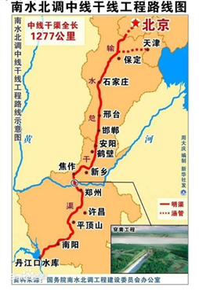
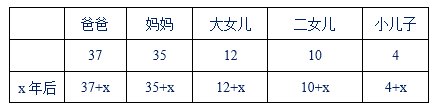
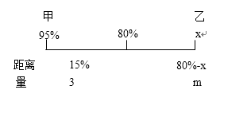
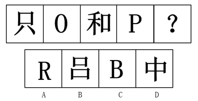
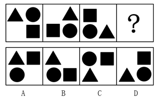
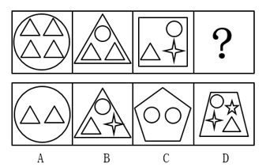
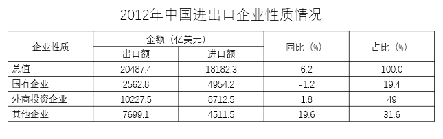

# 2015年湖北省选调生招录考试 综合知识和行政职业能力测验试卷（精选）

<!-- gwy:overview:start -->
> **湖北 · 2015 · 行测 · 选调** ｜ 116 题 · 图片 8 处 · 答案随题折叠

| 题型模块 | 题量 | 题号 |
| --- | ---: | ---: |
| 常识判断 | 71 | 1–71 |
| 言语理解与表达 | 6 | 72–77 |
| 数量关系 | 10 | 78–87 |
| 判断推理 | 19 | 88–106 |
| 资料分析 | 10 | 107–116 |
| **合计** | **116** | |

导航：[题型与作答说明](#题型与作答说明) · [题目](#题目) · [材料 1](#材料-1)
<!-- gwy:overview:end -->

> 候选采集稿。参考答案及解析来自粉笔页面，不代表官方答案或真实高分答卷；来源使用许可与原卷对应关系仍需人工核实。

## 题型与作答说明

常识判断

（71题）

请根据题目要求，在四个选项中选出最恰当的答案。

言语理解与表达

（6题）

请从各小题的备选项中，选出一个最符合题意的答案。

数量关系

（10题）

请从各小题的备选项中找出一个准确答案。

判断推理

（19题）

请从各小题的选项中，选出一个最符合题意的答案。

资料分析

（10题）

请根据给定资料，找出一个准确的答案。

## 题目

### 第 1 题

习近平总书记对实现中国梦作了多次深刻阐述，他强调，实现中国梦要坚持（  ）、弘扬（  ）、凝聚（  ）。

A. 中国道路 中国精神 中国力量

B. 中国制造 中国文化 中国人民

C. 中国道路 中国文化 中国力量

D. 中国制度 中国精神 中国人民

第 1 题 · 答案与解析

**参考答案（粉笔题库参考内容）**

A

**解析**

本题考查政治常识。

2013年3月17日，在十二届全国人大一次会议上当选国家主席的习近平，对中国梦作了深刻阐述。他强调：“实现中国梦必须走中国道路、弘扬中国精神、凝聚中国力量。中国梦归根到底是人民的梦，必须紧紧依靠人民来实现，必须不断为人民造福，这也集中反映了我们党的性质和全心全意为人民服务的根本宗旨。”因此，BCD选项错误。

故正确答案为A。

**考点**：新思想总论、重要会议讲话

**来源**：2015年湖北省选调生招录考试 综合知识和行政职业能力测验试卷（精选）第1题

### 第 2 题

中国特色社会主义理论体系，是马克思主义中国化最新成果，包括：

①马列主义

②毛泽东思想

③邓小平理论

④“三个代表”重要思想

⑤科学发展观

A. ①②③

B. ①②③④⑤

C. ③④⑤

D. ①②③④

第 2 题 · 答案与解析

**参考答案（粉笔题库参考内容）**

C

**解析**

本题考查政治常识。

中国共产党第十七次全国代表大会提出了中国特色社会主义理论体系的科学命题，明确指出：中国特色社会主义理论体系是包括邓小平理论、“三个代表”重要思想以及科学发展观等重大战略思想在内的科学理论体系。中国共产党第十八次全国代表大会删除了“等重大战略思想”这几个字，对这一命题做出新的表述：“中国特色社会主义理论体系，就是包括邓小平理论、‘三个代表’重要思想以及科学发展观在内的科学理论体系，是对马克思列宁主义、毛泽东思想的坚持和发展”。党的十九大报告及经十九大修正后的《党章》中指出，习近平新时代中国特色社会主义思想是中国特色社会主义理论体系的重要组成部分。

③邓小平理论是中国特色社会主义理论体系的开拓和奠基之作，④“三个代表”重要思想是中国特色社会主义理论体系中承上启下的中间环节，⑤科学发展观等重大战略思想是中国特色社会主义理论体系的最新理论成果。该体系不仅是对①马列主义的继承和发展，也是对②毛泽东思想的继承和发展，但并不包括二者。因此，③④⑤正确。

故正确答案为C。

**来源**：2015年湖北省选调生招录考试 综合知识和行政职业能力测验试卷（精选）第2题

### 第 3 题

党的十八届三中全会指出，（  ）是我国社会主义民主政治的特有形式和独特优势，是党的群众路线在政治领域的重要体现。

A. 民主协商

B. 协商民主

C. 协商参政

D. 社会协商

第 3 题 · 答案与解析

**参考答案（粉笔题库参考内容）**

B

**解析**

本题考查政治常识。

中国共产党第十八届中央委员会第三次全体会议通过的《中共中央关于全面深化改革若干重大问题的决定》指出：“协商民主是我国社会主义民主政治的特有形式和独特优势，是党的群众路线在政治领域的重要体现。”因此，ACD选项错误。

故正确答案为B。

**考点**：政治建设、重要文件

**来源**：2015年湖北省选调生招录考试 综合知识和行政职业能力测验试卷（精选）第3题

### 第 4 题

下列不属于我国基本政治制度的是：

A. 人民代表大会制度

B. 中国共产党领导的多党合作和政治协商制度

C. 民族区域自治制度

D. 基层群众自治制度

第 4 题 · 答案与解析

**参考答案（粉笔题库参考内容）**

A

**解析**

本题考查宪法知识。中国共产党领导的多党合作和政治协商制度、民族区域自治制度以及基层群众自治制度等是我国的基本政治制度。而人民代表大会制度是我国的根本政治制度。

本题为选非题，故正确答案为A。

**考点**：宪法

**来源**：2015年湖北省选调生招录考试 综合知识和行政职业能力测验试卷（精选）第4题

### 第 5 题

全面建成小康社会，实现社会主义现代化，实现中华民族伟大复兴，最根本最紧迫的任务是进一步：

A. 推进城乡一体化建设

B. 解放和发展社会生产力

C. 加强和完善党的领导

D. 推进经济体制改革

第 5 题 · 答案与解析

**参考答案（粉笔题库参考内容）**

B

**解析**

本题考查政治常识。

A项错误，中共中央总书记习近平强调，加快推进城乡发展一体化，是党的十八大提出的战略任务，也是落实“四个全面”战略布局的必然要求；

B项正确，党的十八大以来，习近平同志对坚持解放和发展社会生产力的重要原则作出多方面论述：从战略目标上，提出“全面建成小康社会，实现社会主义现代化，实现中华民族伟大复兴，最根本最紧迫的任务还是进一步解放和发展社会生产力”；

C项错误，《中国共产党第十八届中央委员会第三次全体会议公报》强调：全面深化改革必须加强和改善党的领导，充分发挥党总揽全局、协调各方的领导核心作用，提高党的领导水平和执政能力，确保改革取得成功；

D项错误，《中国共产党第十八届中央委员会第三次全体会议公报》强调：经济体制改革是全面深化改革的重点，核心问题是处理好政府和市场的关系，使市场在资源配置中起决定性作用和更好发挥政府作用。

故正确答案为B。

**考点**：经济建设

**来源**：2015年湖北省选调生招录考试 综合知识和行政职业能力测验试卷（精选）第5题

### 第 6 题

党的十八届三中全会提出，经济体制改革是全面深化改革的重点，核心问题是处理好（  ）的关系。

A. 社会和企业

B. 社会和市场

C. 政府和企业

D. 政府和市场

第 6 题 · 答案与解析

**参考答案（粉笔题库参考内容）**

D

**解析**

本题考查政治常识。

《中共中央关于全面深化改革若干重大问题的决定》指出：经济体制改革是全面深化改革的重点，核心问题是处理好政府和市场的关系，使市场在资源配置中起决定性作用和更好发挥政府作用。因此，A、B、C三项错误，D项正确。

故正确答案为D。

**考点**：经济建设、重要文件

**来源**：2015年湖北省选调生招录考试 综合知识和行政职业能力测验试卷（精选）第6题

### 第 7 题

推进生态文明建设，必须坚持节约资源和保护环境的基本国策，坚持节约优先、（  ）优先、自然恢复为主的方针。

A. 利用

B. 保护

C. 效益

D. 开发

第 7 题 · 答案与解析

**参考答案（粉笔题库参考内容）**

B

**解析**

本题考查政治常识。

党的十八大报告明确提出，推进生态文明建设，要坚持节约优先、保护优先、自然恢复为主的方针。这一方针充分体现了生态文明建设规律的内在要求，准确反映了我国生态文明建设面临突出矛盾和问题的客观现实，明确指出了推进生态文明建设的着力方向，是我们建设生态文明的重要指导方针。因此，A、C、D三项错误，B项正确。

故正确答案为B。

**考点**：生态文明建设、重要文件

**来源**：2015年湖北省选调生招录考试 综合知识和行政职业能力测验试卷（精选）第7题

### 第 8 题

党的十八大提出了在新的历史条件下夺取中国特色社会主义新胜利必须牢牢把握的基本要求，这些基本要求是最本质的东西，是体现（  ）的东西，表明我们党对中国特色社会主义规律的认识达到了新水平。

①共产党执政规律

②中国改革和发展规律

③社会主义建设规律

④人类社会发展规律

⑤世界历史发展规律

A. ①②③

B. ①②③④⑤

C. ③④⑤

D. ①③④

第 8 题 · 答案与解析

**参考答案（粉笔题库参考内容）**

D

**解析**

本题考查政治常识。

党的十八大报告指出：中国特色社会主义，既坚持了科学社会主义基本原则，又根据时代条件赋予其鲜明的中国特色，以全新的视野深化了对共产党执政规律、社会主义建设规律、人类社会发展规律的认识，从理论和实践结合上系统回答了在中国这样人口多底子薄的东方大国建设什么样的社会主义、怎样建设社会主义这个根本问题，使我们国家快速发展起来，使我国人民生活水平快速提高起来。因此，①③④正确。

故正确答案为D。

**考点**：新思想总论、重要文件

**来源**：2015年湖北省选调生招录考试 综合知识和行政职业能力测验试卷（精选）第8题

### 第 9 题

建设（  ）、21世纪海上丝绸之路，是党中央实施新一轮扩大开放的重要举措，也是营造有利周边环境的重要举措。

A. 丝绸之路经济带

B. 长江经济带

C. 环渤海经济带

D. 京津鲁冀经济带

第 9 题 · 答案与解析

**参考答案（粉笔题库参考内容）**

A

**解析**

本题考查政治常识。

A项正确，2013年9月和10月，中国国家主席习近平在出访中亚和东南亚国家期间，先后提出共建“丝绸之路经济带”和“21世纪海上丝绸之路”的重大倡议，得到国际社会高度关注；

B项错误，长江经济带是指长江附近的经济圈。改革开放以来，长江经济带已发展成为我国综合实力最强、战略支撑作用最大的区域之一；

C项错误，环渤海经济带是指环绕着渤海全部的沿岸地区所组成的广大经济区域。区域间的经济合作，横向联合，优势互补为环渤海地区开拓了广阔的发展空间；

D项错误，目前暂无此提法。

故正确答案为A。

**考点**：经济建设、重要事件

**来源**：2015年湖北省选调生招录考试 综合知识和行政职业能力测验试卷（精选）第9题

### 第 10 题

2014年2月27日，十二届全国人大常委会第七次会议经表决通过了两个决定，分别将（  ）确定为中国人民抗日战争胜利纪念日，（  ）设立为南京大屠杀死难者国家公祭日。

A. 8月9日 12月30日

B. 9月3日 12月30日

C. 8月9日 12月13日

D. 9月3日 12月13日

第 10 题 · 答案与解析

**参考答案（粉笔题库参考内容）**

D

**解析**

本题考查政治常识。

2014年2月27日，十二届全国人大常委会第七次会议经表决通过了两个决定，分别将9月3日确定为中国人民抗日战争胜利纪念日，将12月13日确定为南京大屠杀死难者国家公祭日。因此，ABC选项错误。

故正确答案为D。

**考点**：重要事件

**来源**：2015年湖北省选调生招录考试 综合知识和行政职业能力测验试卷（精选）第10题

### 第 11 题

2014年12月12日召开的国务院常务会议部署推广上海试验区试点经验，决定依托现有新区、园区，在（  ）特定区域再设定三个自由贸易园区。

A. 浙江、天津、福建

B. 广东、浙江、山东

C. 广东、天津、福建

D. 浙江、江苏、山东

第 11 题 · 答案与解析

**参考答案（粉笔题库参考内容）**

C

**解析**

本题考查政治常识。

2014年12月12日召开的国务院常务会议要求，依托现有新区、园区，在广东、天津、福建特定区域再设三个自由贸易园区，以上海自贸试验区试点内容为主体，结合地方特点，充实新的试点内容。

故正确答案为C。

**考点**：重要事件

**来源**：2015年湖北省选调生招录考试 综合知识和行政职业能力测验试卷（精选）第11题

### 第 12 题

“建设有中国特色的社会主义”新命题是在党的（  ）正式提出的。

A. 十一届三中全会

B. 十二大

C. 十三大

D. 十四大

第 12 题 · 答案与解析

**参考答案（粉笔题库参考内容）**

B

**解析**

本题考查政治常识。

A项错误，十一届三中全会作出了把党的工作重点转移到社会主义现代化建设上来的战略决策，提出了改革开放的重要思想；

B项正确，十二大邓小平提出“走自己的道路，建设有中国特色的社会主义”，它标志着建设有中国特色社会主义思想的正式确立；

C项错误，十三大系统地阐述了关于社会主义初级阶段的理论：我国已经进入社会主义初级阶段，并将长期处于社会主义初级阶段；

D项错误，十四大确定了我国经济体制改革的目标是建立社会主义市场经济体制。

故正确答案为B。

**考点**：其他建设

**来源**：2015年湖北省选调生招录考试 综合知识和行政职业能力测验试卷（精选）第12题

### 第 13 题

2014年12月，南水北调中线一期工程正式通水，除湖北省外，（  ）等省市沿线的6000万人将直接用上水质优良的汉江水，近1亿人间接受益。

①北京

②天津

③河北

④河南

⑤山东

A. ①②③

B. ①②③④⑤

C. ③④⑤

D. ①②③④

第 13 题 · 答案与解析

**参考答案（粉笔题库参考内容）**

D

**解析**

本题考查政治常识。

2014年12月12日14时32分，全长1432公里的南水北调中线一期工程正式通水。“南水”从河南省淅川县渠首闸门喷涌而出，沿京广铁路北上，将用15日时间到达北京，本期工程主要向北京、天津、河南、河北四省市的141个县级以上城市供水。

故正确答案为D。

**考点**：重要事件

**来源**：2015年湖北省选调生招录考试 综合知识和行政职业能力测验试卷（精选）第13题

### 第 14 题

包括中国、印度、新加坡等在内21个首批意向创始成员国的财长和授权代表于2014年10月签约，共同决定成立（  ），银行总部将设在（  ）。

A. 亚洲基础开发投资银行 北京

B. 亚洲基础设施投资银行 北京

C. 亚洲基础开发投资银行 吉隆坡

D. 亚洲基础建设投资银行 吉隆坡

第 14 题 · 答案与解析

**参考答案（粉笔题库参考内容）**

B

**解析**

本题考查政治常识。

亚洲基础设施投资银行（简称亚投行，AIIB）是一个政府间性质的亚洲区域多边开发机构，重点支持基础设施建设，成立宗旨是为了促进亚洲区域的建设互联互通化和经济一体化的进程，并且加强中国及其他亚洲国家和地区的合作，是首个由中国倡议设立的多边金融机构，总部设在北京。

故正确答案为B。

**考点**：重要事件

**来源**：2015年湖北省选调生招录考试 综合知识和行政职业能力测验试卷（精选）第14题

### 第 15 题

党的十八大报告提出建设（  ）的马克思主义执政党，表明我们对执政党建设规律的把握更自觉、更全面、更深刻。

A. 学习型、服务型、创新型

B. 学习型、务实型、创新型

C. 服务型、高效型、廉洁型

D. 服务型、务实型、廉洁型

第 15 题 · 答案与解析

**参考答案（粉笔题库参考内容）**

A

**解析**

本题考查政治常识。

党的十八大报告对新形势下全面提高党的建设科学化水平作出重要部署，要求建设学习型、服务型、创新型的马克思主义执政党，确保党始终成为中国特色社会主义事业的坚强领导核心。学习型——以学习为兴党之要，服务型——以服务为执政之基，创新型——以创新为发展之源。

故正确答案为A。

**考点**：其他建设、重要文件

**来源**：2015年湖北省选调生招录考试 综合知识和行政职业能力测验试卷（精选）第15题

### 第 16 题

我国要加快完善城乡发展一体化体制机制，着力在城乡规划、基础设施、（  ）等方面推进一体化，形成以工促农、以城带乡、工农互惠、城乡一体的新型工农、城乡关系。

A. 社会保障

B. 公共服务

C. 教育医疗

D. 社会公平

第 16 题 · 答案与解析

**参考答案（粉笔题库参考内容）**

B

**解析**

本题考查政治常识。

党的十八大报告指出：城乡发展一体化是解决“三农”问题的根本途径。同时提出，加快完善城乡发展一体化体制机制，着力在城乡规划、基础设施、公共服务等方面推进一体化，促进城乡要素平等交换和公共资源均衡配置，形成以工促农、以城带乡、工农互惠、城乡一体的新型工农、城乡关系。

故正确答案为B。

（备注：2020年党的十九届五中全会在北京胜利召开，党的十九届五中全会提出要全面推进乡村振兴，强化“以工补农、以城带乡，推动形成工农互促、城乡互补、协调发展、共同繁荣的新型工农城乡关系”。只有将乡村放在新型工农城乡关系格局中理解，才能从全局上推进乡村振兴战略，促进乡村全面振兴。）

**考点**：经济建设、重要文件

**来源**：2015年湖北省选调生招录考试 综合知识和行政职业能力测验试卷（精选）第16题

### 第 17 题

新形势下，党面临的执政考验等“四大考验”是长期的、复杂的、严峻的，必须进一步加强党的建设，从严治党，下列不属于“四大考验”的是：

A. 改革开放考验

B. 市场经济考验

C. 外部环境考验

D. 反腐倡廉考验

第 17 题 · 答案与解析

**参考答案（粉笔题库参考内容）**

D

**解析**

本题考查政治常识。

胡锦涛总书记在纪念建党90周年的讲话中指出，全党必须清醒地看到，在世情、国情、党情发生深刻变化的新形势下，提高党的领导水平和执政水平、提高拒腐防变和抵御风险能力，加强党的执政能力建设和先进性建设，面临许多前所未有的新情况新问题新挑战，执政考验、改革开放考验、市场经济考验、外部环境考验是长期的、复杂的、严峻的。故“四大考验”中并不包括反腐倡廉考验。

本题为选非题，故正确答案为D。

**考点**：其他建设

**来源**：2015年湖北省选调生招录考试 综合知识和行政职业能力测验试卷（精选）第17题

### 第 18 题

党的十八大要求全面推进惩治和预防腐败体系建设，做到：

A. 干部清正、部门清廉、政治清明

B. 干部清正、政府清廉、政治清明

C. 干部正派、部门清廉、社会清明

D. 干部正派、政府清廉、社会清明

第 18 题 · 答案与解析

**参考答案（粉笔题库参考内容）**

B

**解析**

本题考查政治常识。

党的十八大强调，要坚持中国特色反腐倡廉道路，坚持标本兼治、综合治理、惩防并举、注重预防方针，全面推进惩治和预防腐败体系建设，做到干部清正、政府清廉、政治清明。

故正确答案为B。

**考点**：其他建设、重要文件

**来源**：2015年湖北省选调生招录考试 综合知识和行政职业能力测验试卷（精选）第18题

### 第 19 题

习近平总书记强调，党的纪律是多方面的，但（  ）是最重要、最根本、最关键的纪律。

A. 干部纪律

B. 组织纪律

C. 政治纪律

D. 保密纪律

第 19 题 · 答案与解析

**参考答案（粉笔题库参考内容）**

C

**解析**

本题考查政治常识。

《党章》第三十九条规定：“党的纪律是党的各级组织和全体党员必须遵守的行为规则，是维护党的团结统一、完成党的任务的保证。党组织必须严格执行和维护党的纪律，共产党员必须自觉接受党的纪律的约束”。习近平总书记强调，“严明党的纪律，首要的就是严明政治纪律。党的纪律是多方面的，但政治纪律是最重要、最根本、最关键的纪律，遵守党的政治纪律是遵守党的全部纪律的重要基础。政治纪律是各级党组织和全体党员在政治方向、政治立场、政治言论、政治行为方面必须遵守的规矩，是维护党的团结统一的根本保证。”

A项错误，《党章》第四十条规定：“党的纪律主要包括政治纪律、组织纪律、廉洁纪律、群众纪律、工作纪律、生活纪律。”故干部纪律并不是党的纪律；

B项错误，党的组织纪律，是党的各级组织和党员必须遵循的维护党在组织上团结统一的行为准则。组织纪律是党的纪律，但不是最重要、最根本、最关键的纪律；

C项正确，党的政治纪律，是党根据不同历史时期政治任务的要求，对各级党组织和党员的政治活动和政治行为确定的基本规范，是各级党组织和党员在政治生活中必须遵循的行为准则；

D项错误，党的保密纪律就是保守党的国家秘密的规定。党的纪律从内容上可分为党的政治纪律、组织纪律、群众纪律、经济纪律、保密纪律和宣传纪律、人事纪律和外事纪律，故党的保密纪律属于党的纪律，但不是最重要、最根本、最关键的纪律。

故正确答案为C。

**考点**：其他建设、重要文件

**来源**：2015年湖北省选调生招录考试 综合知识和行政职业能力测验试卷（精选）第19题

### 第 20 题

党的十八届三中全会强调，落实党风廉政建设责任制，党委负（  ）责任，纪委负监督责任，制定实施切实可行的责任追究制度。

A. 领导

B. 主要

C. 直接

D. 主体

第 20 题 · 答案与解析

**参考答案（粉笔题库参考内容）**

D

**解析**

本题考查政治常识。

十八届三中全会《中共中央关于全面深化改革若干重大问题的决定》提出：落实党风廉政建设责任制，党委负主体责任，纪委负监督责任，制定实施切实可行的责任追究制度。

故正确答案为D。

**考点**：其他建设、重要文件

**来源**：2015年湖北省选调生招录考试 综合知识和行政职业能力测验试卷（精选）第20题

### 第 21 题

新型城镇化的核心是（  ），关键是提升质量。

A. 农村富裕

B. 经济发展

C. 以人为本

D. 城乡一体化

第 21 题 · 答案与解析

**参考答案（粉笔题库参考内容）**

C

**解析**

本题考查政治常识。

2013年12月举行的中央城镇化工作会议提出，走中国特色、科学发展的新型城镇化道路，核心是以人为本，关键是提升质量，与工业化、信息化、农业现代化同步推进。

故正确答案为C。

**考点**：经济建设、重要会议讲话

**来源**：2015年湖北省选调生招录考试 综合知识和行政职业能力测验试卷（精选）第21题

### 第 22 题

2015年，湖北省首次荣获“全国文明城市”称号的城市是：

A. 宜昌

B. 襄阳

C. 咸宁

D. 武汉

第 22 题 · 答案与解析

**参考答案（粉笔题库参考内容）**

D

**解析**

本题考查政治常识。

2015年2月28日下午，全国精神文明建设工作表彰暨学雷锋志愿服务大会在京召开。会上，武汉市荣获第四届“全国文明城市”称号。

A项错误，2011年，宜昌成为湖北首个“全国文明城市”；2015年宜昌已经是第二次获得“全国文明城市”称号；2017年，宜昌市复查确认继续保留全国文明城市荣誉称号，喜获湖北省唯一全国文明城市三连冠称号；

B项错误，2015年襄阳没有荣获“全国文明城市”称号；

C项错误，2015年咸宁没有荣获“全国文明城市”称号；

D项正确，2015年武汉市首次荣获“全国文明城市”称号。

故正确答案为D。

**来源**：2015年湖北省选调生招录考试 综合知识和行政职业能力测验试卷（精选）第22题

### 第 23 题

近期，国务院批复“中三角”规划，长江中游城市群上升为国家战略，以下不属于“中三角”范围的省份是：

A. 湖北

B. 湖南

C. 江西

D. 安徽

第 23 题 · 答案与解析

**参考答案（粉笔题库参考内容）**

D

**解析**

本题考查政治常识。

2015年4月5日，国务院批复《长江中游城市群发展规划》，将以湖北武汉城市圈、湖南长株潭城市圈、江西鄱阳湖生态经济区为主体形成的特大型城市群称为“中三角”。故安徽省不属于“中三角”范围。

本题为选非题，故正确答案为D。

**考点**：重要文件

**来源**：2015年湖北省选调生招录考试 综合知识和行政职业能力测验试卷（精选）第23题

### 第 24 题

《中共中央关于全面推进依法治国若干重大问题的决定》提出，要实现科学立法、严格执法、（  ）、（  ），促进国家治理体系和治理能力现代化。

A. 公正司法 全民学法

B. 公正司法 全民守法

C. 严明司法 全民守法

D. 严明司法 全民学法

第 24 题 · 答案与解析

**参考答案（粉笔题库参考内容）**

B

**解析**

本题考查政治常识。

《中共中央关于全面推进依法治国若干重大问题的决定》提出，要实现科学立法、严格执法、公正司法、全民守法，促进国家治理体系和治理能力现代化。

故正确答案为B。

**考点**：其他建设、重要文件

**来源**：2015年湖北省选调生招录考试 综合知识和行政职业能力测验试卷（精选）第24题

### 第 25 题

习近平总书记在湖北考察改革发展工作时提出，要把握和处理好全面深化改革的一些重大关系，主要包括（  ）以及改革发展稳定的关系。

①解放思想和实事求是的关系

②整体推进和重点突破的关系

③全局和局部的关系

④顶层设计和摸着石头过河的关系

⑤胆子要大和步子要稳的关系

A. ①②③

B. ①②④⑤

C. ③④⑤

D. ①②③④

第 25 题 · 答案与解析

**参考答案（粉笔题库参考内容）**

B

**解析**

本题考查政治常识。

2013年7月23日，习近平在湖北考察改革发展工作时提出，必须从纷繁复杂的事物表象中把准改革脉搏，把握全面深化改革的内在规律，特别是要把握全面深化改革的重大关系，处理好解放思想和实事求是的关系、整体推进和重点突破的关系、顶层设计和摸着石头过河的关系、胆子要大和步子要稳的关系、改革发展稳定的关系。可知①②④⑤正确。

故正确答案为B。

**考点**：新思想总论

**来源**：2015年湖北省选调生招录考试 综合知识和行政职业能力测验试卷（精选）第25题

### 第 26 题

中央决定开展“三严三实”专题教育，是党的群众路线教育实践活动的延展深化，是全面从严治党的重要内容，“三严三实”是指严以修身、严以用权、严以律己，（  ）。

A. 处事要实、创业要实、待人要实

B. 处事要实、讲话要实、做人要实

C. 谋事要实、创业要实、做人要实

D. 谋事要实、讲话要实、待人要实

第 26 题 · 答案与解析

**参考答案（粉笔题库参考内容）**

C

**解析**

本题考查政治常识。

2014年3月9日，习近平总书记在中华人民共和国第十二届全国人民代表大会第二次会议安徽代表团参加审议时提出，各级领导干部都要既严以修身、严以用权、严以律己，又谋事要实、创业要实、做人要实。

故正确答案为C。

**考点**：其他建设、重要事件

**来源**：2015年湖北省选调生招录考试 综合知识和行政职业能力测验试卷（精选）第26题

### 第 27 题

“四个全面”战略布局是以习近平同志为总书记的党中央提出并形成的治国理政总方略，其中，（    ）是目标，是核心。

A. 全面从严治党

B. 全面深化改革

C. 全面推进依法治国

D. 全面建成小康社会

第 27 题 · 答案与解析

**参考答案（粉笔题库参考内容）**

D

**解析**

本题考查政治常识。

2015年2月2日，习近平总书记在省部级主要领导干部学习贯彻十八届四中全会精神全面推进依法治国专题研讨班开班仪式讲话中集中论述了“四个全面”战略布局的逻辑关系。总书记指出，全面建成小康社会是我们的战略目标，全面深化改革、全面依法治国、全面从严治党是三大战略举措。

A项错误，全面从严治党是全面建成小康社会的根本保证；

B项错误，全面深化改革为全面建成小康社会提供不竭动力；

C项错误，全面推进依法治国为全面建成小康社会提供法治保障；

D项正确，全面建成小康社会是总揽全局的战略目标，是“四个全面”的核心。

故正确答案为D。

（备注：2020年党的十九届五中全会在北京胜利召开，会议审议通过了《中共中央关于制定国民经济和社会发展第十四个五年规划和二〇三五年远景目标的建议》。明确提出要“协调推进全面建设社会主义现代化国家、全面深化改革、全面依法治国、全面从严治党的战略布局”。）

**考点**：新思想总论、重要会议讲话

**来源**：2015年湖北省选调生招录考试 综合知识和行政职业能力测验试卷（精选）第27题

### 第 28 题

十八届中央纪委五次全会指出，要坚持无禁区、全覆盖、零容忍，严肃査处腐败分子，着力营造（  ）的政治氛围。

A. 不该腐、不能腐、不愿腐

B. 不该腐、不要腐、不想腐

C. 不准腐、不能腐、不想腐

D. 不敢腐、不能腐、不想腐

第 28 题 · 答案与解析

**参考答案（粉笔题库参考内容）**

D

**解析**

本题考查政治常识。

十八届中央纪委五次全会指出，要坚持无禁区、全覆盖、零容忍，严肃查处腐败分子，着力营造不敢腐、不能腐、不想腐的政治氛围。

故正确答案为D。

**考点**：重要会议讲话

**来源**：2015年湖北省选调生招录考试 综合知识和行政职业能力测验试卷（精选）第28题

### 第 29 题

习近平总书记系列重要讲话，体现着（  ）和底线思维等科学的思想方法，对许多问题的阐释让人豁然开朗。

①战略思维

②历史思维

③辩证思维

④创新思维

A. ①②③

B. ①②③④

C. ③④

D. ②③④

第 29 题 · 答案与解析

**参考答案（粉笔题库参考内容）**

B

**解析**

本题考查政治常识。

《习近平总书记系列重要讲话读本》第十二章指出，习近平总书记系列重要讲话，体现着战略思维、历史思维、辩证思维、创新思维、底线思维等科学的思想方法，对许多问题的阐释让人豁然开朗。可知①②③④均正确。

故正确答案为B。

**考点**：新思想总论

**来源**：2015年湖北省选调生招录考试 综合知识和行政职业能力测验试卷（精选）第29题

### 第 30 题

从2014年起，湖北的扶贫开发进入“两轮驱动”的新阶段，“两轮”是指：

A. 连片特困地区扶贫开发 精准扶贫

B. 连片特困地区扶贫开发 全面扶贫

C. 连片特困地区扶贫攻垒和区域发展 精准扶贫

D. 连片特困地区扶贫攻垒和区域发展 全面扶贫

第 30 题 · 答案与解析

**参考答案（粉笔题库参考内容）**

C

**解析**

本题考查政治常识。

2014年度湖北省扶贫开发发展报告新闻发布会上，湖北省政府新闻办副主任谢双林指出，2014年，是湖北省实施“两轮驱动”（即：精准扶贫和区域发展）、启动精准扶贫的一年。

故正确答案为C。

**来源**：2015年湖北省选调生招录考试 综合知识和行政职业能力测验试卷（精选）第30题

### 第 31 题

马克思主义哲学认为，哲学的基本问题是＿＿＿＿＿＿＿的关系问题。

A. 存在与时间

B. 思维和存在

C. 思维和意识

D. 运动和静止

第 31 题 · 答案与解析

**参考答案（粉笔题库参考内容）**

B

**解析**

本题考查政治常识。

在马克思主义哲学中，哲学的基本问题是思维和存在的关系问题，简单地说，就是意识和物质的关系问题。思维和存在是哲学的两个最高范畴，思维和存在的关系反映着人与世界关系的最根本的方面。因此，思维和存在的关系是任何哲学体系都不能回避的问题，都必须按照各自的方式作出自己的回答。而且，任何哲学体系的建立，对于哲学其他问题的解决与展开，也都要以对这个问题的回答为起点和中心。

故正确答案为B。

**考点**：总论

**来源**：2015年湖北省选调生招录考试 综合知识和行政职业能力测验试卷（精选）第31题

### 第 32 题

在实际工作中犯“一刀切”的错误，从哲学上讲，是忽视了：

A. 矛盾的客观性

B. 矛盾的主观性

C. 矛盾的普遍性

D. 矛盾的特殊性

第 32 题 · 答案与解析

**参考答案（粉笔题库参考内容）**

D

**解析**

本题考查政治常识。“一刀切”比喻不考虑特殊情况，采用一种方式处理问题。

A项错误，矛盾的客观性是指，矛盾不是人们从外部强加于事物的，也不是人的主观意识赋予的，它的存在和发生作用不以人的意识为转移，总是客观地存在着。因此矛盾的客观性并不能反映“一刀切”的问题。

B项错误，矛盾的主观性说法本身就是错误的。

C项错误，矛盾的普遍性是指，矛盾存在于一切事物之中，并且贯穿于每一事物的始终，即事事有矛盾，时时有矛盾，这就是矛盾的普遍性。这并不能反映出“一刀切”的问题所在。

D项正确，“一刀切”的含义是不对具体事务作具体的分析，一律同样对待，这显然是忽视了矛盾的特殊性所造成的结果。

故正确答案为D。

**考点**：唯物辩证法

**来源**：2015年湖北省选调生招录考试 综合知识和行政职业能力测验试卷（精选）第32题

### 第 33 题

在实际工作中，要注意掌握分寸，防止“过”或“不及”，这在哲学上属于：

A. 抓事物的主要矛盾

B. 确定事物的质

C. 认识事物的量

D. 把握事物的度

第 33 题 · 答案与解析

**参考答案（粉笔题库参考内容）**

D

**解析**

本题考查政治常识。

A项错误，做事抓主要矛盾，提示我们任何事物无时无刻都处在矛盾中，这些矛盾有主要矛盾和次要矛盾，我们需要找出对解决问题起决定作用的主要矛盾。但这与“过”和“不及”没有直接关系。

B项错误，“质”是指事物成为它自身并区别于另一事物的内在规定性，这与“过”（事情做过头）与“不及”（事情做得不够），没有联系。

C项错误，量是指事物的规模、程度、速度以及构成要素在空间上的排列组合等可以用数量表示的规定性，题干并未体现。

D项正确，度是关节点范围内的幅度，在这个范围内，事物的质保持不变；突破关节点，事物的质就要发生变化。因此，在实践过程中，启示我们要掌握适度的原则，要学会把握分寸、注意火候，防止“过”或“不及”。

故正确答案为D。

**考点**：唯物辩证法

**来源**：2015年湖北省选调生招录考试 综合知识和行政职业能力测验试卷（精选）第33题

### 第 34 题

党中央指出，在改革开放的历史进程中，要“把坚持独立自主同参与经济全球化结合起来”。从哲学上讲符合：

A. 矛盾统一性和斗争性辩证关系原理

B. 矛盾的普遍性和特殊性辩证关系原理

C. 内因和外因辩证关系原理

D. 主要矛盾和非主要矛盾辩证关系原理

第 34 题 · 答案与解析

**参考答案（粉笔题库参考内容）**

C

**解析**

本题考查政治常识。

A项错误，同一性和斗争性是矛盾的两个基本属性。矛盾的同一性是指矛盾双方相互依赖、相互转化的性质和趋势。矛盾的斗争性是指矛盾双方相互分离、相互排斥的性质和趋势。斗争性是绝对、无条件的，同一性是相对、有条件的。双方在一定条件下可以相互转化。而本题当中“独立自主”与“全球化”并不属于同一性和斗争性的关系范畴。

B项错误，矛盾的普遍性即矛盾的共性，矛盾的特殊性即矛盾的个性。矛盾的普遍性和特殊性是辩证统一的关系。但是“独立自主”与“全球化”并不反映矛盾的普遍性与特殊性的辩证关系。

C项正确，内因是事物变化的根据，外因是事物变化的条件，外因通过内因起作用。要想实现改革又好又快发展，就要将坚持独立自主同参与经济全球化结合起来，其中坚持独立自主是强调内因的作用，积极参与经济全球化是强调外因的作用。

D项错误，唯物辩证法认为，在事物或过程的多种矛盾中，各种矛盾的地位和作用是不平衡的。在事物发展的任何阶段上，必有而且只有一种矛盾居于支配的地位，起着规定或影响其他矛盾的作用。这种矛盾就是主要矛盾，其他矛盾则是非主要矛盾。把坚持独立自主同参与经济全球化结合起来并不是主次矛盾的关系。

故正确答案为C。

**考点**：唯物辩证法

**来源**：2015年湖北省选调生招录考试 综合知识和行政职业能力测验试卷（精选）第34题

### 第 35 题

有一种说法，叫作“整体不等于各个孤立部分的总和”。这句话从哲学上讲说明：

A. 系统的功能性

B. 系统的整体性

C. 系统的层次性

D. 系统的开放性

第 35 题 · 答案与解析

**参考答案（粉笔题库参考内容）**

B

**解析**

本题考查政治常识。

A项错误，功能是系统在内部关系和外部关系中所表现出来的特性和性能，功能也是一种属性，是系统整体才具有的属性。因此它与“整体不等于各个孤立部分的总和”所表达的意思无关。

B项正确，“整体不等于各个孤立部分的总和”是亚里士多德的名言，意思是整体只能存在于各个组成要素的相互联系，相互作用之中，而不是孤立要素和功能的简单相加。这反映的主要是系统的整体性。

C项错误，系统的层次性指一方面系统由一定的要素组成，这些要素是由更小一层次的要素组成的子系统，另一方面系统自身又是更大系统的组成要素。因此系统的层次性并不能准确地解释亚里士多德的这句名言。

D项错误，系统的开放性是指系统与环境发生交换的属性，亦即事物具有从环境输入物质能量与信息的属性，也具有向环境输出物质、能量与信息的属性。可见，系统的开放性并不能体现出整体与部分的关系。

故正确答案为B。

**考点**：唯物辩证法

**来源**：2015年湖北省选调生招录考试 综合知识和行政职业能力测验试卷（精选）第35题

### 第 36 题

十一届三中全会以来，由于党的路线、方针、政策的正确制定与落实，我国经济社会各个方面取得了举世瞩目的伟大成就，这说明：

A. 上层建筑对经济基础的反作用

B. 上层建筑的进步可以解决经济基础发展的根本方向

C. 经济基础的发展总趋势是由上层建筑决定的

D. 经济发展的规律是可以改变的

第 36 题 · 答案与解析

**参考答案（粉笔题库参考内容）**

A

**解析**

本题考查政治常识。

A项正确，党的路线、方针、政策属于上层建筑的范畴，它的制定与落实推动了我国的经济和社会取得举世瞩目的成就，这体现出了上层建筑对经济基础的反作用。

B项错误，上层建筑只能反作用于经济基础，但不能解决经济基础的发展方向。

C项错误，经济基础发展的总趋势是由生产力决定的而不是由上层建筑决定的。

D项错误，经济发展规律是可以利用的，但是不可改变。

故正确答案为A。

**考点**：唯物史观

**来源**：2015年湖北省选调生招录考试 综合知识和行政职业能力测验试卷（精选）第36题

### 第 37 题

“不谋万世者不足以谋一时，不谋全局者不足以谋一域”反映的哲学观点是：

A. 主要矛盾与次要矛盾的关系

B. 质量与数量的关系

C. 整体与局部的关系

D. 长远与近期的关系

第 37 题 · 答案与解析

**参考答案（粉笔题库参考内容）**

C

**解析**

本题考查政治常识。

A项错误，主要矛盾与次要矛盾的关系是指在复杂事物发展过程中，处于支配地位，对事物发展起决定作用的矛盾，叫主要矛盾，其他处于从属地位、对事物发展不起决定作用的矛盾叫次要矛盾。主要矛盾和次要矛盾相互依赖、相互影响，在一定条件下可以相互转化。这一辩证关系，并不能反映出题干的意思。

B项错误，这句话的意思是办事情只有从全局出发，从整体着眼，才能寻求最优目标。显然和“质量与数量的关系”表达的意思不同。

C项正确，这句话的意思是要求人们谋全局，要放眼长远，其寓意告诉我们在认识事物和处理问题时，必须学会从整体上把握事物的联系。它反映的是整体与局部的关系。

D项错误，长远与近期的关系，不属于哲学的范畴。

故正确答案为C。

**考点**：唯物辩证法

**来源**：2015年湖北省选调生招录考试 综合知识和行政职业能力测验试卷（精选）第37题

### 第 38 题

“知屋漏者在宇下，知政失者在草野”反映的哲学思想是：

A. 实践与认识的辩证关系

B. 量变与质变的关系

C. 人民群众是社会历史的主体

D. 主要矛盾与次要矛盾的关系

第 38 题 · 答案与解析

**参考答案（粉笔题库参考内容）**

A

**解析**

本题考查政治常识。

A项正确，这句话的意思是：“知道房屋漏雨的人在房屋下，知道政治有过失的人在民间”，说明实践是认识的来源。这体现了实践与认识的辩证关系。

B项错误，这句话体现的是实践与认识的辩证关系而不是量变与质变的辩证关系。

C项错误，人民群众是社会历史的主体本身并没有错误，但它并不能反映出“知屋漏者在宇下，知政失者在草野”的完整含义。

D项错误，这句话并没有体现出主要矛盾与次要矛盾的关系问题。

故正确答案为A。

**考点**：认识论

**来源**：2015年湖北省选调生招录考试 综合知识和行政职业能力测验试卷（精选）第38题

### 第 39 题

任何科学理论都不能穷尽真理，而只能在实践中不断开辟认识真理的道路，这说明：

A. 真理具有绝对性

B. 真理具有相对性

C. 真理具有客观性

D. 真理具有全面性

第 39 题 · 答案与解析

**参考答案（粉笔题库参考内容）**

B

**解析**

本题考查政治常识。

A项错误，真理的绝对性是指人类的认识按其本性来说，能够正确认识无限发展着的物质世界，认识每前进一步就是对无限发展着的世界的一次接近，这是绝对的、无条件的。但这并不能说明和解释真理只能在实践中不断完善这一层意思。

B项正确，真理具有相对性是指人们在一定条件下对客观过程及其发展规律的正确认识总是有局限性的、不完全的。任何真理性的认识，都只是对该对象的一定程度和一定层次的近似正确的反映。因此，任何科学理论都不能穷尽真理，而只能在实践中不断开辟认识真理的道路。

C项错误，真理是人对客观事物及其规律的正确反映。真理的客观性就是真理的内容不依人的意识而转移，真理的客观性与题干中所表达的意思无关。

D项错误，在同一领域真理只有一个，它是对一切客观事物的总的评价，因此真理具有全面性。这也与题干所述内容无关。

故正确答案为B。

**考点**：认识论

**来源**：2015年湖北省选调生招录考试 综合知识和行政职业能力测验试卷（精选）第39题

### 第 40 题

党中央指出，深化行政管理体制改革要以政府职能转变为核心，政府职能转变的原则是：

A. 把政府不该管的、管不了的、管不好的事项转移出去

B. 把不该政府管理的事项转移出去，把该由政府管理的事项切实管理好

C. 切实搞好经济发展

D. 使经济又好又快的发展

第 40 题 · 答案与解析

**参考答案（粉笔题库参考内容）**

B

**解析**

本题考查管理学常识。

A项错误，坚决把政府不该管的、管不了的、管不好的事情转移出去，可以发挥好公民和社会组织在社会公共事务管理中的作用。但对于该政府管的事情却没有进行说明，表述不完整，有推脱责任之嫌，不能成为政府职能转变的原则。

B项正确，《关于深化行政管理体制改革的意见》指出深化行政管理体制改革要以政府职能转变为核心。加快推进政企分开、政资分开、政事分开、政府与市场中介组织分开，把不该由政府管理的事项转移出去，把该由政府管理的事项切实管好，从制度上更好地发挥市场在资源配置中的基础性作用。

C项错误，切实搞好经济发展并不是政府职能转变的原则。

D项错误，要促使国民经济又好又快的发展是政府职能转变的最终目的而不是原则。

故正确答案为B。

**来源**：2015年湖北省选调生招录考试 综合知识和行政职业能力测验试卷（精选）第40题

### 第 41 题

一批民营企业被批准进入我国城市公共交通和污水处理等领域，这说明：

A. 有限政府是我国政府体制改革的方向

B. 政府又“掌舵”，又“划桨”

C. 公共管理的责任主体逐步由政府向社会转变

D. 政府即使是公共服务的责任主体，也可以实现公共服务社会化

第 41 题 · 答案与解析

**参考答案（粉笔题库参考内容）**

D

**解析**

本题考查管理学常识。

A项错误，“有限政府”是指政府自身在规模、职能、权力和行为方式上受到法律和社会的严格限制和有效制约。有限政府体制改革关键在于依法行政，用法律来划定政府行为的明确界限，故选项与题干无关。

B项错误，《中共中央关于全面深化改革若干重大问题的决定》中指出，必须切实转变政府职能，深化行政体制改革，创新行政管理方式，增强政府公信力和执行力，建设法治政府和服务型政府。政府要让“市场起决定性作用”，而政府同时也要“更好地发挥作用”，政府缺位要补位，从而形成与市场的有机结合。目的在于促使政府在行使职能的过程中，起到的作用是掌舵，而不是划桨，把能交给市场的交给市场和社会组织去做。

C项错误，公共管理是对以政府为核心的公共部门整合社会的各种力量，广泛运用政治的、经济的、管理的、法律的方法，强化政府的治理能力，提升政府绩效和公共服务品质，从而实现公共的福利与公共利益；公共管理主体可以分为政府以及第三方，而政府对社会治理承担主要责任，故责任主体并未向社会转变。

D项正确，公共服务社会化是指根据不同公共服务项目的性质和特点，以社会需求为导向，鼓励各种非营利组织和社会公众积极参与兴办公益事业和社会服务，形成以政府为主导、各种社会主体共同参与的公共服务供给格局，故选项与题干表述相符。

故正确答案为D。

**来源**：2015年湖北省选调生招录考试 综合知识和行政职业能力测验试卷（精选）第41题

### 第 42 题

党十分重视政府决策民主科学化，指出涉及重大事项，必须实行专家论证、集体决策；涉及群众生活问题，必须实行：

A. 酝酿和表决

B. 咨询和论证

C. 调研和讨论

D. 听证和公示

第 42 题 · 答案与解析

**参考答案（粉笔题库参考内容）**

D

**解析**

本题考查管理学常识。

正确决策是保证党和国家各项事业开展的重要前提。党的十七大报告指出，要推进决策科学化、民主化，完善决策信息和智力支持系统，增强决策透明度和公众参与度。对涉及经济社会发展全局的重大事项，要以深入扎实的调查研究为基础，广泛听取各方面意见，由领导班子集体讨论决定，坚决杜绝决策的盲目性、随意性和领导者个人独断专行。对与群众切身利益密切相关的重大事项，要实行社会公示和听证，广泛听取群众意见。

故正确答案为D。

**来源**：2015年湖北省选调生招录考试 综合知识和行政职业能力测验试卷（精选）第42题

### 第 43 题

根据有关规定，地方党委在决定重大问题和任用重要干部方面，要实行：

A. 公示制

B. 票决制

C. 听证制

D. 辩论制

第 43 题 · 答案与解析

**参考答案（粉笔题库参考内容）**

B

**解析**

本题考查管理学常识。

A项错误，公示制，指各级机关用以上墙、印制备案的材料或设置触摸电脑等形式，将执行公务人员身份、岗位职责以及本单位的办事流程、办事依据、办事要求、办事结果、办事承诺一律予以公开的制度。

B项正确，党的十八大报告总结近年来发展党内民主的实践经验，提出积极发展党内民主的重大举措和工作着力点：强化全委会和常委会集体领导作用。重点是强化全委会决策和监督作用，完善常委会议事规则和决策程序，使全委会和常委会能够更加规范、高效地运行；完善已经全面推开的地方党委讨论决定重大问题和任用重要干部票决制，提高科学决策、民主决策、依法决策水平。

C项错误，听证制属于行政程序中的基本制度，是指在法律规定的条件下，由非本案调查人为主持人，采用准司法的方式听取利害关系人的申辩的制度。

D项错误，辩论制，是我国民事诉讼法的基本法律制度。指民事诉讼当事人有权对案件所涉及的实体权利问题或诉讼程序问题各自陈述自己的主张和依据，相互进行反驳或答辩，以维护各自的合法权益。

故正确答案为B。

**来源**：2015年湖北省选调生招录考试 综合知识和行政职业能力测验试卷（精选）第43题

### 第 44 题

十八大报告指出，深入推进政企分开、政资分开、政事分开、政社分开，建设职能科学、(    )、廉洁高效、人民满意的服务型政府。

A. 结构合理

B. 结构优化

C. 决策民主

D. 依法行政

第 44 题 · 答案与解析

**参考答案（粉笔题库参考内容）**

B

**解析**

本题考查管理学常识。

党的十八大报告指出：行政体制改革是推动上层建筑适应经济基础的必然要求。要按照建立中国特色社会主义行政体制目标，深入推进政企分开、政资分开、政事分开、政社分开，建设职能科学、结构优化、廉洁高效、人民满意的服务型政府。

故正确答案为B。

**来源**：2015年湖北省选调生招录考试 综合知识和行政职业能力测验试卷（精选）第44题

### 第 45 题

十八届三中全会指出，推进地方各级政府及其工作部门（  ），依法公开权力运行流程。

A. 权力清单制度

B. 责任清单制度

C. 负面清单制度

D. 责任追究制度

第 45 题 · 答案与解析

**参考答案（粉笔题库参考内容）**

A

**解析**

本题考查政治常识。

A项正确，十八届三中全会于2013年11月9日至12日在北京召开。中共中央总书记习近平主持会议。全会审议通过了《中共中央关于全面深化改革若干重大问题的决定》，《决定》提出，推行地方各级政府及其工作部门权力清单制度，依法公开权力运行流程。完善党务、政务和各领域办事公开制度，推进决策公开、管理公开、服务公开、结果公开。

B项错误，责任清单制度明确了省级政府部门必须承担哪些责任、必须做哪些事情。每个部门的“职责边界”被明确。这一制度可以有效防止“多头管理”“九龙治水”的现象发生。

C项错误，负面清单制度，是指国务院以清单方式明确列出在中华人民共和国境内禁止和限制投资经营的行业、领域、业务等，各级政府依法采取相应管理措施的一系列制度安排。负面清单以外的行业、领域、业务等，各类市场主体皆可依法平等进入。

D项错误，责任追究制，是为规范工作人员工作行为，防止推诿扯皮、耽误工作而制定的问责制度。

故正确答案为A。

**考点**：政治建设、重要文件

**来源**：2015年湖北省选调生招录考试 综合知识和行政职业能力测验试卷（精选）第45题

### 第 46 题

下列属于政府部门内设机构的是：

A. 国务院部委的司

B. 省政府的厅

C. 市政府的委

D. 县政府的局

第 46 题 · 答案与解析

**参考答案（粉笔题库参考内容）**

A

**解析**

本题考查管理学常识。

A项正确，所谓内设机构，系指独立机构的内部组织，又称内部机构。内设机构一般不能单独用本机构的名义对外行使职权，通过所从属的独立机构的名义来行使所赋予的职权。国务院部委的司属于内设机构。

B项、D项错误，省政府的厅和县政府的局都属于政府组成部门。它们具有独立的外部行政主体资格，可以用自己的名义对社会实施管理，对下级政府的相关工作部门行使行政管理职能，如制定和颁布行政规则，对社会相对方发布命令，作出处理。

C项错误，市委是中国共产党在我国直辖市、地级市或县级市设立的最高领导机构，统领全市党组织和党员。故市政府的委不属于政府部门内设机构。

故正确答案为A。

**来源**：2015年湖北省选调生招录考试 综合知识和行政职业能力测验试卷（精选）第46题

### 第 47 题

政府工作人员一般由选任制、委任制、考任制和聘任制产生。下列公务员由选任制产生的是：

A. 司长

B. 处长

C. 科长

D. 乡长

第 47 题 · 答案与解析

**参考答案（粉笔题库参考内容）**

D

**解析**

本题考查管理学常识。

A项、B项、C项错误，司长、处长、科长均属于行政级别，与选任制无关。

D项正确，选任制公务员主要是指在国家权力机关、行政机关、审判和检察机关中由各级人民代表大会及其常委会会议选举或决定任命的人员，以及政党机关、政协机关中按章程选举产生的公务员。行政机关的长官，如省长、市长、县长、区长、乡长都是由选任制产生的。

故正确答案为D。

**来源**：2015年湖北省选调生招录考试 综合知识和行政职业能力测验试卷（精选）第47题

### 第 48 题

根据我国相关法律规定，乡镇人民政府对村民委员会的工作进行：

A. 决定

B. 规定

C. 指导

D. 安排

第 48 题 · 答案与解析

**参考答案（粉笔题库参考内容）**

C

**解析**

本题考查宪法知识。

根据《村民委员会组织法》第五条规定：“乡、民族乡、镇的人民政府对村民委员会的工作给予指导、支持和帮助，但是不得干预依法属于村民自治范围内的事项。村民委员会协助乡、民族乡、镇的人民政府开展工作。”

故正确答案为C。

**考点**：宪法

**来源**：2015年湖北省选调生招录考试 综合知识和行政职业能力测验试卷（精选）第48题

### 第 49 题

中国特色社会主义法律体系，以宪法为统帅，以法律为主干，以行政法规、（  ）为重要组成部分，保证了国家各个方面有法可依。

A. 地方规章

B. 地方性法规

C. 政府文件

D. 部门规定

第 49 题 · 答案与解析

**参考答案（粉笔题库参考内容）**

B

**解析**

本题考查政治常识。

《中国特色社会主义法律体系》白皮书全面介绍了中国特色社会主义法律体系的形成和内涵，展示了新中国立法成就。白皮书指出，中国特色社会主义法律体系，是以宪法为统帅，以法律为主干，以行政法规、地方性法规为重要组成部分，由宪法相关法、民法商法、行政法、经济法、社会法、刑法、诉讼与非诉讼程序法等多个法律部门组成的有机统一整体。

故正确答案为B。

**考点**：其他建设

**来源**：2015年湖北省选调生招录考试 综合知识和行政职业能力测验试卷（精选）第49题

### 第 50 题

下列关于公民权利的说法不符合《宪法》规定的是：

A. 国家机关和国家工作人员侵犯公民权利造成损失的，受害人有依法请求赔偿的权利

B. 公民对于任何国家机关和国家工作人员，有提出批评和建议的权利

C. 公民对任何国家机关和国家机关工作人员的违法失职行为，有提出申诉、控告或检举的权利

D. 任何国家机关在接到公民提出的申诉、控告或检举后，都必须査清事实，负责处理

第 50 题 · 答案与解析

**参考答案（粉笔题库参考内容）**

D

**解析**

本题考查宪法知识。

A项正确，根据《宪法》第四十一条第三款规定：“由于国家机关和国家工作人员侵犯公民权利而受到损失的人，有依照法律规定取得赔偿的权利。”

B项、C项正确，根据《宪法》第四十一条第一款规定：“中华人民共和国公民对于任何国家机关和国家工作人员，有提出批评和建议的权利；对于任何国家机关和国家工作人员的违法失职行为，有向有关国家机关提出申诉、控告或者检举的权利，但是不得捏造或者歪曲事实进行诬告陷害。”

D项错误，根据《宪法》第四十一条第二款规定：“对于公民的申诉、控告或者检举，有关国家机关必须查清事实，负责处理。任何人不得压制和打击报复。”选项表述：“任何国家机关······都必须查清事实，负责处理”。国家专门设置有处理检举、申诉、控告的机关，如法院、检察院等等，故并非所有机关都有职权处理公民提出的申诉、控告、检举等事务。

本题为选非题，故正确答案为D。

**考点**：宪法

**来源**：2015年湖北省选调生招录考试 综合知识和行政职业能力测验试卷（精选）第50题

### 第 51 题

张某使用某公园月票在公园散步时，被树上坠落的枯枝砸中受伤。张某因受伤赔偿与公园发生纠纷。以下观点，正确的是：

A. 受伤结果是自然因素造成的，所以公园管理处不承担责任

B. 受伤结果不是公园管理处造成的，所以公园管理处不承担责任

C. 受伤结果是由公园管理处直接造成的，所以公园管理处应当承担责任

D. 受伤结果是公园管理处的管理过失造成的，所以公园管理处应当承担责任

第 51 题 · 答案与解析

**参考答案（粉笔题库参考内容）**

D

**解析**

本题考查民法知识。

《中华人民共和国侵权责任法》第九十条规定：“因林木折断造成他人损害，林木的所有人或者管理人不能证明自己没有过错的，应当承担侵权责任。”题干中，林木所有人或管理人为公园，公园并非直接造成了张某的受害结果，而是管理过失造成的。公园管理处不能证明自己没有过错的，应当对张某承担侵权责任。

故正确答案为D。

**考点**：民法典

**来源**：2015年湖北省选调生招录考试 综合知识和行政职业能力测验试卷（精选）第51题

### 第 52 题

王某因扰乱社会治安受到公安机关的行政处罚，王某认为处罚太重，（   )。

A. 只能申请复议

B. 只能申请起诉

C. 既可申请复议，也可以直接向法院申请起诉

D. 先申请复议，若不服复议决议，再起诉

第 52 题 · 答案与解析

**参考答案（粉笔题库参考内容）**

C

**解析**

本题考查行政法知识。

《中华人民共和国行政诉讼法》第十二条规定：“人民法院受理公民、法人或者其他组织提起的下列诉讼：（一）对行政拘留、暂扣或者吊销许可证和执照、责令停产停业、没收违法所得、没收非法财物、罚款、警告等行政处罚不服的······”；第四十四条第一款规定：“对属于人民法院受案范围的行政案件，公民、法人或者其他组织可以先向行政机关申请复议，对复议决定不服的，再向人民法院提起诉讼；也可以直接向人民法院提起诉讼。”根据以上规定，题干中，王某对受到行政处罚不服，符合人民法院的受案范围，王某既可以申请复议，也可以直接提起诉讼。

故正确答案为C。

**考点**：其他法律法规

**来源**：2015年湖北省选调生招录考试 综合知识和行政职业能力测验试卷（精选）第52题

### 第 53 题

M为某公司的员工，一天M与公司老板一起外出送货，M趁老板与经销商对账的机会，携带老板让他代为看管的5万元货款潜逃。M的行为构成：

A. 盗窃罪

B. 侵占罪

C. 诈骗罪

D. 抢劫罪

第 53 题 · 答案与解析

**参考答案（粉笔题库参考内容）**

B

**解析**

本题考查刑法知识。

A项错误，根据《中华人民共和国刑法》第二百六十四条的规定，盗窃罪是指以非法占有为目的，盗窃公私财物数额较大或者多次盗窃、入户盗窃、携带凶器盗窃、扒窃公私财物的行为。题干中M将原本已占有的代为看管的货款非法取得，与以转移占有为特征的盗窃罪相比，更符合以不转移占有为特征的侵占罪的犯罪构成。

B项正确，根据《中华人民共和国刑法》第二百七十条的规定，侵占罪是指以非法占有为目的，将代为保管的他人财物、遗忘物或者埋藏物非法占为己有，数额较大，拒不交还的行为。题干中，M以非法占有为目的，将代为看管的公司货款非法占为己有，符合侵占罪的犯罪构成要件。

C项错误，根据《中华人民共和国刑法》第二百六十六条的规定，诈骗罪是指以非法占有为目的，用虚构事实或者隐瞒真相的方法，骗取数额较大的公私财物的行为。M的行为不符合诈骗罪的犯罪构成要件。

D项错误，根据《中华人民共和国刑法》第二百六十三条的规定， 抢劫罪是以非法占有为目的，对财物的所有人、保管人当场使用暴力、胁迫或其他方法，强行将公私财物抢走的行为。M的行为不符合抢劫罪的犯罪构成要件。

故正确答案为B。

**考点**：刑法

**来源**：2015年湖北省选调生招录考试 综合知识和行政职业能力测验试卷（精选）第53题

### 第 54 题

在我国，如果某省级人大制定的地方性法规与国务院某部委制定的部门规章相抵触时，（   ）。

A. 地方性法规无效

B. 部门规章无效

C. 由最高人民法院裁决

D. 由国务院提出意见

第 54 题 · 答案与解析

**参考答案（粉笔题库参考内容）**

D

**解析**

本题考查法理学知识。

《中华人民共和国立法法》第九十五条规定：“地方性法规、规章之间不一致时，由有关机关依照下列规定的权限作出裁决： （二）地方性法规与部门规章之间对同一事项的规定不一致，不能确定如何适用时，由国务院提出意见，国务院认为应当适用地方性法规的，应当决定在该地方适用地方性法规的规定；认为应当适用部门规章的，应当提请全国人民代表大会常务委员会裁决”题干中，省级人大制定的地方性法规与国务院部委制定的部门规章相抵触时，按照以上规定，应由国务院提出意见。

故正确答案为D。

**考点**：其他法律法规

**来源**：2015年湖北省选调生招录考试 综合知识和行政职业能力测验试卷（精选）第54题

### 第 55 题

甲某委托乙某为代理人购买一批货物，乙某的下列行为违反法律规定的是：

A. 乙某及时将购买货物的过程报告给甲某

B. 乙某以高于市场价的价格从某亲友处购入货物

C. 乙某因个人原因不能履行委托之职，并通知了甲某

D. 乙某经甲某同意，另行委托丙某办理货物购买事宜

第 55 题 · 答案与解析

**参考答案（粉笔题库参考内容）**

B

**解析**

本题考查法律常识。

A项正确，基于代理人尽勤勉、谨慎义务的原则，代理人应当将代理事务如实报告给被代理人。

B项错误，《民法典》第一百六十四条第二款规定：“代理人和相对人恶意串通，损害被代理人合法权益的，代理人和相对人应当承担连带责任。”乙某以高于市场价从亲友处购入货物，属于恶意串通损害被代理人合法权益，乙某的行为违反法律规定。

C项正确，基于代理人尽勤勉、谨慎义务的原则，代理人不能履行委托事务，则应通知被代理人。

D项正确，《民法典》第一百六十九条第一款规定：“代理人需要转委托第三人代理的，应当取得被代理人的同意或者追认。”题干中乙某转委托丙某，事先经被代理人甲某同意的做法符合法律规定。

本题为选非题，故正确答案为B。

**考点**：民法典

**来源**：2015年湖北省选调生招录考试 综合知识和行政职业能力测验试卷（精选）第55题

### 第 56 题

某国有公司在地震灾害赈灾活动中公开承诺向灾区捐款500万，但事后该公司只捐了400万，对余款100万的捐赠，下列说法正确的是：

A. 该公司不能撤销这一捐款，因为它是国有企业

B. 该公司只是口头承诺，可以撤销捐赠

C. 该公司不能撤销这一捐赠，因为这是公益捐赠

D. 赠与是实践合同，因为公司尚未给付，可以撤销捐赠

第 56 题 · 答案与解析

**参考答案（粉笔题库参考内容）**

C

**解析**

本题考查法律常识。

《中华人民共和国民法典》第六百五十八条规定：“赠与人在赠与财产的权利转移之前可以撤销赠与。经过公证的赠与合同或者依法不得撤销的具有救灾、扶贫、助残等公益、道德义务性质的赠与合同，不适用前款规定。”第六百六十条第一款规定：“经过公证的赠与合同或者依法不得撤销的具有救灾、扶贫、助残等公益、道德义务性质的赠与合同，赠与人不交付赠与财产的，受赠人可以请求交付。” 因该公司捐赠性质是公益性质，故根据以上规定该赠与合同不能撤销。

故正确答案为C。

**考点**：民法典

**来源**：2015年湖北省选调生招录考试 综合知识和行政职业能力测验试卷（精选）第56题

### 第 57 题

我国《刑事诉讼法》规定，人民法院审判第一审案件应当公开进行。但下列案件，不公开审理：

A. 涉及国家秘密或者商业秘密的案件

B. 涉及国家秘密或者个人隐私的案件

C. 审判时被告人不满十八周岁的案件或涉及商业秘密的案件

D. 审判时被告人不满十八周岁的案件或涉及合同秘密的案件

第 57 题 · 答案与解析

**参考答案（粉笔题库参考内容）**

B

**解析**

本题考查程序法知识。

《中华人民共和国刑事诉讼法》第一百八十八条第一款规定：“人民法院审判第一审案件应当公开进行。但是有关国家秘密或者个人隐私的案件，不公开审理；涉及商业秘密的案件，当事人申请不公开审理的，可以不公开审理。”

故正确答案为B。

**考点**：其他法律法规

**来源**：2015年湖北省选调生招录考试 综合知识和行政职业能力测验试卷（精选）第57题

### 第 58 题

某市都市报刊刊登了一篇反映该市城管局粗暴执法的新闻报道，内容严重失实。对此，该市城管局依法向人民法院起诉，要求该报赔礼道歉。该市城管局的行为属于：

A. 法的执行

B. 法的适用

C. 法的遵守

D. 法的解释

第 58 题 · 答案与解析

**参考答案（粉笔题库参考内容）**

C

**解析**

本题考查法律知识。

A项错误，法的执行，广义是指所有国家行政机关、司法机关及其公职人员依照法定职权和程序实施法律的活动，狭义是指国家行政机关及其公职人员依法行使管理职权、履行职责、实施法律的活动。城管局的起诉并非依法行使管理职权和职责，故不属于法的执行。

B项错误，法的适用是指国家机关及其工作人员和国家授权的社会组织依照法定的职权和程序，运用国家权力，把法律规范的规定运用于具体的主体或场合，解决具体问题的专门活动，包括一切司法和执法活动。题干中城管局的行为不是司法和执法活动，故不属于法的适用。

C项正确，法的遵守简称守法，指一切国家机关和武装力量、各政党和各社会团体、各企业事业组织都必须遵守宪法和法律。城管局向法院起诉的行为是依据相关的民事法律和程序法，行使其正当的民事权利。故属于法的遵守。

D项错误，法的解释是指对法律和法规条文的含义所作的说明。题干中城管局的行为不属于解释法律的行为。

故正确答案为C。

**考点**：其他法律法规

**来源**：2015年湖北省选调生招录考试 综合知识和行政职业能力测验试卷（精选）第58题

### 第 59 题

下列哪个选项不属于民法基本原则的内容？

A. 民事活动应当遵守诚实信用原则

B. 民事活动必须遵守法律，法律没有规定的，应当遵守国家政策

C. 公民在适用法律上一律平等

D. 在中华人民共和国领域内的民事活动，适用中华人民共和国的法律，法律另有规定的除外

第 59 题 · 答案与解析

**参考答案（粉笔题库参考内容）**

B

**解析**

本题考查民法知识。民法基本原则，是指其效力贯穿于民法始终（包括立法、守法、执法各环节）的民法根本规则。我国民法的基本原则为：平等原则，自愿原则，公平原则，诚实信用原则，公序良俗原则等。

A项正确。根据《中华人民共和国民法总则》第七条规定：“民事主体从事民事活动，应当遵循诚信原则，秉持诚实，恪守承诺。”

B项错误。根据《中华人民共和国民法总则》第十条规定：“处理民事纠纷，应当依照法律；法律没有规定的，可以适用习惯，但是不得违背公序良俗。”

C项正确。根据《中华人民共和国民法总则》第四条规定：“民事主体在民事活动中的法律地位一律平等。”

D项正确。根据《中华人民共和国民法总则》第十二条规定：“中华人民共和国领域内的民事活动，适用中华人民共和国法律。法律另有规定的，依照其规定。”

本题为选非题，故正确答案为B。

**考点**：民法典

**来源**：2015年湖北省选调生招录考试 综合知识和行政职业能力测验试卷（精选）第59题

### 第 60 题

下列说法正确的是：

A. 刑法的立法目的是打击犯罪、保护人权

B. 人民法院审理案件，一律公开进行，接受监督

C. 在刑事诉讼中，采用刑讯逼供等非法方法收集的犯罪嫌疑人、被告人供述可以排除适应

D. 在行政诉讼中，被诉讼机关负责人应当出庭应诉，不能出庭的，也应当委托相应的工作人员出庭

第 60 题 · 答案与解析

**参考答案（粉笔题库参考内容）**

D

**解析**

本题考查程序法知识。

A项错误，根据《中华人民共和国刑法》第一条规定：“为了惩罚犯罪，保护人民，根据宪法，结合我国同犯罪作斗争的具体经验及实际情况，制定本法。”因此，刑法立法目的是惩罚犯罪，保护人民，而非打击犯罪、保护人权。

B项错误，根据《中华人民共和国刑事诉讼法》第一百八十八条第一款规定：“人民法院审判第一审案件应当公开进行。但是有关国家秘密或者个人隐私的案件，不公开审理；涉及商业秘密的案件，当事人申请不公开审理的，可以不公开审理。”故人民法院审理案件并非一律公开进行。

C项错误，根据《中华人民共和国刑事诉讼法》第五十六条第一款规定：“采用刑讯逼供等非法方法收集的犯罪嫌疑人、被告人供述和采用暴力、威胁等非法方法收集的证人证言、被害人陈述，应当予以排除······”采用刑讯逼供等非法方法收集的犯罪嫌疑人、被告人供述应当排除而非可以排除。

D项正确，根据《中华人民共和国行政诉讼法》第三条第三款规定：“被诉行政机关负责人应当出庭应诉。不能出庭的，应当委托行政机关相应的工作人员出庭。”

故正确答案为D。

**考点**：其他法律法规

**来源**：2015年湖北省选调生招录考试 综合知识和行政职业能力测验试卷（精选）第60题

### 第 61 题

《宪法》明确规定，公民的合法的私有财产不受侵犯。下列哪种情形违反了这一原则？

A. 基于建设大型公共项目需要，政府依照法律规定对规划区内的公民房产实行征收并给予补偿

B. 为了战事需要，军队紧急征用公民私人所有越野车辆，事后返还，但未支付费用

C. 为了査证群众举报的制毒贩毒行为，公安人员误入民宅，损坏门窗，未予补偿

D. 发生重大疫情，政府宣布进入紧急状态，征用私人医院医疗设备，但未给予补偿

第 61 题 · 答案与解析

**参考答案（粉笔题库参考内容）**

C

**解析**

本题考查宪法知识。

A项正确。根据《中华人民共和国宪法》第十三条第三款规定：“国家为了公共利益的需要，可以依照法律规定对公民的私有财产实行征收或者征用并给予补偿。”

B项、D项正确。根据《中华人民共和国突发事件应对法》第十二条规定：“有关人民政府及其部门为应对突发事件，可以征用单位和个人的财产。被征用的财产在使用完毕或者突发事件应急处置工作结束后，应当及时返还。财产被征用或者征用后毁损、灭失的，应当给予补偿。”根据此规定，财产征用被毁损、灭失的，才给予补偿。

C项错误。误入民宅，损坏门窗，侵犯了公民合法的财产权利，应当给予补偿。

本题为选非题，故正确答案为C。

**考点**：宪法

**来源**：2015年湖北省选调生招录考试 综合知识和行政职业能力测验试卷（精选）第61题

### 第 62 题

我国少数民族中人口最多的一个民族是：

A. 满族

B. 回族

C. 壮族

D. 苗族

第 62 题 · 答案与解析

**参考答案（粉笔题库参考内容）**

C

**解析**

本题考查地理国情。中国共有56个民族，是一个统一的多民族社会主义国家。根据2010年第六次人口普查，汉族人口最多，约占91.6%。其他55个民族被称为少数民族，其中壮族人口最多，有16926381人。超过400万的少数民族还有：满、回、苗、维吾尔、藏、彝、土家、蒙古族等。

A项错误，满族人口总数为10387958人（2010年），在中国55个少数民族中居第三位。满族人口分布于全国各地，以辽宁、河北、黑龙江、吉林和内蒙古自治区、北京等省、自治区、直辖市为多，其他散居于新疆、甘肃、宁夏、山东、湖北、贵州等省区及西安、成都、广州、福州等大中城市。

B项错误，回族是回回民族的简称，是中国人口较多的一个少数民族，总人口10586087人（2010年），在中国55个少数民族中居第二位，全国的31个省、自治区、直辖市均有分布。

C项正确，壮族是中国人口最多的一个少数民族，总人口16926381人（2010年），民族语言为壮语，属汉藏语系壮侗语族壮傣语支。在全国的31个省、自治区、直辖市中均有壮族分布，主要聚居在南方，范围东起广东省连山壮族瑶族自治县，西至云南省文山壮族苗族自治州，北达贵州省黔东南苗族侗族自治州从江县，南抵北部湾。

D项错误，苗族是一个古老的民族，总人口9426007人（2010年），散布在世界各地，主要分布于中国的黔、湘、鄂、川、滇、桂、琼等省区，以及东南亚的老挝、越南、泰国等国家和地区。

故正确答案为C。

**考点**：中国地理

**来源**：2015年湖北省选调生招录考试 综合知识和行政职业能力测验试卷（精选）第62题

### 第 63 题

下列不属于我国四大盆地的是：

A. 准噶尔盆地

B. 吐鲁番盆地

C. 塔里木盆地

D. 四川盆地

第 63 题 · 答案与解析

**参考答案（粉笔题库参考内容）**

B

**解析**

本题考查地理国情。中国的盆地数量很大，其中，四大盆地包括：新疆南部的塔里木盆地（40多万平方公里）、四川盆地（26万多平方公里）、青海西北部的柴达木盆地（25.78万平方公里）及新疆北部准噶尔盆地（30多万平方公里）。

A项正确，准噶尔盆地位于中国新疆的北部，是中国第二大的内陆盆地，位于阿尔泰山与天山之间，西侧为准噶尔西部山地，东至北塔山麓。南北宽450千米，东西长700千米，面积达30多万平方公里，沙漠占30%。

B项错误，吐鲁番盆地是世界上海拔最低的盆地，是天山东部的一个山间盆地，位于天山山地东端。如果以周围山脊线为界，面积50140平方公里，其中低于海平面以下的面积有4050平方千米，盆底艾丁湖低于海平面155米，是中国大陆的最低处，盆地边缘群山环抱，最高的博格达峰终年积雪。

C项正确，塔里木盆地位于中国新疆南部，是中国面积最大的内陆盆地。盆地处于天山、昆仑山和阿尔金山之间。南北最宽处520千米，东西最长处1400千米，面积约40多万平方公里。海拔高度在800-1300米之间，地势西高东低。

D项正确，四川盆地是中国著名红层盆地，位于四川省东部，长江上游，面积26万余平方公里，是中国四大盆地之一，占四川省面积的46%。四川盆地西依青藏高原和横断山地，北靠秦岭山地与黄土高原相望，东接湘鄂西山地，南连云贵高原。

本题为选非题，故正确答案为B。

**考点**：中国地理

**来源**：2015年湖北省选调生招录考试 综合知识和行政职业能力测验试卷（精选）第63题

### 第 64 题

下列历史人物与言论对应正确的是：

A. 先天下之忧而忧，后天下之乐而乐——王安石

B. 民为贵，社稷次之，君为轻——孔子

C. 天下兴亡，匹夫有责——顾炎武

D. 君子和而不同——孟子

第 64 题 · 答案与解析

**参考答案（粉笔题库参考内容）**

C

**解析**

本题考查人文历史。

A项错误，此句出自北宋范仲淹的《岳阳楼记》，体现了作者忧国忧民，关心国家大事的情感，更寄托着作者以天下为己任的政治抱负。

B项错误，此句出自孟子的《尽心章句下》，意思是百姓最为重要，代表国家的土神谷神其次，国君为轻。“民贵君轻”成为后世广泛流传的名言，一直为人引用。

C项正确，此句最早是在顾炎武的《日知录·正始》中提出的。原句是：“保国者，其君其臣肉食者谋之；保天下者，匹夫之贱与有责焉耳矣。”意为国家之事的兴亡，保护国家不致被倾覆，是帝王将相文武大臣的职责，与普通百姓无关；而天下大事的兴盛、灭亡，每一个老百姓都有义不容辞的责任。

D项错误，此句出自《论语·子路》，是孔子所言。子曰：“君子和而不同，小人同而不和。”意思是君子在人际交往中能够与他人保持一种和谐友善的关系，但在对具体问题的看法上却不必苟同于对方。

故正确答案为C。

**考点**：文学常识

**来源**：2015年湖北省选调生招录考试 综合知识和行政职业能力测验试卷（精选）第64题

### 第 65 题

下列关于我国古代文学常识表述正确的是：

A. 《楚辞》是楚国民间歌谣集

B. 《孟子》是由孟子编纂的著作

C. 《诗经》包括风、雅、颂三种体例

D. 《三国志》是罗贯中的作品

第 65 题 · 答案与解析

**参考答案（粉笔题库参考内容）**

C

**解析**

本题考查人文常识。

A项错误，《楚辞》是继《诗经》之后对中国文学产生深远影响的一部诗歌总集。《楚辞》是西汉刘向辑集屈原、宋玉及汉代东方朔、淮南小山等人的作品集合而成的一部辞赋总集。

B项错误，《孟子》一书是孟子的言论汇编，并非由孟子一人编纂而成，是由孟子及其弟子共同编写而成，记录了孟子的语言、政治观点和政治行动的儒家经典著作，属语录体散文集。

C项正确，《诗经》是中国古代诗歌开端，我国最早的一部诗歌总集，收集了西周初年至春秋中叶五百多年的诗歌305篇。《诗经》的体例是按照音乐性质的不同来划分的，分为风、雅、颂三类。

D项错误，《三国志》由西晋史学家陈寿所著，记载中国三国时期的断代史，同时也是二十四史中评价最高的“前四史”之一，是主要记载魏、蜀、吴三国鼎立时期的纪传体国别史，详细记载了从魏文帝黄初元年（220）到晋武帝太康元年（280）六十年的历史，受到后人推崇。

故正确答案为C。

**考点**：文学常识

**来源**：2015年湖北省选调生招录考试 综合知识和行政职业能力测验试卷（精选）第65题

### 第 66 题

“大学之道，在明明德，在亲民，在止于至善”，这是我国古代（    ）的治国理政理念。

A. 墨家

B. 儒家

C. 法家

D. 道家

第 66 题 · 答案与解析

**参考答案（粉笔题库参考内容）**

B

**解析**

本题考查人文常识。 “大学之道，在明明德，在亲民，在止于至善”是《大学》最开篇的一句话，意思是《大学》的宗旨，在于弘扬高尚的德行，在于关爱人民，在于达到最高境界的善。

A项错误，墨家是中国东周时期的哲学派别，主要思想主张是人与人之间平等的相爱（兼爱），反对侵略战争（非攻），推崇节约、反对铺张浪费（节用），重视继承前人的文化财富（明鬼），掌握自然规律（天志）等。

B项正确，儒家是起源于中国并同时影响及流传至其他周遭东亚地区国家的文化主流思想、哲理与宗教体系，思想核心包括仁、义、礼、智、信。题干中，“大学之道，在明明德，在亲民，在止于至善”出自《大学》，而《大学》是一篇论述儒家修身齐家治国平天下思想的散文，因此这句话阐述的是我国古代儒家的治国理政理念。

C项错误，法家是中国历史上提倡以法制为核心思想的重要学派，以富国强兵为己任，主张思想是刑过不避大臣，赏善不遗匹夫。

D项错误，道家是中国先秦时期的一个思想派别，道家以“道”为核心，认为大道无为、主张道法自然，提出道生法、以雌守雄、刚柔并济等政治、经济、治国、军事策略，具有朴素的辩证法思想。

故正确答案为B。

**考点**：文学常识

**来源**：2015年湖北省选调生招录考试 综合知识和行政职业能力测验试卷（精选）第66题

### 第 67 题

下列名胜与国家对应不正确的是：

A. 卢浮宫——法国

B. 奈良古迹——印度

C. 庞贝古城——意大利

D. 坎特伯雷大教堂——英国

第 67 题 · 答案与解析

**参考答案（粉笔题库参考内容）**

B

**解析**

本题考查人文常识。

A项正确，卢浮宫位于法国巴黎市中心的塞纳河北岸，位居世界四大博物馆之首。始建于1204年，原是法国的王宫，居住过50位法国国王和王后，是法国文艺复兴时期最珍贵的建筑物之一，以收藏丰富的古典绘画和雕刻而闻名于世。

B项错误，奈良在公元710年至784年是日本的首都，位于日本本州岛中西部，与京都和大阪成等腰三角形，奈良以鹿闻明。这里自远古以来就有人类居住，它作为奈良时代的首都和佛教中心“南都”，已经有1280年的历史。

C项正确，庞贝古城是亚平宁半岛西南角坎帕尼亚地区一座古城，距罗马约240千米，位于意大利南部那不勒斯附近，维苏威火山东南脚下10千米处。始建于公元前6世纪，公元79年毁于维苏威火山大爆发。

D项正确，坎特伯雷大教堂位于英国肯特郡郡治坎特伯雷市，建于公元598年，是英国最古老、最著名的基督教建筑之一。1452年，尼古拉五世下令重建，1506年由意大利最优秀的建筑师布拉曼特、米开朗琪罗、德拉·波尔塔和卡洛·马泰尔相继主持设计和施工，终于在1626年完成了现在的模样。

本题为选非题，故正确答案为B。

**考点**：文学常识

**来源**：2015年湖北省选调生招录考试 综合知识和行政职业能力测验试卷（精选）第67题

### 第 68 题

下列作品与作者对应正确的是：

A. 《神曲》——薄伽丘

B. 《哈姆雷特》——但丁

C. 《悲惨世界》——莎士比亚

D. 《老人与海》——海明威

第 68 题 · 答案与解析

**参考答案（粉笔题库参考内容）**

D

**解析**

本题考查人文常识。

A项错误，《神曲》是著名意大利诗人阿利盖利·但丁创作的长诗，写于1307年至1321年，这部作品作者通过与地狱、炼狱以及天堂中各种著名人物的对话，反映出中古文化领域的成就和一些重大的问题；薄伽丘是意大利文艺复兴运动的杰出代表、人文主义杰出作家，代表作《十日谈》。

B项错误，《哈姆雷特》是由英国剧作家威廉·莎士比亚创作于1599年至1602年间的一部悲剧作品；阿利盖利·但丁是13世纪末意大利诗人，现代意大利语的奠基者，欧洲文艺复兴时代的开拓人物之一，代表作《神曲》。

C项错误，《悲惨世界》是由法国作家维克多·雨果在1862年发表的一部长篇小说，其内容涵盖了拿破仑战争和之后的十几年的事件；威廉·莎士比亚是英国文学史上最杰出的戏剧家，也是欧洲文艺复兴时期最重要、最伟大的作家，全世界最卓越的文学家之一，代表作《罗密欧与朱丽叶》、《哈姆雷特》、《李尔王》、《麦克白》、《奥赛罗》、《威尼斯商人》《驯悍记》等。

D项正确，《老人与海》是美国作家海明威于1951年在古巴写的一篇中篇小说，于1952年出版。该作围绕一位老年古巴渔夫，与一条巨大的马林鱼在离岸很远的湾流中搏斗而展开故事的讲述。它奠定了海明威在世界文学中的突出地位，这篇小说相继获得了1953年美国普利策奖和1954年诺贝尔文学奖。

故正确答案为D。

**考点**：文学常识

**来源**：2015年湖北省选调生招录考试 综合知识和行政职业能力测验试卷（精选）第68题

### 第 69 题

中国古代丝绸之路的起点是：

A. 敦煌

B. 长安

C. 玉门关

D. 天水

第 69 题 · 答案与解析

**参考答案（粉笔题库参考内容）**

B

**解析**

本题考查地理国情。丝绸之路起源于西汉汉武帝派张骞出使西域开辟的以首都长安（今西安）为起点，经甘肃、新疆，到中亚、西亚，并连接地中海各国的陆上通道。

A项错误，敦煌市隶属于甘肃省酒泉市，位于河西走廊的最西端，地处甘肃、青海、新疆三省（区）的交汇处，是丝绸之路的节点城市，以“敦煌石窟”、“敦煌壁画”闻名天下，是世界遗产莫高窟和汉长城边陲玉门关、阳关的所在地。

B项正确，长安是西安的古称，是历史上第一座被称为“京”的都城，也是历史上第一座真正意义上的城市。长安是丝绸之路的东方起点和隋唐大运河的起点，是迄今为止唯一被联合国教科文组织确定为世界历史名城的中国城市，与雅典、罗马、开罗并称世界四大文明古都。

C项错误，玉门关始置于汉武帝开通西域道路、设置河西四郡之时，因西域输入玉石时取道于此而得名，是汉代时期重要的军事关隘和丝路交通要道。

D项错误，天水是甘肃省下辖地级市，位于甘肃省东南部，毗邻关中平原，是关中平原城市群重要节点城市，是丝绸之路的节点城市。

故正确答案为B。

**考点**：中国地理

**来源**：2015年湖北省选调生招录考试 综合知识和行政职业能力测验试卷（精选）第69题

### 第 70 题

下列关于物联网的说法不正确的是：

A. 物联网就是一个商品之间的网络

B. 物联网就是物物相连的互联网

C. 物联网的基础是互联网

D. 物联网是在互联网技术基础上的延伸和拓展

第 70 题 · 答案与解析

**参考答案（粉笔题库参考内容）**

A

**解析**

本题考查科技常识。物联网是新一代信息技术的重要组成部分，也是“信息化”时代的重要发展阶段。其英文名称是：“Internet of things（IoT）”。最初在1999年提出：即通过射频识别（RFID）(RFID+互联网）、红外感应器、全球定位系统、激光扫描器、气体感应器等信息传感设备，按约定的协议，把任何物品与互联网连接起来，进行信息交换和通讯，以实现智能化识别、定位、跟踪、监控和管理的一种网络。简而言之，物联网就是“物物相连的互联网”。

A项错误，物联网用户端延伸和扩展到了任何物品与物品之间，进行信息交换和通信，实现物物相息，并非一个商品之间的网络。

B项正确，物联网就是物物相连的互联网，是把任何物品与互联网连接起来，进行信息交换和通讯，以实现智能化识别、定位、跟踪、监控和管理的一种网络。

C项正确，物联网的核心和基础仍然是互联网，是在互联网基础上的延伸和扩展的网络。

D项正确，物联网的核心和基础仍然是互联网，是在互联网基础上的延伸和扩展的网络。

本题为选非题，故正确答案为A。

**考点**：科技理论与成就

**来源**：2015年湖北省选调生招录考试 综合知识和行政职业能力测验试卷（精选）第70题

### 第 71 题

下列说法不正确的是：

A. 地震到来时，若来不及撤离，可以躲避到墙角处

B. 发生泥石流时，可以往泥石流的下游方向逃生

C. 深色蔬菜的营养素和抗氧化因子的含量较高

D. 吃鸡蛋过多，会造成血胆固醇含量过高，引起心脑血管疾病的发生

第 71 题 · 答案与解析

**参考答案（粉笔题库参考内容）**

B

**解析**

本题考查科技常识。

A项正确，发生地震时，若在楼房中来不及撤离，应选择厨房等开间小的空间避震，也可选择内墙、墙角、坚固的家具旁等易形成三角空间的地方，要远离外墙、门窗、阳台、楼梯，不可使用电梯，更不能选择跳楼。

B项错误，发生泥石流时，应该马上向与泥石流成垂直方向的山坡上爬，爬得越高越好，跑得越快越好，绝对不能顺着泥石流的流动方向（即下游方向）逃生。

C项正确，深色蔬菜营养素和抗氧化因子的含量较高。同一类蔬菜中，颜色深的品种营养价值更高，如深红色的番茄中番茄红素含量远高于粉红色的。叶菜中，深绿色的品种其维生素B2、叶酸、类黄酮等多种营养成分也高于浅绿色的，即使同一棵菜中，深色部分也要比浅色部分的营养成分含量更高。

D项正确，鸡蛋中含有大量胆固醇，吃鸡蛋过多会使胆固醇的摄入量大大增加，造成血胆固醇含量过高，引起动脉粥样硬化和心、脑血管疾病的发生。

本题为选非题，故正确答案为B。

**考点**：生活常识

**来源**：2015年湖北省选调生招录考试 综合知识和行政职业能力测验试卷（精选）第71题

### 第 72 题

岳母和妻子的不满意，使他陷入了十分尴尬的＿＿＿＿。他感觉到了这个星期是他这辈子＿＿＿＿的最漫长的一天。

填入划横线部分最恰当的一项是：

A. 地步 度过

B. 境地 度过

C. 境地 渡过

D. 地步 渡过

第 72 题 · 答案与解析

**参考答案（粉笔题库参考内容）**

B

**解析**

第一空，横线处与“陷入”搭配。B、C两项“境地”指所处的环境、地步，常与“陷入尴尬的”搭配。A、D两项“地步”指处境，通常表述为“到了某一地步”，与“陷入”搭配不当，排除。

第二空，B项“度过”指时间上过了一段时候，如度过假期、度过少年时光等，C项“渡过”指空间上过了一段距离，往往是指从此岸到彼岸，如渡河、渡江、渡过难关等。根据“最漫长的一天”可知，文段强调的是时间上的度过，B项当选。

故正确答案为B。

**考点**：实词填空、词的辨析-搭配对象

**来源**：2015年湖北省选调生招录考试 综合知识和行政职业能力测验试卷（精选）第72题

### 第 73 题

中华文化源远流长，＿＿＿＿着中华民族最深层的精神追求，代表着中华民族独特的精神标识，为中华民族生生不息、发展壮大提供了丰富的滋养。中华传统美德是中华文化的精髓，蕴含着＿＿＿＿的思想道德资源。

填入划横线部分最恰当的一项是：

A. 体现 巨大

B. 积累 强大

C. 积淀 丰富

D. 反映 伟大

第 73 题 · 答案与解析

**参考答案（粉笔题库参考内容）**

C

**解析**

本题可从第二空入手，横线处搭配“资源”，根据“中华文化······为中华民族······提供了丰富的滋养”“中华传统美德是中华文化的精髓”可知，中华文化蕴含丰富的资源，C项“丰富”符合文意，保留。A项“巨大”、B项“强大”、D项“伟大”均与“资源”搭配不当，排除。

第一空，代入验证，C项“积淀”指积累沉淀，多用于形容长期积累中形成的抽象事物,如积淀某种精神。“积淀着······精神追求”搭配恰当，当选。

故正确答案为C。

【文段出处】《习近平：中华优秀传统文化是涵养社会主义核心价值观的重要源泉》

**考点**：实词填空、词的辨析-搭配对象

**来源**：2015年湖北省选调生招录考试 综合知识和行政职业能力测验试卷（精选）第73题

### 第 74 题

采访中，我们常常被感染得潸然泪下，时时体味着那种无私无畏！英烈们的人生，烛照出现代人的卑琐和渺小，彰显了时下的堕落和龌龊。可以说，采编的过程，就是采编者＿＿＿＿境界、＿＿＿＿灵魂的过程。

填入划横线部分最恰当的一项是：

A. 升华 洗涤

B. 提升 荡涤

C. 升华 改造

D. 提升 塑造

第 74 题 · 答案与解析

**参考答案（粉笔题库参考内容）**

A

**解析**

第一空，横线处搭配“境界”，A、C两项“升华”比喻某些事物的精炼和提高，由低级转为高级的过程，“升华”通常用于修饰精神、思想等方面，表示思想境界的提高、艺术的提高，与“境界”搭配恰当。B、D两项“提升”指的是使位置、程度、水平、数量、质量等方面比原来高，不如“升华”与后文“境界”的搭配更恰当，排除。

第二空，横线处搭配“灵魂”，A项“洗涤”指冲荡、清洗，常指除去罪过、耻辱等。C项“改造”修改或变更原事物，使适合需要。根据“英烈们的人生，烛照出现代人的卑琐和渺小，彰显了时下的堕落和龌龊”可知，采编的过程可以使采编者的灵魂受到洗礼，故A项“洗涤”更符合文意，当选。

故正确答案为A。

**考点**：实词填空、词的辨析-搭配对象

**来源**：2015年湖北省选调生招录考试 综合知识和行政职业能力测验试卷（精选）第74题

### 第 75 题

我们要＿＿＿＿人民给予的权力，用好人民给予的权力，自觉让人民监督权力，紧紧＿＿＿＿人民创造历史伟业，使我们党的根基永远坚如磐石。

填入划横线部分最恰当的一项是：

A. 珍爱 依附

B. 尊重 依赖

C. 爱惜 强调

D. 珍惜 依靠

第 75 题 · 答案与解析

**参考答案（粉笔题库参考内容）**

D

**解析**

本题可从第二空入手，横线前形容词是“紧紧”，横线后宾语是“人民”。D项“依靠”指凭借别的人或事物来达到一定目的，置于文段表达依靠人民创造历史伟业，保留。A项“依附”指依赖、附着、从属，强调主从关系，文段不能体现，排除；B项“依赖”指依靠他人或他物而不能自立或自给，文段无“不自立”之意，排除；C项“强调”指着重提出，与“紧紧”搭配不当，排除。

第一空，代入验证，横线处搭配“权力”，D项“珍惜”指重视、爱惜，与文段语义相符，且搭配恰当，当选。

故正确答案为D。

【文段出处】《习近平在毛泽东诞辰120周年座谈会上讲话全文》

**考点**：实词填空、词的辨析-搭配对象、词的辨析-词义侧重

**来源**：2015年湖北省选调生招录考试 综合知识和行政职业能力测验试卷（精选）第75题

### 第 76 题

许多地方政府为了加快发展，不问客观条件是否具备，只要是国家鼓励发展的行业，就大力招商引资，违背了生产力布局的原则，使大量投资效率低下，企业长期低效运行。在市场短缺时，大多数项目都还可以维持，甚至可能有不错的效益，一旦出现总量过剩，那些布局不合理的企业就首当其冲，面临被淘汰出局的命运，对部分区域经济造成较大冲击。

对这段话主旨概括最准确的一项是：

A. 区域生产力布局的原则

B. 区域生产力布局趋同的缘由及其危害

C. 区域生产力布局趋同的原因

D. 区域生产力布局趋同的危害

第 76 题 · 答案与解析

**参考答案（粉笔题库参考内容）**

B

**解析**

文段首句指出政府为了加快发展，只要国家鼓励，就大力招商引资，违背原则，即阐述了区域生产力布局趋同的原因。文段尾句指出，一旦出现总量过剩，布局不合理的企业就会惨遭淘汰，区域经济将受到冲击，即阐述了区域生产力趋同的危害。因此，文段阐述了区域生产力布局趋同的缘由及其危害，对应B项。

A项，文段并未详细介绍“区域生产力布局的原则”，无中生有，排除；C、D项，只阐述了文段部分内容，表述片面，排除。

故正确答案为B。

【文段出处】《对排浪式增长方式的思考》

**考点**：分述句特征-引入铺垫

**来源**：2015年湖北省选调生招录考试 综合知识和行政职业能力测验试卷（精选）第76题

### 第 77 题

在海湾战争，特别是“9·11”以来的几次现代局部战争中，信息化因素日益增多，现代战争战斗力的生成模式正向全新立体、协同、虚实结合的信息化战争形态转变。无人机攻击、远程遥控打击、网络病毒攻击等成为军事战争的新手段。目前全球有超过100个国家在研究网络战并试图了解他国互联网的军事潜力，组建网络部队、发展网络武器、举行网络军演、实施局部网络打击成为常态。

这段话旨在表明：

A. 无人机攻击、远程遥控打击、网络病毒攻击等成为军事战争的新手段

B. 网络战将全面取代国家间的传统战争模式

C. 网络战成为新时代国家间军事对抗的前沿阵地

D. 海湾战争模式成为新时代国家军事战争的主要模式

第 77 题 · 答案与解析

**参考答案（粉笔题库参考内容）**

C

**解析**

【解析】文段首句通过海湾战争引出信息化战争，即网络战的话题。接着列举介绍了几种军事战争的新手段，并指出全球已有很多国家研究网络战，组建网络部队、实施网络打击成为常态。故文段主要围绕“网络战”展开论述，并强调其在目前成为常态，对应C项。

A项，没有体现“网络战”这一核心主题词，排除；

B项，“网络战将全面取代国家间的传统战争模式”表述过于绝对，且在文段中并未提及，属于无中生有，排除；

D项，海湾战争仅为例子，为了引出话题，非重点，且没有包含“网络战”这一主题词，排除。

故正确答案为C。

【文段出处】《在改革总体部署下要高度重视信息化的全面影响》

**考点**：分述句特征-引入铺垫

**来源**：2015年湖北省选调生招录考试 综合知识和行政职业能力测验试卷（精选）第77题

### 第 78 题

高中一年级有三个班，一班的学生人数比二班少10%，二班的学生人数比三班多一倍，一班的学生人数比三班多20人，则二班的学生人数为多少人？

A. 35

B. 45

C. 50

D. 70

第 78 题 · 答案与解析

**参考答案（粉笔题库参考内容）**

C

**解析**

方法一：设高中一年级二班的学生人数为x，则高中一年级一班人数为0.9x，三班人数为x/2。根据题意可得：0.9x − x/2 = 20，解得x=50，故二班的学生人数为50人。

方法二：由二班的学生人数比三班多一倍，即二班的学生人数是三班的两倍，可知二班人数为偶数，排除A、B项，代入C项，即二班50人，则一班50×（1-10%）=45人，三班1/2 × 50 = 25人，此时一班的人数比三班多20人，符合题意。

故正确答案为C。

**考点**：和差倍比问题

**来源**：2015年湖北省选调生招录考试 综合知识和行政职业能力测验试卷（精选）第78题

### 第 79 题

假设七个相异正整数的平均数是17，中位数为20，则此七个正整数中的最大值可能为多少？

A. 45

B. 50

C. 55

D. 60

第 79 题 · 答案与解析

**参考答案（粉笔题库参考内容）**

B

**解析**

七个相异正整数从大到小依次编号为1-7，设最大的正整数为x，要使x最大，则其他六个数尽可能的小。已知排名第4（中位数）的正整数为20，则七个相异正整数的具体值如下表：

由题意可得：x+ 22+21+20+3+2+1=17×7，解得x=50。

故正确答案为B。

**考点**：构造数列

**来源**：2015年湖北省选调生招录考试 综合知识和行政职业能力测验试卷（精选）第79题

### 第 80 题

一家五口人，爸爸37岁，妈妈35岁，大女儿12岁，二女儿10岁，小儿子4岁，则多少年后，三个孩子的年龄之和与父母的年龄之和相等？

A. 42

B. 44

C. 46

D. 48

第 80 题 · 答案与解析

**参考答案（粉笔题库参考内容）**

C

**解析**

设x年后，三个孩子的年龄之和与父母的年龄之和相等，则x年后一家5口人的具体年龄如下表：

根据题意可得：37+x+35+x=12+x+10+x+4+x。解得x=46。故46年后，三个孩子的年龄之和与父母的年龄之和相等。

故正确答案为C。

**考点**：年龄问题

**来源**：2015年湖北省选调生招录考试 综合知识和行政职业能力测验试卷（精选）第80题

### 第 81 题

某时刻时针与分针的夹角为60度，问至少经过多长时间，时针和分针又一次形成60度夹角？

A. 21.2分钟

B. 21.4分钟

C. 21.6分钟

D. 21.8分钟

第 81 题 · 答案与解析

**参考答案（粉笔题库参考内容）**

D

**解析**

设至少经过x分钟，时针和分针又一次形成60°夹角。整个过程分为两步，首先，分针要追上时针即重合，此时分针比时针多走60°。其次，二者夹角需再一次为60°，此时分针还要比时针多走60°。则整个过程分针共比时针多走120°。已知时针每分钟走360°/(12×60) = 0.5°，分针每分钟走360°/60 = 6°，可列式6x - 0.5x = 120°，解得x=21.8分钟。

故正确答案为D。

注:夹角为60°，有两种情况：①时针在前，分针在后；②分针在前，时针在后。题目问至少经过多长时间，只能是时针在前，分针在后，这样分针追赶时针走过的路程最小。

**考点**：非典型最值问题

**来源**：2015年湖北省选调生招录考试 综合知识和行政职业能力测验试卷（精选）第81题

### 第 82 题

甲、乙两辆车，分别从A、B两地同时出发，相向而行，已知甲车速度是乙车速度的一倍，C地在A、B之间，甲、乙两车到达C地的时间分别是上午10点和下午4点，问甲、乙两车在什么时间相遇？

A. 中午12点

B. 下午1点

C. 下午2点

D. 下午3点

第 82 题 · 答案与解析

**参考答案（粉笔题库参考内容）**

B

**解析**

已知甲车速度是乙车速度的一倍，即甲、乙两车速度相等。设甲、乙两车的行驶速度均为v；设甲车上午10点行驶到C点用t小时，则乙车行驶到C点用t+6小时，S_AB=S_AC+S_CB=vt+v(t+6)=2vt+6v……①。设甲、乙同时出发x小时后相遇，则S_AB = x(v + v)...②。联立方程①②，解得x=t+3，即甲车行驶到C点之后再行驶3小时与乙车相遇。故甲、乙两车在下午1点相遇。

故正确答案为B。

**考点**：相遇追及

**来源**：2015年湖北省选调生招录考试 综合知识和行政职业能力测验试卷（精选）第82题

### 第 83 题

一项工程由甲独立完成需要24天，由甲和乙合作完成需要10天，由甲和丙合作完成需要15天，问由乙和丙合作完成需要多少天？

A. 11天

B. 12天

C. 13天

D. 14天

第 83 题 · 答案与解析

**参考答案（粉笔题库参考内容）**

B

**解析**

设工程总量为120，则甲的效率为120/24=5，甲、乙合作的效率= 120/10 = 12，甲、丙合作的效率= 120/15 = 8，则乙的效率=12-5=7，丙的效率=8-5=3。所以乙、丙合作完成这项工程需要：120/(乙 + 丙) = 120/(7 + 3) = 12天。

故正确答案为B。

**考点**：给完工时间型

**来源**：2015年湖北省选调生招录考试 综合知识和行政职业能力测验试卷（精选）第83题

### 第 84 题

将甲、乙两种不同浓度的酒精混合后，新的酒精浓度为80%，已知甲酒精浓度为95%，质量为3千克，如果乙酒精的质量不超过5千克，则乙酒精的浓度最高为多少？

A. 69%

B. 70%

C. 71%

D. 72%

第 84 题 · 答案与解析

**参考答案（粉笔题库参考内容）**

C

**解析**

方法一：设乙酒精浓度为x，且质量为m(m≤5)千克，由甲、乙两溶液混合前后溶质质量不变，得出3 × 95% + m × x = (3+m) × 80%，整理得x = 80%−45%/m，求x的最大值，则m取最大值5，所以x=80%−45%/5=71%。

方法二：

如图所示，根据线段法，溶液量比与距离差成反比，则m/3 = 15%/(80% - x)，整理得x = 80%−45%/m，同方法一，最终x=71%，即乙酒精的浓度最高为71%。

故正确答案为C。

**考点**：非典型最值问题

**来源**：2015年湖北省选调生招录考试 综合知识和行政职业能力测验试卷（精选）第84题

### 第 85 题

某单位全体职工乘车参加植树节义务劳动，如果每台车坐40人，则8台车还不够，若每台车坐50人，则7台车还有空余。最后决定改成面包车，每台可坐n人，只需要调动n台车正好坐满，问该单位有多少职工？

A. 324

B. 330

C. 336

D. 342

第 85 题 · 答案与解析

**参考答案（粉笔题库参考内容）**

A

**解析**

每辆面包车可坐n人，n台车正好坐满，可知单位职工人数为n^2，其中n为正整数，即该单位职工人数为完全平方数。观察选项，只有A项324是18的平方数。

故正确答案为A。

**考点**：和差倍比问题

**来源**：2015年湖北省选调生招录考试 综合知识和行政职业能力测验试卷（精选）第85题

### 第 86 题

某兴趣班共有学生45人，其中喜欢音乐、舞蹈、美术的学生分别为36、34、31人，问这三项都喜欢的学生至少有多少人？

A. 10

B. 11

C. 12

D. 13

第 86 题 · 答案与解析

**参考答案（粉笔题库参考内容）**

B

**解析**

由题意可知，不喜欢音乐的学生有45-36=9人，不喜欢舞蹈的学生有45-34=11人，不喜欢美术的学生有45-31=14人，只有当不喜欢其中某一项的三个集合都不产生交集时，至少一项不喜欢的人最多。因为总人数一定，至少一项不喜欢的人最多时，三项兴趣都喜欢的人数最少，因此这三项都喜欢的至少有：45-(9+11+14)=11人。

故正确答案为B。

**考点**：多集合反向构造

**来源**：2015年湖北省选调生招录考试 综合知识和行政职业能力测验试卷（精选）第86题

### 第 87 题

某工厂加工一批零件，原计划每天加工30个，40天完成，当完成任务的1/4后，由于采用了新技术，效率提高了50%。问完成任务的时间可以提前多少天？

A. 6

B. 8

C. 10

D. 12

第 87 题 · 答案与解析

**参考答案（粉笔题库参考内容）**

C

**解析**

已知该批零件共为30 × 40 = 1200个，当按原效率完成任务的1/4时，加工了1/4 × 1200 = 300个零件，且花费1/4 × 40 = 10天。采用新技术后，每天加工30 × (1 + 50%) = 45个，完成剩余零件还需：(1200-300)/45 = 20天，则该批零件提前40-(10+20)=10天完成。

故正确答案为C。

**考点**：给具体单位型

**来源**：2015年湖北省选调生招录考试 综合知识和行政职业能力测验试卷（精选）第87题

### 第 88 题

从所给的四个选项中，选择最合适的一个填入问号处，使之呈现一定的规律性：

A. A

B. B

C. C

D. D

第 88 题 · 答案与解析

**参考答案（粉笔题库参考内容）**

A

**解析**

图形元素组成不相同，且无明显属性规律，考虑数量规律。每幅图均出现黑色粗线条和空白区域，优先考虑面数量。依次数面，题干图形均只有1个面，问号处应填入只有1个面的图形，只有A项符合，当选。

故正确答案为A。

**考点**：数量规律-面、文字/字母/数字类

**来源**：2015年湖北省选调生招录考试 综合知识和行政职业能力测验试卷（精选）第88题

### 第 89 题

从所给的四个选项中，选择最合适的一个填入问号处，使之呈现一定的规律性：

A. A

B. B

C. C

D. D

第 89 题 · 答案与解析

**参考答案（粉笔题库参考内容）**

C

**解析**

图形元素组成相同，优先考虑位置规律。题干中图1到图3，三个小图形依次顺时针平移一步。因此“？”处四边形应该位于右上方，圆形应该位于左上方，三角形应该位于左下方，对应C项。

故正确答案为C。

**考点**：位置规律-平移

**来源**：2015年湖北省选调生招录考试 综合知识和行政职业能力测验试卷（精选）第89题

### 第 90 题

从所给的四个选项中，选择最合适的一个填入问号处，使之呈现一定的规律性：

A. A

B. B

C. C

D. D

第 90 题 · 答案与解析

**参考答案（粉笔题库参考内容）**

D

**解析**

图形元素组成不同，且无明显属性规律，考虑数量规律。观察题干图形内部小元素种类，依次为1、2、3、？，则？处应为内部有4种小元素的图形，只有D项符合。

故正确答案为D。

**考点**：数量规律-素

**来源**：2015年湖北省选调生招录考试 综合知识和行政职业能力测验试卷（精选）第90题

### 第 91 题

诱导需求，医生在涉及自身经济利益的服务中，医生既是顾问，又是卫生服务的提供者，因此可以创造额外需求，即供方创造需求。

根据上述定义，下列说法不正确的是：

A. 医生给病人开大处方，过度用药，属于诱导需求现象

B. 诱导需求可能导致药源性疾病甚至药源性死亡

C. 以药养医会助推诱导需求现象产生

D. 病人给外科医生送红包属于诱导需求现象

第 91 题 · 答案与解析

**参考答案（粉笔题库参考内容）**

D

**解析**

第一步：找出定义关键词。

“医生在涉及自身经济利益的服务中”、“创造额外需求”、“供方创造需求”。

第二步：逐一分析选项。

A项：“医生开大处方，过度用药”属于在涉及自身经济利益的服务中创造额外需求，符合定义，排除；

B项：“诱导需求”说明医生会为了经济利益过度创造需求，可能会导致药源性等疾病，符合定义，排除；

C项：“以药养医”说明医生为了自身经济利益会额外创造需求，符合定义，排除；

D项：“病人给医生送红包”是病人主动的行为，不涉及供方创造需求，不符合定义，当选。

本题为选非题，故正确答案为D。

**考点**：单定义-其他句式

**来源**：2015年湖北省选调生招录考试 综合知识和行政职业能力测验试卷（精选）第91题

### 第 92 题

刘易斯把经济划分为传统农业部门和现代工业部门，经济发展是工业部门相对农业部门的扩张过程，直到现代工业部门的发展把传统农业部门的剩余劳动力吸收殆尽，均衡的现代一元经济增长才会出现。剩余劳动力被吸收完的这个时点，被称之为刘易斯拐点。

根据上述定义，下列说法正确的是：

A. 刘易斯拐点到来时，劳动力会出现短缺

B. 刘易斯拐点到来时，城乡差别会消失

C. 刘易斯拐点到来时，农业经济部门会消失

D. 刘易斯拐点到来时，劳动力工资水平会下降

第 92 题 · 答案与解析

**参考答案（粉笔题库参考内容）**

A

**解析**

日常结论题，根据题干信息逐一分析选项。

A项：刘易斯拐点意味着剩余劳动力被吸收完，说明劳动力会出现短缺，当选；

B项：刘易斯拐点意味着工业部门的扩张，但未提及城乡差别会消失，无中生有，排除；

C项：刘易斯拐点意味着工业部门的扩张，但不代表农业经济部门会消失，无中生有，排除；

D项：刘易斯拐点意味着剩余劳动力的减少，则劳动力工资水平可能会增加，而不是下降，排除。

故正确答案为A。

**考点**：日常结论

**来源**：2015年湖北省选调生招录考试 综合知识和行政职业能力测验试卷（精选）第92题

### 第 93 题

跨国文化管理，又称“交叉文化管理”，即在全球化经营中，对子公司所在国的文化采取包容的管理方法，在跨国文化条件下克服异质文化的冲突，并因此创造出企业独特的文化，从而形成卓有成效的管理过程。

根据以上定义，下列情形不属于跨国文化管理的是：

A. 提供机会，让本国员工和子公司所在国员工一起联欢

B. 公司管理者去吃子公司所在国的小吃

C. 尽可能让子公司所在国的员工参与公司决策

D. 让子公司所在国员工给本国员工介绍当地的文化、习俗

第 93 题 · 答案与解析

**参考答案（粉笔题库参考内容）**

B

**解析**

第一步：找出定义关键词。

“对文化采取包容的管理方法”、“克服异质文化的冲突”、“创造企业独特文化”。

第二步：逐一分析选项。

A项：“让本国员工和子公司所在国员工一起联欢”属于对文化采取包容的管理方法，克服异质文化冲突，符合定义，排除；

B项：“管理者去吃子公司所在国小吃”未体现文化上的包容管理，不符合定义，当选；

C项：“让子公司所在国员工参与公司决策”属于对文化采取包容的管理方法，克服异质文化冲突，符合定义，排除；

D项：“让子公司所在国员工介绍当地文化、习俗”属于对文化采取包容的管理方法，克服异质文化冲突，符合定义，排除。

本题为选非题，故正确答案为B。

**考点**：方式目的

**来源**：2015年湖北省选调生招录考试 综合知识和行政职业能力测验试卷（精选）第93题

### 第 94 题

富营养化指湖泊或池塘植物养分的供应量大量增加的过程。富营养化导致植物过度生长，最后使曾经有水的湖泊或者池塘变成旱地。

根据以上定义，下列说法正确的是：

A. 富营养化对于植物的繁衍生长是有利的

B. 富营养化是一个自然过程，跟人类活动无关

C. 对环境的污染会加速富营养化的过程

D. 富营养化完全是人类的行为造成的

第 94 题 · 答案与解析

**参考答案（粉笔题库参考内容）**

C

**解析**

日常结论题，根据题干信息逐一分析选项。

A项：“富营养化导致植物过度生长”说明对植物繁衍生长是有害的，排除；

B项：人类不合理的活动也会导致富营养化，“跟人类活动无关”说法错误，排除；

C项：对环境的污染也会增加植物的养分供应量大量增加，会加速富营养化过程，当选；

D项：富营养化可能是人类活动造成，也可能是自然形成，“完全”表述过于绝对，排除。

故正确答案为C。

**考点**：日常结论

**来源**：2015年湖北省选调生招录考试 综合知识和行政职业能力测验试卷（精选）第94题

### 第 95 题

冰：雾

A. 铁：土

B. 草：树

C. 感冒：发烧

D. 衣服：裤子

第 95 题 · 答案与解析

**参考答案（粉笔题库参考内容）**

B

**解析**

第一步：判断题干词语间逻辑关系。

“冰”和“雾”是水的两种不同状态，二者是并列关系中的反对关系。

第二步：判断选项词语间逻辑关系。

A项：“铁”和“土”没有直接关系，与题干逻辑关系不一致，排除；

B项：“草”和“树”都是大自然中的植物，是并列关系中的反对关系，与题干逻辑关系一致，当选；

C项：“感冒”可能会引起“发烧”，二者是或然因果对应关系，与题干逻辑关系不一致，排除；

D项：“裤子”是“衣服”的一种，二者是种属关系，与题干逻辑关系不一致，排除。

故正确答案为B。

**考点**：逻辑关系-并列关系

**来源**：2015年湖北省选调生招录考试 综合知识和行政职业能力测验试卷（精选）第95题

### 第 96 题

岳父：科学家

A. 男人：女人

B. 矿产：石油

C. 医生：儿童

D. 女青年：运动员

第 96 题 · 答案与解析

**参考答案（粉笔题库参考内容）**

D

**解析**

第一步：判断题干词语间逻辑关系。

有的“岳父”是“科学家”，有的“岳父”不是“科学家”，有的“科学家”是“岳父”，有的“科学家”不是“岳父”，二者是交叉关系。

第二步：判断选项词语间逻辑关系。

A项：“男人”和“女人”是并列关系中的矛盾关系，与题干逻辑关系不一致，排除；

B项：“石油”是一种“矿产”资源，二者是种属关系，与题干逻辑关系不一致，排除；

C项：“医生”是一种职业，“儿童”是指年龄小的孩子，二者之间没有直接联系，与题干逻辑关系不一致，排除；

D项：有的“女青年”是“运动员”，有的“女青年”不是“运动员”，有的“运动员”是“女青年”，有的“运动员”不是“女青年”，二者是交叉关系，与题干逻辑关系一致，当选。

故正确答案为D。

**考点**：逻辑关系-交叉关系

**来源**：2015年湖北省选调生招录考试 综合知识和行政职业能力测验试卷（精选）第96题

### 第 97 题

寸：尺

A. 风：雨

B. 霜：冻

C. 大：小

D. 江：河

第 97 题 · 答案与解析

**参考答案（粉笔题库参考内容）**

C

**解析**

第一步：判断题干词语间逻辑关系。

“寸”和“尺”是两种计量单位，二者是并列关系中的反对关系，“寸”和“尺”有长短之分。

第二步：判断选项词语间逻辑关系。

A项：“风”和“雨”是两种不同范畴的自然现象，是并列关系中的反对关系，但不能比较，与题干逻辑关系不一致，排除；

B项：“冻”是“霜”形成的条件，二者是条件对应关系，与题干逻辑关系不一致，排除；

C项：“大”和“小”是两种形状描述，是并列关系中的反对关系，“大”和“小”有大小之分，与题干逻辑关系一致，当选；

D项：“江”和“河”是河流两种不同的称谓，是并列关系中的反对关系，但不能比较，与题干逻辑关系不一致，排除。

故正确答案为C。

**考点**：逻辑关系-并列关系

**来源**：2015年湖北省选调生招录考试 综合知识和行政职业能力测验试卷（精选）第97题

### 第 98 题

移风：易俗

A. 愚公：移山

B. 成王：败寇

C. 腾云：驾雾

D. 反腐：倡廉

第 98 题 · 答案与解析

**参考答案（粉笔题库参考内容）**

C

**解析**

第一步：判断题干词语间逻辑关系。

题干中“移风”和“易俗”是近义关系，都指变更风俗习惯。

第二步：判断选项词语间逻辑关系。

A项：“愚公”和“移山”不是近义关系，二者构成主谓宾结构，与题干逻辑关系不一致，排除；

B项：“成王”和“败寇”不是近义关系，二者是并列关系，与题干逻辑关系不一致，排除；

C项：“腾云”和“驾雾”是近义关系，都指乘着云雾在空中飞行，与题干逻辑关系一致，当选；

D项：“反腐”和“倡廉”不是近义关系，与题干逻辑关系不一致，排除。

故正确答案为C。

**考点**：拆分思维、语义关系-近义关系

**来源**：2015年湖北省选调生招录考试 综合知识和行政职业能力测验试卷（精选）第98题

### 第 99 题

开机：拨号：通话

A. 举枪：瞄准：射击

B. 吃饭：穿衣：睡觉

C. 刮风：下雨：打雷

D. 跑步：打球：游泳

第 99 题 · 答案与解析

**参考答案（粉笔题库参考内容）**

A

**解析**

第一步：判断题干词语间逻辑关系。

“开机”“拨号”“通话”分别是三个连续的动作，应该先“开机”，再“拨号”，之后才可以进行“通话”，三者是动作先后对应关系。

第二步：判断选项词语间逻辑关系。

A项：“举枪”“瞄准”“射击”分别是三个连续动作，应该先“举枪”，再“瞄准”，之后才可以进行“射击”，是先后顺序对应关系，与题干逻辑关系一致，当选；

B项：“吃饭”“穿衣”“睡觉”分别是三个动作，没有明确的先后顺序，与题干逻辑关系不一致，排除；

C项：“刮风”“下雨”“打雷”只是三种不同的天气现象，没有明显的先后顺序关系，也可以同时进行，与题干逻辑关系不一致，排除；

D项：“跑步”“打球”“游泳”都是运动的三种不同方式，之间没有明确的先后顺序关系，三者是并列关系中的反对关系，与题干逻辑关系不一致，排除。

故正确答案为A。

**考点**：逻辑关系-对应关系

**来源**：2015年湖北省选调生招录考试 综合知识和行政职业能力测验试卷（精选）第99题

### 第 100 题

老周、老吴、老郑、老王四人参加一次乒乓球比赛，获得比赛前四名。据了解，他们之间有以下关系：

①老郑和老王经常相约一起去游泳

②第一名和第三名在这次比赛中刚认识

③第二名不会驾驶汽车，也不会游泳

④老周的名次比老吴的名次靠前

⑤老吴和老王每天自己驾驶汽车上班

比赛前四名依次为：

A. 老郑、老周、老吴、老王

B. 老王、老周、老郑、老吴

C. 老王、老郑、老周、老吴

D. 老郑、老王、老周、老吴

第 100 题 · 答案与解析

**参考答案（粉笔题库参考内容）**

A

**解析**

第一步：分析题干。

①老郑和老王熟识且会游泳；

②第一名和第三名在这次比赛中刚认识；

③第二名不会驾驶汽车，也不会游泳；

④老周的名次>老吴的名次；

⑤老吴和老王每天自己驾驶汽车上班。

第二步：根据题干条件分析选项。

根据①②可知，第一名和第三名不可能是老郑和老王，排除B项；根据①③可知，第二名不是老郑、老王，排除C、D项。

故正确答案为A。

**考点**：排除法

**来源**：2015年湖北省选调生招录考试 综合知识和行政职业能力测验试卷（精选）第100题

### 第 101 题

某学校为了解决学生上课迟到的问题出台了一项新措施。该措施规定：凡上课迟到的学生，将受到罚款处理。出台该措施的校方解释说，通过罚款可以减少学生上课迟到的现象。结果，措施出台后发现学生上课迟到现象更多了。

以下哪项如果为真，最有助于解释上述矛盾？

A. 通常一个措施出台后，需要一段时间验证其可行性

B. 学生迟到事出有因，即使被罚款也不可能保证不迟到

C. 学生认为迟到了可以罚款来弥补，因此不需要对迟到感到歉疚和不安

D. 学生有意通过迟到检验学校执行罚款的措施的力度

第 101 题 · 答案与解析

**参考答案（粉笔题库参考内容）**

C

**解析**

第一步：找出题干矛盾。

学校出台了迟到罚款的措施，但措施出台后发现学生上课迟到现象更多了。

第二步：逐一分析选项。

A项：需要一段时间验证可行性，没法解释为何迟到现象不减少反而增加，不能解释题干矛盾，排除；

B项：学生迟到事出有因，不会因被罚款而受影响，只能解释迟到现象不减少，但没法解释迟到增多，不能解释题干矛盾，排除；

C项：学生认为迟到可以用罚款弥补，不再有愧疚和不安，说明学生认为可以随意迟到，可以解释迟到现象增多，能够解释题干矛盾，当选；

D项：学生有意检验执行力度，但通过几个学生的迟到情况就可以检验，无法解释迟到增多的现象，不能解释题干矛盾，排除。

故正确答案为C。

**考点**：原因解释

**来源**：2015年湖北省选调生招录考试 综合知识和行政职业能力测验试卷（精选）第101题

### 第 102 题

中国梦是强国梦，民族振兴梦，更是人民幸福梦。只有把国家富强，民族振兴的宏大主题落实到改善人民生活，提升幸福感等具体感知上，让人民群众有实实在在的获得感，国家才能拥有取之不尽的发展保障，民族才能拥有无比强大的力量。

根据上述内容可以推出的是：

A. 把国家富强、民族振兴的宏大主题落实到改善人民生活，提升幸福感等具体感知上，让人民群众有实实在在的获得感，就一定能实现中国梦

B. 没有把国家富强、民族振兴的宏大主题落实到改善人民生活，提升幸福感等具体感知上，没有让人民群众有实实在在的获得感，民族就不能凝聚无比强大的力量

C. 如果民族不能凝聚无比强大的力量，说明没有把国家富强，民族振兴的宏大主题落实到改善人民生活，提升幸福感等具体感知上，没有让人民群众有实实在在的获得感

D. 只要把国家富强，民族振兴的宏大主题落实到改善人民生活，提升幸福感等具体感知上，国家就有取之不尽的发展机会

第 102 题 · 答案与解析

**参考答案（粉笔题库参考内容）**

B

**解析**

第一步：翻译题干。

①国家拥有取之不尽的发展保障→把国家富强，民族振兴的宏大主题落实到改善人民生活，提升幸福感等具体感知上，让人民群众有实实在在的获得感；

②民族拥有无比强大的力量→把国家富强，民族振兴的宏大主题落实到改善人民生活，提升幸福感等具体感知上，让人民群众有实实在在的获得感。

第二步：逐一分析选项。

A项：翻译为把国家富强、民族振兴的宏大主题落实到改善人民生活，提升幸福感等具体感知上，让人民群众有实实在在的获得感→实现中国梦，是对①的肯后，无法推出确定结论，排除；

B项：翻译为凝聚无比强大的力量→把国家富强，民族振兴的宏大主题落实到改善人民生活，提升幸福感等具体感知上，让人民群众有实实在在的获得感，根据②可以推出，当选；

C项：翻译为民族不能凝聚无比强大的力量→没有把国家富强，民族振兴的宏大主题落实到改善人民生活，提升幸福感等具体感知上，没有让人民群众有实实在在的获得感，是对②的否前，无法推出确定结论，排除；

D项：翻译为把国家富强，民族振兴的宏大主题落实到改善人民生活，提升幸福感等具体感知上，让人民群众有实实在在的获得感→国家就有取之不尽的发展机会，是对①的肯后，无法推出确定结论，排除。

故正确答案为B。

**考点**：常规翻译

**来源**：2015年湖北省选调生招录考试 综合知识和行政职业能力测验试卷（精选）第102题

### 第 103 题

M公司的产品在N地区十分畅销，随着M公司人力成本的上升，其产品的生产成本不断提高，进入N地区市场的产品价格也不断上升。然而，M公司生产的产品在N地区的销量却并未因此下降。

以下哪项为真，最能解释M公司生产的产品在N地区的销量居高不下？

A. M公司把生产成本的增加控制在一定范围内

B. 尽管目前M公司产品销量未下降，未来两三年内就会显现下降趋势

C. N地区消费者更加注意M公司产品的优秀质量，高质量弥补了M公司产品价格上涨的不利因素

D. 其他公司产品在N地区宣传不够

第 103 题 · 答案与解析

**参考答案（粉笔题库参考内容）**

C

**解析**

第一步：找出题干矛盾。

M公司的产品价格提高了，但在N地区的销量却没有下降。

第二步：根据题干条件分析选项。

A项：虽然把成本控制在一定范围内，但价格还是提高了，没法解释销量不降的问题，无法解释题干矛盾，排除；

B项：题干要解释的是现在销量不降的问题，与未来销量无关，无法解释题干矛盾，排除；

C项：N地区消费者更关注M公司产品质量，高质量弥补了价格上涨，因此销量没有下降，可以解释题干矛盾，当选；

D项：其他公司的产品与M公司的产品没有直接关系，该项也没有表明其他公司产品的宣传对M公司产品是否有影响，无法解释题干矛盾，排除。

故正确答案为C。

**考点**：原因解释

**来源**：2015年湖北省选调生招录考试 综合知识和行政职业能力测验试卷（精选）第103题

### 第 104 题

有些大学毕业生是公务员，因此，有些公务员拥有本科学历。

要使上述论证成立，需要增加以下哪项作为前提？

A. 有些拥有本科学历的大学毕业生不是公务员

B. 有些大学毕业生拥有本科学历

C. 所有公务员都拥有本科学历

D. 所有拥有本科学历的大学毕业生都是公务员

第 104 题 · 答案与解析

**参考答案（粉笔题库参考内容）**

D

**解析**

第一步：找出论点论据。

论点：有些公务员拥有本科学历。

论据：有些大学毕业生是公务员。

第二步：逐一分析选项。

A项：论点是有些公务员拥有本科学历，该项描述的是有些拥有本科学历的大学毕业生不是公务员，无法推出论点，不能加强，排除；

B项：该项是有些大学毕业生拥有本科学历，题干论据等价于有些公务员是大学毕业生，结合二者无法推出论点，不能加强，排除；

C项：所有的公务员都拥有本科学历，可以推出论点，但要使论点有些公务员拥有本科学历成立，并不需要所有的公务员都有本科学历，该项不是必要的前提，排除；

D项：所有可以推出有的，该项可以推知有的拥有本科学历的大学毕业生都是公务员，根据等价互换推知，有的公务员是拥有本科学历的大学毕业生，可以推出论点，相比C项，该项更符合前提的要求，当选。

故正确答案为D。

**考点**：搭桥

**来源**：2015年湖北省选调生招录考试 综合知识和行政职业能力测验试卷（精选）第104题

### 第 105 题

所有与骗子接触的人都被骗了，所有被骗的人都与小刘接触过。

如果以上命题为真，以下哪个命题也是真的？

A. 可能有人没有接触过骗子，但接触过小刘

B. 小刘是个骗子

C. 所有骗子都与小刘接触过

D. 小刘不可能是个骗子

第 105 题 · 答案与解析

**参考答案（粉笔题库参考内容）**

A

**解析**

第一步：翻译题干。

①与骗子接触→被骗；

②被骗→与小刘接触过；

①②可以推出：

③与骗子接触→被骗→与小刘接触过。

第二步：逐一分析选项。

A项：翻译为没有接触过骗子→可能接触过小刘，是对③的否前，否前能够推出可能性的结论，该项可以推出，当选；

B项：小刘是否是骗子，根据题干无法推知，排除；

C项：根据题干仅能推出所有与骗子接触过的人都与小刘接触过，无法推出骗子本身是否与小刘接触过，排除；

D项：小刘是否是骗子，根据题干无法推知，排除。

故正确答案为A。

**考点**：集合推理

**来源**：2015年湖北省选调生招录考试 综合知识和行政职业能力测验试卷（精选）第105题

### 第 106 题

小强、小明、小红参加高考，一个考上了一本学校，一个考上了二本学校，一个考上了高职高专。但究竟谁上了什么学校，大家并不清楚，于是做了以下猜测：

甲：小强考上了一本，小明考上了二本。

乙：不对，小强考上了二本，小红考上了一本。

丙：你们都说错了，小强考上了高职高专，考上一本的是小明。

后来证实，甲乙丙三人的猜测只对了一半。

由此可以推出：

A. 小强考上了一本，小明考上了二本，小红考上了高职高专

B. 小强考上了高职高专，小明考上了二本，小红考上了一本

C. 小强考上了高职高专，小明考上了一本，小红考上了二本

D. 小强考上了二本，小明考上了一本，小红考上了高职高专

第 106 题 · 答案与解析

**参考答案（粉笔题库参考内容）**

B

**解析**

题干条件不确定，优先采用代入法。

A项：将A项代入，甲两句都猜对了，排除；

B项：将B项代入，甲、乙、丙都只猜对了一半，符合题干要求，当选；

C项：将C项代入，甲两句都猜错了，排除；

D项：将D项代入，甲两句都猜错了，排除。

故正确答案为B。

**考点**：代入法、框架题

**来源**：2015年湖北省选调生招录考试 综合知识和行政职业能力测验试卷（精选）第106题

## 材料 1

2015年第一季度，湖北省实现地区生产总值5487.93亿元，按可比价格计算，同比增长8.5%，比上年同期下降0.7个百分点。其中，农林牧渔业实现增加值421.8亿元，增长2.5%；第一产业增加值415.95亿元，增长2.3%；第二产业增加值2827.03亿元，增长8.4%；第三产业增加值2244.95亿元，增长9.7%。

        一季度，全省固定资产投资同比增长18.9%，居全国第4位；实际使用外资22.4亿美元，增长10.1%，第三产业首次超过第二产业，成为外商投资首要领域。规模以上工业增长8.4%，增幅仍居全国第九位。社会消费品零售总额同比增长12.2%，比全国平均水平高1.5个百分点，乡村消费依然快于城镇市场。居民人均可支配收入5632元，同比增长10.3%，跑赢GDP1.8个百分点。

### 第 107 题

湖北省2014年第一季度的地区生产总值增长率是：

A. 7.8%

B. 8.4%

C. 9.2%

D. 9.7%

第 107 题 · 答案与解析

**参考答案（粉笔题库参考内容）**

C

**解析**

根据题干“······增长率是······”，可判定本题为一般增长率问题。定位材料第一段可知，2015年第一季度，湖北省实现地区生产总值······同比增长文字8.5%，比上年同期下降0.7个百分点，则湖北省2014年第一季度的地区生产总值增长率=8.5%+0.7%=9.2%。

故正确答案为C。

**考点**：一般增长率、文字资料

**来源**：2015年湖北省选调生招录考试 综合知识和行政职业能力测验试卷（精选）第107题

### 第 108 题

湖北省2015年第一季度各产业增加值增长最快的是：

A. 农林牧渔业

B. 第一产业

C. 第二产业

D. 第三产业

第 108 题 · 答案与解析

**参考答案（粉笔题库参考内容）**

D

**解析**

定位文字材料第一段可知，2015年第一季度，湖北省······农林牧渔业实现增加值增长2.5%，第一产业增加值增长2.3%，第二产业增加值增长8.4%，第三产业增加值增长9.7%。则湖北省2015年第一季度各产业增加值增长最快的是第三产业。

故正确答案为D。

**考点**：文字资料、直接找数

**来源**：2015年湖北省选调生招录考试 综合知识和行政职业能力测验试卷（精选）第108题

### 第 109 题

2014年第一季度湖北省人均可支配收入为：

A. 5106.07元

B. 5632元

C. 5733.38元

D. 6157.92元

第 109 题 · 答案与解析

**参考答案（粉笔题库参考内容）**

A

**解析**

根据题干“2014年第一季度······人均可支配收入······”，结合选项单位为元，材料时间为2015年第一季度，判定本题为基期计算问题。定位文字材料第二段可知，2015年第一季度，居民人均可支配收入5632元，同比增长10.3%，则基期 = 现期/(1+r) = 5632/(1+10.3%) ≈ 5632/1.1，结果小于5632，只有A项满足。

故正确答案为A。

**考点**：基期计算、文字资料

**来源**：2015年湖北省选调生招录考试 综合知识和行政职业能力测验试卷（精选）第109题

### 第 110 题

2015年以前，外商对湖北省投资的首要领域是：

A. 农林牧渔业

B. 第一产业

C. 第二产业

D. 第三产业

第 110 题 · 答案与解析

**参考答案（粉笔题库参考内容）**

C

**解析**

由材料第二段可知，2015年一季度······第三产业首次超过第二产业，成为外商投资首要领域，说明在2015年以前，外商对湖北省投资的首要领域是第二产业。

故正确答案为C。

**考点**：文字资料、直接找数

**来源**：2015年湖北省选调生招录考试 综合知识和行政职业能力测验试卷（精选）第110题

### 第 111 题

根据上述材料，下面的说法正确的是：

A. 湖北省2015年第一季度规模以上工业增加值居全国第九位

B. 湖北省2015年第一季度乡村社会消费品零售总额高于城镇

C. 湖北省2015年第一季度居民人均可支配收入比人均GDP高出1.8个百分点

D. 湖北省2015年第一季度一、二、三产业的结构优于2014年同期一、二、三产业的结构

第 111 题 · 答案与解析

**参考答案（粉笔题库参考内容）**

C

**解析**

A项：由材料第二段可知，2015年一季度规模以上工业增幅仍居全国第九位，并非增加值，错误。

B项：由材料第二段可知，2015年一季度···乡村消费依然快于城镇市场，“快于”是城乡消费零售额增速的描述，并非零售额的描述，二者概念不同，错误。

C项：由材料第二段可知，2015年一季度居民人均可支配收入···跑赢GDP1.8个百分点，即高出1.8个百分点，正确。

D项：材料仅给出湖北省2015年第一季度一、二、三产业的增加值及同比增速，无法得知各产业结构整体情况，错误。

故正确答案为C。

**考点**：文字资料、综合分析

**来源**：2015年湖北省选调生招录考试 综合知识和行政职业能力测验试卷（精选）第111题

## 材料 2

### 第 112 题

2012年进出口额增幅最大的是：

A. 国有企业

B. 外商投资企业

C. 其他企业

D. 无法确定

第 112 题 · 答案与解析

**参考答案（粉笔题库参考内容）**

C

**解析**

定位表格材料可知，2012年国有企业、外商投资企业和其他企业进出口额增幅分别为：-1.2%、1.8%和19.6%，则2012年进出口额增幅最大的是其他企业。

故正确答案为C。

**考点**：直接找数、统计表

**来源**：2015年湖北省选调生招录考试 综合知识和行政职业能力测验试卷（精选）第112题

### 第 113 题

2012年进出口额占国家进出口总值比例最高的是：

A. 国有企业

B. 外商投资企业

C. 其他企业

D. 无法确定

第 113 题 · 答案与解析

**参考答案（粉笔题库参考内容）**

B

**解析**

定位表格材料可知，2012年国有企业、外商投资企业和其他企业进出口额占国家进出口总值比例分别为：19.4%、49%和31.6%，则2012年进出口额占国家进出口总值比例最高的是外商投资企业。

故正确答案为B。

**考点**：直接找数、统计表

**来源**：2015年湖北省选调生招录考试 综合知识和行政职业能力测验试卷（精选）第113题

### 第 114 题

2012年进出口额出现负增长的是：

A. 国有企业

B. 外商投资企业

C. 其他企业

D. 无法确定

第 114 题 · 答案与解析

**参考答案（粉笔题库参考内容）**

A

**解析**

定位表格材料可知，2012年国有企业进出口额增幅为-1.2%，即出现负增长。

故正确答案为A。

**考点**：直接找数、统计表

**来源**：2015年湖北省选调生招录考试 综合知识和行政职业能力测验试卷（精选）第114题

### 第 115 题

2012年进口额和出口额差额最大的是：

A. 国有企业

B. 外商投资企业

C. 其他企业

D. 无法确定

第 115 题 · 答案与解析

**参考答案（粉笔题库参考内容）**

C

**解析**

求2012年进口额和出口额差额谁最大，列式如下：

国有企业：4954.2 - 2562.8 = 2400^-亿美元；

外商投资企业：10227.5 − 8712.5 = 1500^+亿美元；

其他企业：7699.1−4511.5=3200^-亿美元。

则2012年进口额和出口额差额最大的是其他企业。

故正确答案为C。

**考点**：简单加减计算、统计表

**来源**：2015年湖北省选调生招录考试 综合知识和行政职业能力测验试卷（精选）第115题

### 第 116 题

根据上表的数据，下列说法正确的是：

A. 2012年我国对外贸易总体呈逆差状态

B. 民营企业进出口快速增长，外商投资企业进出口占主导

C. 2012年外商投资企业的对外贸易逆差为1515亿美元

D. 2012年国有企业对外贸易呈顺差状态

第 116 题 · 答案与解析

**参考答案（粉笔题库参考内容）**

C

**解析**

A项：由表格材料可知，2012年我国对外贸易进口额18182.3亿美元，出口额20487.4亿美元，进口额小于出口额，呈顺差状态，错误。

B项：由表格材料无法得知民营企业相关信息，错误。

C项：由表格材料可知，2012年外商投资企业的对外贸易：进口额10227.5亿美元，出口额8712.5亿美元，贸易逆差=10227.5-8712.5=1515亿美元，正确。

D项：由表格材料可知，2012年国有企业进口额4954.2亿美元，出口额2562.8亿美元，进口额大于出口额，呈逆差状态，错误。

故正确答案为C。

注：贸易顺差是指在特定年度一国出口贸易总额大于进口贸易总额；贸易逆差是指在特定年度一国进口贸易总额大于出口贸易总额。

表格材料给出的数据为中国对外贸易情况，C项求得是外商的对外贸易情况，因此两者的进出口数据正好相反。

**考点**：统计表、综合分析

**来源**：2015年湖北省选调生招录考试 综合知识和行政职业能力测验试卷（精选）第116题

