# 2017年湖北省选调生行测题（精选）

<!-- gwy:overview:start -->
> **湖北 · 2017 · 行测 · 选调生** ｜ 115 题 · 图片 28 处 · 答案随题折叠

| 题型模块 | 题量 | 题号 |
| --- | ---: | ---: |
| 常识判断 | 71 | 1–71 |
| 言语理解与表达 | 12 | 72–83 |
| 数量关系 | 6 | 84–89 |
| 判断推理 | 19 | 90–108 |
| 资料分析 | 7 | 109–115 |
| **合计** | **115** | |

导航：[题型与作答说明](#题型与作答说明) · [题目](#题目) · [材料 1](#材料-1)
<!-- gwy:overview:end -->

> 候选采集稿。参考答案及解析来自粉笔页面，不代表官方答案或真实高分答卷；来源使用许可与原卷对应关系仍需人工核实。

## 题型与作答说明

常识判断

（71题）

请根据题目要求，在四个选项中选出最恰当的答案。

言语理解与表达

（12题）

请从各小题的备选项中，选出一个最符合题意的答案。

数量关系

（6题）

请从各小题的备选项中找出一个准确答案

判断推理

（19题）

请从各小题的选项中，选出一个最符合题意的答案

资料分析

（7题）

请根据给定资料，找出一个准确的答案。

## 题目

### 第 1 题

党的十八届六中全会要求全党增强 “四个意识”，尤其必须增强：

A. 政治意识、核心意识

B. 大局意识、核心意识

C. 核心意识、看齐意识

D. 看齐意识、政治意识

第 1 题 · 答案与解析

**参考答案（粉笔题库参考内容）**

C

**解析**

本题考查政治常识。党的十八届六中全会要求全党进一步增强政治意识、大局意识、核心意识、看齐意识，正确理解和强化“四个意识”，是确保全党统一意志、统一行动的重点所在，是形成全党的向心力、凝聚力和战斗力的重要思想保证。各级党组织和广大党员干部要进一步增强“四个意识”，特别是核心意识、看齐意识，严守政治纪律和政治规矩，更加坚定地维护以习近平同志为核心的党中央权威。

故正确答案为C。

**考点**：新思想总论、重要会议讲话

**来源**：2017年湖北省选调生行测题（精选）第1题

### 第 2 题

习近平总书记提出了“四个自信”，并指出更基础、更广泛、更深厚的自信是：

A. 道路自信

B. 理论自信

C. 制度自信

D. 文化自信

第 2 题 · 答案与解析

**参考答案（粉笔题库参考内容）**

D

**解析**

本题考查政治常识。2016年7月1日，习近平总书记在庆祝中国共产党成立95周年大会上发表重要讲话指出，坚持不忘初心、继续前进，就要坚持中国特色社会主义道路自信、理论自信、制度自信、文化自信，坚持党的基本路线不动摇，不断把中国特色社会主义伟大事业推进向前。“四个自信”是一个相互联系不可分割的整体，习近平总书记指出文化自信是更基础、更广泛、更深厚的自信，要把我们党对文化的功能和作用的认识提升到一个新的水平。

故正确答案为D。

**考点**：新思想总论、重要会议讲话

**来源**：2017年湖北省选调生行测题（精选）第2题

### 第 3 题

2013年7月，习近平总书记视察湖北时，要把“湖北建设成为中部地区崛起重要战略支点，在      上走在全国前列”。

填入划横线处最恰当的一项是：

A. 转变发展方式

B. 推进农业现代化

C. 保障和改善民生

D. 生态文明建设

第 3 题 · 答案与解析

**参考答案（粉笔题库参考内容）**

A

**解析**

本题考查政治常识。2013年7月21日至23日，习近平总书记来到湖北视察，提出“努力把湖北建设成为中部地区崛起重要战略支点，在转变经济发展方式上走在全国前列”，为湖北发展提出新的目标和定位。

故正确答案为A。

**来源**：2017年湖北省选调生行测题（精选）第3题

### 第 4 题

对于一些不讲政治，特别是诋毁中国特色社会主义制度、诋毁中国共产党的领导、妄议党中央的言论，要敢于亮剑，敢于批驳。这要求严肃党内政治生活必须增强：

A. 政治性

B. 原则性

C. 时代性

D. 战斗性

第 4 题 · 答案与解析

**参考答案（粉笔题库参考内容）**

D

**解析**

本题考查政治常识。

党的十八届六中全会通过《关于新形势下党内政治生活的若干准则》（以下简称《准则》），强调着力增强党内政治生活的政治性、时代性、原则性、战斗性。2017年3月8日，十二届全国人大代表、湖北省委书记蒋超良做客人民网2017全国两会视频访谈，以“坚持‘四个着力’，推进湖北‘建成支点走在前列’”为主题接受人民网视频专访，并与网友进行了在线交流。他讲到：“要有战斗性。党内政治生活一定要在讲政治上有战斗性，对于一些不讲政治，特别是诋毁中国特色社会主义制度、诋毁中国共产党的领导、妄议党中央的，要敢于战斗，敢于亮剑，要有战斗性。通过这些方面，把党内政治生活严肃起来。”因此，ABC项不符合题意。

故正确答案为D。

**考点**：其他建设、重要文件

**来源**：2017年湖北省选调生行测题（精选）第4题

### 第 5 题

全面建成小康社会要在坚持以经济建设为中心的同时，全面推进经济建设、政治建设、文化建设、社会建设、生态文明建设。当前的突出建设是：

A. 政治建设

B. 文化建设

C. 社会建设

D. 生态文明建设

第 5 题 · 答案与解析

**参考答案（粉笔题库参考内容）**

D

**解析**

本题考查政治常识。党的十八大提出，“全面落实经济建设、政治建设、文化建设、社会建设、生态文明建设五位一体总体布局，促进现代化建设各方面相协调，促进生产关系与生产力、上层建筑与经济基础相协调，不断开拓生产发展、生活富裕、生态良好的文明发展道路”。

习近平指出：“生态文明建设就是突出短板。”在30多年持续快速发展中，我国农产品、工业品、服务产品的生产能力迅速扩大，但提供优质生态产品的能力却在减弱，一些地方生态环境还在恶化。这就要求我们尽力补上生态文明建设这块短板，切实把生态文明的理念、原则、目标融入经济社会发展各方面，贯彻落实到各级各类规划和各项工作中。”

故正确答案为D。

**考点**：重要文件、生态文明建设

**来源**：2017年湖北省选调生行测题（精选）第5题

### 第 6 题

《中国共产党纪律处分条例》规定，在其职责范围内，对直接主管的工作不履行或者不正确履行自己的职责，对造成的损失或者后果负直接领导责任的党员领导干部，是违纪行为的：

A. 直接责任者

B. 直接领导责任者

C. 主要领导责任者

D. 重要领导责任者

第 6 题 · 答案与解析

**参考答案（粉笔题库参考内容）**

C

**解析**

本题考查政治常识。2018年8月26日，新修订的《中国共产党纪律处分条例》公布，从2018年10月1日起实施。依据《中国共产党纪律处分条例》第三十七条规定：“违纪行为有关责任人员的区分：

（一）直接责任者，是指在其职责范围内，不履行或者不正确履行自己的职责，对造成的损失或者后果起决定性作用的党员或者党员领导干部。

（二）主要领导责任者，是指在其职责范围内，对直接主管的工作不履行或者不正确履行职责，对造成的损失或者后果负直接领导责任的党员领导干部。

（三）重要领导责任者，是指在其职责范围内，对应管的工作或者参与决定的工作不履行或者不正确履行职责，对造成的损失或者后果负次要领导责任的党员领导干部。”

故正确答案为C。

**考点**：重要文件、党章党纪

**来源**：2017年湖北省选调生行测题（精选）第6题

### 第 7 题

习近平总书记强调：“我们既要绿水青山，也要金山银山。宁要绿水青山，不要金山银山，而且绿水青山就是金山银山。”这一说法主要体现的哲学原理是：

A. 因果辩证关系原理

B. 对立统一规律

C. 事物普遍联系规律

D. 两点论与重点论统一规律

第 7 题 · 答案与解析

**参考答案（粉笔题库参考内容）**

D

**解析**

本题考查政治常识。

A项错误，唯物辩证法认为，“原因”是引起某种现象产生的现象，“结果”是被某种现象引起的现象，这种引起与被引起的关系，即为因果关系。原因与结果相互依存、相互作用，在一定条件下相互转化。本题未体现出因果辩证关系原理。

B项错误，对立统一规律，亦称矛盾规律，即矛盾双方的统一和斗争的规律。本题未体现出对立统一规律。

C项错误，事物普遍联系规律，是指事物的联系具有普遍性。任何事物内部的各个部分、要素是相互联系的；任何事物都与周围的其他事物相互联系着；整个世界是一个相互联系的统一整体。本题未体现出事物普遍联系规律。

D项正确，坚持两点论就是既要看到主要矛盾，又不忽略次要矛盾；坚持重点论就是要着重抓住主要矛盾。“既要绿水青山，也要金山银山”体现了主要矛盾和次要矛盾，表明要坚持两点论；“宁要绿水青山，不要金山银山”体现了抓住主要矛盾，要坚持重点论。因此，这句话体现了两点论与重点论统一规律。

故正确答案为D。

**考点**：唯物辩证法

**来源**：2017年湖北省选调生行测题（精选）第7题

### 第 8 题

“木桶理论”认为，木桶能装多少水，取决于最短的那一块木板，贯彻“五大发展理念”，推进供给侧结构性改革，其中一项重要任务，就是要通过补短板增强发展后劲。在“五大发展理念”中，最能体现“木桶理论”的是：

A. 创新

B. 协调

C. 开放

D. 绿色

第 8 题 · 答案与解析

**参考答案（粉笔题库参考内容）**

B

**解析**

本题考查政治常识。“木桶理论”是指一只木桶盛水的多少，并不取决于桶壁上最高的那块木块，而恰恰取决于桶壁上最短的那块，又称“木桶短板管理理论”。根据题意，贯彻“五大发展理念”，推进供给侧结构性改革，其中一项重要任务，就是要通过补短板增强发展后劲，补足短板需要的是协调的发展。

故正确答案为B。

**考点**：新思想总论

**来源**：2017年湖北省选调生行测题（精选）第8题

### 第 9 题

党的十五大提出“使市场在国家宏观调控下对资源配置起基础性作用”，党的十六大提出“从制度上更好发挥市场在资源配置中的基础性作用”，党的十八届三中全会提出，“发挥市场在资源配置中的决定性作用”，从“基础性作用”到“决定性作用”提法，说明：

A. 认识能够检验实践

B. 理论对实践具有指导作用

C. 认识过程呈螺旋式前进上升

D. 谬论在一定条件下可以向真理转化

第 9 题 · 答案与解析

**参考答案（粉笔题库参考内容）**

C

**解析**

本题考查政治常识。市场在资源配置中的决定性作用，从“基础性作用”到“决定性作用”，说明人类的认识是无限发展的，而这样的发展呈现出前进性和上升的变化，追求真理的过程是一个永无止境的过程。

A项错误，该项本身说法错误，实践能够检验认识的对错，实践是检验真理的唯一标准。

B项错误，该项本身说法错误，只有正确的理论才对实践具有指导作用，且与题意不符。

C项正确，本题中，市场在资源配置中的作用，从“基础性作用”到“决定性作用”，这表明认识是不断发展的，而这样的发展呈现出螺旋式前进性和上升的变化。

D项错误，从市场的基础性作用到决定性作用，都是党在不同发展阶段对市场的准确定位，不存在“谬论”。

故正确答案为C。

**考点**：认识论

**来源**：2017年湖北省选调生行测题（精选）第9题

### 第 10 题

现在有一种热门的新兴职业——代购，如去日本代购马桶盖，去澳大利亚代购奶粉。结合供给侧结构性改革，对这一现象理解正确的是：

A. 人民生活水平提高，消费量大增，导致供求失衡

B. 供给侧结构性改革的主攻方向是扩大供给总量

C. 推进结构调整，增强供给结构对需求变化的适应性和灵活性

D. 深化体制机制改革，充分发挥政府在资源配置中的作用

第 10 题 · 答案与解析

**参考答案（粉笔题库参考内容）**

C

**解析**

本题考查经济常识。出现题中现象的原因是，有了消费动力，但是供给的产品却满足不了消费者的需求。

A项错误，与题意无关，题干是人民追求质量，需求发生变化。

B项错误、C项正确，供给侧结构性改革就是要解决结构性的失衡，通过改革的办法推进结构性调整，减少无效和低端供给，扩大有效和中高端供给，增强供给结构对需求变化的适应性和灵活性，提高全要素生产率，使供给体系更好适应需求结构变化。

D项错误，深化体制机制改革与题干中的“代购”无关，并且“代购”的出现也并不是政府调控的结果，也与充分发挥政府在资源配置中的作用无关。

故正确答案为C。

**考点**：市场经济

**来源**：2017年湖北省选调生行测题（精选）第10题

### 第 11 题

“打铁还需自身硬。”党的十八大以来，以习近平同志为核心的党中央坚定推进全面从严治党，集中整饬党风，严厉惩治腐败，净化党内政治生态，党内政治生活呈现新气象，赢得了党心民心。这说明：

A. 矛盾的同一性推动事物向前发展

B. 内因是事物存在发展的决定因素

C. 量变积累到一定程度必然引起质变

D. “行”在“知行关系”中居于主要地位

第 11 题 · 答案与解析

**参考答案（粉笔题库参考内容）**

B

**解析**

本题考查政治常识。

A项错误，该项本身说法错误，事物矛盾双方的同一性和斗争性既相互依赖又相互排斥、既同一又斗争，由此使矛盾双方的力量和地位发生变化，推动着事物的运动、变化和发展。

B项正确，唯物辩证法认为，事物的内部矛盾（即内因）是事物自身运动的源泉和动力，是事物存在和发展的根本原因和决定因素；外部矛盾（即外因）是事物发展、变化的第二位的原因。内因是变化的根据，外因是变化的条件，外因通过内因而起作用。 “全面从严治党”即打造“自身”，使自己硬起来，赢得党心民心，体现了这一规律。

C项错误，唯物辩证法认为，量变是质变的必要准备，质变是量变的必然结果，量变积累到一定程度必然引起质变。“打铁需要自身硬”未体现这一规律。

D项错误，“知行关系”中的“知”即知识、理论等，“行”即行动、做事情、实践。“知行关系”要求做到“知行合一”，即理论与实践的统一，“行”在“知行关系”中居于主要地位。题干材料未体现这一规律。

故正确答案为B。

**考点**：唯物辩证法

**来源**：2017年湖北省选调生行测题（精选）第11题

### 第 12 题

把概念的成分夸大成了脱离物质的东西，就会陷入客观唯心主义。下面属于客观唯心主义的是：

A. 我思故我在

B. 存在就是被感知

C. 物是感觉的集合

D. “绝对精神”是世界的本源

第 12 题 · 答案与解析

**参考答案（粉笔题库参考内容）**

D

**解析**

本题考查政治常识。

A、B、C项错误，主观唯心主义把主体的主观精神，如感觉、经验、心灵、意识、观念、意志等看作是意识世界中一切事物产生和存在的根源与基础，而外部世界上的一切事物则是意识体的主观精神所派生的。“我思故我在”“存在就是被感知”“物是感觉的集合”均强调主体人的意识的决定作用，属于主观唯心主义。

D项正确，客观唯心主义认为在物质世界和人类产生之前就独立存在着一种客观精神（理念、理、绝对精神、绝对观念等），这种客观精神在其发展过程中，产生了物质世界。“绝对精神”属于客观精神，属于客观唯心主义。

故正确答案为D。

**考点**：唯物论

**来源**：2017年湖北省选调生行测题（精选）第12题

### 第 13 题

“道虽迩，不行不至；事虽小，不为不成。”与这句话体现的哲学道理不同的是：

A. 见贤思齐，见不贤而内自省也

B. 善不积不足以成名，恶不积不足以灭身

C. 有能一日用其力于仁矣乎？吾未见力不足者

D. 不积跬步无以至千里，不积小流无以成江河

第 13 题 · 答案与解析

**参考答案（粉笔题库参考内容）**

A

**解析**

本题考查政治常识。题干“道虽迩，不行不至；事虽小，不为不成”蕴含的是质量互变规律。

A项错误，意思是看到贤者自觉地树立榜样，督促自己不断地上进，对照别人的错误检查自己，吸取教训，使自己不犯同样的错误，没有体现质量互变规律。

B项正确，意思是不坚持不懈地做大量有益于人的事，就不能成为一个名声卓著的人；而一个落得身败名裂、自我毁灭的人，是他长期干坏事的结果，能够体现质量互变规律。

C项正确，意思是有能一天把自己的力量用在实行仁德上吗？我还没有看见力量不够的，能够体现质量互变规律。

D项正确，意思是不积累一步半步的行程，就没有办法达到千里之远；不积累细小的流水，就没有办法汇成江河大海，能够体现质量互变规律。

本题为选非题，故正确答案为A。

**考点**：唯物辩证法

**来源**：2017年湖北省选调生行测题（精选）第13题

### 第 14 题

意识是物质的产物，但不是物质本身，而是人脑的机能，是物质世界的主观映像，下列不属于意识范畴的是：

A. 心诚则灵

B. 杯弓蛇影

C. 海市蜃楼

D. 无米之炊

第 14 题 · 答案与解析

**参考答案（粉笔题库参考内容）**

C

**解析**

本题考查政治常识。

A项错误，心诚则灵意思是用心专一，恭敬于事，则能获得灵验，属于意识的范畴。

B项错误，杯弓蛇影意思是将映在酒杯里的弓影误认为蛇，属于意识的范畴。

C项正确，海市蜃楼是一种因为光的折射和全反射而形成的自然现象，是地球上物体反射的光经大气折射而形成的虚像，属于物质范畴。

D项错误，无米之炊意思是在没有米的情况下做出饭来，属于意识范畴。

故正确答案为C。

**考点**：唯物论

**来源**：2017年湖北省选调生行测题（精选）第14题

### 第 15 题

在反腐倡廉工作中，要强调底线思维。从哲学的角度看，底线思维体现了：

A. 对立统一规律

B. 质量互变规律

C. 矛盾的同一性

D. 矛盾的特殊性

第 15 题 · 答案与解析

**参考答案（粉笔题库参考内容）**

B

**解析**

本题考查政治常识。所谓“底线”原指“足球、篮球、羽毛球等运动场地两端的界线”，引申后指人们的社会经济活动范围不能超越的纵横两端界线，现指人们在社会经济实践活动中对于某种事态心理可以承受或能够认可阈值的下限，或某项活动进行前设定的期望目标的最低要求或最起码保证。底线思维则是以底线为导向的一种思维方法和心态。

A项错误，对立统一规律，亦称矛盾规律，即对立面的统一和斗争的规律。底线思维未体现出对立统一规律。

B项正确，质量互变规律揭示了一切事物、现象发展过程中量变和质变的内在联系及其相互转化。量变引起质变，质变又引起新的量变，循环往复以至无穷，构成了事物无限发展的过程。度是事物质和量的统一，是事物保持自己质的数量界限、范围或幅度。事物的度的两端的界限叫做关节点。关节点是一定质的事物所能容纳的量的活动范围的最高界限和最低界限。事物的量在度的范围内变化，事物不会发生质变，量变超出度的范围，事物就会发生质变。题干中的“底线思维”即关节点，如在反腐倡廉工作中不坚持底线思维，就会变“质”。

C项错误，矛盾的同一性是指矛盾着的对立面之间的相互依存、相互吸引、相互贯通的一种趋势和联系。底线思维未体现出矛盾的同一性。

D项错误，矛盾的特殊性是指具体事物的矛盾及每一个矛盾的各个方面都有其特点。底线思维未体现出矛盾的同一性。

故正确答案为B。

**考点**：唯物辩证法

**来源**：2017年湖北省选调生行测题（精选）第15题

### 第 16 题

以下论断中，属于唯物史观的是：

A. 天不生仲尼，万古如长夜

B. 民为邦本，本固邦宁

C. 一言以兴邦，一言以丧邦

D. 一切历史都是思想史

第 16 题 · 答案与解析

**参考答案（粉笔题库参考内容）**

B

**解析**

本题考查政治常识。

A项错误，“天不生仲尼，万古如长夜”出自朱熹的《朱子语类》卷九十三，意思是说如果孔子没有诞生的话，中国人的文化史将如漫漫长夜一般黑暗。该观点属于英雄史观，强调个人的历史作用，与唯物史观无关。

B项正确，“民惟邦本，本固邦宁”出自《尚书·五子之歌》，意思是以百姓为国家的根本，根本稳固了，国家就安宁了。强调人民群众在国家建设中的重要作用，体现了唯物史观中人民群众是历史的创造者，人民群众是社会物质财富、精神财富的创造者这一观点。

C项错误，“一言以兴邦，一言以丧邦”出自《论语·子路》，意思是说关键人物的一句话能影响大局。该观点属于英雄史观，强调关键人物的作用，与唯物史观无关。

D项错误，“一切历史都是思想史”出自西方历史哲学家柯林伍德，该观点属于唯心史观，把一切历史归结为思想史。

故正确答案为B。

**考点**：唯物史观

**来源**：2017年湖北省选调生行测题（精选）第16题

### 第 17 题

建党95年以来，一代又一代共产党人，坚定共产主义理想信念，领导和推动中国革命、建设、改革不断取得伟大胜利，这说明：

A. 先有精神后有物质

B. 意识具有无限的能动作用

C. 精神的力量可以转化为物质的力量

D. 意识活动是一个主动创造的过程

第 17 题 · 答案与解析

**参考答案（粉笔题库参考内容）**

C

**解析**

本题考查政治常识。

A项错误，马克思主义唯物论认为，物质决定意识，意识是对物质的能动反映。因此，先有精神后有物质说法错误。

B项错误，该观点错误。马克思主义唯物论认为，意识的能动性是指人们能动地认识世界和能动地改造世界的实践能力和作用。意识的能动活动并不是无限的，是以物质或者实践的要求和内容为基础。

C项正确，马克思主义唯物论认为，意识对物质具有能动的反作用，积极的、科学的意识对于物质的发展有重要作用。共产主义理想信念对中国改革建设等的作用正是精神力量转化为物质力量的生动体现。

D项错误，马克思主义唯物论认为，意识是人脑特有的机能，意识活动是一个主动创造和自觉选择的过程。题干中强调共产主义理想信念对中国改革建设的重要作用，并未体现此观点。

故正确答案为C。

**考点**：唯物论

**来源**：2017年湖北省选调生行测题（精选）第17题

### 第 18 题

社会主义的本质是解放生产力，发展生产力，消灭剥削，消除两极分化，最终达到共同富裕，这一论断体现了：

A. 生产力只是社会发展的手段

B. 经济基础和上层建筑的统一

C. 我国生产关系仍然有对抗性

D. 社会意识对社会存在具有反作用

第 18 题 · 答案与解析

**参考答案（粉笔题库参考内容）**

B

**解析**

本题考查政治常识。

A项错误，生产力的作用不只体现在社会发展方面，它还对政治、文化、生态等方面有着重要作用。

B项正确，社会主义作为一种社会形态，是建立在社会化生产基础上的社会主义经济基础和社会主义上层建筑的统一，而且这种统一是具体的历史的统一。解放生产力，发展生产力，讲的就是在坚持社会主义生产关系的前提下，改革生产关系和上层建筑中不适应生产力发展的一系列相互联系的环节和方面。同时，解放生产力、发展生产力与消灭剥削、消除两极分化，都有一个上层建筑的保障问题。最终达到共同富裕，正是二者的有机统一。

C项错误，建设有中国特色的社会主义新时期的基本矛盾仍然是生产力和生产关系、经济基础和上层建筑之间的矛盾,它不是对抗性的矛盾,可以通过社会主义制度的自我完善和发展加以解决。

D项错误，马克思主义唯物史观认为，社会存在决定社会意识，社会意识对社会存在具有反作用。题干中并未体现社会意识的反作用内容。

故正确答案为B。

**考点**：唯物史观

**来源**：2017年湖北省选调生行测题（精选）第18题

### 第 19 题

“当高楼大厦在我国大地上遍地林立时，中华民族精神的大厦也应该巍然耸立。”与这句话最相符的是：

A. 仓廪实而知礼节，衣食足而知荣辱

B. 形存则神存，形灭则神灭

C. 立善法于天下，则天下治

D. 两手抓，两手都要硬

第 19 题 · 答案与解析

**参考答案（粉笔题库参考内容）**

D

**解析**

本题考查政治常识。

A项错误，“仓廪实而知礼节，衣食足而知荣辱”出自《管子·牧民》，意思是百姓的粮仓充足，丰衣足食，才能顾及到礼仪，重视荣誉和耻辱，强调物质决定意识。而题干内容强调高楼大厦建设和民族精神大厦都应该同时存在，二者所述内容不一致。

B项错误，“形存则神存，形灭则神灭”出自南北朝范缜的《神灭论》，意思是说思想只是（物质的）大脑的运作结果，大脑没有了，思想世界也就不存在了。该思想属于古代朴素唯物主义观点，而题干内容强调物质和精神应当共存，属于马克思主义唯物论观点。

C项错误，“立善法于天下，则天下治”出自北宋王安石《周公》，意思是在天下设立好法制，天下就会太平。强调法制对于国家建设的重要作用，与题干观点内容不一致。

D项正确，“两手抓，两手都要硬”出自邓小平，“两手抓”指一手抓经济建设，一手抓精神文明建设。题干内容高楼大厦代表经济建设，民族精神代表精神文明建设，强调二者都应该同时进行，缺一不可。

故正确答案为D。

**考点**：唯物辩证法

**来源**：2017年湖北省选调生行测题（精选）第19题

### 第 20 题

深化农村土地制度改革，实行“三权分置”，是农村改革又一次重大制度创新，是湖北为农村基本经营制度的自我完善作出的贡献，“三权”指的是：

A. 土地的集体所有权、农户的承包权和收益权

B. 土地的集体所有权和使用权、农户的承包权

C. 土地的集体所有权、农户的承包权和经营权

D. 集体建设用地转让权、农户承包土地使用权和宅基地收益权

第 20 题 · 答案与解析

**参考答案（粉笔题库参考内容）**

C

**解析**

本题考查政治常识。

2016年10月30日，中共中央办公厅国务院办公厅发布《关于完善农村土地所有权承包权经营权分置办法的意见》（以下简称《意见》）。《意见》第一部分“重要意义”中指出：“现阶段深化农村土地制度改革，顺应农民保留土地承包权、流转土地经营权的意愿，将土地承包经营权分为承包权和经营权，实行所有权、承包权、经营权（以下简称‘三权’）分置并行，着力推进农业现代化，是继家庭联产承包责任制后农村改革又一重大制度创新。”

故正确答案为C。

**考点**：经济建设、重要文件

**来源**：2017年湖北省选调生行测题（精选）第20题

### 第 21 题

湖北省委书记蒋超良同志担任全省“第一总河湖长”，带动全省“河湖长”全部配备到位。这是把修复长江生态环境摆在压倒性位置，共抓大保护，不搞大开发，      的具体措施。

A. 营造风清气正的政治生态

B. 营造以上率下的文化生态

C. 营造山清水秀的自然生态

D. 营造充满活力的经济生态

第 21 题 · 答案与解析

**参考答案（粉笔题库参考内容）**

C

**解析**

本题考查政治常识。

湖北省委书记蒋超良同志担任全省“第一总河湖长”，带动全省“河湖长”全部配备到位。这是把修复长江生态环境摆在压倒性位置，共抓大保护，不搞大开发，营造山清水秀的自然生态的具体措施。

故正确答案为C。

**来源**：2017年湖北省选调生行测题（精选）第21题

### 第 22 题

全面建成小康社会的基本标志是：

A. 城乡居民人均收入翻一倍

B. 农村贫困人口脱贫

C. 贫困县全部摘帽

D. 解决区域性整体贫困

第 22 题 · 答案与解析

**参考答案（粉笔题库参考内容）**

B

**解析**

本题考查政治常识。

2015年11月3日，《中共中央关于制定国民经济和社会发展第十三个五年规划的建议》发布。《建议》中把农村贫困人口脱贫作为全面建成小康社会的基本标志，强调实施精准扶贫、精准脱贫，以更大决心、更精准思路、更有力措施，采取超长举措，实施脱贫攻坚工程，确保我国现行标准下农村贫困人口脱贫、贫困县全部摘帽，解决区域性整体贫困。

故正确答案为B。

**考点**：经济建设、重要文件

**来源**：2017年湖北省选调生行测题（精选）第22题

### 第 23 题

首个正式申请加入亚投行的主要西方国家是：

A. 法国

B. 德国

C. 英国

D. 意大利

第 23 题 · 答案与解析

**参考答案（粉笔题库参考内容）**

C

**解析**

本题考查政治常识。

2015年3月12日，英国向中国提交了作为意向创始成员国加入“亚洲基础设施投资银行”的确认函，正式申请加入亚投行，成为首个申请加入亚投行的主要西方国家。

故正确答案为C。

**考点**：重要事件

**来源**：2017年湖北省选调生行测题（精选）第23题

### 第 24 题

全面深化改革，根本在“改革”，关键在“深化”，重点在“全面”。体现在      上就是坚持系统思维，不能以偏概全，不能片面理解。

A. 方法论

B. 实践论

C. 认识论

D. 矛盾论

第 24 题 · 答案与解析

**参考答案（粉笔题库参考内容）**

C

**解析**

本题考查政治常识。

2015年2月27日，《人民日报》发表的评论文章“改革让中国道路越走越宽广——三论协调推进‘四个全面’”指出，不谋全局者，不足谋一域。梳理习近平总书记关于全面深化改革的一系列重要论述，根本在“改革”，关键在“深化”，重点在“全面”。体现在认识论上，就是坚持系统思维，强调不能以偏概全、不能片面理解。因此，ABD项不符合题意。

故正确答案为C。

**考点**：认识论

**来源**：2017年湖北省选调生行测题（精选）第24题

### 第 25 题

2017年中央一号文件见物也见人，提出在美丽乡村建设、乡村旅游发展中，要     培养一批专业人才，扶持一批乡村工匠。

A. 实施农业科技杰出人才培养计划

B. 推进现代青年农场主，林场主培养计划

C. 推进新型农业经营主体带头人轮训计划

D. 鼓励高等学校、职业院校开设乡村规划建设、乡村住宅设计等相关专业和课程

第 25 题 · 答案与解析

**参考答案（粉笔题库参考内容）**

D

**解析**

本题考查政治常识。

2017年中央一号文件第21部分“开发农村人力资源”中指出：“重点围绕新型职业农民培育、农民工职业技能提升，整合各渠道培训资金资源，建立政府主导、部门协作、统筹安排、产业带动的培训机制。鼓励高等学校、职业院校开设乡村规划建设、乡村住宅设计等相关专业和课程，培养一批专业人才，扶持一批乡村工匠。”

故正确答案为D。

**考点**：经济建设、重要文件

**来源**：2017年湖北省选调生行测题（精选）第25题

### 第 26 题

农业供给侧结构性改革主要解决的问题不包括：

A. 通过行政推动，促进农业结构调整

B. 适应市场需求，改善农产品的供求关系

C. 提高农业的质量和效益，增加农民的收入

D. 促进农业转型升级，提高竞争力

第 26 题 · 答案与解析

**参考答案（粉笔题库参考内容）**

A

**解析**

本题考查政治常识。

2017年3月7日，十二届全国人大五次会议新闻中心举行记者会，农业部部长韩长赋、副部长张桃林就“推进农业供给侧结构性改革”的相关问题回答中外记者的提问。韩长赋表示：“农业供给侧结构性改革，主要解决三个方面的问题：一是适应市场需求，改善农产品的供求关系；二是提高农业的质量和效益，增加农民的收入；三是促进农业转型升级，提高竞争力。过去的农业结构调整，是在向市场经济转型过程中进行的，主要是通过行政推动。这次供给侧结构性改革主要是用市场的手段，用改革的办法，通过引导市场主体行为，促进结构调整。”因此，A项错误，BCD三项正确。

本题为选非题，故正确答案为A。

**考点**：经济建设

**来源**：2017年湖北省选调生行测题（精选）第26题

### 第 27 题

推动城乡统筹发展，通过建立城乡融合的体制机制，要形成新型城乡工农发展的特点是：

①以工促农②以城带乡③工农互惠④城乡一体

A. ①②③

B. ②③④

C. ①③④

D. ①②③④

第 27 题 · 答案与解析

**参考答案（粉笔题库参考内容）**

D

**解析**

本题考查政治常识。

十八届三中全会提出：“城乡二元结构是制约城乡发展一体化的主要障碍。必须健全体制机制，形成以工促农、以城带乡、工农互惠、城乡一体的新型工农城乡关系，让广大农民平等参与现代化进程、共同分享现代化成果。要加快构建新型农业经营体系，赋予农民更多财产权利，推进城乡要素平等交换和公共资源均衡配置，完善城镇化健康发展体制。”

故正确答案为D。

备注：2020年党的十九届五中全会在北京胜利召开，党的十九届五中全会提出要全面推进乡村振兴，强化“以工补农、以城带乡，推动形成工农互促、城乡互补、协调发展、共同繁荣的新型工农城乡关系”。只有将乡村放在新型工农城乡关系格局中理解，才能从全局上推进乡村振兴战略，促进乡村全面振兴。

**考点**：经济建设、重要会议讲话

**来源**：2017年湖北省选调生行测题（精选）第27题

### 第 28 题

发展现代农业，要在稳定粮食生产，确保国家粮食安全基础上，着力构建现代农业的：

A. 产业体系、加工体系、经营体系

B. 产业体系、加工体系、销售体系

C. 产业体系、生产体系、经营体系

D. 生产体系、经营体系、销售体系

第 28 题 · 答案与解析

**参考答案（粉笔题库参考内容）**

C

**解析**

本题考查政治常识。

2016年4月25日，习近平总书记在安徽省凤阳县小岗村主持召开农村改革座谈会并发表重要讲话。他在讲话中强调：“发展现代农业，要在稳定粮食生产、确保国家粮食安全基础上，着力构建现代农业产业体系、生产体系、经营体系，加快构建职业农民队伍，形成一支高素质农业生产经营者队伍。”

故正确答案为C。

**考点**：经济建设、重要会议讲话

**来源**：2017年湖北省选调生行测题（精选）第28题

### 第 29 题

我国民营企业，特别是小微企业存在发展短板，以下关于破解民营企业经济发展问题的措施，合适的是：

①进一步削减行政审批事项，规范行政行为

②拓宽融资渠道，加大金融扶持

③制定有关激励政策，引导企业走集团化、规模化的发展道路

④多渠道提供要素支持，引导民营企业壮大规模、转型升级

A. ①②

B. ①②④

C. ②③④

D. ①②③④

第 29 题 · 答案与解析

**参考答案（粉笔题库参考内容）**

D

**解析**

本题考查经济常识。

①正确，民营企业在涉及民间投资管理的行政审批事项和涉企收费较多，通过削减行政审批事项可以规范中间环节、中介组织行为，减轻企业负担，可以加快推进涉企行政事业性收费零收费，降低企业成本。

②正确，民营企业在实际发展中面临资金不足、融资难、融资贵问题，拓宽融资渠道，加大金融扶持可以解决民营企业资金来源问题，进一步提升民营企业发展的信心和勇气。

③正确，民营企业由于缺乏资金、政策支持，发展企业的意愿较低，因此，通过制定有关激励政策，给予民营企业更多的优惠政策扶持，可以更好地引导企业走集团化、规模化的发展道路。

④正确，民营企业在发展过程中缺乏相应的信息、人力资本、矿产要素等要素资源渠道，通过充分运用公共信息交流平台，打通高等院校、科研院所与民营企业对接的渠道，可以更好地引导民营企业壮大规模、转型升级。

故正确答案为D。

**考点**：宏观经济与调控政策

**来源**：2017年湖北省选调生行测题（精选）第29题

### 第 30 题

2016年，我国经济运行不是U型，更不是V型，而是L型的走势。以下对L型走势的理解，正确的是：

①L型是调结构、促转型的必然选择

②L型增长正在从原来的“竖”过渡到“横”

③L型是一个阶段，不是一两年能过去的

④L型意味着在一段时间内经济发展将停滞

A. ①②③

B. ①②④

C. ②③④

D. ①②③④

第 30 题 · 答案与解析

**参考答案（粉笔题库参考内容）**

A

**解析**

本题考查经济常识。

①正确，2017年第2期《人民论坛》发布的文章《L型经济走势下中国区域经济该怎样布局》中指出，“L型是调结构、促转型的必然选择，是为了面对经济发展新常态下的困难和挑战，扩内需、去产能，促进实体经济发展，增强经济发展后劲，实现经济可持续增长的积累过程。”

②正确，2017年2月18日，国务院发展研究中心主任李伟在北京举办的“国研智库论坛·新年论坛2017”上表示，“中国经济增速快落的风险明显下降，稳的因素增多，提质增效正积极推进，L型增长态势有望从‘一竖’过渡到相对平稳的‘一横’。”

③正确，④错误，2016年5月9日，人民网刊登的文章《开局首季问大势——权威人士谈当前中国经济》中指出，“综合判断，2016年，我国经济运行不可能是U型，更不可能是V型，而是L型的走势。这个L型是一个阶段，不是一两年能过去的，L型并不意味着在一段时间内经济发展将停滞。今后几年，总需求低迷和产能过剩并存的格局难以出现根本改变，经济增长不可能像以前那样，一旦回升就会持续上行并接连实现几年高增长。”

故正确答案为A。

**考点**：经济常识

**来源**：2017年湖北省选调生行测题（精选）第30题

### 第 31 题

湖北省委十届八次全会全省经济工作会议强调，要深入学习贯彻党的十八届六中全会和中央经济会议精神，大力振兴我省实体经济，下列关于实体经济的说法，不正确的是：

A. 流动性超规模进入股市不会对实体经济有太大影响

B. 实体经济是一个国家的强国之本，富民之基

C. 振兴实体经济，要扩大高质量产品和服务的供给

D. 虚拟经济产生于实体经济，虚拟经济与实体经济互为表里

第 31 题 · 答案与解析

**参考答案（粉笔题库参考内容）**

A

**解析**

本题考查经济常识。

A项错误，2015年3月12日全国政协副主席、央行行长周小川在十二届全国人大三次会议记者会上表示：“股票市场有这么多实体经济的企业，从石油、化工到建筑、基建、农业、食品工业，他们都在股票市场上融资，他们也都在银行开有账户，在银行借钱，这些资金非常直接地支持了实体经济的发展。特别是从股票发行角度，多数是实体经济的企业通过股票市场来融资，使实体经济得到了发展。”有效控制与避免流动性超规模进入股市可以避免脱离实体经济，积极引导更多的资金流向广大企业、注入实体经济。

B项正确，实体经济是强国之基、富民之本。“振兴实体经济”不仅成为代表委员热议的话题，更是众多地方政府工作报告中的关键词，是引领经济发展新常态的强音。湖北省政府工作报告坦言：“实体经济是强省之基、富民之本。我省是靠实体经济起家的，也要靠实体经济走向未来。”

C项正确，2016年中央经济工作会议上，习近平总书记指出：“着力振兴实体经济，要坚持以提高质量和核心竞争力为中心，坚持创新驱动发展，扩大高质量产品和服务供给。”

D项正确，马克思在《资本论》中提出了“虚拟资本”的概念，并对其进行了详细的论述。所谓虚拟经济，是实体经济发展到一定阶段的必然产物，是从信用关系和信用制度中产生的虚拟资本衍生出来的一种相对独立的经济活动形态。所以说虚拟经济产生于实体经济，虚拟经济与实体经济互为表里。

本题为选非题，故正确答案为A。

**考点**：宏观经济与调控政策

**来源**：2017年湖北省选调生行测题（精选）第31题

### 第 32 题

党的十八届三中全会提出健全宏观调控体系，在此基础上，十八届五中全会强调必须创新和完善宏观调控方式，关于创新和完善宏观调控方式，下列说法不正确的是：

A. 通过体制改革确立企业投资主体地位

B. 在区间调控基础上加大定向调控力度

C. 全面放开各个领域商品和服务价格

D. 以财政政策和货币政策为主要手段

第 32 题 · 答案与解析

**参考答案（粉笔题库参考内容）**

C

**解析**

本题考查经济常识。

A项正确，党的十八届三中全会提出：“深化投资体制改革，确立企业投资主体地位。除关系国家安全和生态安全、战略性资源开发、涉及全国重大生产力布局、重大公共利益、关系民生等项目外，政府不再审批。”

B项正确，十八届五中全会决定：“创新和完善宏观调控方式，在区间调控基础上加大定向调控力度，减少政府对价格形成的干预，全面放开竞争性领域商品和服务价格。”

C项错误，全面放开各个领域商品和服务价格的措施过于绝对。“十三五”规划建议提出，放开电力、石油、天然气、交通运输、电信等领域竞争性环节价格。可见，对于电力、能源等领域，仅能放开这些领域的竞争性环节的价格，仍不能做到全面放开。

D项正确，面对错综复杂的国内外形势，《中共中央关于制定国民经济和社会发展第十三个五年规划的建议》针对创新和完善宏观调控方式明确提出：“完善以财政政策、货币政策为主，产业政策、区域政策、投资政策、消费政策、价格政策协调配合的政策体系”。

本题为选非题，故正确答案为C。

**考点**：宏观经济与调控政策

**来源**：2017年湖北省选调生行测题（精选）第32题

### 第 33 题

2016年中国家电网购分析报告显示，2016年，我国B2C（商家直接对消费者销售）家电网购市场规模达到3846亿元，同比增长27.9%，其中不包括移动终端在内的家电线上市场规模为1796亿元，增幅高达35.3%，这说明：

A. 互联网经济已成为新经济的主要形式

B. 减少市场中间环节利于降成本促销售

C. 市场细分有利于协调和促进社会分工

D. 消费者的购买行为受市场波动影响大

第 33 题 · 答案与解析

**参考答案（粉笔题库参考内容）**

B

**解析**

本题考查经济常识。

A项错误，仅从题干的数据不能说明互联网经济已成为新经济的主要形式。

B项正确，从家电网购的市场规模和增长幅度来看，减少市场中间环节利于降成本促销售。

C项错误，市场细分是营销人员通过市场调查研究，将整体市场按照购买者的特性分为若干个具有相同性质的消费者群体的市场分类过程。市场细分有利于更好的满足社会需求，发掘新的市场机会。题干没有涉及到市场细分的问题。

D项错误，题干没有表现出消费者的购买行为与市场之间的关系。

故正确答案为B。

**考点**：市场经济

**来源**：2017年湖北省选调生行测题（精选）第33题

### 第 34 题

“十三五”时期，我国经济发展的显著特征就是进入新常态，下面关于“新常态”的理解，不正确的是：

A. 我国不同发展阶段更替变化的结果

B. 出口优势和参与国际分工面临挑战的结果

C. 我国发展的环境、条件、任务等变化的结果

D. 我国经济发展面临较大下行压力的结果

第 34 题 · 答案与解析

**参考答案（粉笔题库参考内容）**

D

**解析**

本题考查经济常识。

A、B、C三项正确，2016年1月18日，习近平在省部级主要领导干部学习贯彻十八届五中全会精神专题研讨班开班式上发表重要讲话：“全面认识和把握新常态，需要从时间和空间大角度审视我国发展。从时间上看，我国发展经历了由盛到衰再到盛的几个大时期，今天的新常态是这种大时期更替变化的结果。从空间上看，我国出口优势和参与国际产业分工模式面临新挑战，经济发展新常态是这种变化的体现。从时空两方面综合来看，我国发展的环境、条件、任务、要求等都发生了新的变化，经济发展进入新常态。”

D项错误，2016年1月18日，习近平在省部级主要领导干部学习贯彻十八届五中全会精神专题研讨班开班式上发表重要讲话：“新常态下，尽管我国经济面临较大下行压力，但‘十三五’及今后一个时期，我国仍处于发展的重要战略机遇期，经济发展长期向好的基本面没有变，经济韧性好、潜力足、回旋空间大的基本特质没有变，经济持续增长的良好支撑基础和条件没有变，经济结构调整优化的前进态势没有变。”D项表述颠倒了因果，应该为我国进入新常态，经济面临下行压力。

本题为选非题，故正确答案为D。

**考点**：宏观经济与调控政策

**来源**：2017年湖北省选调生行测题（精选）第34题

### 第 35 题

下列属于2016年我国经济领域发生的重大事件是：

①全面推行“营改增”试点

②以钢铁、化工产业为重点去产能

③人民币正式纳入国际货币基金组织特别提取权货币篮子

④推广上海等自贸实验区改革创新成果，新设7个自贸实验区

A. ①②③

B. ①②④

C. ①③④

D. ②③④

第 35 题 · 答案与解析

**参考答案（粉笔题库参考内容）**

C

**解析**

本题考查政治常识。

①正确，全面推行“营改增”试点是在北京召开全国两会后首个国家级的大型国际论坛中国发展高层论坛时，由财政部部长楼继伟在发表演讲谈到未来中国财税体制改革时提到：“刚刚结束的全国人大会议上李克强总理给我们下达了任务，今年5月1号开始要完成全面推行营业税改为增值税的试点。”

②错误，我国2016年退出钢铁产能超过6500万吨、煤炭产能超过2.9亿吨，超额完成年度目标任务。2017年《政府工作报告》明确，今年要再压减钢铁产能5000万吨左右，退出煤炭产能1.5亿吨以上。因此，2016年去产能的重点是钢铁和煤炭行业，而非化工行业。

③正确，2015年12月1日，国际货币基金组织(IMF)宣布，人民币将纳入SDR（特别提款权）货币篮子，从2016年10月1日正式生效，成为可以自由使用的货币。

④正确，2016年8月31日，党中央、国务院决定将在辽宁、浙江、河南、湖北、重庆、四川和陕西等7个省市新设自贸试验区。

可知①③④正确，②错误。

故正确答案为C。

**考点**：重要事件

**来源**：2017年湖北省选调生行测题（精选）第35题

### 第 36 题

李克强总理在《政府工作报告》中提出，2017年我国发展的主要预期目标是国内生产总值增长6.5%左右，在实际工作中争取更好结果，这主要是考虑到满足以下的需要：

①2017年实现1100万人以上就业目标

②2017年单位国内生产总值能耗下降3.4%以上

③到2020年比2010年国内生产总值翻一番

④到2020年比2010年城乡居民人均收入翻一番

A. ①②③

B. ②③④

C. ①②④

D. ①③④

第 36 题 · 答案与解析

**参考答案（粉笔题库参考内容）**

A

**解析**

本题考查政治常识。

①②正确，李克强总理在《政府工作报告》中提出：“今年发展的主要预期目标是：国内生产总值增长6.5%左右，在实际工作中争取更好结果；居民消费价格涨幅3%左右；城镇新增就业1100万人以上，城镇登记失业率4.5%以内；进出口回稳向好，国际收支基本平衡；居民收入和经济增长基本同步；单位国内生产总值能耗下降3.4%以上，主要污染物排放量继续下降。”

③正确，保持一定速度的增长率才能实现到2020年比2010年国内生产总值翻一番。

④错误，实现到2020年比2010年城乡居民人均收入翻一番，仅依靠GDP的增长还不够，还需要受到其他因素的影响。

可知①②③正确，④错误。

故本题答案为A。

**考点**：重要文件

**来源**：2017年湖北省选调生行测题（精选）第36题

### 第 37 题

在行政管理学中，对行政管理的内容有PDCA四要素循环说和POSDCORB七要素说。在这两种说法中，都提到同一个要素“P”，说明了这个要素的重要性，这个“P”是指：

A. 程序

B. 计划

C. 推动力

D. 项目

第 37 题 · 答案与解析

**参考答案（粉笔题库参考内容）**

B

**解析**

本题考查管理学常识。

PDCA四要素循环说中，P代表计划（plan）、D代表执行(do)，C代表检查(check)，A代表行动(action)。POSDCORB七要素说中，P代表计划（plan）、O代表组织(organization)、S代表人员(staff)、D代表指挥或领导(direct)、CO代表协调(coordinate)、R代表报告(report）含检查督促、B代表预算（budget）。所以P都是指计划。

故正确答案为B。

**来源**：2017年湖北省选调生行测题（精选）第37题

### 第 38 题

三个市直机关部门联合执法，整治道路乱停乱放，在此过程中，需要行使行政职能，使这三个部门密切沟通，理顺关系，相互配合，做到行动步调一致。这种行政职能属于：

A. 组织职能

B. 决策职能

C. 协调职能

D. 控制职能

第 38 题 · 答案与解析

**参考答案（粉笔题库参考内容）**

C

**解析**

本题考查管理学常识。

A项错误，组织职能是指为有效地实现既定行政管理目标和任务，通过建立行政组织机构，确定职位、职责和职权，协调相互关系，将组织内部各个要素联结成有机的整体，使人、财、物得到最合理的使用。

B项错误，决策职能是行政管理过程的首要职能，是指根据客观实际资料，确定行政目标和任务，并具体设计出实现目标的方案、步骤、方法等。

C项正确，协调职能是指通过协调，理顺、沟通各方面的关系，减少、消除不必要的冲突和能量消耗，以建立和谐的分工合作、相互促进的联系，实现行政管理目标。协调职能具体表现为：协调行政组织之间、组织与个人之间、人员之间的关系；协调各项行政管理间的关系；协调行政组织与其他组织以及人民群众之间的关系。题干中要使三个市直部门之间相互协调、步调一致，需要行使协调职能。

D项错误，控制职能是按行政计划标准来衡量计划完成情况并纠正计划执行中的偏差，确保目标实现的管理活动。

故正确答案为C。

**来源**：2017年湖北省选调生行测题（精选）第38题

### 第 39 题

以下现象体现了政府职能社会化的是：

A. 社区物业管理

B. 政府购买公共服务

C. 政府采购

D. 非公企业党建

第 39 题 · 答案与解析

**参考答案（粉笔题库参考内容）**

B

**解析**

本题考查管理学常识。政府职能社会化指的是在社会管理和公共服务领域，改变传统的由政府大包大揽的做法，将一些政府职能通过向社会转移或委托代理等方式转移出政府，以达到提高行政效率、节约财政开支的目的。

A项错误，我国目前的社区物业管理模式多样，主要是以街道办事处为主进行管理，街道办事处是政府的派出机关。与政府职能社会化无关。

B项正确，政府购买公共服务，就是根据不同公共服务项目的性质和特点，以社会需求为导向，鼓励各种非营利组织和社会公众参与兴办公益事业和提供社会服务，形成以政府为主导、各种社会主体共同参与的公共服务供给格局。体现了政府职能社会化。

C项错误，政府采购指国家各级政府为从事日常的政务活动或为了满足公共服务的目的，利用国家财政性资金和政府借款购买货物、工程和服务的行为。与政府职能社会化无关。

D项错误，非公企业党建是由企业自己落实的党建工作，国家政策予以帮扶，政府及其派出机关给予帮助与指导。与政府职能社会化无关。

故正确答案为B。

**来源**：2017年湖北省选调生行测题（精选）第39题

### 第 40 题

下列属于我国国家行政组织的是：

A. 社区

B. 法院

C. 团县委

D. 街道办事处

第 40 题 · 答案与解析

**参考答案（粉笔题库参考内容）**

D

**解析**

本题考查管理学常识。我国国家行政组织是指执掌公共行政权力、承担公共管理职能的组织，包括中央人民政府机构和地方各级人民政府机构。

A项错误，社区是具有某种互动关系的和共同文化维系力的，在一定领域内相互关联的人群形成的共同体及其活动区域。不属于我国国家行政组织。

B项错误，人民法院是中华人民共和国的国家审判机关，不属于我国国家行政组织。

C项错误，共青团县委是共青团组织在县级行政区的领导机关。在所在县中共县委和上级共青团市委的领导下,依据《中国共产主义青年团章程》开展工作。不属于我国国家行政组织。

D项正确，街道办事处是区政府的派出机关，属于地方行政机关，是我国国家行政组织。

故正确答案为D。

**来源**：2017年湖北省选调生行测题（精选）第40题

### 第 41 题

我国行政组织采取的是：

A. 直线职能式结构

B. 多部门结构

C. 矩阵结构

D. 网络型结构

第 41 题 · 答案与解析

**参考答案（粉笔题库参考内容）**

A

**解析**

本题考查管理学常识。中国现在基本上采用的行政组织结构是直线——职能式结构。从纵向看是直线结构，分为中央人民政府――省、自治区、直辖市人民政府――自治州、辖区(市)人民政府――县、自治县、县级市人民政府――乡、民族乡、镇人民政府五个层次。从横向来看是职能式结构，各级政府内部按照业务性质分为若干部门，主要对同级政府的首长负责，也接受对口上级职能部门的领导。

故正确答案为A。

**来源**：2017年湖北省选调生行测题（精选）第41题

### 第 42 题

《唐律·职能律》规定：“诸官有员数，而署置过限及不应置而置，谓非奏授者。一人杖一百，三人加一等，十人徒二年。”这段话讲的主要属于行政管理中的：

A. 决策问题

B. 监督问题

C. 编制问题

D. 计划问题

第 42 题 · 答案与解析

**参考答案（粉笔题库参考内容）**

C

**解析**

本题考查管理学常识。唐朝行政机构分工、职能、考核等都是在法律法令中明文规定，如《唐律》。《唐律·职能律》中，对各级主管官员私自“超编”规定了严厉的惩罚条例，本题题干说的就是机构超编所受到的惩罚。

故本正确答案为C。

**来源**：2017年湖北省选调生行测题（精选）第42题

### 第 43 题

下列关于我国公务员制度的说法，正确的是：

A. 职能常任制

B. 强调政治中立

C. 宗旨是为国家服务

D. 实践分类管理

第 43 题 · 答案与解析

**参考答案（粉笔题库参考内容）**

D

**解析**

本题考查法律常识。

A项错误，常任制指除因辞职、过失被辞退或免职、退休、死亡外，一般均长期任职；非因法定事由和非经法定程序，不得违背个人意愿，强行免职、休职或辞退。实行常任制，干好干坏一个样，干多干少一个样，容易造成公务员队伍人浮于事，互相推诿扯皮的现象。

B项错误，“政治中立”原则是指公务员在执行公务活动中，必须对政党政治采取公正超然的态度，对任何政治问题都必须保持缄默，强调的是行政与政治的分离。我国强调国家公务员必须坚持党的基本路线，在政治上与党中央保持一致。

C项错误，根据《公务员法》第十四条规定：“公务员应当履行下列义务：······（三）忠于人民，全心全意为人民服务，接受人民监督； ······”公务员的工作宗旨是全心全意为人民服务。

D项正确，根据《公务员法》第八条规定：“国家对公务员实行分类管理，提高管理效能和科学化水平。”

故正确答案为D。

**考点**：行政法

**来源**：2017年湖北省选调生行测题（精选）第43题

### 第 44 题

下列不属于政府公共关系事务的是：

A. 信访工作

B. 信息公开

C. 民意测验

D. 重大项目招标

第 44 题 · 答案与解析

**参考答案（粉笔题库参考内容）**

D

**解析**

本题考查管理学常识。政府公共关系，是指以政府作为行为主体，利用各种信息传播手段与民众进行双向的信息沟通，以争取民众的支持、信任与合作，从而树立政府良好形象的各类活动。

A项正确，信访工作是党和政府听取群众意见建议的平台。属于政府公共关系事务内容。

B项正确，信息公开是指国家行政机关和法律、法规以及规章授权和委托的组织，在行使国家行政管理职权的过程中，通过法定形式和程序，主动将政府信息向社会公众或依申请而向特定的个人或组织公开的制度。属于政府公共关系事务内容。

C项正确，民意测验是指用来测定民众对政治或社会问题的主观认识和感受的社会调查方法。属于政府公共关系事务内容。

D项错误，重大项目招标是政府通过招投标确定施工单位，选择具备资质、资金和技术力量雄厚、信誉好的单位参与项目实施，有效避免在选择施工单位过程中发生暗箱操作和腐败行为。不属于政府公共关系的内容。

本题为选非题，故正确答案为D。

**来源**：2017年湖北省选调生行测题（精选）第44题

### 第 45 题

法律是成文的道德，道德是内心的法律。法律和道德在国家治理中都具有的作用是：

A. 规范社会行为，调节社会关系，缓和社会矛盾

B. 规范社会行为，维护社会秩序，缓和社会矛盾

C. 规范社会行为，调节社会关系，维护社会秩序

D. 调节社会关系，维护社会秩序，缓和社会矛盾

第 45 题 · 答案与解析

**参考答案（粉笔题库参考内容）**

C

**解析**

本题考查法律常识。中共中央政治局2016年12月9日下午就我国历史上的法治和德治进行第三十七次集体学习。习近平在主持学习时发表了讲话，他指出：“法律是成文的道德，道德是内心的法律。法律和道德都具有规范社会行为、调节社会关系、维护社会秩序的作用，在国家治理中都有其地位和功能。法安天下，德润人心。法律有效实施有赖于道德支持，道德践行也离不开法律约束。法治和德治不可分离、不可偏废，国家治理需要法律和道德协同发力。”

故正确答案为C。

**考点**：法理学

**来源**：2017年湖北省选调生行测题（精选）第45题

### 第 46 题

中华人民共和国的一切权力属于人民，人民行使国家权力的机关是：

A. 中国人民政治协商会议和地方各级政协会议

B. 国家监察委员会和地方各级政协会议

C. 全国人民代表大会和地方各级人民代表大会

D. 居民委员会、村民委员会等群众性自治组织

第 46 题 · 答案与解析

**参考答案（粉笔题库参考内容）**

C

**解析**

本题考查法律常识。

A项错误，根据《宪法》序言规定：“中国人民政治协商会议是有广泛代表性的统一战线组织。”政协不是人民行使国家权利的机关。

B项错误，根据《宪法》第一百二十五条规定：“中华人民共和国国家监察委员会是最高监察机关。国家监察委员会领导地方各级监察委员会的工作，上级监察委员会领导下级监察委员会的工作。” 国家监察委员会和地方各级监察委员会不是人民行使国家权利的机关。

C项正确，根据《宪法》第二条第一、二款规定：“中华人民共和国的一切权力属于人民。人民行使国家权力的机关是全国人民代表大会和地方各级人民代表大会。”

D项错误，根据《宪法》第一百一十一条规定：“城市和农村按居民居住地区设立的居民委员会或者村民委员会是基层群众性自治组织。”群众性自治组织不是国家机构，它具有群众性、自治性，是一定居住范围内的居民实行自我管理、自我教育、自我服务的社会组织。

故正确答案为C。

**考点**：宪法

**来源**：2017年湖北省选调生行测题（精选）第46题

### 第 47 题

中国红十字会是中华人民共和国统一的红十字组织，其性质上属于：

A. 从事人文主义工作的国家医疗团体

B. 从事人道主义工作的社会救助团体

C. 从事人道主义工作的群体自动团体

D. 从事人文主义工作的社会自愿团体

第 47 题 · 答案与解析

**参考答案（粉笔题库参考内容）**

B

**解析**

本题考查法律常识。根据《中华人民共和国红十字会法》第二条规定：“中国红十字会是中华人民共和国统一的红十字组织，是从事人道主义工作的社会救助团体。”

故正确答案为B。

**考点**：其他法律法规

**来源**：2017年湖北省选调生行测题（精选）第47题

### 第 48 题

被执行人未履行生效法律文书确定的义务，人民法院应当将其纳入失信被执行人名单，依法对其进行信用惩戒，以下不宜纳入失信名单进行信用惩戒的是：

A. 有履行能力而拒不履行生效法律文书确定的义务的

B. 以伪造证据、暴力、威胁等方法妨碍、抗拒执行的

C. 以虚假诉讼或者隐匿、转移财产等方法规避执行的

D. 已被查封的财产足以清偿生效法律文书确定债务的

第 48 题 · 答案与解析

**参考答案（粉笔题库参考内容）**

D

**解析**

本题考查法律常识。根据《最高人民法院关于公布失信被执行人名单信息的若干规定》第一条规定：“被执行人未履行生效法律文书确定的义务，并具有下列情形之一的，人民法院应当将其纳入失信被执行人名单，依法对其进行信用惩戒：（一）有履行能力而拒不履行生效法律文书确定义务的；（二）以伪造证据、暴力、威胁等方法妨碍、抗拒执行的；（三）以虚假诉讼、虚假仲裁或者以隐匿、转移财产等方法规避执行的；（四）违反财产报告制度的；（五）违反限制消费令的；（六）无正当理由拒不履行执行和解协议的。”根据第三条规定：“具有下列情形之一的，人民法院不得依据本规定第一条第一项的规定将被执行人纳入失信被执行人名单：（一）提供了充分有效担保的；（二）已被采取查封、扣押、冻结等措施的财产足以清偿生效法律文书确定债务的；（三）被执行人履行顺序在后，对其依法不应强制执行的；（四）其他不属于有履行能力而拒不履行生效法律文书确定义务的情形。”

ABC项正确，分别符合《最高人民法院关于公布失信被执行人名单信息的若干规定》第一条第（一）、（二）、（三）项规定。

D项错误，被执行人被查封的财产能够清偿债务，即可以履行偿还义务，不宜纳入失信名单。

本题为选非题，故正确答案为D。

**考点**：其他法律法规

**来源**：2017年湖北省选调生行测题（精选）第48题

### 第 49 题

国家保护人民法院的司法人员依法履行法定职责，法官不得从事超出法定职责范围的事务。以下属于超出法官职责范围的事务是：

①业务学习

②联合执法

③送达文书

④招商引资

⑤行政执法

⑥调查证据

A. ②④⑤

B. ①②④

C. ②③⑥

D. ③④⑤

第 49 题 · 答案与解析

**参考答案（粉笔题库参考内容）**

A

**解析**

本题考查法律常识。根据《人民法院落实〈保护司法人员依法履行法定职责规定〉的实施办法》第二条规定：“对于任何单位、个人安排法官从事招商引资、行政执法、治安巡逻、交通疏导、卫生整治、行风评议等超出法定职责范围事务的要求，人民法院应当拒绝，并不得以任何名义安排法官从事上述活动。严禁人民法院工作人员参与地方招商、联合执法，严禁提前介入土地征收、房屋拆迁等具体行政管理活动，杜绝参加地方牵头组织的各类‘拆迁领导小组’‘项目指挥部’等临时机构。”

由此②④⑤超出了法官的职责范围。

故正确答案为A。

**考点**：其他法律法规

**来源**：2017年湖北省选调生行测题（精选）第49题

### 第 50 题

私家车主陈某违章停车，为逃避罚单，卸走车牌，不料车被交警拖走。为应付交警拖车，陈某到派出所报警称车牌被盗。对此，正确的处理是：

A. 只需要对陈某违章停车给予交通行政处罚

B. 只需要对陈某假报警的行为给予治安行政处罚

C. 对陈某违章停车和假报警行为，择一重者处罚

D. 对陈某违章停车和假报警行为，都要进行处罚

第 50 题 · 答案与解析

**参考答案（粉笔题库参考内容）**

D

**解析**

本题考查法律常识。题目中陈某共有违章停车、不按规定安装车牌号、假报警等三种违法行为。

①违章停车。根据《中华人民共和国道路交通安全法》第九十三条规定：“对违反道路交通安全法律、法规关于机动车停放、临时停车规定的，可以指出违法行为，并予以口头警告，令其立即驶离。机动车驾驶人不在现场或者虽在现场但拒绝立即驶离，妨碍其他车辆、行人通行的，处二十元以上二百元以下罚款，并可以将该机动车拖移至不妨碍交通的地点或者公安机关交通管理部门指定的地点停放······”

②不按规定安装车牌号。根据《中华人民共和国道路交通安全法》第九十五条第二款规定：“故意遮挡、污损或者不按规定安装机动车号牌的，依照本法第九十条的规定予以处罚。”

③假报警。假报警行为扰乱了公安机关的正常工作秩序，根据《中华人民共和国治安管理处罚法》第二十三条规定：“有下列行为之一的，处警告或者二百元以下罚款；情节较重的，处五日以上十日以下拘留，可以并处五百元以下罚款：(一)扰乱机关、团体、企业、事业单位秩序，致使工作、生产、营业、医疗、教学、科研不能正常进行，尚未造成严重损失的······”

题目中陈某有三种不同的违法行为，不符合“一事不再罚”原则，应对三种违法行为分别予以处罚。比较选项，ABC均是对一种违法行为处罚，明显错误；D项虽不全面，但相对其他选项，可以作为正确答案。

故正确答案为D。

**考点**：行政法

**来源**：2017年湖北省选调生行测题（精选）第50题

### 第 51 题

痴情女子小雯为阻止男友小马与其分手，邀人将小马打成重伤二级，以下说法正确的是：

A. 小雯目的正当，手段不妥，可不承担刑事责任

B. 小雯可选择承担民事赔偿责任或承担刑事责任

C. 小雯如获得小马谅解，可适用当事人和解程序

D. 小雯即使获得小马的谅解，也应承担刑事责任

第 51 题 · 答案与解析

**参考答案（粉笔题库参考内容）**

D

**解析**

本题考查法律常识。

一、关于刑事责任。根据《中华人民共和国刑法》第二百三十四条第一、二款规定：“故意伤害他人身体的，处三年以下有期徒刑、拘役或者管制。犯前款罪，致人重伤的，处三年以上十年以下有期徒刑。”

二、关于和解程序。根据《中华人民共和国刑事诉讼法》第二百八十八条第一款规定：“下列公诉案件，犯罪嫌疑人、被告人真诚悔罪，通过向被害人赔偿损失、赔礼道歉等方式获得被害人谅解，被害人自愿和解的，双方当事人可以和解：（一）因民间纠纷引起，涉嫌刑法分则第四章、第五章规定的犯罪案件，可能判处三年有期徒刑以下刑罚的；（二）除渎职犯罪以外的可能判处七年有期徒刑以下刑罚的过失犯罪案件。”

A项错误，小雯将男友打成重伤，涉嫌故意伤害罪，应当承担刑事责任。

B项错误，根据《中华人民共和国刑事诉讼法》第一百零一条规定：“被害人由于被告人的犯罪行为而遭受物质损失的，在刑事诉讼过程中，有权提起附带民事诉讼······”小雯造成了男友身体上的严重伤害，除了应负刑事责任还应承担民事赔偿责任。

C项错误，小雯将男友打成重伤，应承担三年以上十年以下有期徒刑，不符合和解程序中“三年有期徒刑以下刑罚的”之规定；小雯是故意伤害的行为也不符合“过失犯罪”之规定，故不适用和解程序。

D项正确，小雯的行为不适用和解程序，即使获得小马的谅解，也应承担刑事责任。

故正确答案为D。

**考点**：诉讼法

**来源**：2017年湖北省选调生行测题（精选）第51题

### 第 52 题

某私企员工鲁女士以请病假为名开始自己的度假旅程，还将度假照片晒到微信朋友圈，公司向公证处办理“微信朋友圈证据保全”公证后，解聘了虚假请假的鲁女士，以下意识中，与公司行为无关的是：

A. 公关意识

B. 法治意识

C. 程序意识

D. 证据意识

第 52 题 · 答案与解析

**参考答案（粉笔题库参考内容）**

A

**解析**

本题考查法律常识。

A项错误，公关意识是指企业致力于塑造组织形象、传播沟通、争取公众理解与支持的思想观念，题干未体现公关意识。

B项正确，公司办理“微信朋友圈证据保全”公证，用法律武器维护公司利益，体现了“用法”的法治意识。

C项正确，该公司在公证处办理“微信朋友圈证据保全”，证据的收集符合法定的程序要求，体现了程序意识。

D项正确，公司在发现员工虚假请病假时，首先想到证据保全，为以后可能发生的劳动仲裁做准备，体现了证据意识。

本题为选非题，故正确答案为A。

**考点**：其他法律法规

**来源**：2017年湖北省选调生行测题（精选）第52题

### 第 53 题

家庭寄养，是指经过规定的程序，将民政部门监护的儿童委托在符合条件的家庭中养育的照料模式。确立家庭寄养关系，应当经过的程序是：

A. 申请-审核-评估-签约-培训

B. 申请-培训-评估-审核-签约

C. 申请-评估-审核-签约-培训

D. 申请-评估-审核-培训-签约

第 53 题 · 答案与解析

**参考答案（粉笔题库参考内容）**

D

**解析**

本题考查法律常识。根据《家庭寄养管理办法》第十二条规定：“确立家庭寄养关系，应当经过以下程序：

（一）申请。拟开展寄养的家庭应当向儿童福利机构提出书面申请，并提供户口簿、身份证复印件，家庭经济收入和住房情况、家庭成员健康状况以及一致同意申请等证明材料；

（二）评估。儿童福利机构应当组织专业人员或者委托社会工作服务机构等第三方专业机构对提出申请的家庭进行实地调查，核实申请家庭是否具备寄养条件和抚育能力，了解其邻里关系、社会交往、有无犯罪记录、社区环境等情况，并根据调查结果提出评估意见；

（三）审核。儿童福利机构应当根据评估意见对申请家庭进行审核，确定后报主管民政部门备案；

（四）培训。儿童福利机构应当对寄养家庭主要照料人进行培训；

（五）签约。儿童福利机构应当与寄养家庭主要照料人签订寄养协议，明确寄养期限、寄养双方的权利义务、寄养家庭的主要照料人、寄养融合期限、违约责任及处理等事项。家庭寄养协议自双方签字（盖章）之日起生效。”

故程序应当是：申请-评估-审核-培训-签约。

故正确答案为D。

**考点**：民法典

**来源**：2017年湖北省选调生行测题（精选）第53题

### 第 54 题

某驾校教练员陈某指导学员吕某练车，在靠边临时停车时，吕某快速推开车门，将未戴头盔违规行驶的摩托车手余某撞飞，对面汽车驾驶员彭某避让不及，将余某撞死。该起事故中，不需要承担责任的是：

A. 陈某

B. 吕某

C. 彭某

D. 余某

第 54 题 · 答案与解析

**参考答案（粉笔题库参考内容）**

B

**解析**

本题考查法律常识。

根据《中华人民共和国道路交通安全法实施条例》第二十条第二款规定：“······学员在学习驾驶中有道路交通安全违法行为或者造成交通事故的，由教练员承担责任。”

A项正确、B项错误，题目中，学员吕某在未确保安全的情况下快速开车门，教练员没有及时制止学员的错误操作，存在过失行为，因此应该承担相应的责任，学员不承担责任。

C项正确，根据《中华人民共和国道路交通安全法》 第七十六条规定：“······机动车与非机动车驾驶人、行人之间发生交通事故，非机动车驾驶人、行人没有过错的，由机动车一方承担赔偿责任；有证据证明非机动车驾驶人、行人有过错的，根据过错程度适当减轻机动车一方的赔偿责任；机动车一方没有过错的，承担不超过百分之十的赔偿责任。”题目中机动车一方彭某没有过错，但仍需要承担不超过百分之十的赔偿责任。

D项正确，根据《中华人民共和国道路交通安全法》第五十一条规定：“机动车行驶时，驾驶人、乘坐人员应当按规定使用安全带，摩托车驾驶人及乘坐人员应当按规定戴安全头盔。”摩托车手余某未戴头盔违规行驶，本身存在过错，应按照过错程度承担责任。

本题为选非题，故正确答案为B。

**考点**：其他法律法规

**来源**：2017年湖北省选调生行测题（精选）第54题

### 第 55 题

在某微信群里，众网友以爱心红包形式为一名癌症患者捐赠，不料一名网友却将多个爱心红包抢走，对于这种抢红包的行为，说法错误的是：

A. 既然是发红包，每个人都有抢的权利和自由

B. 利用网友爱心捞财不道德，该行为应被谴责

C. 如果数额较小，属盗窃行为，可给予治安行政处罚

D. 如果数额较大，构成盗窃罪，可能被追究刑事责任

第 55 题 · 答案与解析

**参考答案（粉笔题库参考内容）**

A

**解析**

本题考查法律常识。①《治安管理处罚法》第四十九条：“盗窃、诈骗、哄抢、抢夺、敲诈勒索或者故意损毁公私财物的，处五日以上十日以下拘留，可以并处五百元以下罚款；情节较重的，处十日以上十五日以下拘留，可以并处一千元以下罚款。”②根据《中华人民共和国》刑法第二百六十四条的规定，盗窃罪是指以非法占有为目的，秘密窃取公私财物数额较大或者多次盗窃、入户盗窃、携带凶器盗窃、扒窃公私财物的行为。

A项错误，题目中的微信红包是针对特定人的捐款，那么钱款的所有者就是捐款人以及被捐款人，并不是每个人都有抢的权利。

B项正确，明知是爱心捐款还多次抢走，是利用网友爱心捞财不道德的行为，应被谴责。

C项正确，明知是捐款还去抢红包，是以非法占有为目的，违背他人意志取得他人财物，如果数额较小，属盗窃行为，可给予治安行政处罚。

D项正确，如果“抢红包”数额较大，根据法条②，可构成盗窃罪，并被追究刑事责任。

本题为选非题，故正确答案为A。

**考点**：行政法

**来源**：2017年湖北省选调生行测题（精选）第55题

### 第 56 题

成年儿子为治病借外债后不治离世，八旬老父毅然决定勇挑重担，替子还债，对此，正确的理解是：

A. 父债子还，子债父还，理所应当

B. 这是一种道义责任，非法律责任

C. 这是一种民事责任而非刑事责任

D. 这是一种刑事责任而非民事责任

第 56 题 · 答案与解析

**参考答案（粉笔题库参考内容）**

B

**解析**

本题考查法律常识。根据《中华人民共和国继承法》第三十三条第一款规定：“继承遗产应当清偿被继承人依法应当缴纳的税款和债务，缴纳税款和清偿债务以他的遗产实际价值为限。超过遗产实际价值部分，继承人自愿偿还的不在此限。”

A项错误，“父债子还，子债父还”都是传统观念，没有法律依据。

B项正确，题干中债务人死亡，父亲作为继承人，应当以儿子的遗产实际价值为限，清偿被继承人依法应当缴纳的税款和债务，而父亲“勇挑重担，替子还债”对于超过遗产实际价值部分，则属于道义责任，非法律责任。

C项错误，题干中显示 “儿子”已是成年人，具有完全民事行为能力，可以独立进行民事活动，对于个人债务，父亲不承担民事责任，更不承担刑事责任。

D项错误，“子债父还”是一种自愿的道义行为，未触犯刑法，不承担刑事责任。

故正确答案为B。

**考点**：民法典

**来源**：2017年湖北省选调生行测题（精选）第56题

### 第 57 题

某直播平台上发布一段视频：一名年轻男子抬起一辆共享单车，视频的拍摄者称：“怒扔共享单车，表演现在开始。”随后，年轻男子抬起共享单车抛进河里，随后面露微笑走向镜头，视频拍摄者发出哄笑。对此，正确的理解是：

A. 年轻男子行为违法，视频拍摄者是违法行为的共犯

B. 年轻男子行为违法，视频拍摄者是违法行为的证人

C. 年轻男子行为不违法，但应承担违约民事赔偿责任

D. 年轻男子行为不违法，但应承担名誉侵权民事责任

第 57 题 · 答案与解析

**参考答案（粉笔题库参考内容）**

A

**解析**

本题考查法律常识。①根据《治安管理处罚法》第十七条第一款规定：共同违反治安管理的，根据违反治安管理行为人在违反治安管理行为中所起的作用，分别处罚。②根据《治安管理处罚法》第二十六条规定：有下列行为之一的，处五日以上十日以下拘留，可以并处五百元以下罚款；情节较重的，处十日以上十五日以下拘留，可以并处一千元以下罚款······（三）强拿硬要或者任意损毁、占用公私财物的······③根据《民法典》第一千一百八十四条规定：“侵害他人财产的，财产损失按照损失发生时的市场价格或者其他合理方式计算。”

年轻男子任意损毁他人财物，侵害他人财产，违反了《治安管理处罚法》和《民法典》，属于违法行为，C、D两项错误；视频拍摄者参与了违法行为，属于“共同违法”，而不是没有责任的“证人”，应根据其在违法行为中所起作用，予以处罚，B项错误。

故正确答案为A。

**考点**：行政法

**来源**：2017年湖北省选调生行测题（精选）第57题

### 第 58 题

孙某在餐馆遇到出差的李某，故意将李某灌醉后乘机盗取其手机、电脑等财物若干。孙某的行为：

A. 构成盗窃罪，符合秘密窃取他人财物的特征

B. 构成抢夺罪，符合乘人不备突然夺取的特征

C. 构成抢劫罪，符合暴力或胁迫以外手段特征

D. 构成侵占罪，符合占有他人财产不归还特征

第 58 题 · 答案与解析

**参考答案（粉笔题库参考内容）**

C

**解析**

本题考查法律常识。《刑法》第二百六十三条：以暴力、胁迫或者其他方法抢劫公私财物的，处三年以上十年以下有期徒刑，并处罚金。①抢劫罪的暴力，是指对被害人的身体施以打击或强制，借以排除被害人的反抗，从而劫取他人财物的行为。②“其他方法”，是指行为人实施暴力、胁迫方法以外的其他使被害人不知反抗或不能反抗的方法。

A项错误，盗窃罪，是指以非法占有为目的，秘密窃取公私财物数额较大或者多次盗窃、入户盗窃、携带凶器盗窃、扒窃公私财物的行为。犯罪客观方面上，孙某通过将李某灌醉，乘其无法反抗将财物拿走，这一行为具有强制性、公开性、当场性，不符合盗窃罪中秘密性的特征。犯罪客体上，甲侵害的不仅是公私财物所有权，还侵犯了乙的人身权利，因而构成抢劫罪，而非盗窃罪。

B项错误，抢夺罪，是指以非法占有为目的，乘人不备，公开夺取数额较大的公私财物的行为。犯罪客观方面上，孙某通过将李某灌醉，乘其无法反抗将财物拿走，不符合乘人不备突然夺取的特征；在犯罪客观方面，题干盗取的财物数额不限并未体现“数额较大”因而构成抢劫罪，而非抢夺罪。

C项正确，孙某通过将李某灌醉，乘其无法反抗将财物拿走，符合使用暴力或胁迫以外的方法，构成抢劫罪。

D项错误，侵占罪，是指以非法占有为目的，将代为他人保管的财物、他人的遗忘物、埋藏物占为己有，拒不退还的。侵占罪非法占有财物时，被占有的财物已在行为人持有或控制之下，题干中孙某通过将李某灌醉，乘其无法反抗才将财物拿走，不符合侵占罪构成要件。

故正确答案为C。

**考点**：刑法

**来源**：2017年湖北省选调生行测题（精选）第58题

### 第 59 题

中华人民共和国公民，都有服兵役的义务，以下应履行该义务的是：

A. 被判处管制附加剥夺政治权利的李某

B. 因民族宗教信仰不愿履行兵役的蓝某

C. 幼时发高烧致使出现生理失聪的段某

D. 身体严重残疾而无法正常训练的张某

第 59 题 · 答案与解析

**参考答案（粉笔题库参考内容）**

B

**解析**

本题考查法律常识。《中华人民共和国兵役法》第三条规定：“中华人民共和国公民，不分民族、种族、职业、家庭出身、宗教信仰和教育程度，都有义务依照本法的规定服兵役。有严重生理缺陷或者严重残疾不适合服兵役的人，免服兵役。依照法律被剥夺政治权利的人，不得服兵役。”

A项错误，剥夺政治权利的李某不得服兵役。

B项正确，中华人民共和国公民，不分民族、种族、职业、家庭出身、宗教信仰和教育程度，都有义务服兵役，蓝某不可因民族宗教信仰不履行服兵役的义务。

C项错误，有严重生理缺陷的段某可免服兵役。

D项错误，严重残疾不适合服兵役的张某可免服兵役。

故正确答案为B。

**考点**：其他法律法规

**来源**：2017年湖北省选调生行测题（精选）第59题

### 第 60 题

城市里风行共享单车，引来小学生尝鲜，某家长让未满12岁的孩子用自己的账号租车骑车，撞伤他人，承担赔偿责任的主体应是：

A. 直接骑车肇事的孩子

B. 共享单车所属的公司

C. 孩子所在学校及老师

D. 负有监护责任的家长

第 60 题 · 答案与解析

**参考答案（粉笔题库参考内容）**

D

**解析**

本题考查法律常识。

根据《中华人民共和国道路交通安全法实施条例》第七十二条规定：“在道路上驾驶自行车、三轮车、电动自行车、残疾人机动轮椅车应当遵守下列规定：（一）驾驶自行车、三轮车必须年满12周岁······”若成年人让未满12岁的儿童开启使用共享单车，一旦发生交通事故，监护人由于未履行好监护职责，应当对儿童造成的损失承担责任，而不是直接骑车肇事的孩子、共享单车所属的公司或孩子所在学校及老师。

故正确答案为D。

**考点**：其他法律法规

**来源**：2017年湖北省选调生行测题（精选）第60题

### 第 61 题

关于联合国秘书长产生的程序，以下排列顺序正确的是：

①各参选国向世界各国通报推荐人选

②经过由五个常任理事国在内的联合国安理会讨论

③获票最多的人，确定为联合国秘书长当选人

④提交到联合国大会，由联合国所有成员国共同投票

A. ①②④③

B. ①③④②

C. ①③②④

D. ①④③②

第 61 题 · 答案与解析

**参考答案（粉笔题库参考内容）**

A

**解析**

本题考查人文常识。

联合国秘书长，是联合国秘书处的长官。根据《联合国宪章》，安理会在提名联合国秘书长新任人选后，将通过联合国大会的认证程序选举出新任联合国秘书长。

联合国秘书长的产生遵循这样的过程：首先在现任秘书长卸任前各参选国首先向世界各国通报推人，根据通报名单，在经过由五个常任理事国在内的联合国安理会讨论，并获同意的情况下，然后提交到联合国大会，由联合国所有成员国共同投票，获票最多的人，当选下一届联合国秘书长。故排序应是①②④③

故正确答案为A。

**考点**：人文常识

**来源**：2017年湖北省选调生行测题（精选）第61题

### 第 62 题

太原钢铁公司2017年1月10日正式对外宣布，国产圆珠笔笔头用不锈钢新型材料取得重大突破。以下关于圆珠笔笔头用不锈钢材料的说法，不正确的是：

A. 长期以来我国制圆珠笔笔头用不锈钢材料一直依赖进口

B. 钢材要制造圆珠笔笔头，必须加很多特殊的微量元素

C. 圆珠笔笔头钢不能不强韧也不能太强韧

D. 圆珠笔笔头关键部位的尺寸精度要求在两毫米

第 62 题 · 答案与解析

**参考答案（粉笔题库参考内容）**

D

**解析**

本题考查科技常识。

新华社太原1月10日电，太原钢铁（集团）公司10日对外宣称，历时5年攻关，由其研发生产的圆珠笔笔头用不锈钢新型材料近日成功应用于国内制笔厂家。

A项正确，太钢有关负责人表示，此次研发活动的成功，标志着我国圆珠笔笔头用不锈钢材料的国产化、自主化进程迈出了关键一步，对于有效打破国外产品长期垄断的局面具有重大意义，因为长期以来国制圆珠笔笔头用不锈钢材料一直依赖进口。

B项正确，太钢集团技术中心高级工程师王辉绵认为，钢材要制造笔头，必须用很多特殊的微量元素，把钢材调整到最佳性能，微量元素配比的细微变化都会影响着钢材质量，这个配比找不到，中国的制笔行业永远都需要进口笔尖钢。

C项正确，生产一个圆珠笔头需要二十多道工序。笔头里面有不同高度的台阶和五条引导墨水的沟槽，加工精度都要达到千分之一毫米的数量级。在笔头最顶端的地方，厚度仅有0.3-0.4毫米，既要容易切削，加工时还不能开裂。即笔头圆珠笔钢不能不强韧也不能太强韧。

D项错误，笔头关键部位的尺寸精度要求在两个微米，表面粗糙度要求0.4微米，在笔头最顶端的地方，厚度仅有0.3到0.4毫米。因此选项“两毫米”错误。

本题为选非题，故正确答案为D。

**考点**：生活常识

**来源**：2017年湖北省选调生行测题（精选）第62题

### 第 63 题

下列关于太空失重环境对生物生长影响的描述，不正确的是：

A. 搭载的种子在地面种植后，产量增加

B. 在失重的环境下，生物生长速度加快

C. 在空间站的温室中，植物几乎没有茎

D. 失重环境对动物习性和感觉器官无影响

第 63 题 · 答案与解析

**参考答案（粉笔题库参考内容）**

D

**解析**

本题考查科技常识。

A项正确，选项所述的技术被称为太空育种，就是将农作物种子或试管种苗送到太空，利用太空特殊的、地面无法模拟的环境（高真空，宇宙高能离子辐射，宇宙磁场、高洁净）的诱变作用，使种子产生变异，再返回地面选育新种子、新材料，培育新品种的作物育种新技术。太空育种具有有益的变异多、变幅大、稳定快，以及高产、优质、早熟、抗病力强等特点。

B项正确，生物在失重状态下，生长不受重力的限制，因此生长速度加快。

C项正确，根的向地生长和茎的背地生长是由于在地球引力的诱导下，导致生长素分布不均匀造成的。在太空失重状态下，由于失去了重力作用，茎的生长也就失去了背地性，根也失去了向地生长的特性，植物生长期很短，不久就枯萎，因此在空间站的温室中，植物几乎没有茎。

D项错误，选项说法过于绝对。以人体为例，失重时人体的流体静压丧失，心血管功能可能改变。另外，失重时感觉重力的器官将异常信号传入大脑，形成前庭、视觉、运动觉等信号冲突，可引起各分析器相互作用紊乱，导致航天运动病。失重还会引起人体的骨无机盐代谢紊乱，以及对抗重力的肌群张力减弱，甚至萎缩。

本题为选非题，故正确答案为D。

**考点**：生物常识

**来源**：2017年湖北省选调生行测题（精选）第63题

### 第 64 题

下面关于我国南海诸岛的描述，不正确的是：

A. 东沙群岛离祖国大陆最近

B. 中沙群岛是一个水下大环礁

C. 南沙诸岛都是珊瑚岛

D. 我国南沙群岛有岛礁200多座

第 64 题 · 答案与解析

**参考答案（粉笔题库参考内容）**

C

**解析**

本题考查地理国情。

A项正确，东沙群岛是南海诸岛中离大陆最近、岛礁最少的一组群岛，位处国际航海重要的交通枢纽，归广东省汕尾市陆丰市碣石镇管辖，实际隶属于台湾地区高雄市旗津区，该岛扼守巴士海峡、巴林塘海峡的入口要冲，有重要战略价值，地处东亚至印度洋和亚、非、大洋洲国际航线要冲。

B项正确，中沙群岛的主礁体——中沙大环礁是南海诸岛中最大的环礁，位于南中国海的中心地带，全为海水淹没，水深一般9～26米。大环礁东侧是深而大的地壳断裂带，陆壳和洋壳接触处以51°～58°陡坡下降到4000米海盆上。

C项错误，选项说法过于绝对。南沙群岛属我国海南省，由岛、礁、洲、滩组成。南沙群岛属珊瑚礁地貌，岛礁沙滩星罗棋布，散布海域面积88万多平方公里。

D项正确，南沙群岛属我国海南省，由200多座岛、礁、洲、滩组成，是我国南海四大群岛中，位置最南、岛礁最多、散布最广的群岛。

本题为选非题，故正确答案为C。

**考点**：中国地理

**来源**：2017年湖北省选调生行测题（精选）第64题

### 第 65 题

“万物并育而不相害，道并行而不相悖。”这句话所蕴含的中国古代智慧是：

A. 天人合一

B. 和而不同

C. 道法自然

D. 民贵君轻

第 65 题 · 答案与解析

**参考答案（粉笔题库参考内容）**

B

**解析**

本题考查人文常识。

“万物并育而不相害，道并行而不相悖”意为：万物同时生长而不相妨害，日月运行四时更替而不相违背，可概括为包容精神与和合之道。

A项错误，“天人合一”的思想体系认为宇宙自然是大天地，人则是一个小天地。人和自然在本质上是相通的，故一切人事均应顺乎自然规律，达到人与自然和谐。与题干所蕴含的意义不同。

B项正确，“万物并育而不相害，道并行而不相悖”可概括为包容与和合之道。“和而不同”中的“和”：于事物来说是多样性的统一，于人来说是观点与意见的多样性统一；“同”：同质事物的绝对同一。孔子认为，君子在人际交往中能够与他人保持一种和谐友善的关系，但在对具体问题的看法上却不必苟同于对方，体现了包容与和合之道。

C项错误，“道法自然”的意思就是大道以其自身为原则，按照自然而然的规律变化。因此与题干所蕴含的意义不同。

D项错误，“民贵君轻”是孟子提出的社会政治思想。意为从天下国家的立场来看，民是基础，是根本，百姓比君主更加重要。与题干所蕴含的道理不同。

故正确答案为B。

**考点**：文化常识

**来源**：2017年湖北省选调生行测题（精选）第65题

### 第 66 题

下列中国古代小说，问世最晚的是：

A. 《三国演义》

B. 《水浒传》

C. 《西游记》

D. 《儒林外史》

第 66 题 · 答案与解析

**参考答案（粉笔题库参考内容）**

D

**解析**

本题考查人文常识。

A项错误，《三国演义》的创作年代在元末明初。全书以描写战争为主，诉说了东汉末年的群雄割据混战和魏、蜀、吴三国之间的政治和军事斗争，最终司马炎一统三国，建立晋朝的故事。

B项错误，《水浒传》是一部以北宋末年宋江起义为主要故事背景、类型上属于英雄传奇的章回体长篇小说，其创作年代在元末明初。

C项错误，《西游记》的创作年代在明代。这部小说以“唐僧取经”这一历史事件为蓝本，通过作者的艺术加工，深刻地描绘了当时的社会现实。

D项正确，《儒林外史》成书于清朝乾隆十四年（1749年）或稍前，先以抄本传世，初刻于嘉庆八年（1803年）。《儒林外史》代表着中国古代讽刺小说的高峰，它开创了以小说直接评价现实生活的范例。

综上，根据朝代的更替顺序，《儒林外史》问世最晚。

故正确答案为D。

**考点**：文学常识

**来源**：2017年湖北省选调生行测题（精选）第66题

### 第 67 题

下列古诗名句描写的景象在今天湖北境内的是：

A. 楚天千里清秋，水随天去秋无际

B. 塞下秋来风景异，衡阳雁去无留意

C. 乱石穿空，惊涛拍岸，卷起千堆雪

D. 重湖叠巘清嘉，有三秋桂子，十里荷花

第 67 题 · 答案与解析

**参考答案（粉笔题库参考内容）**

C

**解析**

本题考查人文常识。

A项错误，“楚天千里清秋，水随天去秋无际”出自《水龙吟·登建康赏心亭》。此词为孝宗乾道四年至六年辛弃疾在建康任通判时所作，建康是今江苏南京。

B项错误，“塞下秋来风景异，衡阳雁去无留意”出自《渔家傲·秋思》，本词创作于公元1040年，范仲淹任陕西经略安抚副使兼知延州之时， “塞下”点明地点：延州（今陕西延安）。此句描写了西北边疆气候寒冷，一到秋天，寒风萧瑟，满目荒凉，大雁此时奋翅南飞，毫无留恋之意。

C项正确，“乱石穿空，惊涛拍岸，卷起千堆雪”出自《念奴娇·赤壁怀古》，本词是苏轼重游当年赤壁之战的战地时，所见到的惊涛拍岸的景象。赤壁市隶属湖北省。

D项错误，“重湖叠巘清嘉，有三秋桂子，十里荷花”是柳永笔下经典的江南美景，描写了杭州风景，相传金人首领完颜亮听到这首词后向往不已，从而更加强了他侵吞南宋的野心。

故正确答案为C。

**考点**：文学常识

**来源**：2017年湖北省选调生行测题（精选）第67题

### 第 68 题

下列中西文化常识，对应错误的是：

A. 《诗经》六义：风、雅、颂、赋、比、兴

B. 初唐四杰：王勃、杨炯、卢照邻、骆宾王

C. 文艺复兴三杰分别是罗丹、拉斐尔、米开朗基罗

D. 莎士比亚四大悲剧：《哈姆雷特》、《李尔王》、《麦克白》、《奥赛罗》

第 68 题 · 答案与解析

**参考答案（粉笔题库参考内容）**

C

**解析**

本题考查人文常识。

A项正确，《诗经》中的“六义”，是指“风、雅、颂”三种诗歌形式与“赋、比、兴”三种表现手法。其中，“风”即国风，是各地的民歌；“雅”多数为公卿贵族所做；“颂”即祭祀和颂圣的乐曲；“赋”是直接铺陈叙述；“比”即比喻；“兴”即起兴。

B项正确，初唐四杰是指中国唐代初年，文学家王勃、杨炯、卢照邻、骆宾王的合称，简称“王杨卢骆”。他们在初唐诗坛的地位很重要，上承梁陈，下启沈宋，其中卢、骆长于歌行，王、杨长于五律。后人所说的声律风骨兼备的唐诗，从他们才开始定型。

C项错误，但丁、彼特拉克、薄伽丘是文艺复兴的先驱者，被称为“文艺复兴三颗巨星”，是文艺复兴前三杰。14～16世纪意大利文艺复兴时期绘画艺术臻于成熟，其代表画家有被誉为“美术三杰”（文艺复兴后三杰），他们分别是：列奥纳多·达·芬奇、米开朗基罗和拉斐尔。

D项正确，莎士比亚四大悲剧包括：《哈姆雷特》、《李尔王》、《麦克白》、《奥赛罗》，四部悲剧都是受心中欲望的驱使，向周围的人施加恶意，但是这并不是造成悲剧的主要原因，所有的悲剧都是因为主角自己性格的缺陷。

本题为选非题，故正确答案为C。

**考点**：文化常识

**来源**：2017年湖北省选调生行测题（精选）第68题

### 第 69 题

下列中国古籍中的描述，指向“小康社会”的是：

A. 故人不独亲其亲，不独子其子，使老有所终，壮有所用，幼有所长，矜寡孤独废疾者皆有所养，男有分，女有归

B. 大人世及以为礼，城郭沟池以为固。礼义以为纪，以正君臣，以笃父子，以睦兄弟，以和夫妇，以设制度，以立田里

C. 田肥美，民殷富，战车万乘，奋击百万，沃野千里，蓄积饶多，地势形便，此所谓天府，天下之雄国也

D. 土地平旷，屋舍俨然，有良田美池桑竹之属。阡陌交通，鸡犬相闻。其中往来种作，男女衣着，悉如外人。黄发垂髫，并怡然自乐

第 69 题 · 答案与解析

**参考答案（粉笔题库参考内容）**

B

**解析**

本题考查人文常识。

A项错误，此句出自《礼运大同篇》，描绘的是孔子的理想世界。孔子认为，故人不独亲其亲，不独子其子，使老有所终，壮有所用，幼有所长，矜寡孤独废疾者皆有所养，男有分，女有归。货恶其弃于地也，不必藏于己；力恶其不出于身也，不必为己。是故谋闭而不兴，盗窃乱贼而不作，故外户而不闭，是谓大同。即此句指向的是大同社会。

B项正确，此句同是出自《礼运大同篇》，原文为：各亲其亲，各子其子，货力为己，大人世及以为礼，城郭沟池以为固。礼义以为纪，以正君臣，以笃父子，以睦兄弟，以和夫妇，以设制度，以立田里，以贤勇知，以功为己。······是谓小康。即本句是孔子认为的小康社会。

C项错误，此句出自《战国·秦策》，是对成都平原的富饶的赞誉，并非指小康社会。

D项错误，此句出自《桃花源记》，该文通过对桃花源的安宁和乐、自由平等生活的描绘，表现了作者追求美好生活的理想和对现实生活的不满。

故正确答案为B。

**考点**：文学常识

**来源**：2017年湖北省选调生行测题（精选）第69题

### 第 70 题

《管子·牧民》中指出：“四维不张，国乃灭亡。”这里的“四维”是指：

A. 道、德、仁、义

B. 礼、义、廉、耻

C. 忠、孝、节、义

D. 温、良、恭、俭

第 70 题 · 答案与解析

**参考答案（粉笔题库参考内容）**

B

**解析**

本题考查人文常识。

《管子·牧民》一文中对“四维”的解释有：“国有四维，一维绝则倾，二维绝则危，三维绝则覆，四维绝则灭。倾可正也，危可安也，覆可起也，灭不可复错也。何谓四维？一曰礼，二曰义，三曰廉，四曰耻。礼不逾节，义不自进，廉不蔽恶，耻不从枉”，即“四维”指的是礼、义、廉、耻。选项ACD均不符合。

故正确答案为B。

**考点**：文学常识

**来源**：2017年湖北省选调生行测题（精选）第70题

### 第 71 题

中国故事中常会写到一些历史事件，如：

①“渔阳鼙鼓动地来，惊破霓裳羽衣曲。”②“恸哭六军俱缟素，冲冠一怒为红颜。”③“三顾频烦天下计，两朝开济老臣心。”以上诗句中的历史事件，按时代先后排序正确的是：

A. ①②③

B. ①③②

C. ③①②

D. ③②①

第 71 题 · 答案与解析

**参考答案（粉笔题库参考内容）**

C

**解析**

本题考查人文常识。

①“渔阳鼙鼓动地来，惊破霓裳羽衣曲”语出白居易《长恨歌》，“渔阳鼙鼓”指公元755年安禄山于渔阳举兵叛唐，即唐朝安史之乱爆发。

②“恸哭六军俱缟素，冲冠一怒为红颜”出自吴伟业《圆圆曲》，1644年吴三桂谒见李自成的途中听闻其父吴襄被大顺军捉拿，并且爱妾陈圆圆也被抢走。吴三桂当即勃然大怒，厉声喊到：“大丈夫不能保一女子，何面目见人？”当即挥师第二次返回山海关，降而复叛，上演了一幕绝世的“冲冠一怒为红颜”，为清廷定鼎中原立下了汗马之功。

③“三顾频烦天下计，两朝开济老臣心”出自杜甫《蜀相》，“三顾”指三顾茅庐，东汉末年，汉朝宗亲左将军刘备三顾茅庐拜访诸葛亮，他们的谈话内容即《隆中对》。“两朝开济老臣心”是指诸葛亮辅佐刘备和刘禅两代君主。

因此，按朝代的前后顺序为③①②。

故正确答案为C。

**考点**：文学常识

**来源**：2017年湖北省选调生行测题（精选）第71题

### 第 72 题

大量的消费背后是大量的生产，这意味着对自然资源和能源的      消耗，不仅如此，产品更新换代的加速、快速消费模式的      还产生了大量的垃圾，甚至由于消费过多导致商品的外包装处理都成为一个      的问题，消费主义的泛滥对我们赖以生存的自然资源和环境造成了巨大的压力。

依次填入划横线部分，最恰当的一项是：

A. 多重 推广 突出

B. 急剧 蔓延 难解

C. 超前 膨胀 可怕

D. 巨大 流行 棘手

第 72 题 · 答案与解析

**参考答案（粉笔题库参考内容）**

D

**解析**

第一空，由“大量的消费背后是大量的生产”可知，横线处所填词语应表达消耗量大的含义，D项“巨大”指极其大的，符合文意，保留；A项“多重”指多种多样，C项“超前”指超越当前正常条件的思想或行为，均与文意无关，排除；B项“急剧”指快而剧烈，不体现“消耗量大”，且虽与后文“加速、快速”形成对应，但“不仅如此”连接前后，语义不应一致，故排除。

第二空，横线处所填词语与“模式”搭配，D项“流行”指广泛传播，符合文意，保留。

第三空，由“甚至”可知，横线处所填词语语义较重，且横线处语义应与后文“造成了巨大的压力”构成对应，D项“棘手”比喻事情难办，像荆棘刺手，符合文意，当选。

故正确答案为D。

【文段出处】《拜金的消费主义要不得》

**考点**：实词填空、词的辨析-程度轻重、对应关系-前后呼应

**来源**：2017年湖北省选调生行测题（精选）第72题

### 第 73 题

文化保护和商业开发有时候是一对矛盾，对于文化来说，赤膊上阵赚钱并非文化的      ，用算盘去衡量内在价值，文化难免在“保护与开发的      中”败下阵来。如今我们认识到，文化成为发展的      动力，企业、地方甚至国家竞争力的核心，可能藏在“文化密码”里。

依次填入划横线部分，最恰当的一项是：

A. 强项 对垒 内生

B. 预设 博弈 不竭

C. 本色 拉锯 强大

D. 追求 权衡 原始

第 73 题 · 答案与解析

**参考答案（粉笔题库参考内容）**

A

**解析**

本题可从第二空入手，由“保护与开发”“败下阵来”可知，横线处所填词语表达对比、较量的含义。A项“对垒”指相持，B项“博弈”指为谋取利益而争斗，均符合文意，保留；C项“拉锯”比喻双方来回往复，D项“权衡”比喻事物在动态中维持平衡的状态，均与文意不符，排除。

第三空，由“核心”“藏在‘文化密码’里”可知，文段强调文化是发展的内在的动力，A项“内生”符合文意，保留；B项“不竭”指源源不断，难以构成对应，排除。

第一空，代入验证，赤膊上阵赚钱并非文化的强项，搭配得当，当选。

故正确答案为A。

【文段出处】人民日报《文化保护不能沦为软约束》

**考点**：实词填空、对应关系-前后呼应

**来源**：2017年湖北省选调生行测题（精选）第73题

### 第 74 题

深入推进“一带一路”建设，      古代丝绸之路的传奇，不仅要看到其对沿线国家和地区经济发展的推动作用，还要看到其在民族交流融合方面的      作用。

依次填入划横线部分，最恰当的一项是：

A. 创造 凝聚

B. 再现 渠道

C. 书写 桥梁

D. 续写 纽带

第 74 题 · 答案与解析

**参考答案（粉笔题库参考内容）**

D

**解析**

第一空，横线处所填词语用以形容“古代丝绸之路的传奇”，由于古代丝绸之路早已是传奇，因此此处意在表达让过去的传奇继续延续的含义，B项“再现”、D项“续写”均符合文意，保留；A项“创造”指新建一个事物，C项“书写”指记录，推进“一带一路”书写的应是当代丝绸之路的传奇，均与文意不符，排除。

第二空，由“民族交流融合”可知，“一带一路”建设可以很好地促进民族交流融合，使各民族密切联系。D项“纽带”指起到联系作用的东西，符合文意，当选；B项“渠道”指通道、路线，与文意无关，排除。

故正确答案为D。

【文段出处】《丝绸之路是民族交流融合的舞台》

**考点**：词的辨析-搭配对象、实词填空、对应关系-前后呼应

**来源**：2017年湖北省选调生行测题（精选）第74题

### 第 75 题

高校教师参与兼职兼薪早已不是新鲜之事，与其偷偷摸摸中“暗流涌动”，倒不如摆到台面上“光明正大”，以充分      改革的善意和红利。同时，允许高校教师兼职兼薪，一定程度上实现了人才资源效益的最大化，增强了高等学校主动服务社会的能力和影响力，于公于私均      。

依次填入划横线部分的词语，最恰当的一项是：

A. 表达 情有可原

B. 体现 无可厚非

C. 增加 利大于弊

D. 释放 大有裨益

第 75 题 · 答案与解析

**参考答案（粉笔题库参考内容）**

D

**解析**

本题可从第二空入手，分析文意可知，文段意在强调，允许高校教师兼职兼薪，于公于私均有好处，故横线处所填成语应表达好处很多的含义，D项“大有裨益”形容某件事对人益处很大，符合文意，保留。A项“情有可原”指在情节上或按情理，有可原谅的地方，B项“无可厚非”指没有什么可以过分指责的，两者均未体现好处，与文意不符，排除；C项“利大于弊”指好处多于坏处，文段并未提及坏处，也无对比之意，排除。

第一空，代入验证，释放改革红利，为常见搭配，符合文意，当选。

故正确答案为D。

【文段出处】《高校教师兼职兼薪“适度”很关键》

**考点**：词的辨析-搭配对象、对应关系-前后呼应、混搭填空

**来源**：2017年湖北省选调生行测题（精选）第75题

### 第 76 题

人工智能的全球竞赛已经开始，各国政府都在            地布局行业应用。而在这场            的竞赛中，中国并不落后。从无人汽车到机器人作业，从医疗看护到育婴保姆，都能看到人工智能的身影。

依次填入划横线部分的词语，最恰当的一项是：

A. 紧锣密鼓 分秒必争

B. 如火如荼 你追我赶

C. 大张旗鼓 时不我待

D. 有条不紊 争先恐后

第 76 题 · 答案与解析

**参考答案（粉笔题库参考内容）**

A

**解析**

第一空，由“人工智能的全球竞赛”可知，文段强调各国政府在人工智能领域处于竞争状态，横线处所填成语用以表示各国政府在进行紧张的备战。A项“紧锣密鼓”形容准备工作进行得紧张、急促，符合文意，保留。B项“如火如荼”形容大规模的行动气势旺盛，气氛热烈，C项“大张旗鼓”形容进攻的声势和规模很大，置于此处搭配不当，均排除；D项“有条不紊”形容做事、说话有条有理，丝毫不乱，与文意不符，排除。

第二空，代入验证，A项“分秒必争”指时间紧迫，用以形容人工智能竞赛的激烈程度，符合文意，当选。

故正确答案为A。

【文段出处】人民日报《期待人工智能的“中国时刻”》

**考点**：成语填空、对应关系-前后呼应

**来源**：2017年湖北省选调生行测题（精选）第76题

### 第 77 题

从《中国成语大会》《中国诗词大会》到《见字如面》《朗读者》，这些别开生面的节目创作，并不是      的。在很多人效仿欧美模式、膜拜韩国风潮的时候，这些节目坚守自己最熟悉的题材而      ，抵达当下的热度。

依次填入划横线部分的词语，最恰当的一项是：

A. 灵光乍现 矢志不渝

B. 一蹴而就 渐入佳境

C. 向壁虚构 不离不弃

D. 一鸣惊人 声名鹊起

第 77 题 · 答案与解析

**参考答案（粉笔题库参考内容）**

B

**解析**

本题可从第二空入手，分析文意可知，文段强调这类节目不受当下流行风潮的影响，坚守自己最熟悉的题材，并最终获得了很高的关注度，横线上所填成语应表达从不被人关注到最终获得热度这一过程，B项“渐入佳境”比喻境况逐渐好转，符合文意，保留。A项“矢志不渝”指立志不会改变，表示永远不变心，C项“不离不弃”指永不分离，永不抛弃，D项“声名鹊起”比喻名声突然大振，知名度迅速提高，均不能表现这一“抵达”的过程，与文意不符，排除。

第一空，代入验证，B项“一蹴而就”比喻事情轻而易举，一下子就成功，置于此处体现了此类节目的创作是逐渐变好的过程，与后文构成对应，当选。

故正确答案为B。

【文段出处】《文化毕竟不是钱生钱的游戏》

**考点**：成语填空、对应关系-前后呼应

**来源**：2017年湖北省选调生行测题（精选）第77题

### 第 78 题

共享单车中的不文明现象不断见诸报端，一场有关“国民素质高低”的争论也随之而来。实际上，所谓的“低素质者”，只是在无规则规范、无法律约束状态下      的“无监管人群”而已。简单以市民素质低来解释共享单车乱象频发，颇有      之嫌。

依次填入划横线部分的词语，最恰当的一项是：

A. 催生 以偏概全

B. 纵容 断章取义

C. 诞生 一叶障目

D. 孕育 避重就轻

第 78 题 · 答案与解析

**参考答案（粉笔题库参考内容）**

A

**解析**

第一空，由“不文明现象”“低素质者”“在无规则规范、无法律约束状态下”“无监管人群”可知，横线处应填入带有消极意味的词语，A项“催生”意为因为某些原因，被迫形成当前状态，带有消极意味，符合文意，保留。C项“诞生”指出生、降生，为中性词，D项“孕育”比喻酝酿着新事物，带有积极意味，均与文段感情色彩不符，排除；B项“纵容”置于此处应为“被纵容”，用法有误，排除。

第二空，代入验证，文段强调不能简单的把共享单车乱象频发的现象解释为市民素质低下，A项“以偏概全”指用片面的观点看待整体问题，符合文意，当选。

故正确答案为A。

【文段出处】《报告称分享经济在出行等十大细分领域全面开花》

**考点**：词的辨析-感情色彩、混搭填空

**来源**：2017年湖北省选调生行测题（精选）第78题

### 第 79 题

随着越来越多“零排放”汽车走向市场，未来空气中源于汽车尾气的污染将逐渐减少，但科研人员担心另一种污染依然没有减轻的迹象，那就是汽车刹车时因摩擦而产生的金属微粒在空气中造成的污染。美国佐治亚理工学院等机构的研究人员近日在美国《环境科学与技术》杂志上报告说，车辆在刹车时，因刹车片、轮胎等部位的摩擦，会产生铜、铁和锰等金属微粒，这些金属微粒会与空气中的酸性硫酸盐反应，从而更易对身体造成危害。本来这些金属微粒不易溶于水，难以进入机体组织内部，但在一些道路周围取得的空气样本中，发现金属微粒与硫酸盐相结合，从而变得可溶。由此形成的微粒在随着呼吸进入人体后，就更易进入机体组织内部，从而危害健康。汽车刹车不是空气中金属微粒的唯一来源，垃圾焚烧装置等也会产生金属微粒，如果排放到空气中，同样可能与硫酸盐混合并产生类似反应。

根据这段文字，下面说法正确的是：

A. 刹车污染正在逐渐取代尾气污染成为汽车污染的主要形式

B. 刹车片、轮胎的摩擦会产生铜、铁和锰等可溶性金属微粒

C. 硫酸盐和绝大多数金属颗粒物反应后会对人体组织产生危害

D. 汽车刹车产生的污染和垃圾焚烧装置带来的污染机制相似

第 79 题 · 答案与解析

**参考答案（粉笔题库参考内容）**

D

**解析**

D项，由尾句“垃圾焚烧装置等也会产生金属微粒······同样可能与硫酸盐混合并产生类似反应”可知，两者带来的污染机制相似，表述正确，当选。

A项“正在逐渐取代······成为主要形式”、C项“绝大多数金属”均在文段中并未提及，无中生有，排除；

B项，由“因刹车片、轮胎等部位的摩擦，会产生铜、铁和锰等金属微粒”可知，并非产生“溶性金属微粒”，概念偷换，排除。

故正确答案为D。

【文段出处】新华网《科普：刹车带来的空气污染不可忽视》

**考点**：细节判断题

**来源**：2017年湖北省选调生行测题（精选）第79题

### 第 80 题

智库的基本功能在于决策咨询。因此，与其他研究机构相比，智库的价值倾向性更为明显。另一方面，智库如果希望它的政策研究具有较高的质量，不能不重视其研究的科学性与价值中立性。没有客观的学术研究，智库的政策咨询水平将难以得到保障。但是，现代社会选择理论指出，不存在可加总的社会总效用。在社会经济政策操作中，不可能做到所谓的“社会利益最大化”，所能存在的只是各种社会集团之间的利益博弈，那种没有价值取向的所谓“科学的”政策咨询是一种根本不可能存在的乌托邦。智库产生政策影响的重要基础之一是智库与政策制定者之间的价值一致性或价值相容性。

这段文字意在说明：

A. 智库应为国家制定社会经济政策提供决策咨询

B. 智库应遵循科学标准来保证其政策研究的质量

C. 智库应在各种社会利益集团的利益博弈中保持中立

D. 智库应该通过某种价值取向来实现政策咨询功能

第 80 题 · 答案与解析

**参考答案（粉笔题库参考内容）**

D

**解析**

文段开篇指出，智库的价值倾向性更为明显，但为了保障质量须重视其研究的客观科学性与价值中立性。接着通过关联词“但是”进行转折，强调在社会经济政策操作中，没有价值取向的政策咨询根本不存在，智库与政策制定者之间的价值一致性才能保证智库产生政策影响。因此，文段意在说明智库要向实现其政策影响，必须通过与其一致的“价值取向”，对应D项。

A项“为国家制定社会经济政策提供决策咨询”在文段中并未提及，无中生有，排除；

B项，对应转折之前的内容，非重点，排除；

C项，文段强调在各种利益博弈之间保持中立是不可能存在的，故与文意相悖，排除。

故正确答案为D。

【文段出处】《大学智库如何做到价值中立》

**考点**：关联词-转折

**来源**：2017年湖北省选调生行测题（精选）第80题

### 第 81 题

传统中国绘画将“气韵生动”的艺术境界作为作品的第一审美要求，最有意味的是它是一种特别强调中华民族文化精神的东方绘画，要求绘画中的文化含义大于绘画本身的意义，注重作品气息。在绘画中，文人画其实是以诗人的思考方式，把表现的对象提升到诗的艺术境界，即苏轼所说的“士人画”，也是后人习惯称的“文人画”。

这段文字主要在讨论：

A. 中国画理念的由来

B. 文人画得名的原因

C. 中国画的文化韵味

D. 文人画的创作心理

第 81 题 · 答案与解析

**参考答案（粉笔题库参考内容）**

B

**解析**

文段开篇指出传统中国画的特点是“绘画中的文化含义大于绘画本身的意义”，接着引出文段的重点“文人画”，并具体介绍了这类画“以诗人的思考方式，把表现的对象提升到诗的艺术境界”，因此得名“文人画”，故文段重点在讨论“文人画”的由来，对应B项。

A、C两项均围绕“中国画”展开论述，未包含文段主题词“文人画”，偏离文段中心，排除；

D项“创作心理”在文段中并未提及，无中生有，排除。

故正确答案为B。

【文段出处】《文人画：世界绘画史皇冠上的明珠》

**考点**：关联词-转折

**来源**：2017年湖北省选调生行测题（精选）第81题

### 第 82 题

过上好的生活是幸福的核心，但在当代中国人心中，好的生活不再被仅仅理解为传统社会的“五福”，也不再被仅仅理解为更多资源的占有和物质欲望的满足，而是被理解为人的自由全面发展。高尚的人格是幸福的主观条件，它不只是传统意义上的仁义道德，而是优良品格、丰富知识、卓越能力等要素构成的有机整体。美好的家庭、和谐的社会、优美的自然环境是幸福的客观条件，它们也都被赋予了现代意蕴。今天，过上幸福生活不仅需要国家富强、民族振兴，还需要构建共建共享、合作共赢的人类命运共同体。

对这段文字概括最准确的是：

A. 当代中国人追求幸福生活的核心是过上好的生活

B. 当代中国人的幸福观相较古代发生了深刻的变化

C. 当代中国人的幸福观融汇了传统精神和现代意蕴

D. 当代中国人对幸福的追求更加全面、多元和开放

第 82 题 · 答案与解析

**参考答案（粉笔题库参考内容）**

D

**解析**

文段开篇指出“过上好的生活是幸福的核心”，通过关联词“但”进行转折，强调在当代中国人心中，好的生活应为人的自由全面发展。接着具体阐述幸福生活的主观条件和客观条件，结尾进行总结，指出过上幸福生活更需要构建共享、合作共赢的人类命运共同体，即对幸福的追求更全面和多元，对应D项。

A项，“核心是过上好的生活”对应文段首句，为转折之前的内容，非重点，排除；

B项，“发生了深刻的变化”表述不明确，排除；

C项，文段重点强调的是幸福“现代意蕴”，两者并非并列关系，排除。

故正确答案为D。

【文段出处】人民日报《构建当代中国人的幸福观》

**考点**：分述句特征-引入铺垫、关联词-转折

**来源**：2017年湖北省选调生行测题（精选）第82题

### 第 83 题

①千百年来，读书人浩浩荡荡，挤满了社会前行的大道和小径，他们认识到读书有益

②读书之有益远不止如此。读书还能辨恶识善，远伪近真，减愚增智，祛俗养雅

③乡村农户的门楣上，常常会镌刻二字曰“耕读”，既含物质，又含精神，避免了文明的失衡

④为了励学，有皇帝直接指出读书之功利：书中自有黄金屋，书中自有颜如玉

⑤总之，读书可敬，读书为上，读书可以进其身、光耀其祖先、繁荣其子孙

⑥中国人读书的传统源远流长

将以上6个句子重新排列，语序正确的是：

A. ⑥④⑤②①③

B. ⑥①③④⑤②

C. ③⑥①⑤④②

D. ①③⑥④②⑤

第 83 题 · 答案与解析

**参考答案（粉笔题库参考内容）**

B

**解析**

对比选项，判断首句，⑥句论述“读书传统源远流长”，①句出现表示时间的提示词“千百年来”，是对⑥句的具体解释，故应将⑥①捆绑，且⑥句在前，排除A、D两项。

进一步观察B和C发现，②均为尾句，②句中“读书之有益远不止如此”，则上一句应同样介绍读书的益处。⑤句同样阐述读书的益处，故应将⑤②捆绑，锁定B项。

故正确答案为B。

【文段出处】《精神与物质的平衡：读书之乐 乐在何处？》

**考点**：确定顺序、确定捆绑

**来源**：2017年湖北省选调生行测题（精选）第83题

### 第 84 题

已知边长为a的正方形内切4个面积相等且相切的小圆，则以该正方形的对角线的交点为圆心，对角线为直径的大圆的面积是每个小圆面积的多少倍？

A. 2

B. 4

C. 8

D. 16

第 84 题 · 答案与解析

**参考答案（粉笔题库参考内容）**

C

**解析**

根据题意可画图，如图可知正方形每个内切小圆的半径为a/4，正方形对角线的长度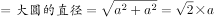，则大圆的半径为(√2×a)/2，根据圆面积之比等于半径之比的平方可知： 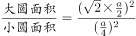(a^2/2)/(a^2/16)=8。

故正确答案为C。

**考点**：几何公式类-平面图形、几何结论类-三角形相关

**来源**：2017年湖北省选调生行测题（精选）第84题

### 第 85 题

某高校安排3名职工分别去了3所不同的中学进行招生宣传，其中甲不去A中学，乙不去B中学，则有多少种不同的安排方案？

A. 2

B. 3

C. 4

D. 5

第 85 题 · 答案与解析

**参考答案（粉笔题库参考内容）**

B

**解析**

方法一：采用枚举法，根据题干条件，满足情况的安排方案共有：（1）甲去B中学，乙去A中学，丙去C中学；（2）甲去B中学，乙去C中学，丙去A中学；（3）甲去C中学，乙去A中学，丙去B中学。共3种情况。

方法二：分情况讨论，（1）甲去B中学，乙、丙没有限制，则有A_2^2=2种情况。（2）甲去C中学，乙只能去A中学，只有1种情况。故总情况数=2+1=3种。

故正确答案为B。

**考点**：基础排列组合

**来源**：2017年湖北省选调生行测题（精选）第85题

### 第 86 题

某单位需要对一块长90m，宽10m的长方形地块进行绿化，要求每隔1m交替种A、B两种树，如果从该块地的任意角开始种植A种树，则该块地可种植B种树多少棵？（ ）

A. 450

B. 480

C. 500

D. 520

第 86 题 · 答案与解析

**参考答案（粉笔题库参考内容）**

C

**解析**

根据题意可知：地块长为90m，每隔1m种一行树，则共需要种90+1=91行；宽为10m，每隔1m种一列树，则共需要种10+1=11列，因此长方形地块共种树91×11=1001棵。由于交替种A、B两种树，故前1000棵树中两种树刚好各500棵，由于先种的是A，所以最后一棵也为A，即B树种植了500棵。

故正确答案为C。

**来源**：2017年湖北省选调生行测题（精选）第86题

### 第 87 题

某公司准备将一批重量为81吨的货物运到某市，现有载重量为8吨和5吨的货车各一辆。假定运输一趟的耗油量分别为16升和10升，问在耗油量最少的情况下，两种货车运输的趟次相差多少？（ ）

A. 1

B. 2

C. 3

D. 4

第 87 题 · 答案与解析

**参考答案（粉笔题库参考内容）**

B

**解析**

根据题意可知两种货车每吨的耗油量都为2升，则货车每趟都满载的情况下运完81吨的货物时，耗油量最少。设载重量为8吨和5吨的货车运输趟次分别为x、y，则8x+5y=81，得到的整数解只有x=2、y=13与x=7、y=5两组。第一种情况运输趟次相差13-2=11，无选项；第二种情况运输趟次相差7-5=2，对应B项。

故正确答案为B。

**考点**：统筹规划问题

**来源**：2017年湖北省选调生行测题（精选）第87题

### 第 88 题

假定甲地比乙地时区晚3个小时，一架飞机晚上7时从甲地起飞，于次日上午8时到达乙地，若两地往返飞行时间相等，问飞机上午9时从乙地起飞抵达甲地是什么时间？（题中时间均为当地时间）

A. 上午3时

B. 下午4时

C. 上午5时

D. 下午6时

第 88 题 · 答案与解析

**参考答案（粉笔题库参考内容）**

B

**解析**

一架飞机晚上7时从甲地起飞，于次日上午8时到达乙地。由“甲地比乙地时区晚3个小时”，则当乙地上午8点时，甲地还需要3小时才能到8点，即飞机到达时为甲地上午8-3=5点。则飞机于甲地晚上7时起飞，次日上午5时到达，即飞行时间为10个小时。由于往返飞行时间相等，因此按照甲地时间计算，飞机返程起飞时间为上午9-3=6点，到达时间应为6+10=16点，即下午4时。

故正确答案为B。

**来源**：2017年湖北省选调生行测题（精选）第88题

### 第 89 题

某市物价部门规定，每周用水不超过50吨，每吨收5角，如果超过50吨，超过的部分按1元收费。某月A用户比B用户多交了8元水费，问本月A用户比B用户可能多用多少吨水？（ ）

A. 4吨或6吨

B. 6吨或8吨

C. 6吨或10吨

D. 8吨或10吨

第 89 题 · 答案与解析

**参考答案（粉笔题库参考内容）**

D

**解析**

根据题意可知水费最贵为1元/吨，A用户比B用户多交了8元水费，说明A用户比B用户至少多用了8÷1=8吨水，只有D项满足条件。

故正确答案为D。

**考点**：分段计算问题

**来源**：2017年湖北省选调生行测题（精选）第89题

### 第 90 题

从所给四个选项中，选择最合适的一个填入问号处，使之呈现一定的规律性：

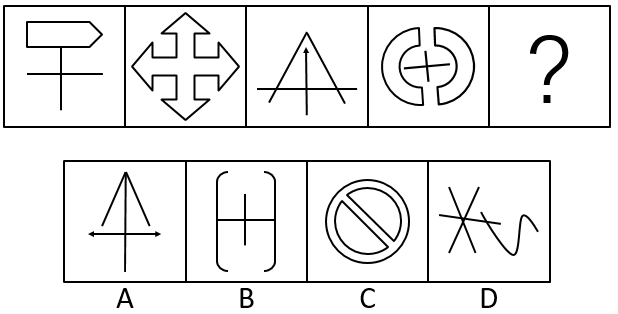

A. A

B. B

C. C

D. D

第 90 题 · 答案与解析

**参考答案（粉笔题库参考内容）**

C

**解析**

图形元素组成不相同，优先考虑属性规律。进一步观察图形共同特征可知，题干每幅图均有封闭区间，而选项中只有C项有封闭区间。

故正确答案为C。

**考点**：属性规律-开闭性

**来源**：2017年湖北省选调生行测题（精选）第90题

### 第 91 题

从所给四个选项中，选择最合适的一个填入问号处，使之呈现一定的规律性：

A. A

B. B

C. C

D. D

第 91 题 · 答案与解析

**参考答案（粉笔题库参考内容）**

C

**解析**

图形元素组成不相同，优先考虑属性规律。题干每幅图都是轴对称图形，排除B项；继续观察，题干每幅图都是竖轴对称，但A、D两项都有多个轴对称，没有唯一竖对称轴；题干每幅图都只有一条对称轴，只有C项有一条对称轴。

故正确答案为C。

**考点**：属性规律-对称性

**来源**：2017年湖北省选调生行测题（精选）第91题

### 第 92 题

从所给四个选项中，选择最合适的一个填入问号处，使之呈现一定的规律性：

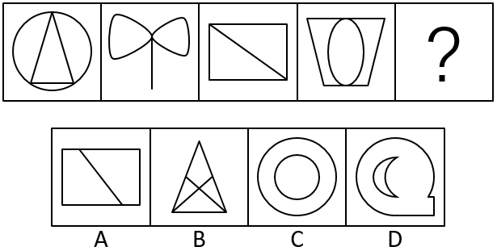

A. A

B. B

C. C

D. D

第 92 题 · 答案与解析

**参考答案（粉笔题库参考内容）**

A

**解析**

图形元素组成不相同，且无明显属性规律，考虑数量规律。题干图3和A项是典型的“日”字变形，且选项B是“田”字变形，考虑笔画数。题干每幅图均是一笔画图形，A项是一笔画，B项是两笔画，C项是两笔画，D项是两笔画。

故正确答案为A。

**考点**：数量规律-线

**来源**：2017年湖北省选调生行测题（精选）第92题

### 第 93 题

团体迷思，指团体在决策过程中，由于成员倾向让自己的观点与团体一致，因而令整个团体缺乏不同的思考角度，不能进行客观分析。一些值得争议的观点、有创意的想法或客观的意见不会有人提出、或者是遭到忽视及隔离。

根据上述定义，下列属于团体迷思的是（ ）。

A. 小赵提的一个建议遭到了领导否决，他以后再也不提意见了

B. 在会议上大家都不发表意见，可一走出会议室就议论纷纷

C. 老王性格内向，不习惯在单位大会上发表个人见解

D. 公司管理很混乱，看不到希望，大家都懒得提意见

第 93 题 · 答案与解析

**参考答案（粉笔题库参考内容）**

B

**解析**

第一步：找出定义关键词。

“团体在决策过程中，由于成员倾向让自己的观点与团体一致，因而令整个团体缺乏不同的思考角度，不能进行客观分析”。

第二步：逐一分析选项。

A项：小赵是因建议遭到领导否决而不提意见，不是为了让自己的观点与团体一致，不符合定义，排除；

B项：在会议上大家都不发表意见，走出会议室就议论纷纷，说明大多数人是有意见的，都是看到别人不发表意见自己也就不发表意见，符合倾向让自己的观点与团体一致，符合题干定义，当选；

C项：老王是因为性格内向而不发表见解，不是为了让自己的观点与团体一致，不符合定义，排除；

D项：大家懒得提意见是因为公司管理乱，没希望，不是因为倾向于让自己的观点与团体一致，不符合定义，排除。

故正确答案为B。

**考点**：原因结果

**来源**：2017年湖北省选调生行测题（精选）第93题

### 第 94 题

揭短营销是一种通过暴露自己的短处或是不足来进行营销的手段。揭短营销表面上揭露了企业的短处，实际上是对商品的客观评价。

根据上述定义，下列情形属于揭短营销的是：

A. 卖苹果的摊主故意说自己的苹果酸，引得路人买他的苹果

B. 某公司宣扬产品优点的同时，也告知顾客产品的不足之处

C. 某商家在宣传自己的产品时，揭露同行的产品存在的弱点

D. 酒厂故意在商店打碎一瓶酒，以此吸引顾客的注意

第 94 题 · 答案与解析

**参考答案（粉笔题库参考内容）**

B

**解析**

第一步：找出定义关键词。

“通过暴露自己的短处或是不足来进行营销”“表面上揭露了企业的短处，实际上是对商品的客观评价”。

第二步：逐一分析选项。

A项：摊主不是“企业”，不符合定义，排除；

B项：某公司宣扬产品优点同时告知不足之处，是暴露自己的不足，也是客观的评价，符合题干定义，当选；

C项：商家揭露的是同行的弱点，不是自己的不足之处，不符合定义，排除；

D项：该酒厂并未揭露自己的短处或不足，不符合定义，排除。

故正确答案为B。

**考点**：方式目的

**来源**：2017年湖北省选调生行测题（精选）第94题

### 第 95 题

社会公共消费，是指以社会和集体作为消费单位，在社会或集体范围内为满足其成员的共同需要而消费各种消费资料和劳务的一种消费需求，是在社会或集体范围内共同进行的消费。

根据上述定义，下列情形不属于社会公共消费的是：

A. 中小学生的义务教育消费

B. 单位为员工提供体育健身设施

C. 单位为优秀工作者发放奖金

D. 某市为60岁以上老人发放福利金

第 95 题 · 答案与解析

**参考答案（粉笔题库参考内容）**

C

**解析**

第一步：找出定义关键词。

“以社会和集体作为消费单位，在社会或集体范围内为满足其成员的共同需要而消费各种消费资料和劳务的一种消费需求，是在社会或集体范围内共同进行的消费”。

第二步：逐一分析选项。

A项：中小学生的义务教育消费，是以社会和集体作为消费单位，是在社会范围内为满足成员（中小学生）的共同需要进行的消费，符合题干定义，排除；

B项：单位为员工提供体育健身设施，是以集体作为消费单位，是在集体范围内为满足成员（单位员工）的共同需要进行的消费，符合题干定义，排除；

C项：单位给优秀工作者发放奖金，是以个人作为消费单位，不是为满足集体成员（单位员工）进行的消费行为，不是集体范围内共同进行的消费，不符合定义，当选；

D项：某市为60岁以上老人发放福利金，是以社会和集体作为消费单位，是在社会范围内为满足成员（60岁以上老人）的共同需要进行的消费，符合定义，排除。

本题为选非题，故正确答案为C。

**考点**：主客体

**来源**：2017年湖北省选调生行测题（精选）第95题

### 第 96 题

如若对某人提出一个很大而又易被拒绝接受的要求，接着向他提出一个小一点的要求，那么他接受这个小要求的可能性，比直接向他提出这个小要求而被接受的可能性大得多，这种现象被称为门面效应。

根据上述定义，下列情形符合门面效应的是：

A. 商业谈判时，公司先提出一个较高的报价，后面不得已下调

B. 和他人初步认识时不提过分要求，等到关系熟了后再提要求

C. 小王想请两天假，他故意向领导说请5天，领导说最多3天

D. 买菜时，老梁跟摊贩讨价还价，以双方都能接受的价格成交

第 96 题 · 答案与解析

**参考答案（粉笔题库参考内容）**

C

**解析**

第一步：找出定义关键词。

“提出一个很大而又易被拒绝接受的要求，接着提出一个小一点的要求”、“接受这个小要求的可能性，比直接向他提出这个小要求而被接受的可能性大得多”。

第二步：逐一分析选项。

A项：商业谈判时先提出较高的报价，后面“不得已”下调，说明下调后的价格不是公司原本希望的要求，不符合定义，排除；

B项：初步认识时不提过分要求，关系熟了再提要求，不是接连提出要求，不符合定义，排除；

C项：小王故意请5天假，是比2天更大一点的要求，领导给了3天假，比他本来希望请的2天假更多，符合定义，当选；

D项：两个人讨价还价，不是向某人先提出一个大要求，再提出小要求，且最后双方都能接受的价格不一定是双方本来期待的价格，不符合定义，排除。

故正确答案为C。

**考点**：单定义-其他句式

**来源**：2017年湖北省选调生行测题（精选）第96题

### 第 97 题

史华兹论断认为，所有的坏事情，只有在我们认为它是不好的情况下，才会真正成为不幸事件。面对挫败，是自暴自弃，让它成为不可逆转的事实，还是让它变成促使重新奋发的动力，取决人们的主观努力。能从坏中看好，积极对待，反而会有个好结果。

根据上述定义，下列情形不符合史华兹论断的是：

A. 大成眼睛失明，但他学习盲人按摩，成为职业技能大赛冠军

B. 公司重奖对其服务投诉的消费者，获得了社会的普遍赞赏

C. 出了生产事故后，车间进行整改，成为企业安全生产标兵

D. 某企业出了质量丑闻后，积极自责自纠，最终却仍然倒闭

第 97 题 · 答案与解析

**参考答案（粉笔题库参考内容）**

D

**解析**

第一步：找出定义关键词。

“坏事情”、“能从坏中看好，积极对待，反而会有个好结果”。

第二步：逐一分析选项。

A项：大成眼睛失明是“坏事情”，但他学习盲人按摩，成为职业技能大赛冠军，证明他能从坏中看好，积极对待，反而有个好结果，符合定义，排除；

B项：投诉是“坏事情”，但公司重奖对其投诉的消费者，获得了社会的普遍赞赏，即消费者的认可，证明该公司能积极看待，反而有个好结果，符合定义，排除；

C项：生产事故是“坏事情”，车间进行整改，成为安全生产标兵，证明该车间从坏中看好，积极对待，反而有个好结果，符合定义，排除；

D项：质量丑闻是“坏事情”，积极自责自纠，但最终却仍然倒闭，证明虽然积极对待，但最后没有得到好结果，不符合定义，当选。

本题为选非题，故正确答案为D。

**考点**：单定义-其他句式

**来源**：2017年湖北省选调生行测题（精选）第97题

### 第 98 题

生产全球化：贸易全球化：经济全球化

A. 亚太经合组织：20国集团：世贸组织

B. 劳动力竞争：资金竞争：市场竞争

C. 资本国际化：金融自由化：投资便利化

D. 边际成本：边际效应：消费剩余

第 98 题 · 答案与解析

**参考答案（粉笔题库参考内容）**

B

**解析**

第一步：判断题干词语间逻辑关系。

经济全球化是指贸易、投资、金融、生产等活动的全球化，因此生产全球化和贸易全球化均为经济全球化的一种表现形式，且二者是并列关系。

第二步：判断选项词语间逻辑关系。

A项：亚太经合组织、20国集团、世贸组织分别是不同的国际组织，三者是并列关系，与题干逻辑关系不一致，排除；

B项：劳动力竞争和资金竞争均为市场竞争的一种表现形式，且二者是并列关系，与题干逻辑关系一致，当选；

C项：资本国际化，金融自由化、投资便利化均为促进贸易发展的方向，三者是并列关系，与题干逻辑关系不一致，排除；

D项：边际成本、边际效应、消费剩余均为经济学名词，三者是并列关系，与题干逻辑关系不一致，排除。

故正确答案为B。

**考点**：逻辑关系-并列关系、逻辑关系-对应关系

**来源**：2017年湖北省选调生行测题（精选）第98题

### 第 99 题

春季：观花

A. 春暖：花开

B. 夏日：流火

C. 秋天：采摘

D. 冬季：结冰

第 99 题 · 答案与解析

**参考答案（粉笔题库参考内容）**

C

**解析**

第一步：判断题干词语间逻辑关系。

春季适宜观花，观花是人的行为，二者是季节与行为之间的对应关系。

第二步：判断选项词语间逻辑关系。

A项：春暖导致花开，二者为因果对应关系，与题干逻辑关系不一致，排除；

B项：七月流火指天气逐渐凉爽起来，七月指夏历七月，而非“夏日”，与题干逻辑关系不一致，排除；

C项：秋天适宜采摘，采摘是人的行为，二者是季节与行为之间的对应关系，与题干逻辑关系一致，当选；

D项：冬季容易结冰，但结冰不是人的一种行为，与题干逻辑关系不一致，排除。

故正确答案为C。

**考点**：逻辑关系-对应关系

**来源**：2017年湖北省选调生行测题（精选）第99题

### 第 100 题

雾霾：治污

A. 人生：婚姻

B. 渍水：排涝

C. 虫灾：减产

D. 资本：管理

第 100 题 · 答案与解析

**参考答案（粉笔题库参考内容）**

B

**解析**

第一步：判断题干词语间逻辑关系。

雾霾是“污”的一种，治污需要治理雾霾，且治污后雾霾减少。

第二步：判断选项词语间逻辑关系。

A项：人生可能有婚姻，可能没有婚姻，与题干逻辑关系不一致，排除；

B项：渍水是“涝”的一种，排涝需要排放渍水，且排涝后渍水减少，与题干逻辑关系一致，当选；

C项：虫灾会导致减产，二者是因果对应关系，与题干逻辑关系不一致，排除；

D项：管理资本，而且为动宾搭配，且管理后资本不一定会减少，与题干逻辑关系不一致，排除。

故正确答案为B。

**考点**：逻辑关系-对应关系

**来源**：2017年湖北省选调生行测题（精选）第100题

### 第 101 题

电商：微商

A. 电脑：手机

B. 大数据：云计算

C. 自媒体：微信

D. 微博：短信

第 101 题 · 答案与解析

**参考答案（粉笔题库参考内容）**

C

**解析**

第一步：判断题干词语间逻辑关系。

微商是电商的一种，二者为种属关系。

第二步：判断选项词语间逻辑关系。

A项：电脑和手机都是电子产品，二者为并列关系，与题干逻辑关系不一致，排除；

B项：大数据和云计算都是计算机技术，二者为并列关系，与题干逻辑关系不一致，排除；

C项：微信是一种自媒体，二者为种属关系，与题干逻辑关系一致，当选；

D项：微博和短信都有沟通交流的功能，二者为并列关系，与题干逻辑关系不一致，排除。

故正确答案为C。

**考点**：逻辑关系-包容关系

**来源**：2017年湖北省选调生行测题（精选）第101题

### 第 102 题

扶贫：济困

A. 励精：图治

B. 克难：攻坚

C. 狼吞：虎咽

D. 星罗：棋布

第 102 题 · 答案与解析

**参考答案（粉笔题库参考内容）**

B

**解析**

第一步：判断题干词语间逻辑关系。

扶贫指扶持贫穷的人，济困指接济困难的人，二者为近义关系。

第二步：判断选项词语间逻辑关系。

A项：励精指振奋精神，图治指治理国家，不是近义关系，与题干逻辑关系不一致，排除；

B项：克难指克服困难，攻坚指攻破坚壁，二者为近义关系，保留；

C项：狼吞和虎咽是近义关系，均可形容吃东西又猛又急，二者为近义关系，保留；

D项：星罗指星星罗列，棋布指棋子分布，均可形容数量繁多，二者为近义关系，保留。

二级辨析：看构词结构。题干扶贫和济困均为谓宾结构。

B项：克难和攻坚是谓宾结构，与题干逻辑关系一致，当选；

C项：狼吞和虎咽是主谓结构，与题干逻辑关系不一致，排除；

D项：星罗和棋布是主谓结构，与题干逻辑关系不一致，排除。

故正确答案为B。

**考点**：语义-其他、拆分思维

**来源**：2017年湖北省选调生行测题（精选）第102题

### 第 103 题

（ ） 对于 手机 相当于 （ ） 对于 空调

A. 网聊；烘干

B. 短信；冷冻

C. 通话；抽湿

D. 通讯；调强

第 103 题 · 答案与解析

**参考答案（粉笔题库参考内容）**

C

**解析**

逐一代入选项。

A项：手机有网聊功能，而空调的功能不是烘干，前后逻辑关系不一致，排除；

B项：手机有短信功能，空调可以制冷，而非冷冻，用于冷冻的应为冰箱，前后逻辑关系不一致，排除；

C项：手机有通话功能，空调有抽湿功能，前后逻辑关系一致，当选；

D项：手机有通讯功能，空调没有调强功能，前后逻辑关系不一致，排除。

故正确答案为C。

**考点**：逻辑关系-对应关系

**来源**：2017年湖北省选调生行测题（精选）第103题

### 第 104 题

南方某镇不仅向全镇低收入家庭送书赠报，还规定全镇居民和有一年以上居住证的新居民，每年可凭购书发票到镇里报销200元。舆论分析说，政府的做法，有利于培养老百姓读书看报习惯，形成全社会学习风气。

以下哪项最能支持舆论分析？

A. 读书看报不仅是人的行为方式或文化习惯，也是一种消费行为，完全可以用经济手段加以刺激引导

B. 人们越来越多的意识到，知识创造财富

C. 政府有补贴，可以促使穷人和富人都去购书订报

D. 如果文化补贴时间足够长，将来政府停发补贴，或将补贴发往其他方面，人们仍会读书看报

第 104 题 · 答案与解析

**参考答案（粉笔题库参考内容）**

C

**解析**

第一步：找出论点和论据。

论点：政府的做法（向全镇低收入家庭送书赠报，规定全镇居民和有一年以上居住证的新居民每年可凭购书发票到镇里报销200元）有利于培养老百姓读书看报习惯，形成全社会学习风气。

论据：无。

第二步：逐一分析选项。

A项：读书可以用经济手段加以刺激引导，与是否会形成全社会学习风气无关，不能支持，排除；

B项：人们意识到知识创造财富，不代表人们会读书看报以及形成全社会学习风气，无关项，不能支持，排除；

C项：政府补贴可以促使穷人和富人都去购书订报，可以形成全社会学习风气，可以支持，当选；

D项：如果补贴时间够长是一种未来假设，但题干没有提及补贴时间是否足够长，无关项，不能支持，排除。

故正确答案为C。

**考点**：必要条件

**来源**：2017年湖北省选调生行测题（精选）第104题

### 第 105 题

全球超算TOP500最新榜单中，国产“神威”“太湖之光”二度问鼎。中国更以167台超算超过美国165台，成为入列500强超算最多的国家。而这167台计算机都是近15年内开发，2001年前这一数字还是零。国产超算发展成效如此喜人，可挖原因一是有一支吃苦耐劳、作风过硬、高水平、高素质的科研团队。二是国产化率显著提升。三是突破性创新频频出现。近年我国超算领域确实是国产化率不断提高。

由此，可推出国产超算发展喜人的原因：

A. 是国产化率显著提高

B. 也许不是国产化显著提高

C. 也许是创新成果频频突破

D. 是有一支吃苦耐劳、作风过硬、高水平的、高素质的科研团队

第 105 题 · 答案与解析

**参考答案（粉笔题库参考内容）**

B

**解析**

日常结论题，根据题干信息逐一分析选项。

A项：国产化率显著提高只是国产超算发展喜人的原因之一，不能推出一定是该原因，不能推出，排除；

B项：也许不是国产化显著提高，题干有三个可挖原因，所以可能不是该原因，可以推出，当选；

C项：也许创新成果频频突破，强调创新成果不断有突破，题干是突破性创新频频出现，强调数量多，偷换概念，不能推出，排除；

D项：有一支吃苦耐劳、作风过硬、高水平、高素质的科研团队只是原因之一，不能推出一定是该原因，不能推出，排除。

故正确答案为B。

**考点**：日常结论

**来源**：2017年湖北省选调生行测题（精选）第105题

### 第 106 题

“城归”，有学者解释为，从农村出去打工、经商的农民，或从农村走出的读书人、退役士兵等，经过多年在城市打拼，累积了经验，获得技术和资金。如今又重回乡村生产生活。据国务院公布的数据，目前“城归”已超过450万人。在新农村建设中，需要大量人才和资金支持，而“城归”群体的迅速壮大是提供人才和资金的必要条件。

据此可以推出：

A. 如果没有“城归”群体的发展壮大，那么就不能实现新农村建设目标

B. 只要有人才和资金支持，就能实现新农村建设目标

C. 一旦有人才就会有资金

D. 倘若有资金支持，就能实现新农村建设目标

第 106 题 · 答案与解析

**参考答案（粉笔题库参考内容）**

A

**解析**

第一步：翻译题干。

①新农村建设→人才和资金；

②人才和资金→“城归”群体壮大；

将①和②串联得出：③新农村建设→人才和资金→“城归”群体壮大。

第二步：逐一分析选项。

A项：翻译为—“城归”群体壮大→—新农村建设，是对③的否后推否前，可以推出，当选；

B项：翻译为人才和资金→新农村建设，是对①的肯后，肯后无必然结论，无法推出，排除；

C项：翻译为人才→资金，题干未提及人才和资金之间的关系，无关项，无法推出，排除；

D项：翻译为资金→新农村建设，新农村建设不仅需要资金还需要人才，无法推出，排除。

故正确答案为A。

**考点**：常规翻译

**来源**：2017年湖北省选调生行测题（精选）第106题

### 第 107 题

人们常说，治污要治本，治本先清源。加强环境保护，遏制环境污染，如果只注意治理已经出现的污染，不从源头上抓起，往往是按下葫芦浮起瓢，陷入防不胜防的恶性循环，不能根治污染。

据此可推出：

A. 国际社会普遍认为，解决环境问题的治本之策是从源头上减少污染物排放

B. 如果要根治污染，必须从源头上减少污染物排放

C. 只要从源头抓起，就能根治污染

D. 从源头上防治污染，必须加快调整经济结构，推动产业优化升级

第 107 题 · 答案与解析

**参考答案（粉笔题库参考内容）**

B

**解析**

第一步：翻译题干。

\-源头抓起→-根治。

第二步：逐一分析选项。

A项：“国际社会普遍认为”与“人们常说”不符，偷换概念，无法推出，排除；

B项：翻译为根治污染→源头减少污染排放，否后推否前，可以推出，当选；

C项：翻译为源头抓起→根治污染，否前得不到确定性结论，无法推出，排除；

D项：题干未提及“加快调整经济结构，推动产业优化升级”与源头防止污染之间的关系，无法推出，排除。

故正确答案为B。

**考点**：常规翻译

**来源**：2017年湖北省选调生行测题（精选）第107题

### 第 108 题

某大学国家重点实验室自成立以来，实行的弹性考核，只要非科研人员进行3至5年的阶段性工作汇报，对研究人员每年该争取多少科研项目和经费、发表多少科研论文、取得多少次发明专利等，一概不提硬性指标。这一做法尊重科学研究规律，拒绝浮躁功利，呵护科学家的创新原动力，收到了良好的成效。

上述举措依据的前提是：

A. 保证科研人员能坚持开展周期性长、前瞻性强、挑战性高的科研内容

B. 该室近年来产生的重大成果多数都涉及许多学科，考核难度大

C. 只有较长的研究周期，才能保证前瞻性强、挑战性高的科研内容

D. 研究周期长的课题，一旦突破，相关成果就会出现井喷现象

第 108 题 · 答案与解析

**参考答案（粉笔题库参考内容）**

A

**解析**

第一步：找出论点和论据。

论点：只要非科研人员进行3至5年的阶段性工作汇报，对研究人员每年该争取多少科研项目和经费、发表多少科研论文、取得多少次发明专利等，一概不提硬性指标。

论据：无明显论据。

第二步：逐一分析选项。

A项：考虑否定代入，如果科研人员不坚持开展周期性长、前瞻性强、挑战性高的科研内容，该举措难以考核科研人员，是论点成立的必要条件，可以加强，当选；

B项：涉及许多学科，考核难度大不代表不能考核，不能加强，排除；

C项：较长的研究周期才能保证科研内容，不代表不需要硬性考核，不能加强，排除；

D项：成果一旦突破便会出现井喷现象，但也可以在过程中实行硬性考核，不能加强，排除。

故正确答案为A。

**考点**：必要条件

**来源**：2017年湖北省选调生行测题（精选）第108题

## 材料 1

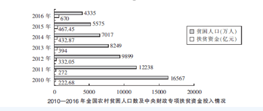

2016年我国扶贫力度进一步加大，中央和省级财政专项扶贫资金投入超过了1000亿元，其中中央财政安排专项扶贫资金670亿元。全国农村超额完成了政府工作报告提出的减贫1000万人的目标任务。2000-2014年，中央财政累计投入专项扶贫资金2966亿元，年均增长11.6%。

### 第 109 题

2011-2016年，中央财政专项扶贫资金投入增速超过20%的有：

A. 2年

B. 3年

C. 4年

D. 5年

第 109 题 · 答案与解析

**参考答案（粉笔题库参考内容）**

B

**解析**

根据问题“增速超过20%”可判定题型为增长率问题，由增长率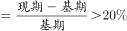，所求问题可转化为：满足基期+基期×0.2＜现期，即增速超过20%。

定位第二个图形材料可得：

2011年：222.68+222.68×0.2≈223+44=267＜272，满足；

2012年：272+272×0.2≈272+54＜332.05，满足；

2013年：332.05+332.05×0.2≈332+66＞394，不满足；

2014年：394+394×0.2≈394+79＞432.87，不满足；

2015年：432.87+432.87×0.2≈433+87＞467.45，不满足；

2016年：467.45+467.45×0.2≈467+93＜670，满足。

因此2011年、2012年、2016年，共3年满足。

故正确答案为B。

**考点**：一般增长率、综合资料

**来源**：2017年湖北省选调生行测题（精选）第109题

### 第 110 题

1980年-2015年，全国农村贫困发生率下降最快的是：

A. 1980-1985年

B. 1990-1995年

C. 2000-2005年

D. 2010-2015年

第 110 题 · 答案与解析

**参考答案（粉笔题库参考内容）**

C

**解析**

定位第一个图形材料可得四个选项分别下降了：1980-1985年：96.20%-78.30%=17.90%；1990-1995年：73.50%-60.50%=13.00%；2000-2005年：49.80%-30.20%=19.60%；2010-2015年：17.20%-5.70%=11.50%，故2000-2005年全国农村贫困发生率下降最快。

故正确答案为C。

**考点**：综合资料、简单加减计算

**来源**：2017年湖北省选调生行测题（精选）第110题

### 第 111 题

根据所给材料，下列说法正确的是：

①2010-2016年中央财政专项扶贫资金投入与农村贫困人口数的变化趋势相反

②2010-2016年全国农村年均减贫人口数超过2000万人

③2016年全国农村贫困人口同比下降3成

④2016年全国农村完成减贫任务超过目标近25%

A. ①②③

B. ①②④

C. ②③④

D. ①②③④

第 111 题 · 答案与解析

**参考答案（粉笔题库参考内容）**

B

**解析**

①定位第二个图形材料可知：2010-2016年中央财政专项扶贫资金投入逐年增加，农村贫困人口数逐年减少，变化趋势相反，正确；

②定位第二个图形材料可知：2010年全国农村贫困人口16567万人，2016年全国农村贫困人口4335万人，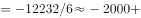万人，即年均减贫超过2000万人，正确；

③定位第二个图形材料可知，2016年全国农村贫困人口4335万人，2015年全国农村贫困人口5575万人，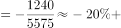，即同比下降不到3成，错误；

④定位文字材料和第二个图形材料可知：2016年全国农村减贫目标为1000万人，实际减贫人口数=5575-4335=1240，超过目标：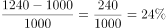，接近25%，正确。

综上，①②④正确。

故正确答案为B。

**考点**：综合分析、综合资料

**来源**：2017年湖北省选调生行测题（精选）第111题

## 材料 2

中国支付清算协会发布的《中国支付清算行业运作报告（2016）》显示，2015年国内银行共处理移动支付业务138.37亿笔，金额108.22万亿元，同比分别增长205.86%和379.06%；非银行支付机构共同处理移动支付业务398.61亿笔，金额21.96万亿元，同比分别增长160%和166.5%。

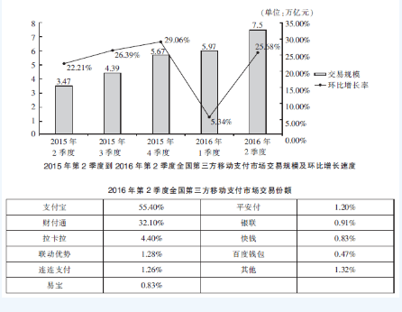

### 第 112 题

2016年第二季度第三方移动支付市场交易额同比增速最接近：

A. 115%

B. 110%

C. 105%

D. 95%

第 112 题 · 答案与解析

**参考答案（粉笔题库参考内容）**

A

**解析**

根据问题问“同比增速”，可判定此题为增长率计算。定位第一个图形材料可得：2016年第二季度第三方移动支付市场交易额为7.5万亿元，2015年第二季度第三方移动支付市场交易额为3.47万亿元。由公式：，与A项最接近。

故正确答案为A。

**考点**：一般增长率、综合资料

**来源**：2017年湖北省选调生行测题（精选）第112题

### 第 113 题

2015年全国第三方移动支付市场月均交易额约为：

A. 1.2万亿元

B. 1.9万亿元

C. 1.7万亿元

D. 1.4万亿元

第 113 题 · 答案与解析

**参考答案（粉笔题库参考内容）**

D

**解析**

根据问题问“月均”，结合问题时间为2015年、材料时间为2016年，可判定题型为基期平均数问题。定位第一个图形材料，由可知：2015年1季度全国第三方移动支付市场交易额为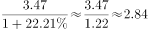万亿元，则月均交易额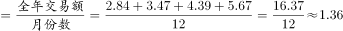万亿元，与D项最接近。

故正确答案为D。

**考点**：基期平均数、综合资料

**来源**：2017年湖北省选调生行测题（精选）第113题

### 第 114 题

2016年第二季度，全国第三方移动支付市场上支付宝比财付通交易额高出约：

A. 64%

B. 73%

C. 81%

D. 87%

第 114 题 · 答案与解析

**参考答案（粉笔题库参考内容）**

B

**解析**

根据问题“2016年第二季度······高出约”结合选项为百分数可判定题型为增长率问题。定位第二个表格材料可得：2016年第二季度，全国第三方移动支付市场上支付宝交易份额为55.40%，财付通为32.10%，支付宝比财付通高出：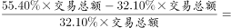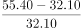，与B项最接近。

**考点**：一般增长率、综合资料

**来源**：2017年湖北省选调生行测题（精选）第114题

### 第 115 题

2015年国内银行和非银行机构移动支付金额同比增量之比约为：

A. 7:2

B. 6:1

C. 5:2

D. 4:1

第 115 题 · 答案与解析

**参考答案（粉笔题库参考内容）**

B

**解析**

根据问题“······同比增量之比约为”可判定题型为比值计算问题。定位文字材料可得：2015年国内银行移动支付金额108.22万亿元，同比增长379.06%，非银行机构移动支付金额21.96万亿元，同比增长166.5%。由可得：2015年国内银行移动支付金额同比增长了万亿元，2015年非银行机构移动支付金额同比增长了万亿元，故比值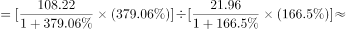，与B项最接近。

故正确答案为B。

**考点**：比值计算、综合资料

**来源**：2017年湖北省选调生行测题（精选）第115题

