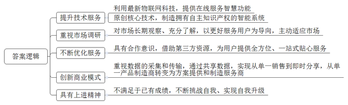
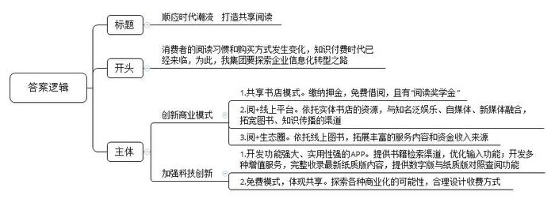
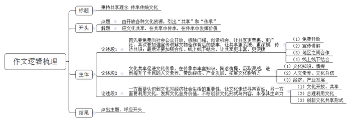

# 2018年公务员多省联考《申论》题（湖北卷）

<!-- gwy:overview:start -->
> **湖北 · 2018 · 申论 · 统考** ｜ 4 题 · 图片 4 处 · 答案随题折叠

导航：[题目](#题目) · [材料 1](#材料-1)
<!-- gwy:overview:end -->

> 候选采集稿。参考答案及解析来自粉笔页面，不代表官方答案或真实高分答卷；来源使用许可与原卷对应关系仍需人工核实。

## 给定材料

### 材料 1

互联网的迅猛发展，从根本上颠覆了许多传统行业，也创造了新的行业和机遇。21世纪初，有学者提出了互联网时代协同消费的理念和发展模式，并将其分为若干阶段。最初，是代码共享，即通过互联网向用户提供信息，但信息流是单向的，用户不能参与其中进行评论和交流。当互联网进入Web2.0时代，用户开始通过网络平台与陌生人分享信息、表达观点，但其分享局限于内容或信息，不涉及实物交易，一般也不存在金钱报酬，仅仅是生活共享或是内容共享。

随着物物相联时代到来，网络平台公司通过互联网重新整合社会闲散资源和富余劳动力，然后再按需精准配置，实现物尽其用，社会分配从专业化向社会化转变，真正实现了离线资源的共享，即线上的分享协作渗透和延伸至线下，并由此改变了我们的文化和经济世界。如今，需求方不仅可以享受到低价与个性化服务，也得到了社交机会。对企业而言，随着加入网络的节点及节点间的连接增加，网络的价值会随着用户数量的平方数增加而增加。作为一种新的商业模式，其势必会对现行制度和秩序造成冲击，政府应积极提供相应的法律制度保障，实现其可持续发展。同时，任何商业行为都是以盈利为目标，任何市场的开发也都需要资金的支持，而过度的资本运作可能导致市场滥用其优势地位，甚至违背市场规律进行不正当竞争。政府理应鼓励相关企业采取科学的商业模式；鼓励新经济创造真正的消费者，而不仅是通过补贴来吸引消费者。

在新经济模式中，个体成为自由劳动者，劳动力价值能得到充分实现并完全由自己支配。供求双方通过互联网发布自己可供分享或需求的物品，不仅能为特定的供给者或需求者提供可选择的交易对象，还有助于掌握交易对象更多的信息，避免不公平交易，降低了交易成本。对闲置物资的再利用使得前期投入的成本要么已得到回收，要么当做沉没或折旧成本而收费较低廉，从而令闲置物资的边际成本更低，显现出更大的成本和资源利用效率优势。由于这一系列商业活动完全有别于过往经济行为，加强政府的监督与引导，显得尤为重要，建立新的监管规则体系迫在眉睫。在新的规则出台之前，可以运用相关的法理，借鉴现行的法律法规，引导市场建立内部自律监督机制，维护市场的正常秩序。

### 材料 2

美国某房屋租赁公司曾发生一起事件。一名房东发现她的公寓被从该公司网站上招来的房客洗劫一空。她在给该公司的信上写道：“他们在我的柜子上凿了个洞，劫走了里面的护照、现金、信用卡和我奶奶的珠宝首饰。不仅如此，他们又搜走了我的照相机、老式电脑和装有我所有相片、日志等备份的外接硬盘。他们掠走了我的一切。”这大概是所有人对互联网时代协同消费经济模式的顾虑了。某调查公司针对美国用户对这一经济模式的调研数据显示，参与调查的人群中，57%的人表示，“对这种消费模式感兴趣，但是仍有顾虑”；而在熟悉这种经济模式的人群中，69%的人认为，“除非信任的人推荐，否则将不会相信”。

共享充电宝在成为许多市民生活“标配”的同时，也引发了不少争议。除了共享充电宝自身存在质量安全外，使用者可能还会面临个人信息泄露的风险。曹先生是一位互联网公司的程序员，他说：“每次看到有人使用共享充电宝，我都为他们捏把汗。其实它本质上就是一台电脑，有电脑的地方就会有黑客。现在大数据、算法不断发展，数据公司和社交软件合作，无孔不入地对个人信息进行收集。如今，我们消费时常扫二维码，授权第三方进行支付，但是第三方支付其实都绑定了个人身份信息、银行卡信息，在扫码过程中，就存在信息泄露的可能。”

本应更方便、更优惠的互联网协同消费经济，有时还会让人陷入更大的麻烦。随着家庭用品加速升级换代，如何让闲置物品流转起来，使旧物出售和消费变成“动动手指就能办成的事”，成为商家瞄准的一片蓝海。不过，由于买卖无需“打照面”，交钱与交货环节分离等原因，网络二手交易平台的信誉难尽人意，“省时省力不省心”，是不少人的共同印象。与一般商品不同，非标准化是二手商品的最大特点，其损耗程度、保养情况等很难得到最合理的评估、考证。如何让踏实放心取代买卖双方的彼此猜忌，除了考验平台的服务智慧、相关部门的治理决心，还有赖于社会征信体系的建立。

由于制度建设的相对滞后，如何解决经济活动过程中产生的纠纷，也让人颇费思量。租车、私厨、保洁……“互联网+”催生了很多以APP为平台的服务业务，通过APP和客户建立联系并提供服务，是否就算是和APP的运营公司建立了劳动关系？邓先生、孙先生等7名厨师，通过某公司APP平台成为上门掌勺的“私厨”。日前，他们向法院起诉要求确认自己和该公司存在劳动关系，要求支付双倍工资、休息加班费等酬劳。该公司认为，根据双方签订的商务合作协议，孙先生等通过其旗下的APP平台，依照客户需求接单提供服务，是否接单和工作时间的选定均由孙先生等人自行掌握，他们不接受公司管理，因此双方不存在劳动关系。有法律界人士认为，“互联网+”劳务是近年来兴起的劳务形式，网络服务平台运营方与加入平台的劳动者之间是否构成劳动关系是一个尚有争议的法律问题。这就造成劳动权益被侵害的风险加大。

某些网站只需付费即可杜撰、发布不实词条，让人对这场新经济的盛宴又多添了几分忧虑。有网友打趣，互联网平台在实现“与世界分享你的知识、经验和见解”的同时，也在分享着以假乱真的故事。一方面，这一创新模式让人们遨游于知识的汪洋；另一方面，利益架构起来的知识岛屿往往会误导人们求知的航向。一位哲人曾说，一切背离了公正的知识都应叫做狡诈，而不应称为智慧。平台的开放性与真实性从来都不是背道而行的，更不容许贪婪的欲望主导信息的传播。每个人不管是主动分享，还是被动接收，都应遵守规则，承担责任，用客观理性的观念培育知识的植株，做一名慧眼识珠的花匠、恪尽职守的护花使者。如此，知识的花朵才会灿然盛开、芬芳四溢。

### 材料 3

近日，某国产知名品牌校园洗衣房正式入驻R市大学城，18台物联网自助洗衣设备开始投入使用，为大学生提供自助洗衣服务。与过去的自助投币式洗衣机不同，大学生只要扫描下载该品牌洗衣APP，就可以随时随地实现在线预约排队、在线支付及在线状态查看等智慧功能。

基于对中国当代大学生的长期观察和了解，该品牌依托物联网打造出这一创新模式。这种自助洗衣设备一入驻R市大学城，就受到了大学生们的喜爱。课间查看空余机位，一键下单，手机支付，该品牌洗衣逐渐成为大学生校园生活的一部分。“自从学校有了这种自助洗衣设备，之前排队洗衣的时间可以用在逛书店和学习上了。现在我们宿舍的六个室友，每人都装了洗衣APP，给我们带来了很多便利。”一名收到洗衣APP取衣提醒后前来取衣的学生告诉记者。

其实，这样的场景每天都在全国二百多个城市六百多所高校上演。有数据统计，该品牌洗衣APP注册用户数达541万，且日增新用户7000余人。事实上，从上世纪90年代起，该品牌洗衣机就以更好服务用户为导向，主动适应市场，在学校中设立投币式自助洗衣设备，让学校成为其洗衣服务的“重要阵地”。如今，在行业还停留在探索如何刷卡投币解决大学生洗衣排队难题时，该品牌又开始以物联网的理念运作自助洗衣。在校学生足不出户便可享受到智能预约洗衣、手机下单在线支付、完成提醒功能等一站式贴心服务，彻底解决了大学生的“洗衣难”问题。此外，通过与全国六百多所高校合作，借助第三方资源入驻，该品牌洗衣APP还为大学生提供O2O模式下的校园社交、学生生活、投资机构和商家对接等全方位服务，在资源扩大的同时实现自我升级。

无独有偶，S机床厂通过创新商业模式，实现了在国内外机床行业市场规模整体萎靡之时的逆势上扬。“我在机床行业工作近30年。这些年，我冷静下来思考，总结了四句话——第一，我们的员工不满意。任何员工都希望工资越来越高，我们拿什么来给他们发工资？第二，我们的用户不满意。很多装备都是进口的，而且一些顶尖的机床，国外根本就不卖给我们。第三，我们的领导不满意，说你们什么时候才能赶超日、美、德呢？第四，我们自己也不满意。回顾过去，基本啥也没干。”董事长不无幽默地说道。或许正是这些“不满意”，促使他决定开启一场“冒险”。2007年，S机床厂彻底摒弃模仿和跟随的道路，该厂科技部的一帮年轻人从源代码开始写起，用了6年时间，原创了多项数控核心技术，诞生了拥有自主知识产权的“智能5代系统”。该系统具有一个很重要的特性：在运行的过程中可以实时采集和传输数据。有了这些数据，客户在手机上就能通过S机床厂的大数据系统实时查看自己工厂的运转情况、机台的生产情况，从而替代了传统的管理；由于掌握了这些最真实的数据，S机床厂又能通过互联网，为客户在线提供技术解决方案，实现人才共享。数据的“共享”，还为S机床厂开启了一条与众不同的商业模式——不再是传统的机床买卖、加价销售、赚取利润，而是以“零首付”租赁给客户，按小时或者按加工量收费，并依据机床运转传输回来的数据进行结算。通过赢取用户对企业和产品的信任，让机床的销售由单纯买卖，走向了即时分享。S机床厂已经从过去单纯的产品制造商，转身成为系统解决方案提供商和工业制造服务商。

### 材料 4

“观众想细看养心殿的文物，不用再趴窗户了。”据媒体报道，从2016年9月28日到2017年2月，深藏于故宫博物院养心殿的268件文物“移驾”首都博物馆，接受公众的检阅，这也是养心殿文物首次“出宫”。大批珍贵文物走出故宫，不仅仅是博物馆系统内部的一次完美合作，而且有着更为深广的意义。即文物不再一味地深“藏”不露，矜持内敛，而是正在以越来越开放的姿态，越来越亲民的路径，融入老百姓的生活。正如一位学者所言，一个一流的博物馆并不在于藏品有多么丰富，而在于人们要有机会看到这个馆里大量珍贵的藏品，并将博物馆文化融入自己的生活中去，从中汲取有助于现实生活的灵感。

如今飞入寻常百姓家的王谢堂前燕，可谓比比皆是。如公众像“追剧”一样密切关注海昏侯墓的考古挖掘。无论是展示时间，还是展览手段，均创下了记录。这样的努力，既是一种文化普及，也是一次全民性的价值提升。遗憾的是，从全国范围看，文物休眠的情形不在少数。由于资金缺乏，在许多县级文保所，众多国宝级文物多年深藏在地库之中。有些文保所甚至连一个像样的仓库都没有，大量宝贵的出土文物就随意堆放在地上，令人叹息。第三次全国文物普查数据显示，全国登记的不可移动文物高达76万处，而全国重点文物保护单位为4295处。这里面有多少文物常年深藏“冷宫”，不为人知？听任文物闲置，无疑是一种极大的文化浪费。而国内不少地方，虽然也建起了宏伟富丽的博物馆，但由于理念的落后以及过度保护的错误意识，能够展出来与公众见面的文物仍十分有限。文物就应该走出封闭状态，接受公众的观赏，让民众共享。文化的传承、历史的重现、艺术的熏陶，往往在这种亲炙一面中得以完成。一个人若有幸在众多传承有序、历史和文化价值极高的文物精品中获得滋养，也一定会受用终生。

### 材料 5

从16世纪开始，关于梁祝故里的争议就一直不断。在各地反映梁祝故事的戏曲和民间文艺作品中，梁祝的故乡一直没有得到确定。据考证，梁祝故事的流传涉及多个城市。一直以来，各地都言之凿凿，声称自己是正宗嫡派。相对于竞争故里的热闹，中国民俗保护开发研究中心的陈教授在田野调查时发现，如今能原汁原味将梁祝传说从头至尾讲一个钟头的人，只剩寥寥几位老人了。“人们所熟悉的梁祝，只剩一个简单的故事、一个概念。它所蕴含的精神实质和文化内核，实已到了濒危的境地！”面对这样的危机，各地都认识到，合作才能共赢，一花独放不是春，百花齐放春满园。经过多方协商，这些城市达成共识，共同发布“梁祝传说”联合申遗倡议书，确立起“天下梁祝文化是一家”的理念。终于，“梁祝传说”进入我国第一批非物质文化遗产名录。

在这些城市的共同协作下，对梁祝遗存的保护与抢救也取得了很大成绩：抢救了一批梁祝文化传承人的录音、录像；整理了一批梁祝传说、歌谣；收集了一批历代有关梁祝的记载与相关文物、资料；保护了一批与梁祝传说有关的遗址遗迹；创作了一批关于梁祝的文艺作品，出版了《梁祝文化大观》《梁祝文库》等专著。与此同时，共享“梁祝”品牌资源，也给各遗存地注入了发展活力。依托梁祝文化资源，有的城市举办中国梁祝婚俗节、建设梁祝文化园，有的打造梁祝文化小镇，以此带动婚纱摄影、婚庆、休闲旅游等文化产业发展，有的对景区进行改造，恢复传统的观蝶节等。

2011年，全国美术馆开始实行免费开放，在一片叫好声中，也有人担心：面对国内美术馆缺少固定陈列、展览参差不齐的现状，观众愿不愿意走进去？即便走进去了，在公众审美需求不断变化的今天，怎样吸引他们驻足？从2012年开始，文化部年年组织推出“全国美术馆馆藏精品展出季”活动，除以国家重点美术馆为代表的一些大型综合美术馆每年都推出重磅展览之外，还有一些地市级甚至县级的基层美术馆也积极参与其中。参与的美术馆多了，藏在深闺的作品露脸频繁了，公共教育与推广的手段也丰富了。各美术馆打破自身馆藏资源的局限和束缚，加强合作，惠民措施层出不穷。像D省美术馆的“水印年华——省美术馆馆藏版画作品精选”巡展至西部多个省，某著名画家私人艺术馆的“艺术回顾展”巡展至公立美术馆，都吸引了大量观众；C省美术馆将展出的所有馆藏精品用微信平台展现，方便观众查阅、分享和收藏，吸引了3500余名观众参与。5年来，“全国美术馆馆藏精品展出季”共推出展览150余个，展出藏品近18000件（套），观众总量约800万人次。一位知名学者说，当一件件文物、一幅幅佳作走出高墙深闺，来到寻常百姓中间，虽然它的容颜依旧，它的价值却早已跨越了市场定位，带给百姓的不仅仅是自豪，还有自信，让他们更加坚定地沿着自己民族的道路走向未来。

### 材料 6

只需缴纳99元押金，即可免费把书从书店带回家；10天内归还可享受免费借阅，押金随时退还；3个月内读完12本书可享返还押金的8%作为“阅读奖学金”。日前，W省新华发行集团旗下的某书店以首创“共享书店”的身份正式亮相。这家书店一度走红网络，有着“全国最美书店”“全国首家O2O智慧书城”等称号。“共享书店”实现了由买书到借书，把书店变成自家书房，由个人阅读到共享阅读的重大转变。

“共享书店”是基于对用户需求的分析和把握，依托实体书店的原有资源，通过运营模式的颠覆式变革，实现阅读服务的转型升级。该集团总经理说：“近年来消费者阅读习惯和购买方式发生巨大变化，我们相信未来所有的书店都会实现共享。如今，我们的‘阅+线上平台’已经进驻100多家全国知名泛娱乐、自媒体、新媒体，未来还将推出更多理财产品、研学游产品等等，打造‘阅+生态圈’。”

与W省新华发行集团异曲同工，商务印书馆的《新华字典》APP日前正式上线。据了解，这款APP提供了单字、词语、汉语拼音、部首、笔画数、四角号码等检索渠道，并且支持手写、摄像头取字和语音输入等功能，全面满足了用户查字、输字需求。它还具有两大特色功能：一是提供了动态和静态两种标准笔顺，并支持屏幕跟写，用户可识别、掌握3500个基础汉字的笔画；二是由专业播音员对1万余个汉字进行播读，用户也可以点击“朗读”键测试自己普通话的准确性。此外，该APP还开发了生字本、知识问答、汉字游戏等增值服务，并完整收录《新华字典》最新纸质版全部内容，提供数字版与纸质版对照查阅功能。但同时，该APP每天仅有2个字免费体验、完整版需付费40元的情况也引发了争议。有媒体认为《新华字典》的收费行为是“思维落后”“缺乏诚意”，单靠权威不足以赢得市场；也有媒体称，“《新华字典》作为一本工具书，具有较强的社会服务功能，但它本身也是一种文化产品，是商品。通过有偿服务来维护版权以及促进软件研发是行业通行惯例，有其合理性。”从现有的手机应用市场来看，国际流行的语言字典价格均在百余元甚至数百元人民币，远超《新华字典》的40元定价。

知识付费近年来已被社会逐渐接受，这是对知识的一种尊重，也是保持产品持续发展、服务用户的必要方式。《新华字典》作为有价值的知识产权，出品方推出APP时考虑营利因素，无可厚非。但是，直接向用户收费的方式是否与现阶段新媒体产业的发展有些脱节？开放和共享是互联网经济的主要特征，一款收费的APP既相对封闭，也无法体现共享精神。《新华字典》要在互联网时代取得成功，前提是满足互联网产品的逻辑、适应互联网发展生态。

## 题目

### 第 1 题

**根据给定资料1\-2，针对当前互联网协同消费经济存在的问题，提出相应的对策。（20分）**

关联材料：材料 1、材料 2

作答要求：

要求：紧扣资料，对策可行，不超过300字。

第 1 题 · 答案与解析

**参考答案（粉笔题库参考内容）**

参考答案一：

一、完善制度法律，加强监督监管。1.借鉴现行法律法规，引导市场建立自律监督机制，完善监管规则，维护市场秩序，避免不正当竞争。2.完善“互联网+”劳务等领域的法律制度，界定劳动关系，保障劳动权益。

二、保障财产信息安全。1.鼓励企业采取科学商业管理模式，创造消费者。2.督促租赁平台监管租赁方，及时追责违法行为。3.把控产品质量，监管第三方支付平台信息收集，加强信息安全保护。

三、加强信用道德建设。1.引导用户遵守规则，承担责任，用客观理性观念传播知识。2.完善社会征信体系，提升信任感，提升二手交易平台信誉，完善二手商品评估考证标准。

参考答案二：

政府：一、在立法上与时俱进，积极提供相应的法律制度保障，完善“互联网+”劳务领域的法律制度，保障劳动权益。二、加强监督与引导，建立新的监管规则体系，加速社会征信体系的建立。引导市场建立内部自律监督机制，维护市场的正常秩序。三、加强对共享产品质量监管，规范第三方支付平台的信息收集行为。四、鼓励相关企业采取科学的商业模式，鼓励新经济创造真正的消费者。五、引导信息平台用户遵守规则，承担责任，用客观理性的观念传播知识。

平台：一、租赁平台加强对承租方的行为监管，对侵害财产的行为进行惩戒追偿。二、二手交易平台加强交易信息审核，完善对二手商品损耗程度、保养情况等评估考证标准。

**解析**

**参考答案说明：**答案根据政府和平台这两个不同的主体进行了分条撰写。且每条要点之间内容上没有交叉。

**考点**：提出对策类

**来源**：2018年公务员多省联考《申论》题（重庆一卷）

### 第 2 题

**给定资料3描述了典型国产品牌在新经济环境下发展的事例，请归纳其中的成功做法。（15分）**

关联材料：材料 3

作答要求：

要求：全面、准确、简明、有条理，不超过300字。

第 2 题 · 答案与解析

**参考答案（粉笔题库参考内容）**

1.提升技术服务。利用最新物联网科技，提供在线服务智慧功能；原创核心技术，制造拥有自主知识产权的智能系统。

2.重视市场调研。对市场长期观察、充分了解，以更好服务用户为导向，主动适应市场。

3.不断优化服务。具有合作意识，借助第三方资源，为用户提供全方位、一站式贴心服务。

4.创新商业模式。重视数据的采集和传输，通过共享数据，实现从单一销售到即时分享，从单一产品制造商转变为方案提供和制造服务商。

5.具有上进精神。不满足于已有成绩，不断挑战自我、实现自我升级。

**解析**

**参考答案说明**：本题分别从“提升技术服务”“重视市场调研”“不断优化服务”“创新商业模式”“具有上进精神”五个方面介绍经验做法，并且将总结词前置，分条罗列，每条要点间内容上无交叉。

**考点**：经验启示类

**来源**：2018年公务员多省联考《申论》题（湖北卷）

### 第 3 题

**某省出版发行集团拟召开部分下属企业负责人参加的座谈会，请结合给定资料6的启示，为出席会议的总经理草拟一份推进信息时代企业转型升级的动员讲话提纲。（25分）**

关联材料：材料 6

作答要求：

要求：

（1）列出一级提纲及要点；

（2）切合主题，内容具体；

（3）条理清楚，层次分明；

（4）不超过300字。

第 3 题 · 答案与解析

**参考答案（粉笔题库参考内容）**

顺应时代潮流 打造共享阅读

消费者的阅读习惯和购买方式发生变化，知识付费时代已经来临，为此，我集团要探索企业信息化转型之路。

一、创新商业模式：1.共享书店模式。缴纳押金，免费借阅，且有“阅读奖学金”。2.阅+线上平台。依托实体书店的资源，与知名泛娱乐、自媒体、新媒体融合，拓宽图书、知识传播的渠道。3.阅+生态圈。依托线上图书，拓展丰富的服务内容和资金收入来源。二、加强科技创新：1.开发功能强大、实用性强的APP。提供书籍检索渠道，优化输入功能；开发多种增值服务，完整收录最新纸质版内容，提供数字版与纸质版对照查阅功能。2.免费模式，体现共享。探索各种商业化的可能性，合理设计收费方式。

**解析**

**参考答案说明：**（1）本题主要写到了正文这一部分。按照“开头+主体”的结构展开。（2）为了体现逻辑性，还加上了连接语承接上下文。

**考点**：宣传类

**来源**：2018年公务员多省联考《申论》题（湖北卷）

### 第 4 题

**根据你对给定资料5中划线部分的理解，以“文化共享与传承”为主题，自拟题目，写一篇议论文。（40分）**

关联材料：材料 1、材料 2、材料 3、材料 4、材料 5、材料 6

作答要求：

要求：

（1）自选角度，立意明确；

（2）联系实际，不拘泥于给定资料；

（3）思路清晰，语言流畅；

（4）总字数1000字左右。

第 4 题 · 答案与解析

**参考答案（粉笔题库参考内容）**

**秉持共享理念** **传承传统文化**

全国美术馆实行免费开放、私人艺术馆举办巡展、故宫博物院镇馆藏品频频集体“出宫”……十八大以来，以开放文化馆藏品资源、让百姓共享共赏为主旋律的文化惠民工程不断推进。不管是历史文物还是名人佳作都是国家的文化资源、全民的精神财富，理应让百姓共享，在共享中传承，在传承中发挥价值，真正让民族文化大放异彩。

所谓文化共享？**首先要免费向社会公众开放，拆除门槛，创造机会，让共享更普惠、更广泛；其次要加强宣传讲解文物佳作背后的故事，让共享更系统、更深刻，传达共识；最后还要加强合作、线上线下结合，让共享更丰富、更便捷**。博物馆、美术馆、文化馆等公共文化设施免费开放是时代大势，也是满足群众文化需求的必然选择。事实证明，政府这项文化惠民工程深得民心，真正实现了公共文化资源服务广大群众的理念。进一步来讲，民众在欣赏文物佳作的同时，将文化内化于心，才是政策的本意。所以，门票虽免费，服务不能免，方能吸引观众、留住观众。比如提供讲解咨询、推动各地区馆际交流等，还可以借助微信、微博、移动客户端等技术手段，展现馆藏资源，方便民众随时随地查阅、分享和收藏。

**文化共享促进文化传承，在传承中丰富知识、陶冶情操、汲取灵感，进而提升了全民的人文素养，带动经济、产业发展，拓展文化影响力。**“梁祝传说”带我们领略凄婉动人的爱情故事，弘扬优秀人文精神，提高道德情操；同时经过多方努力，“梁祝传说”进入我国第一批非物质文化遗产名录，让品牌资源得以共享，给各遗存在传承中注入活力，带动经济、产业的发展。《国家宝藏》通过对一件件文物的梳理与总结，演绎文物背后的故事与历史，让观众在一眼万年中，感受传统文化的深厚与自豪，不断传播文化影响力，拉近当代人与历史文物的距离，让传统文化发扬光大。

为了让文化共享可持续，进一步扩大中华传统文化的影响力，传承传统文化势在必行！**一方面要认识到文化对经济社会生活的重要性，让文化走进寻常百姓，另一方面要利用文化，发挥文化自身价值，不断创新文化形式与内容，永葆其生命力。**文物、佳作如果只是放在馆内静态展示，容易造成机构因经费短缺陷入难以为继的境地，更遑论与公众共享了。所以，我们要重视文化，以现代商业意识推动文化资源向文化资本转变，让优秀文化资源真正“活起来”，传统文化不应只是高高在上、不食人间烟火，我们不应闭门造车、抱残守缺，而是敞开大门让文化与人们的日常生活接轨。当然，文化的传承也要创新传播，利用互联网平台，创新形式，精准传播，让每个人都能感受到传统文化的深厚底蕴和丰富内涵。只有在不断创新中才能获得“重生”，在“创造”中得以传承！

优秀传统文化是中华民族的基因和精神命脉，为所有华人提供了“精神家园”。让我们在传统文化的传承中共享，在共享中传承，找到自己的“基因”所在、精神所托，沿着民族的道路行稳致远！

**解析**

**文章分析**

**秉持共享理念** **传承传统文化**

【**标题的优点：**首先，范文的标题“秉持共享理念 传承传统文化”突出了“文化共享与传承”这一主题。其次，形式上，采用了对仗，文字简洁明快。】

（1）全国美术馆实行免费开放、私人艺术馆举办巡展、故宫博物院镇馆藏品频频集体“出宫”……十八大以来，以<u>开放文化馆藏品资源</u>、<u>让百姓共享共赏为主旋律的文化惠民工程不断推进</u>。（2）不管是<u>历史文物还是名人佳作都是国家的文化资源</u>、<u>全民的精神财富</u>，理应让百姓共享，在共享中传承，在传承中发挥价值，真正让民族文化大放异彩。

【**开头的优点：**★内容方面。范文的开头是紧扣题目给定的主题“文化共享与传承”展开的。首先，开头即点出主题，做到了主题明确。其次，对“文化共享与传承”这一主题进行了分析阐述，指出了（1）“文化共享与传承”的背景；（2）“在共享中传承，在传承中发挥价值”。注意：以上两个方面的阐述在逻辑上有先后顺序：先写“背景”，再写“意义”。★文字表达方面：长短句配合使用，使语言表达有节奏感。】

所谓文化共享？**首先要免费向社会公众开放，拆除门槛，创造机会，让共享更普惠、更广泛；其次要加强宣传讲解文物佳作背后的故事，让共享更系统、更深刻，传达共识；最后还要加强合作、线上线下结合，让共享更丰富、更便捷**。（1）<u>博物馆</u>、<u>美术馆</u>、<u>文化馆等公共文化设施免费开放是时代大势</u>，<u>也是满足群众文化需求的必然选择</u>。事实证明，<u>政府这项文化惠民工程深得民心</u>，<u>真正实现了公共文化资源服务广大群众的理念</u>。（2）进一步来讲，<u>民众在欣赏文物佳作</u>的同时，<u>将文化内化于心</u>，<u>才是政策的本意</u>。（3）所以，<u>门票虽免费</u>，<u>服务不能免</u>，<u>方能吸引观众</u>、<u>留住观众</u>。<u>比如提供讲解咨询</u>、<u>推动各地区馆际交流等</u>，<u>还可以借助微信</u>、<u>微博</u>、<u>移动客户端等技术手段</u>，<u>展现馆藏资源</u>，<u>方便民众随时随地查阅</u>、<u>分享和收藏</u>。

【**论述段1的优点：**★观点句：范文的观点句是紧扣“文化共享与传承”这一文章主题提出的。形式上，它在段首处直接写出，位置突出，容易发现。内容上，关键词突出，内容要点明确，可以明显看出它是从“对策”的角度入手，指出了“如何做到文化共享”。★论述内容：（1）介绍了“免费开放公共文化设施”；（2）介绍了“让群众将文化内化于心”；（3）介绍了“文化共享的具体做法”。注意：以上三个方面的内容都是紧扣“文化共享”这个观点句进行分析论述的，论述的针对性强，内容层次丰富。在论述方法和论据的选取上做到了讲道理和举例子相结合，做到了丰富多样。】

**文化共享促进文化传承，在传承中丰富知识、陶冶情操、汲取灵感，进而提升了全民的人文素养，带动经济、产业发展，拓展文化影响力。**（1）<u>“梁祝传说”带我们领略凄婉动人的爱情故事</u>，<u>弘扬优秀人文精神</u>，<u>提高道德情操</u>；（2）<u>同时经过多方努力</u>，<u>“梁祝传说”进入我国第一批非物质文化遗产名录</u>，<u>让品牌资源得以共享</u>，<u>给各遗存在传承中注入活力</u>，<u>带动经济</u>、<u>产业的发展</u>。（3）《国家宝藏》通过对一件件<u>文物的梳理与总结</u>，<u>演绎文物背后的故事与历史</u>，让观众在一眼万年中，<u>感受传统文化的深厚与自豪</u>，<u>不断传播文化影响力</u>，<u>拉近当代人与历史文物的距离</u>，<u>让传统文化发扬光大</u>。

【**论述段2的优点：**★观点句：范文的观点句是紧扣“文化共享与传承”这一文章主题提出的。形式上，它在段首处直接写出，位置突出，容易发现。内容上，关键词突出，内容要点明确，可以明显看出它是从“意义”的角度入手，指出了“文化的共享促进文化传承”。★论述内容：（1）介绍了“文化共享与传承带来知识，提高道德情操”；（2）介绍了“文化共享与传承带动经济、产业发展”；（3）介绍了“不断传播文化影响力，让传统文化发扬光大”。注意：以上三个方面的内容都是紧扣“文化共享促进文化传承，在传承中丰富知识、陶冶情操、汲取灵感，进而提升了全民的人文素养，带动经济、产业发展，拓展文化影响力”这个观点句进行分析论述的，论述的针对性强，内容层次丰富。在论述方法和论据的选取上做到了讲道理和举例子相结合，做到了丰富多样。】

为了让文化共享可持续，进一步扩大中华传统文化的影响力，传承传统文化势在必行！**一方面要认识到文化对经济社会生活的重要性，让文化走进寻常百姓，另一方面要利用文化，发挥文化自身价值，不断创新文化形式与内容，永葆其生命力。**（1）文物、佳作如果只是放在馆内静态展示，容易造成<u>机构因经费短缺陷入难以为继</u>的境地，更遑论与公众共享了。（2）所以，<u>我们要重视文化</u>，<u>以现代商业意识推动文化资源向文化资本转变</u>，<u>让优秀文化资源真正“活起来”</u>，<u>传统文化不应只是高高在上</u>、<u>不食人间烟火</u>，<u>我们不应闭门造车</u>、<u>抱残守缺</u>，<u>而是敞开大门让文化与人们的日常生活接轨</u>。（3）当然，<u>文化的传承也要创新传播</u>，<u>利用互联网平台</u>，<u>创新形式，精准传播</u>，<u>让每个人都能感受到传统文化的深厚底蕴和丰富内涵</u>。<u>只有在不断创新中才能获得“重生”</u>，<u>在“创造”中得以传承</u>！

【**论述段3的优点：**★观点句：范文的观点句是紧扣“文化共享与传承”这一文章主题提出的。形式上，它在段首处直接写出，位置突出，容易发现。内容上，关键词突出，内容要点明确，可以明显看出它是从“对策”的角度入手，指出了“如何进行文化共享与传承”。★论述内容：（1）介绍了“文化共享与传承的必要性”；（2）介绍了“合理利用文化”；（3）介绍了“创新文化共享与传承的形式”。注意：以上三个方面的内容都是紧扣“传承传统文化”这个观点句进行分析论述的，论述的针对性强，内容层次丰富。在论述方法和论据的选取上做到了讲道理和举例子相结合，做到了丰富多样。】

（1）<u>优秀传统文化是中华民族的基因和精神命脉</u>，<u>为所有华人提供了“精神家园”</u>。 （2）<u>让我们在传统文化的传承中共享</u>，<u>在共享中传承</u>，<u>找到自己的“基因”所在</u>、<u>精神所托</u>，<u>沿着民族的道路行稳致远</u>！

【**结尾的优点**：范文的结尾回扣了“文化共享与传承”这一主题。（1）再次强调了“文化共享与传承”的意义；（2）进行了展望，通过文化共享与传承，沿着民族的道路行稳致远。】

**考点**：文章写作题

**来源**：2018年公务员多省联考《申论》题（湖北卷）

