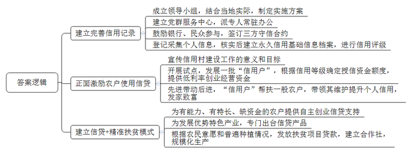
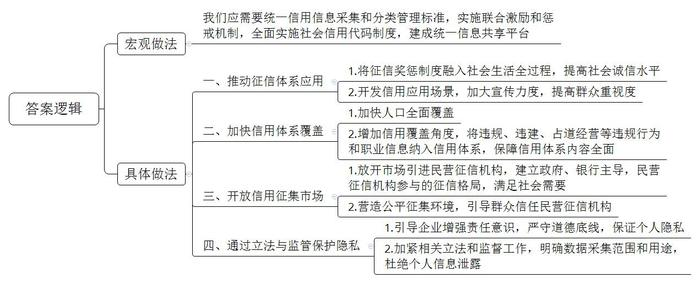
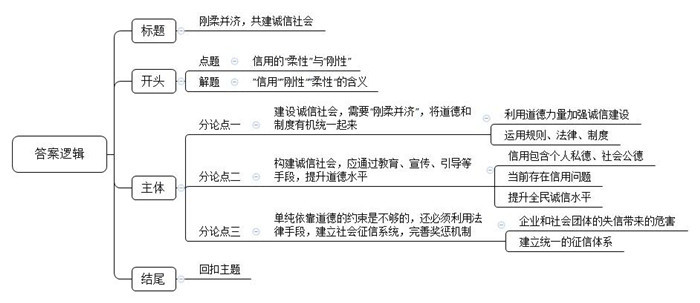

# 2019年公务员多省联考《申论》题（湖北县级卷）

<!-- gwy:overview:start -->
> **湖北 · 2019 · 申论 · 县级卷** ｜ 4 题 · 图片 4 处 · 答案随题折叠

导航：[题目](#题目) · [材料 1](#材料-1)
<!-- gwy:overview:end -->

> 候选采集稿。参考答案及解析来自粉笔页面，不代表官方答案或真实高分答卷；来源使用许可与原卷对应关系仍需人工核实。

## 给定材料

### 材料 1

人无信不立，业无信不兴。诚信不仅是个人安身立命的根本，也是社会良序发展的基石。

党的十八大以来，党和国家高度重视诚信建设。习近平总书记在多个不同场合围绕诚信主题发表了一系列重要论述，从战略高度为新时代中国的诚信建设提供了基本遵循。他从历史维度、价值维度、实践维度对诚信问题进行了深刻闸述，进一步指出中华文化关于诚信的思想和理念，不论过去还是现在，都有其鲜明的民族特色，都有其永不褪色的时代价值。他强调，要运用法治手段解决道德领域突出问题。对突出的诚信缺失问题，既要抓紧建立覆盖全社会的征信系统，又要完善守法诚信褒奖机制和违法失信惩戒机制，使人不敢失信、不能失信。对见利忘义、制假售假的违法行为，要加大执法力度，让败德违法者受到惩治、付出代价。

为全面推进诚信建设，党和国家作出了一系列重要部署。中共中央办公厅印发的《关于培育和践行社会主义核心价值观的意见》强调：“以诚信建设为重点，加强社会公德、职业道德、家庭美德、个人品德教育，形成修身律己、崇德向善、礼让宽容的道德风尚。”中央文明委发布《关于推进诚信建设制度化的意见》，明确规定通过曝光失信当事人、限制严重失信者高消费行为等手段打击失信行为。这是我国第一份强调从制度层面推进国家诚信建设的中央文件。国务院先后发布《关于建立完善守信联合激励和失信联合惩成制度加快推进社会诚信建设的指导意见》《关于加快推进失信被执行人信用监督、警示和惩戒机制建设的意见》，建立起社会诚信奖惩制度，并进一步完善了失信惩戒制度。诚信建设从注重教育走向教育与制度建设并重。

### 材料 2

一年前，小张从北京到杭州工作，在租房时，她惊喜地得知，由于她的信用记录良好，所以不用缴纳两倍于月租的租房押金；而北京的胡某，却遇到一件让他颜面尽失的事情。他原准备在假期租辆宝马车和朋友外出自驾游玩，没想到被租车公司拒绝。原来，胡先生由于欠款许久未还，被列入了“老赖”名单，导致自己的信用不佳，被禁止租车。

2018年2月起，到E市妇女儿童医疗中心就诊的患者发现，只要自己的信用度足够好，在医疗中心就可以“先诊疗后付费”，无需一次次在诊室、检查室和交费处之间奔波，大大节省了时间和精力。

信用骑车、信用住店、信用借书、公交车扫码乘车……这一幕一幕，都是真真切切正在我们身边发生的场景，告诉我们中国正在迈进信用社会。<u>随着大数据时代的来临，信用成为每个人的“第二张身份证”。</u>每个人、每个机构的信用度都可以被量化，曾经“看不见”“摸不到“的信用，正在逐步“变现”。

信用也提升了交易效率，为新经济提供支撑。对于废旧手机回收利用创业者向先生而言，信用就为他解决了“先收手机还是先付款”的难题。“先收手机，用户不放心。先付款，我们也怕损失。”向先生说，引入信用后，对高分用户优先付款，不仅订单量上浮一倍，也没有出现违约情况。

有了信用的助力，企业经营效率变得更高。目前，多家共享单车企业已实现信用免押金，大大方便了新用户开通使用。一些共享汽车、共享租衣企业也在研究信用梯度收费等模式，最大限度吸引用户。用户对信用的珍视也令人惊喜。以租车为例，引入信用分后，行业租金欠款率下降了52%，违章罚款欠款率下降了27%。

在网络高度发达的今天，资源的分布不再局限于有形市场，很多资源分布在网络上，资金资源不再集中在类似于银行这种金融机构身上，而是通过互联网分散分布。一个人只要拥有足够的信用水平，在网络上就能够筹集到资金。所以，信用社会给予了人们一个公平发展的环境。“信用既是商业社会的内在原则，也创造价值和财富。”某研究员说，随着信用体系不断完善，每个人都能在社会中获得公平发展的机会，这将大大激发全社会创业创新热情。

在某信用机构负责人看来，10年后，国内绝大多数城市都将成为信用城市。诚实守信的市民和商家，会享受到非常大的便利，政府的管理效率也将大大提高。信用体系的建立可以推动整个社会综合治理发展。

在S市，26万老人领取养老金不用亲自跑腿去现场，只需要在手机上进行一次信用认证。购房者提取公积金时也不需要准备一堆证明材料，柜台的人脸识别系统扫描后，他的相关信用信息迅速呈现。在促进政务精细化管理方面，“信用”正在发挥越来越重要的作用，有着高信用值的市民在通过实名认证之后，越来越多的政务服务都可以通过互联网进行办理，“刷脸”即可，无需到窗口排队。

凑一堆人就走的“中国式过马路”、不走寻常路玩“跨越”、开车煲电话粥、没事打开远光灯……这些交通违规行为带来安全隐患，给城市管理增加了困难。当前，有的城市把这些交通违规行为纳入个人信用记录，已经能实现这样的应用场景：一名过马路闯红灯的路人，被监控系统识别身份，达到一定次数将被扣除相应信用分，降低信用等级，严重的甚至影响贷款。这种做法背后的逻辑是，一个不尊重交规的人，也可能做出不尊重其他公共规则的行为。个人信用信息就是对个人的一种人格勾勒。在一个公民素质发育成熟的社会，对公民的信用评估，往往是以公民在公共事务中的态度和做法为基本出发点的。<u>信用既是一种道德品质，也是一种制度和规则。</u>信用体系全面建立的意义不仅在于解决押金带来的纠纷，更在于塑造一个和谐的社会，换言之，使每个人都更加规矩。

### 材料 3

老潘是G县龙台村农民，前些年一直在沿海某省的服装厂打工，收入也很稳定。但由于离家远，无法照顾子女，于是萌生了在家乡开服装加工厂的念头。可是租厂房、找工人、买机器设备几乎花光了他所有的积蓄，周转资金的事让老潘一筹莫展。万般无奈之下，妻子提出了找银行贷款的主意。令他们没想到的是，仅仅两天，老潘就如愿获得了5万元的贷款，服装厂顺利开工。老潘说，不用担保人，也无需资产抵押，简简单单就贷到款了。这样的便捷，就是因为“信用村”这个称号。

龙台村以农业为主，几年前，村民因既无合法抵押物和担保人，又无任何社会信用记录，无法获得银行贷款，基本生产资金靠民间借贷，更谈不上高投入、高产出。近年来，当地政府和银行成立“创建信用村”领导小组，结合该村实际情况，制定了《龙台村创建信用村实施方案》。政府建立“党群服务中心”并派专人常驻办公，相关银行全力参与。政府、银行和村民三方共同签订守信合约。合约约定村民用身份证在银行代办网点登记建立个人基本信息，银行核实后为村民建立永久信用基础信息档案，对农户进行信用评级。此外还对贫困户分别制定帮扶计划和脱贫致富奔小康规划，做到“一户一策，精准扶贫”。

在创建信用村过程中，针对部分农户不愿参与的情况，领导小组利用各种载体，广泛宣传信用村建设工作的重要意义和目标要求，采取“以先进带后进，正向激励形成面”的思路，发展一批“信用户”，根据信用等级对其授信2至5万元，及时为其提供低利率的创业及经营资金，让农户看到当上“信用户”的实惠。同时，“信用户”积极帮扶一般农户争创“信用户”，带领其维护和提升个人信用，发展养殖、种植发家致富。“这样做不仅有利于工作开展，还能促进村民之间信任互助的关系，形成良好的民风。”龙台村党支部书记说。

为强化“信贷+扶贫”的引领作用，针对农户不同的情况，领导小组量身定制不同扶贫信贷模式。像老潘这样有能力、有特长、缺资金的农户，银行发放信用贷款支持其自主创业。针对当地药材种植这一优势特色产业，专门出台信贷产品“药农贷”，支持药材种植户。此外，领导小组还在自愿的基础上，根据当地村民普遍种植红薯的情况，发放专门的项目扶贫贷款。该村红薯种植合作社成立后，吸收了48户贫困户入社，银行发放扶贫项目贷款70万元，支持他们种植红薯，这些农户因种植红薯户均收入大幅增加。

### 材料 4

“不乱扔杂物、不乱搭乱建，不违规饲养宠物，倡导邻里文明停车、和睦共处，积极配合社区的各项工作，共筑美丽幸福家园，争做诚信居民，为‘信用社区’贡献力量！”在先锋街道举行的“争做诚信居民，共建信用社区”千人誓师大会上，各社区居民代表一起郑重宣誓。

经历4年探索实践，C市今年成功获批“社会信用示范城市”。地处市中心的先锋街道围绕如何让信用管理走进群众日常生活，开展了一系列基层管理创新，全面开展了诚信社区建设活动，将诚信建设向社区延伸。

“我们街道的光明社区2015年就率先开展了征信体系建设工作，4000名常住居民每人都有‘诚信身份证’！”街道办事处负责人介绍，光明社区是C市首个建立征信管理体系的社区。3年来，社区居民对征信有了实实在在的认识。随着征信体系的建成和完善，征信已经渗透到光明社区每个角落，扎根在每个居民心中。“信用信息平台里的分数高，好处很多。自己的口碑好，别人都爱和你交往。 ”社区居民毕女士说。孟先生开办了社区国画公益课堂并担任授课老师，免费教授居民国画。提起创建国画公益课堂的初衷，他说：“我本身就是搞美术的，所以想让更多居民喜欢、了解国画。”让孟先生没有想到的是，一心做好的“份内事”竟然让自己得到20分的征信加分，成为社区居民学习的榜样。“我开办国画公益课堂不是为了加分，但是街道和社区给了这份荣誉，我也特别高兴。”孟先生说。

光明社区的居民征信条款是与市征信办多次沟通协调后最终制定的，社区征信管理有一套严格的流程和评价体系。社区建设社会信用信息共享平台及门户网站，并与市信用平台对接。社区通过平台和网站推进信用信息归集，已归集行政许可和行政处罚公示数据20169条，信用数据4187条，“红黑”名单数据311条。居民信用等级根据分数不同，分为五星级、四星级、三星级、二星级和一星级。居民信用等级的高低可在政策扶持、岗位招考、评先选优、发展党员、银行贷款等领域作为考量指标。居民在好人好事、保护社区环境等方面有所作为的，每次加5分。相反，有随意倾倒杂物或者造谣生事等行为的，每次扣5分。行为更加恶劣的，还要提报市级征信平台。社区负责人介绍，社区正在开展“诚信楼宇”“诚信家庭”“诚信个人”“诚信商铺”等评选活动，通过展示墙、电子宣传栏等展播诚信事迹，“我们要充分发挥榜样的激励作用，尤其要发挥党员干部的先锋带头作用。今后我们还要推动窗口单位和工作人员的政务诚信建设，把基层管理和服务融入到诚信社区的建设中。”

先锋街道的上岭社区也积极响应建设“诚信社区”活动的号召，积极开展“诚信社区”的创建活动。社区及时成立诚信社区领导小组，由社区书记担任组长，主任担任副组长。领导小组深入研究社区的实际情况，针对社区内商家和工厂较多的情况，决定以这些商家和工厂的诚信建设为重点，带动诚信社区的全面建设。

社区安排工作人员对辖区20余家经营门店发放了“诚信经营”倡议书，并对辖区的超市、餐饮门店等开展食品安全检查。在检查中，社区工作人员还向广大商户大力宣传《食品安全法》等法律知识，增强食品经营户的法律意识，强化其守法经营理念。社区联合C市市场监督管理局在菜市场门前举办“百城万店讲诚信”主题活动，通过设置咨询台和投诉举报台、发放宣传资料、现场讲解等方式，向广大群众普及了安全消费、识药用药、生产等常识，引导消费者养成科学、健康、文明的消费习惯，倡导广大商家和群众争做诚信的传播者、践行者与维护者。

上岭社区联合市场监督管理局等有关部门对社区各商户和菜市场各个摊位进行多次巡查。经过巡查，社区内商户全部诚信经营，信誉良好，得到了周围居民的一致好评。各有关部门还在菜市场进行“诚信经营”大走访活动，对市场内商家的交易秤进行检查。结果显示，菜市场商家都能够做到诚信经营。

上岭社区联合社区各企业开展“质量第一、诚信做产品”活动。社区书记讲解了开展活动的目标、内容和意义。随后，企业负责人就提高产品质量、诚信做产品等方面做的工作进行了介绍，并与员工签订了《产品质量诚信承诺书》。通过此次活动，进一步强化了生产企业的信用观念。

### 材料 5

“你有多少分了？”正成为F市市民茶余饭后的话题，这里的“分”指的是个人信用积分。信用积分高的市民，可在24小时自助图书馆免押金借书，还可享受部分公交线路票价八折优惠、部分医院就医优先等。“信用越来越有用”，恰如网友评价，信用正成为个人和社会的一笔宝贵财富，“无形”的信用给守信者带来“有形”的便利。

与此同时，在动车上吸烟、在飞机上寻衅滋事、逾期不履行行政罚没款缴纳义务……这些长期以来为人们深恶痛绝的行为，将面临“寸步难行”。近日，123名限制乘坐火车严重失信人和381名限制乘坐民用航空器严重失信人新增入“信用中国网站”最新公示的名单上。“干得漂亮！就是要让失信者寸步难行！”网友的评论，代表了广大群众的心声。

伴随着我国现代化进程的加快，传统“熟人社会”逐渐瓦解，利益主体更趋多元，经济社会交往常常在陌生地、陌生人之间进行，对全社会诚信水平提出了更高要求。党的十八大以来，从制定全国统一的信用信息采集和分类管理标准，到初步形成守信联合激励和失信联合惩戒机制，再到全面实施统一社会信用代码制度，基本建成统一的信用信息共享平台，国家社会信用体系建设的步伐明显加快。“一处失信、处处受限”的联合惩戒大格局逐步呈现，“守信受益、失信难行”的良好势头初步形成：在法院执行领域，254万失信被执行人慑于信用惩戒，主动履行义务；在税收征管领域，各级税务机关累计公布税收违法“黑名单”案件9341件，共有1170户“黑名单”当事人在主动缴清税款、滞纳金和罚款后，从“黑名单”中撤出；在电子商务领域，发布电子商务领域失信“黑名单”，共计987家企业，并通过全国信用信息共享平台推送至地方开展专项治理工作……基于制度建设的社会信用体系正呼之欲出。

但是我们也要看到，社会信用体系建设依然任重道远，与社会期望还存在一定差距。在不少地方，类似机动车交通违章、社区违建、路边非法占道经营等行为，并没有纳入信用体系；而对于一些企业来说，招聘财务、中高级管理岗位等职位时，也常常因为难以获得有效个人信用信息，不得不耗费大量精力调查应聘者的职业素养。

根据一家咨询公司数据，我国信用体系覆盖人口大约三到四亿，覆盖度约为35%。“民间征信系统虽然吸收了更全面的互联网信用信息，但多集中在购物消费、金融信贷方面，角度比较单一，难以真正反映一个人的信用状况，与规模巨大的市场需求相比仍然杯水车薪。”一家信用机构的负责人说，目前我国信用应用场景仅仅开发了1%，还有很多人对信用信息不够重视，不知道运用信用信息。

建立社会信用体系离不开对信用信息的征集，过去我国的征信工作主要由政府和银行主导，但随着时代的发展，这已越来越不能满足社会的需要，放开市场引进民营征信机构势在必行。民营机构做个人征信会否泄露个人信息，成为公众关注的焦点。一家网站的专题调查显示，3000多名投票网友里六成不看好民营征信发展前景，绝大部分都是出于对个人信息保护的担忧。“个人信息泄露了谁来负责？”这是网友问得最多的问题。信用体系建设，既要获取更多数据勾勒人格特征，也要注重保护个人隐私。对个人隐私的保护，不仅考验企业的技术能力，也考验企业的责任感。有专家说，“即便用户授权，也只采集合法、相关、必要的信息。”我国现在尚无专门的隐私权保护法，对于哪些数据涉及隐私权需要保护，缺乏明确的法律界定。“作为新生事物，对民营征信公司不宜求全责备，但相关立法和监管工作要加紧跟上。”

## 题目

### 第 1 题

**“给定资料**2**”中提到“随着大数据时代的来临，信用成为每个人的‘第二张身份证’”，请你谈谈对这句话的理解。（15分）**

关联材料：材料 2

作答要求：

要求：全面、准确、简明，有条理，不超过200字。

第 1 题 · 答案与解析

**参考答案（粉笔题库参考内容）**

该句指大数据推动社会信用化，信用融入经济社会中，可被量化，能勾勒人格特征，是个人、企业、政府的识别工具。

信用的作用：1.方便民众生活。节省时间、精力、减轻生活负担。2.支撑新经济发展。提升交易、经营效率，降低经营风险。3.促进社会公平。利于筹集资金，激发创业热情。4.推动社会治理综合发展。提高管理效率，促进政务精细化、数字化。5.塑造和谐社会。惩戒失信者，倒逼公民守信。

我们要利用大数据推动信用社会建设。

**参考答案说明**：思路方面，本参考答案按照“总体释义+展开解释+总结”的答题思路展开。内容方面，本参考答案先对“随着大数据时代的来临，信用成为每个人的‘第二张身份证’”这句话进行了解释：“展开解释”部分从“方便民众的生活”“支撑新经济发展”“促进社会公平发展”“推动社会治理综合发展”“塑造和谐社会”等不同角度分析了“信用建设”的作用；最后进行了总结。

**解析状态：unknown（来源未提供）**

### 第 2 题

**G县拟在全县范围内开展信用村创建工作，请结合“给定资料**3**”谈谈龙台村的经验对这项工作有何启示。(20分)**

关联材料：材料 3

作答要求：

要求：

（1）紧扣资料，内容具体；

（2）分析准确，措施可行；

（3）不超过350字。

第 2 题 · 答案与解析

**参考答案（粉笔题库参考内容）**

一、建立完善信用记录。1.成立领导小组，结合当地实际，制定实施方案。2.建立党群服务中心，派专人常驻办公。3.鼓励银行、民众参与，签订三方守信合约。4.登记采集个人信息，核实后建立永久信用基础信息档案，进行信用评级。

二、正面激励农户使用信贷。1.宣传信用村建设工作的意义和目标。2.开展试点，发展一批“信用户”，根据信用等级确定授信资金额度，提供低利率创业经营资金。3.先进带动后进，“信用户”帮扶一般农户，带领其维护提升个人信用，发家致富。

三、建立信贷+精准扶贫模式。1.为有能力、有特长、缺资金的农户提供自主创业信贷支持。2.为发展优势特色产业，专门出台信贷产品。3.根据农民意愿和普遍种植情况，发放扶贫项目贷款，建立合作社，规模化生产。

**参考答案说明：**本参考答案从“建立完善信用记录”“正面激励农户使用信贷”“建立信贷+精准扶贫模式”这三个方面进行了分条撰写。各条要点之间在内容上相互并列，没有交叉。

**解析状态：unknown（来源未提供）**

### 第 3 题

**请针对****“给定资料**5**”中提到的信用体系建设问题，提出解决措施。(25分)**

关联材料：材料 5

作答要求：

要求：

（1）紧扣资料，内容具体；

（2）层次分明，有逻辑性；

（3）不超过400字。

第 3 题 · 答案与解析

**参考答案（粉笔题库参考内容）**

我们需要统一信用信息采集和分类管理标准，实施联合激励和惩戒机制，全面实施社会信用代码制度，建成统一信息共享平台。具体对策如下：

一、推动征信体系应用。1.将征信奖惩制度融入社会生活全过程，提高社会诚信水平；2.开发信用应用场景，加大宣传力度，提高群众重视度。

二、加快信用体系覆盖。1.加快人口全面覆盖；2.增加信用覆盖角度，将违规、违建、占道经营等违规行为和职业信息纳入信用体系，保障信用体系内容全面。

三、开放信用征集市场。1.放开市场引进民营征信机构，建立政府、银行主导，民营征信机构参与的征信格局，满足社会需要；2.营造公平征集环境，引导群众信任民营征信机构。

四、通过立法与监管保护隐私。1.引导企业增强责任意识，严守道德底线，保证个人隐私；2.加紧相关立法和监督工作，明确数据采集范围和用途，杜绝个人信息泄露。

**参考答案说明**：本参考答案整体按照“宏观措施+具体措施”逻辑呈现，其中，具体措施从“推动征信体系应用”“加快信用体系覆盖”“开放信用征集市场”“通过立法与监管保护隐私”四个方面进行撰写。各条要点之间在内容上相互并列，没有交叉。

**解析状态：unknown（来源未提供）**

### 第 4 题

**给定资料中提到，****“信用既是一种道德品质，也是一种制度和规则”，请以信用的“柔性”与“刚性”为主题，自拟题目，写一篇议论文。（40分）**

关联材料：材料 1、材料 2、材料 3、材料 4、材料 5

作答要求：

要求：

（1）自选角度，立意明确；

（2）联系实际，不拘泥于“给定资料”；

（3）思路清晰，语言流畅；

（4）总字数1000字左右。

第 4 题 · 答案与解析

**参考答案（粉笔题库参考内容）**

**刚柔并济，共建诚信社会**

当人们在评价某个人很有信用时，往往会用诚信、诚实等形容品质的词汇，所以信用代表了道德品质，是对个人的人格勾勒，是一种柔性的力量。当然，一说到信用，人们也会用“遵守信用”来搭配，因此信用是对公民在公共事务中态度和做法的描述。遵守信用的背后，体现出一种社会契约，需要大家共同遵守，它也是一种制度和规则，是一种刚性的力量。

**建设诚信社会，需要“刚柔并济”，将道德和制度有机统一起来。**道德本身具备一定的强制性。通过个体良心的谴责，舆论的否定性评价等方式，道德可以规范社会行为。所以，构建诚信社会，需要道德的力量。但是，在快速发展、变迁的社会中，单纯依靠道德是不够的，还需要约束力更强的规则、法律、制度。通过国家强制力来规范各类经济社会活动，建设诚信社会。当然，所有的规章制度都是建立在一定的文化、社会风气基础上，制度建设的最理想状态就是变成社会行为、文化、风气的一部分。所以，构建诚信社会，一方面要通过教育、引导、宣传等手段发挥道德的柔性力量；另一方面也需要通过法律、社会征信系统、奖惩机制等手段加强道德的刚性约束。

**构建诚信社会，应通过教育、宣传、引导等手段，提升道德水平。**信用是一种道德品质，这种品质体现在方方面面。它既包含个人品德、家庭美德等个人私德；也囊括职业道德、社会美德等社会公德。而在当下，却出现个人学术造假，离婚率居高不下，收礼、拿红包现象频繁，各类诈骗案被持续曝光等现象，在这背后不难发现，小到个人层面，大到社会公德，都有诚信缺失的影子。毋庸赘言，提升全民的诚信水平已成为当务之急。构建诚信社会，需要发挥出道德的柔性力量，通过“三微一端”、课堂教育等手段加大宣传引导，也可以通过各类诚信人物的评选活动，来进行教化。

我国目前正处在社会转型阶段，由熟人社会向陌生人社会转变，利益主体多元，社会经济活动增多。**单纯依靠道德的约束是不够的，还必须利用法律手段，建立社会征信系统，完善奖惩机制。**

老话说：“业无信不兴”。企业和社会团体的失信往往会影响自身公信力，导致利益受损。但“店大欺客”现象也时有发生。从最近发生的“奔驰女车主维权”事件可以发现，若企业出现失信行为，单纯依靠教育、引导，呼吁其加强自省，效果往往不尽人意。因此，就需要“刚性”手段，利用法律手段，尤其是奖惩机制来规范社会行为。政府、银行、企业、社会团体，利用互联网、大数据，共同建立统一的征信体系。对守信方，提供政策、资金、公共服务等方面的便利，并向社会广泛宣传；对失信方，在医食住用行等方面进行限制，并依法向社会公示，起到震慑作用。

信用是我们的一种内在品德，也是外界对我们的一种要求、规范。建设诚信社会，既需要“柔性”的教育，也需要“刚性”的制度，只有“刚柔并济”，才能为“诚信”提供一片肥沃的“土壤”，让诚信成为国家治理体系建设的新支柱，成为治理能力现代化提升的新抓手。

**文章分析**

**刚柔并济，共建诚信社会**

【**标题的优点：**首先，范文的标题“刚柔并济，共建诚信社会”突出了“信用的‘柔性’与‘刚性’”这一主题。其次，形式上，文字简洁明快。】

（1）当人们在评价某个人很有信用时，<u>往往会用诚信、诚实等形容品质的词汇</u>，<u>所以信用代表了道德品质</u>，<u>是对个人的人格勾勒</u>，<u>是一种柔性的力量</u>。当然，（2）一说到信用，人们也会用“遵守信用”来搭配，因此<u>信用是对公民在公共事务中态度和做法的描述</u>。<u>遵守信用的背后</u>，<u>体现出一种社会契约</u>，<u>需要大家共同遵守</u>，<u>它也是一种制度和规则</u>，<u>是一种刚性的力量</u>。

【**开头的优点：**★内容方面。范文的开头是紧扣“信用的‘柔性’与‘刚性’”这一主题展开的。首先，**开头点出主题，做到了主题明确**。其次，**对“信用的‘柔性’与‘刚性’”这一主题进行了分析阐述：（****1****）先从道德层面对信用进行了阐述；（****2****）再从制度层面对信用进行了阐述**。★文字表达方面：使用了“所以……”“也是……”等关联句式，使语言表达有逻辑性。】

**建设诚信社会，需要“刚柔并济”，将道德和制度有机统一起来。**（1）<u>道德本身具备一定的强制性</u>。<u>通过个体良心的谴责</u>，<u>舆论的否定性评价等方式</u>，<u>道德可以规范社会行为</u>。所以，构建诚信社会，需要道德的力量。但是，（2）在快速发展、变迁的社会中，单纯依靠道德是不够的，还需要<u>约束力更强的规则、法律、制度</u>。<u>通过国家强制力来规范各类经济社会活动</u>，<u>建设诚信社会</u>。当然，所有的规章制度都是建立在一定的文化、社会风气基础上，<u>制度建设的最理想状态就是变成社会行为、文化、风气的一部分</u>。所以，构建诚信社会，一方面要通过教育、引导、宣传等手段发挥道德的柔性力量；另一方面也需要通过法律、社会征信系统、奖惩机制等手段加强道德的刚性约束。

【**观点****1****段落的优点：**★观点句：范文的观点句是紧扣“信用的‘柔性’与‘刚性’”这一文章主题提出的。形式上，它在段首处直接写出，位置突出，容易发现。内容上，要点明确，可以明显看出它是从“道德与制度的关系”入手，指出了“信用建设需要兼顾道德与制度”。★论述内容：（1）先介绍了“为什么建设诚信社会需要道德约束”；（2）再介绍了“为什么建设诚信社会需要制度约束”。注意：以上两个方面的内容都是紧扣“建设诚信社会，需要‘刚柔并济’，将道德和制度有机统一起来”这个观点句进行分析论述的，论述的针对性强，内容层次丰富。最后，在论述方法和论据的选取上以讲道理为主，做到了分析透彻、层次清晰。】

**构建诚信社会，应通过教育、宣传、引导等手段，提升道德水平。**（1）信用是一种道德品质，这种品质体现在方方面面。它既<u>包含个人品德、家庭美德等个人私德</u>；也<u>囊括职业道德、社会美德等社会公德</u>。（2）而在当下，却<u>出现个人学术造假</u>，<u>离婚率居高不下</u>，<u>收礼、拿红包现象频繁</u>，<u>各类诈骗案被持续曝光等现象</u>，在这背后不难发现，<u>小到个人层面</u>，<u>大到社会公德</u>，<u>都有诚信缺失的影子</u>。毋庸赘言，提升全民的诚信水平已成为当务之急。（3）构建诚信社会，<u>需要发挥出道德的柔性力量</u>，<u>通过“三微一端”、课堂教育等手段加大宣传引导</u>，也可以<u>通过各类诚信人物的评选活动</u>，<u>来进行教化</u>。

【**观点****2****段落的优点：**★观点句：范文的观点句是紧扣“信用的‘柔性’与‘刚性’”这一文章主题提出的。形式上，它在段首处直接写出，位置突出，容易发现。内容上，要点明确，可以明显看出它是从“道德约束”入手，指出了“如何建设诚信社会”。★论述内容：（1）先介绍了“信用在道德层面的表现”；（2）再介绍了“当前信用滑坡的现象”；（3）最后介绍了“如何借用道德力量建设诚信社会”。注意：以上三个方面的内容都是紧扣“构建诚信社会，应通过教育、宣传、引导等手段，提升道德水平”这个观点句进行分析论述的，论述的针对性强，内容层次丰富。最后，在论述方法和论据的选取上做到了讲道理、举例相结合，做到了丰富多样。】

我国目前正处在社会转型阶段，由熟人社会向陌生人社会转变，利益主体多元，社会经济活动增多。**单纯依靠道德的约束是不够的，还必须利用法律手段，建立社会征信系统，完善奖惩机制**。

老话说：“业无信不兴”。（1）<u>企业和社会团体的失信往往会影响自身公信力</u>，<u>导致利益受损</u>。但“店大欺客”现象也时有发生。从最近发生的“奔驰女车主维权”事件可以发现，<u>若企业出现失信行为</u>，<u>单纯依靠教育、引导，呼吁其加强自省</u>，<u>效果往往不尽人意</u>。因此，（2）就需要“刚性”手段，利用法律手段，尤其是<u>奖惩机制来规范社会行为</u>。<u>政府、银行、企业、社会团体</u>，<u>利用互联网、大数据</u>，<u>共同建立统一的征信体系</u>。<u>对守信方</u>，<u>提供政策、资金、公共服务等方面的便利</u>，并<u>向社会广泛宣传</u>；<u>对失信方</u>，<u>在医食住用行等方面进行限制</u>，并<u>依法向社会公示</u>，<u>起到震慑作用</u>。

【**观点****3****段落的优点：**★观点句：范文的观点句是紧扣“信用的‘柔性’与‘刚性’”这一文章主题提出的。形式上，它在段首处直接写出，位置突出，容易发现。内容上，要点明确，可以明显看出它是从“制度约束”入手，指出了“如何建设诚信社会”。★论述内容：（1）先介绍了“之所以需要制度约束的原因”；（2）再介绍了“如何借用制度的力量建设诚信社会”。注意：以上两个方面的内容都是紧扣“必须利用法律手段，建立社会征信系统，完善奖惩机制”这个观点句进行分析论述的，论述的针对性强，内容层次丰富。最后，在论述方法和论据的选取上做到了讲道理、举例相结合，做到了丰富多样。】

【**论述段之间的关系：**★内容的内在逻辑：范文的论述段之间有两层逻辑。第一层，整体上是从“分析”到“对策”的逻辑展开的。第二层，其中观点2和观点3又是从“对策”出发，论述段2先写了“借助道德力量建设诚信社会”，论述段3再写了“借助法制力量建设诚信社会”。★段与段的外在衔接：论述段3的段首处的过渡句“我国目前正处在社会转型阶段，由熟人社会向陌生人社会转变，利益主体多元，社会经济活动增多。单纯依靠道德的约束是不够的”，起到了承接论述段2、引出了论述段3的作用。】

信用是我们的一种内在品德，也是外界对我们的一种要求、规范。（1）建设诚信社会，<u>既需要“柔性”的教育</u>，<u>也需要“刚性”的制度</u>，只有“刚柔并济”，才能为“诚信”提供一片肥沃的“土壤”，（2）<u>让诚信成为国家治理体系建设的新支柱</u>，<u>成为治理能力现代化提升的新抓手</u>。

【**结尾的优点**：范文的结尾回扣了“信用的‘柔性’与‘刚性’”这一主题。（1）再次提到了“信用的‘柔性’与‘刚性’”；（2）发出了号召希望。】

**解析状态：unknown（来源未提供）**

