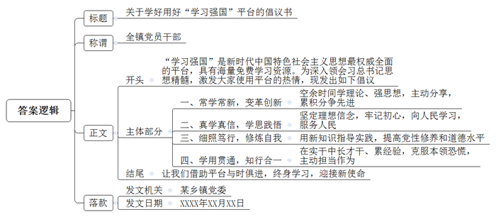
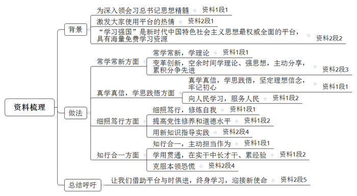
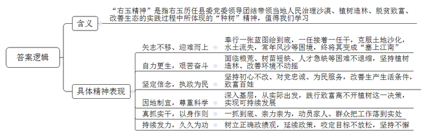
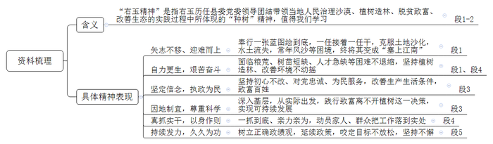

# 2019年湖北省定向、集中选调生考试《申论》题

<!-- gwy:overview:start -->
> **湖北 · 2019 · 申论 · 选调生** ｜ 4 题 · 图片 4 处 · 答案随题折叠

导航：[题目](#题目) · [材料 1](#材料-1)
<!-- gwy:overview:end -->

> 候选采集稿。参考答案及解析来自粉笔页面，不代表官方答案或真实高分答卷；来源使用许可与原卷对应关系仍需人工核实。

## 给定材料

### 材料 1

在2019年春季学期中央党校（国家行政学院）中青年干部培训班开班式上，习近平总书记着眼党和国家前途命运这一战略大局，着眼培养选拔优秀年轻干部这一百年大计，亲自为培训班学员讲授了理论学习的“开学第一课”。中青年干部当深入领会习近平总书记“开学第一课”的思想精髓，“在常学常新中加强理论修养，在真学真信中坚定理想信念，在学思践悟中牢记初心使命，在细照笃行中不断修炼自我，在知行合一中主动担当作为。”

非学无以广才，非志无以成学。中青年干部要担起新时代之大任，就当牢记习近平总书记的教诲，自觉向习近平总书记看齐，把理论学习作为一种生活方式，把厚实理论素养作为一种人生境界，把提高理论水平作为一种政治责任。在常学常新中做到往深里走、往实里走、往心里走，学思用贯通，知信行统一；在真学真信中以学促信，以信拓学，坚守理想信念要发自内心，在学习中不断掸去思想上的灰尘；在学思践悟中信奉群众是真正的英雄，自觉拜人民为师、向人民学习；在细照笃行中提升党性修养和道德水平，永葆中国共产党人的政治品格、价值追求、精神境界和作风操守；在知行合一中牢记空谈误国、实干兴邦，做起而行之的行动者、不做坐而论道的清谈客，在摸爬滚打中增长才干，在层层历练中积累经验。

知者行之始，行者知之成。加强政治训练、党性锻炼，加强马克思主义理论武装，做到既有宽肩膀，又有铁肩膀，既政治过硬，又本领高强，广大干部就一定能不辱使命、不负重托，我们国家就一定能建设一支忠实贯彻习近平新时代中国特色社会主义思想、全心全意为人民服务，适应新使命新任务新要求、经得起风浪考验，数量充足、充满活力的高素质专业化年轻干部队伍。

### 材料 2

“近年来，中国全国各地掀起了一场学习习近平新时代中国特色社会主义思想的热潮……如今又多了一种学习方式，成千上万中国人都可以通过智能手机上的应用软件加入这场学习热潮之中。”西班牙《国家报》网站这样评论。

这款手机应用软件，就是2019年年初甫一上线便迅即走红的“学习强国”。登陆细览，“学习强国”不仅开设了“新思想”“十九大时间”这样的重磅栏目，也有中央主要新闻单位等“强国号”提供的原创优质内容。海量、免费的图文和音视频学习资源，让“学习强国”成为习近平新时代中国特色社会主义思想最权威、最全面的信息平台，打造出一个干事创业的理论宝库、强魄铸魂的精神家园。

学习之于信仰和才干，犹如运动之于健康体魄，持之以恒、行之愈远愈受益。利用领先的技术、打造最好的平台、提供最优的服务，“学习强国”本身就犹如一个生动“提醒”：主动变革、创新学习，永远是掌握时代主动的关键。“阅读一下文章，看一下时政新闻，随时随地都能学到新知识。”2月25日一大早的会上，东营市垦利区恳利街道宣传委员与职工分享他使用“学习强国”的心得，引得台下党员机关干部纷纷点头赞同。“以前，总是习惯拿手机刷朋友圈，自从安上这个APP后，我的兴趣爱好就发生了变化。现在，已经习惯在空余时间刷‘学习强国’。”如今，在垦利街道学习“学习强国”已成为新时尚，成为加强理论学习的新平台，加强思想政治建设、提高理论武装的新载体，积分榜更是他们争先进位的有力佐证。

思想田野里的每一寸躬耕，总能在实践中寻得收获。在学习和实践中找思路、想办法，永远都是一条重要方法论。李晓鸽是昌邑市北孟镇朱甫社区的新任党总支书记，尽管已有10年多的乡镇工作经历，但在担任社区书记伊始，她心里仍然没底：“就怕自己干不好，总觉得理论水平有待提升，业务能力需要加强。”为消除这种“本领恐慌”，每当工作之余，她都会登录“学习强国”学习平台为自己加油充电。通过坚持学习和不断历练，如今她的状态比之前从容了许多。“社区事务涉及方方面面，只有把上级精神学深悟透，才能在工作中游刃有余。平台上的信息权威、全面又系统，对我帮助很大。我们要始终秉承‘知行合一’的理念，将学习平台内容变成行动自觉、理论自觉，将新思想新知识化为指导实际工作的生动实践。”李晓鸽深有体会地说。

思想是行动的先导，理论是实践的指南。事业发展没有止境，学习就没有止境。对共产党人而言，把马克思主义立场、观点、方法学到手，才谈得上拥有“看家本领”。无论驾驭复杂局面，还是开辟发展新境，辩证思维能力不可或缺，思想与时俱进必不可少。惟有强化学习、打磨理论思维，才能使主观世界更好符合客观实际，从而更好指导实践、推动事业发展。

### 材料 3

右玉，地处山西北部，与毛乌沙漠毗邻，古称“善无”。新中国成立前，右玉土地沙化，水土流失严重，常年风沙肆虐，几乎寸草难生，森林覆盖率只有0.3%。解放后，为了改善生存环境，让当地群众过上富足的生活，右玉历任县委领导矢志不移、迎难而上，一张蓝图绘到底，一任接着一任干，坚持带领右玉人民自力更生、艰苦奋斗，依靠坚强的信念和科学的精神，植树造林不动摇，改善自然环境不动摇，终于把塞外不毛之地变成了“塞上江南”。

习近平总书记在山西视察工作时强调：“右玉精神是宝贵财富，一定要大力学习和弘扬。”山西省委高度重视，组织创作了38集电视剧《右玉和她的县委书记们》，在央视一套黄金时段播出，引起强烈反响。电视剧在忠实于历史真实的基础上，进行积极的艺术创造，把60多年的历史跨度浓缩在有限的时间之内，依据真实人物的事迹虚构了梁怀远等不同时代数位右玉县委书记形象，很好地体现了“一任接着一任、一棒接着一棒”，初心不改，利在长远的崇高追求，生动地再现了“右玉精神”。

我们党从建立之初就是要为人民谋利益，右玉的共产党人始终坚持以人民为中心、为人民服务的立党宗旨。剧中的梁怀远从硝烟弥漫的战场转业到地方，步行来到右玉担任县委书记。他深入偏乡僻壤，跑遍沟沟坎坎，从群众的期盼中获取力量，深知不改变右玉恶劣的自然环境，老百姓就过不上好日子。“右玉要想富，就得风沙住。要想风沙住，就得多栽树。”在县委的带领下，发动全县群众植树造林，改善生产生活条件。这一决策符合右玉的实际，代表了右玉人民的利益，成为六十多年来历任县委书记不放弃、不松劲的事业坚守。

要改变右玉的面貌，靠耍花架子不行，只练嘴上功夫也不行。唯一可行的就是一个字：干！不仅组织动员群众干，更重要的是县委领导带头干，与群众一起干。右玉的党员干部，号召群众植树造林，自己首先去种树。不仅自己去种，还要动员家人落户右玉与大家一起种。在剧中，梁怀远等人的家人都随他们迁到了右玉，参加植树造林。即使在身负重伤的情况下，梁怀远仍然坚持出院工作。为解决粮荒，他们找战友借粮；为解决树苗，他们外出借树苗，组织建苗圃；为解决种树的技术问题，他们四处请教，培养人才。他们的心中只有一个信念，就是尽快改变右玉的生态环境，让老百姓的生活好起来。

右玉生态环境的恶化，不是一天两天造成的，右玉生态的改善也不可能三天两天就见效，而是一个长期的艰苦过程。右玉的历任县委书记们非常清楚这个道理。靠种树，短期内的政绩并不明显，但是功成不必在我，他们在右玉，并不想那些花拳绣腿没有实效的所谓“政绩”，也不想自己怎样才能离开这个艰苦的地方，更不想靠“政绩”升迁。他们想的只有如何使右玉尽快绿起来、富起来、发展起来，当眼前利益与改善生态这一长远目标发生矛盾时，他们坚持植树不动摇。每一任县委书记都会把自己对改善右玉生态环境的思考记在笔记本上，供下一任书记参考，目的就是希望一任能够接着一任干、一张蓝图绘到底。

### 材料 4

青年承载着国家的未来和民族的希望。当代青年是同新时代共同前进的一代，既生逢其时，也重任在肩。新时代的青年要坚定理想信念、练就过硬本领、勇于创新创造、矢志艰苦奋斗、锤炼高尚品格，以“初生牛犊不怕虎”的锐气，放飞青春梦想，奏响新时代的青春之歌。

2007年团中央启动实施“青年马克思主义者培养工程”（以下简称“青马工程”），并联合全国学联组建了中国大学生骨干培养学校。10多年来各级“青马班”共培养大学生骨干超过120万人，“青马工程”已经在全国高校落地生根，很多参加过青马班的同学在接受回访调研时反映，“青马工程”在自己的人生成长中打下了深深的烙印，自己不仅提升了理论素养、锤炼了实践品格、提高了综合能力，也更加坚定了理想信念。

培养“人”是“青马工程”的核心。青年正处于世界观、人生观、价值观形成的关键期，“青马工程”注重提高互动性、增强思辨性、激发自觉性，更多运用自主论坛、辩论会等形式，鼓励学员自主思考，让真理内化于心。学员们带头认真学习习近平新时代中国特色社会主义思想，深入学习《习近平七年知青岁月》和《习近平关于青少年和共青团工作论述摘编》，用党的最新理论武装自己。武汉大学还采用双学位的形式，每年从大学一年级学生中遴选50名青马学员，通过194个学分的课程教学，进行两年专项培养，让大学生骨干的培养更加科学。

为学之实，固在践履。当代青年要成为担当民族复兴大任的时代新人，必须既读好“有字之书”，也读好“无字之书”，自觉在实践中磨炼品格、增长本领。“青马工程”通过多层面、多角度的深入社会观察和实践，让学员们做到理论学习与社会实践并举，求真学问、练真本领。团上海市委每年选拔500名左右优秀大学生骨干赴全市各委办局和区县的基层单位开展为期两个月的“优秀在校大学生暑期挂职锻炼”。中国人民大学“青年先锋”训练营学员通过“千人百村”社会实践项目，开展各类社会调研，并且通过“社区青年汇”，把实践变成了必修课。

青春是用来奋斗的，青春的光辉、生命的意义也体现在奋斗之中。“青马工程”最终的目的，就是要让学员们自觉融入工作大舞台、社会大课堂、群众大熔炉，在实践中施展才华，在岗位上建功立业。对中国大学生骨干培养学校前6期1373名学员的就业去向进行统计发现，近80%的学员在高校、国企、党政机关、事业单位工作，不少同学已经在重点工程一线、创新创业前沿崭露头角。湖北省委从2014年开始，把“青马工程”提档升级，每年遴选50名左右特别优秀、毕业后有志到基层乡镇工作的大学生骨干，进行为期两年的重点培养，目前集中培养了156名学员，首批50名学员中已有32名考录到基层乡镇工作。

实施“青马工程”不仅培养骨干，更要让骨干发挥“点燃一盏灯，照亮一大片”的示范带动作用。“我们成立‘青年学生马克思主义者协会’，不仅包括青马学员，还面向更多同学开展活动，吸引更多有志学生加入青马的行列，推动马克思主义广泛传播。”北京林业大学团委书记辛永全说。“青马工程”这一共青团组织彰显政治性特征、聚焦思想政治引领主责主业的工作品牌，将在引导新时代青年成长成才上发挥更大作用。

### 材料 5

温室里养不出万年松，庭院里跑不出千里马。欲有所作为，必须经风雨见世面，在大风大浪里锻炼成长。云南省楚雄州大姚县湾碧乡“白发书记”李忠凯扎根边远贫困乡镇，带领群众脱贫致富。2014-2017年，湾碧乡共有989户3958名贫困人口实现稳定脱贫，两个贫困村如期脱贫出列。诸如此类的成绩，正是广大“白发书记”们担当作为的见证。当下，大多数领导干部都是科班出身，高学历专业性人才已不鲜见。不少人知识丰富，见多识广，志向高远，很想尽快干出一番事业来。但是，有的人只是文凭显赫抢眼，而实际工作能力不足；有的追求进机关住城市图舒适，不大安心在基层工作；有的心浮气躁、急功近利，经不起一点挫折和逆境，耐不住性子在一个岗位多干几年，缺乏基层工作实践的艰苦磨炼，这是造成一些领导干部文凭高能力低、说功好做功差、想法多办法少，眼高手低，难以成事的重要原因。

毛泽东同志通读历史，深谙其理，他要求各级领导干部尤其是高级领导干部身体力行，严格要求子女，不搞特殊化，让他们在实践中摔打磨炼，在实践中成才成长。他的长子毛岸英就是典型，毛岸英曾是国民党铁窗里的小囚徒和旧上海十里洋场的流浪儿，参加了苏联的卫国战争。他回到延安后，毛泽东没有因他从小受苦把他留在身边，而是把他送到延安所特有的“劳动大学”去学习，和老乡们一起吃住劳动。抗美援朝战争爆发后，毛泽东又让毛岸英作为中国人民志愿军的普通一兵跨过鸭绿江，转战在烽火连天的朝鲜战场，为朝鲜人民的解放事业献出了年轻的生命。

凡是在各种领导岗位上有所作为、成绩突出的干部，都是注重实践锻炼，在丰富生动的实践中磨炼出来的。多磨炼，虽然艰苦一些，但苦中有营养。多磨炼遇到的难事可能会多一些，但难中一定有收获。多经历一些大事要事、急事难事，多点“热锅上蚂蚁”的经历，才能在干事中长本事，在历练中变老练。“纸上得来终觉浅，绝知此事要躬行。”一个干部也是如此，他的人生阅历越厚重，关键时刻才能“处变不惊”，遇到棘手之事，他才会比别人看得清看得远，处理起来更有思路和章法。

党的十九大报告指出，“实现伟大梦想，必须进行伟大斗争”。如果说伟大梦想是奋斗目标，那么，伟大斗争就是实现路径。对党员干部来说，进行伟大斗争，既要发扬斗争精神，又要提高斗争本领。实践锻炼是人才成长的必由之路，也是培养干部最管用最有效的办法。古话说，“宰相起于州郡，猛将发于卒伍”。我党我军老一辈革命家和著名战将，大多不是军校科班出身，而是从战争中学习战争，在长期革命战争实践中成就的辉煌。“不是一番寒彻骨，哪得梅花扑鼻香。”一个人要成长成才，必须经历一些艰难困苦和坎坷挫折，在实践锻炼中砥砺品质、提高本领。

今天，我们已经进入中国特色社会主义新时代，进入夺取伟大斗争新胜利的重要攻坚阶段。就像登山，越接近峰顶空气越稀薄，山势越陡峭，条件越险恶，体力消耗越大。要想取得伟大斗争新胜利，取得伟大工程、伟大事业、伟大梦想的全面胜利，没有斗争精神不行，没有斗争本领也不行。新时代赢得伟大斗争的胜利，斗争本领是核心和根本。斗争不是喊口号，而是靠实实在在的行动。斗争能不能取胜，最终要靠斗争本领来说话。

“天下无现成之人才，亦无生知之卓识，大抵皆由勉强磨炼而出耳。”各级干部尤其是年轻干部到基层一线去工作，拜人民群众为师，把自己对中国梦的追求转化为一件件百姓实事、一个个发展目标，在艰苦斗争中学真本领、练真功夫，日积月累、久久为功，才能成为真正的好干部，实现伟大的中国梦才会有坚强的干部力量。

## 题目

### 第 1 题

**请根据资料1和资料2，以某乡镇党委的名义起草一篇号召全镇党员干部用好“学习强国”平台的倡议书。（15分）**

关联材料：材料 1、材料 2

作答要求：

要求：格式规范，内容准确，观点鲜明，语言生动，条理清晰，表达流畅。不超过350字。

第 1 题 · 答案与解析

**参考答案（粉笔题库参考内容）**

关于学好用好“学习强国”平台的倡议书

全镇党员干部：

“学习强国”是新时代中国特色社会主义思想最权威全面的平台，具有海量免费学习资源。为深入领会习总书记思想精髓，激发大家使用平台的热情，现发出如下倡议：

一、常学常新，变革创新。空余时间学理论、强思想，主动分享，累积分争先进。二、真学真信，学思践悟。坚定理想信念，牢记初心，向人民学习，服务人民。三、细照笃行，修炼自我。用新知识指导实践，提高党性修养和道德水平。四、学用贯通，知行合一。在实干中长才干、累经验，克服本领恐慌，主动担当作为。

让我们借助平台与时俱进，终身学习，迎接新使命！

某乡镇党委

XXXX年XX月XX日

**解析**

**参考答案说明：**（1）格式方面，本参考答案写到了“标题”“称谓”“正文”“落款”四个部分。（2）正文部分，一方面从内容上来看，围绕“用好‘学习强国’平台”这一主题，本参考答案的开头先介绍学好用好“学习强国”平台的背景；主体部分从“常学常新，变革创新”“真学真信，学思践悟”“细照笃行，修炼自我”“学用贯通，知行合一”四个方面介绍具体做法；最后，结尾进行了总结呼吁。另一方面，形式上，本参考答案做到了分段、分条撰写，整体上条理较为清晰。

**答题演示（粉笔页面原文，含审题—读料—要点提取全过程）**

> 以下为粉笔页面本题「答题演示」分区的原文转写；它不是官方答案，也不是参考作答，与上方参考答案并列存放。

**第一步——审题**

通过勾画题干关键词，明确题型，题目的主题、答题要素、资料范围和作答要求等。

请根据<u>资料</u>1和<u>资料</u>2【出现“根据”一词，提示我们只需阅读资料1和资料2】，以<u>某乡镇党委</u>的名义起草<u>一篇号召全镇党员干部用好“学习强国”平台</u>的<u>倡议书</u>【由“一篇+倡议书”可知，本题为公文题，需注意格式。倡议书的一般格式为：标题+称谓+正文+落款（包括发文机关和发文日期）。其中，①标题的一般写法为：关于+主题词+的+文种，结合主题“用好‘学习强国’平台”，因此标题可写为：关于学好用好“学习强国”平台的倡议书。②由题干中的“号召全镇党员干部”可知，该倡议书是写给全镇党员干部的，故称谓可写为：全镇党员干部。③正文部分包括：开头（介绍学好用好“学习强国”平台的背景等）+主体部分（介绍党员干部学好用好“学习强国”平台的做法）+结尾（可以发出呼吁号召）。④由“以某乡镇党委的名义”，可知发文机关为：某乡镇党委；发文日期一般可以表示为XXXX年XX月XX日，或者写考试当天的日期。具体内容需结合资料而定】。（15分）

要求：格式规范，内容准确，观点鲜明，语言生动，条理清晰，表达流畅。不超过350字。

**第二步——阅读材料，寻找要点，梳理逻辑**

**资料**1

**段1：**在2019年春季学期中央党校（国家行政学院）中青年干部培训班开班式上，习近平总书记着眼党和国家前途命运这一战略大局，着眼培养选拔优秀年轻干部这一百年大计，亲自为培训班学员讲授了理论学习的“开学第一课”。<u>中青年干部当深入领会习近平总书记“开学第一课”的思想精髓</u>，“<u>在常学常新中加强理论修养</u>，<u>在真学真信中坚定理想信念</u>，<u>在学思践悟中牢记初心使命</u>，<u>在细照笃行中不断修炼自我</u>，<u>在知行合一中主动担当作为</u>。”

〖段1介绍了中青年干部应深入学习习总书记的思想精髓。（1）“中青年干部当深入领会习近平总书记‘开学第一课’的思想精髓”提示中青年干部应当深入领会习思想，可作为此次倡议书的目的，表述规范，可**摘抄**出要点：**为深入领会习总书记思想精髓。**（2）阅读段尾处的“在常学常新中加强理论修养，在真学真信中坚定理想信念，在学思践悟中牢记初心使命，在细照笃行中不断修炼自我，在知行合一中主动担当作为”，可知中青年干部强化理论学习需要从四个方面做起，一是要常学常新，加强理论修养；二是要真学真信，学思践悟，坚定信念，牢记初心；三是要细照笃行，修炼自我；四是要知行合一，主动担当，由此可**概括**、**摘抄**出要点：**常学常新，学理论。真学真信，学思践悟，坚定理想信念，牢记初心。细照笃行，修炼自我。知行合一，主动担当作为。**〗

**段1要素及其话题梳理：**

段1介绍了两个方面的内容。一是中青年干部应深入领会习思想，可作为背景放在倡议书的开头部分；二是中青年干部需要强化理论学习，具体从“常学常新”“真学真信，学思践悟”“细照笃行”“知行合一”四个层面入手。

**段1要点总结：**

背景：为深入领会习总书记思想精髓。

做法：常学常新，学理论。真学真信，学思践悟，坚定理想信念，牢记初心。细照笃行，修炼自我。知行合一，主动担当作为。

**段2：**非学无以广才，非志无以成学。中青年干部要担起新时代之大任，就当牢记习近平总书记的教诲，自觉向习近平总书记看齐，把理论学习作为一种生活方式，把厚实理论素养作为一种人生境界，把提高理论水平作为一种政治责任。在常学常新中做到往深里走、往实里走、往心里走，<u>学思用贯通</u>，<u>知信行统一</u>；在真学真信中以学促信，以信拓学，坚守理想信念要发自内心，在学习中不断掸去思想上的灰尘；在<u>学思践悟中信奉群众是真正的英雄</u>，<u>自觉拜人民为师、向人民学习</u>；在<u>细照笃行</u>中<u>提升党性修养和道德水平</u>，永葆中国共产党人的政治品格、价值追求、精神境界和作风操守；在<u>知行合一</u>中牢记空谈误国、实干兴邦，<u>做起而行之的行动者</u>、不做坐而论道的清谈客，<u>在摸爬滚打中增长才干</u>，<u>在层层历练中积累经验</u>。

〖段2承接上文，继续介绍中青年干部应强化理论学习。（1）“在学思践悟中信奉群众是真正的英雄，自觉拜人民为师、向人民学习”提示干部需要坚守群众路线，以人民为师，为人民服务，由此可**概括**出要点：**向人民学习，服务人民。**（2）“在细照笃行中提升党性修养和道德水平”提示做法，表述规范，可**摘抄**出要点：**提高党性修养和道德水平。**（4）“学思用贯通，知信行统一”“在知行合一中牢记空谈误国、实干兴邦……在摸爬滚打中增长才干，在层层历练中积累经验”提示干部需要坚持学用贯通，知行统一，在实践行动中增长才干，积累经验，由此可**摘抄**、**概括**出要点：**学用贯通，在实干中长才干、累经验**。其中，“把理论学习作为一种生活方式……把提高理论水平作为一种政治责任”强调中青年干部要深入学习理论，已在上文“学理论”处出点，此处不再重复；“在常学常新中做到往深里走、往实里走、往心里走”“在真学真信中以学促信，以信拓学，坚守理想信念要发自内心，在学习中不断掸去思想上的灰尘”已在上文“常学常新，真学真信，坚定理想信念”处出点，此处不再重复。〗

**段2话题梳理：**

段2围绕中青年干部应强化理论学习展开，其中，“向人民学习，服务人民”属于“学思践悟”方面的内容；“提高党性修养和道德水平”属于“细照笃行”方面的内容；“学用贯通，在实干中长才干、累经验”属于“知行合一”方面的内容。

**段2要点总结：**

做法：“学思践悟”方面：向人民学习，服务人民。“细照笃行”方面：提高党性修养和道德水平。“知行合一”方面：学用贯通，在实干中长才干、累经验。

**段3：**知者行之始，行者知之成。加强政治训练、党性锻炼，加强马克思主义理论武装，做到既有宽肩膀，又有铁肩膀，既政治过硬，又本领高强，广大干部就一定能不辱使命、不负重托，我们国家就一定能建设一支忠实贯彻习近平新时代中国特色社会主义思想、全心全意为人民服务，适应新使命新任务新要求、经得起风浪考验，数量充足、充满活力的高素质专业化年轻干部队伍。

〖段3介绍了我国打造高素质专业化年轻干部队伍的相关内容，与理论学习的关联度不高，未涉及到与本文主题“学习强国”相关的内容，略读即可。〗

**资料**2

**段1：**“近年来，<u>中国全国各地掀起了一场学习习近平新时代中国特色社会主义思想的热潮</u>……如今又多了一种学习方式，<u>成千上万中国人都可以通过智能手机上的应用软件加入这场学习热潮之中</u>。”西班牙《国家报》网站这样评论。

〖段1介绍了我国各地掀起了学习习思想的热潮。“中国全国各地掀起了一场学习习近平新时代中国特色社会主义思想的热潮……成千上万中国人都可以通过智能手机上的应用软件加入这场学习热潮之中”指出了通过智能化平台，激发了公众学习习思想的热情，由此可**概括**出要点：**激发大家使用平台的热情。**〗

**段1话题梳理：**

段1介绍了通过智能化平台，激发了公众学习习思想的热情，可作为背景介绍放在倡议书的开头部分。

**段1要点总结：**

背景：激发大家使用平台的热情。

**段2：**这款手机应用软件，就是2019年年初甫一上线便迅即走红的“学习强国”。登陆细览，“学习强国”不仅开设了“新思想”“十九大时间”这样的重磅栏目，也有中央主要新闻单位等“强国号”提供的原创优质内容。<u>海量、免费的图文和音视频学习资源</u>，<u>让“学习强国”成为习近平新时代中国特色社会主义思想最权威、最全面的信息平台</u>，打造出一个干事创业的理论宝库、强魄铸魂的精神家园。

〖段2介绍了“学习强国”这一平台的特点。“海量、免费的图文和音视频学习资源，让‘学习强国’成为习近平新时代中国特色社会主义思想最权威、最全面的信息平台”，指出了“学习强国”具有海量且免费的学习资源，并且是当下思想最权威、最全面的信息平台，表述规范，可**摘抄**出要点：**“学习强国”是新时代中国特色社会主义思想最权威全面的平台，具有海量免费学习资源。**其中，“‘学习强国’不仅开设了……重磅栏目，也有中央主要新闻单位……原创优质内容”，具体介绍了“学习强国”开设的资源内容，因字数限制，故不出点。〗

**段2话题梳理：**

段2介绍了“学习强国”这一平台的特点，可作为背景介绍放在倡议书的开头部分。

**段2要点总结：**

背景：“学习强国”是新时代中国特色社会主义思想最权威全面的平台，具有海量免费学习资源。

**段3：**学习之于信仰和才干，犹如运动之于健康体魄，持之以恒、行之愈远愈受益。利用领先的技术、打造最好的平台、提供最优的服务，“学习强国”本身就犹如一个生动“提醒”：<u>主动变革、创新学习</u>，永远是掌握时代主动的关键。“阅读一下文章，看一下时政新闻，<u>随时随地都能学到新知识</u>。”2月25日一大早的会上，东营市垦利区恳利街道宣传委员<u>与职工分享他使用“学习强国”的心得</u>，引得台下党员机关干部纷纷点头赞同。“以前，总是习惯拿手机刷朋友圈，自从安上这个APP后，我的兴趣爱好就发生了变化。现在，已经<u>习惯在空余时间刷‘学习强国’</u>。”如今，在垦利街道学习“学习强国”已成为新时尚，成为<u>加强理论学习</u>的新平台，<u>加强思想政治建设</u>、<u>提高理论武装</u>的新载体，<u>积分榜更是他们争先进位</u>的有力佐证。

〖段3介绍了垦利街道运用“学习强国”平台，积极学习理论知识的事例。“主动变革、创新学习”“随时随地都能学到新知识”“东营市垦利区恳利街道宣传委员与职工分享他使用‘学习强国’的心得”“已经习惯在空余时间刷‘学习强国’”“成为加强理论学习的新平台……提高理论武装的新载体，积分榜更是他们争先进位的有力佐证”，指出了垦利街道的党员干部能够变革创新,主动学习，利用空余时间随时随地学习理论，加强思想建设，积极分享学习心得，并设置积分榜，争取先进，由此可**概括**出要点：**变革创新，空余时间学理论、强思想，主动分享，累积分争先进。**〗

**段3话题梳理：**

段3介绍了垦利街道的党员干部利用“学习强国”平台，主动创新，积极学习理论知识，属于“常学常新”方面的内容。

**段3要点总结：**

做法：“常学常新”方面：变革创新，空余时间学理论、强思想，主动分享，累积分争先进。

**段4：**思想田野里的每一寸躬耕，总能在实践中寻得收获。在学习和实践中找思路、想办法，永远都是一条重要方法论。李晓鸽是昌邑市北孟镇朱甫社区的新任党总支书记，尽管已有10年多的乡镇工作经历，但在担任社区书记伊始，她心里仍然没底：“就怕自己干不好，总觉得理论水平有待提升，业务能力需要加强。”为<u>消除这种“本领恐慌</u>”，每当工作之余，她都会登录“学习强国”学习平台为自己加油充电。通过坚持学习和不断历练，如今她的状态比之前从容了许多。“社区事务涉及方方面面，只有把上级精神学深悟透，才能在工作中游刃有余。平台上的信息权威、全面又系统，对我帮助很大。我们要始终秉承‘知行合一’的理念，<u>将学习平台内容变成行动自觉、理论自觉</u>，<u>将新思想新知识化为指导实际工作的生动实践</u>。”李晓鸽深有体会地说。

〖段4介绍了党员李晓鸽能够将学习与实践相结合的事例。（1）“为消除这种‘本领恐慌’……登录‘学习强国’学习平台为自己加油充电”提示党员干部要坚持学用贯通，以此来消除本领恐慌，可**摘抄**出要点：**克服本领恐慌**。（2）“将学习平台内容变成行动自觉、理论自觉，将新思想新知识化为指导实际工作的生动实践”提示党员干部需要将理论知识转化为行动实践，用新知识指导实践，由此可**概括**出要点：**用新知识指导实践**。其中，“通过坚持学习和不断历练”“我们要始终秉承‘知行合一’的理念”已在上文“学用贯通，知行合一”处出点，此处不再重复。〗

**段4话题梳理：**

段4介绍了两个层面的内容。一是党员干部要坚持学用贯通，消除本领恐慌，属于“知行合一”方面的内容；二是党员干部需要将理论知识转化为行动实践，属于“细照笃行”方面的内容。

**段4要点总结：**

做法：“知行合一”方面：克服本领恐慌。“细照笃行”方面：用新知识指导实践。

**段5：**思想是行动的先导，理论是实践的指南。事业发展没有止境，<u>学习就没有止境</u>。对共产党人而言，<u>把马克思主义立场、观点、方法学到手</u>，才谈得上拥有“看家本领”。无论驾驭复杂局面，还是开辟发展新境，<u>辩证思维能力不可或缺</u>，<u>思想与时俱进必不可少</u>。惟有<u>强化学习</u>、<u>打磨理论思维</u>，才能使主观世界更好符合客观实际，<u>从而更好指导实践、推动事业发展</u>。

〖段5总结了共产党人不断学习、强化思想的重要性。“事业发展没有止境，学习就没有止境”“把马克思主义立场、观点、方法学到手”“辩证思维能力不可或缺，思想与时俱进必不可少”“惟有强化学习、打磨理论思维……从而更好指导实践、推动事业发展”指出了共产党人需要与时俱进，不断学习，强化思想建设，推动事业发展，迎接新使命，由此可**概括**出要点：**让我们借助平台与时俱进，终身学习，迎接新使命！**〗

**段5话题梳理：**

段5总结呼吁共产党人不断学习、强化思想，可作为呼吁号召放在倡议书的结尾部分。

**段5要点总结：**

总结呼吁：让我们借助平台与时俱进，终身学习，迎接新使命！

**第三步——整合要点，按照答题框架，组织答案**

【回扣题干，按照倡议书的答题思路“标题+称谓+正文（开头：介绍学好用好“学习强国”平台的背景等+主体部分：介绍党员干部学好用好“学习强国”平台的具体做法+结尾：总结呼吁号召）+落款”整理要点，适当添加引导语、逻辑关联词，形成答案。】

**标题**

**【**标题的一般写法为：关于+主题词+的+文种，结合主题“用好‘学习强国’平台”，因此标题可写为：关于学好用好“学习强国”平台的倡议书**】**关于学好用好“学习强国”平台的倡议书

**称谓**

【由题干中的“号召全镇党员干部”可知，该倡议书是写给全镇党员干部的，故称谓可写为】全镇党员干部：

**正文**

**开头**

**【**资料1段1以及资料2段1-2介绍了学好用好“学习强国”平台的背景，可放在倡议书的开头部分，同时，适当添加引导语，优化表述，整理得出**】**“学习强国”是新时代中国特色社会主义思想最权威全面的平台，具有海量免费学习资源。为深入领会习总书记思想精髓，激发大家使用平台的热情，现发出如下倡议：

**主体部分**

【资料1段1以及资料2段3介绍了“常学常新”方面的做法，可合并写成一条。同时，可将概括性较强的“常学常新，变革创新”作为总括句前置】一、常学常新，变革创新。空余时间学理论、强思想，主动分享，累积分争先进。

【资料1段1、段2介绍了“真学真信，学思践悟”方面的做法，可合并写成一条。同时，可将概括性较强的“真学真信，学思践悟”作为总括句前置】二、真学真信，学思践悟。坚定理想信念，牢记初心，向人民学习，服务人民。

【资料1段1、段2以及资料2段4介绍了“细照笃行”方面的做法，可合并写成一条。同时，可将概括性较强的“细照笃行，修炼自我”作为总括句前置】三、细照笃行，修炼自我。用新知识指导实践，提高党性修养和道德水平。

【资料1段1、段2以及资料2段4介绍了“知行合一”方面的做法，可合并写成一条。同时，可将概括性较强的“学用贯通，知行合一”作为总括句前置】四、学用贯通，知行合一。在实干中长才干、累经验，克服本领恐慌，主动担当作为。

**结尾**

**【**资料2段5总结全文，呼吁号召共产党人不断学习、强化思想，可作为呼吁号召放在倡议书的结尾部分**】**让我们借助平台与时俱进，终身学习，迎接新使命！

**落款**

【由“以某乡镇党委的名义”，可知撰写者的身份是某乡镇党委，因此发文机关可写为】某乡镇党委

【发文日期一般可以表示为XXXX年XX月XX日，或者写考试当天的日期】XXXX年XX月XX日

### 第 2 题

**请结合资料3，简要概述“右玉精神”的主要内容。（20分）**

关联材料：材料 3

作答要求：

要点：观点准确，概括全面，表述清晰，分条罗列。字数不超过350字。

第 2 题 · 答案与解析

**参考答案（粉笔题库参考内容）**

“右玉精神”是指右玉历任县委党委领导团结带领当地人民治理沙漠、植树造林、脱贫致富、改善生态的实践过程中所体现的“种树”精神，值得我们学习。具体有：

一、矢志不移、迎难而上。奉行一张蓝图绘到底，一任接着一任干，克服土地沙化，水土流失，常年风沙等困境，终将其变成“塞上江南”。二、自力更生，艰苦奋斗。面临粮荒、树苗短缺、人才急缺等困难不退缩，坚持植树造林、改善环境不动摇。三、坚定信念，执政为民。坚持初心不改、对党忠诚、为民服务，改善生产生活条件，致富百姓。四、因地制宜，尊重科学。深入基层，从实际出发，践行致富离不开植树这一决策，实现可持续发展。五、真抓实干，以身作则。一抓到底、亲力亲为，动员家人、群众把工作落到实处。六、持续发力，久久为功。树立正确政绩观，延续政策，咬定目标不放松，坚持不懈。

**解析**

**参考答案说明：**本参考答案先指出了“右玉精神”的含义，接着分别从“矢志不移、迎难而上”“自力更生，艰苦奋斗”“坚定信念，执政为民”“因地制宜，尊重科学”“真抓实干，以身作则”“持续发力，久久为功”这六个方面阐述了具体精神表现。各条要点之间在内容上相互并列，没有交叉。

**答题演示（粉笔页面原文，含审题—读料—要点提取全过程）**

> 以下为粉笔页面本题「答题演示」分区的原文转写；它不是官方答案，也不是参考作答，与上方参考答案并列存放。

**第一步——审题**

通过勾画题干关键词，明确题型、题目的主题、答题要素、资料范围和要求等。

请<u>结合资料</u>3【出现“结合”一词，提示本题需阅读资料3】，简要<u>概述</u>“<u>右玉精神</u>”的<u>主要内容</u>【“概述……主要内容”提示本题为单一题。首先，“右玉精神”的含义不明确，可能需要寻找右玉精神的内涵，阅读资料时，可以关注描述精神品质的词语，也可以通过分析事例型资料概括提炼出要点；其次，可能需要寻找右玉精神的表现、相关做法等，阅读资料时，应关注动词引导的句子，从中摘抄、概括出要点】。（20分）

要点：观点准确，概括全面，表述清晰，分条罗列。字数不超过350字。

**第二步——阅读资料，寻找要点，梳理逻辑**

**资料**3

**段1：**右玉，地处山西北部，与毛乌沙漠毗邻，古称“善无”。<u>新中国成立前</u>，<u>右玉土地沙化</u>，<u>水土流失严重</u>，<u>常年风沙肆虐</u>，几乎寸草难生，森林覆盖率只有0.3%。解放后，<u>为了改善生存环境</u>，<u>让当地群众过上富足的生活</u>，<u>右玉历任县委领导矢志不移</u>、<u>迎难</u><u>而上</u>，<u>一张蓝图绘到底</u>，<u>一任接着一任干</u>，<u>坚持带领右玉人民自力更生</u>、<u>艰苦奋斗</u>，<u>依靠坚强的信念和科学的精神</u>，<u>植树造林不动摇</u>，<u>改善自然环境不动摇</u>，<u>终于把塞外不毛之地变成了“塞上江南”</u>。

**段2：**习近平总书记在山西视察工作时强调：“<u>右玉精神是宝贵财富</u>，<u>一定要大力学习和弘扬</u>。”山西省委高度重视，组织创作了38集电视剧《右玉和她的县委书记们》，在央视一套黄金时段播出，引起强烈反响。电视剧在忠实于历史真实的基础上，进行积极的艺术创造，把60多年的历史跨度浓缩在有限的时间之内，依据真实人物的事迹虚构了梁怀远等<u>不同时代数位右玉县委书记形象</u>，很好地体现了“一任接着一任、一棒接着一棒”，初心不改，利在长远的崇高追求，<u>生动地再现了“右玉精神”</u>。

〖段1-2概述了右玉历任干部带领群众改善生态的过程，可合并阅读。（1）阅读段1中的“新中国成立前，右玉土地沙化，水土流失严重，常年风沙肆虐”“右玉历任县委领导矢志不移、迎难而上，一张蓝图绘到底，一任接着一任干”“依靠坚强的信念和科学的精神”“终于把塞外不毛之地变成了‘塞上江南’”，对比过去与现在可知，右玉历任干部矢志不移、迎难而上，接力将蓝图变为现实，解决了当地的生态困境，由此可**摘抄**、**概括**出要点：**矢志不移，迎难而上。奉行一张蓝图绘到底，一任接着一任干，克服土地沙化，水土流失，常年风沙等困境，终将其变成“塞上江南”**。（2）段1中的“坚持带领右玉人民自力更生、艰苦奋斗”提示右玉干部的精神品质，表述规范，可直接**摘抄**出要点：**自力更生，艰苦奋斗**。（3）阅读段1中的“为了改善生存环境，让当地群众过上富足的生活，右玉历任县委领导……坚持带领右玉人民……植树造林不动摇，改善自然环境不动摇，终于把塞外不毛之地变成了‘塞上江南’”以及段2中的“右玉精神是宝贵财富，一定要大力学习和弘扬”“不同时代数位右玉县委书记形象……生动地再现了‘右玉精神’”可知，右玉历任县委党委领导带领当地人民治理生态环境，包括治沙、植树造林、改善生态、脱贫致富等，在这一实践过程中所展现出的种树精神就是“右玉精神”，这一精神值得我们学习和弘扬，由此可**概括**出含义：**“右玉精神”是指右玉历任县委党委领导团结带领当地人民治理沙漠、植树造林、脱贫致富、改善生态的实践过程中所体现的“种树”精神，值得我们学习**。（3）段2中的“一任接着一任、一棒接着一棒”“初心不改，利在长远的崇高追求”提示右玉干部矢志不移，一任接着一任干的精神品质，与前文要点相同，此处不出点。〗

**段1-2要素及其话题梳理：**

段1-2概述了右玉历任干部带领群众改善生态的过程，涉及三个方面的内容。其一，介绍了矢志不移，迎难而上方面的具体精神表现；其二，介绍了自力更生，艰苦奋斗方面的具体精神表现；其三，介绍了“右玉精神”的含义。具体要点可按照资料描述的顺序罗列。

**段1-2要点总结：**

矢志不移，迎难而上方面的具体精神表现：矢志不移，迎难而上。奉行一张蓝图绘到底，一任接着一任干，克服土地沙化，水土流失，常年风沙等困境，终将其变成“塞上江南”。

自力更生，艰苦奋斗方面的具体精神表现：自力更生，艰苦奋斗。

“右玉精神”的含义：“右玉精神”是指右玉历任县委党委领导团结带领当地人民治理沙漠、植树造林、脱贫致富、改善生态的实践过程中所体现的“种树”精神，值得我们学习。

**段3：**<u>我们党从建立之初就是要为人民谋利益</u>，<u>右玉的共产党人始终坚持以人民为中心</u>、<u>为人民服务的立党宗旨</u>。剧中的梁怀远从硝烟弥漫的战场转业到地方，步行来到右玉担任县委书记。<u>他深入偏乡僻壤</u>，<u>跑遍沟沟坎坎</u>，从群众的期盼中获取力量，<u>深知不改变右玉恶劣的自然环境</u>，<u>老百姓就过不上好日子</u>。“<u>右玉要想富</u>，<u>就得风沙住</u>。<u>要想风沙住</u>，<u>就得多栽树</u>。”在县委的带领下，<u>发动全县群众植树造林</u>，<u>改善生产生活条件</u>。这一决策<u>符合右玉的实际</u>，<u>代表了右玉人民的利益</u>，成为六十多年来历任县委书记<u>不放弃</u>、<u>不松劲的事业坚守</u>。

〖本段介绍了右玉干部坚定植树造林的决策。（1）阅读“我们党从建立之初就是要为人民谋利益，右玉的共产党人始终坚持以人民为中心、为人民服务的立党宗旨”“发动全县群众植树造林，改善生产生活条件”“不放弃、不松劲的事业坚守”可知，右玉干部忠诚于党的宗旨，坚持为人民服务，不放弃事业初心，帮助群众改善了生产生活条件，实现增收致富，展现出历任党员干部坚定理想信念，执政为了人民的精神品质，由此可**概括**出要点：**坚定信念，执政为民。坚持初心不改、对党忠诚、为民服务，改善生产生活条件，致富百姓**。（2）阅读“他深入偏乡僻壤，跑遍沟沟坎坎”“深知不改变右玉恶劣的自然环境，老百姓就过不上好日子”“右玉要想富，就得风沙住。要想风沙住，就得多栽树”“符合右玉的实际，代表了右玉人民的利益”可知，右玉干部深入基层了解情况，根据当地实际状况，科学判断发展策略，提出想致富先种树的决策并践行，保障右玉人民能够长久持续地发展，体现出右玉干部因地制宜，尊重科学的精神品质，由此可**概括**出要点：**因地制宜，尊重科学。深入基层，从实际出发，践行致富离不开植树这一决策，实现可持续发展**。〗

**段3话题梳理：**

段3介绍了右玉干部做出植树造林的决策，讲了两个方面的内容。其一，介绍了坚定信念，执政为民方面的具体精神表现；其二，介绍了因地制宜，尊重科学方面的具体精神表现。具体要点可按照资料描述的顺序罗列。

**段3要点总结：**

坚定信念，执政为民方面的具体精神表现：坚定信念，执政为民。坚持初心不改、对党忠诚、为民服务，改善生产生活条件，致富百姓。

因地制宜，尊重科学方面的具体精神表现：因地制宜，尊重科学。深入基层，从实际出发，践行致富离不开植树这一决策，实现可持续发展。

**段4：**要改变右玉的面貌，靠耍花架子不行，只练嘴上功夫也不行。<u>唯一可行的就是一个字：干！</u>不仅<u>组织动员群众干</u>，更重要的是<u>县委领导带头干</u>，<u>与群众一起干</u>。右玉的党员干部，<u>号召群众植树造林</u>，<u>自己首先去种树</u>。不仅自己去种，还要<u>动员家人落户右玉与大家一起种</u>。在剧中，梁怀远等人的家人都随他们迁到了右玉，参加植树造林。即使<u>在身负重伤的情况下</u>，<u>梁怀远仍然坚持出院工作</u>。<u>为解决粮荒</u>，<u>他们找战友借粮</u>；<u>为解决树苗</u>，<u>他们外出借树苗</u>，<u>组织建苗圃</u>；<u>为解决种树的技术问题</u>，<u>他们四处请教</u>，<u>培养人才</u>。<u>他们的心中只有一个信念</u>，<u>就是尽快改变右玉的生态环境</u>，<u>让老百姓的生活好起来</u>。

〖本段介绍了右玉干部付诸实践、带头种树的过程。（1）阅读“唯一可行的就是一个字：干！”“组织动员群众干”“县委领导带头干，与群众一起干”“号召群众植树造林，自己首先去种树”“动员家人落户右玉与大家一起种”“在身负重伤的情况下，梁怀远仍然坚持出院工作”可知，右玉干部从头抓到尾，亲自带领家人、群众认真干好植树造林工作，体现出右玉干部真抓实干、用自身行动树立榜样的精神品质，可**概括**出要点：**真抓实干，以身作则。一抓到底、亲力亲为，动员家人、群众把工作落到实处**。（2）“为解决粮荒，他们找战友借粮；为解决树苗，他们外出借树苗，组织建苗圃；为解决种树的技术问题，他们四处请教，培养人才”提示，面对粮荒、树苗短缺、技术人才不足等困难，右玉干部积极解决、从不退缩；“他们的心中只有一个信念，就是尽快改变右玉的生态环境，让老百姓的生活好起来”提示右玉干部坚持植树造林、改善生态环境的信念不动摇，可**概括**出要点：**面临粮荒、树苗短缺、人才急缺等困难不退缩，坚持植树造林、改善环境不动摇**。〗

**段4话题梳理：**

段4介绍了右玉历任干部付诸实践种树、克服工作困难的过程，讲了两个方面的内容。其一，介绍了真抓实干，以身作则方面的具体精神表现；其二，介绍了自力更生，艰苦奋斗方面的具体精神表现。具体要点可按照资料描述的顺序罗列。

**段4要点总结：**

真抓实干，以身作则方面的具体精神表现：真抓实干，以身作则。一抓到底、亲力亲为，动员家人、群众把工作落到实处。

自力更生，艰苦奋斗方面的具体精神表现：面临粮荒、树苗短缺、人才急缺等困难不退缩，坚持植树造林、改善环境不动摇。

**段5：**右玉生态环境的恶化，不是一天两天造成的，<u>右玉生态的改善也不可能三天两天就见效</u>，<u>而是一个长期的艰苦过程</u>。右玉的历任县委书记们非常清楚这个道理。靠种树，<u>短期内的政绩并不明显</u>，<u>但是功成不必在我</u>，他们在右玉，<u>并不想那些花拳绣腿没有实效的所谓“政绩”</u>，<u>也不想自己怎样才能离开这个艰苦的地方</u>，<u>更不想靠“政绩”升迁</u>。他们想的只有如何使右玉尽快绿起来、富起来、发展起来，<u>当眼前利益与改善生态这一长远目标发生矛盾时</u>，<u>他们坚持植树不动摇</u>。<u>每一任县委书记都会把自己对改善右玉生态环境的思考记在笔记本上</u>，<u>供下一任书记参考</u>，<u>目的就是希望一任能够接着一任干</u>、<u>一张蓝图绘到底</u>。

〖本段介绍了右玉干部持续推进植树事业。（1）“右玉生态的改善也不可能三天两天就见效，而是一个长期的艰苦过程”提示右玉生态改善工作是一个长期的工作，右玉干部必须持续不断坚持，锲而不舍努力，才能取得事业成功；（2）阅读“短期内的政绩并不明显，但是功成不必在我”“并不想那些花拳绣腿没有实效的所谓‘政绩’，也不想自己怎样才能离开这个艰苦的地方，更不想靠‘政绩’升迁”可知，右玉干部对于政绩有着正确的认识和评价，树立了正确政绩观；（3）“当眼前利益与改善生态这一长远目标发生矛盾时，他们坚持植树不动摇”提示，右玉干部咬定目标不放松，坚持不懈执着追求生态改善；（4）“每一任县委书记都会把自己对改善右玉生态环境的思考记在笔记本上，供下一任书记参考，目的就是希望一任能够接着一任干、一张蓝图绘到底”提示历任干部延续前任政策。综上，展现出右玉干部持续发力，久久为功的精神品质，可**概括**出要点：**持续发力，久久为功。树立正确政绩观，延续政策，咬定目标不放松，坚持不懈**。〗

**段5话题梳理：**

段5介绍了右玉历任干部持续发力、推进植树事业方面的具体精神表现，可将概括性较强的“持续发力，久久为功”作为总括句前置，具体要点可按照资料描述的顺序罗列。

**段5要点总结：**

持续发力，久久为功方面的具体精神表现：持续发力，久久为功。树立正确政绩观，延续政策，咬定目标不放松，坚持不懈。

**第三步——组织答案**

【梳理各个要点，发现“右玉精神”的主要内容分为含义和具体精神表现这两个层次，其中，具体精神表现是从“矢志不移、迎难而上”“自力更生，艰苦奋斗”“坚定信念，执政为民”“因地制宜，尊重科学”“真抓实干，以身作则”“持续发力，久久为功”这六个方面的展开的，具体要点可按照不同层次展开，分条撰写。】

【段1-2阐述了“右玉精神”的含义，可单独为一条】“右玉精神”是指右玉历任县委党委领导团结带领当地人民治理沙漠、植树造林、脱贫致富、改善生态的实践过程中所体现的“种树”精神，值得我们学习。具体有：

【段1阐述了“矢志不移、迎难而上”方面的具体精神表现，可将其作为总括词前置】一、矢志不移、迎难而上。奉行一张蓝图绘到底，一任接着一任干，克服土地沙化，水土流失，常年风沙等困境，终将其变成“塞上江南”。

【段1要点“自力更生，艰苦奋斗”以及段4要点“面临粮荒、树苗短缺、人才急缺等困难不退缩，坚持植树造林、改善环境不动摇”，阐述了“自力更生，艰苦奋斗”方面的具体精神表现，可合并为一条，并将其作为总括词前置】二、自力更生，艰苦奋斗。面临粮荒、树苗短缺、人才急缺等困难不退缩，坚持植树造林、改善环境不动摇。

【段3阐述了“坚定信念，执政为民”方面的具体精神表现，可将其作为总括词前置】三、坚定信念，执政为民。坚持初心不改、对党忠诚、为民服务，改善生产生活条件，致富百姓。

【段3阐述了“因地制宜，尊重科学”方面的具体精神表现，可将其作为总括词前置】四、因地制宜，尊重科学。深入基层，从实际出发，践行致富离不开植树这一决策，实现可持续发展。

【段4阐述了“真抓实干，以身作则”方面的具体精神表现，可将其作为总括词前置】五、真抓实干，以身作则。一抓到底、亲力亲为，动员家人、群众把工作落到实处。

【段5阐述了“持续发力，久久为功”方面的具体精神表现，可将其作为总括词前置】六、持续发力，久久为功。树立正确政绩观，延续政策，咬定目标不放松，坚持不懈。

### 第 3 题

**请结合资料4，谈谈青年人在读好“有字之书”的同时，如何读好“无字之书”？（25分）**

关联材料：材料 4

作答要求：

要求：观点准确，条理清晰，表达流畅。不超过400字。

第 3 题 · 答案与解析

**参考答案（粉笔题库参考内容）**

读好“无字之书”是指青年人在学习思想理论的基础上，自觉实践，磨炼品格、增长本领，以担当民族复兴大任，如加入“青马工程”及其系统项目。具体做法如下：

一、坚定理想信念、练就过硬本领、勇于创新创造、矢志艰苦奋斗、锤炼高尚品格，以勇猛果敢的锐气，放飞青春梦想，奏响新时代的青春之歌。二、树立正确的世界观、人生观、价值观，注重培养互动性、思辨性、自觉性，如利用自主论坛、辩论会等形式，进行自主思考，让真理内化于心。三、学习习总书记新时代中国特色社会主义思想，用党的最新理论武装自己，如深入学习《习近平七年知青岁月》和《习近平关于青少年和共青团工作论述摘编》，还可通过修双学位实现专项培养等。四、多层面、多角度的深入社会观察和实践，自觉融入工作、社会、群众中，在实践中、岗位上施展才华，做到理论与实践并举，求真问学。如参加暑期挂职锻炼、“千人百村”、“社区青年汇”等基层实践项目。

**解析状态：unknown（来源未提供）**

### 第 4 题

**请结合给定资料和自身实际，围绕“学思践悟强素质，知行合一勇作为”这一主题，自拟题目，写一篇议论文。（40分）**

关联材料：材料 1、材料 2、材料 3、材料 4、材料 5

作答要求：

要求：主题突出、观点明确，紧扣资料、结合自身，条理清晰、语言流畅。字数1000字左右。

第 4 题 · 答案与解析

**参考答案（粉笔题库参考内容）**

学思践悟强素质 知行合一勇作为

古语有云：“治人者必先自治、责人者必先自责、成人者必须自成”，而党员干部作为社会主义建设的领头人，更要延续“治人自治”的作风，不仅要全面提高政治素养，做到思想过硬，作风过硬；还要强化业务技能，学习过硬，能力过硬；更要敢于担当重任，形象过硬。

新时期的多数领导干部都能坚守岗位、艰苦奋斗、做到一心为公。但也存在少数干部虽科班出身，但空有文凭，不懂实际工作；虽进入体制，却贪图舒适，害怕挫折逆境；虽安于工作，却只求名利，贪求为官政绩……可见，我党干部队伍建设还有待加强，这就要坚定不移的践行学思践悟强素质，知行合一勇作为的理念，并付诸行动。

学思践悟强素质，知行合一勇作为的前提是党员干部需要常学常新、真学真信，坚定理想信念，强化理论素质。“非学无以广才，非志无以成学”，当前社会观念日新月异，青年干部作为新时代主人，必须紧跟时代潮流，在思想上做到与时俱进。比如可借助“学习强国”平台，努力学习习总书记新时代中国特色社会主义思想，将新思想学懂、学透，将新信念内化于心、外化于行。唯有强化学习、打磨理论，才能使主观与客观实际相结合，进而掸去思想上的灰尘。唯有以新思想武装自我，才能更好指导实践、推动事业发展，真正做到立党为公、执政为民。

除了“常学常新、真学真信”，我党干部还应该在此基础上深入思考、悟透精髓，拜师于百姓群众，升华政治思维。社会主义新思想内涵丰富，但万变不离其宗，其根源在于“惠及百姓”。只有以百姓为师，向百姓学习，才能从根本上领悟其真谛、才能理解党中央出台的各项决策，才能落实好各项惠民惠农政策。然而当前有些干部眼高手低、轻视群众、不愿从群众中汲取智慧，靠拍脑门决策，最终只会脱离实际，违背群众意愿。“水能载舟，亦能覆舟”，只有真正深入群众，虚心向百姓请教，才能始终与群众保持统一战线，进而升华政治使命。

在拥有强大的理论，并且不断钻研、思考其精髓之后，我党干部需细照笃行、知行合一，不断修炼自我，主动担当作为。“思想是行动的先导，理论是实践的指南”，树立思想之后欲有所为，必须在大风大浪里锻炼成长。右玉历任县委奉行一张蓝图绘到底，在土地沙化、常年风沙等困境中磨炼自我，坚定植树造林不动摇，坚持真抓实干、以身作则，把各项工作落到实处，最终实现实名，将右玉变成“塞上江南”。“不是一番寒彻骨，哪得梅花扑鼻香”，只有多实践锻炼磨炼，才能先苦后甜，增长知识与才干，才能为成为一名优秀合格的干部队员奠定基础。

“天下无现成之人才，亦无生知之卓识”，作为中国特色社会主义的人才干部，必须坚持学思践悟、知行合一，唯有此才能提高素质，有所作为！

**解析状态：unknown（来源未提供）**

