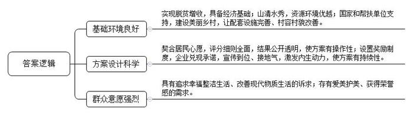
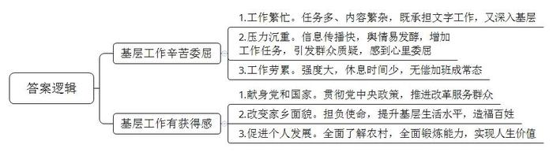
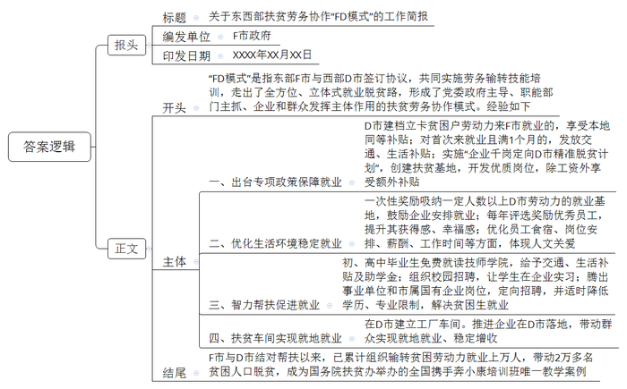
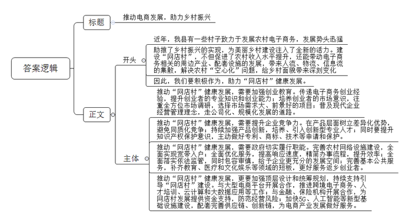

# 2020年0822公务员多省联考《申论》题（湖北乡镇卷）

<!-- gwy:overview:start -->
> **湖北 · 2020 · 申论 · 乡镇卷** ｜ 4 题 · 图片 4 处 · 答案随题折叠

导航：[题目](#题目)
<!-- gwy:overview:end -->

> 候选采集稿。参考答案及解析来自粉笔页面，不代表官方答案或真实高分答卷；来源使用许可与原卷对应关系仍需人工核实。

## 给定材料

### 材料 material-bc1f8b100f3e79dd

杨家村是深度贫困村，经过几年的努力，村里绝大多数贫困户已经脱贫。为了稳定增收，村两委决定利用山清水秀的资源环境发展乡村旅游。2019年初，在政府和帮扶单位专项资金支持下，杨家村的美丽乡村建设项目顺利开工。水泥道路通村入户，古建民居修葺一新，竹木栅栏、青石台阶、小桥流水，让这个昔日的深度贫困村华丽转身，好似世外桃源。

村里漂亮了，可是家居环境改善却是个“老大难”。走进老百姓家里一看，庭院乱堆放，灶台藏污垢。村干部多次上门做工作，但是村民认为这是自家的事，村干部管不着。这时，省建筑装饰集团公司的驻村第一书记小梁为村里精心设计了一套解决方案。事后，它被村民称作“小梁方案”。

8月的一天，一场“积分兑换心愿，勤劳改变习惯”的文明习惯养成活动在杨家村拉开帷幕。小梁和村干部一道向村民征集有关家居环境改善的“微心愿”，并制定了10项涵盖个人卫生和居家环境的评分细则，在为期半年的时间里将每周公布评分结果，最终按照积分排名兑现前20名的“微心愿”。“我们想通过‘微心愿’来激发村民的内生动力，帮助大家养成好习惯，涵养新风尚。”小梁说。

村民们纷纷表达了自己改善家居的愿望。“要是有台大彩电，忙完一天的农活，就可以陪孙子看动画片了！”村民张大娘说。“要是有台电脑，我就能学习更多的科技文化了！”村民刘大哥说。他们这些心愿，配上摄影师为他们拍摄的生活照，被制成精美的海报，张贴在村里醒目的位置。其中一张海报是65岁的唐大妈笑呵呵地在做针线活。“在干净、整洁的屋里做针线活儿，心里那叫一个美啊！”这两行大字是唐大妈的感言。看着邻里乡亲竟然也能像明星一样登上精美的海报，村民们的荣誉感更强烈了，改善家居环境一时间蔚然成风。

村民夏姐的丈夫常年在外打工，她一个人忙里忙外，难免顾不上收拾屋子。“自从参加活动以来，渐渐养成了好习惯，房前屋后干净了，自己住着也舒服。”她说。

从爱美之心人皆有之，到护美之行人人为之，杨家村这个新建成的美丽乡村，处处透着美的气息。半年后，省建筑装饰集团公司如约为表现优异的家庭兑现了“微心愿”，同时也为其他家庭送去棉服、抱枕、围巾等暖冬礼物。在活动现场，夏姐领到了向往已久的热水器，脸上露出了开心的笑容。

### 材料 material-c99f0f5ce42e996c

“要是有‘三头六臂’就好了！”M乡王干事快人快语。王干事负责完善贫困户档案，要了解“家庭人员构成、住房改造前后照片对比、种植养殖种类及数量、扶持项目公示、会议记录、入户走访、满意度调查”等内容。一方面要动手，填写大量的表格资料；另一方面要动腿，“表格的内容很细，不到贫困户家中实地调查是不行的，有些表格还需要当事人签字。看似简单的事情其实很繁琐，有时候要来回跑很多趟。”

基层工作千头万绪，事务繁杂。一旦某件事成为舆情热点，不仅会突然增加大量的工作任务，而且要承担巨大的压力。经历过几次舆情热点事件，M乡宣传干事小陈已经有些经验：尽快披露事实，及时回应网友质疑……即便这样，他仍坦言工作不易：“国家全面推进依法治国，事情处理起来都有程序，需要时间。但新媒体时代信息传播越来越快，舆情容易在极短的时间内放大发酵。”一次，该地出现旅游纠纷，消息在网上飞快传开，网友一边倒地批评当地。可是调查结果表明，其实是游客挑衅刁难。“虽然最后真相大白，可是大家还是感到有些委屈。”小陈说。

基层，是整个社会的“地基”。基层干部，是党和国家工作的“基石”。他们奋战在改革发展的主战场、服务群众的最前沿。目前绝大多数政策落地都在县乡，从脱贫攻坚到民生保障，从招商引资到产业发展，从入户调查到矛盾化解，都离不开基层干部。基层干部忙得脚打后脑勺，加班是常态，而且没有加班费。R市有关部门对一些乡镇的调查显示，乡镇干部平均每天工作10到11个小时，不少乡镇干部五六年没休过假。

“忙、累、压力大”是很多乡镇干部的深切感受，不过，乡镇干部们也都认为乡镇工作是他们无悔的选择。

C乡党委李书记从1998年至今已在5个乡镇工作过，乡镇的每个岗位几乎都干过。“乡镇是最基层的一级政权，麻雀虽小五脏俱全。产业发展、土地问题、安全生产……乡镇工作经历能最深刻地了解中国农村，最全面地锻炼干部能力。”

2017年，中共中央办公厅、国务院办公厅发文，强调要加强乡镇干部队伍建设，实行县以下机关公务员职务与职级并行制度，落实乡镇工作补贴和艰苦边远地区津贴政策。“而且现在干部的选拔任用更加注重基层工作经历，相关政策也更多向基层干部倾斜。”李书记说，“干部成长有规律，在基层多‘蹲蹲苗’十分必要。”

不过，在李书记看来，最重要的还是乡镇工作特有的成就感。“我们很多人都是农村出身，很多亲戚朋友都在农村。改变家乡面貌，造福一方百姓，这是我们肩负的使命。”C乡地处贫困山区，李书记带领群众克服海拔高、交通条件差、缺人手、缺材料等困难，在三个月内新建、改造了71栋房子，“看着很多贫困户欢欢喜喜搬进新房，我们许多乡镇干部忍不住流下眼泪。想到靠自己的努力能够为老百姓做成一点儿事，就有一种梦想正在实现的感觉，那个时候你就会觉得所有的付出都值了。”

### 材料 material-e8a8170ffbd162b4

2017年2月，东部F市与西部D市两地政府签订《东西部扶贫协作框架协议》，确定共同实施劳务输转技能培训暨大中专生就业协作计划。3年来，F市走出了一条帮助D市群众全方位、立体式的就业脱贫路，探索出FD两地扶贫劳务协作模式，入选了110个“全球减贫案例”。

32岁的小周与他的妻子小张，是D市建档立卡贫困户。在两地有关部门的组织下，夫妇俩于2019年年初来F市务工，现在是某塑胶有限公司的员工。“我一个月工资五六千元吧，我老婆也差不多。这样下去，我们的日子有奔头了！”说起这份工作，小周十分满意。他说，除了工资，只要务工半年以上，还可以享受到F市为每人发放的一万多元的各种补贴，十分可观。目前他们每人已经领取到了4500元补贴，其余补贴将陆续发放。此外，公司专门为他们安排了免费的夫妻房，洗手间、厨房、空调等配套设施一应俱全，让他们在F市安下了一个温暖的家。像小周夫妇这样的D市贫困劳动力，3年来，F市已输转了近万人次。

F市和D市相距2000多公里，为实现“输转一人、就业一人、脱贫一户”的目标，F市多措并举，从政策保障、薪酬待遇等方面，为务工人员提供良好的务工环境。针对D市建档立卡贫困户劳动力普遍年龄偏大、缺乏技能、工作效率低、工资待遇不高等实际情况，F市出台政策规定：D市建档立卡贫困户劳动力来F市就业的，认定为F市就业困难对象，享受F市本地建档贫困户同等的社保补贴、职业培训补贴等政策。首次来F市就业且就业满1个月的，发放交通补贴500元和一次性生活补贴1000元；借鉴公益性岗位开发扶贫经验，探索以劳务补助方式实施“企业千岗定向D市精准脱贫计划”，每年在F市扶贫就业基地，企业新开发2000个优质岗位，定向招聘D市建档立卡贫困户劳动力，除企业工资外，在最初6个月内每人每月补贴600元。到2019年，务工半年以上的D市贫困家庭劳动力，每人可享受F市各类补贴13500元。

为了调动企业积极性，F市遴选一批企业创建了就业扶贫示范基地，对吸纳D市劳动力一定人数以上，予以一次性奖励。F市每年评选100名D市户籍优秀员工并给予奖励，目前已有200名员工获评，进一步提升了他们的获得感、幸福感。为了让D市员工吃得惯、住得好、留得下，F市在食宿条件、岗位安排、薪酬待遇、工作时间等方面进一步提升优化，体现对他们的特别关爱，真正做到“政策留人、待遇留人、环境留人、感情留人”。

D市贫困劳动力到F市务工，他们的子女如何帮扶？F市坚持渔鱼兼授，实施智力扶贫。针对部分建档立卡户学生初中、高中毕业后辍学在家，缺乏技能等问题，F市发挥技师学院优势，资助D市户籍建档立卡贫困家庭初、高中毕业生到技师学院免费就读，使他们能够学到一技之长，更好地建设和服务家乡。这些学生在上学期间除了免交学杂费和住宿费外，还可以享受交通往返补贴2000元、生活补助8000元、国家助学金2000元。对于一些即将毕业的技校学生，F市积极搭建平台，组织多家企业开展校园招聘活动，为他们学习锻炼和就业创造条件。目前已有200多名学生在多家企业顶岗实习。F市每年还腾出一批事业单位和市属国有企业岗位，面向D市建档立卡贫困家庭高校毕业生招聘，并根据实际情况适当降低学历要求、放宽专业限制，目前已招聘近300名贫困学子来F市工作。“我要扎根F市努力工作，以良好的工作业绩回报当地人民的关爱。”D市贫困学子小黄感动地说。

对于外出务工有难度的贫困户，F市与D市对接产业转移项目，将工厂车间“搬”到他们家门口，让他们实现就地就业、稳定增收。说起在某服装公司上班，贫困户小何满心欢喜：“原来出去打工，照顾不到家里，现在在家门口打工，每月4000多元工资，老婆也有2000多元，我俩既赚了钱，也顾了家。”目前在这家服装公司已安排了140名当地群众就业，其中建档立卡贫困户100人。截至2019年底，F市已推进25家企业在D市落地，带动1800多名建档立卡贫困户就近就地就业。

F市与D市结对帮扶以来，两地扶贫劳务协作工作取得显著成效，初步形成了党委政府主导、职能部门主抓、企业和群众发挥主体作用的扶贫劳务协作“FD模式”。目前，已累计组织输转建档立卡贫困劳动力就业上万人次，直接带动2万多名D市贫困人口脱贫，组织输转建档立卡贫困劳动力占东部地区帮扶贫困地区总数近一半。

FD扶贫劳务协作模式，成为国务院扶贫办举办的全国携手奔小康培训班唯一教学案例，为推动全国东西部扶贫工作优化升级贡献了“东部智慧”，彰显了中国特色社会主义的制度优势。

### 材料 material-078eb35f9e7af79b

党的十九届四中全会通过的《中共中央关于坚持和完善中国特色社会主义制度推进国家治理体系和治理能力现代化若干重大问题的决定》要求：构建基层社会治理新格局。完善群众参与基层社会治理的制度化渠道。健全党组织领导的自治、法治、德治相结合的城乡基层治理体系，健全社区管理和服务机制，推行网格化管理和服务，发挥群团组织、社会组织作用，发挥行业协会商会自律功能，实现政府治理和社会调节、居民自治良性互动，夯实基层社会治理基础。加快推进市域社会治理现代化。推动社会治理和服务重心向基层下移，把更多资源下沉到基层，更好地提供精准化、精细化服务。注重发挥家庭、家教、家风在基层社会治理中的重要作用。

## 题目

### 第 1 题

**根据给定资料**2**，请指出“小梁方案”实施成功的可行性条件有哪些？（15分）**

关联材料：材料 material-bc1f8b100f3e79dd

作答要求：

要求：全面、准确、有条理，不超过200字。

第 1 题 · 答案与解析

**参考答案（粉笔题库参考内容）**

一、基础环境良好。实现脱贫增收，具备经济基础；山清水秀，资源环境优越；国家和帮扶单位支持，建设美丽乡村，让配套设施完善、村容村貌改善。

二、方案设计科学。契合居民心愿，评分细则全面，结果公开透明，使方案有操作性；设置奖励制度，企业兑现承诺，宣传到位、接地气，激发内生动力，使方案有持续性。

三、群众意愿强烈。具有追求幸福整洁生活、改善现代物质生活的诉求；存有爱美护美、获得荣誉感的需求。

**解析**

**参考答案说明：**本参考答案从“基础环境良好”“方案设计科学”“群众意愿强烈”等不同的话题进行了分条撰写。各条答案要点之间在内容上是并列关系，没有交叉。

**考点**：考点原因类

**来源**：来源2020年0822公务员多省联考《申论》题（湖北乡镇卷）

粉笔申论页面对本题只提供「解析视频」入口，该入口是会员推广位，页面无视频地址与文字解析。

### 第 2 题

**根据给定资料**3**，分析文中基层干部“忍不住流下眼泪”的主要因素。（20分）**

关联材料：材料 material-c99f0f5ce42e996c

作答要求：

要求：全面、准确、有条理，不超过200字。

第 2 题 · 答案与解析

**参考答案（粉笔题库参考内容）**

一、基层工作辛苦委屈。1.工作繁忙。任务多、内容繁杂，既承担文字工作，又深入基层。2.压力沉重。信息传播快，舆情易发酵，增加工作任务，引发群众质疑，感到心里委屈。3.工作劳累。强度大，休息时间少，无偿加班成常态。

二、基层工作有获得感。1.献身党和国家。贯彻党中央政策，推进改革服务群众。2.改变家乡面貌。担负使命，提升基层生活水平，造福百姓。3.促进个人发展。全面了解农村，全面锻炼能力，实现人生价值。

**解析**

**参考答案说明：**本参考答案从“基层工作辛苦委屈”“基层工作有获得感”两个不同的话题进行了分条撰写。其中“基层工作辛苦委屈”又体现在“忙、累、压力大”三个方面，“基层工作有获得感”又体现在“国家、家乡、个人”三个方面。各条答案要点之间在内容上是并列关系，没有交叉。

**考点**：考点原因类

**来源**：来源2020年0822公务员多省联考《申论》题（湖北乡镇卷）

粉笔申论页面对本题只提供「解析视频」入口，该入口是会员推广位，页面无视频地址与文字解析。

### 第 3 题

**根据给定资料**4**，请就东西部扶贫劳务协作“FD模式”的基本做法拟写一份工作简报。（25分）**

关联材料：材料 material-e8a8170ffbd162b4

作答要求：

要求：

（1）紧扣资料，内容完整；

（2）条理清晰，语言准确；

（3）格式规范；

（4）500-600字。

第 3 题 · 答案与解析

**参考答案（粉笔题库参考内容）**

关于东西部扶贫劳务协作“FD模式”的工作简报

F市政府 XXXX年XX月XX日

“FD模式”是指东部F市与西部D市签订协议，共同实施劳务输转技能培训，走出了全方位、立体式就业脱贫路，形成了党委政府主导、职能部门主抓、企业和群众发挥主体作用的扶贫劳务协作模式。经验如下：

一、出台专项政策保障就业。D市建档立卡贫困户劳动力来F市就业的，享受本地同等补贴；对首次来就业且满1个月的，发放交通、生活补贴；实施“企业千岗定向D市精准脱贫计划”，创建扶贫基地，开发优质岗位，除工资外享受额外补贴。

二、优化生活环境稳定就业。一次性奖励吸纳一定人数以上D市劳动力的就业基地，鼓励企业安排就业；每年评选奖励优秀员工，提升其获得感、幸福感；优化员工食宿、岗位安排、薪酬、工作时间等方面，体现人文关爱。

三、智力帮扶促进就业。初、高中毕业生免费就读技师学院，给予交通、生活补贴及助学金；组织校园招聘，让学生在企业实习；腾出事业单位和市属国有企业岗位，定向招聘，并适时降低学历、专业限制，解决贫困生就业。

四、扶贫车间实现就地就业。在D市建立工厂车间。推进企业在D市落地，带动群众实现就地就业、稳定增收。

F市与D市结对帮扶以来，已累计组织输转贫困劳动力就业上万人，带动2万多名贫困人口脱贫，成为国务院扶贫办举办的全国携手奔小康培训班唯一教学案例。

**解析**

**参考答案说明：**（1）本题要求写“工作简报”，一般格式为：报头（包括标题、编发单位、印发日期等）+正文（一般包括开头、主体、结尾）。（2）正文部分，一方面从内容来看，围绕着“东西部扶贫劳务协作‘FD模式’”这一主题，本参考答案的开头先介绍了“FD模式”；主体部分分别从“专项政策保障就业”“优化生活环境稳定就业”“智力帮扶促进就业”“扶贫车间实现就地就业”四个方面写到了“FD模式”的基本做法；结尾对“FD模式”进行了总结。另一方面，形式上，本参考答案做到了分段、分条撰写，整体上条理较为清晰。

**参考答案二**

关于东西部扶贫劳务协作“FD模式”的工作简报

F市政府 XXXX年XX月XX日

“FD模式”是指东部F市与西部D市签订协议，共同实施劳务输转技能培训，走出了全方位、立体式就业脱贫路，形成了党委政府主导、职能部门主抓、企业和群众发挥主体作用的扶贫劳务协作模式。经验如下：

一、提供良好务工条件。出台扶持政策，规定D市建档立卡贫困户劳动力来F市就业的，享受本地同等补贴，对首次来就业且满1个月的，发放交通、生活补贴；实施“企业千岗定向D市精准脱贫计划”，创建扶贫基地，一次性奖励吸纳D市劳动力达标的就业基地，开发优质岗位；评选并表彰奖励优秀员工，提升其获得感、幸福感；优化员工生活和工作条件，体现人文关爱。

二、智力扶贫，帮扶D市贫困户子女。资助贫困家庭初、高中毕业生免费就读技师学院，给予交通、生活补贴及助学金；搭建平台，组织校园招聘，让技校生在企业实习；腾出事业单位和市属国有企业岗位，定向招聘，放宽学历、专业限制，解决贫困生就业。

三、帮助贫困户就近就地就业。F市推进企业在D市落地，建设扶贫车间，带动群众实现就地就业、稳定增收，使其兼顾家庭和就业。

F市与D市结对帮扶以来，已累计组织输转贫困劳动力就业上万人，带动2万多名贫困人口脱贫，成为国务院扶贫办举办的全国携手奔小康培训班唯一教学案例，也入选了全球减贫案例。

**考点**：考点总结类

**来源**：来源2020年0822公务员多省联考《申论》题（湖北乡镇卷）

粉笔申论页面对本题只提供「解析视频」入口，该入口是会员推广位，页面无视频地址与文字解析。

### 第 4 题

**根据给定资料**5**，围绕“‘网店村’健康发展”这一主题，请以县委宣传部工作人员的身份给县政府门户网站写一篇短评。（40分）**

关联材料：材料 material-078eb35f9e7af79b

作答要求：

要求：

（1）联系实际，自拟题目；

（2）观点鲜明，中心突出；

（3）逻辑严密，语言简练；

（4）800字左右。

第 4 题 · 答案与解析

**参考答案（粉笔题库参考内容）**

**推动电商发展，助力乡村振兴**

近年，我县有一些村子致力于发展农村电子商务，发展势头迅猛，助推了乡村振兴的实现，为美丽乡村建设注入了全新的活力。建设“网店村”，不但促进了农村收入水平提升，还能带动电子商务相关的周边产业、配套设施的发展，带来人流、物流、信息流的集散，解决农村“空心化”问题，给乡村面貌带来深刻变化。因此，我们要积极作为，助力“网店村”健康发展。

**推动“网店村”健康发展，需要加强创业教育。**传递电子商务创业经验，提升创业者的专业知识和创业能力；培养创业者的市场意识，注重全方位市场调研，选择市场需求大、前景好的项目；普及现代企业经营管理理念，走公司化、规模化发展的道路。

**推动“网店村”健康发展，需要提升企业竞争力。**在产品层面树立差异化优势，避免同质化竞争；持续加强产品创新，培养、引入创新型专业人才；同时要提升知识产权保护意识，主动做好专利、商标、技术等申请和保护。

**推动“网店村”健康发展，需要政府切实履行职能。**完善农村网络设施建设，全面实现宽带入户；全面优化服务，提高响应速度，精简办事流程，提升效率；全面落实依法监管，同时包容审慎，给予企业更充分的发展空间；完善基本公共服务，补齐教育、医疗和文化娱乐等领域的短板，更好服务返乡创业者。

**推动“网店村”健康发展，更要加强顶层设计和统筹规划，持续支持引导“网店村”建设。**与大型电商平台开展合作，推进跨境电子商务、人才培训、云计算和大数据应用等工作；与金融、保险机构开展合作，为网店村发展提供资金支持，防范经营风险；加快5G、人工智能等新型基础设施建设，配套完善供应链、创新链，为电商产业发展做好服务。

**解析**

**参考答案说明：**（1）本参考答案按照“短评”的作答结构，写到了“标题+正文”两个部分。（2）正文部分：一方面从内容来看，开头部分概述N县“网店村”发展的总体情况，介绍建设“网店村”的意义，并表明了观点，主体部分分别从“创业教育”“企业竞争力”“政府职能”“政府规划”四个方面给出了推动“网店村”健康发展的对策。另一方面从形式来看，本参考答案做到了分段、分条撰写，各条要点在内容上各自独立，没有交叉。

**考点**：考点评论类

**来源**：来源2020年0822公务员多省联考《申论》题（湖北乡镇卷）

粉笔申论页面对本题只提供「解析视频」入口，该入口是会员推广位，页面无视频地址与文字解析。

