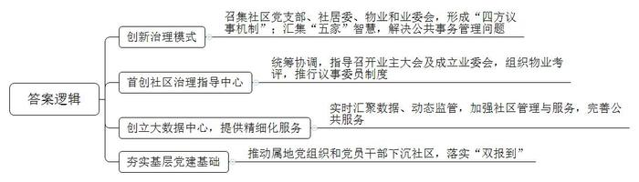
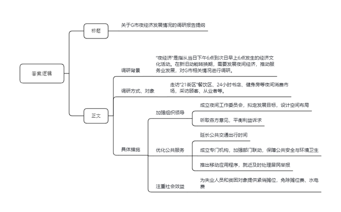
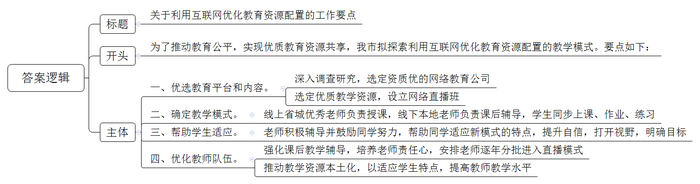
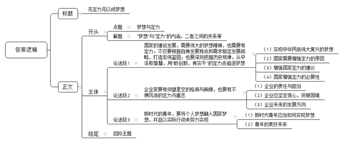

# 2020年0822公务员多省联考《申论》题（湖北县级卷）

<!-- gwy:overview:start -->
> **湖北 · 2020 · 申论 · 县级卷** ｜ 4 题 · 图片 4 处 · 答案随题折叠

导航：[题目](#题目)
<!-- gwy:overview:end -->

> 候选采集稿。参考答案及解析来自粉笔页面，不代表官方答案或真实高分答卷；来源使用许可与原卷对应关系仍需人工核实。

## 给定材料

### 材料 material-0a5082d8364990c5

“我们真是社区治理的受益者，现在门口一点儿也不堵了，物业经理都亲自给我们站岗呢！”说到校门口的变化，第二小学的李校长满面笑容，第二小学位于Z小区旁，以前因为管理混乱，车辆乱停乱放堵塞了校门，校车进出困难。小区环境脏乱差，业主更是怨声载道。去年，Z小区业主委员会成立，准备炒掉物业公司，社区和街道办对此非常着急，因为物业费一直不曾涨过，“我们担心旧物业走了，新物业又找不来，小区就乱套了。”H街道办陈主任说。

为破解难题，H街道办决定在Z小区创新社区治理模式，召集社区党支部委员会、社区居委会、物业和业委会，心平气和地摆出问题，逐步形成了“四方议事机制”，以社区“两委”为“本家”、社区全体业主为“主家”、物业服务企业为“管家”、辖区单位为”邻家”、专业规划团队为“专家”，汇集“五家”智慧，解决社区公共事务中的重点难点问题。H街道办在全市首创社区治理指导中心，负责统筹协调，指导召开业主大会并成立业委会，组织开展辖区物业服务企业的考评工作，全面推行社区议事委员制度，营造社区民主协商氛围。

社区治理的创新让小区大“变脸”。过去Z小区大门破旧不堪，安全系数低，也影响车辆通行。新的社区治理模式运行后，社区党支部积极发挥“本家”的作用，引导“主家”“管家”“邻家”形成合力，经小区半数以上“主家”投票选定大门整修方案并会商筹措资金，共同推进小区大门整修工作，如今小区大门焕然一新：青砖黄柱，一边是整洁的保安亭，一边是灰色大字的小区名，十分典雅。“回家顿时有了仪式感。”小区居民王先生感叹道。

物业公司拥有600平方米的育种苗圃，业主们想为小区孩子们打造一块种植园，让他们知道西红柿、土豆怎么开花结果。经社区居委会积极与物业公司沟通，物业同意共建共享，社区邀请种植专家和居民代表召开会议，制定了具体的建设方案，经过精心设计改造，生态体验园种植花卉、果蔬，既有科普教学功能、又有食用价值、美学价值，还能让居民、小朋友参与劳动感受种植乐趣。

为了提供更精细化的服务，H街道办还创立了区域大数据中心。社会服务管理指挥中心的电子大屏幕随时切换着辖区内相关动态信息，辖区内“人、地、事、物”等数据实现了实时汇聚和动态监测，为社区管理与服务提供基础数据支撑。

“我们根据大数据平台掌握的实有人口和户籍人口信息，通过热力图表预测未来两年0至3岁幼儿的入园需求，从而根据幼儿分布状态选址建设幼儿园。”陈主任说，目前街道办已与区教委达成一致意见，共同新建两个公立幼儿园，满足辖区内幼儿的入园需求。此外，凡年满60周岁的老年人信息会被大数据平台筛选出来，提前3个月自动为老人发送政策短信提示。老年证办理成功后，由社区工作人员送达，大数据的运用让信息多跑路，让群众少跑路，打通了公共服务的“最后一米”路程。

陈主任坦言，社区就是我们的大家庭，我们的梦想就是打造一个共建共治共享的和谐家园。最近，根据中央要求，属地所有单位党组织和党员干部下沉社区，已经落实“双报到”，这将为我们集中更多资源，夯实基层基础，提升社区治理，注入全新力量。

### 材料 material-ab4b0e1cf409785a

2019年8月的G市，已进入高温炙烤模式。晚上十点，市区最大商场的主体部分已经打烊，人们陆续离开商场。与此同时，另一批“意犹未尽”的顾客走进了地下一层和地下二层东侧的“21街区”。这里营业时间一直会延长到凌晨两点，是名副其实的“深夜食堂”。人们排队买炸糕，在奶茶店外挑选着饮料，手捧着冰淇淋和炸鸡……”街区内无论面条米饭、饺子煎包、牛排披萨、汉堡意面，种类都很丰富。流连忘返的王阿姨说：“丰富的夜市，让我们感觉到生活特别美好。”

G市商务局的陈科长介绍说，所谓“夜经济”是指从当日下午6点到次日早上6点发生的经济文化活动。在不少人看来，夜经济无非就是“啤酒烤串加唱歌”。事实上，夜经济的内涵远比“吃吃喝喝”丰富得多。它已经由早期的灯光夜市转变为包括“食、游、购、娱、体、展、演”等在内的多元夜间消费市场。

G市一家著名的24小时书店，位于临窗位置的阅读区，座无虚席。年轻姑娘小赵戴着耳机，全神贯注地看着手机播放的“中国会计网校”课程。小赵告诉记者，自己参加工作不到一年，打算自学考“注会”。合租环境比较吵闹，下班晚餐后就来书店学到10点多再回去。

夜里九点半，位于G市南二环附近的一家健身工作室灯火通明。健身教练说，“我们开业近三年，明显感觉到健身的人在增多。我们正常是晚上十点关门，但有的人下班晚，跟教练约了，过来练到十一点、十二点也没问题，我们都等。”一位扎着马尾辫的女孩，抹了下额头的汗珠，告诉记者：“经不住美食的诱惑，快要长出‘游泳圈’了，我要练出令人羡慕的‘马甲线’！”

为了做好“夜经济”这篇大文章，G市于2019年初成立了由政府相关部门和行业协会组成的夜间工作委员会，拟定夜经济发展目标，设计夜经济空间布局，并通过与场地经营者、工作人员、夜间消费者以及周边居民对话的方式听取各方意见，平衡相关群体的利益诉求。同时，交通部门延长了地铁、公交夜间行车时间，为消费者和从业人员提供安全、便捷的交通工具。夜经济的治安、噪音、垃圾等问题最为人们所诟病。G市成立专门机构加强公安、消防、城市管理等多部门联动，确保了夜市的公共安全、环境卫生。此外还推出了移动应用程序，供居民举报夜间滋扰情况，方便就近及时处理。2020年入夏以来，G市统筹推进疫情防控和经济社会发展工作，将“夜经济”作为疫后重振、缓解就业压力、精准扶贫的重要抓手，进一步加大了有关工作力度。在一个繁华的“夜经济”聚集点，政府就拿出60个紧俏摊位，提供给失业人员和贫困对象，免摊位费、水电费。

上海财经大学张教授认为，当前，我国经济正处于新旧动能转换的关键时期，服务业具有吸引社会资本与居民消费的双重属性。“夜间经济提高了设施使用率、释放了消费需求、激发了文化创造、带动了区域发展、推动了内循环。”在谈到如何促进夜经济健康有序发展时，他说，“政府的顶层设计尤为关键。政策质量高了，服务品质好了，投资者信心才更强，夜经济才会走得更好，走得更远。”

### 材料 material-e54d1fc483b71bd4

L县是国家级贫困县，师资力量和办学条件整体比较落后。县一中虽然是该县的示范中学，但高考成绩并不是很理想。“其实我们的孩子都很勤奋，可总体成绩就是不如城市里的孩子。”吴副校长说，“孩子们都梦想着能接受和城里同龄人一样的教育，进行公平的竞争。”

得益于这两年脱贫攻坚进程的加快，县一中的软硬件有了较大改善。经过反复调查研究，县政府决定选择一家网络教育公司，在一中设立网络直播班，同步直播省城七中的课堂教学。在网络直播课程中，每门课都有线上线下两位老师，线上的是省城七中的优秀老师，负责课堂授课，线下的是一中的老师，负责课后辅导，学生们跟着省城七中同步上课、同步作业、同步练习。

罗同学是一中的高三学生，他对自己刚接触网络直播课程的情形记忆犹新，“那边的教学特点就是密度大，知识面广。我刚开始有些不适应，感觉差距还是有些大的。这种教学模式有它的特点，6门学科有了12名指导老师。经过老师的辅导和自己的努力，不久就跟上了那个课堂，自信心也上来了。”

网络直播班班主任杨老师观察到，新教学模式带来成绩上的提高，更给学生提供了参照和动力。“他会觉得，在追梦的路上自己和省城七中的同学享有均等的机会，剩下的就看自己的奋斗了。”

何同学去年从一中网络直播班毕业，考入了一所名牌大学。她回忆说，“从省城七中的师生身上我学到很多东西，打开了我的视野，让我觉得有一个清晰的目标，考什么大学，想去什么样的地方。好像是一道光，它照亮了我的梦想，让梦想变得明亮清晰。”

从最初引入一个班试点，逐渐发展到一中、二中两校30个网络直播班1500多名孩子，越来越多的孩子们参与到了网络课堂中，关于网络直播班的教学效果，教育局王局长介绍说，当地普通班本科上线率大概在45%左右，而网络直播班的本科上线率达到99.9%，其中一本上线率达到了60%。

网络直播授课的模式是“互联网+教育”的产物，在一定程度上打破了地区和学校之间的资源壁垒，使优质教育资源跨时空配置，王局长说，“网络直播授课模式能取得目前的成效，本地教师的课后教学辅导也很关键，他们的工作量是普通班的3倍，很多教师要连续加班，这对教师的责任心是一个考验。”吴副校长认为这对教师来说也是锻炼和学习的机会。“我们的教师逐年分批次进入这种教学模式里锻炼，并且把省城七中的资源本土化，让它适合我们学生自己的特点，在这个过程中，我们教师的教学水平也得到了提升”。

### 材料 material-fa4bad9004e01af8

“我们都在努力奔跑，我们都是追梦人。”是的，我们都是追梦人。追梦，我们收获满满；追梦，我们希望满满。

正如习近平总书记所说，中国人民具有伟大梦想精神。改革开放40多年，就是一个追梦之旅。改革开放之初，我们党以非凡的胆略、坚定的自信设计了用70多年、分三步走战略基本实现社会主义现代化的宏伟蓝图。改革开放40多年的追梦路上，我们咬定青山不放松，风雨无阻朝着这个伟大目标前进。

从站起来、富起来到强起来，这是奋斗的力量，也是梦想的力量。

党的十九大对我国发展提出了更高的奋斗目标，形成了从全面建成小康社会到基本实现现代化、再到全面建成社会主义现代化强国的战略安排，发出了实现中华民族伟大复兴中国梦的最强音。

但是，船到中流浪更急，人到半山路更陡，并且“愈进愈难、愈进愈险而又不进则退、非进不可”。在这样的关键时刻，我们要心怀梦想、奋勇拼搏，一步一个脚印，一棒接着一棒，在新时代创造中华民族新的更大奇迹！

梦想是拼出来的，奇迹是干出来的。改革开放40多年来的辉煌成就背后，是40多年的不懈努力。未来中国梦的实现，同样需要汗水的浇灌。没有人能随随便便成功。改革开放40多年的历程告诉我们：伟大事业都始于梦想，基于创新，成于实干。梦想是激发活力的源泉，只要有梦想，就会有力量。只要有梦想，则时光不弃，未来可期。

## 题目

### 第 1 题

**根据****“给定资料**3**”，概括H街道办创新社区治理的主要内容。（15分）**

关联材料：材料 material-0a5082d8364990c5

作答要求：

要求：准确、全面、有条理，不超过200字。

第 1 题 · 答案与解析

**参考答案（粉笔题库参考内容）**

1.创新治理模式。召集社区党支部、社居委、物业和业委会，形成“四方议事机制”；汇集“五家”智慧，解决公共事务管理问题。

2.首创社区治理指导中心。统筹协调，指导召开业主大会及成立业委会，组织物业考评，推行议事委员制度。

3.创立大数据中心，提供精细化服务。实时汇聚数据、动态监管，加强社区管理与服务，完善公共服务。

4.夯实基层党建基础。推动属地党组织和党员干部下沉社区，落实“双报到”。

**解析**

**参考答案说明：**本参考答案从“创新治理模式”“首创社区治理指导中心”“创立大数据中心，提供精细化服务”“夯实基层党建基础”这四个方面给出了H街道创新社区治理的主要内容。各条要点之间在内容上相互并列，没有交叉。

**考点**：考点概括措施类

**来源**：来源2020年0822公务员多省联考《申论》题（湖北县级卷）

粉笔申论页面对本题只提供「解析视频」入口，该入口是会员推广位，页面无视频地址与文字解析。

### 第 2 题

**假如你随某市商务局团考察了****G市“夜经济”发展情况，请根据“给定资料**4**”写一份调研报告提纲。（20分）**

关联材料：材料 material-ab4b0e1cf409785a

作答要求：

要求：

（1）紧扣资料，内容全面；

（2）层次分明，有逻辑性；

（3）格式规范；

（4）不超过300字。

第 2 题 · 答案与解析

**参考答案（粉笔题库参考内容）**

关于G市夜经济的调研报告提纲

调研背景：“夜经济”是指从当日下午6点到次日早上6点发生的经济文化活动。在新旧动能转换期，需要发展夜间经济，推动服务业发展，对G市相关情况进行调研。

调研方式、对象：走访“21街区”餐饮区、24小时书店、健身房等夜间消费市场，采访顾客、从业者等。

具体措施：1.加强组织领导。成立夜间工作委员会，拟定发展目标，设计空间布局；听取各方意见，平衡利益诉求。2.优化公共服务。延长公共交通出行时间；成立专门机构，加强部门联动，保障公共安全与环境卫生；推出移动应用程序，就近及时处理居民举报。3.注重社会效益。为失业人员和贫困对象提供紧俏摊位，免除摊位费、水电费。

**解析**

**参考答案说明：**（1）一方面，内容上，正文部分从调研背景，调研方式、对象，具体措施三个方面介绍了G市发展夜经济的具体情况。（2）另一方面，形式上，本参考答案做到了分段、分条撰写，整体上条理较为清晰。

**考点**：考点总结类

**来源**：来源2020年0822公务员多省联考《申论》题（湖北县级卷）

粉笔申论页面对本题只提供「解析视频」入口，该入口是会员推广位，页面无视频地址与文字解析。

### 第 3 题

**根据****“给定资料**8**”，假如你是某地级市教育局工作人员，请借鉴L县经验，提出全市利用互联网优化教育资源配置的工作要点。（25分）**

关联材料：材料 material-e54d1fc483b71bd4

作答要求：

要求：

（1）内容全面；

（2）观点鲜明；

（3）层次分明；

（4）格式规范；

（5）不超过300字。

第 3 题 · 答案与解析

**参考答案（粉笔题库参考内容）**

关于利用互联网优化教育资源配置的工作要点

为了推动教育公平，实现优质教育资源共享，我市拟探索利用互联网优化教育资源配置的教学模式。要点如下：

一、优选教育平台和内容。深入调查研究，选定资质优的网络教育公司；选定优质教学资源，设立网络直播班。二、确定教学模式。线上省城优秀老师负责授课，线下本地老师负责课后辅导，学生同步上课、作业、练习。三、帮助学生适应。老师积极辅导并鼓励同学努力，帮助同学适应新模式的特点，提升自信，打开视野，明确目标。四、优化教师队伍。强化课后教学辅导，培养老师责任心，安排老师逐年分批进入直播模式；推动教学资源本土化，以适应学生特点，提高教师教学水平。

**解析**

**参考答案说明：**（1）格式方面，本参考答案写到了“标题”“正文”，标题体现了主题和文种。（2）正文部分，一方面从内容来看，围绕着“利用互联网优化教育资源配置”这一主题，本参考答案开头先写了利用互联网优化教育资源配置的目的、背景等。主体部分从“优选教育平台和内容”“确定教学模式”“帮助学生适应”“优化教师队伍”等四个方面分别给出了具体的对策。另一方面，形式上，本参考答案做到了分段、分条撰写，整体上条理较为清晰。

**考点**：考点方案类

**来源**：来源2020年0822公务员多省联考《申论》题（湖北县级卷）

粉笔申论页面对本题只提供「解析视频」入口，该入口是会员推广位，页面无视频地址与文字解析。

### 第 4 题

**根据上述资料，以****“梦想与定力”为主****题****，联系实际，自拟题目，写一篇议论文。（****40分）**

关联材料：材料 material-fa4bad9004e01af8

作答要求：

要求：

（1）自选角度，立意明确；

（2）思想清晰，语言流畅；

（3）参考“给定资料”，但不拘泥于“给定资料”；

（4）总字数1000字左右。

第 4 题 · 答案与解析

**参考答案（粉笔题库参考内容）**

**无定力无以成梦想**

梦想是促使个人成长，推动企业进步，推进国家发展的源动力；定力是面对困难险阻依旧坚持创新、实干，奋勇拼搏。梦想和定力都是实现伟大事业的必要条件，历史上任何一个梦想，无一不是在追梦者执着的毅力中兑现的。张桂梅行善助学、“鸿蒙”系统顺利发布、“嫦娥五号”凯旋归来，这些伟大的梦想都成于坚如磐石的定力。

**国家的建设发展，****需要伟大的梦想精神，也需要有定力。不仅要根据自身发展特点和需求制定发展战略，打造宏伟蓝图，也要深刻把握历史规律，从中汲取智慧，****用****“敢创新、肯实干”的定力去追逐梦想****。**实现中华民族伟大复兴是全民族的伟大梦想，指引着前进的方向。但追逐伟大梦想的道路必然是坎坷的、充满荆棘的，所以还需我们加强定力。不仅要统一思想认识、激发奋进力量、坚信文化自信，还需把握历史发展大势、从历史中汲取经验。正如习近平总书记所言：我们的改革是在中国特色社会主义道路上不断前进的改革，既不走封闭僵化的老路，也不走改旗易帜的邪路。在深化改革开放的道路上，中国开放的大门不会关闭，只会越开越大。增强定力，这是我们实现中国梦的必然选择。

**企业家要有仰望星空的格局与胸襟，也要有不惧风浪的定力与意志。**企业承担着提供优质服务、解决社会就业、满足群众需求、推动社会发展的责任与担当。与此同时，面对发展瓶颈和前行阻碍时也需要坚定信心，乘风破浪。面对海外势力的夹击，任正非怀揣家国情怀，咬定青山不放松，坚持中国制造，把核心技术自主创新摆在企业发展的突出位置，努力打破西方国家的科技封锁。不日新者必日退，企业要不断提升自主研发和科技创新能力，让企业自立自强，造福民众、实现科技兴国。

**新时代的青年，****要将个人梦想融入国家梦想，并且以实际行动来努力实现。**这要求青年有信念、有情怀，深入实践、扎根基层，充分发挥主观能动性、创新工作方式方法，发挥实干精神，主动肩负使命，将自我价值和社会价值统一。正如基层扶贫干部吴书香，她扎根基层11年初心不改、服务群众痴心不移，用新时代青年的梦想和担当，用务实创新实现了做一名村官、富一方百姓的夙愿。我们深信，“未来属于年轻一代”，当代中国青年只要牢牢把握人生航向，美好的青春一定能在实现中国梦的进程中绽放出更加绚丽夺目的光彩。

梦想，就是太阳，有了梦想，就有了坚定的目标、方向和希望；而定力，就是奔赴太阳的途中披荆斩棘的武器。狄更斯说过：顽强的毅力可以征服世界上任何一座高峰。同样，执着的定力也可以实现世界上任何一个梦想。不论梦想的模样，只要我们实干、拼搏、开拓、创新，梦想的星辰大海一定就在前方。

**解析**

**文章分析**

**无定力无以成梦想**

【**标题的优点：**首先，范文的标题“无定力无以成梦想”突出了“梦想与定力”这一主题。其次，形式上，文字简洁明快。】

（1）梦想是促使个人成长，推动企业进步，推进国家发展的源动力；（2）定力是面对困难险阻依旧坚持创新、实干，奋勇拼搏。（3）梦想和定力都是实现伟大事业的必要条件，历史上任何一个梦想，无一不是在追梦者执着的毅力中兑现的。张桂梅行善助学、“鸿蒙”系统顺利发布、“嫦娥五号”凯旋归来，这些伟大的梦想都成于坚如磐石的定力。

【**开头的优点：**★内容方面。范文的开头是紧扣“梦想与定力”这一主题展开的。首先，开头点出主题，做到了主题明确。其次，对“梦想与定力”这一主题进行了分析阐述，指出了：（1）“梦想”的内涵；（2）“定力”的内涵；（3）“梦想”与“定力”的关系。★文字表达方面：长短句配合使用，使语言表达有节奏感。】

**国家的建设发展****，****需要伟大的梦想精神****，****也需要有定力。不仅要根据自身发展特点和需求制定发展战略****，****打造宏伟蓝图，也要深刻把握历史规律，从中汲取智慧，用****“敢创新、肯实干”的定力去追逐梦想。**（1）实现中华民族伟大复兴是全民族的伟大梦想，指引着前进的方向。但（2）追逐伟大梦想的道路必然是坎坷的、充满荆棘的，所以还需我们加强定力。不仅（3）要统一思想认识、激发奋进力量、坚信文化自信，还需把握历史发展大势、从历史中汲取经验。正如习近平总书记所言：我们的改革是在中国特色社会主义道路上不断前进的改革，既不走封闭僵化的老路，也不走改旗易帜的邪路。在深化改革开放的道路上，中国开放的大门不会关闭，只会越开越大。（4）增强定力，这是我们实现中国梦的必然选择。

【**论述段****1的优点：**★观点句：范文的观点句是紧扣“梦想与定力”这一文章主题提出的。形式上，它在段首处直接写出，位置突出，容易被发现；内容上，关键词突出，内容要点明确，可以明显看出它是从“制定发展战略、把握历史规律、创新实干”等角度入手，指出了“国家的建设发展要有梦想与定力”。★论述内容：（1）介绍了实现中华民族伟大复兴的梦想；（2）介绍了国家需要增强定力的原因；（3）给出了增强国家定力的建议；（4）指出了国家增强定力的必要性。注意：以上四个方面的内容都是紧扣观点句“国家的建设发展，需要伟大的梦想精神，也需要有定力。不仅要根据自身发展特点和需求制定发展战略，打造宏伟蓝图，也要深刻把握历史规律，从中汲取智慧，用‘敢创新、肯实干’的定力去追逐梦想”进行分析论述的，针对性强、内容层次丰富。在论证方法上以讲道理为主，做到了论证有力。】

**企业家要有仰望星空的格局与胸襟，也要有不惧风浪的定力与意志。**（1）企业承担着提供优质服务、解决社会就业、满足群众需求、推动社会发展的责任与担当。与此同时，（2）面对发展瓶颈和前行阻碍时也需要坚定信心，乘风破浪。面对海外势力的夹击，任正非怀揣家国情怀，咬定青山不放松，坚持中国制造，把核心技术自主创新摆在企业发展的突出位置，努力打破西方国家的科技封锁。不日新者必日退，（3）企业要不断提升自主研发和科技创新能力，让企业自立自强，造福民众、实现科技兴国。

【**论述段****2的优点：**★观点句：范文的观点句是紧扣“梦想与定力”这一文章主题提出的。形式上，它在段首处直接写出，位置突出，容易被发现；内容上，关键词突出，内容要点明确，可以明显看出它是从“格局与胸襟、不惧风浪”等角度入手，指出了“企业家要有梦想与定力”。★论述内容：（1）指出了企业的责任与担当；（2）举例论述企业应坚定信心，突破困境；（3）明确了企业未来的发展方向。注意：以上三个方面的内容都是紧扣观点句“企业家要有仰望星空的格局与胸襟，也要有不惧风浪的定力与意志”进行分析论述的，针对性强、内容层次丰富。在论证方法上采用了讲道理和举例子相结合的方式，使内容更加充实。】

**新时代的青年****，****要将个人梦想融入国家梦想，并且以实际行动来努力实现。**（1）这要求青年有信念、有情怀，深入实践、扎根基层，充分发挥主观能动性、创新工作方式方法，发挥实干精神，主动肩负使命，将自我价值和社会价值统一。正如基层扶贫干部吴书香，她扎根基层11年初心不改、服务群众痴心不移，用新时代青年的梦想和担当，用务实创新实现了做一名村官、富一方百姓的夙愿。（2）我们深信，“未来属于年轻一代”，当代中国青年只要牢牢把握人生航向，美好的青春一定能在实现中国梦的进程中绽放出更加绚丽夺目的光彩。

【**论述段****3的优点：**★观点句：范文的观点句是紧扣“梦想与定力”这一文章主题提出的。形式上，它在段首处直接写出，位置突出，容易被发现；内容上，关键词突出，内容要点明确，可以明显看出它是从“个人梦想、付出实际行动”等角度入手，指出了“新时代青年的梦想与定力”。★论述内容：（1）举例说明新时代青年应当如何实现梦想；（2）展望了青年的美好未来。注意：以上两个方面的内容都是紧扣观点句“新时代的青年，要将个人梦想融入国家梦想，并且以实际行动来努力实现”进行分析论述的，针对性强、内容层次丰富。在论证方法上采用了讲道理和举例子相结合的方式，使内容更加充实。】

【**论述段之间的关系**：★内容的内在逻辑：范文的论述段之间是依照“并列”的逻辑展开的。论述段1先写了“国家的梦想与定力”，论述段2再写了“企业的梦想与定力”，论述段3接着写了“青年的梦想与定力”。按照“国家”“企业”“青年”三个不同主体展开，结构清晰。】

（1）梦想，就是太阳，有了梦想，就有了坚定的目标、方向和希望；而定力，就是奔赴太阳的途中披荆斩棘的武器。狄更斯说过：顽强的毅力可以征服世界上任何一座高峰。同样，执着的定力也可以实现世界上任何一个梦想。不论梦想的模样，（2）只要我们实干、拼搏、开拓、创新，梦想的星辰大海一定就在前方。

【**结尾的优点：**范文的结尾回扣了“梦想与定力”这一主题。（1）再次提到了“梦想与定力”；（2）对未来发出了展望。】

**考点**：考点文章写作题

**来源**：来源2020年0822公务员多省联考《申论》题（湖北县级卷）

粉笔申论页面对本题只提供「解析视频」入口，该入口是会员推广位，页面无视频地址与文字解析。

