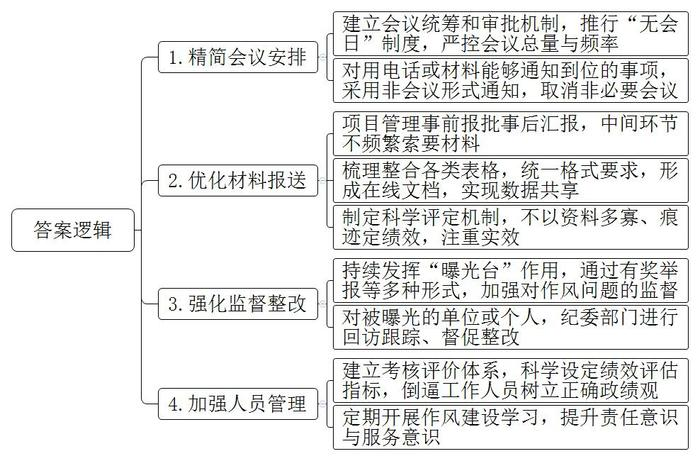
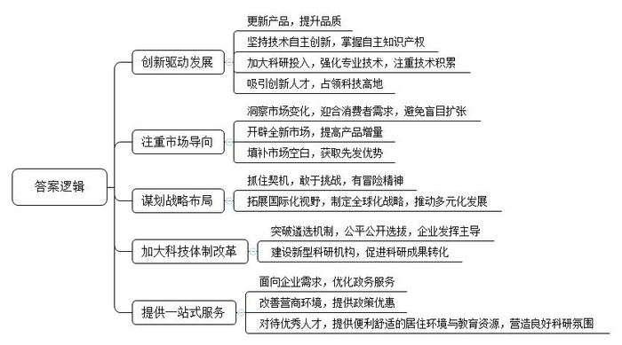
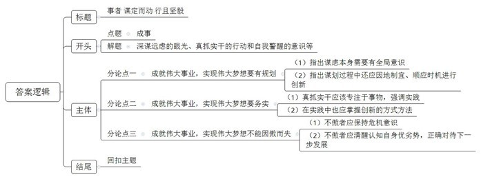

# 2021年公务员多省联考《申论》题（湖北县级卷）

> 候选采集稿。参考答案及解析来自粉笔页面，不代表官方答案或真实高分答卷；来源使用许可与原卷对应关系仍需人工核实。

## 给定材料

### 材料 material-8fc25c8c339d2a78

站在L县大塬上，眺望着50万亩果林，红彤彤的苹果挂满枝头，L县县委曹书记向记者介绍，L县曾经是省内出名的穷县。1947年，有人带回100棵果树苗……但当时乡亲们并没认识到这是一座“金矿”。改革开放后，县委县政府经过考察调研，形成“苹果是L县最具优势的产业”共识。党的十九大以来，县委县政府制定了《苹果产业强县建设规划》，提出以“苹果产业后整理”为抓手，为巩固脱贫攻坚成果、促进乡村振兴奠定厚实的产业基础。

“虽然如今形势喜人，但L县苹果产业也曾出现过危机。”曹书记说，“每年10月至11月，当苹果集中上市时，能否卖上好价钱，既是老百姓心中的忧虑，也是我们干部们心中的挂念。过去，因为市场透明度不高，信息不对称，果农们在与果商的博弈中，吃亏是常有的事。”

2017年12月，苹果期货在Z商品交易所上市。“我们发现苹果期货的价格能够及时反映市场变化。”曹书记说，“这为我们帮助果农对价格进行预判，指导企业发展提供了一把金钥匙。”为此，县里成立了专门工作组，一方面派人到Z商品交易所学习，一方面请专家来县里普及苹果期货有关知识。

“从2018年初夏开始，经常见到一些戴眼镜、穿衬衣的文化人来村里打听苹果长得怎么样，听说霜冻把果子冻了，还要问冻了多少。”村民小史说，后来知道这些人大多是做苹果期货的金融业人士。从此，当地不少果农一改过去“听果商报价，自己估摸差不多就卖了”的做法，转而主动和果商议价。2019年，L县苹果总体减产8%，但整体销售价格同比提高30%，果农总收入增加了20%。

“人畏冬山肃，我爱冬日丽”，这正是L县果农内心真实的写照。50多岁的老李作为当地苹果大户，每到岁末就忙得不可开交。“今天下午要发5000件货，明天还有5000件……”他一边对着记者介绍，一边盘点着贴有鲜明的“L县苹果”“平安接福”等标签的苹果。

在L县日新鲜果公司车间里，多条现代化选果线依次排开，它可以轻而易举地检测出每颗苹果的大小、糖度、瑕疵等。“这台机器堪称是整条选果线的中枢，如果苹果有瑕疵，它可以准确地标记并筛选出来，同时为后续选果提供数据支撑。”公司刘经理指着生产线上的机器介绍到，分级分选更好地提高了苹果价值，实现了优果优价、以质论价。

在金奇果业科技有限公司的车间，工人们正在紧张有序地进行从接收订单到装箱发货的“一站式”操作。“我们通过成立直播团队、建立大数据中心等措施，实现L县苹果和消费者无缝对接，同时也助推全县苹果电商和微商的快速发展。”公司赵经理说。目前公司在省城成立了苹果电商运营中心，全网开设店铺40多家，目的就是要利用互联网宣传、推广特性，延伸L县苹果产业链条，让果农在苹果产业链上能获益、增收。

“‘产业后整理’对于农业产业发展而言，可以说是一场深刻的变革。”省农科院的王博士说。过去老百姓只会种、不会卖，现在就是要解决这个问题，提高农产品市场化程度。

### 材料 material-e82394b8669bb462

“每天不是在开会，就是在开会的路上。”频繁又非必要的会议，让C市柳云村党支部书记老文很是头疼。老文工作的村子地处沿海，夏秋之际，台风频繁。“大家白天入户排查情况，宣传防台风要求，还得抽时间应付各种会议。”老文告诉记者，“有的会议只是花几分钟传达一下文件精神，其实用电话或者材料就能通知到位。”

“刚刚签订战略合作协议，实质项目还没落地，就要准备一堆汇报材料。”C市大华街道干部小李对报送“材料”的苦恼，也引起了扶贫干部小吴的共鸣。小吴是2018年起驻村负责57户建档立卡贫困户的工作。回想近两年的工作，小吴说，驻村扶贫工作不易，但最让人头疼的，却是应付各项检查以及反复整理、填写、修改各种资料和表格。“最多的时候，我手里同时有20多个表格要填。有一个表，因为不同要求反复修改，弄了大半年。”如果遇到过于重视迎检资料的领导，可能出现以资料多寡、“痕迹”是否明显来定绩效的情况，基层干部就不得不加班加点找资料，熬更守夜补台账。

2020年，C市纪检监察机关紧扣“四风”问题，设立了转变作风“曝光台”。采取有奖举报、外聘专家、记者采访等形式，对工作不实、作风漂浮的给予定期曝光。被曝光的单位或个人，市纪委监委将回访跟踪、督促整改。市新区小学师生则是这一举措的直接受益者。该小学位于上塘路交叉口，2018年新建了一座高架桥，由于未设置隔音屏，800多名师生不得不在滚滚车流带来的噪音中上课。工程完成伊始，学校和学生家长就多次反映问题，希望加装隔音屏。该街道住建科负责人表示，隔音屏属于高架桥附属工程，高架桥是谁建的，隔音屏就该谁来建，而建设主体市建委则表示，该段高架已移交市城管委养护，应由该委负责加装隔音屏。市城管委称，隔音屏在工程建设过程中，是由原建设单位负责实施的，需要增补应由属地政府负责落实。这次一上“曝光台”，市建委马上邀请市信访、城管、环保等部门和街道进行协调。一个多月后，长达近两年的问题得以解决。

市纪委张副书记说，在作风建设方面，近期，C市一举推出了“六项机制”，重点整饬“闭门施策”“推诿扯皮”“政令空转”“留痕管理”“督考过多”“文山会海”等六大顽疾。“我对这样的措施表示肯定。”C市党校刘教授说，不少面向群众的基层政府人员，依然存在不作为、慢作为等现象，而这绝不是小事，甚至会在一定程度上影响政府威信。

### 材料 material-8dd22e14534c89f9

仙路控股有限公司是H县的一家食品企业，曾有过很长一段的高光时刻：1992年创办后，业绩一路高歌，旗下仙路鲜汁成为当时整个饮品行业中为数不多的百亿大单品，缔造了“中国零食龙头企业”的神话。如今，仙路公司却面临着“中年危机”。记者调查发现，仙路近年来的增长基本来自于几款多年前的老产品，而非新产品，仙路鲜汁这个单品几乎撑起了仙路的大半个江山。但鲜汁属于可替代产品，消费者对此类产品容易喜新厌旧。一位消费品行业专家告诉记者，仙路的第一代产品主要来自外国技术转移，借助中国经济快速发展和繁荣的东风，大胆生产扩张才获得后来的成绩。遗憾的是，一直以来，它主要依靠代工思维做品牌。如今，旗下主要品类经过多年发展，市场已经接近饱和，产品很难再有增量，业绩下滑是在所难免。

为了摆脱品牌老化的尴尬处境，仙路开启了疯狂的“中年变形记”。2017年，仙路一度推出了50多个新产品，几乎每月都有新产品上线，覆盖了咖啡、果汁、能量饮料等大类。但分析所谓的新品，并没有迅速打开市场。对于仙路来说，面对庞大的市场，很容易在品牌优势耗尽后，走入无可挽回的滑落之路。

位于H县的国欣家居用品有限公司，是一家老牌的制造企业，产品是家居行业极其细分的市场——化纤丝，董事长陆建国与总经理陆欣是一对父女。

“以前的牙刷，化纤丝都是圆柱形的，触感和舒适度都不好，我们将圆柱改成圆锥，变得更加柔软，且便于口腔清洁和牙龈保护。”陆建国说，从柱体到锥体并非靠磨，而是需要一系列复杂的工艺流程来打造，看似很小的行业，却需要很强的专业支撑。上世纪90年代初，国内市场对此类化纤丝的需求量非常大，但全部依赖进口，且价格昂贵。

1993年，陆建国毅然选择下海，创办了国欣家居，立足新材料方向，做国产化替代。经过不断学习、实践，陆建国终于让生产出来的牙刷丝更加柔软舒适，并先后拿下了许多知名公司的订单。

在牙刷丝领域站稳脚跟后，国欣家居将目光瞄向了原理都是相通的油漆刷丝市场。在做市场调研的时候，陆建国发现，质量好的油漆刷用的都是猪鬃、羊毛等天然材料，原材料比较匮乏。“当时的油漆刷使用场景相对单一，实际上油漆是水性还是油性，刷的是墙面还是地板，对油漆刷是有不同要求的。”陆建国说。沿着这一思路，国欣家居将产品从牙刷丝扩展到油漆刷丝，并拿下了油漆行业的数家大客户。

“公司每次产品的更新，都是有契机的。”陆建国告诉记者，2007年一家合作伙伴因企业战略变化，欲让国欣接管整个制刷项目。这对于迅速扩充公司实力无疑是良机，但是从只生产其中的丝，到生产整个刷具，这样的转型能否成功，经过反复的考量，国欣家居决定接受这个挑战。

陆建国告诉记者，国欣家居如今能够在市场如鱼得水，与女儿陆欣的接班助力有很大关联。“让女儿接班，并非我的本意，毕竟她会有更好的选择。”陆欣曾在一家世界500强企业工作，可是偶然间看到的一幕，让她改变了主意。“有一天下班已经很晚了，看到父亲戴着老花镜，还在跟客户打电话，说着并不流畅的英语，两鬓已经斑白，真的觉得我有责任回来帮助他。”国外的学习和工作经历，让陆欣跟着父亲一起打拼市场时显得游刃有余。父亲专业积累过硬，女儿胜在国际视野，两人互补联合，拿下了不少国际大单。

对于国欣家居的未来发展，陆欣也有自己的考量：“之前提到中国制造，大家的第一反应就是价格便宜，实际上不是我们做不出好产品，而是好产品需要供应链上下游的共同发力。” 通过在化纤丝行业的精耕细作，陆欣看到了匠心的价值，她希望自己将来能够搭建一个平台，把好的资源整合起来，共同打造优质的产品。

### 材料 material-882fbb5096ec8050

1949年3月23日下午，西柏坡阳光明媚，毛泽东同志从住了10个月的小院里走出来，正好碰到迎上来的周恩来同志。他望着远处连绵雄伟的太行山，意味深长地说：“今天是进京赶考的日子。”周恩来答道：“我们都应当考及格，不要退回来。”毛泽东坚定地说：“退回来就失败了。我们决不当李自成！我们共产党人进北平，是要继续革命，建设社会主义，直到实现共产主义。”

2013年7月，习近平总书记在河北省调研时指出：“当年党中央离开西柏坡时，毛泽东同志说是‘进京赶考’。60多年过去了，我们取得了巨大进步，中国人民站起来了，富起来了，但我们面临的挑战和问题依然严峻复杂，应该说，党面临的‘赶考’远未结束。”

2018年12月，习近平总书记在庆祝改革开放40周年大会上的讲话中指出：“古人说，事者，生于虑，成于务，失于傲。伟大梦想不是等得来、喊得来的，而是拼出来、干出来的。”

2020年10月，党的十九届五中全会审议通过了《中共中央关于制定国民经济和社会发展第十四个五年规划和二〇三五年远景目标的建议》。2021年3月11日，全国人民代表大会通过了《中华人民共和国国民经济和社会发展第十四个五年规划和二〇三五年远景目标纲要》。对于中国发展来说，“五年规划”是党治国理政的重要方式，也是量度中国步伐的显著路碑。从1953年新中国开始实行第一个“五年计划”，到2020年“十三五”规划完成，一个又一个五年，诠释了不同时期的历史标识，推动中华民族迎来了从站起来、富起来到强起来的伟大飞跃。

## 题目

### 第 1 题

**根据****“资料**2**”，请概括****L****县“苹果产业后整理”的主要举措。（****15****分）**

关联材料：material-8fc25c8c339d2a78

作答要求：

要求：全面、准确，有条理。不超过200字。

### 第 2 题

**针对****“资料**3**”中****C****市存在的形式主义问题，请提出相应的对策。（****20****分）**

关联材料：material-e82394b8669bb462

作答要求：

要求：紧扣资料，条理清晰，有可行性。不超过300字。

### 第 3 题

**根据****“资料**4**、**5**、**6**”，请分析推动企业高质量发展的主要因素。（****25****分）**

关联材料：material-8dd22e14534c89f9

作答要求：

要求：全面、准确，有条理，不超过300字。

### 第 4 题

**请结合给定资料，根据对划线部分****“事者，生于虑，成于务，失于傲”的理解，联系实际，自拟题目，自选角度，写一篇议论文****。****（****40****分）**

关联材料：material-882fbb5096ec8050

作答要求：

要求：

（1）观点明确，见解深刻；

（2）参考给定资料，但不拘泥于给定资料；

（3）思路清晰，语言流畅；

（4）字数在1000字左右。

## 答案与解析

第 1 题

**参考答案（粉笔题库参考内容）**

1.政策规划。考察调研，加强规划，确定“苹果产业后整理”发展思路。2.个性化包装。粘贴标签，宣传品牌。3.分级分选。打造现代化生产线，检测苹果品质，分类标记筛选，为加工提供数据支撑，提高苹果价值。4.电商营销。成立直播团队，建立大数据中心，无缝对接消费者；成立电商运营中心，开设网店，加强宣传推广。5.利用期货模式。成立工作组，派人学习、邀请专家，学习期货知识，进行价格预判，指导企业发展，提升果农议价能力。

**解析**

**参考答案说明：**本参考答案从“政策规划”“个性化包装”“分级分选”“电商营销”和“利用期货模式”这五个方面展开。各条答案要点在内容上相互并列，没有交叉。

**考点**：考点概括措施类

**来源**：来源2021年公务员多省联考《申论》题（湖北县级卷）

粉笔申论页面对本题只提供「解析视频」入口，该入口是会员推广位，页面无视频地址与文字解析。

第 2 题

**参考答案（粉笔题库参考内容）**

1.精简会议安排。建立会议统筹和审批机制，推行“无会日”制度，严控会议总量与频率；对用电话或材料能够通知到位的事项，采用非会议形式通知，取消非必要会议。

2.优化材料报送。项目管理事前报批事后汇报，中间环节不频繁索要材料；梳理整合各类表格，统一格式要求，形成在线文档，实现数据共享；制定科学评定机制，不以资料多寡、痕迹定绩效，注重实效。

3.强化监督整改。持续发挥“曝光台”作用，通过有奖举报等多种形式，加强对作风问题的监督；对被曝光的单位或个人，纪委部门进行回访跟踪、督促整改。

4.加强人员管理。建立考核评价体系，科学设定绩效评估指标，倒逼工作人员树立正确政绩观；定期开展作风建设学习，提升责任意识与服务意识。

**解析**

**参考答案说明：**本参考答案从“精简会议安排”“优化材料报送”“强化监督整改”“加强人员管理”这四个不同角度对解决形式主义问题的对策进行了分条撰写。各条要点之间在内容上相互并列，没有交叉。

**考点**：考点提出对策类

**来源**：来源2021年公务员多省联考《申论》题（湖北县级卷）

粉笔申论页面对本题只提供「解析视频」入口，该入口是会员推广位，页面无视频地址与文字解析。

第 3 题

**参考答案（粉笔题库参考内容）**

1.创新驱动发展。更新产品，提升品质；坚持技术自主创新，掌握自主知识产权；加大科研投入，强化专业技术，注重技术积累；吸引创新人才，占领科技高地。

2.注重市场导向。洞察市场变化，迎合消费者需求，避免盲目扩张；开辟全新市场，提高产品增量；填补市场空白，获取先发优势。

3.谋划战略布局。抓住契机，敢于挑战，有冒险精神；拓展国际化视野，制定全球化战略，推动多元化发展。

4.加大科技体制改革。突破遴选机制，公平公开选拔，企业发挥主导；建设新型科研机构，促进科研成果转化。

5.提供一站式服务。面向企业需求，优化政务服务；改善营商环境，提供政策优惠；对待优秀人才，提供便利舒适的居住环境与教育资源，营造良好科研氛围。

**解析**

**参考答案说明：**本参考答案从“创新驱动发展”“注重市场导向”“谋划战略布局”“加大科技体制改革”“提供一站式服务”等五个方面进行了分条撰写。各条要点之间在内容上相互并列，没有交叉。

**考点**：考点原因类

**来源**：来源2021年公务员多省联考《申论》题（湖北县级卷）

粉笔申论页面对本题只提供「解析视频」入口，该入口是会员推广位，页面无视频地址与文字解析。

第 4 题

**参考答案（粉笔题库参考内容）**

**事者** **谋定而动** **行且坚毅**

《管子·乘马》言：“是故事者生于虑，成于务，失于傲。不虑则不生，不务则不成，不傲则不失。”在庆祝改革开放40周年大会上，习近平总书记引用了这句古语，强调伟大的梦想与事业都是拼出来、干出来的，告诫我们无论是政府建设、企业突围、个人发展，**想成就一番事业都要用深谋远虑的眼光、真抓实干的行动和自我警醒的意识来干事创业，推动站起来、富起来、强起来的伟大飞跃**。

**成就伟大事业，实现伟大梦想要有规划，要全面性、系统性****地****规划，还要在规划中结合实际，兼具创新性和突破性。**谋定而动方能笃行致远，为了实现国家富强，我们深惟重虑，从对外开放到一带一路、从攻坚脱贫到乡村振兴、从服务型政府到数字化政府建设，在不同时期制定了不同的发展战略，不断突破自我，挑战自我，为国家建设提供指导性的政策规划。国家如此，企业亦如此。企业发展建设也要以市场为基、创新为源、技术为本，如华为在发展中，从生产用户交换机到发展智能移动通信设施，从安卓系统到鸿蒙系统，实现了自我的华丽转身。新时代的发展，需要我们不忘初心，砥砺前行，多一点从长计议、高瞻远瞩。

**成就伟大事业，实现伟大梦想要务实，需躬行实践、深耕细作，还需在过程中善于变通、与时俱进。**“制心一处，无事不办”。从卖油翁到庖丁解牛、再到百步穿杨，众多能工巧匠通过执著实践，实现游刃有余、技进乎道的精妙技艺。如果说秉承匠心的探索能展现格物致知的深刻哲学，那当下随着开放的发展，我们还要顺应需求，主动求变。改革开放初期，邓小平同志创新提出经济特区建设，使得南方小渔村深圳，成为改革开放的试验场；国际餐饮巨头肯德基在发展初期因错估市场情况无奈撤出香港市场，而后耗时5年，打造符合中国人口味特点的系列产品，最终实现发展蝶变。

面对新形势下的挑战，做成一件事的关键不仅在于谋划决策的战略眼光、真抓实干的精气神，还要时刻警惕“傲”这一顽疾，始终保持谦虚谨慎、戒骄戒躁的作风，强化谦逊的血脉传承。

**成就伟大事业，实现伟大梦想不能因傲而失，在功成名遂的时候，既不可满足已有成绩，固步自封，骄傲自满，失去忧患意识，亦不可丧失自我认识，盲目自信，莽撞冒进。**风靡一时的手机巨头诺基亚正是由于躺在过去的功劳簿上，安于现状、坐享其成，最终才会黯然退出手机市场。正所谓“生于忧患，死于安乐”，只有永葆危机意识，不断进行自我革新、挑战未来，才能取得最终的胜利。但是，在突破发展的道路上，也不能头脑发热、急于求成，照抄照搬他人经验，走上另一个极端。而是要明晰自我角色，利用自身优势，结合客观规律，稳扎稳打，积小胜为大胜，积跬步致千里。

“正入万山圈子里，一山放过一山拦。”追求成功的道路上布满荆棘坎坷，不仅要事前放宽视野、精心谋划，事中秉持匠心、抓住机遇，还需要时时小心在意、戒骄戒躁，方能成就伟大事业！

**解析**

**文章分析**

**事者** **谋定而动** **行且坚毅**

【**标题的优点：**标题中含有“事者”，即指代“成事”这一主题词，文章主题突出、清晰。】

《管子·乘马》言：“是故事者生于虑，成于务，失于傲。不虑则不生，不务则不成，不傲则不失。”在庆祝改革开放40周年大会上，习近平总书记引用了这句古语，（1）强调伟大的梦想与事业都是拼出来、干出来的，告诫我们无论是政府建设、企业突围、个人发展，想成就一番事业都要用深谋远虑的眼光、真抓实干的行动和自我警醒的意识来干事创业，（2）推动站起来、富起来、强起来的伟大飞跃。

【**开头的优点：**★内容方面。范文的开头是紧扣“成事”这一主题展开的。首先，开头在段首处点出主题，做到了主题明确。其次，对“成事”这一主题进行了分析阐述，指出了（1）“如何成事”的对策；（2）“成事”的意义。**★文字表达方面：**使用了名言警句，增强了文章的说服力。】

**成就伟大事业，实现伟大梦想要有规划，要全面性、系统性地规划，还要在规划中结合实际，兼具创新性和突破性。**（1）谋定而动方能笃行致远，为了实现国家富强，我们深惟重虑，从对外开放到一带一路、从攻坚脱贫到乡村振兴、从服务型政府到数字化政府建设，在不同时期制定了不同的发展战略，不断突破自我，挑战自我，为国家建设提供指导性的政策规划。国家如此，企业亦如此。（2）企业发展建设也要以市场为基、创新为源、技术为本，如华为在发展中，从生产用户交换机到发展智能移动通信设施，从安卓系统到鸿蒙系统，实现了自我的华丽转身。新时代的发展，需要我们不忘初心，砥砺前行，多一点从长计议、高瞻远瞩。

【**论述段****1****的优点：**★观点句：范文的观点句是紧扣“成事”这一文章主题提出的。形式上，它在段首处直接写出，位置突出，容易发现。内容上，关键词突出，内容要点明确，可以明显看出它侧重于“成就伟大事业，实现伟大梦想要有规划”入手。★论述内容：（1）指出谋虑本身需要有全局意识；（2）指出谋划过程中还应因地制宜、顺应时机进行创新。注意：以上两个方面层次清晰，论述的针对性强。在论述方法上主要采用了讲道理、举例子相结合的方式。】

**成就伟大事业，实现伟大梦想要务实，需躬行实践、深耕细作，还需在过程中善于变通、与时俱进。**“制心一处，无事不办”。（1）从卖油翁到庖丁解牛、再到百步穿杨，众多能工巧匠通过执著实践，实现游刃有余、技进乎道的精妙技艺。（2）如果说秉承匠心的探索能展现格物致知的深刻哲学，那当下随着开放的发展，我们还要顺应需求，主动求变。改革开放初期，邓小平同志创新提出经济特区建设，使得南方小渔村深圳，成为改革开放的试验场；国际餐饮巨头肯德基在发展初期因错估市场情况无奈撤出香港市场，而后耗时5年，打造符合中国人口味特点的系列产品，最终实现发展蝶变。

【**论述段****2****的优点：**★观点句：范文的观点句是紧扣“成事”这一文章主题提出的。形式上，它在段首处直接写出，位置突出，容易发现。内容上，关键词突出，内容要点明确，可以明显看出它从“躬行实践、深耕细作”入手，指出了“成就伟大事业，实现伟大梦想要务实”。★论述内容：（1）真抓实干应该专注于事物，强调实践；（2）在实践中也应掌握创新的方式方法。注意：以上两个方面“先坚守匠心、再进行方式创新”都是紧扣观点句进行分析论述展开，论述的针对性强，内容层次丰富。】

面对新形势下的挑战，做成一件事的关键不仅在于谋划决策的战略眼光、真抓实干的精气神，还要时刻警惕“傲”这一顽疾，始终保持谦虚谨慎、戒骄戒躁的作风，强化谦逊的血脉传承。

【**过渡段的优点：**★过渡段旨在指出能够成事不仅应当有谋略的眼光、真抓实干的实践，还不能有“傲”，进而引出下文我们应该如何不傲，清晰点明“不傲”就是谦虚谨慎、戒骄戒躁。★文字表达方面。使用了“而”“并”等连接词，使语言表达有逻辑性。】

**成就伟大事业，实现伟大梦想不能因傲而失，在功成名遂的时候，既不可满足已有成绩，固步自封，骄傲自满，失去忧患意识，亦不可丧失自我认识，盲目自信，莽撞冒进。**风靡一时的手机巨头诺基亚正是由于躺在过去的功劳簿上，安于现状、坐享其成，最终才会黯然退出手机市场。正所谓“生于忧患，死于安乐”，（1）只有永葆危机意识，不断进行自我革新、挑战未来，才能取得最终的胜利。但是，（2）在突破发展的道路上，也不能头脑发热、急于求成，照抄照搬他人经验，走上另一个极端。而是要明晰自我角色，利用自身优势，结合客观规律，稳扎稳打，积小胜为大胜，积跬步致千里。

【**论述段****3****的优点：**★观点句：范文的观点句是紧扣“成事”这一文章主题提出的。形式上，它在段首处直接写出，位置突出，容易发现。内容上，关键词突出，内容要点明确，可以明显看出它是从“成就伟大事业，实现伟大梦想不能因傲而失”入手。★论述内容：（1）不能满足于当前的成绩；（2）应清醒认知自身优劣势，正确对待下一步发展。注意：以上几个方面的内容都是紧扣观点句进行分析论述的，论述的针对性强，内容层次丰富。在论述方法上采用了讲道理、举例子相结合，做到了丰富多样。】

【**论述段之间的关系：**★内容的内在逻辑：按时间顺序展开，论述段1从谋略论证成事的前提，论述段2从实干层面论证成事的过程，论述段3从戒骄戒躁层面论证成事后的进一步延续。三个论述段相互并列，逻辑清晰。】

“正入万山圈子里，一山放过一山拦。”追求成功的道路上布满荆棘坎坷，不仅要事前放宽视野、精心谋划，事中秉持匠心、抓住机遇，还需要时时小心在意、戒骄戒躁，方能成就伟大事业！

【**结尾的优点**：范文的结尾回扣了“成事”这个主题词，语言精悍富有文采，不拖沓。】

**考点**：考点文章写作题

**来源**：来源2021年公务员多省联考《申论》题（湖北县级卷）

粉笔申论页面对本题只提供「解析视频」入口，该入口是会员推广位，页面无视频地址与文字解析。

