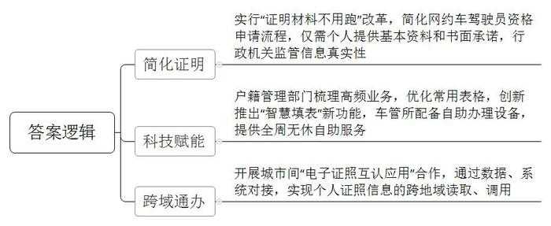
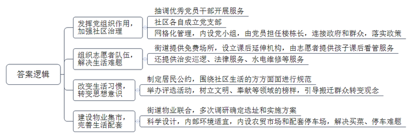
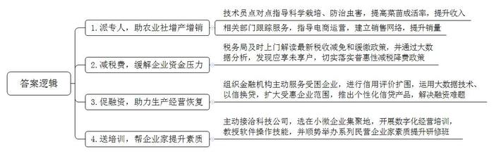

# 2022年公务员多省联考《申论》题（湖北省市县卷）

<!-- gwy:overview:start -->
> **湖北 · 2022 · 申论 · 省市县卷** ｜ 4 题 · 图片 4 处 · 答案随题折叠

导航：[题目](#题目) · [材料 1](#材料-1)
<!-- gwy:overview:end -->

> 候选采集稿。参考答案及解析来自粉笔页面，不代表官方答案或真实高分答卷；来源使用许可与原卷对应关系仍需人工核实。

## 给定材料

### 材料 1

L市交通职业技术学院驾校报名处的大厅里，陆续有人前来报考网约车驾驶员从业资格。“两年前，我来申请过一次。当时的工作人员要求去相关部门开具无犯罪记录、无交通肇事记录等证明材料，流程十分繁琐，有些材料一时难以办理，无奈之下只好放弃。”回忆以往的经历，来办证的小顾说，听说网约车驾驶员资格认证做了改革，个人不需要再提交各类证明，他就想着再试试。

进了报名大厅，小顾在工作人员的引导下，拍了照片，提交了个人基本资料，就办好了报名手续，全程不到3分钟。驾校教务科杨科长介绍：“从前，网约车驾驶员资格认定需要提供好几项证明材料，涉及公安、交管等多个单位，需要报名人自行去开具。现在L市实行‘证明材料不用跑’改革，群众报名网约车驾驶员资格，只要提供个人基本资料，有些事前的证明手续，可以由申请人提交书面承诺，承诺的真实性由行政机关通过信息共享、事中检查、事后核查等方式监管。”

近年来，L市还在“放管服”改革中借用现代科技手段，不断创新便民举措，让群众办事不再难，不再烦。大学刚毕业来到L市工作的小王要为自己办理落户手续，他拿出手机，登录“L市政务通”，点击选择“户籍业务自助预约填表”，填上自己的姓名、身份证号等基本信息后，其他各项信息就自动生成了。填表完成后，系统立刻跳转到预约办理环节，前后只花了2分钟左右。“过去办理户籍相关业务，群众需要在派出所户籍窗口手工填写申请人姓名、出生日期、户籍地等10多项信息，至少耗时15分钟。”市户籍部门相关负责人说，“如遇到填写错误的情况，就得重新填表，耗时又费力；遇到有不会填写的项目，窗口还需安排专门人力现场指导，有些群众因此产生不满情绪。”为方便群众办理业务，户籍管理部门精心梳理了夫妻投靠落户、技能人才落户、出生申报等14项高频户籍业务，优化群众填写的常用业务表格，依托大数据平台和信息化技术手段，创新推出“智慧填表”新功能。

科技赋能带来的办事便利不仅仅在事前，也体现在办理过程中。“网上办”“掌上办”与“自助办”相结合，群众享受的方法越来越多。周末，市民陈先生来到市车辆管理所准备办理驾驶证换证业务。来到车管所大厅后，先进入自助体检机，几分钟后便完成了体检。而后，他使用自助照相机完成了证件照拍摄。最后，他带着材料来到业务窗口处，经检查无误后，这次换证业务便完成了。“现在车管所大厅里的自助机器非常方便，照相、体检都可通过机器自助办理，以前可能需要半天甚至好几天才能办完的业务，如今半个小时左右就完成了！”陈先生说，“而且休息日也可以来自助办理相关业务，不用专门请假，省时又省心！”

推进政务服务“跨省通办”“跨域通办”，是促进要素自由流动、便利群众生活的重要支撑。近年来，L市在改革中不断创新优化服务，满足“移动人群”办事需求，让政务服务便捷度和满意度不断提升。黄先生是邻省M市人，在L市开了一家公司，最近因业务拓展需要变更公司营业执照经营范围。“以前，非L市的电子身份证信息在邻省的工商登记系统中可能无法被识别，只能拿着身份证去现场办理。”黄先生说。这次显然不同，他打开“L市政务通”，亮出电子身份证，经扫码识别，有关信息便上传至L市政务平台，完成了变更登记。黄先生享受到这样的便利，得益于去年L市与M市两地的“电子证照互认应用”合作协议，通过数据、系统的对接，初步实现了个人证照信息的跨地域读取、调用。“其实不仅仅是跨域事项的办理和电子证照的互认。作为普通公民，我深刻地体会到去政府部门办事时，流程越来越简便，规则越来越清晰，指导越来越细致，政府通过优化政务服务，让群众办事越来越便利。”黄先生说。

### 材料 2

“社区很大，共有安置房148栋，安置人口2.9万人。人员众多，而且原来都来自农村，群众生活环境变化大，不适应。”春林易地搬迁安置点建成使用后，老单便来这里担任春林街道办主任。如何有效治理是一个大考验。“区委区政府专门成立了春林街道办事处，通过深入考察，认为我们11个人有经验有能力，就选派我们组成党政班子，后来又从全区抽调了67名优秀的党员干部到安置点开展后续服务。”

老刘已经68岁，是一个老党员，搬迁前在老家当了40年的村干部，原本计划搬进城里安心过退休生活，“不料，搬来没几天，社区干部就找上门，问我愿不愿意当楼栋长。”老刘说，虽然担心自己做不好，但转念一想，“我是党员，得冲在前头做好榜样！”为了更好地进行社区治理，安置点分为3个社区，各自成立党支部。同时实行网格化管理，每个网格设有党小组。每栋楼任命党员为楼栋长，直接联系居民，宣传政策、化解矛盾、收集民意等，均是楼栋长的日常工作。“搬迁后，政府一次性发放的1500元生活补助，是按人发还是按户发？许多群众不清楚。”入户讲解后，老刘又在楼下小广场开会，一条条地给大伙儿解释，还有疑问的，老刘就拿文件给大伙儿看，实在解决不了的问题，就及时向组织反映。“我们楼栋长就是要做连接政府和群众的桥，把党的政策落实到每个群众。”

“每个月有2200元的工资，上班时把孩子送到‘希望小课堂’，有志愿者看管，日子轻松多了。”搬迁户周大姐长松了一口气。因为家中变故，周大姐要独自抚养孩子。她进过工地，卖过小吃，无论做啥，孩子总要带在身边，不然没人照顾。几个月下来，实在无法坚持，她便向街道求助。经过协调，周大姐去附近的鞋厂上班，孩子放学后由志愿者接到“希望小课堂”。“希望小课堂”是街道提供的课后延伸机构。搬迁群众大都要去上班，孩子下课后怎么办，成为很多群众头疼的事情。“街道提供免费场所设立‘希望小课堂’，征集社区志愿者来看管。”老单说，除了“希望小课堂”，社区还组建了治安巡逻、法律服务、水电维修等志愿者队伍。

刚搬迁那会儿，老单经常跟同事一起入户走访，发现不少楼里公共区域乱糟糟的，只好帮着打扫。可等到第二天再去，又是老样子。几次下来，大家发现，群众的生活方式不易转变，规则意识相对缺乏，这给社区治理带来了一定阻力。于是，老单带着3个社区陆续制定居民公约，围绕社会治安、环境卫生、民风民俗、邻里关系等进行规范。制定居民公约只是第一步，街道办还进行“街道之星”评比活动，包括文明家庭之星、奉献之星等七大类，通过树立榜样，引导搬迁群众转变观念，加速融入新生活。“大家从不同的地方搬到这里，初来乍到，肯定会产生很多问题。如果大家都是事不关己的态度，社区得成什么样？”李大叔说。在首届“街道之星”评比中，李大叔光荣当选“奉献之星”。为啥能获奖？因为热心公共事务：孩子打架会去劝，住户扰民会去找，看到垃圾随手捡……

“平时我们买菜得去镇上买，开车过去也要10多分钟，现在集市就在家门口，方便多了。”安置点的孙阿姨得知“物业集市”开业，一大早就赶来“尝鲜”。春林街道虽然人口众多，但刚刚建立起来，生活配套跟不上。周围的居民需要跑到镇上买菜，购物不方便且停车位难找，生活相当不便。“有完善的配套服务，群众才能安居乐业。”老单说，“街道联合物业，经过多次调研敲定了‘物业集市’的选址和实施方案。”“物业集市”整体采用钢结构大棚设计，遮阳避雨，冬暖夏凉，内部设立农贸市场和配套停车场，帮助周边居民及上班族解决“买菜难”“停车难”的问题。

“民生无小事，枝叶总关情。我们希望通过自己实实在在的努力，帮助搬迁群众完成从农民向‘新市民’的转变。”老单说。

### 材料 3

走进F县现代农业示范园区，农民专业合作社负责人老杨正在大棚内侍弄自己培育的瓜果蔬菜苗，一盆盆幼苗在阳光的照射下茁壮生长。“县农村农业局派了技术员点对点指导我们科学栽培，防治虫害，我们的菜苗成活率比以前高多了。去年一年，光种苗我们合作社就卖了500多万株，抛去各种成本，一年下来能有40多万元的纯利润。”说起去年的收入，老杨掩不住内心的喜悦。“以前我们只知道种自家的田，后来随着时代发展，几户人家成立起合作社。”老杨说，种植规模不断扩大，但种植的作物怎么卖出去却让自己觉得力不从心，幸好县里有关部门一路跟着服务，“商务局派了工作人员指导我们怎样做电商，建立销售网络，让我们不愁卖不出去。”

老杨说的是F县帮扶小微企业行动中的一部分。小微企业是国民经济和社会发展的重要基础，在扩大就业、增加收入、改善民生、促进稳定等方面具有举足轻重的作用。“近年来，国家和省里都出台了一系列的政策，扶持小微企业发展，我们县也结合自身实际情况制定了相关的文件，把帮扶小微企业当作‘为群众办实事’活动的重要内容来抓。”F县王县长说。

“作为小企业，我们市场竞争力小，面对突如其来的新冠肺炎疫情，企业发展资金压力很大，是税务局及时上门解读最新的税收减免和缓缴政策，帮助减免了40多万元税款，解了燃眉之急。”未来食品公司蔡经理感激地说。未来食品公司主要经营糕点糖果批发。去年，该企业实现利润总额274万元，原本按25%的税率应缴纳企业所得税61.87万元，由于该企业符合小微企业条件，享受小微企业普惠性减税降费政策，实际仅缴纳企业所得税19.75万元，减免税额达42.12万元。“有些我们这样的小微企业并不了解国家税务政策的变化，是县税务局通过大数据分析，发现了我们这些应享未享户，切实给我们带来了国家减税降费政策的温暖。”

“小微贷情系小微”，在当地一家银行，有这样一面锦旗，7个字饱含了一个企业家对银行有力支持小微企业发展的衷心感谢。送锦旗的纳税人老魏是县一家五金模具厂的老板。受新冠肺炎疫情影响，该企业连续停业2个月，生产经营面临巨大困难。县政府组织多家金融机构主动服务受困企业，提供个性化融资支持服务。银行刘行长说：“我们积极配合县政府的行动，通过信用评价扩围，运用大数据分析技术和‘以信换贷’方式，将受惠企业范围由纳税信用A级和B级扩大至M级，推出多种个性化的信贷产品，最大限度赋能企业渡过难关。”2021年，全县共有183家小微企业获得信用贷款，融资难、融资贵问题得到极大缓解。老魏的模具厂获得了银行线上发放的47.9万元低息信用贷款。“这笔贷款是旱日的甘霖，我们立即用这笔贷款购买开工原材料、支付人员工资等，给我们复工复产带来莫大的信心。”老魏说。

县综合市场石材批发店的老板老黄，凭着不怕吃苦的劲儿，生意越来越好，老伴一笔笔手工记账，很快就赶不上他们生意的节奏了。可石材批发店人手不多，专门雇人记账成本太高。“近年来，随着国家跨入数字时代，数字化运营成为企业的必由之路。”王县长说，“但我们县小微企业离真正的数字化运营还很远，这成为企业发展的一个瓶颈。”县政府主动接洽一家科技公司，对全县小微企业开展数字化经营的专门培训。“目的是帮助小微企业尽快跟上数字化运营的时代步伐，不断做优做强。这是我们为群众办实事的具体实践。”首场培训选在小微企业集中的县综合市场，大家热情高涨，包括老黄在内的近百名企业家参加了数字化运营培训班，老黄很快学会使用数字记账软件，每日、每周、每月的顾客人数、收款笔数、单笔款项等一目了然。看到这些企业如此踊跃参加培训班，县政府又顺势而为举办一系列民营企业家素质提升研修班，也受到众多小微企业的热捧。

“我们县小微企业居多，今后县委、县政府还打算聚焦募集资金难、招工用工荒、市场开拓难等问题，采取实际行动提升小微企业竞争能力。我们要结合本地特色谋发展，比如农村农业局正在协调推进建设商业化育种能力，加大培育抗病虫害的高产果苗，充分发挥本地瓜果个大果甜的特色，目前已经和几所农业科研院所进行了初步接洽。县里还打算找准产业发展方向，通过打造长途蔬菜冷链物流配送体系、发展蔬菜深加工产业等，凝聚小微企业，脚踏实地做大做强产业链。”王县长说。

### 材料 4

“早就想买新能源汽车，可总是担心充电难。看到写字楼地库新增了10多个公共充电桩，我终于下定决心了！”受益于充电桩建设不断提速，K市市民李先生前不久得偿所愿，买下一台新款纯电动汽车。随着新能源汽车在K市越来越受欢迎，充电桩也发展迅猛，已经建成充电桩三万多个，车桩比接近2：1。“市政府的规划是车桩比要达到1：1，但新能源汽车越来越多，充电桩建设的速度还是跟不上。”K市工信局崔局长说，“我市的充电桩建设已经取得很大进展，但也正面临‘成长的烦恼’。”

“家里的车位按年续租、没有产权。按以往经验，物业很难允许安充电桩，可这次却痛快地签了安装协议。”前不久，小钱终于在家门口安上了充电桩。这得益于K市出台的相关规定：用户安装充电桩时，物业需指定专人配合新能源汽车生产企业和属地供电公司勘查现场，提供相关材料，配合办理相关手续。“装是装上了，可是一波三折，等了两周多时间。”小钱说，在小区安充电桩要办理建设用地规划许可证、建设工程规划许可证和施工许可证等，需要填写一堆表格；用电和施工要进行可行性勘查，电力、消防、物业等都得到场，协调时间有难度；物业也设置隐形门槛，以走流程为借口拖着不肯办……“电力负荷不够，可以申请扩容，但扩容这笔钱谁来掏？”物业宋经理也有自己的顾虑，近年来，部分老旧小区已由市供电公司进行电力扩容改造，但改造后又出现了新问题：“私桩无人值守，管理隐患和安全风险都不容小觑，而且责权不清，出事谁负责呢？”

扫码、缴费、插枪……在城郊的新能源汽车充电站里，看着手机屏幕上显示出“正在充电”的字样，出租车司机钟师傅终于长舒了一口气。此前，他送客人到城郊，看到只有百分之三十的电，就用手机导航寻找充电桩，发现周边充电桩很少，最近的离自己也有五六千米。钟师傅开过去一看，却是慢充电桩，充好电要五个多小时，怕耽误接生意，只好继续寻找。最后终于找到了这家充电站，这里是快充电桩，不到一个小时就可以充好。“市区大概一两千米就有快充电桩，城郊就少很多，而且像这个充电站离主干道很远，开车找过来很不容易。”钟师傅的手机里装着四个充电桩应用软件，钟师傅解释说：“我们市的充电桩分属不同平台运营。就怕着急用的时候周围没有熟悉的充电平台，多下载几个应用软件，才能方便寻找和使用，就是操作起来比较繁琐、费时费力。”

“新能源车主最怕啥？怕车子开半路没电。比没电更可怕的是啥？找到充电桩却充不了电。”张先生因为在充电站没法充电，只好打拖车救援电话。原来，这家充电站有100多个充电桩，张先生按操作说明，多次扫码充电，均显示乱码，现场也找不到管理人员。“有的充电桩设备老化，但又没有及时清理，手机软件上显示还在，但实际上无法充电了。”一家充电桩运营公司的周经理说，“有的则是运营公司倒闭了，充电桩的安装成本和运营成本都很高，虽然有政府补贴，但如果公司的规划和实际脱节，公司就很难坚持下去，拆除也要一大笔钱，有的公司就弃置不管了。”

“这是谁的车子，怎么停了这么久？”在一家停车场，保安小刘焦急地大喊。这家停车场共有150多个车位，其中21个是充电车位。由于充电桩是分时段差异化收费，在平时（8时至16时，电价0.6元/度）和峰时（16时至0时，电价超过1元/度），来充电的新能源车较少，而这期间正值商业广场经营高峰期，车位紧张，很多汽油车就会停在新能源车位上。但到了谷时（0时至8时，电价0.3元/度），前来充电的新能源车会增多，部分原先停在新能源车位上的汽油车没有及时开走，使得新能源车充不了电。“经常出现纠纷，我们也很头疼。”小刘说。

小小充电桩，一头连着产业，一头连着民生。“充电桩关系到清洁能源革命和绿色交通发展。”崔局长说，<u>“成长的烦恼总是在成长中化解的。”</u>

## 题目

### 第 1 题

**根据“给定资料1”，请概括L市在优化政务服务方面的主要举措。（15分）**

关联材料：材料 1

作答要求：

要求：全面，准确，有条理，不超过250字。

第 1 题 · 答案与解析

**参考答案（粉笔题库参考内容）**

1.简化证明。实行“证明材料不用跑”改革，简化网约车驾驶员资格申请流程，仅需个人提供基本资料和书面承诺，行政机关监管信息真实性。

2.科技赋能。户籍管理部门梳理高频业务，优化常用表格，创新推出“智慧填表”新功能，车管所配备自助办理设备，提供全周无休自助服务。

3.跨域通办。开展城市间“电子证照互认应用”合作，通过数据、系统对接，实现个人证照信息的跨地域读取、调用。

**解析**

**参考答案说明：**本参考答案从“简化证明”“科技赋能”“跨域通办”三个方面对L市优化政务服务的举措进行了具体展开，各条答案要点之间在内容上相互并列，没有交叉。

**考点**：概括措施类

**来源**：2022年公务员多省联考《申论》题（湖北省市县卷）

### 第 2 题

**根据“给定资料2”，请分析春林街道是如何帮助搬迁群众完成从农民向“新市民”转变的。（20分）**

关联材料：材料 2

作答要求：

要求：准确，清晰，有条理，不超过300字。

第 2 题 · 答案与解析

**参考答案（粉笔题库参考内容）**

1.发挥党组织作用，加强社区治理。抽调优秀党员干部开展服务；社区各自成立党支部；网格化管理，内设党小组，由党员担任楼栋长，连接政府和群众，落实政策。

2.组织志愿者队伍，解决生活难题。街道提供免费场所，设立课后延伸机构，由志愿者提供孩子课后看管服务；还提供治安巡逻、法律服务、水电维修等服务。

3.改变生活习惯，转变思想意识。制定居民公约，围绕社区生活的方方面面进行规范；举办评选活动，树立文明、奉献等领域的榜样，引导搬迁群众转变观念。

4.建设物业集市，完善生活配套。街道物业联合，多次调研确定选址和实施方案；科学设计，内部环境适宜，内设农贸市场和配套停车场，解决买菜、停车难题。

**解析**

**参考答案说明**：本参考答案从“发挥党组织作用，加强社区治理”“组织志愿者队伍，解决生活难题”“改变生活习惯，转变思想意识”“建设物业集市，完善生活配套”四个方面进行了分条撰写，各条要点之间在内容上相互并列，没有交叉。

**考点**：概括措施类

**来源**：2022年公务员多省联考《申论》题（湖北省市县卷）

### 第 3 题

**针对“给定资料3”F县在发展小微企业中存在的困难和问题，提出你的建议。（25分）**

关联材料：材料 3

作答要求：

要求：

（1）全面，准确，有条理；

（2）所提建议具体可行；

（3）不超过350字。

第 3 题 · 答案与解析

**参考答案（粉笔题库参考内容）**

1.派专人，助农业社增产增销。技术员点对点指导科学栽培、防治虫害，提高菜苗成活率，提升收入；相关部门跟踪服务，指导电商运营，建立销售网络，提升销量。

2.减税费，缓解企业资金压力。税务局及时上门解读最新税收减免和缓缴政策，并通过大数据分析，发现应享未享户，切实落实普惠性减税降费政策。

3.促融资，助力生产经营恢复。组织金融机构主动服务受困企业，进行信用评价扩围，运用大数据技术、以信换贷，扩大受惠企业范围，推出个性化信贷产品，解决融资难题。

4.送培训，帮企业家提升素质。主动接洽科技公司，选在小微企业集聚地，开展数字化经营培训，教授软件操作技能，并顺势举办系列民营企业家素质提升研修班。

**解析**

**参考答案说明：**答案分别按照“派专人，助农业社增产增销”“减税费，缓解企业资金压力”“促融资，助力生产经营恢复”“送培训，帮企业家提升素质”这四个方面的建议进行了分条撰写。且对每条要点提炼出了总括词并前置。

**考点**：提出对策类

**来源**：2022年公务员多省联考《申论》题（湖北省市县卷）

### 第 4 题

**“给定资料4”中提到“成长的烦恼总是在成长中化解的”，发展难免会带来新问题，而新问题是新发展的契机。请联系实际，自选角度，自拟题目，写一篇议论文。（40分）**

关联材料：材料 1、材料 2、材料 3、材料 4

作答要求：

要求：

（1）立意明确，观点正确；

（2）思路清晰，语言流畅；

（3）1000-1200字。

第 4 题 · 答案与解析

**参考答案（粉笔题库参考内容）**

**推动新兴民生产业高质量发展**

经济社会的高速发展催生了越来越多的新兴民生产业：智慧医疗、在线教育、新零售……，它们不仅满足了人民日益增长的需求，还为经济发展带来了新机遇。但这些新兴民生产业在发展的过程中，却渐渐暴露出了规划滞后、制度缺失、服务品质低等系列问题。民生产业关乎民生，问题待解决，前路需笃行，要推动新兴民生产业高质量发展，不仅需要具备前瞻性思维和应对解决纠纷的能力，更要不断提升服务水平，始终将人民放在心中。

**更好地应对新兴民生产业，需要着眼未来，做好前瞻性设计。**政府不仅要通过研判未来的发展趋势，制定产业规划，避免因为规划的短视造成长远建设的被动；还要做好及时填补相应的制度空白，健全体制机制。“凡事预则立，不预则废”。从养老服务机构摇号进入，到直播行业虚假宣传、价格误导……这些问题都是由于产业发展初期，政府只从当下需求和利益出发而做出相应的规划设计，但是随着产业不断发展，起初的规划设计逐渐远远落后于现实，导致问题频发。因此，在面对新兴民生产业时，政府部门必须通过研究产业的过去与现在，根据产业发展规模和速度的趋势，制定出具有可预见性的计划与部署，并且提前出台支撑产业发展的政策体系，为新事物打造良好的发展环境。

**更好地应对新兴民生产业，需要坚持以人为本，提升服务质量。**既要推进服务便利化，让群众轻松容易地获取服务；也要推进服务精细化，力争做好每个细节，加强各环节的衔接；还要加大投入，促进服务持续升级，让群众享受到更优质的服务。民生产业为人民，必须坚持以人民为中心，将群众需求放到首位，不断推动服务向便利化、精细化、优质化转型，加快新兴民生产业高质量发展。正如新材料产业通过特殊技术，为人们提供衣食住行新体验；新零售产业打通线上线下，给消费者带来更加贴心的服务。我们既要转变思维，想人民之所想，创新服务内容，还要查缺补漏，不断精进，强化资金支持，持续优化服务水平，让人民群众充分享受新兴民生产业发展红利。

**我们更应该认识到，作为与人直接发生联系的民生产业，必然少不了摩擦纠纷的发生，这就需要做好应对工作。**当纠纷发生时，要快速反应，第一时间处理；同时，针对频发、易发的纠纷，要在工作中总结出明确的处理方法、流程，提升处置效果。“前途是光明的，道路是曲折的”。从共享行业泄露个人信息，到人工智能冲击传统产业，再到新能源汽车充电难……不可否认，我国在新兴民生产业发展过程中存在问题，引起了人们的质疑和批判，制约了产业的进一步发展。如何快速解决并避免类似情况发生呢？一方面，我们要全面了解并根据实际情况，快速给出合理处置，做好解释工作，避免事态扩大；另一方面，要认真分析问题产生的深层次原因，通过完善制度、规范管理等方式堵塞漏洞，构建长效处理机制。

春天的道路依然充满泥泞。回顾过去，我们曾经面对很多看似难以克服的问题，但发展本身正是一个不断解决问题的过程。相信通过不断提高治理能力，新兴民生产业的发展必将蹄疾步稳、充满活力。

**解析**

**文章分析**

**推动新兴民生产业高质量发展**

【**标题的优点：**标题中含有主题词，使文章主题更突出、清晰。】

（1）经济社会的高速发展<u>催生了越来越多的新兴民生产业</u>：<u>智慧医疗、在线教育、新零售</u>……，它们不仅<u>满足了人民日益增长的需求</u>，还<u>为经济发展带来了新机遇</u>。（2）但这些新兴民生产业在发展的过程中，却<u>渐渐暴露出了规划滞后、制度缺失、服务品质低</u>等系列问题。（3）民生产业关乎民生，问题待解决，前路需笃行，要推动新兴民生产业高质量发展，不仅<u>需要具备前瞻性思维和应对解决纠纷的能力</u>，更要<u>不断提升服务水平</u>，<u>始终将人民放在心中</u>。

【**开头的优点：**★内容方面。范文的开头是紧扣题目给定的“新兴民生产业发展”这一主题展开的。（1）介绍了新兴民生产业发展的良好态势及影响；（2）指出了当前新兴民生产业发展中存在的问题；（3）从整体上指出了推动新兴民生产业发展的措施。★文字表达方面。使用了“不仅……还”“但……”“不仅……更”等连接词，使语言表达具有严谨的逻辑性。】

**更好地应对新兴民生产业，需要着眼未来，做好前瞻性设计。政府不仅要通过研判未来的发展趋势，制定产业规划，避免因为规划的短视造成长远建设的被动；还要做好及时填补相应的制度空白，健全体制机制。**（1）“凡事预则立，不预则废”。从养老服务机构摇号进入，到直播行业虚假宣传、价格误导……<u>这些问题都是由于产业发展初期</u>，<u>政府只从当下需求和利益出发而做出相应的规划设计</u>，但是<u>随着产业不断发展</u>，<u>起初的规划设计逐渐远远落后于现实</u>，<u>导致问题频发</u>。（2）因此，在面对新兴民生产业时，<u>政府部门必须通过研究产业的过去与现在</u>，<u>根据产业发展规模和速度的趋势</u>，<u>制定出具有可预见性的计划与部署</u>，并且<u>提前出台支撑产业发展的政策体系</u>，<u>为新事物打造良好的发展环境</u>。

【**论述段1的优点：**★观点句：范文的观点句是紧扣“新兴民生产业发展”这一文章主题提出的。形式上，它在段首处直接写出，位置突出，容易发现。内容上，关键词突出，内容要点明确，可以明显看出是从“前瞻规划”角度，对“促进新兴民生产业发展”展开了论述。★论述内容：（1）以养老服务业、直播行业为例，指出了当前民生产业存在的问题及原因；（2）指出了政府部门应当立足过去与现在，对新兴民生产业做出科学合理的规划。注意：以上两个方面的内容都是紧扣“更好地应对新兴民生产业，需要着眼未来，做好前瞻性设计。政府不仅要通过研判未来的发展趋势，制定产业规划，避免因为规划的短视造成长远建设的被动；还要做好及时填补相应的制度空白，健全体制机制”这个观点句进行分析论述的，论述的针对性强，内容层次丰富。在论述方法上采用了摆事实、讲道理相结合的方式，论述清晰透彻。】

**更好地应对新兴民生产业，需要坚持以人为本，提升服务质量。既要推进服务便利化，让群众轻松容易地获取服务；也要推进服务精细化，力争做好每个细节，加强各环节的衔接；还要加大投入，促进服务持续升级，让群众享受到更优质的服务。**（1）<u>民生产业为人民</u>，<u>必须坚持以人民为中心</u>，<u>将群众需求放到首位</u>，<u>不断推动服务向便利化、精细化、优质化转型</u>，<u>加快新兴民生产业高质量发展</u>。正如新材料产业通过特殊技术，为人们提供衣食住行新体验；新零售产业打通线上线下，给消费者带来更加贴心的服务。（2）我们<u>既要转变思维</u>，<u>想人民之所想</u>，<u>创新服务内容</u>，<u>还要查缺补漏</u>，<u>不断精进</u>，<u>强化资金支持</u>，<u>持续优化服务水平</u>，<u>让人民群众充分享受新兴民生产业发展红利</u>。

【**论述段2的优点：**★观点句：范文的观点句是紧扣“新兴民生产业发展”这一文章主题提出的。形式上，它在段首处直接写出，位置突出，容易发现。内容上，关键词突出，内容要点明确，可以明显看出是从“提升服务质量”角度，对“促进新兴民生产业发展”展开了论述。★论述内容：（1）指出了要重视群众需求，推进民生服务向高质量水平跃进；（2）指出了要转变思维，创新民生服务，让群众享受发展红利。注意：以上两个方面的内容都是紧扣“更好地应对新兴民生产业，需要坚持以人为本，提升服务质量。既要推进服务便利化，让群众轻松容易地获取服务；也要推进服务精细化，力争做好每个细节，加强各环节的衔接；还要加大投入，促进服务持续升级，让群众享受到更优质的服务”这个观点句进行分析论述的，论述的针对性强，内容层次丰富。在论述方法上采用了摆事实、讲道理相结合的方式，论述清晰透彻。】

**我们更应该认识到，作为与人直接发生联系的民生产业，必然少不了摩擦纠纷的发生，这就需要做好应对工作。当纠纷发生时，要快速反应，第一时间处理；同时，针对频发、易发的纠纷，要在工作中总结出明确的处理方法、流程，提升处置效果。**（1）“前途是光明的，道路是曲折的”。从共享行业泄露个人信息，到人工智能冲击传统产业，再到新能源汽车充电难……不可否认，<u>我国在新兴民生产业发展过程中存在问题</u>，<u>引起了人们的质疑和批判</u>，<u>制约了产业的进一步发展</u>。（2）如何快速解决并避免类似情况发生呢？一方面，<u>我们要全面了解并根据实际情况</u>，<u>快速给出合理处置</u>，<u>做好解释工作</u>，<u>避免事态扩大</u>；另一方面，<u>要认真分析问题产生的深层次原因</u>，<u>通过完善制度、规范管理等方式堵塞漏洞</u>，<u>构建长效处理机制</u>。

【**论述段3的优点：**★观点句：范文的观点句是紧扣“新兴民生产业发展”这一文章主题提出的。形式上，它在段首处直接写出，位置突出，容易发现。内容上，关键词突出，内容要点明确，可以明显看出是从“应对摩擦纠纷”角度，对“促进新兴民生产业发展”展开了论述。★论述内容：（1）以共享行业、人工智能产业为例，指出了我国新兴民生产业的问题及影响；（2）从避免事态扩大、完善制度与管理方式的角度，提出了解决问题的措施。注意：以上两个方面的内容都是紧扣“我们更应该认识到，作为与人直接发生联系的民生产业，必然少不了摩擦纠纷的发生，这就需要做好应对工作。当纠纷发生时，要快速反应，第一时间处理；同时，针对频发、易发的纠纷，要在工作中总结出明确的处理方法、流程，提升处置效果”这个观点句进行分析论述的，论述的针对性强，内容层次丰富。在论述方法上采用了摆事实、讲道理相结合的方式，论述清晰透彻。】

【**论述段之间的关系：**三个论述段分别从“前瞻规划”“提升服务质量”“应对摩擦纠纷”等三个角度，对文章主题“新兴民生产业发展”展开了论述，在内容上，彼此之间呈现出并列的逻辑。】

春天的道路依然充满泥泞。回顾过去，我们曾经面对很多看似难以克服的问题，但发展本身正是一个不断解决问题的过程。相信通过<u>不断提高治理能力</u>，<u>新兴民生产业的发展必将蹄疾步稳、充满活力</u>。

【**结尾的优点：**范文的结尾回扣了“新兴民生产业发展”这个主题，并且进行了总结升华。】

**考点**：文章写作题

**来源**：2022年公务员多省联考《申论》题（湖北省市县卷）

