# 2022 湖北省公务员录用考试 行测（统考）

> 行测 · 125 题 · 湖北 2022

## 第 1 题　qid 5102128 · 时事政治

中国共产党十九届六中全会决定，党的二十大将于2022年下半年在北京召开。下列有关党的二十大的说法正确的有几项：
①党的二十大，是我们党进入全面建设社会主义现代化国家、向第二个百年奋斗目标进军新征程的重要时刻召开的一次十分重要的代表大会
②代表产生程序的5个主要环节是：推荐提名、组织考察、确定代表候选人初步人选、确定代表候选人预备人选、会议选举
③党的二十大代表的选举要严格资格条件，坚持把政治标准放在首位
④党的二十大代表名额共2300名，与十九大时相同

- **A**. 1项
- **B**. 2项
- **C**. 3项
- **D**. 4项

## 第 2 题　qid 5102123 · 新思想

2022年3月，习近平总书记在看望参加政协会议的社会福利和社会保障界委员时强调，要在推动社会保障事业高质量发展上持续用力，织密社会保障安全网，为人民生活安康托底。下列做法有助于推动社会保障事业高质量发展的有几项：
①加大对因疫因灾遇困群众的临时救助力度
②保障流浪乞讨人员人身安全和基本生活，关心关爱精神障碍人员
③健全灵活就业人员社保制度，扩大失业、工伤、生育保险的覆盖面
④健全社会保障基金监管体系，严厉打击欺诈骗保、套保和挪用贪占各类社会保障资金的违法行为

- **A**. 1项
- **B**. 2项
- **C**. 3项
- **D**. 4项

## 第 3 题　qid 5102125 · 时事政治

2022年，按照以习近平同志为核心的党中央的部署要求，为稳定宏观经济大盘，稳定上亿市场主体，各部门多措并举优化和落实助企纾困政策，为经济平稳运行提供有力支撑。下列属于“稳主体”对策的是：
①实施大规模留抵退税政策
②对特困行业实行阶段性缓缴养老保险费
③中国人民银行宣布下调金融机构存款准备金率
④设立3岁以下婴幼儿照护个人所得税专项附加扣除
⑤央行、银保监会发布个人首套房商贷利率下限调整

- **A**. 2项
- **B**. 3项
- **C**. 4项
- **D**. 5项

## 第 4 题　qid 5102126 · 新思想

习近平总书记强调，必须深化对新的时代条件下我国各类资本及其作用的认识，规范和引导资本健康发展，发挥其作为重要生产要素的积极作用。下列对资本的认识不准确的是（    ）。

- **A**. 在社会主义市场经济体制下，资本是带动各类生产要素集聚配置的重要纽带
- **B**. 资本具有逐利本性，如不加以规范和约束，就会给经济社会发展带来不可估量的危害
- **C**. 要加强资本领域反腐败，保持反腐败高压态势，坚决打击以权力为依托的资本逐利行为
- **D**. 要正确处理资本和利益分配问题，既注重维护按劳分配的主体地位，更注重保障资本参与社会分配获得增殖和发展

## 第 5 题　qid 5102121 · 新思想

2022年5月10日，习近平总书记在庆祝中国共产主义青年团成立100周年大会上发表重要讲话，激励广大青年团员在实现中华民族伟大复兴中国梦的新征程上奋勇前进。下列有关中国共产主义青年团表述不正确的是：

- **A**. 团的地方组织和基层组织同时受同级党委和团的上级组织领导
- **B**. 中国共产主义青年团受中国共产党的委托领导中国少年先锋队的工作
- **C**. 团旗上环绕黄色五角星周围的黄色圆圈，象征中国青年一代紧密团结在中国共产党周围
- **D**. 团员在加入共产党后或年满二十八周岁、没有在团内担任职务的情况下，不再保留团籍

## 第 6 题　qid 5102122 · 人文常识

《中共中央 国务院关于加快建设全国统一大市场的意见》于2022年4月发布，提出从全局和战略高度加快建设全国统一大市场。下列做法符合建设全国统一大市场要求的是：

- **A**. 统一产权交易信息发布机制，实现全国产权交易市场联通
- **B**. 以集中管理代替市场机制，统一市场价格、商品供给和配给渠道
- **C**. 严格落实“负面清单准入”管理模式，要求各地主管部门根据实际情况及时发布具有市场准入性质的负面清单
- **D**. 指导各地区综合比较优势、资源环境承载能力、产业基础、防灾避险能力等因素，搞好“小而全”的自我小循环

## 第 7 题　qid 5102118 · 人文常识

2022年，中央一号文件《中共中央 国务院关于做好2022年全面推进乡村振兴重点工作的意见》明确提出“三农”工作的首要任务是“全力抓好粮食生产和重要农产品供给”。下列选项错误的是：

- **A**. 大力推进北方设施蔬菜、北菜南运基地建设，提高蔬菜应急保供能力
- **B**. 坚持中国人的饭碗任何时候都要牢牢端在自己手中，饭碗主要装中国粮
- **C**. 全面落实粮食安全党政同责，严格粮食安全责任制考核，确保粮食播种面积稳定
- **D**. 坚持和加强党对“三农”工作的全面领导，牢牢守住保障国家粮食安全和不发生规模性返贫两条底线

## 第 8 题　qid 5102119 · 科技常识

新时代需要继承发扬以国家民族命运为己任的爱国主义精神，更需要继承发扬以爱国主义为底色的科学家精神。在中华民族伟大复兴的征程上，一代又一代的科学家不畏艰难，勇攀高峰，无私奉献，为国家和人民做出了彪炳史册的重大贡献。下列科学家与其成就对应关系正确的是：
①“两弹一星”元勋——于敏
②北斗三号卫星首席总设计师——谢军
③中国核潜艇第一任总设计师——赵忠尧
④新中国飞机空气动力设计奠基人——顾诵芬
⑤中国脊髓灰质炎疫苗研发生产拓荒者——汤飞凡

- **A**. ①③④
- **B**. ②③⑤
- **C**. ①②④
- **D**. ②④⑤

## 第 9 题　qid 5102137 · 法律常识

某市为保护当地的湿地自然景观，制定颁布了《X市湿地保护办法》，禁止私自采掘、捕捞、打猎等行为。张某闲来无事，前往湿地景区游玩，看到两只受伤野鸭便顺手捡起，准备带回家去。在回家路上，张某携带的野鸭被正在巡逻的警察发现，警察依据《X市湿地保护办法》对其处以1000元罚款。张某不服，欲提起行政诉讼，下列说法错误的是：

- **A**. 张某可以就罚款决定提起诉讼
- **B**. 张某认为《X市湿地保护办法》违背上位法规定，可以只就其合法性提起诉讼
- **C**. 张某可以提供行政行为违法的证据，提供的证据不成立的，不免除公安机关的举证责任
- **D**. 公安机关对作出的行政行为负有举证责任，应当提供作出该行政行为的证据和所依据的规范性文件

## 第 10 题　qid 5102139 · 科技常识

关于下列诗句均描述了一种生物学现象，对其解释错误的是：

- **A**. “儿童急走追黄蝶，飞入菜花无处寻”体现动物的拟态
- **B**. “春色满园关不住，一枝红杏出墙来”体现植物的向光性
- **C**. “落红不是无情物，化作春泥更护花”体现微生物的分解作用
- **D**. “人间四月芳菲尽，山寺桃花始盛开”体现植物开花受温度影响

## 第 11 题　qid 5102145 · 科技常识

关于安全生产管理工作，下列说法正确的是：

- **A**. 机关、团体、企业、事业等单位应当对建筑消防设施每季度至少进行一次全面检测
- **B**. 未造成人员伤亡的一般事故，县级人民政府可以委托事故发生单位组织事故调查组进行调查
- **C**. 交通运输主管部门负责危险化学品的公共安全管理，核发剧毒化学品购买许可证、剧毒化学品道路运输通行证
- **D**. 安全生产监督管理部门和负有安全生产监督管理职责的有关部门逐级上报事故情况，每级上报的时间不得超过1小时

## 第 12 题　qid 5102403 · 人文常识

在日常生活中，长期来看下列杯子的使用方法对人体最没有危害的是：

- **A**. 用玻璃杯喝冰橙汁
- **B**. 用不锈钢杯喝碳酸饮料
- **C**. 用塑料杯盛放刚烧开的水
- **D**. 用内壁涂有彩釉的陶瓷杯喝热姜汁

## 第 13 题　qid 5102133 · 人文常识

传统的光刻技术中，镜头与光刻胶之间的介质是空气，而浸入式技术是将空气介质换成液体，得到合适波长的光，以提高成像分辨率，以下说法错误的是：

- **A**. 液体局部温度起伏会引起成像质量恶化
- **B**. 为了减少液体对光线的吸收，液层厚度不能太大
- **C**. 以纯水为介质时，可以选取任意波长紫外光为光源
- **D**. 可以注入高折射率的液体以得到更高频率的光，提高成像分辨率

## 第 14 题　qid 5102375 · 人文常识

“揭榜挂帅”是通过高额悬赏征集科技创新成果，把需要攻关的科研项目张榜，谁有本事谁就揭榜。这充分体现了国家对改革科研项目管理模式、提高科技创新支撑能力的高度重视。下列说法不准确的是：

- **A**. 采取“一对一”的揭榜方式
- **B**. 支持企业牵头组建的创新联合体“揭榜攻关”
- **C**. 是一种以科研成果来兑现的科研经费投入体制
- **D**. “政府搭台、创新唱戏”将各自的资源优势有力整合到一起

## 第 15 题　qid 5102374 · 人文常识

下列典故，表达的文化内涵相同的一项是：

- **A**. 陆绩怀橘、六子尽赤
- **B**. 结草衔环、曾子烹彘
- **C**. 黄粱美梦、梦笔生花
- **D**. 程门立雪、子贡结庐

## 第 16 题　qid 5102310 · 人文常识

古代绘画艺术是中华文明的重要组成部分，下列有关说法正确的是：

- **A**. 元代和明代画家常绘的《雪夜访戴图》取材于《幽明录》的记载
- **B**. 本生故事画是敦煌壁画中的流行题材
- **C**. 东晋著名画家顾恺之被誉为画圣
- **D**. 《潇湘竹石图》是苏辙的名画

## 第 17 题　qid 5102132 · 经济常识

下列关于金融产品的说法正确的是：

- **A**. 金融产品价格波动属于信用风险
- **B**. 在开放基金中风险最低的是混合型基金
- **C**. 存款保险制度的保障范围不包括银行自营的理财产品
- **D**. 金融产品的风险由大到小排序：金融债券＞股票＞储蓄产品

## 第 18 题　qid 5102143 · 科技常识

下列关于伟大科学工程的说法，正确的是：

- **A**. 阿波罗计划：1961年在美国启动，尤里·加加林乘坐阿波罗1号宇宙飞船第一个登上月球表面
- **B**. 中国863计划：1986年在中国启动，深海载人潜水器被列为该计划的研究专项之一
- **C**. 人类基因组计划：1990年在法国启动，聚焦测定人染色体DNA序列，以破译遗传信息为目的
- **D**. 人类脑计划：1997年在英国启动，以心理科学和信息科学研究为核心

## 第 19 题　qid 5102377 · 科技常识

高脂血症的临床表现主要是脂质在皮肤内沉积引起的黄色瘤和脂质在血管内皮沉积所引起的动脉粥样硬化，然而，多数患者并无明显症状和异常体征。下列关于这种疾病的说法正确的是：

- **A**. 患者日常饮食中的油脂摄入应当以动物油为主
- **B**. 只有肥胖者才会得高脂血症
- **C**. 血液中的部分脂质过高
- **D**. 容易引起白血病

## 第 20 题　qid 5102319 · 人文常识

丙烯酰胺被世界卫生组织列为2A级致癌物，即可疑致癌物。食品中的丙烯酰胺并不是人为添加到食物中，而是在烘焙或烹饪过程中产生的，下列烹饪手法中生成丙烯酰胺最少的是：

- **A**. 干煸四季豆
- **B**. 炸油条
- **C**. 白灼虾
- **D**. 炝炒白菜

## 第 21 题　qid 5102382 · 逻辑填空

中华传统节日的文化内涵蕴藏在人与自然、人与他人、人与自身的相处之道中，体现了中华民族的核心价值观念，而        其中的则是对“和”的追求。
填入划横线部分最恰当的一项是：

- **A**. 分列
- **B**. 统贯
- **C**. 包含
- **D**. 纵横

## 第 22 题　qid 5102187 · 逻辑填空

修炼挨批评这项基本功，要有虚心接受的气度。接受批评，就要拿出虚心以待、胸怀若谷的姿态，砥砺            、从善如流的自觉。
填入划横线部分最恰当的一项是：

- **A**. 见贤思齐
- **B**. 洗心革面
- **C**. 兼听则明
- **D**. 闻过则喜

## 第 23 题　qid 5102183 · 逻辑填空

改革和法治如鸟之两翼、车之两轮。党的十八大以来，全面深化改革的一个鲜明特点，就是把法治贯穿于改革全过程，在法治下推进改革、在改革中完善法治，保证改革和法治相互促进、            。
填入划横线部分最恰当的一项是：

- **A**. 交相辉映
- **B**. 相映成趣
- **C**. 相得益彰
- **D**. 相为表里

## 第 24 题　qid 5102212 · 逻辑填空

文化自信是更基础、更广泛、更深厚的自信，是一个国家、一个民族发展中最基本、最深沉、最持久的力量。人类社会与文明的每一次        ，无不伴随着文化的历史性进步。纵览历史长河，无论是传统还是现代社会治理结构和治理体系中，文化发展无不         、推动着社会的发展和完善。
依次填入划横线部分最恰当的一项是：

- **A**. 跨越 滋补
- **B**. 跃进 滋养
- **C**. 变迁 滋润
- **D**. 突破 滋生

## 第 25 题　qid 5102389 · 逻辑填空

这款奥运比赛服，将国旗色与故宫传统色相结合，在色彩的渐变中，“飞龙”腾空而起，        在祥云瑞气之中，        吉祥如意的祝福与祈愿。
依次填入划横线部分最恰当的一项是：

- **A**. 掩护 包涵
- **B**. 掩映 饱含
- **C**. 掩藏 包容
- **D**. 掩盖 包含

## 第 26 题　qid 5102213 · 逻辑填空

由我国自营勘探开发的首个1500米超深水大气田“深海一号”在海南岛东南陵水海域正式投产，标志着中国海洋石油勘探开发能力全面进入“超深水时代”，对保障国家能源安全、        能源结构转型升级和提升我国深海资源开发能力具有重要意义，建设海洋强国迈出了        的一步。
依次填入划横线部分最恰当的一项是：

- **A**. 促使 坚决
- **B**. 推动 坚实
- **C**. 鼓动 坚定
- **D**. 提高 坚韧

## 第 27 题　qid 5102211 · 逻辑填空

中国的全面小康，犹如一幅前后相续的长卷，有            的创业征程，有气壮山河的建设浪潮，有波澜壮阔的改革探索，也有拥抱世界的        襟怀。在这条路上，我们用几十年时间，走完了发达国家几百年走过的发展历程；我们用一百年的奋斗，实现了中华民族伟大复兴中国梦的关键一步。
依次填入划横线部分最恰当的一项是：

- **A**. 餐风宿露 开明
- **B**. 筚路蓝缕 开放
- **C**. 栉风沐雨 开朗
- **D**. 艰苦卓绝 开拓

## 第 28 题　qid 5102210 · 逻辑填空

脱贫攻坚精神是不断创造伟大奇迹的有力武器。贫穷是人类文明社会的顽疾，但贫穷不是不可改变的        ；贫穷不是社会主义，社会主义必须努力摆脱贫穷。脱贫攻坚伟大胜利成果来之不易，在脱贫攻坚这场与贫穷作斗争的硬仗中，党带领广大人民群众逢山开路、遇水搭桥、开拓创新，使贫困群众的生活状况、精神风貌发生了历史性变化，这场规模浩大的伟大斗争实现了            、载入史册的胜利。
依次填入划横线部分最恰当的一项是：

- **A**. 命运 叹为观止
- **B**. 归宿 登峰造极
- **C**. 使命 绝无仅有
- **D**. 宿命 史无前例

## 第 29 题　qid 5102215 · 逻辑填空

低碳转型是牵涉供应端和消费端全链条的        工程，不仅需要各行各业攻坚克难的决心，也需要我们每个人            的行动。夏天把空调温度调高一些，尽量购买节能型用品，积极参与义务植树活动，每个人都为地球的“凉热”出一份力。只有让低碳成为新风尚、新潮流，才能与技术革新形成合力。
依次填入划横线部分最恰当的一项是：

- **A**. 核心 事必躬亲
- **B**. 系统 脚踏实地
- **C**. 特殊 持之以恒
- **D**. 浩大 厚积薄发

## 第 30 题　qid 5102253 · 逻辑填空

在斗争中诞生、在斗争中发展、在斗争中壮大，一百年来，不怕牺牲、英勇斗争的伟大精神贯穿于革命、建设、改革各个时期，        成我们党历经百年风雨而风华正茂、饱经磨难而            的精神基因。
依次填入划横线部分最恰当的一项是：

- **A**. 锤炼 永不言败
- **B**. 锻造 百折不挠
- **C**. 磨炼 九死不悔
- **D**. 熔铸 生生不息

## 第 31 题　qid 5102182 · 逻辑填空

奋斗者永远是年轻的。青春与否，无关乎年龄，而在于心境。用奋斗        时代，用拼搏定义未来，这不仅是年轻人该有的追求，更是每个与时代同行者应有的姿态。奋斗不息，青春不朽。让我们以梦为马，不负韶华，在奋勇搏击中放飞青春梦想，在            中激扬青春力量。
依次填入划横线部分最恰当的一项是：

- **A**. 礼赞 砥砺前行
- **B**. 拥抱 继往开来
- **C**. 顺应 一往无前
- **D**. 讴歌 风雨兼程

## 第 32 题　qid 5102185 · 逻辑填空

党的十八大以来，习近平总书记始终            、以上率下，带头严格执行中央八项规定，以行动作无声的号令、以身教作执行的榜样，为全党改进作风提供了强大动力。从八项规定到八项规定实施细则，研究同样的内容并进一步深化细化，释放出            将作风建设进行到底的鲜明信号。
依次填入划横线部分最恰当的一项是：

- **A**. 高瞻远瞩 一如既往
- **B**. 以身作则 一以贯之
- **C**. 克己奉公 久久为功
- **D**. 身先士卒 驰而不息

## 第 33 题　qid 5102360 · 逻辑填空

衡量民众对美好生活需要的满足状况，获得感无疑是一个重要的社会心态        。而获得感的        ，需要个体的持续努力，也需要政府和社会的赋能。共同富裕、教育减负、生育友好等国家战略和政策，都是有效的赋能方式，既可以直接        社会成员的负担，也有助于培养更加朝气蓬勃的社会生态，进而从体制机制上保障获得感的可持续性。
依次填入划横线部分最恰当的一项是：

- **A**. 标志 获取 减少
- **B**. 标准 增强 释放
- **C**. 指标 提升 减轻
- **D**. 准绳 巩固 降低

## 第 34 题　qid 5102181 · 逻辑填空

中国空间站名为“天宫”，是一个长期在近地轨道运行的空间实验室。这个极具中国        的名字，不仅蕴含了希望航天员在太空工作生活得更为        的愿望，更        着中国人遨游太空的浪漫情怀和不懈探索的精神。
依次填入划横线部分最恰当的一项是：

- **A**. 韵味 舒适 寄寓
- **B**. 意蕴 舒服 涵盖
- **C**. 特色 惬意 象征
- **D**. 智慧 适意 承载

## 第 35 题　qid 5102184 · 逻辑填空

有统计表明，由听力障碍者组成的家庭中，约90%育有听力正常子女。他们因出生于听障家庭，常常处在听障、健听两个世界的边缘地带。他们可能既无法真正        听障者世界，也不被听人世界完全        。他们面临普通人无法想象的挫折和压力，比如语言        迟缓、人际沟通障碍等，社会应给予他们更多的关注。
依次填入划横线部分最恰当的一项是：

- **A**. 融入 接纳 习得
- **B**. 汇入 接受 发展
- **C**. 进入 纳入 获取
- **D**. 深入 接收 运用

## 第 36 题　qid 5102218 · 片段阅读

叙事医学是一种具有叙事能力的医学实践，而叙事能力是指能够吸收、解释并被疾病的故事所感动的能力。这种能力有助于临床医生在医疗活动中提升对患者的共情能力、职业精神、亲和力和自我行为的反思。叙事医学要求医生在临床决策过程中倾听病人的叙事，关注家属等社会关系人的叙事。这样，医生才可以获取更多有助于临床决策的信息，才能作出正确的疾病诊断，提出最适合病人的决策建议，最后和患方共同作出首先保障病人利益，又能平衡各方权益的诊疗选择。
这段文字意在说明：

- **A**. 叙事医学有助于医患共同决策
- **B**. 叙事医学可化解当下医疗分歧
- **C**. 叙事医学可避免技术至上误区
- **D**. 叙事医学有利于当前医学实践

## 第 37 题　qid 5102363 · 片段阅读

铝是一种很容易发生化学反应的物质，即使只放置在空气中，也会与氧发生反应，在表面形成氧化铝层。这种与氧发生反应、被其他物质夺走电子的化学反应称为“氧化”；与此相反，从其他物质夺取电子的化学反应则称为“还原”。普通金属与氧发生反应后会生锈（氧化物等的化合物）而被腐蚀，但是，如果像铝那样整个表面很快就覆盖上一层膜的话，膜下面的铝就不能再与氧发生反应。也就是说，多亏了铝具有容易发生化学反应（易氧化）这一性质，所以才能防止下层的铝继续氧化（生锈）。
从这段文字可以推出：

- **A**. 铝容易氧化，但膜不容易生锈
- **B**. 铝虽容易氧化，但也容易还原
- **C**. 铝既容易生锈，也不容易生锈
- **D**. 铝不仅容易氧化，还容易生锈

## 第 38 题　qid 5102263 · 片段阅读

制造与服务融合是智能制造的重要内容之一，服务要素渗透到制造各个环节中形成了生产性服务与制造服务化。本文从工业互联网的商业视角、使用视角、功能视角、实现视角建立了制造与服务融合中虚拟逻辑与实体活动交互的技术体系，有针对性地提出了生态位驱动、供应链驱动、大数据驱动、物联网驱动的制造与服务融合方法。本文构建的制造与服务融合技术体系，深化了工业互联网在制造业与服务业中的应用，为数字经济中制造服务产业的技术创新奠定了基础。
如果这是一篇论文的摘要，那么这篇论文的标题最有可能是：

- **A**. 数字经济中制造与服务融合的协同机制
- **B**. 四轮驱动下的制造与服务融合技术体系
- **C**. 工业互联网在智能制造中的体系化应用
- **D**. 基于工业互联网的制造与服务融合技术

## 第 39 题　qid 5102385 · 片段阅读

进入数字经济时代，数据成为一种重要生产要素，是国家核心战略资源和社会重要财富。2021年世界互联网大会乌镇峰会发布的《中国互联网发展报告2021》显示，2020年中国数字经济规模达到39.2万亿元，占GDP比重达38.6%，保持9.7%的高位增长速度，成为稳定经济增长的关键动力。在数字经济时代，安全是前提，更是基座。确保数据安全成为进一步激发数字经济活力、保障数字经济健康发展的基础手段。
接下来最不可能讲的是：

- **A**. 保障数据安全的重要性
- **B**. 多措并举保障数据安全
- **C**. 通过立法保障数据安全
- **D**. 全链条、全生命周期、全场景保护数据安全

## 第 40 题　qid 5102219 · 片段阅读

人脸识别的相关应用需要公民肖像做支撑，因此，肖像权是人脸识别过程中最有可能受到侵害的权利。在人们看来，人脸识别当然是识别人脸。但实际上，人脸识别图像上显示的是人脸，不过后台能够看见的画面已不局限在人脸范围，这样的人脸识别采集图像，的确有“说话不算数”之嫌。进一步说来，如此人脸识别的App在法律上也涉嫌越权或者侵权。人脸识别只能采集公民主动提供人脸的图像信息，一旦采集范围扩大，将人脸周围的图像、公民所处的环境、正在从事的行为等信息进行采集，将侵犯公民不愿暴露的隐私。
下列选项与文段意思不符的是：

- **A**. 扩大人脸识别采集范围有可能侵害公民隐私权
- **B**. 摄像头采集人脸周围的图像扩大了采集的范围
- **C**. 公民应主动提供人脸的图像信息并享有知情权
- **D**. 公民肖像权在人脸识别过程中最有可能受侵害

## 第 41 题　qid 5102260 · 片段阅读

目前，牙科医生治疗受损牙齿使用的修复物由人造材料制成，而固定修复物所用的商业用胶，在性能和化学组成方面与天然牙组织——牙质有很大不同。因此，修复物与真牙结合得不太好，有时甚至会脱落。天然羟基磷灰石存在于牙齿、蛋壳等组织中，在其基础上制作的新黏合剂可模拟牙质的特性和结构。为检验新黏合剂的效果，科研人员将修复物放在真牙上，部分修复物用新黏合剂固定，另一部分以商业牙科用胶固定。结果显示，新型黏合剂由于与天然牙组织高度相似，可以更牢固地黏合人造修复材料。
下列说法与上述语段意思不符的是：

- **A**. 类似牙齿的天然材料可治疗牙齿受损部分
- **B**. 蛋壳中提取的羟基磷灰石可制成牙科黏合剂
- **C**. 新型黏合剂与天然牙组织的特性和结构相似
- **D**. 商业牙科用胶在固定牙科修复物时的黏性比不上新型黏合剂

## 第 42 题　qid 5102256 · 片段阅读

在人口老龄化趋势加快和经济社会快速转型的背景下，社会适老化改造已经到了刻不容缓的地步。根据第七次全国人口普查数据，我国60岁及以上老年人口达2.6亿，占全国总人口的18.7%，且老年人口规模还在持续快速增长。但我国城乡住宅普遍存在“不适老”的问题，大部分老旧小区未安装电梯和设置无障碍坡道。此外，大多数老年人因为不会使用智能手机，在出行、就医、消费等方面遭遇了许多不便。老年人口的基本生活需要与社会“不适老”之间的矛盾已经十分突出。
在此段之前最可能讲的是：

- **A**. 推进社会适老化改造是解决老年人生活不便的当务之急，也是社会文明进步的重要标志
- **B**. 养老问题已成为社会关注的焦点，适老化成为当下的社会热词
- **C**. 要转变认知观念，提升全社会的适老化意识
- **D**. 全社会应共同努力，加大适老化改造的力度

## 第 43 题　qid 5102254 · 片段阅读

实现技术要素高效配置是高标准市场体系建设的战略使命。技术要素市场化改革为建设高标准市场体系带来内生动力。发展完善技术要素市场，对现有市场体系提出了更高要求，例如需要更加健全的产权保护制度，更加公平的市场竞争环境，更为成熟的劳动力、资本要素市场以及更加包容的市场监管。此外，由于市场管理与创新管理的部门分割，技术要素市场化改革必然要求高标准市场体系建设要着力解决深层次的体制机制障碍、更加有效地统筹市场体系与创新体系的关系、协调科技与经济社会发展的关系。
这段文字的中心观点在于说明：

- **A**. 科技与经济社会发展的关系
- **B**. 技术要素与高标准市场体系的关系
- **C**. 高标准市场体系与创新体系的关系
- **D**. 技术要素对市场体系提出了更高要求

## 第 44 题　qid 5102364 · 语句表达

热水和冷水混在一起会变成温水。但是，温水不会自发分成热水和冷水。热量只能从热的物体向冷的物体单向传递，这一原理称为“热力学第二定律”。如果用分子这一微观视角看这一定律，物质的温度取决于其中沿着随机方向运动的分子的速度。分子运动速度快就会变热，速度慢就会变冷。但是数量庞大的分子运动时，各个分子的运动速度不是固定的。说到底，温度只不过是以不同速度运动的分子的平均速度罢了。因此，如果能够从以各种速度运动的分子中，只筛选出运动速度快的分子，从理论上说，就应该能                    。
填入划横线处最恰当的句子是：

- **A**. 从温水中单独提取出热水
- **B**. 从温水中自发分出冷热水
- **C**. 不使用能量就把冷水烧开
- **D**. 不通过传递就把热水变温

## 第 45 题　qid 5102220 · 片段阅读

南极动物的食物链极有特色，有人这样形容：在南极生活的动物从食物链上划分只有三个可能：它是磷虾，它吃磷虾或它捕食吃磷虾的动物。这个说法简单清晰地揭示了南极磷虾在南极生物圈承担的关键角色——这里几乎所有的动物都直接或间接地依赖磷虾生存。有些动物的食谱只有磷虾，没有其他替代品，而且它们生长繁殖、捕猎与迁移的时间和地点均与磷虾的生长状态相耦合。
由上述材料无法推出：

- **A**. 南极磷虾是南极生物链中至关重要的一个环节
- **B**. 大多南极动物进化出以磷虾为中心的生存方式
- **C**. 部分南极动物的繁殖期与磷虾的丰产期相一致
- **D**. 企鹅数量的下降主要由于磷虾数量的减少所致

## 第 46 题　qid 5102257 · 片段阅读

在高空气球技术取得进展的同时，航空和航天技术也迎来了飞速发展时期。在大气层内，飞机是更便捷的飞行工具，而对于那些需要在大气层之上进行的科学研究，卫星提供了更加理想的环境。然而，高空气球这种历久弥新的工具却没有走出人们的视野，目前仍然是重要的科学研究工具。
这段文字的核心观点是：

- **A**. 高空气球在科学研究中有独特优势
- **B**. 高空气球比飞机和卫星更重要
- **C**. 古老的高空气球仍在不断发展
- **D**. 高空气球可用作科学观测平台

## 第 47 题　qid 5102221 · 片段阅读

我国全年降水量、河川径流量60％～80％集中在汛期；同时，降水和径流的年际变化显著，最大和最小年降水量南方地区相差2～4倍，北方地区相差3～6倍，径流量最大和最小年份相差10～15倍。天然来水过程与需水过程不匹配，很多地区出现旱涝急转，水资源开发利用难度加大。随着城镇化水平不断提升，人口和经济要素进一步向城市集聚。20世纪80年代初，全国人口城镇化率仅30%，2020年已达63.8%。城市群尤其中心城市水资源保障问题将日益突出。
这段文字意在说明：

- **A**. 我国降水和河川径流年际变化较大
- **B**. 我国大部分地区水资源年内分配不均
- **C**. 我国北方地区水资源衰减态势可能会进一步持续
- **D**. 我国水资源分布失衡、供需矛盾突出，与自然和人为因素有关

## 第 48 题　qid 5102204 · 片段阅读

目前，水和肥料都没有在农业中得到最佳使用，传统的植物栽培方法，使大部分水和化学物质，穿过土壤“溜过”根部，与地下水混合。为此，全球农业科技工作者都在寻找可以解决问题的新材料。某大学科研人员开发出一种聚合物水凝胶，该凝胶可作为土壤的“智能”添加剂，有助于避免土壤污染，显著减少用水量并改善植物对肥料的吸收。该研究员说，新研发的水凝胶能够在下雨或灌溉时储存大量水分，然后随着土壤变干缓慢释放。同时，这种水凝胶完全可以生物降解，也就是说，经过一段时间后，它们会“溶解”在土壤中，毫无踪迹。
这段文字意在说明：

- **A**. 根部肥料往往远离根部未发挥其肥料作用
- **B**. 聚合物水凝胶可减少土地用水并避免污染
- **C**. 大量使用化学肥料使土壤状况被破坏
- **D**. 新研发的水凝胶在土壤中可完全降解

## 第 49 题　qid 5102208 · 语句表达

一国文明通常要通过典籍、实物和活态三条渠道完成传承。在传统社会中学者关注最多的是前二者，而很少会注意到活态传承。事实上，当一个国家最重要的文明——非物质文化遗产，因其内容、形式、工艺过于复杂，                    。传承人也凭借着他们的“活态传承”，为中华文明的延续作出了属于自己的贡献。
填入划横线部分最恰当的句子是：

- **A**. 要想通过典籍将非物质文化遗产代代传承，几乎是不可能的
- **B**. 通过古人的器物、遗址，同样能认识祖先创造的辉煌的人类文明
- **C**. 用典籍与实物无法传承时，民间常用口耳相传等方式进行“活态传承”
- **D**. 典籍传承有明显短板，中国典籍大多记载官方历史或文人创作，民间文化鲜有提及

## 第 50 题　qid 5102176 · 片段阅读

人们一般都喜欢追逐日出或日落景观，但绝大部分人可能没意识到，其实在与太阳相反一侧的天空，也隐藏着鲜为人知的景观，比如说人们能看到的两种大尺度影子景观——“山影”和“地影”。日出或日落前后，在太阳照射下，高大山峰投射出巨大阴影。此时站在该山峰的观测者观察这个阴影，阴影看起来像金字塔，这就是山影。除了登山家或摄影师，几乎很少有人注意到山影和地影，并将它们作为一种景观来欣赏。
对这段文字理解正确的是：

- **A**. 大多数人不喜欢欣赏“山影”“地影”景观
- **B**. 人们不把“山影”“地影”作为景观来欣赏
- **C**. “山影”和“地影”是鲜为人知的山上景观
- **D**. 只有极少数人能发现和欣赏“山影”和“地影”

## 第 51 题　qid 5102258 · 片段阅读

长棘海星，这种像仙人球一般长满尖刺的生物，是珊瑚礁生态系统的主要捕食者。成年长棘海星的身体直径可以达到35厘米，有记录的最大个体甚至能超过75厘米。长棘海星以各类珊瑚，尤其是造礁珊瑚为食，被啃食的珊瑚只会留下白森森的外骨骼。如同肆虐于草原和农田的蝗灾一样，在全球范围内长棘海星会出现不规律的种群暴发，对珊瑚礁生态系统造成严重影响。
这段文字没有提及长棘海星的：

- **A**. 外形特征
- **B**. 捕食对象
- **C**. 种群密度
- **D**. 破坏作用

## 第 52 题　qid 5102207 · 语句表达

所有生物都拥有共同的祖先，后来经过漫长的岁月才进化成了各种各样的生物，这是进化论告诉我们的答案。过去，科学家根据生物的外表和骨骼等来推测各种生物的进化历程。但是，近年来随着DNA分析等技术的进步，发现了一些颠覆以往观点、拥有意外亲缘关系的例子。生物世界里存在许多                    。海豚、海豹和海牛虽然具有非常相似的特征，比如它们都主要生活在水里，体型为流线型等，但实际上这3种动物彼此都不是近亲。海豚和长颈鹿是近亲，而海牛和大象是近亲。
填入划横线处最恰当的句子是：

- **A**. “容貌相似的亲戚”和“毫无相似之处的外人”
- **B**. “容貌相似的外人”和“不无相似之处的亲戚”
- **C**. “外表相似的外人”和“毫无相似之处的亲戚”
- **D**. “外表相似的亲戚”和“不无相似之处的外人”

## 第 53 题　qid 5102216 · 片段阅读

我国宏观调控体系伴随社会主义市场经济体制改革的全面深化不断创新、完善。随着大数据、云计算、人工智能、区块链等加速创新，数字技术日益融入经济社会发展各领域全过程。数字技术不仅是数字经济发展的支撑，而且是辅助经济治理的基础。宏观经济是一个不可中断的连续进程，作为关键生产要素的数据也是动态的、系统化的，以不间断的“流”的形式存在。发挥数字技术在宏观经济治理中的作用，是创新和完善调控的重要任务，是提高调控前瞻性、针对性、有效性的重要条件。
这段文字是一篇文章的引言，接下去作者最可能讲述的是：

- **A**. 如何运用数字技术创新完善宏观调控
- **B**. 如何完善宏观经济治理推动社会发展
- **C**. 如何深度挖掘宏观经济数据资源
- **D**. 如何让数字文明助力新发展格局

## 第 54 题　qid 5102206 · 语句表达

①因火焰的热量而变成气体
②因此，烛芯就显得尤为重要
③变成气体的蜡则可以在火焰中燃烧
④液体的蜡会堆积在里面，并在烛芯中向上移动
⑤点燃烛芯后，蜡烛的上部会因受热而熔化成碗状
⑥蜡烛一般是由石蜡制成，但直接用火很难点燃固体蜡
将以上6个句子重新排列，语序正确的是：

- **A**. ⑥⑤②④①③
- **B**. ⑥⑤④①③②
- **C**. ⑥②⑤④①③
- **D**. ⑥②⑤①③④

## 第 55 题　qid 5102372 · 语句表达

①我国现存辽塔约有90座，其中辽宁省内就有约40座
②辽宁辽塔的“辽”字，既有空间上的地理分布，又有时间上的历史积淀
③辽代古塔简称辽塔，其以独特的风格造型和精美的建造艺术在中华古塔中独树一帜
④一座座矗立在辽宁省内的辽塔，历经千年，记录着佛教在东北地区的传播流变，也成为我们窥探大辽王朝兴衰的一扇窗
⑤契丹民族兴起于辽河河畔，辽宁省名源于辽河
将以上5个句子重新排列，语序正确的是：

- **A**. ③①⑤②④
- **B**. ③⑤①②④
- **C**. ②③①④⑤
- **D**. ①③②⑤④

## 第 56 题　qid 5102131 · 数学运算

某单位四个党史宣讲小组各有若干组员，现增加2人并重新分配，使得四个小组人数相等。此时与原先相比，第一小组人数增加10人，第二小组人数减少1人，第三小组人数增加一倍，第四小组人数减半。则原先人数最多的小组与人数最少的小组之间相差：

- **A**. 15人
- **B**. 21人
- **C**. 24人
- **D**. 32人

## 第 57 题　qid 5102124 · 数学运算

为了支持乡村教育，某市派出6名优秀教师前往该市农村的三所学校支教，一所1名，一所2名，一所3名，不同的选派方法共有：

- **A**. 60种
- **B**. 120种
- **C**. 360种
- **D**. 720种

## 第 58 题　qid 5102130 · 数学运算

清朝乾隆皇帝曾出上联“客上天然居，居然天上客”，纪昀以“人过大佛寺，寺佛大过人”对出下联，这副对联既可以顺读也可以逆读，被称作回文联。数学中也有类似回文数，如212、37473等，则三位数中回文数是奇数的概率为：

- **A**. 

- **B**. 

- **C**. 

- **D**. 

## 第 59 题　qid 5102142 · 数学运算

某地采用传统销售模式，销售一批鸡蛋需要20天，销售一批桃子需要25天。为推动销售，当地开启县领导直播带货模式，直播带货期间，鸡蛋的销售效率提高为原来的2倍，桃子销售效率为原来的3倍；其余销售时间依然按照传统模式进行，结果两种产品同时销售完成。那么销售期间直播带货的天数为：

- **A**. 3
- **B**. 5
- **C**. 8
- **D**. 10

## 第 60 题　qid 5102134 · 数学运算

某智能停车场泊车的泊车位置由电脑随机派位生成。现有两排车位，每排4个，有4辆不同的车需要泊车。泊车要求至少有一车与其它车不同排，且甲乙两车在同一排。则电脑可生成几种派位方式？

- **A**. 672
- **B**. 480
- **C**. 384
- **D**. 288

## 第 61 题　qid 5102155 · 数学运算

滑雪和滑冰是冬奥会的两大项赛事，其中高山滑雪、自由式滑雪、单板滑雪、跳台滑雪、越野滑雪和北欧两项是滑雪大项中的6个分项，短道速滑、速度滑冰和花样滑冰是滑冰大项中的3个分项。小林打算去现场观看比赛，共选择6个项目，并且每个大项不少于1个，若所有项目比赛时间均不交叉，则不同的观赛方式有：

- **A**. 83种
- **B**. 84种
- **C**. 92种
- **D**. 102种

## 第 62 题　qid 5102161 · 数学运算

为了加强环境治理和生态修复，某市派出4位专家（甲、乙、丙、丁）前往某山区3个勘探点进行环境检测，要求每个勘探点至少安排一名专家。那么甲、乙两名专家去了不同勘探点的概率是：

- **A**. 

- **B**. 

- **C**. 

- **D**. 

## 第 63 题　qid 5102309 · 数学运算

某镇卫生院50多名医生被平均分配到13个基层诊所参与工作，其中男医生比女医生多4人。工作结束后，25％的男医生和一部分女医生继续到邻镇4个医疗点支援工作，这批人员中任意6人必有男医生，且保证必有一个医疗点的女医生多于1人。那么该卫生院到邻镇支援工作的医生共有：

- **A**. 12人
- **B**. 14人
- **C**. 16人
- **D**. 18人

## 第 64 题　qid 5102162 · 数学运算

某方舱医院配有1000张床位，现已接收新冠确诊患者200名，并按床护比（护士数与床位数的比值）0.6：1配齐了护士人员。因疫情发展迅速，该医院又收治了700名患者，此时床护比下调为0.2：1，那么还需增加护士：

- **A**. 80名
- **B**. 60名
- **C**. 40名
- **D**. 20名

## 第 65 题　qid 5102127 · 数学运算

某市举行庆典活动，将依次升空105架无人机，升空方式如下：每架无人机间距均相等，第一次升空n架，第二次升空n-1架，以此类推，最终在夜空中组成一个近似等边三角形背景的灯光秀，那么第10次升空的无人机数量是：

- **A**. 3架
- **B**. 5架
- **C**. 8架
- **D**. 10架

## 第 66 题　qid 5102138 · 数学运算

用一个长为20厘米、宽为2厘米、高为1.5厘米的长方体木料，制作一串半径最大的木珠子，不考虑制作过程中的损耗，则这串珠子的数量最多为：

- **A**. 10个
- **B**. 13个
- **C**. 14个
- **D**. 20个

## 第 67 题　qid 5102140 · 数学运算

北京冬奥会期间，冬奥会吉祥物“冰墩墩”纪念品十分畅销。销售期间某商家发现，进价为每个40元的“冰墩墩”，当售价定为44元时，每天可售出300个，售价每上涨1元，每天销量减少10个。现商家决定提价销售，若要使销售利润达到最大，则售价应为：

- **A**. 51元
- **B**. 52元
- **C**. 54元
- **D**. 57元

## 第 68 题　qid 5102311 · 数学运算

某商场为庆祝开业三周年，制作了一个长方形大蛋糕，并切成四块，如图所示。假设这个蛋糕可供350人享用，左下角那块蛋糕平均可供50人享用，右上角那块蛋糕平均可供70人，则中间最大块蛋糕平均可供多少人享用？

- **A**. 150
- **B**. 155
- **C**. 175
- **D**. 180

## 第 69 题　qid 5102160 · 数学运算

A、B两个乡镇分布于山谷两侧，山谷间有一条宽为2km的河道（如下图所示）。当地政府决定在两个乡镇间修建一条跨河公路促进旅游发展。由于架桥费用高昂，所以要求跨河公路中的桥梁路段长度最短。那么根据图中数据，从A镇前往B镇的最短距离为：

- **A**. 17km
- **B**. 15km
- **C**. 19km
- **D**. 20km

## 第 70 题　qid 5102158 · 数学运算

商家门口摆放了一把正四棱锥形（底面为正方形，侧面为四个全等的等腰三角形）的遮阳伞，第一次伞撑开到图1所示的位置，伞柄与伞骨成角为，继续撑开到如图2所示的位置，伞柄与伞骨成角变为，那么第二次伞撑开后形成的正方形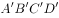是第一次撑开后正方形ABCD面积的：

- **A**. 
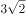倍

- **B**. 
倍

- **C**. 
2倍

- **D**. 
3倍

## 第 71 题　qid 5102356 · 图形推理

所给的四个选项中，哪一项填入问号处，不能使之呈现一定的规律性：

- **A**. A
- **B**. B
- **C**. C
- **D**. D

## 第 72 题　qid 5102250 · 图形推理

从所给的四个选项中，选择最合适的一个填入问号处，使之呈现一定的规律性：

- **A**. A
- **B**. B
- **C**. C
- **D**. D

## 第 73 题　qid 5102354 · 图形推理

把下面的六个图形分为两类，使每一类图形都有各自的共同特征或规律，分类正确的一项是：

- **A**. ①②③，④⑤⑥
- **B**. ①③⑤，②④⑥
- **C**. ①④⑤，②③⑥
- **D**. ①⑤⑥，②③④

## 第 74 题　qid 5102227 · 图形推理

把下面的六个图形分为两类，使每一类图形都有各自的共同特征或规律，分类正确的一项是：

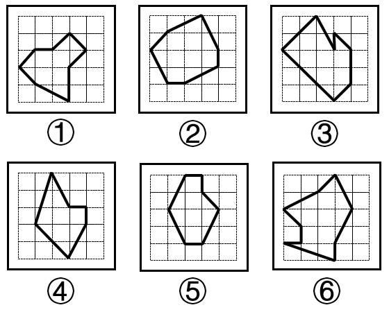

- **A**. ①②③，④⑤⑥
- **B**. ①③⑤，②④⑥
- **C**. ①④⑤，②③⑥
- **D**. ①⑤⑥，②③④

## 第 75 题　qid 5102238 · 图形推理

下图右框内纸盒的外表面中，不能折叠成左框内所示的纸盒的是：

- **A**. A
- **B**. B
- **C**. C
- **D**. D

## 第 76 题　qid 5102202 · 定义判断

马兰戈尼效应，指的是表面张力不同的两种液体存在表面张力梯度，表面张力大的对其周围表面张力小的液体的拉力强，使液体从表面张力小的一边向张力大的方向流动渗透。
根据上述定义，下列属于马兰戈尼效应的是：

- **A**. 若干种不同的酒按密度大小依次缓慢倒进杯子，会形成分层，通过加冰块，可以加大或减小密度，分层更明显
- **B**. 涂料配色过程中，涂料和干燥后的涂膜颜色存在细微差异，在湿膜时颜色一般比较浅，在干燥后，颜色会加深
- **C**. 牛奶中加入几滴流体色素，没有搅拌的情况下色素相对集中，取少量洗洁精滴在色素所在位置，色素迅速往牛奶边缘扩散
- **D**. 奶茶就是牛奶和茶叶水的充分混合，不同的奶粉和不同茶叶水搭配，产生不同风味的奶茶，而且奶粉和茶水的配比也影响奶茶口感

## 第 77 题　qid 5102199 · 定义判断

最小干预原则是指在保证文物安全的基本前提下，通过最小程度的介入来最大限度地维系文物的原本面貌，保留文物的历史、文化价值，以实现延续现状、降低保护性破坏的目标。
根据上述定义，下列选项不属于最小干预原则的是：

- **A**. 某博物馆在修复古籍时不拆开原线绳，只修补蛀洞严重的书页，而不修补强度未受蛀洞影响的书页
- **B**. 某博物馆的一幅雕塑作品中的人物手臂缺失，专家们查阅了原始资料，根据资料将其复原如初
- **C**. 某古城墙修缮时，保留其残损的现状，在靠近边墙的一侧恢复了很窄的台阶供游人安全通过
- **D**. 某古塔倾斜，专家们在研究后最终决定只纠偏一度，它看上去依旧是倾斜的状态

## 第 78 题　qid 5102235 · 定义判断

薄膜干涉，指的是不同颜色的光波有不同的波长，当一束光波照射于薄膜，由于折射率不同，光波会被薄膜的上界面与下界面分别反射后再相遇，发生相互干涉而形成新的光波。对这一现象的研究可以用于计算薄膜的厚度、折射率等。
根据上述定义，下列不属于薄膜干涉的是：

- **A**. 一片普通薄玻璃镶嵌在窗框里，屋外灿烂的阳光穿透玻璃，照在屋内镜子上也能产生强烈反光
- **B**. 汽车玻璃上的贴膜会改变折射光线和反射光线的能量分配比例，增加对某一光波的反射光强度
- **C**. 汽车在有积水的柏油路上驶过时，积水面会形成一层油膜，这层油膜在阳光下呈现出美丽的色彩
- **D**. 自然环境中，两块干净平整的玻璃片紧紧压叠形成极薄空间，出现一些平行条纹，手指用力压紧玻璃时，条纹随之发生改变

## 第 79 题　qid 5102223 · 定义判断

深度学习是指在模仿人脑机制的神经网络中，对人工神经元的层进行了“多层处理”。深度学习不仅可以让AI（人工智能）读取大量图片，还可以让AI自主提取图片特征。得益于深度学习技术的面世，只要有大量数据，AI就能以极高的准确率进行学习，从而大幅度拓展了AI的应用范围。
根据上述定义，下列属于深度学习的是：

- **A**. 人工智能图片教学走进课堂让学生体验深度学习
- **B**. 问诊机器人可以迅速获取病患B超报告的风险信息
- **C**. 某设区市在数字峰会期间提供无人驾驶汽车试乘服务
- **D**. 安防巡检机器人通过图像识别技术判定工人是否佩戴安全帽

## 第 80 题　qid 5102222 · 定义判断

回应性监管是指政府通过制度设计，采用多样化的监管手段和策略对市场主体和社会组织进行动态化、智能化、差别化的监管。回应性监管强调监管主体的多元化，除政府以外，企业、社会组织，乃至被监管对象都是监管主体；在监管策略上，采取差异化、阶梯化的监管方式，即政府首先鼓励自我监管，难以奏效时才采取更为严厉的强化型自我监管直至命令控制型监管。
根据上述定义，下列选项没有体现回应性监管的是：

- **A**. 某地主管部门因食品安全问题突击整顿涉事企业
- **B**. 瑞典立法要求工作场所必须建立安全环保的内控体系
- **C**. 英国成立企业、工会代表组成的大健康监管委员会
- **D**. 聘请专业的第三方机构对企业安全生产状况进行评估

## 第 81 题　qid 5102355 · 定义判断

参照群体理论是关于人的社会心理态度和行为怎样受其从属的或追求的群体参照力所影响的社会心理学理论。参照群体是指个体从心理上把自己列入、与之对照，并在评价、态度、行为上和在规范与价值观形成上接受其影响的群体。
根据上述定义，下列选项不能用参照群体理论解释的是：

- **A**. 小王平时喜欢便装，但是参加面试时他决定穿着西装
- **B**. 夏秋之际，妈妈怕孩子受凉，很注意给孩子增减衣物
- **C**. 小刘看其他影迷都购买了偶像同款商品，自己也去买
- **D**. 小张父母都是医生，她比常人更在意身边的卫生状况

## 第 82 题　qid 5102247 · 定义判断

乡情治理是指乡情作用于基层社会治理主体和治理体系，在基层社会的意见整合、利益协调、矛盾化解、服务供给等治理过程中发挥重要作用的一种治理形态。“乡情”是一种基于地域以及附着在经济、社会、文化纽带上的特殊情感，体现为认同感、归属感、荣誉感及在此基础上的回馈意愿和公共精神。乡情治理的核心是存在一个由情感和认同构筑的场域，这个场域通过一些微观机制影响个体动机和群体行为，从而影响社会治理体系和过程。
根据上述定义，下列属于乡情治理的是：

- **A**. 顺德人都以顺德是“世界美食之都”而自豪
- **B**. 敢拼会赢的精神一直激励着闽南人勇闯南洋
- **C**. 海外华侨华人一直有着爱国爱乡的光荣传统
- **D**. 北岸乡贤成立妈祖慈善基金会服务当地桑梓

## 第 83 题　qid 5102236 · 定义判断

生殖隔离可以区分为合子前隔离和合子后隔离。合子前隔离是指由于活动区域、生活习性、体态差异等各种因素导致无法进行基因交流，从而产生生殖隔离。相比来说，合子后隔离则是因为遗传信息的不匹配，即使双方的生殖细胞能够相遇结合，也无法完成正常的繁衍。
根据上述定义，下列现象体现合子后隔离的是：

- **A**. 甲种兰花通过a昆虫授粉，乙种兰花通过b昆虫授粉，二者只能通过人工授粉进行繁殖
- **B**. 三倍体西瓜开花后，用二倍体西瓜的花朵进行授粉，培育无籽西瓜
- **C**. 富尔顿蟋蟀和宾州蟋蟀的鸣声不同，无法相互吸引，不会进行交配
- **D**. 13年蝉和17年蝉的发情期不同，没有交配机会

## 第 84 题　qid 5102230 · 定义判断

过滤气泡是指以大数据与算法推荐为底层架构，根据用户的使用时间、地区以及浏览习惯生成用户画像，并通过算法技术为其呈现独一无二的界面体验。网络上这种针对个人化搜索而提供筛选后结果的推荐算法，被称为过滤气泡。
根据上述定义，下列不属于过滤气泡的是：

- **A**. 赵先生准备买车，上网看了很多汽车测评类的文章，买完车之后，浏览器上的内容几乎全是汽车类的资讯
- **B**. 李先生经常网购图书，平台特意为他推送购书清单，打造个性化书店，让他在第一时间能得到新书的信息
- **C**. 刘先生经常去某网络贴吧发帖，得到了很多人的关注，一些与他有相同爱好的人还建立了一个微信群进行交流
- **D**. 王先生和张先生分别在各自手机上搜索某公司，王先生的搜索结果多为该公司的招聘信息，张先生的却多为该公司的投资信息

## 第 85 题　qid 5102197 · 定义判断

衰老通常分为生理性衰老和病理性衰老。生理性衰老是指随着年龄增长出现的衰老，也就是自然老化。病理性衰老是指衰老速度由于负面情绪、物理创伤、营养匮乏、身体疾病等各种因素的作用而加快。
根据上述定义，下列诗词所描述的现象最符合病理性衰老的是：

- **A**. 白头搔更短，浑欲不胜簪
- **B**. 寒暑迭变，不觉渐成衰老
- **C**. 惟草木之零落兮，恐美人之迟暮
- **D**. 人生不得长欢乐，年少须臾老到来

## 第 86 题　qid 5102358 · 类比推理

帛书：简牍

- **A**. 日晷：秒表
- **B**. 熊猫：银杏
- **C**. 青铜：礼器
- **D**. 牛车：轿子

## 第 87 题　qid 5102353 · 类比推理

考拉：树袋熊

- **A**. 墨鱼：乌贼
- **B**. 蜜蜂：黄蜂
- **C**. 蚱蜢：蝗虫
- **D**. 金龟子：天牛

## 第 88 题　qid 5102169 · 类比推理

电脑：设备

- **A**. 广播：传媒
- **B**. 颜料：绘画
- **C**. 文言：白话
- **D**. 能源：煤炭

## 第 89 题　qid 5102228 · 类比推理

姹紫：嫣红

- **A**. 嘉言：懿行
- **B**. 风刀：霜剑
- **C**. 小家：碧玉
- **D**. 疾首：蹙额

## 第 90 题　qid 5102209 · 类比推理

马匹：船只：车辆

- **A**. 银两：金钱：银币
- **B**. 纸张：试卷：画册
- **C**. 水杯：油瓶：饭碗
- **D**. 官员：武将：首领

## 第 91 题　qid 5102174 · 类比推理

电影院：影片：放映

- **A**. 图书馆：资料：查阅
- **B**. 下水道：地漏：排水
- **C**. 传染病：疫苗：防疫
- **D**. 朋友圈：微信：聊天

## 第 92 题　qid 5102233 · 类比推理

针线：布料：服饰

- **A**. 剪刀：彩纸：窗花
- **B**. 刻刀：玺印：玉石
- **C**. 玻璃：窗户：窗框
- **D**. 鸡精：乌鸡：鸡汤

## 第 93 题　qid 5102171 · 类比推理

征稿：评选：颁奖

- **A**. 运动：热身：放松
- **B**. 节能：减排：环保
- **C**. 设计：施工：监理
- **D**. 麻醉：切开：缝合

## 第 94 题　qid 5102173 · 类比推理

晴空万里 对于 （    ） 相当于 （    ） 对于 识文断字

- **A**. 天干物燥；才高八斗
- **B**. 雨后春笋；妙笔生花
- **C**. 阴云密布；胸无点墨
- **D**. 倾盆大雨；味同嚼蜡

## 第 95 题　qid 5102192 · 类比推理

入木三分 对于 （    ） 相当于 （    ） 对于 音乐

- **A**. 绘画；珠圆玉润
- **B**. 雕刻；黄钟大吕
- **C**. 建筑；高山流水
- **D**. 书法；余音绕梁

## 第 96 题　qid 5102232 · 逻辑判断

研究人员对人的“头骨突起”进行了一项研究。在这项研究中，调查对象包括1200名年龄在18岁至86岁的普通人群，研究发现，颅骨底部出现骨质突起的情况在年轻人中比在老年人中更为普遍，尤其是在18岁至30岁年龄组的男性当中，研究者认为，一些人颅骨底部出现的奇怪的“头骨突起”与他们长时间弯下脖子看智能手机时的奇怪角度有关。
以下各项如果为真，最能质疑上述结论的是：

- **A**. 网上销售的塑形枕头深受“头骨突起”的年轻消费者欢迎
- **B**. 该研究样本人群是随机抽取，它的结论适用于普通人群
- **C**. 研究人员对年轻人更容易出现头骨突起的分析过程存在瑕疵
- **D**. 研究者并未对调查对象每日弯下脖子看智能手机的时间进行记录

## 第 97 题　qid 5102359 · 逻辑判断

有些人的心情比较容易受到外界影响，比如飞行员担心遇到雷暴，虽然没有什么奇招，但有些食物的确能让大脑更好地运作，可可就是其中之一。这是因为可可含有大量的茶碱和咖啡因，它们可以有效的减轻压力和缓解疼痛。
以下哪项如果为真，最能支持上述观点？

- **A**. 虽然可可富含咖啡因，但咖啡因只有在特定条件下才能发挥其减压作用
- **B**. 据研究显示，可可中含有的茶碱和咖啡因可以刺激大脑分泌内啡肽，而内啡肽对减轻压力和缓解疼痛非常有效
- **C**. 每天摄入主要原料为可可的黑巧克力对情绪会有一定影响
- **D**. 每天至少30分钟的运动，有助于大脑产生缓解压力和焦虑所需的激素

## 第 98 题　qid 5102226 · 逻辑判断

有观点认为，体质的酸化是百病之源。无论是癌症，还是常见的高血压、糖尿病、痛风等，都是由于“酸性食物”吃多了导致体质酸化引起的。而鱼、肉、米饭、酒等人类的主副食品都是酸性的，尤其是我们的主食米饭，更被渲染成“酸性食物”的典型代表。
以下各项如果为真，最能反驳上述观点的是：

- **A**. 人体的皮肤处于弱酸性状态时，比较不容易滋生细菌
- **B**. 人体的酸碱度以7.4为佳，即身体偏碱性就是健康的
- **C**. 人体有三个调节系统平衡酸碱，人的体质不会是酸性
- **D**. 健康人的尿液是呈酸性的，人体本身就存在酸性物质

## 第 99 题　qid 5102231 · 逻辑判断

DNA甲基化严密控制着基因的表达，在肿瘤发生发展过程中发挥着重要作用。DNA出错且甲基化缺失是导致癌症的一个重要成因。几乎所有的人类肿瘤中都存在肿瘤相关基因的异常甲基化。因此，DNA甲基化异常是癌症发生的一种警示性标志。研究者据此认为，可以使用DNA甲基化作为一种全新的癌症检测筛查标志物，来有效识别结直肠癌、肺癌、乳腺癌和肝癌等肿瘤。
以下各项如果为真，最能支持上述研究者观点的是：

- **A**. 肿瘤抑制基因启动子区往往发生DNA高甲基化，而癌基因启动子区则呈现出低甲基化
- **B**. DNA甲基化检测方法不断涌现，既说明该研究难度大，也说明这些方法都有其局限性
- **C**. DNA甲基化检测方法具有生物学的稳定性，且样本需求量少，检查过程更加简单快捷
- **D**. 基因启动子区异常甲基化在多种人类疾病发生发展机制的研究中受到越来越多的重视

## 第 100 题　qid 5102362 · 逻辑判断

传统理论认为恐龙的灭绝是小行星撞击地球导致的，科学家表示，恐龙的多样性是从7600万年前开始下降。研究人员研究了六大恐龙群体的进化趋势，发现在6600万年白垩纪末期物种大灭绝之前的大约1000万年里，食草恐龙和食肉恐龙都在衰落。
由此可以推出：

- **A**. 在小行星撞击地球并最终使恐龙灭绝之前恐龙就已经处境不佳
- **B**. 在恐龙时代的最后1000万年里，六大恐龙的新物种形成速度下降，灭绝速度急剧上升
- **C**. 在恐龙时代最后4000万年中的不同时期，六大恐龙的多样性都出现了下降，尽管降幅不一
- **D**. 恐龙在小行星撞地球之前就面临危机，由于它们的灭绝速度超过新物种的速度，因此“尤其容易灭绝”

## 第 101 题　qid 5102186 · 逻辑判断

研究发现，对居住地附近有至少30%的土地是公园和绿地的成年人而言，他们感到孤独的几率比居住地附近绿地面积不足10%的成年人要低26%。对于独居者而言，关联性甚至更大——在绿地面积达到或超过30%的地区，他们感到孤独的可能性降低了一半。
以下哪项如果为真，最能支持上述观点?

- **A**. 越来越多的证据表明，孤独感与罹患抑郁症的风险增加有关
- **B**. 城市重新造林可能有助于降低主观记忆减退甚至患阿尔茨海默症的风险
- **C**. 以前没有定期接触自然的人以安全、积极和可持续的方式定期与自然接触，就有希望缓解孤独感
- **D**. 绿地面积大小与社交互动频率正相关，经常与他人在绿地环境中交流有助于改善情绪和消除孤独感

## 第 102 题　qid 5102179 · 逻辑判断

科学家在金星大气层中探测到了磷化氢的踪迹，浓度极高，是地球大气层中磷化氢浓度的1000倍至100万倍。在地球上，磷化氢仅见于工业生产领域或由厌氧微生物所产生。对于金星上磷化氢的来源，研究团队进行了大量分析，推断是否来自光照、闪电、火山或者从金星表面向上吹至大气层中的矿物质等，但根据已有知识的计算结果均不支持这些来源。研究人员因此表示有磷化氢意味着没有充足的氧气存在，但有可能证明是存在厌氧生物的，故而金星大气层中的磷化氢有可能是某种生物留下的印记。
以下哪项如果为真，最能削弱上述研究人员的观点？

- **A**. 金星大气中含有大量二氧化碳以及浓硫酸云层，温室效应非常严重
- **B**. 科学家们发现了“不需要呼吸”的动物，比较符合金星的大气条件
- **C**. 金星上存在某些未知的光化学过程，这些光化学过程能够释放大量的磷化氢
- **D**. 磷化氢需要很多能量来制作，且任何行星上都不太可能存在太多磷，因此一颗行星产生大量磷化氢的可能性很低

## 第 103 题　qid 5102200 · 逻辑判断

伤害感受神经能够对造血干细胞动员进行调控，增强造血干细胞的黏附或迁移，降钙素基因相关肽（CGRP）是伤害感受神经元主要分泌的神经递质分子。研究者发现，给予CGRP可以显著增强造血干细胞动员。CGRP可以直接影响造血干细胞，诱导细胞表面形成CALCRL和RAMP1蛋白形成的二聚体受体，并促进造血干细胞进入血管。研究专家认为，吃辣可以促进造血干细胞动员。
如果上述结论为真，需要补充的前提是：

- **A**. 骨髓神经纤维中高达77%都是伤害感受神经元
- **B**. 辛辣食物导致的“辣味”是一种痛觉，会激活伤害感受神经
- **C**. 辣的食物能够促进消化液的分泌，增加消化酶的活性，加速胃肠道蠕动
- **D**. 造血干细胞会在神经的调控之下，从骨髓释放进入循环，对损失的血细胞进行补充

## 第 104 题　qid 5102164 · 逻辑判断

研究者发现，蚕挑选桑叶要经过类似于计算机安全系统的验证。蚕口器下方的下颚须在触碰叶片时会先轻轻咬一口，下颚须中的味觉神经能以极高的灵敏度识别叶片表面的-谷甾醇、绿原酸、异槲皮苷这三种物质；接着，它会用口器上的须形外颚叶来尝一下叶片叶汁中的糖分，须形外颚叶上的味觉神经比较迟钝，只有高浓度的糖才能激活；在确认是桑叶后它才开始大肆咀嚼。

由此可以推出：

- **A**. 桑叶会分泌适合蚕生长的糖分和物质，故而它几乎只吃桑叶
- **B**. 通过不同的器官感受不同的味道，这就是蚕判断桑叶的秘诀
- **C**. 蚕在演化过程中，它的口器具备了通过触碰感知桑叶的能力
- **D**. 这项研究有助于改进蚕的人工饲料，可在没有桑树的环境下养蚕

## 第 105 题　qid 5102163 · 逻辑判断

欧洲杯比赛期间，小赵、小钱、小孙、小李预测甲、乙两支队伍能否进入决赛。他们的对话如下：
小赵：如果甲进入决赛，则乙也能进入决赛。
小钱：我看甲进入决赛没有问题。
小孙：在我看来，甲能够进入决赛，但乙进不了。
小李：我的看法是，如果甲不能进入决赛，则乙进决赛。
结果出来后，他们四人的预测有两个真、两个假，关于甲和乙是否进入决赛，以下推论正确的是：

- **A**. 甲和乙都进入决赛
- **B**. 甲和乙都没有进入决赛
- **C**. 甲进入决赛，乙没有进入决赛
- **D**. 甲没有进入决赛，乙进入决赛

## 材料 1

        2020年，由软件产品、信息技术服务、信息安全产品和服务、嵌入式系统软件四大业务形态构成的我国软件和信息技术服务业持续恢复，收入保持较快增长，信息技术服务加快云化发展，软件应用服务化、平台化趋势明显。

        2020年，软件产品实现收入22758亿元，同比增长10.1%，占全行业比重为27.9%。其中，工业软件产品实现收入1974亿元，增长11.2%，为支撑工业领域的自主可控发展发挥重要作用。

        2020年，信息技术服务实现收入49868亿元，同比增长15.2%，增速高出全行业平均水平1.9个百分点，占全行业收入比重为61.1%。其中，电子商务平台技术服务收入9095亿元，同比增长10.5%；云服务、大数据服务共实现收入4116亿元，同比增长11.1%。

        2020年，信息安全产品和服务实现收入1498亿元，同比增长10.0%，增速较上年回落2.4个百分点。

        2020年嵌入式系统软件实现收入7492亿元，同比增长12.0%，增速较上年提高4.2个百分点，占全行业收入比重为9.2%。嵌入式系统软件已成为产品和装备数字化改造、各领域智能化增值的关键性带动技术。

### 第 106 题　qid 5102378 · 比重

2020年电子商务平台技术服务收入占全行业收入的比重约为：

- **A**. 7.6%
- **B**. 11.1%
- **C**. 15.3%
- **D**. 18.2%

### 第 107 题　qid 5102379 · 增长

2020年四大业务形态收入同比增速高于全行业平均水平的有：

- **A**. 1个
- **B**. 2个
- **C**. 3个
- **D**. 4个

### 第 108 题　qid 5102380 · 综合

2019年全行业实现收入约为：

- **A**. 7.2万亿元
- **B**. 7.4万亿元
- **C**. 8.2万亿元
- **D**. 8.4万亿元

### 第 109 题　qid 5102381 · 增长

2019年嵌入式系统软件同比增速相较于信息安全产品和服务同比增速：

- **A**. 快2.0%
- **B**. 快8.6%
- **C**. 慢4.6%
- **D**. 慢7.5%

### 第 110 题　qid 5102383 · 综合

下列选项不能从上述资料推出的是：

- **A**. 2019年信息安全产品和服务实现收入约为1361.8亿元
- **B**. 2019年信息安全产品和服务占全行业收入比重最低
- **C**. 2020年信息安全产品和服务占全行业收入比重为2.8%
- **D**. 2019年信息技术服务收入占全行业收入比重低于61.1%

## 材料 2

        近年来，我国新能源汽车销量及保有量快速提升，充电基础设施布局也日渐完善。2021年新能源汽车销量达352.1万辆，同比增长157.51%；截至2021年，我国新能源汽车保有量达784万辆，同比增长59.25%。

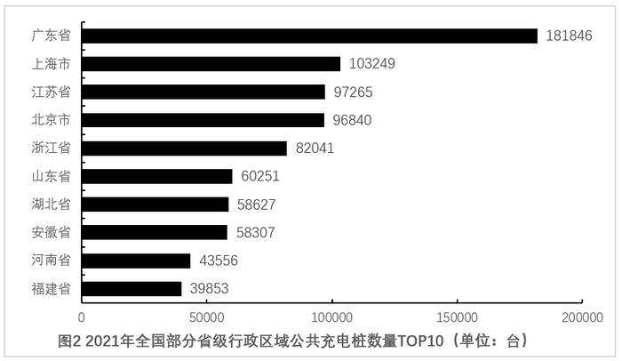

### 第 111 题　qid 5102153 · 增长

2016—2021年我国公共充电桩数量同比增速最大的年份是：

- **A**. 2016年
- **B**. 2019年
- **C**. 2020年
- **D**. 2021年

### 第 112 题　qid 5102150 · 比重

2021年北京市、上海市、广东省公共充电桩数量之和占全国公共充电桩总数的比重约为：

- **A**. 28.7%
- **B**. 33.3%
- **C**. 39.8%
- **D**. 46.7%

### 第 113 题　qid 5102148 · 增长

2016—2021年我国公共充电桩数量年均增长量约为：

- **A**. 15.57万台
- **B**. 17.35万台
- **C**. 18.17万台
- **D**. 19.94万台

### 第 114 题　qid 5102152 · 增长

2016—2021年我国公共充电桩数量同比增速未超过50%的年份有：

- **A**. 1个
- **B**. 2个
- **C**. 3个
- **D**. 4个

### 第 115 题　qid 5102154 · 综合

下列选项能够从上述资料中推出的是：

- **A**. 2022年我国公共充电桩数量超过180万台
- **B**. 2021年我国公共充电桩数量超过5万台的省级行政区域有7个
- **C**. 2016—2021年我国公共充电桩数量同比增速最小的年份是2017年
- **D**. 2021年我国省级行政区域公共充电桩数量前5名之和占全国总数的比重约为48.9%

## 材料 3

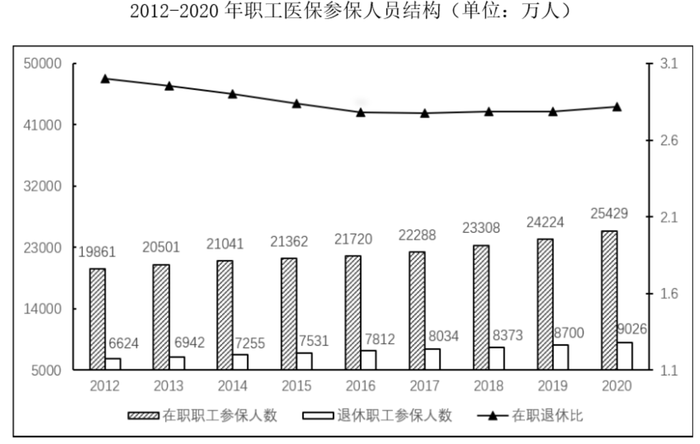

### 第 116 题　qid 5102280 · 综合

2012—2020年中，在职退休比最接近3的是：

- **A**. 2020年
- **B**. 2019年
- **C**. 2013年
- **D**. 2012年

### 第 117 题　qid 5102167 · 综合

2019年，职工医保参保人数共：

- **A**. 30322万人
- **B**. 31681万人
- **C**. 32924万人
- **D**. 34455万人

### 第 118 题　qid 5102172 · 增长

下列年份中，在职职工参保人数同比增速大小排序错误的是：

- **A**. 2017年＞2016年
- **B**. 2018年＞2017年
- **C**. 2019年＞2018年
- **D**. 2020年＞2019年

### 第 119 题　qid 5102170 · 综合

表中（？）处应填入的数字是：

- **A**. 7822
- **B**. 8559
- **C**. 8577
- **D**. 8898

### 第 120 题　qid 5102175 · 增长

能够从上述资料中推出的有：
①2017年职工医保在职退休比高于2016年
②2020年居民医保参保人数比上年略有增加
③2012—2020年间，职工医保参保人数持续增加
④2012—2020年间，居民医保基金支出增长金额最快的是2017年

- **A**. 1
- **B**. 2
- **C**. 3
- **D**. 4

## 材料 4

        2020年末，全国共有艺术表演团体17581个，从业人员43.69万人，其中各级文化和旅游部门所属艺术表演团体2060个，从业人员10.75万人。2020年，全国文化和旅游部门所属艺术表演团体共组织政府采购公益演出13.38万场，比上年下降14.9%；观众0.86亿人次，下降27.9%。

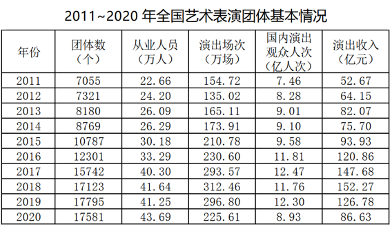

### 第 121 题　qid 5102149 · 增长

2011~2020年中，全国艺术团体数同比增量超过2000个的年份有：

- **A**. 1个
- **B**. 2个
- **C**. 3个
- **D**. 4个

### 第 122 题　qid 5102151 · 比重

2020年，在全国艺术表演团体中，各级文化和旅游部门所属艺术表演团体从业人员占比约为：

- **A**. 11.7%
- **B**. 24.6%
- **C**. 27.4%
- **D**. 31.7%

### 第 123 题　qid 5104420 · 平均数

2011~2020年全国艺术表演团演出收入的年平均值为：

- **A**. 大于105亿元
- **B**. 95~105亿元之间
- **C**. 85~95亿元之间
- **D**. 小于85亿元

### 第 124 题　qid 5102156 · 综合

以下折线图中，能准确反映2011~2020年国内演出观众人次变化的是：

- **A**. A
- **B**. B
- **C**. C
- **D**. D

### 第 125 题　qid 5102157 · 综合

不能够从上述资料中推出的是：

- **A**. 2015年，全国艺术表演团体平均演出收入不足100万元
- **B**. 2018年，全国艺术表演团体演出收入同比增速快于2016年
- **C**. 2019年，全国文化和旅游部门所属艺术表演团体组织的政府采购公益演出中，观众超过1亿人次
- **D**. 2020年，全国艺术表演团体演出场次与国内演出观众人次均同比下降

## 答案与解析

第 1 题

**答案**：D

**官方解析**

本题考查政治常识。
①正确，中国共产党第十九届中央委员会第六次全体会议公报指出：“全会决定，中国共产党第二十次全国代表大会于2022年下半年在北京召开。全会认为，党的二十大是我们党进入全面建设社会主义现代化国家、向第二个百年奋斗目标进军新征程的重要时刻召开的一次十分重要的代表大会，是党和国家政治生活中的一件大事。”
②正确，二十大代表的产生，要坚持和加强党的全面领导，充分发扬党内民主，采取自下而上、上下结合、反复酝酿、逐级遴选的办法进行。代表产生程序有5个主要环节，即推荐提名、组织考察、确定代表候选人初步人选、确定代表候选人预备人选、会议选举。
③正确，党中央提出，二十大代表应是共产党员中的优秀分子。要严把人选政治关，坚持把政治标准放在首位，突出考察人选的理想信念、政治品格和道德修养，着重了解人选政治判断力、政治领悟力、政治执行力，增强“四个意识”、坚定“四个自信”、做到“两个维护”等方面的表现情况，对政治上不合格的一票否决。
④正确，中央组织部负责人就做好二十大代表选举工作接受采访时表示，党中央明确，二十大代表名额共2300名，与十九大时相同。二十大代表名额的分配，主要根据党组织数量和党员人数确定，同时考虑前几次党的全国代表大会代表名额等因素。按照这一分配办法，各选举单位的代表名额，与十九大时基本相同。
故①②③④说法正确。
故正确答案为D。

---

第 2 题

**答案**：D

**官方解析**

本题考查政治常识。
①②正确，习近平总书记强调：“要加大对因疫因灾遇困群众的临时救助力度，做好残疾人康复、教育、就业等工作，保障流浪乞讨人员人身安全和基本生活，关心关爱精神障碍人员，坚决杜绝欺凌虐待妇女儿童、老年人、残疾人等违法行为。”
③④正确，习近平总书记强调：“我国已建成世界上规模最大的社会保障体系。要健全灵活就业人员社保制度，扩大失业、工伤、生育保险的覆盖面，实现制度安排更加公平，覆盖范围更加广泛，为人民生活安康托底。要健全社会保障基金监管体系，严厉打击欺诈骗保、套保和挪用贪占各类社会保障资金的违法行为，守护好人民群众的每一分‘养老钱’、‘保命钱’。”
综上所述，有助于推动社会保障事业高质量发展的有①②③④，有4项。
故正确答案为D。

---

第 3 题

**答案**：C

**官方解析**

本题考查经济常识。
市场主体是经济的力量载体，保市场主体就是保社会生产力。
①正确，2022年3月21日，国务院总理李克强主持召开国务院常务会议，确定实施大规模增值税留抵退税的政策安排，为稳定宏观经济大盘提供强力支撑。
②正确，2022年4月6日，国务院总理李克强主持召开国务院常务会议，决定对特困行业实行阶段性缓缴养老保险费政策，加大失业保险支持稳岗和培训力度；部署适时运用货币政策工具，更加有效支持实体经济发展。
③正确，为支持实体经济发展，促进综合融资成本稳中有降，中国人民银行决定于2022年4月25日下调金融机构存款准备金率0.25个百分点（不含已执行5%存款准备金率的金融机构），为加大对小微企业和“三农”的支持力度，对没有跨省经营的城商行和存款准备金率高于5%的农商行，在下调存款准备金率0.25个百分点的基础上，再额外多降0.25个百分点。
④错误，为贯彻落实《中共中央 国务院关于优化生育政策促进人口长期均衡发展的决定》，依据《中华人民共和国个人所得税法》有关规定，国务院决定，设立3岁以下婴幼儿照护个人所得税专项附加扣除。自2022年1月1日起，纳税人照护3岁以下婴幼儿子女的相关支出，在计算缴纳个人所得税前，按照每个婴幼儿每月1000元的标准定额扣除。该项扣除政策有利于减轻人民群众抚养子女负担，体现了国家对人民群众生育养育的鼓励和照顾。属于“保民生”的措施。
⑤正确，2022年5月15日，央行、银保监会联合发布《关于调整差别化住房信贷政策有关问题的通知》，对于贷款购买普通自住房的居民家庭，首套住房商业性个人住房贷款利率下限调整为不低于相应期限贷款市场报价利率（LPR）减20个基点，二套住房商业性个人住房贷款利率政策下限按现行规定执行。此举对稳定市场预期将起到积极作用，有利于进一步满足刚性和改善性住房需求，促进房地产市场平稳健康发展。
综上所述，属于“稳主体”对策的是①②③⑤，共4项。
故正确答案为C。

---

第 4 题

**答案**：D

**官方解析**

本题考查政治常识。
2022年4月29日，中共中央总书记习近平就依法规范和引导我国资本健康发展进行第三十八次集体学习时发表重要讲话。
A、B两项正确，习近平总书记在讲话中指出：“要历史地、发展地、辩证地认识和把握我国社会存在的各类资本及其作用。在社会主义市场经济体制下，资本是带动各类生产要素集聚配置的重要纽带，是促进社会生产力发展的重要力量，要发挥资本促进社会生产力发展的积极作用。同时，必须认识到，资本具有逐利本性，如不加以规范和约束，就会给经济社会发展带来不可估量的危害。”
C项正确，习近平总书记在讲话中指出：“要加强资本领域反腐败，保持反腐败高压态势，坚决打击以权力为依托的资本逐利行为，着力查处资本无序扩张、平台垄断等背后的腐败行为。”
D项错误，习近平总书记在讲话中指出：“要正确处理资本和利益分配问题。我国社会主义的国家性质决定了我们必须坚持按劳分配为主体、多种分配方式并存，在社会分配中体现人民至上。要注重经济发展的普惠性和初次分配的公平性，既注重保障资本参与社会分配获得增殖和发展，更注重维护按劳分配的主体地位，坚持发展为了人民、发展依靠人民、发展成果由人民共享，坚定不移走全体人民共同富裕的道路。”
本题为选非题，故正确答案为D。

---

第 5 题

**答案**：D

**官方解析**

本题考查政治常识。
A项正确，《中国共产主义青年团章程》总则规定：“中国共产主义青年团中央委员会受中国共产党中央委员会领导，团的地方组织和基层组织受同级党的委员会领导，同时受团的上级组织领导。”
B项正确，《中国共产主义青年团章程》总则规定：“中国共产主义青年团受中国共产党的委托领导中国少年先锋队的工作。中国共产主义青年团是中华全国青年联合会的核心团体会员，发挥主导作用。中国共产主义青年团在中国共产党的领导下，指导中华全国学生联合会开展工作。”
C项正确，《中国共产主义青年团章程》第八章“团旗、团徽、团歌”中的第三十七条规定：“中国共产主义青年团团旗旗面为红色，象征革命胜利；左上角缀黄色五角星，周围环绕黄色圆圈，象征中国青年一代紧密团结在中国共产党周围。”
D项错误，《中国共产主义青年团章程》第一章“团员”中的第一条第三款规定：“团员加入共产党以后仍保留团籍，年满二十八周岁，没有在团内担任职务，不再保留团籍。”
本题为选非题，故正确答案为D。

---

第 6 题

**答案**：A

**官方解析**

本题考查政治常识。
A项正确，《中共中央 国务院关于加快建设全国统一大市场的意见》在“（九）完善市场信息交互渠道”部分指出：“统一产权交易信息发布机制，实现全国产权交易市场联通。优化行业公告公示等重要信息发布渠道，推动各领域市场公共信息互通共享。优化市场主体信息公示，便利市场主体信息互联互通。推进同类型及同目的信息认证平台统一接口建设，完善接口标准，促进市场信息流动和高效使用。依法公开市场主体、投资项目、产量、产能等信息，引导供需动态平衡。”
B项错误，《中共中央 国务院关于加快建设全国统一大市场的意见》在“（二）工作原则”部分指出：“有效市场，有为政府。坚持市场化、法治化原则，充分发挥市场在资源配置中的决定性作用，更好发挥政府作用，强化竞争政策基础地位，加快转变政府职能，用足用好超大规模市场优势，让需求更好地引领优化供给，让供给更好地服务扩大需求，以统一大市场集聚资源、推动增长、激励创新、优化分工、促进竞争。”故不能用集中管理代替市场机制。
C项错误，《中共中央 国务院关于加快建设全国统一大市场的意见》在“（五）实行统一的市场准入制度”部分指出：“严格落实‘全国一张清单’管理模式，严禁各地区各部门自行发布具有市场准入性质的负面清单，维护市场准入负面清单制度的统一性、严肃性、权威性。”
D项错误，《中共中央 国务院关于加快建设全国统一大市场的意见》在“（二十四）破除地方保护和区域壁垒”部分指出：“指导各地区综合比较优势、资源环境承载能力、产业基础、防灾避险能力等因素，找准自身功能定位，力戒贪大求洋、低层次重复建设和过度同质竞争，不搞‘小而全’的自我小循环，更不能以‘内循环’的名义搞地区封锁。”
故正确答案为A。

---

第 7 题

**答案**：A

**官方解析**

本题考查政治常识。
A项错误，《中共中央 国务院关于做好2022年全面推进乡村振兴重点工作的意见》在“一、全力抓好粮食生产和重要农产品供给”部分指出：“（三）保障‘菜篮子’产品供给。加大力度落实‘菜篮子’市长负责制。稳定生猪生产长效性支持政策，稳定基础产能，防止生产大起大落。加快扩大牛羊肉和奶业生产，推进草原畜牧业转型升级试点示范。稳定水产养殖面积，提升渔业发展质量。稳定大中城市常年菜地保有量，大力推进北方设施蔬菜、南菜北运基地建设，提高蔬菜应急保供能力。”由此可知，应是“南菜北运基地建设”，而非“北菜南运基地建设”。
B、C两项正确，《中共中央 国务院关于做好2022年全面推进乡村振兴重点工作的意见》在”一、全力抓好粮食生产和重要农产品供给”部分指出：“（一）稳定全年粮食播种面积和产量。坚持中国人的饭碗任何时候都要牢牢端在自己手中，饭碗主要装中国粮，全面落实粮食安全党政同责，严格粮食安全责任制考核，确保粮食播种面积稳定、产量保持在1.3万亿斤以上。”
D项正确，《中共中央 国务院关于做好2022年全面推进乡村振兴重点工作的意见》在开头第二段指出：“做好2022年‘三农’工作，要以习近平新时代中国特色社会主义思想为指导，全面贯彻党的十九大和十九届历次全会精神······坚持和加强党对‘三农’工作的全面领导，牢牢守住保障国家粮食安全和不发生规模性返贫两条底线，突出年度性任务、针对性举措、实效性导向，充分发挥农村基层党组织领导作用，扎实有序做好乡村发展、乡村建设、乡村治理重点工作，推动乡村振兴取得新进展、农业农村现代化迈出新步伐。”
本题为选非题，故正确答案为A。

---

第 8 题

**答案**：C

**官方解析**

本题考查政治常识。
①项正确，于敏，核物理学家，中国“氢弹之父”，生于河北省宁河县（今天津市宁河区）。他在我国氢弹原理突破中解决了一系列基础问题，提出了从原理到构形基本完整的设想，起了关键作用。此后长期领导核武器理论研究、设计，解决了大量理论问题。对我国核武器进一步发展到国际先进水平做出了重要贡献。1982年于敏获国家自然科学奖一等奖。1985年、1987年和1989年三次获国家科技进步奖特等奖。1994年获求是基金杰出科学家奖。1999年被国家授予“两弹一星”功勋奖章。2019年9月17日，国家主席习近平签署主席令，授予于敏“共和国勋章”。
②项正确，谢军，山西临汾人，中共党员，研究员，历任航天科技集团五院504所副所长、所长，北斗二号导航卫星总设计师。现任北斗三号工程副总设计师、北斗三号导航卫星首席总设计师，北斗卫星导航系统工程副总设计师。2020年12月，被国资委党委授予第五届“央企楷模”称号。2021年2月17日，谢军被评为“感动中国2020年度人物”。
③项错误，彭士禄是中国核潜艇第一任总设计师，中国工程院首批及资深院士，被誉为“中国核潜艇之父”。赵忠尧，主要从事核物理研究，特别是硬g射线与物质相互作用等方面的研究，主持建成中国第一、二台质子静电加速器，为在国内建立核物理实验基地做出了重要贡献。
④项正确，顾诵芬，江苏苏州人，飞机设计专家，中国自行设计、制造的高空高速歼击机的主要技术负责人之一，是新中国飞机空气动力设计奠基人。2021年11月3日上午，2020年度国家科学技术奖励大会在北京人民大会堂隆重召开。中国航空工业集团有限公司顾诵芬院士获国家最高科学技术奖。
⑤项错误，顾方舟，我国著名病毒学家、脊髓灰质炎疫苗研发生产拓荒者，被称为“中国脊髓灰质炎疫苗之父”。汤飞凡，著名微生物学家、病毒学家，沙眼衣原体的发现人之一，长期从事微生物学、病毒学和免疫学的研究。
综上所述，科学家与其成就对应关系正确的是①②④。
故正确答案为C。

---

第 9 题

**答案**：B

**官方解析**

本题考查法律常识。
A项正确，根据《中华人民共和国行政诉讼法》第十二条第一款第一项规定：“人民法院受理公民、法人或者其他组织提起的下列诉讼：（一）对行政拘留、暂扣或者吊销许可证和执照、责令停产停业、没收违法所得、没收非法财物、罚款、警告等行政处罚不服的；”
B项错误，根据《中华人民共和国行政诉讼法》第十三条第二项规定：“人民法院不受理公民、法人或者其他组织对下列事项提起的诉讼：（二）行政法规、规章或者行政机关制定、发布的具有普遍约束力的决定、命令；”题中，《X市湿地保护办法》属于规章或行政机关制定、发布的具有普遍约束力的决定、命令，不得对其提起行政诉讼。
C项正确，根据《中华人民共和国行政诉讼法》第三十七条规定：“原告可以提供证明行政行为违法的证据。原告提供的证据不成立的，不免除被告的举证责任。”
D项正确，根据《中华人民共和国行政诉讼法》第三十四条第一款规定：“被告对作出的行政行为负有举证责任，应当提供作出该行政行为的证据和所依据的规范性文件。”
本题为选非题，故正确答案为B。

---

第 10 题

**答案**：A

**官方解析**

本题考查科技常识。
A项错误，“儿童急走追黄蝶，飞入菜花无处寻”意为小孩子奔跑着追赶黄蝴蝶，可是蝴蝶飞入菜花丛中就再也找不到了。动物的保护色是指动物把体表的颜色改变为与周围环境相似，这种颜色叫保护色。黄蝶飞入菜花丛中就再也找不到了体现的是动物的保护色。拟态是一种生物模拟另一种生物或模拟环境中的其他物体从而获得好处的现象，一般拟态是属于静止的，而保护色与运动状态无关。
B项正确，“春色满园关不住，一枝红杏出墙来”意为满园子的春色是关不住的，开得正旺的红杏有一枝枝条伸到墙外来了。植物的向光性是指植物生长器官受单方向光照射而引起生长弯曲的现象，对高等植物而言，向光性主要指植物地上部分茎叶的正向光性。正向光性运动与生长素分布有关，光线能使生长素在背光一侧比向光一侧分布多，因此，背光侧比向光侧生长得快，使植物的茎显示出向光性。“红杏出墙”是因为红杏树枝条的向光性生长发生弯曲。
C项正确，“落红不是无情物，化作春泥更护花”意为从枝头上掉下来的落花不是无情之物，会化作春天的泥土，培育春天的花朵生长。落花之所以会转化为春泥是微生物的分解作用，泥土中的微生物通过分解作用可以将落花中的有机物分解为简单的无机物，为土地提供养分，使自然界的物质得到循环利用。
D项正确，“人间四月芳菲尽，山寺桃花始盛开”意为人间四月里百花凋零已尽，可是山寺之中，桃花却刚刚盛开。说明海拔高度升高温度下降，温度会影响植物的生长发育进程。
本题为选非题，故正确答案为A。

---

第 11 题

**答案**：B

**官方解析**

本题考查法律常识。
A项错误，根据《中华人民共和国消防法》第十六条第一款第三项规定：“机关、团体、企业、事业等单位应当履行下列消防安全职责：（三）对建筑消防设施每年至少进行一次全面检测，确保完好有效，检测记录应当完整准确，存档备查。”题中，每季度至少进行一次全面检测说法错误。
B项正确，根据《生产安全事故报告和调查处理条例》第十九条规定：“特别重大事故由国务院或者国务院授权有关部门组织事故调查组进行调查。重大事故、较大事故、一般事故分别由事故发生地省级人民政府、设区的市级人民政府、县级人民政府负责调查。省级人民政府、设区的市级人民政府、县级人民政府可以直接组织事故调查组进行调查，也可以授权或者委托有关部门组织事故调查组进行调查。未造成人员伤亡的一般事故，县级人民政府也可以委托事故发生单位组织事故调查组进行调查。”
C项错误，根据《危险化学品安全管理条例》第六条第二项规定：“对危险化学品的生产、储存、使用、经营、运输实施安全监督管理的有关部门（以下统称负有危险化学品安全监督管理职责的部门），依照下列规定履行职责：（二）公安机关负责危险化学品的公共安全管理，核发剧毒化学品购买许可证、剧毒化学品道路运输通行证，并负责危险化学品运输车辆的道路交通安全管理。”
D项错误，根据《生产安全事故报告和调查处理条例》第十一条规定：“安全生产监督管理部门和负有安全生产监督管理职责的有关部门逐级上报事故情况，每级上报的时间不得超过2小时。”
故正确答案为B。

---

第 12 题

**答案**：A

**官方解析**

本题考查科技常识。
A项正确，玻璃杯是指玻璃制成的杯子，通常由原材料高硼硅玻璃，经过600多度的高温烧制而成，其物理强度高，与普遍玻璃相比，无毒副作用，其机械性能，热稳定性能，抗水、抗碱、抗酸等性能大大提高。用玻璃杯喝冰橙汁对身体基本不会产生危害。
B项错误，不锈钢材质对于酸性饮料不具有防腐蚀特性，碳酸饮料属于酸性物质，长时间使用不锈钢杯装碳酸饮料不仅会破坏腐蚀水杯内壁，更会对人体造成伤害，因此不宜用不锈钢杯喝碳酸饮料。
C项错误，塑料杯通常由聚苯乙烯（PS）制作而成，用其装酸（如柳橙汁）、碱性物质后，会分解出致癌物质，不耐高温；其温度达到六十几度的时候会变形，产生对人体有害的物质，因此不宜能用塑料杯盛放刚烧开的水。
D项错误，彩釉陶瓷杯上的图案是用颜料涂画而来，内壁涂有彩釉，当装入开水、酸性、碱性饮料时，铅等有害重金属元素会溶解在饮料中，对健康不利。因此不宜用内壁涂有彩釉的陶瓷杯喝热姜汁。
故正确答案为A。

---

第 13 题

**答案**：C

**官方解析**

本题考查科技常识。
A项正确，液体温度的变化将引起折射率的改变。如果液体温度变化不均匀，会导致像面聚焦偏移和球差的改变。在曝光系统中，焦面的偏移可由调焦调平系统校正，然而局部的温度起伏将引起局部的成像质量恶化。
B项正确，光刻机的生产率与照明光的透射率成正比，因此为了减小液体对光线的吸收，液体层的厚度不能太大。
C项错误，在光的大多数波段水的折射率为1.33左右，而在193nm附近，水的折射率高达1.437，因此为满足高折射率和高透射系数的要求，应使用水作为193nm附近光刻的浸没液体，不能任意选择波长。
D项正确，浸入式技术利用光通过液体介质后光源波长缩短来提高分辨率，其缩短的倍率即为液体介质的折射率。因此，折射率越高的液体就可以得到波长更短的光，提高成像分辨率。【备注：本题D项说法不严谨，注入高折射率的液体改变的应是光的波长，而非频率。】
本题为选非题，故正确答案为C。

---

第 14 题

**答案**：A

**官方解析**

本题考查政治常识。
A项错误，从揭榜方式来看，当前多数省份默认采取“一对一”的揭榜方式，同时鼓励揭榜单位组建创新联合体共同攻关，而针对需求方无法确定唯一合作对象的情况，部分地区注明揭榜方可为2-3家，实行“赛马”制。
B项正确，在中国科学院第二十次院士大会、中国工程院第十五次院士大会、中国科协第十次全国代表大会上，习近平总书记强调，“要发挥企业出题者作用，推进重点项目协同和研发活动一体化，加快构建龙头企业牵头、高校院所支撑、各创新主体相互协同的创新联合体。”企业天然具有技术创新的诉求和属性，领军企业能够把握关键核心技术的前沿导向，并具有较强的研发领导能力与抗风险能力，由他们牵头组建创新联合体，有助于带动整个创新链上下游企业的技术水平，实现关键核心技术的突破。因此要支持企业牵头组建的创新联合体“揭榜攻关”。
C项正确，“揭榜挂帅”也被称为科技悬赏制，是一种以科研成果来兑现的科研经费投入体制，由政府组织面向全社会开放征集科技创新成果的一种非周期性科研资助安排。
D项正确，“政府搭台”是指发挥好政府在科研管理方面的组织优势，提供政策保障，“创新唱戏”是要激发高校、企业等创新主体的创新活力，整合各种创新资源，提升国家整体创新能力。实行“揭榜挂帅”的最终目的，就是要通过深化科技体制改革把巨大创新潜能有效释放出来，持续提升科技自主创新能力，整合企业、科学界等的力量与资源集中攻破难关。
本题为选非题，故正确答案为A。

---

第 15 题

**答案**：D

**官方解析**

本题考查人文常识。
A项错误，“陆绩怀橘”主要讲述的是陆绩六岁就知道把橘子让给母亲品尝的故事，体现出孝顺父母的美好品德。“六子尽赤”主要讲述的是刘信为表明自己并无背叛义祖之心，觉得用言语表白无济于事，便借掷骰博戏之机，以掷骰于盆，六子皆为红色，证明自己赤心不二。体现出忠义的美好品德。
B项错误，“结草衔环”是来源于古代报恩神话故事的成语，比喻受人恩惠，定当厚报，生死不渝。“曾子烹彘”也就是曾子杀猪的故事，主要强调的是家长要与孩子诚实相待，要信守诺言。说明了要有诚实守信的人生态度。
C项错误，“黄粱美梦”用于比喻不切实际、不能实现的如意打算。“梦笔生花”是指梦到笔头生了花，比喻才情横溢，文思敏捷。
D项正确，“程门立雪”这则成语意指学生恭敬求教，比喻尊师重教，虔诚求学。“子贡结庐”是指子贡在他的老师孔子的墓前建造房屋，为恩师守墓六年。体现出尊师重教的美好品德。
故正确答案为D。

---

第 16 题

**答案**：B

**官方解析**

本题考查人文常识。
A项错误，中国传统绘画中，有许多描写传说故事的题材。比如历代画家都有不少《雪夜访戴图》，如元代张渥、明代周文靖等。这些画作是以东晋王徽之雪夜乘舟访问朋友戴逵的故事为创作背景。《雪夜访戴》出自《世说新语·任诞》，讲述王徽之雪夜访戴安道，未至而返，显示了他作为名士的潇洒自适。
B项正确，本生故事画描绘释迦牟尼生前的各种善行，宣传“因果报应”“苦修行善”的生动故事。也是敦煌早期壁画中广泛流行的题材，如“萨捶那舍身饲虎”“尸毗王割肉救鸽”“九色鹿舍己救人”等。
C项错误，吴道子（约680年—759年），又名道玄，唐代著名画家，后世尊称其为画圣。擅佛道、神鬼、人物、山水、鸟兽、草木、楼阁等，尤精于佛道、人物，长于壁画创作。顾恺之，东晋杰出画家、绘画理论家，精于人像、佛像、禽兽、山水等，世人称之为三绝：画绝、文绝和痴绝。
D项错误，《潇湘竹石图》为北宋苏轼创作的绢本水墨画。采用长卷式构图，展现湖南省零陵县西潇、湘二水合流处，遥接洞庭巨浸的苍茫景色。整幅画作以潇湘二水的交汇点为中心，远山烟水，风雨瘦竹，近水与云水、蹲石与远山、筱竹与烟树产生强烈对比，让人在窄窄画幅内如阅千里江山。
故正确答案为B。

---

第 17 题

**答案**：C

**官方解析**

本题考查经济常识。
A项错误，信用风险又称违约风险，是指借款人、证券发行人或交易对方因种种原因，不愿或无力履行合同条件而构成违约，致使银行、投资者或交易对方遭受损失的可能性。因此，金融产品价格波动不属于信用风险。
B项错误，人们将开放式基金分为四种基本类型：股票型基金、混合型基金、债券型基金、货币型基金。混合型基金指同时投资于股票、债券和货币市场等工具，没有明确投资方向的基金。而货币型基金主要投资于货币市场的基金，相对来说，它的风险是最低的。
C项正确，存款保险主要保障的是储蓄存款，如果存款保险成员机构发生经营危机，或者面临破产倒闭，那么存款保险就可以为该成员机构提供财务方面的救助，或者直接向存款人支付部分或全部的存款，从而保障存款人的相关权益。但是银行自营的理财产品并不属于储蓄存款，因此是不属于存款保险制度的保障范围之内的。
D项错误，金融债券是由银行和非银行金融机构发行的债券。从收益方面看，债券在购买之前，利率已定，到期就可以获得固定利息，而不用管发行债券的公司经营获利与否；股票一般在购买之前不定股息率，股息收入随股份公司的盈利情况变动而变动，盈利多就多得，盈利少就少得，无盈利不得。从本金方面看，债券到期可回收本金，也就是说连本带利都能得到，如同放债一样；股票则无到期之说。股票本金一旦交给公司，就不能再收回，只要公司存在，就永远归公司支配。公司一旦破产，还要看公司剩余资产清盘状况，那时甚至连本金都会蚀尽，所以债券的风险性小于股票。储蓄产品是指银行推出的存钱产品，风险是最低的。因此，风险由大到小排序：股票＞金融债券＞储蓄产品。
故正确答案为C。

---

第 18 题

**答案**：B

**官方解析**

本题考查科技常识。
A项错误，阿波罗计划为20世纪60-70年代美国实施的载人登月工程，“阿波罗”登月飞行从1961年启动。1969年7月16-24日，阿姆斯特朗作为“阿波罗”11号飞船指令长，完成人类首次登月飞行。
B项正确，中国863计划是中国发展高技术及其产业的计划，全称国家高技术研究发展计划。因1986年3月王大珩、王淦昌、杨嘉墀、陈芳允四位科学家提出这个建议而得名，于1986年启动实施。2002年中国科技部将深海载人潜水器研制列为国家高技术研究发展计划（863计划）重大专项，启动“蛟龙号”载人深潜器的自行设计、自主集成研制工作。
C项错误，人类基因组计划由美国科学家于1985年率先提出，1990年正式启动，于2000年完成了人类基因组“工作框架图”。其核心任务是要绘制出人类基因组的遗传图谱、物理图谱、转录图谱和序列图谱，最终测定出人类基因组DNA的全部核苷酸序列。
D项错误，人类脑计划包括神经科学和信息科学这当今自然科学两大热点的相互结合研究，其核心内容是神经信息学。1997年人类脑计划在美国正式启动，美国20多家著名的大学和研究所参加了这个研究计划。
故正确答案为B。

---

第 19 题

**答案**：C

**官方解析**

本题考查科技常识。
A项错误，高脂血症的患者日常饮食中的油脂摄入应当以植物油为主，并且每人每日的用量以25-30g为宜。因为动物性脂肪，或者是肉类、蛋类、乳制品等食物中的饱和脂肪酸和胆固醇的含量比较丰富，摄入过多，容易使胆固醇超标，出现高胆固醇血症，会加重病情。
B项错误，肥胖的人的血脂代谢异常的可能性大，出现高脂血症的几率大，但是并不是只有肥胖的人才会得高脂血症，就算是体型消瘦的人也会得高脂血症。高脂血症是一种脂质代谢紊乱引起的疾病，高脂血症也是引起动脉硬化、血管内粥样斑块形成的最主要的原因。
C项正确，高脂血症是由各种原因导致的血浆中的胆固醇、甘油三酯以及低密度脂蛋白水平升高和高密度脂蛋白过低的一种的全身质代谢异常的一种病。
D项错误，白血病与高脂血症一般没有关系，属于两种不同的疾病。高脂血症是指血脂水平过高。白血病是血液当中出现不正常的白细胞大量增生的情况。
故正确答案为C。

---

第 20 题

**答案**：C

**官方解析**

本题考查科技常识。

丙烯酰胺的形成与食物加工烹调方式、温度、时间、水分等有关。丙烯酰胺主要在高碳水化合物、低蛋白质的植物性食物烹调过程中被加热到120以上时生成，140-180为生成的最佳温度；在加工温度较低，如用水煮时，丙烯酰胺的形成水平相当低。食物的水含量也是影响丙烯酰胺形成的重要因素，特别是烘烤、油炸食品最后阶段水分减少、表面温度升高后，其丙烯酰胺形成量更高。白灼虾是用水煮的方式烹调，与干煸四季豆、炸油条、炝炒白菜相比，丙烯酰胺的生成量最少。

故正确答案为C。

---

第 21 题

**答案**：B

**官方解析**

根据“中华传统节日的文化内涵蕴藏在人与自然、人与他人、人与自身的相处之道中”可知，横线处应体现出对“和”的追求贯穿始终之意，B项“统贯”指系统、条贯，可以体现“贯穿始终”之意，当选。
A项“分列”指按照一项准则分级或分类，与文意无关，排除；
C项“包含”指里边含有，无法体现“贯穿始终”之意，排除；
D项“纵横”指竖横交错或奔驰无阻，文段未体现“交错”之意，排除。
故正确答案为B。
【文段出处】书籍《中国文艺评论》2021年第5期——《中华传统节日的文化内涵：基于人与自然、他者和自身关系视角的考察》

---

第 22 题

**答案**：D

**官方解析**

根据顿号可知，横线处所填成语与“从善如流”构成并列关系，表示听取正确的意见、接受善意的规劝之意，D项“闻过则喜”意为听到批评意见就喜悦，比喻乐于接受他人规劝，符合文意，当选。
A项“见贤思齐”意思是见到德才兼备的人就要向他（她）看齐，文段没有体现出要向德才兼备的人看齐之意，排除；B项“洗心革面”意为除去邪思杂念，改变旧日面目，比喻彻底悔悟，改过自新，文段并无改过自新之意，排除；C项“兼听则明”指多方听取意见才能辨明是非得失，侧重意见，文段强调批评，与文意不符，排除。
故正确答案为D。
【文段出处】人民日报《人民日报:每一位同志都要修炼好挨批评的基本功》

---

第 23 题

**答案**：C

**官方解析**

横线处所填成语搭配“改革和法治”，根据横线前顿号可知，横线处所填成语与“相互促进”构成近义并列，表意相近。C项“相得益彰”指两个人或两件事物互相配合，双方的能力和作用更能显示出来，可以体现相互促进之意，当选。A项“交相辉映”指各种光亮、色彩等互相映照，多用于形容美好的景象，与“改革和法治”搭配不当，排除；B项“相映成趣”指相互衬托着，显得很有趣味，很有意思，D项“相为表里”即互为表象及内里，内外互相配合，共为一体，均无法体现促进之意，排除。
故正确答案为C。
【文段出处】人民日报《人民时评：让法治与改革相得益彰》

---

第 24 题

**答案**：B

**官方解析**

第一空，横线处搭配“人类社会与文明”，根据“无不伴随着文化的历史性进步”可知，横线处要体现人类社会与文明的进步之意。A项“跨越”指超过时期或地区之间的界限，B项“跃进”指跳着向前进，比喻极快地前进，D项“突破”指冲破或超过某个界限，均可体现出进步之意，符合文意，保留。C项“变迁”指事物缓慢逐渐变化转移，侧重强调变化而并不一定就是进步，与文意不符，排除。
第二空，根据横线后顿号可知，横线处与“推动”构成近义并列，共同体现出“文化发展”对“社会的发展和完善”发挥的积极作用。B项“滋养”指供给养分，置于此处表示文化为社会的发展和完善提供养分，符合文意，当选。A项“滋补”指供给身体需要的养分，补养，常与“身体”搭配，与后文“社会的发展和完善”搭配不当，排除；D项“滋生”指繁殖，引起，产生，多用于消极语境，如滋生细菌、滋生腐败等，文段并非消极语境，排除。
故正确答案为B。
【文段出处】中国教育报《涵育向上而行的文化》

---

第 25 题

**答案**：B

**官方解析**

第一空，横线处所填词语用以形容“飞龙”腾空而起，穿行于祥云瑞气之中的场景，B项“掩映”指彼此遮掩而互相衬托，时隐时现，符合文意，保留；A项“掩护”指用人体或其他掩护体挡住，C项“掩藏”指隐藏、藏匿，D项“掩盖”指隐藏，隐瞒，均与文意无关，排除。
第二空，代入验证，横线处词语与“祝福与祈愿”搭配，B项“饱含”指满含，充满，置于此处搭配得当，符合文意，当选。
故正确答案为B。
【文段出处】人民资讯《比音勒芬携五星战袍Ⅱ 助力奥运健将在国际舞台上展现中国自信！》

---

第 26 题

**答案**：B

**官方解析**

第一空，搭配“能源结构转型升级”，A项“促使”指推动某物或某事使达到一定目的，B项“推动”指使事物前进或发展，均与“能源结构转型升级”搭配恰当，保留。C项“鼓动”指以言语或行为使他人有所行动，多用于贬义语境，与文段感情色彩不符，排除；D项“提高”指使位置、程度、水平等方面比原来高，与“能源结构转型升级”搭配不当，排除。
第二空，搭配“一步”，B项“坚实”指牢固结实，符合文意，且与“一步”搭配恰当，当选。A项“坚决”指意志坚定，毫不犹豫，多形容态度、主张等，与“一步”搭配不当，排除。
故正确答案为B。
【文段出处】光明网《“深海一号”，探寻超深海能源宝藏》

---

第 27 题

**答案**：B

**官方解析**

第一空，搭配“创业征程”，且根据文意可知，横线处形容创业的艰难。B项“筚路蓝缕”形容创业的艰辛，C项“栉风沐雨”形容不避风雨，奔波劳碌，D项“艰苦卓绝”形容十分艰苦，极不平凡，均与“创业征程”搭配恰当，且均可体现创业的艰难，符合文意，保留。A项“餐风宿露”形容旅途劳累或野外生活艰苦，与“创业征程”搭配不当，排除。
第二空，搭配“襟怀”，且根据“拥抱世界”可知，横线处应体现“对外发展”之意。B项“开放”指解除封锁、禁令、限制等，允许进入或利用，与“襟怀”搭配恰当，且符合文意，当选。C项“开朗”指开阔明朗或人性格豁达，乐观，D项“开拓”指开发、拓展，均与“襟怀”搭配不当，排除。
故正确答案为B。
【文段出处】人民日报《继往开来的世纪伟业——写在全面建成小康社会的历史时刻》

---

第 28 题

**答案**：D

**官方解析**

第一空，搭配“不可改变”，且形容“贫穷”，根据“贫穷是人类文明社会的顽疾”“贫穷不是社会主义，社会主义必须努力摆脱贫穷”可知，横线处要表达出贫穷是可以摆脱的事情，A项“命运”比喻事物发展变化的趋向及结局，D项“宿命”指生来注定的命运，均与“不可改变”搭配恰当，且符合文意，保留。B项“归宿”指人或事物最终的着落，文段中的贫穷属于目前存在的事情，与文意不符，排除；C项“使命”指派人办事的命令，多比喻重大的责任，贫穷并非是命令或责任，与文意不符，且“使命”多用于偏积极的语境，而“贫穷”偏消极，排除。
第二空，根据“使贫困群众的生活状况、精神风貌发生了历史性变化”“载入史册的胜利”可知，横线处要体现出这场斗争的宏大和前所未有，D项“史无前例”指历史上从来没有过的事例，符合文意，当选。A项“叹为观止”指赞美所见的事情好到了极点，常见用法为“令人叹为观止”“让人叹为观止”，置于此处用法错误，排除。
故正确答案为D。
【文段出处】光明日报《赓续伟大的脱贫攻坚精神》

---

第 29 题

**答案**：B

**官方解析**

第一空，根据“牵涉供应端和消费端全链条”以及“不仅需要······也需要······”可知，低碳转型是一个涉及方方面面的工程，故横线处应体现涉及范围广的含义，B项“系统”指有条理的、成体系的，D项“浩大”指规模巨大，均符合文意，保留。A项“核心”指中心，主要部分，C项“特殊”指与别的事物不同，文段强调的是涉及范围广，均与文意不符，排除。
第二空，根据“夏天把空调温度调高一些，尽量购买节能型用品，积极参与义务植树活动，每个人都为地球的‘凉热’出一份力”可知，低碳行动需要我们每个人都付出切实的行动，B项“脚踏实地”比喻做事踏实认真，符合文意，当选。D项“厚积薄发”形容只有准备充分才能办好事情，文段强调每个人切实去做而非事先准备，与文意不符，排除。
故正确答案为B。
【文段出处】光明网《科技创新助力碳中和》

---

第 30 题

**答案**：D

**官方解析**

第一空，搭配“精神基因”，且根据文意可知，横线处表达伟大精神要转变成内在的精神基因之意，B项“锻造”指一种金属加工方法，含有打造之意，D项“熔铸”指熔化并铸造，均符合文意，且与“精神基因”搭配恰当，保留。A项“锤炼”指锻炼，磨炼，常搭配“意志”“语言”等，C项“磨炼”指在艰难困苦的环境中锻炼，常搭配“本领”“才干”等，均与“精神基因”搭配不当，排除。
第二空，搭配“精神基因”，根据文意可知，横线处表达历经磨难而精神基因一直存在之意，D项“生生不息”指事物不断地产生、发展，符合文意，当选。B项“百折不挠”指无论受多少挫折都不退缩，形容意志坚强，与文意无关，排除。
故正确答案为D。
【文段出处】南方日报《不怕牺牲 英勇斗争——三论伟大建党精神》

---

第 31 题

**答案**：A

**官方解析**

第一空，搭配“奋斗”“时代”，且文段感情色彩偏积极。A项“礼赞”指怀着敬意地赞扬，B项“拥抱”指为表示亲近和爱意而互相搂抱，均搭配恰当且符合文段感情色彩，保留。C项“顺应”指顺从，适应，为中性词，与文段感情色彩不符，排除；D项“讴歌”指用歌唱、言辞等赞美，与“奋斗”搭配不当，排除。
第二空，横线处成语与“奋勇搏击”构成并列，强调面对困难努力拼搏，勇敢向前。A项“砥砺前行”指经历磨炼，克服困难，往前进步，符合文意，当选。B项“继往开来”指继承前人的事业，开辟未来的道路，文段并未提及继承前人的事业，与文意不符，排除。
故正确答案为A。
【文段出处】人民网《在奋勇搏击中放飞青春梦想》

---

第 32 题

**答案**：B

**官方解析**

第一空，根据顿号可知，横线处与“以上率下”构成同义并列，语义相近，“以上率下”意为以自己为表率，作榜样给下属看。B项“以身作则”意为用自己的行动做出榜样，D项“身先士卒”指领导带头，走在群众前面，置于此处均可体现以自己为表率之意，保留。A项“高瞻远瞩”比喻目光远大，C项“克己奉公”意为克制自己的私心，一心为公，均与文意不符，排除。
第二空，根据横线前“从八项规定到八项规定实施细则，研究同样的内容······”可知，横线处应体现出以同样的事物贯穿始终之意，B项“一以贯之”意为用一种思想或理论贯穿于各类事物之中，置于此处可体现出将作风建设贯穿始终之意，符合文意，当选。D项“驰而不息”意为奔驰向前不停息，与文意不符，排除。
故正确答案为B。
【文段出处】《为了海晏河清、朗朗乾坤》

---

第 33 题

**答案**：C

**官方解析**

第一空，根据文意可知，横线处所填词语可以起到“衡量民众对美好生活需要的满足状况”的作用，B项“标准”指衡量事物的准则，C项“指标”指衡量目标的参数或预期中打算达到的指数、规格、标准，D项“准绳”比喻言论、行动等依据的原则和标准，三者均符合文意，保留。A项“标志”指表明特征的记号或事物，无法起到衡量的作用，排除。
第二空，搭配“获得感”，根据“个体的持续努力”“保障获得感的可持续性”可知，横线处所填词语应体现获得感越来越多之意。B项“增强”指在原有的基础上更进一步，C项“提升”指提高，二者均符合文意且搭配恰当，保留。D项“巩固”指使牢固，强调原有基础的保持，不能体现变多之意，排除。
第三空，搭配“负担”，C项“减轻”指减少重量或程度，与“负担”搭配恰当，当选。B项“释放”指把所含的能量或物质放出来，常搭配“能量”“压力”“潜能”等，与“负担”搭配不当，排除。
故正确答案为C。
【文段出处】光明网《以青春之奋斗创造青年之获得》

---

第 34 题

**答案**：A

**官方解析**

第一空，根据文意可知，横线处所填词语意在表达“天宫”这一名字极具中国传统文化特点。A项“韵味”指情趣、趣味，B项“意蕴”指内在的意义、含义，C项“特色”指事物所表现的独特的色彩、风格，均符合文意，保留。D项“智慧”指聪明才智，文中并非表达这个命名体现了聪明才智，与文意不符，排除。
第二空，根据“蕴含了希望航天员在太空工作生活得更为······的愿望”可知，横线处所填词语意在表达希望航天员生活得较为满意。A项“舒适”指舒服安适，B项“舒服”指身心感到轻松愉快，C项“惬意”形容心情感到愉快畅快，愉悦、舒畅，均符合文意，保留。
第三空，搭配“情怀”和“精神”，且由文意可知，“天宫”这一名字体现着“浪漫情怀和不懈探索的精神”。A项“寄寓”指寄托，即把理想、希望、感情放在（某人身上或某种事物上），符合文意，当选。B项“涵盖”指包容，覆盖，无法准确表达出“天宫”这一名字与“情怀”“精神”之间的关系，与文意不符，排除；C项“象征”指用具体事物表现某些抽象意义，如“玫瑰花象征着爱情”，不能将“名字”这一抽象概念作为主语进行搭配，排除。
故正确答案为A。
【文段出处】安化县人民政府网《天宫空间站——太空闪耀中国智慧》

---

第 35 题

**答案**：A

**官方解析**

第一空，搭配“听障者世界”，横线前“他们”指代听力障碍者家庭中的听力正常子女，根据前文“常常处在听障、健听两个世界的边缘地带”可知，他们对于这两个世界都无法融合进来，A项“融入”、C项“进入”、D项“深入”均搭配恰当且符合文意，保留。B项“汇入”侧重空间上的汇合进入，与“听障者世界”搭配不当，排除。
第二空，搭配“听人世界”，且根据前后的并列关系可知，此处表示不被听人世界所接受，A项“接纳”、C项“纳入”均搭配恰当且符合文意，保留。D项“接收”指收受，文段强调的是接受的态度而非接收的具体行为，与文意不符，排除。
第三空，搭配“语言”，A项“习得”指学习得到，置于此处搭配恰当且符合文意，当选。C项“获取”表示获得、取得，一般不与“语言”搭配，排除。
故正确答案为A。
【文段出处】光明日报《倪兰：听障家庭中的健听子女》

---

第 36 题

**答案**：A

**官方解析**

文段开篇阐释“叙事医学”的定义，紧接着说明其对于临床医生在医疗活动中有诸多提升，接下来介绍“叙事医学”对医生在临床决策过程中的相关要求，最后通过“这样”总结前文，进一步指出“叙事医学”在诊疗过程中的积极意义。文段尾句点明主旨，强调“叙事医学”有助于医生和患方共同作出诊疗选择，对应A项。
B项“医疗分歧”、C项“技术至上”文段并未提及，无中生有，均排除；
D项，“医学实践”对应首句话题引入部分，非重点，且“有利于当前医学实践”表述不明确，排除。
故正确答案为A。
【文段出处】期刊《叙事医学助力医患共同决策》

---

第 37 题

**答案**：C

**官方解析**

A项，根据“如果像铝那样整个表面很快就覆盖上一层膜的话，膜下面的铝就不能再与氧发生反应”可知，是“膜下面的铝”不容易生锈，而不是“膜”不容易生锈，偷换概念，排除；
B项，根据“从其他物质夺取电子的化学反应则称为‘还原’”可知，文段仅提及还原反应，但是并未提及铝的还原，无中生有，排除；
C项，根据“铝是一种很容易发生化学反应的物质······”“如果像铝那样整个表面很快就覆盖上一层膜的话，膜下面的铝就不能再与氧发生反应”以及文意可知，铝容易发生氧化反应，即“生锈”，但又因为铝氧化后表面覆盖一层膜，使得膜下的铝不容易生锈，因此“铝既容易生锈，也不容易生锈”，表述正确，当选；
D项，根据“如果像铝那样整个表面很快就覆盖上一层膜的话，膜下面的铝就不能再与氧发生反应······所以才能防止下层的铝继续氧化（生锈）”可知，膜下面的铝具有不易生锈的特点，表述错误，排除。
故正确答案为C。

---

第 38 题

**答案**：D

**官方解析**

文段开篇指出制造与服务融合是智能制造的重要内容之一，并由此形成了生产性服务与制造服务化。随后指出本文从工业互联网的多重视角，建立了制造与服务融合中虚拟逻辑与实体活动交互的技术体系，提出了多要素驱动的制造与服务融合方法，尾句作进一步阐释，指出基于工业互联网的制造与服务融合技术体系带来了诸多利好。故文段主要讨论的话题为“工业互联网”与“制造与服务融合技术”，对应D项。
A、B两项，均缺少文段核心话题“工业互联网”，排除；
C项，强调“工业互联网”在智能制造中的应用，缺少文段另一核心话题“制造与服务融合技术”，排除。
故正确答案为D。
【文段出处】万方智搜《基于工业互联网的制造与服务融合技术》

---

第 39 题

**答案**：A

**官方解析**

文段开篇指出在数字经济时代数据的重要性，接下来列举相关数据加以论证，紧接着指出在数字经济时代安全很重要，最后尾句强调确保数据安全的重要性，故接下来应该围绕文段最后论述的核心话题“确保数据安全”展开论述，即具体如何确保数据安全。A项“重要性”在文段尾句已经提到，接下来不会重复讲述，当选。
B项“多措并举”、C项“立法”、D项“全链条、全生命周期、全场景保护”均是对策表述，接下来有可能讲述，排除。
本题为选非题，故正确答案为A。
【文段出处】《数据安全怎么保障》

---

第 40 题

**答案**：C

**官方解析**

A项，根据文段“一旦采集范围扩大，将人脸周围的图像、公民所处的环境、正在从事的行为等信息进行采集，将侵犯公民不愿暴露的隐私”可知，说法正确，排除；
B项，根据文段“不过后台能够看见的画面已不局限在人脸范围”“一旦采集范围扩大，将人脸周围的图像······将侵犯公民不愿暴露的隐私”可知，采集人脸周围的图像属于扩大采集范围，说法正确，排除；
C项，根据文段“人脸识别只能采集公民主动提供人脸的图像信息”可知，人脸识别的信息获取来源由公民主动提供，文段并未要求公民主动提供，偷换概念，当选；
D项，根据文段“因此，肖像权是人脸识别过程中最有可能受到侵害的权利”可知，说法正确，排除。
本题为选非题，故正确答案为C。
【文段出处】光明网《人脸识别只能识别人脸》

---

第 41 题

**答案**：A

**官方解析**

A项，根据文段首句“牙科医生治疗受损牙齿使用的修复物由人造材料制成，而固定修复物所用的商业用胶······”以及“天然羟基磷灰石存在于牙齿、蛋壳等组织中，在其基础上制作的新黏合剂可模拟牙质的特性和结构”可知，用来治疗牙齿受损的是修复物，为人造材料制成，只有固定修复物的胶可以是天然物质合成，因此“类似牙齿的天然材料”应指的是起到黏合、固定作用的新黏合剂，并不能起到“治疗”作用，偷换概念，当选；
B项，根据文段中“天然羟基磷灰石存在于牙齿、蛋壳等组织······模拟牙质的特性和结构”可知，表述正确，排除；
C项，根据文段中“天然羟基磷灰石······制作的新黏合剂可模拟牙质的特性和结构”可知，新型黏合剂与天然牙组织有类似的特性和结构，表述正确，排除；
D项，根据文段中“为检验新黏合剂的效果······结果显示，新型黏合剂由于与天然牙组织高度相似，可以更牢固地黏合人造修复材料”可知，新型黏合剂的黏合效果更好，表述正确，排除。
本题为选非题，故正确答案为A。
【文段出处】光明网《蛋壳提取物 可制备牙科黏合剂》

---

第 42 题

**答案**：B

**官方解析**

本题为接语选择题的变形，此段之前论述的内容应与文段话题一致，逻辑衔接恰当。文段开篇指出在当前的背景下，社会适老化改造刻不容缓，接着通过具体数据指出我国老年人口数量多、占比大且持续快速增长，后文在转折后通过“此外”引导的并列结构，从“住宅”和“智能手机”两个方面阐述了我国社会“不适老”的表现，指出老年人口的基本生活需要与社会“不适老”之间的矛盾已经十分突出。整个文段先强调“社会适老化改造”已刻不容缓，后分析“社会适老化改造”的原因，即当前社会存在“不适老”的情况，故前文应提出“社会适老化”的话题，对应B项。
A项，提到推进社会适老化改造可以解决老年人生活不便的问题，文段在最后提及老年人生活不便的情况，故A项与文段末尾话题的衔接更恰当，更适合放在文段之后论述，排除；
C、D两项，均为“社会适老化改造”的具体对策，应放在文段之后论述，排除。
故正确答案为B。
【文段出处】光明日报《构建老年友好型社会须推进适老化改造》

---

第 43 题

**答案**：B

**官方解析**

文段首先指出实现技术要素是高标准市场体系建设的战略使命，接着介绍技术要素市场化对高标准市场体系的作用及要求，并举例说明，然后通过“此外”引导并列，指出技术要素市场化改革对高标准市场体系的要求，故文段的主题词是“技术要素”与“高标准市场体系”，强调的重点是技术要素与高标准市场体系的关系，对应B项。
A项，“科技与经济社会发展的关系”对应尾句的一部分，表述片面，且无主题词“技术要素”与“高标准市场体系”，排除；
C项，文段并未提及“高标准市场体系与创新体系的关系”，无中生有，且无主题词“技术要素”，排除；
D项，对应“此外”前的内容，表述片面，且文段主题词是“高标准市场体系”而非“市场体系”，主题词范围扩大，排除。
故正确答案为B。
【文段出处】《技术要素市场如何培育》

---

第 44 题

**答案**：A

**官方解析**

横线出现在结尾，且为尾句的分句，故需依据横线前内容以及横线所在尾句内容进行分析。文段开篇指出，温水不会自发分成热水和冷水，并解释原因。随后指出物质的温度取决于分子的速度，分子速度快就会变热，速度慢就会变冷，并以“说到底”进行总结，指出温度是分子的平均速度。“因此”基于前文得出结论，指出若能筛选出运动速度快的分子，就可以达到某种目的。结合前文可知，运动速度快意味着温度高，“筛选出运动速度快的分子”意味着提取出了温度高的部分，A项“提取出热水”符合文意，且呼应首句提出的问题，当选。
B项，“筛选出运动速度快的分子”意味着提取出温度高的部分，而非“分出冷热水”，排除；
C项，文段没有体现出“不使用能量”，排除；
D项，“筛选出运动速度快的分子”意味着提取出温度高的部分，而非将热水变温，排除。
故正确答案为A。

---

第 45 题

**答案**：D

**官方解析**

A项，根据“这个说法简单清晰地揭示了南极磷虾在南极生物圈承担的关键角色——这里几乎所有的动物都直接或间接地依赖磷虾生存”可以推出，南极磷虾在南极生物圈发挥关键作用，表述正确，排除；
B项，根据“在南极生活的动物从食物链上划分只有三个可能：它是磷虾，它吃磷虾或它捕食吃磷虾的动物”“这里几乎所有的动物都直接或间接地依赖磷虾生存”可以推出，大多南极动物进化出以磷虾为中心的生存方式，表述正确，排除；
C项，根据“而且它们生长繁殖、捕猎与迁移的时间和地点均与磷虾的生长状态相耦合”可以推出，部分南极动物的繁殖期与磷虾的丰产期相一致，表述正确，排除；
D项，文段未提及“企鹅数量下降”的原因，也未涉及“磷虾数量的减少”，故属于无中生有，当选。
本题为选非题，故正确答案为D。
【文段出处】《从南极磷虾看生命的意义》

---

第 46 题

**答案**：A

**官方解析**

文段开篇指出在高空气球技术发展的同时，航空和航天技术也在发展，随后通过“飞机”和“卫星”具体介绍了航空航天技术的发展应用，尾句“然而”引导转折，强调高空气球依然是重要的科学研究工具，对应A项。
B项，“比飞机和卫星更重要”文段并未提及，无关对比，排除；
C项，“高空气球仍在不断发展”对应文段首句，为话题引入部分的内容，非重点，排除；
D项，“科学观测平台”文段并未提及，无中生有，排除。
故正确答案为A。
【文段出处】北晚在线《高空气球打造新型天文望远镜，只花千分之一的钱，做和哈勃望远镜同样的事》

---

第 47 题

**答案**：D

**官方解析**

文段开篇指出我国全年降水量和河川径流量大部分集中在汛期，且不同年份的变化显著，天然来水过程与需水过程不匹配，接着又指出，随着城镇化水平不断提升，人口和经济要素向城市集聚，这种人为的因素也导致了水资源保障问题日益突出。因此，文段为没有标志的并列结构，前半部分指出水资源供需矛盾的自然因素，后半部分指出人为因素，对应D项。
A、B两项，均对应文段关于“水资源供需矛盾的自然因素”，表述片面，排除；
C项，“北方地区水资源衰减态势”文段未提及，无中生有，排除。
故正确答案为D。
【文段出处】光明日报《院士专家把脉我国水资源“家底”——水，如何平衡发展之重》

---

第 48 题

**答案**：B

**官方解析**

文段开篇介绍传统的植物栽培方法存在不足，水和肥料都没有得到最佳使用，接着通过“为此”指代前文进行总结，指出某大学科研人员开发出一种聚合物水凝胶，并指出该凝胶既有助于避免土壤污染，又能减少用水量及改善植物对肥料的吸收。后文围绕聚合物水凝胶的作用进行具体解释说明。故文段重在强调聚合物水凝胶具有避免土壤污染和减少用水量的作用，对应B项。
A项，“根部肥料往往远离根部”对应前文传统的栽培方法的部分内容，文段重点强调新材料聚合物水凝胶，排除；
C项，文段并未论述“大量使用化学肥料”对于“土壤状况”的危害，无中生有，排除；
D项，“土壤中可完全降解”对应“同时”之后解释说明的内容，非重点且表述片面，排除。
故正确答案为B。
【文段出处】《新凝胶可减少土地用水并避免污染》

---

第 49 题

**答案**：C

**官方解析**

横线在文段中间，需考虑与前后文的衔接。横线前介绍国家文明的传承需要通过典籍、实物和活态三条渠道，而活态传承相较前两种更缺少学者关注，接着通过转折词“事实上”指出非物质文化遗产的内容、形式、工艺很复杂。横线后通过“也”指出传承人通过“活态传承”为中华文明的延续作出贡献。横线前后均围绕“活态传承”展开论述，因此横线处应体现“活态传承”这一核心话题，对应C项。
A、B、D三项均偏离文段核心话题“活态传承”，排除。
故正确答案为C。
【文段出处】《非遗传承人：中华文明的另类传承者》

---

第 50 题

**答案**：D

**官方解析**

A项，根据“除了登山家或摄影师，几乎很少有人注意到山影和地影，并将它们作为一种景观来欣赏”可知，大部分人只是没有注意到“山影”“地影”，故“大多数人不喜欢”无中生有，排除；
B项，根据“除了登山家或摄影师，几乎很少有人注意到山影和地影，并将它们作为一种景观来欣赏”可知，登山家和摄影师还是会欣赏“山影”和“地影”的，表述过于绝对，排除；
C项，根据“在与太阳相反一侧的天空，也隐藏着鲜为人知的景观······‘山影’和‘地影’”可知，“山影”和“地影”是天空中的景观，故“山上景观”表述错误，排除；
D项，根据“除了登山家或摄影师，几乎很少有人注意到山影和地影，并将它们作为一种景观来欣赏”可知，表述正确，当选。
故正确答案为D。
【文段出处】中国地理网《山影地影 只有极少数人在欣赏它们》

---

第 51 题

**答案**：C

**官方解析**

A项，根据“长棘海星，这种像仙人球一般长满尖刺的生物”“成年长棘海星的身体直径可以达到35厘米，有记录的最大个体甚至能超过75厘米”可知，“外形特征”文段有提及，排除；
B项，根据“长棘海星以各类珊瑚，尤其是造礁珊瑚为食”可知，其“捕食对象”即为珊瑚，文段有提及，排除；
C项，“种群密度”文段并未提及，无中生有，当选；
D项，根据“如同肆虐于草原和农田的蝗灾一样，在全球范围内长棘海星会出现不规律的种群暴发，对珊瑚礁生态系统造成严重影响”可知，文段有提及“破坏作用”，排除。
本题为选非题，故正确答案为C。
【文段出处】中国国家地理杂志《长棘海星暴发 充满谜团的自然现象》

---

第 52 题

**答案**：C

**官方解析**

横线在文段中间，需考虑与前后文的衔接。横线前介绍科学家之前根据生物的外表等来推测进化历程，之后通过转折词“但是”强调发现了一些颠覆以往观点的例子。横线后指出海豚、海豹和海牛外在特征相似却不是近亲，并介绍“海豚和长颈鹿是近亲，而海牛和大象是近亲”，即强调外在特征不同却是近亲。故横线处应体现有些动物“外在特征相似却不是近亲”和“外在特征不同却是近亲”，对应C项。
A项“‘容貌相似的亲戚’”、D项“‘外表相似的亲戚’”，均与文意相悖，排除；
B项，“不无相似”强调的是相似，与文意相悖，且“容貌相似”表述片面，“外表和骨骼”“生活在水里，体型为流线型”不仅仅指“容貌”，排除。
故正确答案为C。
【文段出处】新浪《生物间意想不到的亲缘关系》

---

第 53 题

**答案**：A

**官方解析**

本题为接语选择题，需通读全文，重点关注文段最后讨论的核心话题。文段开篇引出话题，即宏观调控体系在不断创新、完善。随后提出数字技术对于经济治理的重要作用，并提出宏观经济与数据均是动态的形式存在。尾句提出数字技术对于宏观调控的重要作用。根据话题一致原则，文段接下来最可能围绕“数字技术”和“宏观调控”展开论述，介绍如何通过数字技术创新和完善宏观调控，对应A项。
B、C、D三项，均未提及文段核心话题“数字技术”，与前文无法衔接，排除。
故正确答案为A。
【文段出处】《善用数字技术创新宏观调控》

---

第 54 题

**答案**：C

**官方解析**

对比选项，首句均为⑥句。
进一步观察选项发现，应对比⑥句后面接②句还是⑤句，⑥句指出直接用火很难点燃固体蜡，②句通过“因此”得出结论，介绍烛芯的重要性，故⑥②两句可形成因果关系，构成捆绑，保留C、D两项。⑤句介绍点燃烛芯后蜡烛的变化，根据逻辑顺序，应先引入“烛芯”这一话题，再具体解释“点燃烛芯后的蜡烛变化”，故②句应在⑤句之前，排除A、B两项。
对比C、D两项，开头均为⑥②⑤三句，区别在于④句和①③两句的先后顺序，①句指出因火焰的热量而变成气体，③句指出变成气体的蜡可以燃烧，④句介绍液体蜡的情况，根据蜡烛燃烧时“固体-液体-气体”的变化规律可知，④句应在①③两句之前，排除D项，对应C项。
故正确答案为C。

---

第 55 题

**答案**：A

**官方解析**

对比选项，判断首句，①句指出我国现存辽塔的数量，②句指出辽塔中“辽”的内涵，③句引出辽塔这一话题。应先引出话题，再围绕其展开论述。故③句更适合作为首句，排除C、D两项。
继续对比选项，寻找线索。A、B两项的区别在于③句之后接①句还是⑤句，①句围绕辽塔话题，指出现存数量，与③句话题一致，而⑤句强调辽宁省的名字来源，与③句话题不一致，故确定③①两句捆绑，锁定A项。
故正确答案为A。
【文段出处】《辽宁辽塔 占据全国辽塔半壁江山的古塔群》

---

第 56 题

**答案**：C

**官方解析**

设重新分配后平均每组x人，则根据题意可知：

由上表可得，原先四个小组总人数 ，解得x=14。可得原先四个小组人数分别为：第一小组=x-10=4人，第二小组=x+1=15人，第三小组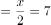人，第四小组=2x=28人。则原先人数最多的小组与人数最少的小组之间相差28-4=24人。

故正确答案为C。

---

第 57 题

**答案**：A

**官方解析**

第一所学校需1名教师，选择情况数为种；第二所学校需2名教师，选择情况数为种，此时剩余三名教师自动去往第三所学校，故总情况数为种。

故正确答案为A。

备注：本题存在歧义，题干未明确指出三所学校所需教师名额是否固定。若名额不固定，另一种解法为：先选出一所学校，派出1名教师，情况数为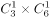种；再选出一所学校，派出2名教师，情况数为种，此时剩余三名教师自动去往最后一所学校，故总情况数为种，对应C项。但现实生活中，支教名额应该是根据学校需求定好的，所以粉笔更倾向A项为正确答案。

---

第 58 题

**答案**：D

**官方解析**

根据题意三位数是回文数的情况，即百位数字和个位数字相同，且由于三位数百位数字不能为0，只能是1-9中的任意一个，十位数字可以是0-9中的任意一个，故总情况数有9×10=90种。回文数是奇数的情况，即个位数字可以是1、3、5、7、9中的一个，百位数字和个位数字相同，十位数字可以是0-9中的任意一个，故满足条件的情况有5×10=50种。则三位数中回文数是奇数的概率为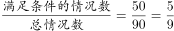。

故正确答案为D。

---

第 59 题

**答案**：B

**官方解析**

除了销售时间相同，销售鸡蛋和销售桃子没有其它关系，所以二者是相互独立的，因此可赋值传统销售模式下的鸡蛋和桃子的销售效率均为1，则直播带货期间，鸡蛋销售效率为2，桃子销售效率为3。根据题意可得，该批鸡蛋总量为20×1=20，该批桃子总量为25×1=25。设销售期间直播带货的天数为x，则非直播带货的鸡蛋销售时间为，非直播带货的桃子销售时间为。因为两种产品同时销售完成，其中的直播带货时间相同，那么非直播带货的时间也相同，即20-2x=25-3x，解得x=5，因此销售期间直播带货的天数为5。

故正确答案为B。

---

第 60 题

**答案**：A

**官方解析**

根据题干“至少有一车与其它车不同排”，可分为以下两种情况：

①其中一排停3辆车，另一排停1辆车。

首先，从两排中选一排停放甲乙，有种情况；然后，从剩余2辆车中选1辆车与甲乙同排，有种情况；再把这3辆车停进这排的4个车位里，有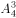种情况；最后，余下1辆车从另一排4个车位中选1个车位停放，有种情况；分步用乘法，共有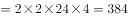种情况。

②两排均停2辆车。

首先，从两排中选一排停放甲乙，有种情况；然后，把甲乙停进这排的4个车位里，有种情况；最后，把剩余的两辆车停进另一排的4个车位里，有种情况；分步用乘法，共有种情况。

因此，电脑可生成的派位方式共有384+288=672种情况。

方法二：本题也可以考虑逆向思维求解。总情况为甲、乙在任意一排中的2个车位泊车，其余2辆车在剩余的6个车位中随机泊车，有种情况。反面情况为4辆车都在同一排泊车，有种情况。则题干所求=总情况数-反面情况数=720-48=672种，即电脑可生成672种派位方式。

故正确答案为A。

---

第 61 题

**答案**：A

**官方解析**

方法一：根据题意，要求每个大项不少于1个，即分为三类情况讨论如下：

第一类：滑冰大项中选择1个分项，滑雪大项中选择5个分项，情况数为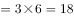种情况；

第二类：滑冰大项中选择2个分项，滑雪大项中选择4个分项，情况数为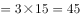种情况；

第三类：滑冰大项中选择3个分项，滑雪大项中选择3个分项，情况数为种情况；

分类相加，即符合条件的总情况数为18+45+20=83种。

方法二：根据题意，要求每个大项不少于1个，正面情况数较多，故从反面考虑。反面为选择的6个项目均为滑雪分项（滑冰分项仅有3个，故不可能全为滑冰项目），则反面情况为从6个滑雪分项中选择6个项目，有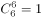种情况。总的情况数为从9个分项中选择6个项目，有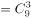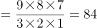种情况，故所求情况数=总情况数-反面情况数=84-1=83种。

故正确答案为A。

---

第 62 题

**答案**：C

**官方解析**

4位专家分配到3个勘探点，要求每个勘探点至少安排一名专家，则有一个勘探点需要分配2位专家。从4位专家中选择两位，有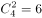种情况，将选择的两位专家当作一个整体，与另外两位专家分别分配到3个勘探点，共有种情况，则总情况数有6×6=36种。

甲、乙两名专家去了不同勘探点，从正向分析情况数较多，考虑反向计算，即甲、乙两名专家去了同一勘探点。将甲、乙两名专家当作一个整体，与另外两位专家分别分配到3个勘探点，共有种情况。即甲、乙两名专家去了同一勘探点共有6种情况。

则所求概率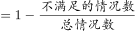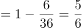。

故正确答案为C。

---

第 63 题

**答案**：A

**官方解析**

根据题意，某镇卫生院50多名医生被平均分配到13个基层诊所参与工作，医生总数为13的倍数，则医生总数只能为52人。由于男医生比女医生多4人，则男医生有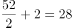人，女医生有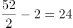人，分配到邻镇的男医生有28×25%=7人。要使这批人员中任意6人必有男医生，则女医生的人数应小于6人；又因有4个医疗点，且要保证必有一个医疗点的女医生多于1人，则女医生的人数应大于4人，故女医生的人数为5人。则该卫生院到邻镇支援工作的医生有7+5=12人。

故正确答案为A。

注：男医生人数为7人，女医生人数少于6人，则医生总人数少于13人，只有A项满足。

---

第 64 题

**答案**：B

**官方解析**

根据最初床护比为0.6：1，可求出最初200名患者配备的护士人数为200×0.6=120名；又收治700名患者后，患者总数变为200+700=900名，按照下调后床护比为0.2：1计算，共需护士900×0.2=180名，所以需增加护士人数=180-120=60名。
故正确答案为B。

---

第 65 题

**答案**：B

**官方解析**

根据题意可知，每次升空的无人机数量组成等差数列。又因为“组成一个近似等边三角形”，则第一次升空n架（）为底边，最后一次升空的无人机在三角形的顶点上，数量为1架（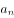），且公差d＝-1。根据等差数列求和公式：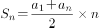，可得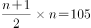，解得n＝14。再根据等差数列通项公式：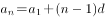，则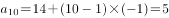，故第10次升空的无人机数量是5架。

故正确答案为B。

---

第 66 题

**答案**：C

**官方解析**

木珠子是球形的，需要从长方体木料的内部进行切割，由于长方体的高为1.5厘米，则木珠子的最大直径为长方体的高1.5厘米，即半径最大。长方体的宽为2厘米，木珠子的直径为1.5厘米，制作过程中，要令数量最多，木珠子错落摆放即满足要求。摆放过程注意不要超出长方体木料的长度，用前两个珠子的摆放作为演示：

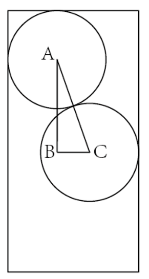

AC是两个木珠子球心的连线，长度即为木珠子的直径1.5厘米，AC为斜边做直角三角形ABC，AC即两个球心间的最短距离。BC的长度为长方体的宽-木珠子的半径-B点距长方体左边的边长，且AB垂直BC，可得出B点距长方体左边的边长即A点距长方体边长的距离0.75厘米，可求BC长=2-0.75-0.75=0.5厘米，在直角三角形ABC中，利用勾股定理可以求出AB长为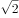厘米，即在AB所在直线上，相邻两个珠子间距（把珠子看成点）为厘米，且第一个和最后一个珠子的球心距长方体木料两端至少为0.75厘米。则制作的珠子数量=段数+1，段数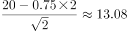，即分为13段，那么珠子数量最多=13+1=14个。

故正确答案为C。

---

第 67 题

**答案**：D

**官方解析**

设“冰墩墩”纪念品售价共上涨x元，销售利润为y元。根据题意，可列方程：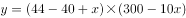，即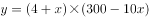，令y=0，解得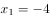，，当时，总利润最大，此时售价为44+13=57元。

故正确答案为D。

---

第 68 题

**答案**：B

**官方解析**

假设平均每人享用蛋糕，则蛋糕面积为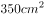，赋值蛋糕的长为35cm，宽为10cm。如下图所示：

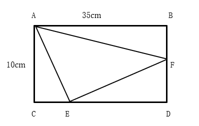

根据“左下角那块蛋糕平均可供50人享用，右上角那块蛋糕平均可供70人”可知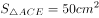，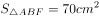，根据三角形面积公式：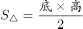，可得：CE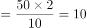cm，BFcm，则ED=35-10=25cm，DF=10-4=6cm，则，故，平均可供155人享用，即中间最大块蛋糕平均可供155人享用。

故正确答案为B。

---

第 69 题

**答案**：B

**官方解析**

根据题目要求桥长2km，最短距离=AB最短距离+桥长，如下图所示，将河流看成一条直线，两点之间线段最短，连接AB构成直角三角形ABC，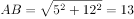km。

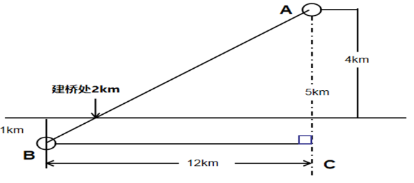

从A镇前往B镇的最短距离=13+2=15km。

故正确答案为B。

---

第 70 题

**答案**：D

**官方解析**

连接CQ，如图1所示，因PQ与正四棱锥的底面垂直，故三角形CPQ为直角三角形，在直角三角形CPQ中，，故。同理，连接，如图2，在直角三角形中，，故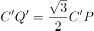，根据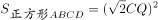 ，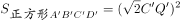，且，可得 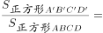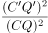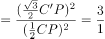，故第二次伞撑开后形成的正方形是第一次撑开后正方形ABCD面积的3倍。

故正确答案为D。

---

第 71 题

**答案**：D

**官方解析**

元素组成不同，且无明显属性规律，考虑数量规律。观察发现，图一、图三和图四均为多端点图形，图二为多圆相交图形，可以考虑笔画数。题干图形均为一笔画，而本题为选非题，故？处应选择不是一笔画的图形。A、B、C三项均为一笔画图形，D项为两笔画图形。只有D项不符合规律。
本题为选非题，故正确答案为D。

---

第 72 题

**答案**：B

**官方解析**

元素组成相同，优先考虑位置规律。观察发现，第一组图形中，第一个图形上下翻转并保留原图形后得到第二个图形，第一个图形保持不变放置在下方，然后对第一个图形分别进行上下翻转后放置在上方、顺时针旋转后放置在左侧、逆时针旋转后放置在右侧得到第三个图形。第二组图形应用此规律，对应B项。

故正确答案为B。

---

第 73 题

**答案**：D

**官方解析**

元素组成不同，且无明显属性规律，考虑数量规律。观察发现，题干图形分割明显，考虑面数量。图①⑤⑥均有6个面，图②③④均有9个面，即图①⑤⑥一组，图②③④一组。
故正确答案为D。

---

第 74 题

**答案**：C

**官方解析**

本题为分组分类题目。元素组成不同，且属性规律无法分为两组，考虑数量规律。题干每幅图形均为25宫格内出现的一个由黑粗线条构成的多边形封闭区域。观察发现，图①④⑤中多边形的面积相同，均占7.5个格子，图②③⑥中多边形的面积相同，均占10.5个格子。即图①④⑤为一组，图②③⑥为一组。
故正确答案为C。

---

第 75 题

**答案**：B

**官方解析**

本题考查六面体的空间重构。将题干立体图中的面依次标注为面a、面b、面c，如下图所示。

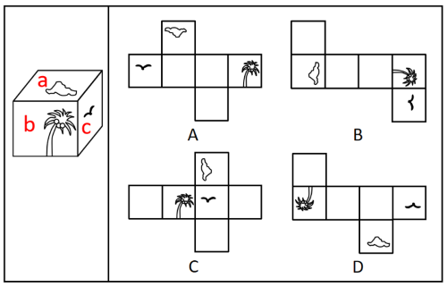

A项：选项与题干立体图一致，排除；

B项：题干立体图中面a与面b的公共边靠近面a中云朵的底部，而选项中面a与面b的公共边靠近面a中云朵的顶部，选项与题干立体图不一致，当选；

C项：选项与题干立体图一致，排除；

D项：选项与题干立体图一致，排除。

本题为选非题，故正确答案为B。

备注：本题作图不严谨，C项中面b与面a的公共边所对应的图形与题干立体图有差别，云朵的细节与立体图形不同，但对比B、C两项，B项错误更加明显，因此小粉笔建议选择B项。

---

第 76 题

**答案**：C

**官方解析**

第一步：找出定义关键词。
“表面张力不同的两种液体”、“液体从表面张力小的一边向张力大的方向流动渗透”。
第二步：逐一分析选项。
A项：若干种不同的酒按密度大小依次缓慢倒进杯子形成分层，并没有出现流动渗透，不符合“液体从表面张力小的一边向张力大的方向流动渗透”，不符合定义，排除；
B项：涂料和干燥后的涂膜颜色存在细微差异，在湿膜时颜色一般比较浅，在干燥后，颜色会加深，说的是涂料干燥前和干燥后的颜色差异，只出现一种液体涂料，不符合“表面张力不同的两种液体”，并且也体现不出液体之间的流动渗透，不符合“液体从表面张力小的一边向张力大的方向流动渗透”，不符合定义，排除；
C项：牛奶中加入几滴流体色素，没有搅拌的情况下色素相对集中，取少量洗洁精滴在色素所在位置，色素迅速往牛奶边缘扩散，这是因为牛奶密度略高于色素，在牛奶中加入色素后，色素可以短暂漂浮在牛奶表面，洗洁精是一种表面活性剂，加入洗洁精后，色素表面的张力迅速下降，从而小于牛奶张力，便形成扩散效果，加入洗洁精后的牛奶与色素符合“表面张力不同的两种液体”，色素在洗洁精的作用下改变张力，从而向牛奶边缘扩散，符合“液体从表面张力小的一边向张力大的方向流动渗透”，符合定义，当选；
D项：奶茶是牛奶和茶叶水的混合物，在介绍奶茶的制作原材料，没有体现两种液体互相流动渗透，不符合“液体从表面张力小的一边向张力大的方向流动渗透”，不符合定义，排除。
故正确答案为C。

---

第 77 题

**答案**：B

**官方解析**

第一步：找出定义关键词。
“保证文物安全”、“最小程度的介入”、“最大限度地维系文物的原本面貌”、“延续现状、降低保护性破坏”。
第二步：逐一分析选项。
A项：某博物馆在修复古籍时不拆开原线绳，只修补蛀洞严重的书页，符合“最小程度的介入”，不修补强度未受蛀洞影响的书页，符合“最大限度地维系文物的原本面貌”，符合定义，排除；
B项：雕塑作品中的人物手臂缺失，根据资料将其复原如初，并没有保留现状，也没有体现是不是最小程度的改变，不符合“最小程度的介入”、“最大限度地维系文物的原本面貌”，不符合定义，当选；
C项：某古城墙修缮时，保留其残损的现状，符合“最大限度地维系文物的原本面貌”，在靠近边墙的一侧恢复了很窄的台阶，说明修复的地方很少，符合“最小程度的介入”，符合定义，排除；
D项：某古塔倾斜，专家们只纠偏一度，说明修复的很少，符合“最小程度的介入”，依旧保留倾斜的状态，符合“最大限度地维系文物的原本面貌”，符合定义，排除。
本题为选非题，故正确答案为B。

---

第 78 题

**答案**：A

**官方解析**

第一步：找出定义关键词。
“一束光波照射于薄膜”、“薄膜使其形成新的光波”。
第二步：逐一分析选项。
A项：阳光穿透玻璃，照在屋内镜子上产生强烈反光，说明镜子对光进行了反射，但镜子上是否有薄膜并不清楚，不符合“一束光波照射于薄膜”，不符合定义，当选；
B项：光线照射在汽车玻璃上的贴膜上，符合“一束光波照射于薄膜”，改变折射光线和反射光线的能量分配比例，增加对某一光波的反射光强度，说明光波经过贴膜后形成了新的光波，符合“薄膜使其形成新的光波”，符合定义，排除；
C项：积水面形成的油膜在阳光下呈现出美丽的色彩，符合“一束光波照射于薄膜”，“美丽的色彩”说明肉眼看不到颜色的阳光经过油膜后形成了新的光波，符合“薄膜使其形成新的光波”，符合定义，排除；
D项：两块干净平整的玻璃片紧紧压叠形成极薄空间时，出现平行条纹，说明周围环境有光，符合“一束光波照射于薄膜”，手指用力压紧玻璃时，条纹随之发生改变，说明出现了新的光波，符合“薄膜使其形成新的光波”，符合定义，排除。
本题为选非题，故正确答案为A。

---

第 79 题

**答案**：D

**官方解析**

第一步：找出定义关键词。
“AI（人工智能）读取大量图片”、“自主提取图片特征”。
第二步：逐一分析选项。
A项：让学生观看人工智能的图片来体验深度学习，是让学生观看图片，不是让AI读取图片，不符合“AI（人工智能）读取大量图片”，不符合定义，排除；
B项：问诊机器人可以识别B超报告，但报告中不只含有图片，还含有文字性诊断结果可以直接告知病患风险信息，而不需要AI提取，不符合“AI（人工智能）读取大量图片”、“自主提取图片特征”，不符合定义，排除；
C项：提供无人驾驶汽车试乘服务，不是让AI读取图片，不符合“AI（人工智能）读取大量图片”、“自主提取图片特征”，不符合定义，排除；
D项：安防巡检机器人通过识别工人的图像来判定工人是否佩戴安全帽，符合“AI（人工智能）读取大量图片”、“自主提取图片特征”，符合定义，当选。
故正确答案为D。

---

第 80 题

**答案**：A

**官方解析**

第一步：找出定义关键词。
“采用多样化的监管手段和策略”、“监管主体的多元化”。
第二步：逐一分析选项。
A项：某地主管部门直接对涉事企业进行了整顿，监管只有某地主管部门一个，没有体现出监管手段的多样化，不符合“采用多样化的监管手段和策略”，不符合定义，当选；
B项：瑞典立法要求建立内控体系，说明除政府外还有其他监管手段和策略，内控体系也体现了“差别化的监管”，符合“采用多样化的监管手段和策略”，符合定义，排除；
C项：英国成立企业、工会代表组成的大健康监管委员会，说明监管由不同主体共同完成，体现了多样化的监管手段和策略，符合“采用多样化的监管手段和策略”，符合定义，排除；
D项：聘请专业的第三方机构，说明除第三方机构外可能还有其他的监管主体，可能符合 “监管主体的多元化”，比A更好，符合定义，排除。
本题为选非题，故正确答案为A。

---

第 81 题

**答案**：B

**官方解析**

第一步：找出定义关键词。
“受其从属的或追求的群体参照力所影响”。
第二步：逐一分析选项。
A项：小王平时喜欢便装，但参加面试时穿了西装，是因为面试时大多数人都选择正式的西装，小王也受其影响，因而在面试时做出同样的选择，符合“受其从属的或追求的群体参照力所影响”，符合定义，排除； 
B项：妈妈给孩子增减衣物是因为天气转凉，妈妈行为的变化是受天气变化的影响而不是群体的影响，不符合“受其从属的或追求的群体参照力所影响”，不符合定义，当选；
C项：小刘购买偶像同款商品是因为其他影迷都购买了，小刘的行为受影迷群体的影响，符合“受其从属的或追求的群体参照力所影响”，符合定义，排除；
D项：小张在意卫生状况是因为小张的父母都是医生，小张的行为受其父母的影响，符合“受其从属的或追求的群体参照力所影响”，符合定义，排除。
本题为选非题，故正确答案为B。

---

第 82 题

**答案**：D

**官方解析**

第一步：找出定义关键词。
“乡情作用于基层社会治理主体和治理体系”、“在基层社会的治理过程中发挥重要作用”、“由情感和认同构筑的场域”、“影响社会治理体系和过程”。
第二步：逐一分析选项。
A项：“以顺德是‘世界美食之都’而自豪”只表明顺德人对当地的情感和认同，但是没有体现出对基层社会的治理，不符合“乡情作用于基层社会治理主体和治理体系”、“在基层社会的治理过程中发挥作用”，不符合定义，排除；
B项：“敢拼会赢的精神”只表明这是闽南人的一种精神，并不是对于某地域的乡情，所以不存在由情感和认同构筑的场域，不符合“由情感和认同构筑的场域”，同时并没有体现出治理，不符合“乡情作用于基层社会治理主体和治理体系”，不符合定义，排除；
C项：“爱国爱乡的光荣传统”只是海外华侨华人的品格，并不是对于某地域的乡情，所以不存在由情感和认同构筑的场域，不符合“由情感和认同构筑的场域”，同时并没有体现出治理，不符合“乡情作用于基层社会治理主体和治理体系”，不符合定义，排除；
D项：“乡贤成立妈祖慈善基金会”说明当地人认同本地区的文化，存在由情感和认同构筑的场域，符合“由情感和认同构筑的场域”，而且“服务当地桑梓”是一种基层社会治理，符合“乡情作用于基层社会治理主体和治理体系”、“影响社会治理体系和过程”，符合定义，当选。
故正确答案为D。

---

第 83 题

**答案**：B

**官方解析**

第一步：找出定义关键词。
合子前隔离：“由于活动区域、生活习性、体态差异等各种因素”、“导致无法进行基因交流”；
合子后隔离：“因为遗传信息的不匹配”、“即使双方的生殖细胞能够相遇结合，也无法完成正常的繁衍”。
第二步：逐一分析选项。
A项：两种兰花因“授粉昆虫不同”无法自然进行基因交流，但可以通过人工授粉进行繁殖，不符合“即使双方的生殖细胞能够相遇结合，也无法完成正常的繁衍”，不符合“合子后隔离”的定义，排除；
B项：三倍体西瓜用二倍体西瓜授粉后，培育出了“无籽”西瓜，说明双方生殖细胞结合后不能完成正常的繁衍，符合“因为遗传信息的不匹配”、“即使双方的生殖细胞能够相遇结合，也无法完成正常的繁衍”，符合“合子后隔离”的定义，当选；
C项：富尔顿蟋蟀和宾州蟋蟀因“鸣声不同”，不会进行交配，符合“由于活动区域、生活习性、体态差异等各种因素”、“导致无法进行基因交流”，符合“合子前隔离”的定义，不符合“合子后隔离”的定义，排除；
D项：两种蝉因“发情期不同”，没有交配机会，符合“由于活动区域、生活习性、体态差异等各种因素”、“导致无法进行基因交流”，符合“合子前隔离”的定义，不符合“合子后隔离”的定义，排除。
故正确答案为B。

---

第 84 题

**答案**：C

**官方解析**

第一步：找出定义关键词。
“针对个人化搜索，提供筛选后结果”。
第二步：逐一分析选项。
A项：赵先生上网看测评类的文章后，浏览器为其推送相关内容，符合“针对个人化搜索，提供筛选后结果”，符合定义，排除；
B项：李先生经常网购图书，平台针对性推送购书清单，符合“针对个人化搜索，提供筛选后结果”，符合定义，排除；
C项：刘先生经常去某网络贴吧发帖，建立微信群的过程，没有体现出“针对个人化搜索，提供筛选后结果”，不符合定义，当选；
D项：两位先生分别在各自手机上搜索某公司后，搜索结果的不同，符合“针对个人化搜索，提供筛选后结果”，符合定义，排除。
本题为选非题，故正确答案为C。

---

第 85 题

**答案**：A

**官方解析**

第一步：找出定义关键词。
病理性衰老：“由于负面情绪、物理创伤、营养匮乏、身体疾病”、“衰老速度加快”；
生理性衰老：“随着年龄增长出现的衰老”、“自然老化”。
第二步：逐一分析选项。
A项：“白头搔更短，浑欲不胜簪”意思为“愁闷心烦只有搔首而已，致使白发疏稀插不上簪”，愁闷心烦符合“由于负面情绪、物理创伤、营养匮乏、身体疾病”，白发稀疏是衰老的明显特征之一，而更稀疏符合“衰老速度加快”，符合“病理性衰老”定义，当选；
B项：“寒暑迭变，不觉渐成衰老”意思为“冬天和夏天交替变化，没有感觉就已渐渐衰老”，时间的变化导致的衰老，不符合“由于负面情绪、物理创伤、营养匮乏、身体疾病”，也未体现“衰老速度加快”，不符合“病理性衰老”定义，排除；
C项：“惟草木之零落兮，恐美人之迟暮”意思为“想到树上黄叶纷纷飘零，而害怕美人头上也添上丝丝霜鬓”，诗人只是表达了害怕美人衰老，而不是描写美人已经衰老，又为何衰老，不符合“由于负面情绪、物理创伤、营养匮乏、身体疾病”，也未体现“衰老速度加快”，不符合“病理性衰老”定义，排除；
D项：“人生不得长欢乐，年少须臾老到来”意思为“人的一生得不到长久的欢乐，青春年少的时光总是过的很快，老年很快就来了”，诗人感叹的是时光飞逝，是由于时间的原因导致衰老，不符合“由于负面情绪、物理创伤、营养匮乏、身体疾病”，也未体现“衰老速度加快”，不符合“病理性衰老”定义，排除。
故正确答案为A。
注——本题出处如下：
https://baike.baidu.com/item/%E8%A1%B0%E8%80%81/1169838?fr=aladdin

---

第 86 题

**答案**：D

**官方解析**

第一步：判断题干词语间逻辑关系。
帛书是指中国古代写在绢帛上的文书；简牍是指中国古代书写在竹简或木片上的文书，二者是两种不同的书，为并列关系。
第二步：判断选项词语间逻辑关系。
A项：日晷和秒表是两种不同的计时器，二者为并列关系，与题干逻辑关系一致，保留；
B项：熊猫是动物，银杏是植物，二者不是并列关系，与题干逻辑关系不一致，排除；
C项：青铜是制作礼器的原材料之一，二者为原材料与成品的对应关系，与题干逻辑关系不一致，排除；
D项：牛车和轿子是两种不同的交通工具，二者为并列关系，与题干逻辑关系一致，保留。
对比A、D两项，题干中的帛书和简牍都是古代出现的事物，A项中的日晷是古代出现的事物，但秒表是现代出现的事物，D项中的牛车起源于商代，牛车和轿子都是古代出现的事物，故D项与题干的关系更近。
故正确答案为D。

---

第 87 题

**答案**：A

**官方解析**

第一步：判断题干词语间逻辑关系。

考拉和树袋熊是同一种动物，二者为全同关系。

第二步：判断选项词语间逻辑关系。

A项：墨鱼和乌贼是同一种动物，二者为全同关系，与题干逻辑关系一致，保留；

B项：黄蜂属于胡蜂科，蜜蜂属于蜜蜂科，二者为并列关系，与题干逻辑关系不一致，排除；

C项：蚱蜢和蝗虫的关系较有争议，部分资料显示二者为全同关系，与题干逻辑关系一致，保留；

D项：金龟子是鞘翅目金龟总科的通称，天牛是多食亚目天牛科昆虫的总称，二者为并列关系，与题干逻辑关系不一致，排除。

对比A、C两项，C项中蚱蜢和蝗虫的关系较有争议，如下图所示，维基百科和百度百科都表明二者是全同关系，但现代汉语词典表明二者并不是同一种动物，目前无法确定出题人对二者的关系是如何判定的，相对来说，A项中的墨鱼和乌贼是没有争议的全同关系，因此，小粉笔更倾向于将正确答案给到A项。

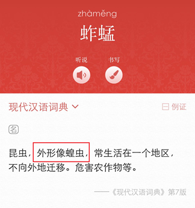

故正确答案为A。

---

第 88 题

**答案**：A

**官方解析**

第一步：判断题干词语间逻辑关系。
电脑是一种设备，二者是种属关系。
第二步：判断选项词语间逻辑关系。
A项：传媒指传播媒介，特指报纸、广播、电视、网络等各种新闻工具，广播是一种传媒，二者是种属关系，与题干逻辑关系一致，当选；
B项：颜料是绘画所用的材料，二者不是种属关系，与题干逻辑关系不一致，排除；
C项：文言和白话为汉语书面语的两种形式，二者是并列关系而非种属关系，与题干逻辑关系不一致，排除；
D项：煤炭是一种能源，二者是种属关系，但两词顺序与题干相反，与题干逻辑关系不一致，排除。
故正确答案为A。

---

第 89 题

**答案**：A

**官方解析**

第一步：判断题干词语间逻辑关系。
姹紫嫣红形容各种颜色的花卉艳丽、好看，“姹紫”指美丽的紫色，“嫣红”指鲜艳的红色，二者为并列关系。
第二步：判断选项词语间逻辑关系。
A项：嘉言懿行指有教育意义的好言语和好行为，“嘉言”指有益的言论，“懿行”指高尚的行为，二者为并列关系，与题干逻辑关系一致，保留；
B项：风刀霜剑指寒风像刀子，严霜像剑一样刺人的肌肤，形容气候寒冷，也比喻世态险恶，“风刀”指风如刀，“霜剑”指霜似剑，二者为并列关系，与题干逻辑关系一致，保留；
C项：小家碧玉指小户人家的年轻美貌的女子，“小家”指小户人家，“碧玉”指年轻美貌的女子，二者不是并列关系，与题干逻辑关系不一致，排除；
D项：疾首蹙额形容厌恶、痛恨的样子，“疾首”指头痛，“蹙额”指皱眉，二者为并列关系，与题干逻辑关系一致，保留。
对比A、B、D三项，题干中，“姹”修饰“紫”，“嫣”修饰 “红”，“姹紫”和“嫣红”均为偏正结构；A项的“嘉言”和“懿行”均为偏正结构，B项的“风刀”和“霜剑”不是偏正结构，D项的“蹙额”是动宾结构，所以A项与题干的逻辑关系更加一致。

故正确答案为A。

---

第 90 题

**答案**：C

**官方解析**

第一步：判断题干词语间逻辑关系。
马匹、船只和车辆都有运输的功能，三者在功能上是并列关系。
第二步：判断选项词语间逻辑关系。
A项：银两是以银锭为主要形式的一种秤量货币单位，金钱多指用金属铸成的钱，后泛指货币财富，银两是金钱，二者是种属关系，与题干逻辑关系不一致，排除；
B项：纸张是制作试卷的原材料，二者是原材料与成品的对应关系，与题干逻辑关系不一致，排除；
C项：水杯、油瓶和饭碗都有盛装物品的功能，三者在功能上是并列关系，与题干逻辑关系一致，当选；
D项：武将是古代的军事将领或部队军官，武将是官员，二者是种属关系，与题干逻辑关系不一致，排除。
故正确答案为C。

---

第 91 题

**答案**：A

**官方解析**

第一步：判断题干词语间逻辑关系。
在电影院放映影片，放映影片是动宾关系，电影院是放映影片的地点。
第二步：判断选项词语间逻辑关系。
A项：在图书馆查阅资料，查阅资料是动宾关系，图书馆是查阅资料的地点，与题干逻辑关系一致，当选；
B项：地漏具有排水的功能，二者是功能对应关系，与题干逻辑关系不一致，排除；
C项：不能说在传染病防疫疫苗，且传染病不是一个地点，与题干逻辑关系不一致，排除；
D项：不能说在朋友圈聊天微信，且朋友圈不是一个地点，微信具有聊天的功能，二者是功能对应关系，与题干逻辑关系不一致，排除。
故正确答案为A。

---

第 92 题

**答案**：A

**官方解析**

第一步：判断题干词语间逻辑关系。
针线是制作服饰的工具，布料是制作服饰的原材料，三者为工具、原材料、成品的对应关系。
第二步：判断选项词语间逻辑关系。
A项：剪刀是制作窗花的工具，彩纸是制作窗花的原材料，三者为工具、原材料、成品的对应关系，与题干逻辑关系一致，当选；
B项：刻刀是制作玺印的工具，玉石是制作玺印的原材料，三者为工具、成品、原材料的对应关系，但三词顺序与题干不同，与题干逻辑关系不一致，排除；
C项：玻璃和窗框是窗户的组成部分，与题干逻辑关系不一致，排除； 
D项：鸡精是一种调味品，不是制作鸡汤的工具，与题干逻辑关系不一致，排除。
故正确答案为A。

---

第 93 题

**答案**：D

**官方解析**

第一步：判断题干词语间逻辑关系。
先征稿，再评选，最后颁奖，三者为动作上的先后顺序的对应关系。
第二步：判断选项词语间逻辑关系。
A项：先热身，再运动，两词顺序与题干相反，与题干逻辑关系不一致，排除；
B项：节能和减排是并列关系，不分先后，且节能和减排都属于环保措施，与题干逻辑关系不一致，排除；
C项：先设计，再施工，监理是指对工程项目等进行监督管理，监理的主要内容是熟悉所监理项目的合同条款、规范、设计图纸，有效开展现场监理工作，及时报告施工过程中出现的问题等，所以施工和监理可以同时发生，没有一定的先后顺序，与题干逻辑关系不一致，排除；
D项：先麻醉，再切开，最后缝合，三者为动作上的先后顺序的对应关系，与题干逻辑关系一致，当选。
故正确答案为D。

---

第 94 题

**答案**：C

**官方解析**

逐一代入选项。
A项：“晴空万里”形容天空晴朗，没有一点云彩，“天干物燥”意思是天气太干，物品也干燥，极易起火，二者无明显逻辑关系；“才高八斗”比喻才学极高，“识文断字”意思是能识字读书，指有一点文化知识，二者无明显逻辑关系，前后逻辑关系不一致，排除；
B项：“晴空万里”形容天空晴朗，没有一点云彩，“雨后春笋”指春天下大雨后，发出来的竹笋一下子就长出来很多，比喻新生事物迅速大量地涌现出来，二者无明显逻辑关系；“妙笔生花”比喻写作能力大有进步，或形容文章写得很出色，“识文断字”意思是能识字读书，指有一点文化知识，二者无明显逻辑关系，前后逻辑关系不一致，排除；
C项：“晴空万里”形容天空晴朗，没有一点云彩，“阴云密布”形容浓厚的云层或空气中的大量的烟尘遮蔽天日，二者为反义关系；“胸无点墨”意思是肚子里没有一点墨水，指没有文化，“识文断字”意思是能识字读书，指有一点文化知识，二者为反义关系，前后逻辑关系一致，当选；
D项：“晴空万里”形容天空晴朗，没有一点云彩，“倾盆大雨”形容雨大势急，二者为反义关系；“味同嚼蜡”意思是像吃蜡一样，没有一点儿味，形容语言或文章枯燥无味，“识文断字”意思是能识字读书，指有一点文化知识，二者无明显逻辑关系，前后逻辑关系不一致，排除。
故正确答案为C。

---

第 95 题

**答案**：D

**官方解析**

逐一代入选项。
A项：入木三分形容书法刚劲有力，也用来形容议论、见解深刻，与绘画无明显逻辑关系；珠圆玉润形容歌声婉转优美或文字流畅明快，用来形容音乐，二者为对应关系。前后逻辑关系不一致，排除；
B项：入木三分形容书法刚劲有力，也用来形容议论、见解深刻，与雕刻无明显逻辑关系；黄钟大吕形容正大、庄严、高妙的音乐或文辞，用来形容音乐，二者为对应关系。前后逻辑关系不一致，排除；
C项：入木三分形容书法刚劲有力，也用来形容议论、见解深刻，与建筑无明显逻辑关系；高山流水指知音难觅或乐曲高妙，用来形容音乐，二者为对应关系。前后逻辑关系不一致，排除；
D项：入木三分形容书法刚劲有力，也用来形容议论、见解深刻，用来形容书法，二者构成对应关系；余音绕梁形容歌声或音乐优美，耐人回味，用来形容音乐，二者构成对应关系。前后逻辑关系一致，当选。
故正确答案为D。

---

第 96 题

**答案**：D

**官方解析**

第一步：找出论点和论据。
论点：一些人颅骨底部出现的奇怪的“头骨突起”与他们长时间弯下脖子看智能手机时的奇怪角度有关。
论据：研究发现颅骨底部出现骨质突起的情况在年轻人中比在老年人中更为普遍，尤其是在18岁至30岁年龄组的男性当中。
本题论据在分析“年龄”与“头骨突起”的关系，论点在分析“长时间弯下脖子看智能手机时的奇怪角度”和“头骨突起”的关系，论据和论点话题不一致，优先考虑拆桥，即不能通过“年龄”推出“不良姿势看手机的时长”。
第二步：逐一分析选项。
A项：指出塑形枕头受到“头骨突起”的年轻消费者欢迎，是在强调部分头骨突起人群的购物偏好，但论点是在分析“头骨突起”产生的具体原因，话题不一致，无法削弱，排除；
B项：指出研究样本选取很科学，结论具有普适性，进一步说明了结论成立的科学性，为加强项，无法削弱，排除；
C项：指出研究中对年轻人更容易出现头骨突起的分析过程存在瑕疵，即论据中的研究过程是存在瑕疵的，可以削弱，保留；
D项：指出该研究未统计过不同年龄段的受访者用不良姿势看智能手机的时长，那就不能通过“年龄”推出“不良姿势看手机的时长”，可以削弱，保留；
比较C、D两项，C项只说分析过程存在瑕疵，但具体是什么瑕疵，是否会影响实验结论，表述并不明确，故D项更为明确。
故正确答案为D。

---

第 97 题

**答案**：B

**官方解析**

第一步：找出论点和论据。
论点：有些食物的确能让大脑更好地运作，可可就是其中之一。
论据：可可含有大量的茶碱和咖啡因，它们可以有效的减轻压力和缓解疼痛。
本题论点说的是“可可”让“大脑更好地运作”，论据说的是“可可”中的“茶碱和咖啡因”可以“减轻压力和缓解疼痛”，“减轻压力和缓解疼痛”有助于“大脑更好地运作”，二者关系紧密，可以认为话题一致，加强可以考虑补充论据，即解释原因或举例。
第二步：逐一分析选项。
A项：指出可可中的咖啡因需要在“特定条件”下才能发挥减压作用，但无法确定食用可可时是否满足特定条件，也就无法判断减压作用是否能实现，属于不明确项，无法加强，排除；
B项：指出可可中含有的茶碱和咖啡因是通过刺激大脑分泌内啡肽来起到减轻压力和缓解疼痛作用的，进而能让大脑更好地运作，解释原因，补充论据，当选；
C项：指出用可可制作的黑巧克力对情绪有影响，但无法判断是好影响还是坏影响，能否让大脑更好的运作，属于不明确项，无法加强，排除；
D项：指出“运动”对于大脑的作用，而论点说的是“可可”对于大脑的作用，话题不一致，属于无关项，无法加强，排除。
故正确答案为B。

---

第 98 题

**答案**：C

**官方解析**

第一步：找出论点和论据。
论点：体质的酸化是百病之源。
论据：无论是癌症，还是常见的高血压、糖尿病、痛风等，都是由于“酸性食物”吃多了导致体质酸化引起的。
本题的论点和论据均在讨论“体质酸化”与“疾病”之间的关系，话题一致，削弱优先考虑削弱论点，即体质的酸化不是百病之源。
第二步：逐一分析选项。
A项：该项讨论的是“人体皮肤处于弱酸性状态”与“不容易滋生细菌”的关系，“人体皮肤处于弱酸性状态”不能代表论点中“体质的酸化”，且“不容易滋生细菌”不代表不容易生病，话题不一致，无法削弱，排除；
B项：该项指出身体偏碱性就是健康的，未明确说明酸性体质是否健康，不明确项，排除；
C项：该项指出人的体质不会是酸性的，说明酸性体质不存在，则酸性体质也不可能是百病之源，削弱论点，当选；
D项：该项指出健康人体存在酸性物质，但是存在酸性物质不代表健康人是“酸性体质”，话题不一致，无法削弱，排除。
故正确答案为C。

---

第 99 题

**答案**：A

**官方解析**

第一步：找出论点和论据。
论点：可以使用DNA甲基化作为一种全新的癌症检测筛查标志物，来有效识别结直肠癌、肺癌、乳腺癌和肝癌等肿瘤。
论据：DNA甲基化异常是癌症发生的一种警示性标志。
本题论点探讨“DNA甲基化”和“筛查癌症的标志”之间的关系，论据说的是“DNA甲基化”和“癌症警示性标志”之间的关系，二者话题一致，优先考虑补充论据加强，可以举例子，也可以解释原因。
第二步：逐一分析选项。
A项：该项指出肿瘤抑制基因启动子区呈现DNA高甲基化，而癌基因启动子区呈现DNA低甲基化，解释了为什么DNA甲基化可以作为癌症检测筛查的标志物，解释原因，可以加强，当选；
B项：该项讨论DNA甲基化检测方法的研究难度以及局限性，但并未提及DNA甲基化是否可以作为癌症检测筛查的标志物，与论点讨论的话题不一致，无法加强，排除；
C项：该项讨论DNA甲基化检测方法有稳定性高、简单快捷等优势，但并未提及DNA甲基化是否可以作为癌症检测筛查的标志物，与论点讨论的话题不一致，无法加强，排除；
D项：该项讨论基因启动子区异常甲基化在研究中受到越来越多的重视，但并未提及DNA甲基化是否可以作为癌症检测筛查的标志物，与论点讨论的话题不一致，无法加强，排除。
故正确答案为A。

---

第 100 题

**答案**：A

**官方解析**

日常结论题，根据题干信息逐一分析选项。
A项：根据题干可知，恐龙的多样性从7600万年前就开始下降，食草恐龙和食肉恐龙都在衰落，这些发生在6600万年白垩纪末期物种大灭绝（小行星撞击地球的时间）之前的大约1000万年里，可以推出在小行星撞击地球并最终使恐龙灭绝之前恐龙就已经处境不佳，当选；
B项：题干只是指出在恐龙时代的最后1000万年里，食草恐龙和食肉恐龙都在衰落，并没有提及新物种形成速度和灭绝速度的情况，无中生有，无法推出，排除；
C项：题干中没有提及在恐龙时代“最后4000万年中的不同时期”，六大恐龙多样性的降幅问题，无中生有，无法推出，排除；
D项：题干中没有提及恐龙和新物种灭绝速度的比较，无中生有，无法推出，排除。
故正确答案为A。

---

第 101 题

**答案**：D

**官方解析**

第一步：找出论点和论据。
论点：对于独居者而言，关联性甚至更大——在绿地面积达到或超过30%的地区，他们感到孤独的可能性降低了一半。
论据：对居住地附近有至少30%的土地是公园和绿地的成年人而言，他们感到孤独的几率比居住地附近绿地面积不足10%的成年人要低26%。
论据给出一组“居住地附近绿地面积”与“孤独感”关系的数据，论点说的是“居住地附近绿地面积”与“独居者孤独感”的关系，论据和论点的话题一致，加强优先考虑补充论据，即解释原因或举例子。
第二步：逐一分析选项。
A项：该项说的是孤独感与罹患抑郁症风险的关系，而论点说的是居住地附近绿地面积与孤独感的关系，话题不一致，无法加强，排除；
B项：该项说的是城市造林对主观记忆减退及患阿尔茨海默症风险的影响，而论点说的是居住地附近绿地面积与孤独感的关系，话题不一致，无法加强，排除；
C项：该项说的是定期接触自然有望缓解孤独感，但并不明确“接触自然”与“居住地附近绿地面积”的关系，为不明确项，无法加强，排除；
D项：该项说的是绿地面积大小影响社交互动频率，且经常与他人在绿地环境中交流有助于改善情绪和消除孤独感，解释了为什么在绿地面积达到或超过30%的地区，独居者感到孤独的可能性会降低，补充论据，可以加强，当选。
故正确答案为D。

---

第 102 题

**答案**：C

**官方解析**

第一步：找出论点和论据。
论点：金星大气层中的磷化氢有可能是某种生物留下的印记。
论据：有磷化氢意味着没有充足的氧气存在，但有可能证明是存在厌氧生物的。
本题论点说的是“金星大气层中的磷化氢”与“某种生物”之间的关系，论据说的是“磷化氢”与可能存在“厌氧生物”之间的关系，论点论据话题一致，削弱优先考虑削弱论点。
第二步：逐一分析选项。
A项：该项说金星大气中含有大量二氧化碳以及浓硫酸云层，温室效应非常严重，而论点讨论的是金星大气层中的磷化氢是否来自于某种生物，话题不一致，无法削弱，排除；
B项：该项说的是存在比较符合金星上大气条件的“不需要呼吸”的动物，说明在金星上可能在没有充足氧气的情况下存在生物，即厌氧生物，补充论据说明这些生物可能是磷化氢的来源，为加强项，无法削弱，排除；
C项：该项说的是金星上存在某些未知的光化学过程，这些光化学过程能够释放大量的磷化氢，说明金星大气层中的磷化氢是来自于光化学过程，而不是来自于厌氧生物，削弱论点，可以削弱，当选；
D项：该项说的是任何行星上都不太可能存在太多磷，因此一颗行星产生大量磷化氢的可能性很低，而题干论点讨论的是金星大气层中的磷化氢的来源问题，话题不一致，无法削弱，排除。
故正确答案为C。

---

第 103 题

**答案**：B

**官方解析**

第一步：找出论点和论据。
论点：吃辣可以促进造血干细胞动员。
论据：伤害感受神经能够对造血干细胞动员进行调控，增强造血干细胞的黏附或迁移，降钙素基因相关肽（CGRP）是伤害感受神经元主要分泌的神经递质分子。研究者发现，给予CGRP可以显著增强造血干细胞动员。CGRP可以直接影响造血干细胞，诱导细胞表面形成CALCRL和RAMP1蛋白形成的二聚体受体，并促进造血干细胞进入血管。
本题论点说的是“吃辣”与“造血干细胞动员”之间的关系，论据说的是“伤害感受神经”与“造血干细胞动员”之间的关系，话题不一致，且提问方式为“前提”，加强优先考虑搭桥，即建立“吃辣”与“伤害感受神经”之间的联系。
第二步：逐一分析选项。
A项：指出骨髓神经纤维中的伤害感受神经元占比高，不能说明“吃辣”与“造血干细胞动员”之间的关系，话题不一致，无法加强，排除；
B项：指出“辣味”会激活神经纤维中的伤害感受神经，这说明吃辣可以影响伤害感受神经，进而影响造血干细胞动员，在“吃辣”与“伤害感受神经”之间建立了联系，搭桥项，可以加强，当选；
C项：指出辣的食物能够促进消化液的分泌、加速胃肠道蠕动，与造血干细胞无关，属于无关项，无法加强，排除；
D项：指出造血干细胞能够对损失的血细胞进行补充，未提及吃辣对其的影响，属于无关项，无法加强，排除。
故正确答案为B。

---

第 104 题

**答案**：B

**官方解析**

日常结论题，根据题干信息逐一分析选项。

A项：题干指出蚕是通过高浓度糖分激活须形外颚叶上的味觉神经来确认桑叶，没有提及蚕只吃桑叶的原因，无中生有，无法推出，排除；

B项：题干指出蚕口器下方的下颚须中的味觉神经能识别-谷甾醇、绿原酸、异槲皮苷，接着，蚕会用口器上的须形外颚叶来尝一下叶片叶汁中的糖分，可以推出蚕通过不同的器官感受不同的味道来判断是否是桑叶，可以推出，当选；

C项：题干指出蚕依靠下颚须中的“味觉神经”识别叶片表面的一些物质，用口器上的须形外颚叶来“尝”糖分，因此蚕是依靠“味觉”来感知桑叶，而非依靠“碰触”，无法推出，排除；

D项：题干中没有提及蚕的饲养，也没有提及改进蚕的人工饲料，无中生有，无法推出，排除。

故正确答案为B。

---

第 105 题

**答案**：D

**官方解析**

第一步：分析题干找关系。

①小赵：甲乙；

②小钱：甲；

③小孙：甲 且 乙；

④小李：甲乙。

分析题干条件，①、③为矛盾关系，必有一真一假。

第二步：看其余。

根据题干推理可知，四人预测为两真两假，故②、④也必有一真一假。由“AB”=“A 或 B”可知，④“甲乙”=“甲 或 乙”，此时，若②“甲”为真，则④“甲 或 乙”为真，与②、④必有一真一假矛盾，故②“甲”为假，即甲没有进入决赛，此时④“甲 或 乙”为真，根据或关系的否一推一，可知乙进入决赛。

故正确答案为D。

---

第 106 题

**答案**：B

**官方解析**

根据题干“2020年······占······的比重约为”，结合材料时间是2020年，可判定本题为现期比重问题。定位文字材料第二段、第三段可知：2020年，软件产品实现收入22758亿元，同比增长10.1%，占全行业比重为27.9%；电子商务平台技术服务收入9095亿元。根据公式：比重，则2020年全行业收入亿元，故题干所求，与B项最接近。

故正确答案为B。

---

第 107 题

**答案**：A

**官方解析**

定位文字材料第二段可知：2020年软件产品收入同比增长10.1%；定位文字材料第三段可知：2020年信息技术服务收入同比增长15.2%，增速高出全行业平均水平1.9个百分点，可得2020年全行业平均水平同比增速为15.2%-1.9%=13.3%；定位文字材料第四段可知：2020年信息安全产品和服务收入同比增长10.0%；定位文字材料第五段可知：2020年嵌入式系统软件收入7492亿元，同比增长12.0%。四大业务形态收入同比增速高于全行业平均水平的为信息技术服务(15.2%)，有1个。
故正确答案为A。

---

第 108 题

**答案**：A

**官方解析**

根据题干“2019年······约为”，结合材料时间为2020年，可判定本题为基期计算问题。定位文字材料第三段可得：2020年，信息技术服务实现收入49868亿元，同比增长15.2%，增速高出全行业平均水平1.9个百分点，占全行业收入比重为61.1%。根据公式：整体量，则2020年全行业实现收入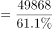亿元，同比增速=15.2%-1.9%=13.3%。根据公式：基期量，则2019年全行业实现收入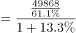亿元万亿元。

故正确答案为A。

---

第 109 题

**答案**：C

**官方解析**

根据题干“2019年······同比增速相较于······同比增速”，可判定本题为一般增长率问题。定位材料第五段，2020年嵌入式系统软件实现收入7492亿元，同比增长12.0%，增速较上年提高4.2个百分点，则2019年嵌入式系统软件同比增速为12.0%-4.2%=7.8%；定位材料第四段，2020年信息安全产品和服务实现收入1498亿元，同比增长10.0%，增速较上年回落2.4个百分点，则2019年信息安全产品和服务同比增速为10.0%+2.4%=12.4%，二者相差：7.8%-12.4%=-4.6%，即慢4.6%。
故正确答案为C。

---

第 110 题

**答案**：C

**官方解析**

A项：定位文字材料第四段可得：2020年，信息安全产品和服务实现收入1498亿元，同比增长10.0%。根据公式：基期量，则2019年信息安全产品和服务实现收入为亿元，正确；

B项：定位文字材料可知2020年软件产品、信息技术服务、信息安全产品和服务、嵌入式系统软件的实现收入及同比增长率。根据公式：比重，整体量一致，比较比重的大小，只需比较部分量的大小即可。根据公式：基期量，则2019年软件产品、信息技术服务、信息安全产品和服务、嵌入式系统软件的实现收入分别为亿元、亿元、亿元、亿元。分母（1+增长率）相差不大，现期量最小的是信息安全产品和服务，则其基期量最小，占全行业收入比重最低，正确；

C项：定位文字材料第一段可知：软件产品、信息技术服务、信息安全产品和服务、嵌入式系统软件四大业务形态构成我国软件和信息技术服务业。定位文字材料第二、三、五段可知2020年软件产品、信息技术服务、嵌入式系统软件实现收入占全行业收入的比重分别是27.9%、61.1%、9.2%。因此，2020年信息安全产品和服务占全行业收入比重为1-27.9%-61.1%-9.2%=1.8%，错误；

D项：定位文字材料第三段可得：2020年，信息技术服务实现收入同比增长15.2%，增速高出全行业平均水平1.9个百分点，占全行业收入比重为61.1%。根据两期比重比较口诀“部分增长率大于整体增长率，则比重上升”。部分增长率（15.2%）大于整体增长率（15.2%-1.9%），比重上升，即2019年信息技术服务收入占全行业收入比重低于61.1%，正确。

本题为选非题，故正确答案为C。

---

第 111 题

**答案**：A

**官方解析**

根据题干“2016-2021年······同比增速最大的年份是”，可判定本题为一般增长率比较问题。定位统计图1可知2015—2021年我国公共充电桩数量。根据公式：增长率，可得我国公共充电桩数量同比增速分别为：

2016年，；

2019年，；

2020年，；

2021年，。

则2016—2021年我国公共充电桩数量同比增速最大的年份是2016年。

故正确答案为A。

---

第 112 题

**答案**：B

**官方解析**

根据题干“2021年······占······的比重约为”，可判定本题为现期比重问题。定位图1可得：2021年我国公共充电桩数量为114.7万台；定位图2可得：2021年广东省、上海市、北京市公共充电桩数量依次为181846台、103249台、96840台。根据公式：比重，则2021年北京市、上海市、广东省公共充电桩数量之和占全国公共充电桩总数的比重为。

故正确答案为B。

---

第 113 题

**答案**：D

**官方解析**

根据题干“2016—2021年······年均增长量约”，可判定本题为年均增长量问题。定位图1可得，2016年我国公共充电桩数量为15万台，2021年我国公共充电桩数量为114.7万台，根据年均增长量公式：年均增长量万台。

故正确答案为D。

---

第 114 题

**答案**：C

**官方解析**

根据题干“······同比增速未超过50%······”，可判定本题为一般增长率问题。定位图1可知2015—2021年我国公共充电桩数量。根据公式：增长率，同比增速未超过50%，即现期量1.5基期量。

2016年：15＞5.7×1.5=8.55，不满足；

2017年：21.4＜15×1.5=22.5，满足；

2018年：30＜21.4×1.5=32.1，满足；

2019年：51.6＞30×1.5=45，不满足；

2020年：80.7＞51.6×1.5=77.4，不满足；

2021年：114.7＜80.7×1.5=121.05，满足。

因此2016—2021年我国公共充电桩数量同比增速未超过50%的年份有3个。

故正确答案为C。

---

第 115 题

**答案**：D

**官方解析**

A项：材料中没有给出2022年我国公共充电桩数量的相关数据，因此无法计算，不能推出，错误；

B项：定位图2可得，2021年我国公共充电桩数量超过5万台的省级行政区域有8个，分别是广东省、上海市、江苏省、北京市、浙江省、山东省、湖北省、安徽省，并非7个，错误；

C项：定位图1可得，2017年我国公共充电桩数量同比增速为，2018年我国公共充电桩数量同比增速为，2017年我国公共充电桩数量同比增速高于2018年，并非最小，错误；

D项：定位图1、2可得，2021年我国公共充电桩数量为114.7万台，2021年我国省级行政区域公共充电桩数量前5名之和为181846+103249+97265+96840+82041182000+103000+97000+97000+82000=561000=56.1万台，占全国总数的比重为，正确。

故正确答案为D。

---

第 116 题

**答案**：D

**官方解析**

方法一：根据题干“2012—2020年中，在职退休比······”，可判定本题为比值计算问题。定位统计图可得2012—2020年在职职工参保人数与退休职工参保人数。根据在职退休比，可得各年份在职退休比分别为：

A项，2020年；

B项，2019年；

C项，2013年；

D项，2012年。

在职退休比最接近3的是2012年。

方法二：定位统计图折线数据，观察可知2012、2013、2019、2020年在职退休比最接近3的是2012年。

故正确答案为D。

---

第 117 题

**答案**：C

**官方解析**

定位统计图可知，2019年在职职工医保参保人数为24224万人，退休职工医保参保人数为8700万人，则2019年职工医保参保人数为在职职工医保参保人数与退休职工医保参保人数之和：24224+8700=32924万人。
故正确答案为C。

---

第 118 题

**答案**：C

**官方解析**

根据题干“······同比增速大小排序”，可判定本题为一般增长率问题。定位统计图可得2016-2020年在职职工参保人数，根据公式，增长率，代入公式可得2016-2020年在职职工参保人数同比增速分别为：，，，，。因此，2019年同比增速小于2018年同比增速，C项排序错误。

本题为选非题，故正确答案为C。

---

第 119 题

**答案**：C

**官方解析**

表中“？”为2019年基金收入，结合材料给出2019年基金支出以及结余率，可判定本题为现期比重问题。定位统计表，2019年基金支出为8191亿元，结余率为4.5%。根据公式结余率，将数据代入公式可得，则基金收入，与C项最接近。

故正确答案为C。

---

第 120 题

**答案**：B

**官方解析**

①：定位统计图可得：2017年职工医保在职退休比相较于2016年有所下降，故2017年退休比＜2016年退休比，错误；

②：材料所给数据均为职工医保参保人数，未出现居民医保参保人数相关数据，故无法推出，错误；

③：定位统计图可得：在职职工参保人数和退休职工参保人数2012年-2020年每年均在增加，故职工医保参保总人数也持续增加，正确；

④：定位统计表可得2012-2020年的数据，根据公式：增长率，

2013年，；

2014年，；

2015年，；

2016年，；

2017年，；

2018年，；

2019年，；

2020年，基金支出较上年下降，增长率&lt;0。故2017年增速最快，正确；

综上所述，只有③④正确，共2项。

故正确答案为B。

【备注】根据历年真题教研，对于④的问法，如果材料有2011年数据，需要计算2012年的增速，但如果材料没有2011年的数据，则不用计算。因此判定④正确。

---

第 121 题

**答案**：B

**官方解析**

根据题干“2011~2020年中······同比增量超过2000个······”，可判定本题为增长量计算问题。定位表格材料可得：2011~2020年各年的全国艺术团体数依次为：7055个、7321个、8180个、8769个、10787个、12301个、15742个、17123个、17795个和17581个。根据公式：增长量=现期量-基期量，可得2012~2020年各年全国艺术团体数的同比增量，情况如下：
2012年的同比增量=7321-7055=266个&lt;2000个；
2013年的同比增量=8180-7321=859个&lt;2000个；
2014年的同比增量=8769-8180=589个&lt;2000个；
2015年的同比增量=10787-8769=2018个&gt;2000个；
2016年的同比增量=12301-10787=1514个&lt;2000个；
2017年的同比增量=15742-12301=3441个&gt;2000个；
2018年的同比增量=17123-15742=1381个&lt;2000个；
2019年的同比增量=17795-17123=672个&lt;2000个；
2020年的同比增量=17581-17795=-214个&lt;2000个。
则2011~2020年中，全国艺术团体数同比增量超过2000个的年份有2015年和2017年，共2个。
故正确答案为B。
【备注】根据历年真题教研，本题问法也应计算2011年的增量。但由于题目数据不支持推出2011年增量，本题从2012年增量开始分析。

---

第 122 题

**答案**：B

**官方解析**

根据题干“2020年，······占比约为”，可判定本题为现期比重问题。定位文字材料可得：2020年末，全国共有艺术表演团体从业人员43.69万人，其中各级文化和旅游部门所属艺术表演团体从业人员10.75万人。则2020年，在全国艺术表演团体中，各级文化和旅游部门所属艺术表演团体从业人员占比。

故正确答案为B。

---

第 123 题

**答案**：B

**官方解析**

根据题干“2011~2020年······的年平均值”，可判定本题为现期平均数问题。定位表格材料可得：2011~2020年全国艺术表演团体演出收入分别为52.67亿元、64.15亿元、82.07亿元、75.70亿元、93.93亿元、120.86亿元、147.68亿元、152.27亿元、126.78亿元、86.63亿元。根据选项的范围设置，利用“削峰填谷”，以100为基准，分别作差为：-47.33、-35.85、-17.93、-24.3、-6.07、20.86、47.68、52.27、26.78、-13.37，，即所求年平均值约等于100.4亿元。

故正确答案为B。

---

第 124 题

**答案**：C

**官方解析**

定位表格材料可得：2011年、2012年、2013年、2014年、2015年、2016年、2017年、2018年、2019年、2020年国内演出观众人次分别为：7.46亿人次、8.28亿人次、9.01亿人次、9.10亿人次、9.58亿人次、11.81亿人次、12.47亿人次、11.76亿人次、12.30亿人次、8.93亿人次，人次变化趋势为开始缓慢升高，排除B、D两项；最后下降，排除A项。
故正确答案为C。

---

第 125 题

**答案**：B

**官方解析**

A项：定位表格材料可得，2015年全国艺术表演团体演出收入为93.93亿元，表演团体数为10787个。则2015年全国艺术表演团体平均演出收入为万元＜100万元，正确。

B项：定位表格材料可得，2018年全国艺术表演团体演出收入为152.27亿元，2017年为147.68亿元，故2018年全国艺术表演团体演出收入同比增速为；2016年全国艺术表演团体演出收入为120.86亿元，2015年为93.93亿元，故2016年全国艺术表演团体演出收入同比增速为。因此2018年全国艺术表演团体演出收入同比增速低于2016年，而非快于2016年，错误。

C项：定位文字材料可得，2020年，全国文化和旅游部门所属艺术表演团体组织政府采购公益演出观众0.86亿人次，下降27.9%。则2019年观众人次亿人次＞1亿人次，正确。

D项：定位表格材料可得，2020年全国艺术表演团体演出场次225.61万场＜2019年演出场次296.80万场；2020年国内演出观众人次8.93亿人次＜2019年观众人次12.30亿人次。因此2020年全国艺术表演团体演出场次与国内演出观众人次均同比下降，正确。

本题为选非题，故正确答案为B。

---

