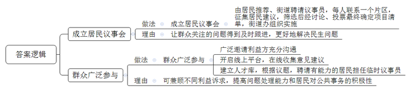
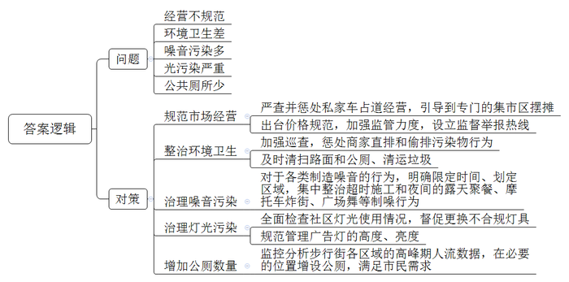
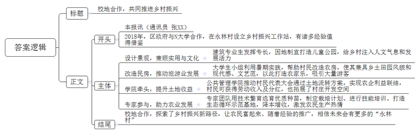
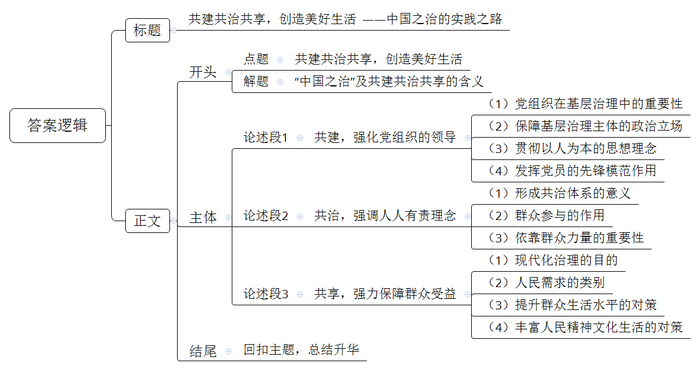

# 2023年公务员多省联考《申论》题（湖北县乡卷）

<!-- gwy:overview:start -->
> **湖北 · 2023 · 申论 · 乡镇卷** ｜ 4 题 · 图片 4 处 · 答案随题折叠

导航：[题目](#题目)
<!-- gwy:overview:end -->

> 候选采集稿。参考答案及解析来自粉笔页面，不代表官方答案或真实高分答卷；来源使用许可与原卷对应关系仍需人工核实。

## 给定材料

### 材料 material-0d6fbe4971697ba9

自从小区改造列入本市民生实事项目，各小区微信群里议论纷纷。居民需求复杂多样，怎么让大家都满意？由86名成员组成的东风街道第一届居民议事会成立，解了难题。居民议事会成员向居民征集建议后，列出了包含25个诉求的建议清单。“街道党工委对建议清单进行筛选后形成候选清单，开展讨论和投票。居民议事会确定项目清单并提出处理建议。经街道党工委同意后街道办事处组织实施。”街道党工委孙书记说，“议事协商议的是民生话题，瞄准的是更好解决民生问题。”

东风街道居民议事会是市基层协商议事试点之一。走进居民议事会，10多张活动桌椅整齐地摆放着，同时还配套发言台和电子显示屏，一块大大的告示牌悬挂在墙壁上，上面正在公示居民议事会近期表决的项目清单，居民议事会为居民、为社区所做的事情一目了然。议事员陈老伯说：“议事会在做什么，怎么做，做得怎么样，一切都是公开透明的，这样大伙儿就心里有数，才会监督议事会。”陈老伯退休前是一名教师，熟悉思政工作，为人公道，热心社区事务，在居民中威望较高，被街道聘请来当议事员。“议事员是由居民推荐，街道聘请的，大多是党员，政治素质过硬，有的是像陈老伯这样的老住户，是大家都信任的，有的是有专长的行家。”孙书记说，“每个议事员都要联系一个片区，负责收集居民关心的问题。翻看议事会记录本，物业管理升级、推进垃圾分类等，老百姓关注的问题都得到了及时的跟进。”

“车乱停，有时堵楼门口，出行难。”停车乱，无车户难以忍受。“我们也想按车位停，可哪有车位？”停车难，有车户也感到无奈。东风街道的一次居民议事会上，由街道工作人员主持会议，社区居委会、物业、业委会议事员、有车户代表、无车户代表畅所欲言。“没有车位的统一停小区外面吧，不影响小区环境。”无车户提出。“还是停小区里面好，安全可管理。”有车户有异议。意见不同，大家平心静气，一起来分析：停小区外面可能妨碍交通，可行性差，还是要在小区内挖掘潜力，将废弃绿地、边角地划成车位。方案表决后公示，车位边一楼的无车户担忧噪声会影响休息。议事会再次启动，决定在车位与住房之间种植花草，同时对受影响住户进行补偿。现在，有车居民自觉泊车入位，一排排车辆整整齐齐。“议事会已经形成了一套行之有效的程序，街道工作人员主持，将参会人员分成不同小组进行讨论，再由各组的代表汇总上台发言，投票选出可行性高的解决方案。”孙书记说，“不少事项牵涉到不同的利益主体，议事会要尊重和照顾不同的利益诉求。虽然很多时候协商的过程很曲折，甚至有争吵，但充分沟通后达成共识，能兼顾不同的利益方，促进彼此理解、消除了矛盾和怨气。”前不久，东风街道居民议事会还开启了线上平台。“如今讲共建、共治、共享，最重要的就是老百姓肯参与进来！”孙书记说，“议事会开到线上以后，居民只需要扫个二维码，就能在平台上提交自己的意见和建议，这让年轻人的参与度大大提高，这样议事会就能更广泛地听取群众的心声。”

议事协商有结果，更要落地，切实解决群众诉求，把民生实事办到群众心坎上，居民议事会才会受到群众信任。前不久，街道的中心街改造通过验收，居民觉得改造效果很好。“去年，大家还抱怨这小广场环境差，蚊虫多，有和没有一个样呢。”高先生笑着说，高先生是市建筑设计研究院的工程师，受聘成为议事会特别议事员，负责中心街改造的监督。增设小广场、展示墙和儿童游乐场所等，就是他看完设计图纸后提出的建议，东风街道根据居民的议事能力、专业特长和工作经历，建立人才库，议题确定后，街道就会联系相应的居民，聘请他们担任临时议事员，让“适合”的人参加“合适”的会，从而提高议事会处理议题的能力。

“议而能决、商而能行、理顺群众的‘气’，很多事情都好办了，这便是运用柔的方法，取得好的效果。”孙书记说，“在街道工作多年，我能真切感受到，有了居民议事会，居民们对公共事务变得越来越积极了。”

### 材料 material-72dc4dd4b2f13242

南浦步行街坐落在R市蓝阳区中心地带，既是居民日常购物、观光的场所，也是商业地产、个人居住的聚集地。步行街自2022年5月“开街”以来，持续火爆，与夜市繁华同时到来的还有民众对步行街的各类投诉。

·最近，“后备箱经济”比较火，虽然步行街设立了专门的集市区，但还是经常有私家车打“擦边球”，停靠在步行街入口处的非机动车道上，打开后备箱，售卖各式各样的商品，影响行人和非机动车通行。

·深夜12点多，步行街东面的工地还在施工，产生各种噪音，十分扰民。最可怕的是那个洗车池，离场的搅拌车反反复复，前进后退地在池里洗车轮的污泥，巨大的噪音让人无法忍受。熟睡的小孩被吵醒，好无奈！

·步行街上的烧烤摊油烟直接排到空气中，经常一路飘到我们家里，熏得我们眼睛都睁不开了，也不敢开窗通风，希望城管部门管管。

·步行街入口的那家生活超市，大中午还在装修，严重影响我们住在附近的居民，噪音这么大，家里的老人都神经衰弱了。

·步行街对面的小公园，晚上十点多还经常有人在那边的休闲桌上聚会、喝酒、聊天，声音很大，他们都不用休息的吗，能不能管管？

·步行街一些餐饮摊的老板经常把“汤汤水水”直接倒在人行道上，弄得到处油汪汪的，不仅影响市容，还影响行人通行。

·步行街深夜经常有摩托车“炸街”，不时呼啸而过，声音非常吵。

·步行街保洁清扫不及时，很多垃圾桶里的垃圾没有及时清运。

·家对面安装的不知道是什么射灯，一到晚上，光线直射进卧室的窗户，实在太亮了。另外，斜对面商务宾馆的广告灯位置又高、亮度又亮，每天从晚上亮到凌晨四五点，十分刺眼。

·步行街有几家餐饮店偷偷挖管道，将油烟直接排入路边的下水道，下水道不时冒出刺鼻的油烟味。

·每到晚上，就有人在步行街上放音乐、跳广场舞，声音放得大，而且影响通行，一直闹到十点多。

·步行街有一家面馆，一碗清汤面就收了顾客38元。

·步行街公共厕所太少，而且比较脏。

### 材料 material-0648bcd69280f599

“三年前，永林村全村常住人口仅138人。第一期农房改造完毕后，永林村重现活力。如今成了全区的‘网红村’。”永林村乡村振兴工作站蔡站长表示，2018年，当地区政府与N大学合作，在永林村设立乡村振兴工作站。

小王是N大学建筑专业大四学生。三年前，在学长的带动下，他报名参与永林村村内微景观设计。“我们的每一个设计细节都既注重实用，也注重文化的保留。希望通过我们的设计改造，给永林村带来人文气息，也带来发展的活力。”小王指着不远处一个儿童公园说，“这是我们送给孩子们的秘密花园，原来这里是村里废弃的采石场，我们从孩子们的需求出发，设计这样一个乡村儿童公园和公共活动空间。”接下来，他还要为孩子们设计一段梅花桩小路，路边用农村物件设计地景和座椅等，尽可能充满趣味。

大四学生小杨是15人小组的支队长，“这是我第三次参与暑期实践，大家住在农村，与村民也建立了良好的关系。”小杨说，自己印象最深的，是三年前为村民高大姐设计农家乐的事。原本这是一间普通的瓦房，小杨和学姐们将其设计成白墙红屋顶，并在大小错落的窗边设计了墙绘。“房子看起来很有乡土气息，但是一些细节又很有现代感、文艺范，设计里巧妙地嵌入了很多农用工具，呈现了田园风貌。”高大姐对设计非常满意。“以前，村子里的人都快走光了，更别说外面有人来，白天晚上都很冷清。”自从乡村振兴站设立后，仅仅两三年光景，老村落就有了新气象。曾经做过厨师的她，把这个小院打造成了全村第一个农家乐。“这两年几乎每天游客满座，我是尝到甜头了。”高大姐乐呵呵地说。村子发展好了，好多像她一样原先在外打工的人都回来了。

永林村采取整村开发模式，梳理村庄周边农田，收储闲置农房，并对梳理出的100余亩集体建设用地，进行入市交易试点。2019年，在N大学公共管理学院的牵头推动下，村民代表大会表决通过了《农村集体经营性建设用地入市工作方案》《承包地承包户补偿方案及集体增值收益分配使用方案》，让永林村多个项目通过土地流转方式实现了农企利益联结，企业每年给村集体和农户分红，并聘用流转土地的农民参加生产劳动，既增加了村民收入，又拓展了村庄开发空间。

去年暑假，N大学生物学院刘院长率领专家团队来到永林村调研，发现永林村的土壤很适合种植高品质辣椒。刘院长利用组织培养与细胞克隆技术繁育辣椒优质种苗，选育优良品系，为永林村制定了优质的辣椒栽培计划，并对村民开展相关技能培训。村民掌握技能后，种出的辣椒非常鲜美，外表特别漂亮，很快就脱销了。今年愿意栽培辣椒的人越来越多，预计产量会达到100吨，产值约500万元。“刘院长不仅给我们带来了先进的辣椒种植技术，还帮我们村打造了虫草鸡生态循环示范基地。”永林村农业带头人老李介绍道。基地利用高蛋白昆虫黑水虻和富含花青素的紫金草搭配饲养生态鸡，降低了20%至30%的饲料成本，提升了养鸡的利润。去年基地饲养5000只鸡，全村集体收入增加近20万元。

“校地合作，探索乡村振兴新路径，让农民富起来。”蔡站长算了一下账，闲置农房农地的租金、入股开展合作经营的股金、就地就业创业的薪金，让更多原住村民成了“三金农民”。三年来，该村人均可支配收入平均增长12%。蔡站长说：“在永林村实践的基础上，我们又开始向周边乡村推广校地合作模式，将来还会出现更多的‘永林村’。”

### 材料 material-1424a7999b8715a6

湖北省第十二次党代会提出：“构建政府、社会、村民共建共治共享的治理体系。立足做强基层，建设完整乡村社区，大力发展集体经济，增强基层服务群众的条件、能力和水平。尊重群众主体地位，从群众身边、房前屋后的实事小事做起，组织群众、宣传群众、凝聚群众、服务群众，增强群众主人翁意识，共同建设美好家园。”“广泛开展美好环境与幸福生活共同缔造活动，发动群众决策共谋、发展共建、建设共管、效果共评、成果共享。”

## 题目

### 第 1 题

**根据****“给定资料**3**”，概括东风街道在基层治理中最值得推广的两条做法，请简要说明理由。（15分)**

关联材料：材料 material-0d6fbe4971697ba9

作答要求：

要求：准确、有条理、有说服力。不超过200字。

第 1 题 · 答案与解析

**参考答案（粉笔题库参考内容）**

做法一：成立居民议事会。由居民推荐、街道聘请议事员，每人联系一个片区，征集居民建议，筛选后经讨论、投票最终确定项目清单，街道办组织实施。理由：让群众关注的问题得到及时跟进，更好地解决民生问题。

做法二：群众广泛参与。广泛邀请利益方充分沟通；开启线上平台，在线收集意见建议；建立人才库，根据议题，聘请有能力的居民担任临时议事员。理由：可兼顾不同利益诉求，提高问题处理能力和居民对公共事务的积极性。

**解析**

**参考答案说明：**本参考答案从“居民议事会”“群众广泛参与”两个方面着手，依次撰写了“做法”与“理由”两个方面的要点，做到理由和做法一一对应。各条要点之间在内容上相互并列，没有交叉。

**考点**：考点多要素组合类

**来源**：来源2023年公务员多省联考《申论》题（湖北县乡卷）

粉笔申论页面对本题只提供「解析视频」入口，该入口是会员推广位，页面无视频地址与文字解析。

### 第 2 题

**根据****“给定资料**4**”，请对居民反映步行街的问题先进行分类汇总，然后提出解决对策。（20分）**

关联材料：材料 material-72dc4dd4b2f13242

作答要求：

要求：全面、准确、有条理、有概括性。不超过300字。

第 2 题 · 答案与解析

**参考答案（粉笔题库参考内容）**

问题：1.经营不规范；2.环境卫生差；3.噪音污染多；4.光污染严重；5.公共厕所少。

对策：1.规范市场经营。严查并惩处私家车占道经营，引导到专门的集市区摆摊；出台价格规范，加强监管力度，设立监督举报热线。2.整治环境卫生。加强巡查，惩处商家直排和偷排污染物行为；及时清扫路面和公厕、清运垃圾。3.治理噪音污染。对于各类制造噪音的行为，明确限定时间、划定区域，集中整治超时施工和夜间的露天聚餐、摩托车炸街、广场舞等制噪行为。4.治理灯光污染。全面检查社区灯光使用情况，督促更换不合规灯具；规范管理广告灯的高度、亮度。5.增加公厕数量。监控分析步行街各区域的高峰期人流数据，在必要的位置增设公厕，满足市民需求。

**解析**

**参考答案说明：**本参考答案从“经营不规范”“环境卫生差”“噪音污染多”“光污染严重”“公共厕所少”五个方面对步行街的问题进行分类汇总；另外，从“规范市场经营”“整治环境卫生”“治理噪音污染”“治理灯光污染”“增加公厕数量”五个方面提出了解决对策。对策和问题一一对应。各条要点之间在内容上相互并列，没有交叉。

**考点**：考点提出对策类

**来源**：来源2023年公务员多省联考《申论》题（湖北县乡卷）

粉笔申论页面对本题只提供「解析视频」入口，该入口是会员推广位，页面无视频地址与文字解析。

### 第 3 题

**区里拟将永林村与****N大学“校地合作共同推进乡村振兴”的经验作为先进典型进行宣传。请根据“给定资料**5**”，以通讯员张某某的名义给报社撰写一篇宣传稿。（25分）**

关联材料：材料 material-0648bcd69280f599

作答要求：

要求：

（1）格式规范，内容全面；

（2）条理清晰，语言流畅；

（3）不超过400字。

第 3 题 · 答案与解析

**参考答案（粉笔题库参考内容）**

校地合作，共同推进乡村振兴

本报讯（通讯员 张XX）2018年，区政府与N大学合作，在永林村设立乡村振兴工作站，有诸多经验值得借鉴。

设计景观，兼顾实用与文化。建筑专业生发挥专长，因地制宜打造儿童公园，给乡村注入人文气息和发展活力。

改造民房，推动旅游业发展。大学生小组利用暑期实践，帮助村民改造农房，使其兼具乡土田园风貌和现代感、文艺范，以此打造农家乐，吸引大量游客。

学院牵头，提升土地收益。公共管理学院推动村民代表大会通过土地流转方案，实现农企利益联结，村民可获得劳动收入及分红，也拓展了村庄开发空间。

专家参与，助力农业发展。专家团队用技术繁育选育优质种苗，制定栽培计划、进行技能培训、打造生态循环示范基地，降本增收，激发农民生产热情。

校地合作，探索了乡村振兴新路径，让农民富起来。随着经验的推广，相信未来会有更多的“永林村”。

**解析**

**参考答案说明：**（1）格式方面，本参考答案写到了“标题”“正文”两个部分。（2）正文部分，一方面从内容上来看，答案的开头先写到消息头并介绍了校地合作推进乡村振兴的背景；主体从“设计景观，兼顾实用与文化”“改造民房，推动旅游业发展”“学院牵头，提升土地收益”和“专家参与，助力农业发展”四个方面介绍了校地模式推进乡村振兴的经验；结尾进行了总结、展望。另一方面，形式上，本参考答案做到了分段、分层撰写，整体上条理较为清晰。

**考点**：考点宣传类

**来源**：来源2023年公务员多省联考《申论》题（湖北县乡卷）

粉笔申论页面对本题只提供「解析视频」入口，该入口是会员推广位，页面无视频地址与文字解析。

### 第 4 题

**根据给定资料，围绕****“共建共治共享，创造美好生活”主题，联系实际，自拟题目，写一篇策论文。（40分）**

关联材料：材料 material-1424a7999b8715a6

作答要求：

要求：

（1）观点明确，层次清晰；

（2）对策具有可行性，系统性；

（3）参考“给定资料”，但不拘泥于“给定资料”；

（4）总字数1000—1200字。

第 4 题 · 答案与解析

**参考答案（粉笔题库参考内容）**

**共建共治共享，创造美好生活**

**——中国之治的实践之路**

国之兴衰系于制，民之安乐皆由治。“中国之治”是现代化治理，构建的是政府、社会、村民共建共治共享的治理体系，形成的是党建引领、多元参与、人人收益的良好成果。

**共建，强化党组织的领导。**“党政军民学，东西南北中，党是领导一切的。”压实基层治理的责任必须发挥党组织的作用。从“社区吹哨、党员报到”到“我是党员，必须做到六个‘一’”，都体现了党员在基层治理中举足轻重的地位。首先，要保障基层治理中各级组织、党员干部以及群众的政治立场，与中央保持一致；其次，要保障贯彻党的思想理念，坚持以人为本、为民服务；最后，党员要发挥好先锋模范作用，带动群众参与治理。可以说，党组织不仅要发挥政治上、思想上的“引航灯”作用，还要当好群众组织上的“好帮手”。

**共治，强调人人有责理念。**“积力之所举，则无不胜也；众智之所为，则无不成也。”形成“人人参与，人人尽力”的共治体系，可以大大提升治理的效率。譬如居民议事会让群众参与讨论，公开透明，解决民生难题，让群众从“不信任”转变为“很满意”；乡村振兴，让大专院校的专业团队和人才贡献技术与智慧，助力产业发展，实现农民的增收致富；优化产业布局，召开座谈会让单位、群众等畅所欲言找到旅游业的转型之路……总之，现代治理无论怎么开展都必须依靠群众的力量，坚持从群众中来到群众中去，听群众心声，只有人人都有社会责任感、参与度，才能提高治理效能，增强社会活力。

**共享，强力保障群众受益。**人民就是江山，江山就是人民。现代化治理的目的就是要满足人民的需求，让群众得实惠、添福祉。人民的需求大致可以分成两类，基本需求与精神需求，从这两方面入手才能增强群众的获得感和幸福感。一方面，要提升群众生活水平，如大力发展各类产业，提供就业岗位、实现收入的增加。如改善人居环境，治理水污染、土壤污染等，变“脏乱差”为“美极了”。另一方面，要丰富人民精神文化生活，通过共建共治加强“文化服务圈”、线上“文化点单”等文化服务供给，方便群众娱乐，用文化滋养人民。正所谓“人民是阅卷人”，只有人民享受到了福利，人民满意了，才可以说我们交出了最好的试卷。

美好家园你我共建，美好生活你我共享。共建共治共享社会，可以说，“共建”回答社会治理依靠谁的问题，“共治”回答社会治理怎么开展的问题，“共享”回答社会治理为了谁的问题。这三者环环相扣，是实现我国社会治理现代化的重中之重，更是让社会更和谐美好的必由之路。

**解析**

**文章分析**

**共建共治共享，创造美好生活**

**——中国之治的实践之路**

【**标题的优点：**首先，范文的标题突出了“共建共治共享，创造美好生活”这一主题；其次，形式上采用主副标题结构，使文章主题更加清晰。】

国之兴衰系于制，民之安乐皆由治。“中国之治”是现代化治理，构建的是政府、社会、村民共建共治共享的治理体系，形成的是党建引领、多元参与、人人收益的良好成果。

【**开头的优点：**★内容方面：范文的开头是紧扣题目给定的“共建共治共享，创造美好生活”这一主题展开的。首先，开头点出主题，做到了主题明确。其次，对“共建共治共享，创造美好生活”这一主题进行了分析阐述，指出了“中国之治”及共建共治共享的含义。★文字表达方面：长短句配合使用，使语言表达有节奏感。】

**共建，强化党组织的领导。**（1）“党政军民学，东西南北中，党是领导一切的。”压实基层治理的责任必须发挥党组织的作用。从“社区吹哨、党员报到”到“我是党员，必须做到六个‘一’”，都体现了党员在基层治理中举足轻重的地位。首先，（2）要保障基层治理中各级组织、党员干部以及群众的政治立场，与中央保持一致；其次，（3）要保障贯彻党的思想理念，坚持以人为本、为民服务；最后，（4）党员要发挥好先锋模范作用，带动群众参与治理。可以说，党组织不仅要发挥政治上、思想上的“引航灯”作用，还要当好群众组织上的“好帮手”。

【**论述段****1的优点：**★观点句：范文的观点句是紧扣“共建共治共享，创造美好生活”这一文章主题提出的。形式上，它在段首处直接写出，位置突出，容易发现。内容上，关键词突出，内容要点明确，可以明显看出主要论述“共建，强化党组织的领导”方面的内容。★论述内容：（1）介绍了党组织在基层治理中的重要性；（2）介绍了要保障基层治理主体的政治立场；（3）介绍了要贯彻以人为本的思想理念；（4）介绍了要发挥党员的先锋模范作用。注意：以上四个方面的内容都是紧扣“共建，强化党组织的领导”这个观点句进行分析论述的，论述的针对性强，内容层次丰富。在论述方法上采取了举例子和讲道理相结合的方式，论述充实透彻。】

**共治，强调人人有责理念。**（1）“积力之所举，则无不胜也；众智之所为，则无不成也。”形成“人人参与，人人尽力”的共治体系，可以大大提升治理的效率。（2）譬如居民议事会让群众参与讨论，公开透明，解决民生难题，让群众从“不信任”转变为“很满意”；乡村振兴，让大专院校的专业团队和人才贡献技术与智慧，助力产业发展，实现农民的增收致富；优化产业布局，召开座谈会让单位、群众等畅所欲言找到旅游业的转型之路……总之，（3）现代治理无论怎么开展都必须依靠群众的力量，坚持从群众中来到群众中去，听群众心声，只有人人都有社会责任感、参与度，才能提高治理效能，增强社会活力。

【**论述段****2****的优点：**★观点句：范文的观点句是紧扣“共建共治共享，创造美好生活”这一文章主题提出的。形式上，它在段首处直接写出，位置突出，容易发现。内容上，关键词突出，内容要点明确，可以明显看出主要论述“共治，强调人人有责理念”方面的内容。★论述内容：（1）介绍了形成共治体系的意义；（2）举例介绍了群众参与的作用；（3）介绍了依靠群众力量的重要性。注意：以上三个方面的内容都是紧扣“共治，强调人人有责理念”这个观点句进行分析论述的，论述的针对性强，内容层次丰富。在论述方法上采取了举例子和讲道理相结合的方式，论述充实透彻。】

**共享，强力保障群众受益。**（1）人民就是江山，江山就是人民。现代化治理的目的就是要满足人民的需求，让群众得实惠、添福祉。（2）人民的需求大致可以分成两类，基本需求与精神需求，从这两方面入手才能增强群众的获得感和幸福感。一方面，（3）要提升群众生活水平，如大力发展各类产业，提供就业岗位、实现收入的增加。如改善人居环境，治理水污染、土壤污染等，变“脏乱差”为“美极了”。另一方面，（4）要丰富人民精神文化生活，通过共建共治加强“文化服务圈”、线上“文化点单”等文化服务供给，方便群众娱乐，用文化滋养人民。正所谓“人民是阅卷人”，只有人民享受到了福利，人民满意了，才可以说我们交出了最好的试卷。

【**论述段****3****的优点：**★观点句：范文的观点句是紧扣“共建共治共享，创造美好生活”这一文章主题提出的。形式上，它在段首处直接写出，位置突出，容易发现。内容上，关键词突出，内容要点明确，可以明显看出主要论述“共享，强力保障群众受益”方面的内容。★论述内容：（1）介绍了现代化治理的目的；（2）介绍了人民需求的类别；（3）介绍了提升群众生活水平的对策；（4）介绍了丰富人民精神文化生活的对策。注意：以上四个方面的内容都是紧扣“共享，强力保障群众受益”这个观点句进行分析论述的，论述的针对性强，内容层次丰富。在论述方法上采取了举例子和讲道理相结合的方式，论述充实透彻。】

【**论述段之间的关系**：★内容的内在逻辑：范文的论述段之间是依照并列的逻辑展开的。论述段1先写了“共建，强化党组织的领导”，论述段2再写了“共治，强调人人有责理念”，论述段3最后写了“共享，强力保障群众受益”，论述逻辑清晰。】

美好家园你我共建，美好生活你我共享。共建共治共享社会，可以说，“共建”回答社会治理依靠谁的问题，“共治”回答社会治理怎么开展的问题，“共享”回答社会治理为了谁的问题。这三者环环相扣，是实现我国社会治理现代化的重中之重，更是让社会更和谐美好的必由之路。

【**结尾的优点：**范文的结尾回扣了“共建共治共享，创造美好生活”这个主题，进行了总结升华。】

**考点**：考点文章写作题

**来源**：来源2023年公务员多省联考《申论》题（湖北县乡卷）

粉笔申论页面对本题只提供「解析视频」入口，该入口是会员推广位，页面无视频地址与文字解析。

