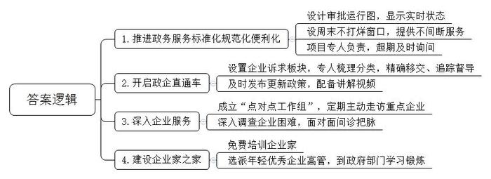
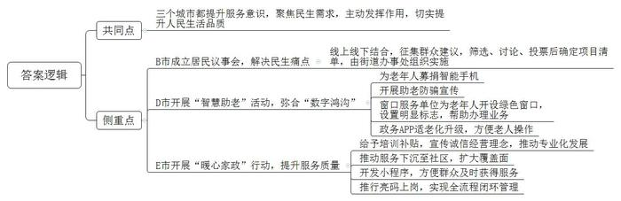
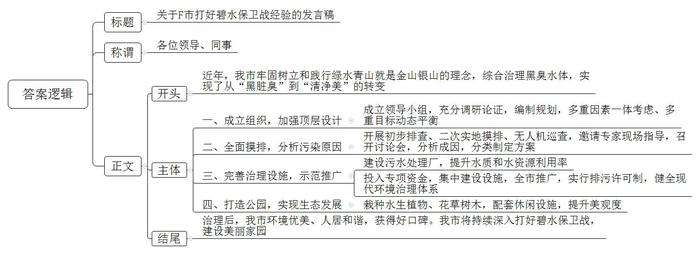
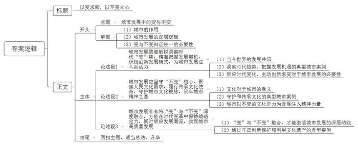

# 2023年公务员多省联考《申论》题（湖北省市卷）

<!-- gwy:overview:start -->
> **湖北 · 2023 · 申论 · 省市卷** ｜ 4 题 · 图片 4 处 · 答案随题折叠

导航：[题目](#题目)
<!-- gwy:overview:end -->

> 候选采集稿。参考答案及解析来自粉笔页面，不代表官方答案或真实高分答卷；来源使用许可与原卷对应关系仍需人工核实。

## 给定材料

### 材料 material-5152de97174f07d9

近年来，H省创新公共服务，积极提升公共服务质量。H省A市加强政务服务中心建设，推进政务服务标准化、规范化、便利化。走进A市政务服务中心一楼大厅，首先映入眼帘的便是一块大屏幕。屏幕上有一张类似地铁运行图的线路表，A市项目建设的各环节细化设计成14个站点的“地铁运行图”，每个站点代表一个审批流程中的具体事项，绿、蓝、黄、红4色指示灯分别代表该环节办结、未办、在办及超期4种状态。为了实现企业项目早落地、快落地、落好地，政务服务中心还设立“周末不打烊”窗口。“我们对税务、社保、公安等24个单位实行轮岗制，随时为企业提供不间断的服务。”市政务服务中心邵主任说，“我们采取专人负责制，每个项目都安排一位对接的人员，所有环节只要联系他一个人就好了。如果出现超期，信息会迅速传递到市优化营商环境工作督导组，督导组都会及时询问。”

建新厂投资大，市羊毛衫厂的流动资金一时短缺，发工资都成了问题。总经理李先生的眉头拧成疙瘩。“有一笔钱能应急，可看得见，拿得慢。”李先生说，公司外贸订单多，每月出口退税，按流程要办两周。有人提醒他，可以到A市年初开启的“政企直通车”智慧平台提出诉求。问题反映上去，被列入加急清单，办理进度加快，仅两天就办完了。点开“政企直通车”智慧平台的“企业诉求”板块，清晰可见每一条诉求的主办部门、办理进度、完结日期。A市安排专人对企业留言诉求梳理分类，根据属地和部门职责推送移交，全过程留痕，并对办理结果、时限进行追踪督导。李先生使用这个平台后发现，相关政策在平台的“惠企政策”栏目上及时发布，滚动更新。只要输入查询关键词，相关政策就全部出现了，还配有工作人员的讲解视频。

在一家纺织有限公司的厂房里，一条条细如发丝的化纤从卷轴拉出，经过上浆、并轴，织成连绵不断的布匹。“别看现在生产线满负荷运转，几个月前，订单少，三天两头停工。”公司负责人徐女士说，“幸亏有‘点对点工作组’，他们看到我们的困难后，主动组织企业间对接，逐渐打开了销路。”徐女士所说的“点对点工作组”，是A市服务机制创新，实施党政干部常态化联系民营企业的制度，一家重点企业安排一名科级干部为“首席服务官”、一名后备干部为“首席服务员”、一名主办银行负责人为“首席金融官”，“点对点工作组”定期、主动走访联系的企业。

“我们公司生产的汽车安全气囊丝，质量过硬。我们就想着谋求产品全、产量大，但很快就发现摊子铺得太大，分支业务没有发展起来，还导致主营业务下滑。”市化纤股份有限公司副总经理王先生说，市里得知后及时组织相关部门的工作人员和专家来到公司，深入调查，召开座谈会，面对面问诊把脉，帮助企业寻找准确的市场定位，形成新的产品结构。

每次走进A市的“企业家之家”，王先生都感觉自己“找到了家”。这里开设了“商务大讲堂”、民营企业家学院，免费举办针对企业家的培训，提升企业家的思想、业务水平。除了在这里接受培训之外，王先生还有一番独特的经历——去A市商务局学习锻炼。原来，A市出台了文件，明确规定每年选派15名年轻优秀企业高管，用两到三个月时间，到市政府经济管理部门学习锻炼，王先生成为其中之一。两个月下来，他对政府服务、外贸政策、海外市场更了解了，更有利于公司开拓海外市场。

### 材料 material-c9099cab29e22944

自从小区改造列入B市民生实事项目后，各小区微信群里就议论纷纷：这家要求先装灯，那户提出停车难，居民诉求复杂多样，怎么让大家都满意？由86名成员组成的B市C街道第一届居民议事会的成立，解决了这道难题。居民议事会成员向居民征集建议后，列出了包含25个诉求的建议清单，楼道灯安装、停车位改造等大家关心的事都包括在内。“街道党工委对建议清单进行筛选，形成候选清单，再提交居民议事会讨论和投票。居民议事会确定项目清单并提出处理建议后，由街道党工委交由街道办事处组织实施。”街道党工委肖书记说，“议事协商议的是民生话题，瞄准的是更好地解决民生问题。确定议题过程中，街道党工委要主动发挥作用，深入群众、深入基层，倾听群众呼声，将政府职能与百姓期盼精准对接，才能让议事协商直击痛点，契合居民心意，有助于民生实事加快落地。”

“议事员是由居民推荐、街道聘请的，大多是党员，政治素质过硬，是大家都信任的；有的是有专长的行家，能为大家出谋划策。”肖书记说，每个议事员都要联系一个片区，负责收集居民关心的问题。

前不久，B市C街道居民议事会还开启了线上平台，肖书记说：“议事会开到线上以后，居民只需要扫个二维码，就能在平台上提交自己的意见和建议，这让年轻人的参与度大大提高。这样议事会就能更广泛地听取群众的心声。”

### 材料 material-d9a63599333236bb

H省统筹安全和发展，把江河安澜放在突出位置，加强黑臭水体治理，持续深入打好碧水保卫战，推动江河湖库生态保护治理，坚决守住水环境安全底线。

夏日骄阳下，H省F市城中湖公园，湖水澄清，鱼翔浅底，映日荷花别样红。这一景色和湖边古色凉亭、不远处一片绿油油的人工湿地，构成了一幅美丽的生态画卷。

“以前这里湖水臭不可闻，一到夏天，蚊蝇乱飞，恶臭味隔老远就能闻到。后来政府把这个城中湖列为黑臭水体治理试点，没想到，才三年时间，它会变成这么美的地方。”提及城中湖的黑臭水体治理效果，市民们情不自禁地露出笑容。

党的二十大报告指出，大自然是人类赖以生存发展的基本条件。尊重自然、顺应自然、保护自然，是全面建设社会主义现代化国家的内在要求。消除黑臭水体关键在于综合治理。三年前，F市牢固树立和践行绿水青山就是金山银山的理念，站在人与自然和谐共生的高度，谋划实施流域综合治理，坚持高位推进，成立了市碧水保卫战工作领导小组，坚持精准治污、科学治污、依法治污。经过广泛深入调研和科学论证，编制完成了F市流域综合治理和统筹发展规划，注重多重因素一体考虑、多重目标动态平衡。

“为做好这项工作，我们当时花了两个多月时间，才完成对全市黑臭水体的排查摸底。”F市环保局王局长告诉我们，“在区、街道初步排查的基础上，我们又组织工作人员再次实地摸排，对于人工无法踏勘的区域，就利用无人机技术全面巡查。为了确保不错过全市范围内任何一个黑臭水体，我们也不怕麻烦，对比较难以直接判断的坑池，就请专家到现场指导。最后，我们又邀请专家召开多场讨论会，逐一分析每一个黑臭水体形成的原因，并结合周边地理位置、水体性质等因素，综合分类制定治理方案。”

注重以点示范、点面结合。城中湖是F市黑臭水体治理的示范点。三年前，城中湖周边的污水处理设施不够完善，生活污水直排城中湖形成黑臭水体。在征求专家和群众意见后，F市决定通过建设污水处理厂开展城中湖黑臭水体整治。

城中湖污水处理厂项目涉及周围3条街道污水处理。2021年底，污水处理厂建成投入使用后，周边闻不到一丝臭味，污水经过处理后哗哗流进尾水池，水质清澈透明，看上去跟自来水没有分别，直接用来种花养鱼都没问题。

从空中俯瞰城中湖公园，栽种在水中的铜钱草、鸢尾、水兰等水生植物在水中摇曳，让人赏心悦目。依托这些植物和水环境，F市又在这里配套彩虹桥、亲水平台、健身休闲廊道等设施，并栽种了不同品种的花草树木，进一步提升城中湖公园的“颜值”，城中湖公园逐步成为了市民“打卡”胜地和城市“会客厅”。

以城中湖污水治理为示范，F市全方位、全地域、全过程推进城市黑臭水体治理。从市财政列出专项资金，集中建设了一批污水处理设施，实行排污许可制，健全现代环境治理体系。经过三年的专项治理，全市黑臭水体基本消除，守住了水环境安全底线。

从“黑脏臭”到“清净美”，F市对黑臭水体的治理，不仅治出了环境优美、人居和谐的新成效，还收获了老百姓的好口碑，让美不胜收的城市新画卷徐徐展开。

### 材料 material-d87b423df4746c4f

党的二十大报告指出：“必须完整、准确、全面贯彻新发展理念，坚持社会主义市场经济改革方向，坚持高水平对外开放，加快构建以国内大循环为主体、国内国际双循环相互促进的新发展格局。着力解决好人民群众急难愁盼问题，健全基本公共服务体系，提高公共服务水平，增强均衡性和可及性，扎实推进共同富裕。”

湖北省第十二次党代会提出：“高举习近平新时代中国特色社会主义思想伟大旗帜，深入贯彻落实习近平总书记关于湖北省工作的重要讲话和指示批示精神，立足新发展阶段，完整、准确、全面贯彻新发展理念，努力建设全国构建新发展格局先行区，加快‘建成支点、走在前列、谱写新篇’，奋进全面建设社会主义现代化新征程。”

## 题目

### 第 1 题

**根据****“给定资料**2**”，请谈谈A市在提升公共服务质量，优化服务企业方面有哪些工作创新？（15分）**

关联材料：材料 material-5152de97174f07d9

作答要求：

要求：全面、准确、有条理，不超过200字。

第 1 题 · 答案与解析

**参考答案（粉笔题库参考内容）**

1.推进政务服务标准化规范化便利化。设计审批运行图，显示实时状态；设周末不打烊窗口，提供不间断服务；项目专人负责，超期及时询问。

2.开启政企直通车。设置企业诉求板块，专人梳理分类，精确移交、追踪督导；及时发布更新政策，配备讲解视频。

3.深入企业服务。成立“点对点工作组”，定期主动走访重点企业；深入调查企业困难，面对面问诊把脉。

4.建设企业家之家。免费培训企业家；选派年轻优秀企业高管，到政府部门学习锻炼。

**解析**

**参考答案说明**：本参考答案从“推进政务服务标准化规范化便利化”“开启政企直通车”“深入企业服务”“建设企业家之家”这四个方面进行了分条撰写，各条答案要点之间在内容上相互并列，没有交叉。

**考点**：考点概括措施类

**来源**：来源2023年公务员多省联考《申论》题（湖北省市卷）

粉笔申论页面对本题只提供「解析视频」入口，该入口是会员推广位，页面无视频地址与文字解析。

### 第 2 题

**根据****“给定资料**3**、资料**4**、资料**5**”，请指出三个城市在提高人民生活品质工作方面的共同点以及各自的侧重点。（20分）**

关联材料：材料 material-c9099cab29e22944

作答要求：

要求：全面、准确、有条理，不超过300字。

第 2 题 · 答案与解析

**参考答案（粉笔题库参考内容）**

共同点：三个城市都提升服务意识，聚焦民生需求，主动发挥作用，切实提升人民生活品质。

侧重点：B市成立居民议事会，解决民生痛点。线上线下结合，征集群众建议，筛选、讨论、投票后确定项目清单，由街道办事处组织实施。D市开展“智慧助老”活动，弥合“数字鸿沟”。为老年人募捐智能手机；开展助老防骗宣传；窗口服务单位为老年人开设绿色窗口，设置明显标志，帮助办理业务；政务APP适老化升级，方便老人操作。E市开展“暖心家政”行动，提升服务质量。给予培训补贴，宣传诚信经营理念，推动专业化发展；推动服务下沉至社区，扩大覆盖面；开发小程序，方便群众及时获得服务；推行亮码上岗，实现全流程闭环管理。

**解析**

**参考答案说明：**本参考答案先介绍了三个城市提高人民生活品质工作的共同点；后分别从“B市成立居民议事会，解决民生痛点”“D市开展‘智慧助老’活动，弥合‘数字鸿沟’”和“E市开展‘暖心家政’行动，提升服务质量”三个方面介绍了不同城市各自工作的侧重点。各条答案要点在内容上相互并列，没有交叉。

**考点**：考点多要素组合类

**来源**：来源2023年公务员多省联考《申论》题（湖北省市卷）

粉笔申论页面对本题只提供「解析视频」入口，该入口是会员推广位，页面无视频地址与文字解析。

### 第 3 题

**H省准备召开“全省深入打好碧水保卫战经验交流会”，请根据“给定资料**6**”，为F市拟写一份发言稿。****（****25分****）**

关联材料：材料 material-d9a63599333236bb

作答要求：

要求：观点明确，内容全面；条理清晰，语言流畅；不超过400字。

第 3 题 · 答案与解析

**参考答案（粉笔题库参考内容）**

关于F市打好碧水保卫战经验的发言稿

各位领导、同事：

近年，我市牢固树立和践行绿水青山就是金山银山的理念，综合治理黑臭水体，实现了从“黑脏臭”到“清净美”的转变，具体工作如下：

一、成立组织，加强顶层设计。成立领导小组，充分调研论证，编制规划，多重因素一体考虑、多重目标动态平衡。二、全面摸排，分析污染原因。开展初步排查、二次实地摸排、无人机巡查，邀请专家现场指导，召开讨论会，分析成因，分类制定方案。三、完善治理设施，示范推广。建设污水处理厂，提升水质和水资源利用率；投入专项资金，集中建设设施，全市推广，实行排污许可制，健全现代环境治理体系。四、打造公园，实现生态发展。栽种水生植物、花草树木，配套休闲设施，提升美观度。

治理后，我市环境优美、人居和谐，获得好口碑。我市将持续深入打好碧水保卫战，建设美丽家园。

**解析**

**参考答案说明：**（1）格式方面，本参考答案写到了“标题”“称谓”“正文”三个部分。（2）正文部分，一方面从内容上来看，围绕“打好碧水保卫战”这一主题，本参考答案的开头先介绍了F市治理黑臭水体的背景；主体部分从“成立组织，加强顶层设计”“全面摸排，分析污染原因”“完善治理设施，示范推广”和“打造公园，实现生态发展”四个方面给出了具体的做法；结尾进行了总结评价。另一方面，形式上，本参考答案做到了分段、分条撰写，整体上条理较为清晰。

**考点**：考点总结类

**来源**：来源2023年公务员多省联考《申论》题（湖北省市卷）

粉笔申论页面对本题只提供「解析视频」入口，该入口是会员推广位，页面无视频地址与文字解析。

### 第 4 题

**“给定资料**7**”中，S市的龙市长说“要准确识变、科学应变、主动求变****，****以变促变****”；****“给定资料**8**”****中，****G市林主任说“要以不变应万变”。请围绕上述观点，联系实际，自拟题目，写一篇议论文。****（****40分****）**

关联材料：材料 material-d87b423df4746c4f

作答要求：

要求：

（1）观点明确，见解深刻；

（2）参考“给定资料”，但不拘泥于“给定资料”；

（3）思路清晰，语言流畅；

（4）总字数1000-1200字。

第 4 题 · 答案与解析

**参考答案（粉笔题库参考内容）**

**以变求新，以不变立心**

城市是文明的容器，既承载着历史的厚重，又奔涌着创新的活力。在时代更迭中，“准确识变、科学应变、主动求变”的发展智慧与“以不变应万变”的文化坚守，共同揭示了城市发展的深层逻辑——变是破局的动力，推动城市在革新中开拓疆域；不变是立城的根本，守护城市在变迁中不失本真。唯有在变与不变的辩证统一中，城市才能书写永续发展的时代答卷。

**城市发展需要敏锐洞察时代****“变”势，精准把握发展契机，积极创新发展模式，为城市发展注入新活力。**当今世界，科技和产业变革风起云涌，绿色发展成为全球共识。深圳敏锐把握信息技术革命机遇，从一个边陲小镇发展成为国际科技产业创新中心，GDP从1980年的2.7亿元跃升至2023年的3.68万亿元，创造了世界城市发展史上的奇迹。成都在智慧城市建设中，运用大数据、人工智能等技术优化城市治理，推出“蓉易办”政务服务平台，让企业和群众办事像“网购”一样方便，城市竞争力大幅提升。这些案例表明，只有顺应时代变化，主动创新求变，才能让城市在激烈的竞争中脱颖而出。

**城市发展应坚守****“不变”初心，聚焦人民文化需求，履行传承文化使命，守护城市文化根脉，筑牢城市精神之基。**文化是城市的灵魂，是城市独特魅力的重要源泉。泉州在城市化进程中，始终守护“海上丝绸之路”的文化遗产，将南音、提线木偶等非遗项目融入城市规划，让千年港口的文化记忆在现代生活中鲜活延续，成功入选世界遗产名录。北京中轴线保护工程则秉持“不改变文物原状”的原则，在修缮故宫、天坛等古建筑时，沿用传统工艺与材料，让中轴线成为贯穿古今的文化脊梁，每年吸引超3000万游客感受中华文明的厚重。这些城市以不变的文化定力，让历史文脉在现代化进程中薪火相传，为城市发展注入深沉而持久的精神力量。

**城市发展唯有将****“变”与“不变”深度融合，方能在时代变革中保持战略定力，同时顺应发展潮流，实现城市高质量发展。**“变”是破局革新的时代应答，“不变”是固本培元的精神坚守，二者相伴相生，才能激活城市发展的深层动能。正如厦门鼓浪屿在申遗保护中，既以“修旧如旧”的匠心维系了万国建筑的红砖肌理，让百年琴岛始终保有“海上花园”的诗意底色，又以国际音乐艺术季等现代表达方式，让菽庄花园的月光与琴声在数字光影中交融共鸣。这种守正创新的实践，让古老建筑既延续着“琴岛听涛”的历史回响，又生长出“文旅融合”的时代新枝。

“明者因时而变，知者随事而制。”城市发展的辩证法，从来不是非此即彼的选择题，而是兼收并蓄的平衡术。在新的发展阶段，唯有将“变”与“不变”深度融合，以恒心守护根脉，以慧心雕琢未来，方能让城市在时光流转中留住记忆的厚度，绽放崭新的光芒。

**解析**

**文章分析**

**以变求新，以不变立心**

【**标题的优点：**首先，标题中含有主题词，使文章主题更突出、清晰。其次，形式上，文字简洁明快有力，不拖沓。】

（1）城市是文明的容器，既承载着历史的厚重，又奔涌着创新的活力。（2）在时代更迭中，“准确识变、科学应变、主动求变”的发展智慧与“以不变应万变”的文化坚守，共同揭示了城市发展的深层逻辑——变是破局的动力，推动城市在革新中开拓疆域；不变是立城的根本，守护城市在变迁中不失本真。（3）唯有在变与不变的辩证统一中，城市才能书写永续发展的时代答卷。

【**开头的优点：**★内容方面。范文的开头是紧扣“城市发展中的变与不变”这一主题展开的。首先，开头点出主题，做到了主题明确。其次，对“城市发展中的变与不变”这一主题进行了分析阐述，指出了（1）城市的作用；（2）城市发展的深层逻辑；（3）变与不变辩证统一的必要性。★文字表达方面。使用了“既……又……”“唯有……才……”等关联词，使语言表达有逻辑性。】

**城市发展需要敏锐洞察时代****“变”势，精准把握发展契机，积极创新发展模式，为城市发展注入新活力**。（1）当今世界，科技和产业变革风起云涌，绿色发展成为全球共识。（2）深圳敏锐把握信息技术革命机遇，从一个边陲小镇发展成为国际科技产业创新中心，GDP从1980年的2.7亿元跃升至2023年的3.68万亿元，创造了世界城市发展史上的奇迹。成都在智慧城市建设中，运用大数据、人工智能等技术优化城市治理，推出“蓉易办”政务服务平台，让企业和群众办事像“网购”一样方便，城市竞争力大幅提升。（3）这些案例表明，只有顺应时代变化，主动创新求变，才能让城市在激烈的竞争中脱颖而出。

【**论述段****1的优点：**★观点句：范文的观点句是紧扣“城市发展中的变与不变”这一文章主题提出的。形式上，它在段首处直接写出，位置突出，容易发现。内容上，关键词突出，内容要点明确，可以明显看出是从“顺应时代‘变’势，把握发展契机”的角度展开论述。★论述内容：（1）先介绍了当今世界的发展共识；（2）接着列举洞察时代趋势、把握发展机遇的典型城市案例；（3）阐明顺应时代变化、主动创新求变对于城市发展的必要性。注意：以上三个方面的内容都是紧扣“城市发展需要敏锐洞察时代‘变’势，精准把握发展契机，积极创新发展模式，为城市发展注入新活力”这个观点句进行分析论述的，论述的针对性强，内容层次丰富。在论述方法上主要采用了举例子和讲道理结合的方式，论述清晰透彻。】

**城市发展应坚守****“不变”初心，聚焦人民文化需求，履行传承文化使命，守护城市文化根脉，筑牢城市精神之基**。（1）文化是城市的灵魂，是城市独特魅力的重要源泉。（2）泉州在城市化进程中，始终守护“海上丝绸之路”的文化遗产，将南音、提线木偶等非遗项目融入城市规划，让千年港口的文化记忆在现代生活中鲜活延续，成功入选世界遗产名录。北京中轴线保护工程则秉持“不改变文物原状”的原则，在修缮故宫、天坛等古建筑时，沿用传统工艺与材料，让中轴线成为贯穿古今的文化脊梁，每年吸引超3000万游客感受中华文明的厚重。（3）这些城市以不变的文化定力，让历史文脉在现代化进程中薪火相传，为城市发展注入深沉而持久的精神力量。

【**论述段****2的优点：**★观点句：范文的观点句是紧扣“城市发展中的变与不变”这一文章主题提出的。形式上，它在段首处直接写出，位置突出，容易发现。内容上，关键词突出，内容要点明确，可以明显看出是从“坚守‘不变’初心，守护文化根脉”的角度展开论述。★论述内容：（1）先介绍了文化对于城市的意义；（2）接着例举守护和传承文化的典型城市案例；（3）最后介绍了城市以不变的文化定力为发展注入精神力量。注意：以上三个方面的内容都是紧扣“城市发展应坚守‘不变’初心，聚焦人民文化需求，履行传承文化使命，守护城市文化根脉，筑牢城市精神之基”这个观点句进行分析论述的，论述的针对性强，内容层次丰富。在论述方法上主要采用了举例子和讲道理结合的方式，论述清晰深刻。】

**城市发展唯有将****“变”与“不变”深度融合，方能在时代变革中保持战略定力，同时顺应发展潮流，实现城市高质量发展**。（1）“变”是破局革新的时代应答，“不变”是固本培元的精神坚守，二者相伴相生，才能激活城市发展的深层动能。（2）正如厦门鼓浪屿在申遗保护中，既以“修旧如旧”的匠心维系了万国建筑的红砖肌理，让百年琴岛始终保有“海上花园”的诗意底色，又以国际音乐艺术季等现代表达方式，让菽庄花园的月光与琴声在数字光影中交融共鸣。这种守正创新的实践，让古老建筑既延续着“琴岛听涛”的历史回响，又生长出“文旅融合”的时代新枝。

【**论述段****3的优点：**★观点句：范文的观点句是紧扣“城市发展中的变与不变”这一文章主题提出的。形式上，它在段首处直接写出，位置突出，容易发现。内容上，关键词突出，内容要点明确，可以明显看出是从“‘变’与‘不变’需要深度融合”的角度展开论述。★论述内容：（1）先介绍了“变”与“不变”融合，才能激活城市发展的深层动能；（2）接着介绍了通过守正创新保护和利用文化遗产的典型案例。注意：以上两个方面的内容都是紧扣“城市发展唯有将‘变’与‘不变’深度融合，方能在时代变革中保持战略定力，同时顺应发展潮流，实现城市高质量发展”这个观点句进行分析论述的，论述的针对性强，内容层次丰富。在论述方法上主要采用了举例子和讲道理结合的方式，论述清晰有力。】

【**论述段之间的关系：**三个论述段分别从“顺应时代‘变’势，把握发展契机”“坚守‘不变’初心，守护文化根脉”“‘变’与‘不变’需要深度融合”的角度，对文章主题“城市发展中的变与不变”展开了论述，整体逻辑较为清晰。】

“明者因时而变，知者随事而制。”城市发展的辩证法，从来不是非此即彼的选择题，而是兼收并蓄的平衡术。在新的发展阶段，唯有将“变”与“不变”深度融合，以恒心守护根脉，以慧心雕琢未来，方能让城市在时光流转中留住记忆的厚度，绽放崭新的光芒。

【**结尾的优点：**范文的结尾回扣了“城市发展中的变与不变”这个主题，并且进行了总结升华。】

**考点**：考点文章写作题

**来源**：来源2023年公务员多省联考《申论》题（湖北省市卷）

粉笔申论页面对本题只提供「解析视频」入口，该入口是会员推广位，页面无视频地址与文字解析。

